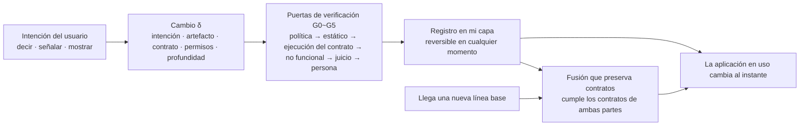

<div align="center">

<!-- LANG-BAR -->
[English](README.md) · [한국어](README.ko.md) · [简体中文](README.zh-CN.md) · [日本語](README.ja.md) · **Español**
<!-- /LANG-BAR -->

# Mallangable-AI

**El usuario se lo dice a la IA, la aplicación que estaba usando cambia en el acto, y el cambio sobrevive a las actualizaciones.**

*A vendor-neutral reference architecture for AI-driven malleable software.*

[](https://github.com/Hyunki6040/mallangable-ai/actions/workflows/check.yml)
[](CHANGELOG.es.md)
[](LICENSE-docs)
[](LICENSE)
[](tools/)

[Por qué hace falta](#por-qué-hace-falta) · [Ideas clave](#ideas-clave) · [Cómo funciona](#cómo-funciona) · [Inicio rápido](#inicio-rápido) · [Aplicarlo](#aplicarlo-a-tu-proyecto) · [Leer la especificación](#mapa-de-documentos) · [Contribuir](CONTRIBUTING.es.md)

</div>

`말랑(mallang)` + `-able` = *malleable*. "Mallang" es la palabra coreana para blando o esponjoso. Software que se puede moldear a golpes y adaptar al propio uso.

> **Estado: borrador v0.2.4 de la definición de arquitectura** ([registro de cambios](CHANGELOG.es.md)). Es una **especificación**, no una implementación. Publica un modelo conceptual, un espacio de diseño (design space), una arquitectura de referencia, JSON Schemas y herramientas de cálculo. No está atada a ningún producto, proveedor de modelos ni runtime de agentes concreto.
>
> **Ediciones**: English (predeterminada) · 한국어 (original) · 简体中文 · 日本語 · Español. El cuerpo de la especificación está en `docs/<idioma>/`. La edición coreana es la original y las demás son traducciones. Si una traducción difiere del original, prevalece el original; avísanos de la diferencia con un issue.

---

## Por qué hace falta

**Gracias a la IA, el código se ha abaratado. Pero el software sigue siendo rígido.**

El software producido en masa se hace a la medida del usuario promedio. Cuanto más lejos del promedio está alguien, más tiene que adaptar su forma de trabajar a la herramienta. Hoy, algo como "ordena esta lista por fecha límite y pon en rojo lo vencido" lo escribe una IA en código en pocos segundos. Aun así, la aplicación que uso todos los días no cambia. Los generadores de aplicaciones solo crean aplicaciones *nuevas*; no modifican la que ya uso. Como señala [Ink & Switch](https://www.inkandswitch.com/essay/malleable-software/), **generar código no basta para que el software se vuelva maleable.**

El bloqueo no está en el rendimiento del modelo, sino en la **estructura**.

| Carencia | Lo que ocurre hoy |
| --- | --- |
| **No hay dónde encajarlo** | Aunque la IA cree una funcionalidad, la aplicación existente no tiene un hueco donde insertarla. Al final se parchea directamente el código fuente del núcleo. |
| **No resiste las actualizaciones** | Cuando el proveedor publica una nueva versión, las modificaciones del usuario se rompen. Se repite con miles de usuarios × cada versión. |
| **No se puede controlar** | No se sabe quién cambió qué, a qué accede ese código ni quién paga el costo. A principios de 2026, en un mercado de skills para agentes, 341 de las 2,857 skills auditadas eran maliciosas ([The Hacker News](https://thehackernews.com/2026/02/researchers-find-341-malicious-clawhub.html)). La causa era estructural: "las skills se ejecutan con todos los permisos del agente". |

Hay que resolver las tres carencias a la vez. Si se resuelve solo una, las demás estallan. Si solo se crea dónde encajar los cambios, se rompen en las actualizaciones; si se los hace resistir a las actualizaciones, se pierde el control; si se aprieta el control, nadie modifica nada. Mallangable-AI trata las tres con **un único modelo y un único espacio de diseño**.

### En qué se diferencia de otros enfoques

| Enfoque | ¿Modifica la aplicación existente? | ¿Sobrevive a las actualizaciones? | Control de riesgos |
| --- | :---: | :---: | :---: |
| Ajustes (Settings) | De forma limitada | Alta | Alto |
| Plugins | Solo desarrolladores | Se rompe si cambia la API | Varía según el ecosistema |
| Constructores no-code · generadores de aplicaciones | No (aplicación nueva) | No aplica | Depende de la plataforma |
| UI generativa efímera | No (volátil) | No aplica | Limitado por un catálogo |
| **Mallangable** | **Sí**, dentro de los puntos de extensión | **Objetivo de diseño** (fusión que preserva contratos) | **Ajustable por intervalos de política** |

## Ideas clave

**1. El núcleo se deja intacto y solo se apilan capas.**
Las modificaciones del usuario ocurren únicamente dentro de los **puntos de extensión** (extension points) que el proveedor publica (el mapa de capacidades, capability map). Como no se parchea el núcleo (core), el proveedor puede seguir publicando actualizaciones (invariante I1).

**2. Todo cambio lleva una "lista de promesas" (contrato).**
Es una lista de verificaciones ejecutables, como "solo se ven las tareas completadas esta semana" o "si la lista está vacía, aparece un mensaje de ayuda". Con un contrato, en las actualizaciones, al compartir o en la promoción, una máquina puede juzgar si "se fusionó correctamente". Un cambio sin contrato no se activa (I2). El resultado de una fusión debe cumplir los contratos de ambas partes; si no puede, se pasa a una persona (I10).

**3. Se construye con la expresión más débil posible.**
Aplicamos a los cambios del usuario el [principio de mínimo poder (Rule of Least Power)](https://www.w3.org/2001/tag/doc/leastPower.html) del W3C. Cada nivel de profundidad (depth) que se sube aumenta a la vez lo que se puede hacer y lo que hay que verificar. Si algo que puede hacerse en D2 se hace en D4, se rechaza.

| Profundidad | Nombre | Artefacto | Ejemplo |
| --- | --- | --- | --- |
| D1 | Apariencia | Tokens de diseño | "Botón más grande, en naranja" |
| D2 | Composición | Combinaciones de comandos existentes · atajos · reglas | "Un solo botón para exportar + enviar por correo" |
| D3 | Pantalla | UI declarativa sobre un catálogo de componentes aprobado | "Panel con la lista de lo que vence hoy" |
| D4 | Comportamiento | Código en un sandbox, solo con los permisos declarados | "Ordenar la tabla automáticamente al guardar" |
| D5 | Núcleo | Modificación del código fuente del núcleo → no va a la capa del usuario, se recoge como **solicitud de funcionalidad** | "Reemplazar el motor de renderizado" |

**4. El control no es un interruptor, sino un intervalo.**
Los niveles superiores (proveedor → organización → equipo) estrechan el techo, y el usuario elige dentro de él. Una política (policy) inferior no puede ser más amplia que la superior (I5). Y existen **derechos mínimos del usuario (user floor rights) que ninguna política puede eliminar**: revertir (F1), modo seguro (F2), aviso de quién ve lo mío (F3), exportar (F4), ver permisos (F5), tope de gasto (F6) y explicación en lenguaje sencillo (F7).

**5. Se asume que la IA se equivoca y puede ser engañada.**
La IA que genera y la IA que juzga son distintas (I7). Un agente no puede ampliar sus propios permisos (I4). Los datos que no se deben ver tampoco entran en el contexto del agente (I6). Las verificaciones en el dispositivo del usuario son solo orientativas; la aplicación autoritativa se hace en un límite controlado por el operador (I8).

**6. No se da una única respuesta correcta, sino un espacio de diseño calculable.**
Una herramienta para un desarrollador individual y un sistema público con red aislada no pueden usar la misma estructura. Por eso se filtran las **1,944,000** combinaciones de 11 ejes con reglas lógicas y de seguridad hasta **36,772 configuraciones recomendadas**, y se publica la calculadora junto con ellas. En una revisión de diseño se puede responder "¿por qué esta combinación?" con identificadores de regla.

## Cómo funciona



1. **Intención**: el usuario habla, señala algo en la pantalla o hace una demostración.
2. **Generación**: el agente consulta el mapa de capacidades y crea el cambio en la profundidad más baja posible. Cambio = intención + artefacto + contrato + permisos necesarios.
3. **Verificación**: pasa por las puertas. Antes de generar, comprueba primero el alcance de la política (G0, costo 0); ejecuta el contrato en una vista previa aislada (G2); otra IA juzga sin conocer el origen (G4); y si aumentan los permisos, una persona aprueba (G5).
4. **Registro**: se apila en la capa del usuario. El estado anterior siempre se conserva, así que revertir termina en tiempo constante (I3).
5. **Supervivencia a las actualizaciones**: cuando llega una nueva línea base (baseline), se intenta resolver en orden de menor a mayor costo. Fusión 3-way normal → fusión consciente de la sintaxis → fusión por claves de esquema → reutilización de una resolución verificada → agente de fusión → persona (R0~R5). En cualquier paso, el resultado debe pasar los contratos de ambas partes.

### Así se ve un cambio

```yaml
# examples/change.example.yaml (extracto, valores traducidos al español) — se valida con schemas/change-record.schema.json
id: chg_01JBX7M0A1
summary: Añadir panel de tareas completadas esta semana
intent: Quiero ver de un vistazo lo completado esta semana en la retrospectiva semanal
depth: D3                     # pantalla declarativa. Sin código
points: [sidebar.panel]       # punto de extensión publicado por el anfitrión
contract:                     # promesas que se vuelven a ejecutar en actualizaciones y fusiones
  - id: only-this-week
    check: tree-query
    selector: "sidebar.panel[ext=weekly-done-panel] list > item"
    assert: count == 2
    given: 2 tareas completadas esta semana, 1 completada la semana pasada
    expect: el panel muestra solo 2 elementos
```

---

## Abstract

AI has made code cheap, but software is still rigid. App builders generate *new* apps; they do not let people reshape the tools they already use, and nothing keeps those personal changes alive when the vendor ships an update. Mallangable-AI is a vendor-neutral reference architecture for **malleable software driven by AI agents**. It defines (1) a formal model of hosts, layers, changes, contracts and policies with ten invariants; (2) a five-level change-depth hierarchy that applies the Rule of Least Power to user modifications; (3) an eleven-axis design space whose 1,944,000 raw combinations reduce to 36,772 recommended configurations in 863 structural families, with a calculator to recompute them; (4) an interval-delegation control model with user floor rights no policy can remove; (5) a six-plane reference architecture with ports, a vendor-neutral harness event model and verification gates; (6) contract-preserving merges and lineage propagation so changes survive upstream releases; (7) experience rules for input surfaces, waiting, plain-language vocabulary packs and model connection; and (8) a coupling matrix between twenty business models and the architecture choices they require.

**Traducción al español**

La IA ha abaratado el código, pero el software sigue siendo rígido. Los generadores de aplicaciones crean aplicaciones *nuevas*; no permiten a las personas remodelar las herramientas que ya usan, y nada mantiene vivos esos cambios personales cuando el proveedor publica una actualización. Mallangable-AI es una arquitectura de referencia neutral respecto al proveedor para **software maleable impulsado por agentes de IA**. Define (1) un modelo formal de anfitriones, capas, cambios, contratos y políticas con diez invariantes; (2) una jerarquía de profundidad de cambio de cinco niveles que aplica el principio de mínimo poder (Rule of Least Power) a las modificaciones del usuario; (3) un espacio de diseño de once ejes cuyas 1,944,000 combinaciones en bruto se reducen a 36,772 configuraciones recomendadas en 863 familias estructurales, con una calculadora para volver a calcularlas; (4) un modelo de control por delegación de intervalos con derechos mínimos del usuario que ninguna política puede eliminar; (5) una arquitectura de referencia de seis planos con puertos, un modelo de eventos de harness neutral respecto al proveedor y puertas de verificación; (6) fusiones que preservan contratos y propagación de linaje para que los cambios sobrevivan a las versiones del proyecto original; (7) reglas de experiencia para superficies de entrada, espera, paquetes de vocabulario en lenguaje sencillo y conexión de modelos; y (8) una matriz de acoplamiento entre veinte modelos de negocio y las decisiones de arquitectura que requieren.

---

## Mapa de documentos

| Capítulo | Contenido | Quién debería leerlo primero |
| --- | --- | --- |
| [1. Introducción](docs/es/01-introduction.md) | Problema, definiciones, contribuciones, trabajo relacionado | Todos |
| [2. Modelo central](docs/es/02-core-model.md) | Actores · anfitrión · capa · cambio · contrato · profundidad · política · ciclo de vida · invariantes I1~I10 | Arquitectos |
| [3. Espacio de diseño](docs/es/03-design-space.md) | 11 ejes, restricciones L/N/S, número de combinaciones, perfiles de referencia P1~P7, procedimiento de selección | Líderes de producto, arquitectos |
| [4. Espectro de control](docs/es/04-control-spectrum.md) | Delegación de intervalos, catálogo de perillas, presets, quién decide, derechos mínimos del usuario F1~F7 | Producto · seguridad · administradores |
| [5. Arquitectura de referencia](docs/es/05-reference-architecture.md) | 6 planos, despliegue, interfaces de puertos, flujos, modelo de eventos de harness, roles, puertas, runtime | Ingenieros |
| [6. Versiones y linaje](docs/es/06-versioning-and-lineage.md) | Topología, linaje, algoritmo de propagación, escalera de resolución, fusión que preserva contratos, modelo de costos, compartición, promoción | Ingenieros |
| [7. Confianza y seguridad](docs/es/07-trust-and-security.md) | Modelo de amenazas, romper la tríada letal, separación de planificación y ejecución, etiquetas de flujo de información, cadena de suministro | Seguridad |
| [8. Diseño de la experiencia](docs/es/08-experience-design.md) | Superficies de entrada, niveles de tiempo T0~T4, representación del proceso de generación, recibos, paquetes de léxico, conexión del motor de IA | Diseñadores, PM |
| [9. Acoplamiento con el negocio](docs/es/09-business-coupling.md) | 20 BM, matriz perfil×BM, BM atípicos, plan de precios = techo de política | Fundadores, negocio |
| [10. Problemas abiertos](docs/es/10-open-problems.md) | 13 problemas abiertos, Mallang-Bench, niveles de conformidad, hoja de ruta | Investigadores, contribuidores |
| [Notas de investigación](docs/es/research/) | Análisis de Harness², análisis de ThinkRail, estudio de casos previos, evaluación adversarial | Contribuidores, revisores |
| [Glosario](docs/es/glossary.md) · [Referencias](docs/es/references.md) | | |

## El espacio de diseño en números

Valores calculados con `tools/design_space.py` (capítulo 3).

| | Valor |
| --- | ---: |
| Ejes de diseño | 11 |
| Combinaciones en bruto | 1,944,000 |
| Lógicamente viables | 103,320 (5.31%) |
| Que además cumplen las normas de seguridad | 61,064 (3.14%) |
| Recomendadas sin advertencias | **36,772 (1.89%)** |
| Familias estructurales | 863 |
| Opciones de negocio y política que quedan tras fijar la estructura | 57% en promedio |

La contradicción de diseño más típica es **"quiero ocultar el código fuente, pero quiero ejecutar la IA en el dispositivo del usuario"** (regla L1). No es viable. Las reglas que más combinaciones en bruto descartan son L3 y L4, que hacen coincidir la profundidad con la representación (3.4, según el número de violaciones independientes, que no depende del orden).

## Perfiles de referencia

| | Situación típica | Agente | Topología | Visibilidad | Obtención de modelos |
| --- | --- | --- | --- | --- | --- |
| P1 Taller personal | Herramientas para desarrolladores, modificadas con mi propia suscripción de IA | Dispositivo | fork | Todo público | Suscripción del usuario |
| P2 Curado por equipo | Herramientas internas de trabajo, línea base del equipo | Mixto | lineage | Solo lo mío | BYOK |
| P3 Confidencial empresarial | Contrato de código fuente no divulgado | Servidor | lineage | Oculto | Nube del inquilino |
| P4 Consumo masivo | Millones de usuarios, temas y reglas compartidos | Servidor | snapshot | Público | Créditos |
| P5 Colaborativo local-first | Documentos colaborativos en tiempo real | Dispositivo | crdt | Público | BYOK |
| P6 Plataforma de mercado | Mercado público de extensiones de usuarios | Mixto | lineage | Solo lo mío | Créditos |
| P7 Sector público aislado | Red aislada, modelo interno | Servidor | lineage | Oculto | Modelo interno |

Los valores completos de los 11 ejes están en [`examples/profiles.yaml`](examples/profiles.yaml).

## Ficha de arquitectura

Igual que se adjunta una ficha de modelo al publicar un modelo nuevo, aquí se dejan por escrito los usos y límites de esta arquitectura.

| Elemento | Contenido |
| --- | --- |
| Uso previsto | Diseño inicial de arquitectura para proveedores y equipos de plataforma que quieren añadir modificación del usuario basada en IA a software ya existente (web · escritorio · móvil · herramientas internas) |
| Fuera de alcance | Generadores de aplicaciones que crean una aplicación entera a partir de un prompt, UI generativa efímera que no se guarda, mercados de plugins que ejecutan código sin aislamiento |
| Supuestos | El anfitrión puede exponer un mapa de capacidades (puntos de extensión · permisos). Los despliegues que necesitan control tienen un límite de servidor controlado por el operador. Los modelos pueden equivocarse y son vulnerables a la inyección |
| Límites conocidos | Un contrato débil deja pasar la fusión mientras rompe la funcionalidad (rotura silenciosa). El control en el dispositivo del usuario se puede eludir. Los paquetes de ejecución que bajan al dispositivo pueden analizarse. La detección de conflictos semánticos e interacciones entre funcionalidades no está resuelta |
| Evaluación | Métricas de Mallang-Bench (capítulo 10). Se informa la tasa de rotura silenciosa (silent breakage rate, SBR) junto con la tasa de intervención humana |
| Riesgos sociales | Riesgo de uso como herramienta de vigilancia de miembros, regulación del monitoreo laboral, regresiones de accesibilidad, distorsión de recomendaciones por valores predeterminados patrocinados |
| Mitigaciones | Aviso permanente de visibilidad (F3), aprobación humana de aumentos de permisos (I4), puerta de accesibilidad (G3), obligación de señalar el patrocinio |
| Dependencias de políticas | Las condiciones de suscripción y de API de los proveedores de modelos cambian a menudo. Abstraer la obtención de modelos (model sourcing) tras un puerto y mantener al menos dos vías |

## Inicio rápido

```bash
git clone https://github.com/Hyunki6040/mallangable-ai.git && cd mallangable-ai
python3 tools/design_space.py --check all     # solo biblioteca estándar. Verifica P1~P7
python3 tools/design_space.py --markdown      # número de combinaciones y estadísticas por regla (enumeración completa, tarda unos minutos)
python3 tools/design_space.py --bm            # matriz perfil × modelo de negocio
pip install -r requirements.txt && python3 tools/check_schemas.py   # 9 ejemplos aprobados + prueba de regresión de rechazo de documentos prohibidos
```

## Aplicarlo a tu proyecto

Toma solo lo que necesites. Los pasos siguientes son independientes, y cuanto más arriba, más ligeros.

| Paso | Qué se toma | Qué hacer | Resultado |
| --- | --- | --- | --- |
| 1. Vocabulario | Términos · identificadores | Citar tal cual `D1~D5`, `I1~I10`, `F1~F7` y los ids de regla en los documentos de diseño | Revisiones con fundamento, como "una funcionalidad D4 requiere pasar G5 (5.8)" |
| 2. Espacio de diseño | `tools/design_space.py` | Fijar los valores de los 11 ejes de tu producto y verificarlos | Un JSON de perfil que se puede commitear y los ids de violaciones y advertencias |
| 3. Ampliar la calculadora | Ejes · reglas | Copiar el archivo y añadir tus opciones y principios de seguridad en `AXES` y `normative()` | Número de combinaciones recomendadas y estadísticas de reglas para tu organización |
| 4. Contratos de datos | `schemas/` | Validar con los esquemas el mapa de capacidades, los manifiestos, los registros de cambio, las políticas y los paquetes de léxico | Formatos de documento que pueden intercambiarse entre implementaciones |
| 5. Arquitectura | Capítulos 5~7 | Mapear los 6 planos, los puertos y las puertas a tu stack, y redactar la tabla de correspondencia de eventos de harness (5.6) | Mapa de componentes, lista de verificación del modelo de amenazas |
| 6. Declarar conformidad | 10.3 | Comprobar una por una las condiciones de los niveles Core → Governed → Sealed | Una declaración verificable como "conforme con Mallangable Core (v0.2.4)" |

### Paso 2: situar tu producto en el espacio de diseño

Elige los valores consultando la definición de los ejes (3.2) y guárdalos en un archivo. Si lo commiteas junto con la revisión o el ADR, podrás responder "¿por qué esta combinación?" con ids de regla.

```bash
cat > my-product.profile.json <<'EOF'
{"A1":"D3","A2":"decl","A3":"client","A4":"none","A5":"hidden","A6":"fork",
 "A7":"proposed","A8":"none","A9":"sub","A10":"none","A11":"preview"}
EOF
python3 tools/design_space.py --profile my-product.profile.json
# → "result": "logical", "violated": "L1"
#   para ocultar el código fuente (A5=hidden), el agente que toca el código debe estar en el servidor (A3=server)
```

El resultado es uno de `clean` (recomendado) · `warned` (advertencia `S*`) · `normative` (violación de un principio de seguridad `N*`) · `logical` (inviable `L*`); si es viable, también se muestra el acoplamiento con los 20 modelos de negocio. El código de salida es 0 para `clean` y `warned`, y 1 en los demás casos (`normative` · `logical` · error de entrada), así que puede usarse directamente como puerta de CI. Las claves duplicadas y el JSON que no es un objeto se rechazan como error de entrada. Lo más rápido es partir del perfil de referencia más cercano (P1~P7) e ir cambiando un eje a la vez.

### Paso 3: adaptar la calculadora a tu organización

`tools/design_space.py` es un solo archivo, sin dependencias. Cópialo y modifícalo.

- Añadir opciones: agrega valores a las listas de `AXES` (p. ej., `"partner_api"` en A9).
- Tus principios de seguridad: añade reglas `N` en `normative()`. Los ids nuevos van después de los números existentes (`N7`, `N8` …).
- Combinaciones no recomendadas: añade advertencias `S` en `soft()`.
- **No cambies el orden** de `LOGICAL_RULES` (el recuento de "primera violación" depende del orden). En tus afirmaciones, usa los recuentos de violaciones independientes y únicas, que no dependen del orden.

### Paso 4: validar tus documentos con los esquemas

Copia `examples/`, adáptalo a tu anfitrión y valídalo. Sirven tanto YAML como JSON, y también varios documentos (`---`) en un mismo archivo.

```bash
python3 tools/check_schemas.py capability-map  my-app/capability-map.yaml
python3 tools/check_schemas.py extension-manifest my-app/extensions/*.yaml
python3 tools/check_schemas.py policy          my-app/policy.yaml
# esquemas: capability-map | change-record | extension-manifest | lexicon-pack | policy
```

Desde cualquier lenguaje se pueden usar `schemas/*.json` tal cual con un validador de JSON Schema draft 2020-12. El `$id` de los esquemas (`https://mallangable.ai/schemas/v0.1/…`) es un identificador, no una dirección desde la que se pueda descargar. Referencia directamente los archivos del repositorio o cópialos y fíjalos.

**Los esquemas solos no bastan.** Las reglas que requieren comparar documentos entre sí (la relación de inclusión de políticas de I5, generador ≠ juez de I7) no pueden expresarse en JSON Schema, así que `check_schemas.py` las marca como `ACCEPTED (validator MUST check)`. El validador de runtime DEBE (MUST) verificarlas por separado.

Para validar documentos recibidos de fuera, `check_schemas.py` rechaza los alias de YAML (`*ref`) y los archivos de más de 1 MiB, y escapa los caracteres de control y saltos de línea de la salida (así no se pueden inyectar caracteres de control de terminal ni anotaciones `::error::` de GitHub Actions a través de claves del documento). Interpreta el veredicto por el código de salida (0 aprobado, 1 fallido), no por el texto de la salida.

### Paso 5: mapear la arquitectura a tu stack

- Para cada puerto del [capítulo 5](docs/es/05-reference-architecture.md) (`ModelPort`, `SandboxHost`, `PolicyDecisionPoint` …), anota tu implementación. La implementación detrás del puerto es libre.
- Mapea los eventos del runtime de agentes que uses al modelo de eventos de harness (5.6). Las tablas de correspondencia para AG-UI · A2A · MCP sirven de ejemplo.
- Usa el modelo de amenazas del [capítulo 7](docs/es/07-trust-and-security.md) como lista de verificación. En particular, confirma que las verificaciones en el dispositivo del usuario son solo orientativas y que la aplicación autoritativa se hace en el límite del operador (I8).

### Cuándo esta especificación no encaja

Quedan fuera de alcance los generadores de aplicaciones que crean una aplicación entera a partir de un prompt, la UI generativa efímera que no se guarda y los mercados de plugins que ejecutan código sin aislamiento (ver la ficha de arquitectura). Si tu anfitrión no puede exponer puntos de extensión, usa solo los pasos 1~3.

## Estructura del repositorio

```text
mallangable-ai/
├── README.md · CHANGELOG.md · CONTRIBUTING.md   # inglés (predeterminado). Las demás ediciones son README.<idioma>.md, etc.
├── CITATION.cff
├── LICENSE                    # Apache-2.0 (schemas/, examples/, tools/)
├── LICENSE-docs               # CC BY 4.0 (docs/, README y demás documentos)
├── requirements.txt           # dependencias de check_schemas.py
├── .github/                   # CI (check.yml, token de solo lectura), plantillas de issues
├── .claude/skills/security-audit/  # skill de auditoría de seguridad de Cloudflare (MIT, original fijado, no modificar)
├── docs/<idioma>/             # cuerpo de la especificación (capítulos 1~10, glosario, referencias). en · ko (original) · zh-CN · ja · es
├── schemas/                   # JSON Schema (draft 2020-12)
│   ├── capability-map.schema.json
│   ├── extension-manifest.schema.json
│   ├── change-record.schema.json
│   ├── policy.schema.json
│   └── lexicon-pack.schema.json
├── examples/                  # ejemplos que pasan los esquemas
│   ├── capability-map.example.yaml
│   ├── extension-manifest.example.yaml
│   ├── change.example.yaml
│   ├── policy.example.yaml
│   ├── lexicon.{en,ko,zh-CN,ja,es}.yaml
│   └── profiles.yaml
├── docs/<idioma>/research/     # notas de investigación (análisis de Harness², análisis de ThinkRail, estudio de casos previos, evaluación adversarial)
└── tools/
    ├── design_space.py        # calculadora del espacio de diseño · acoplamiento con BM (solo biblioteca estándar)
    └── check_schemas.py       # validación de ejemplos + regresión de rechazo de documentos prohibidos / validación de tus documentos
```

## Auditoría de seguridad

[cloudflare/security-audit-skill](https://github.com/cloudflare/security-audit-skill) está fijada en `.claude/skills/security-audit/` (commit original en `UPSTREAM`, licencia MIT). Si en Claude Code pides "haz una auditoría de seguridad de este repositorio", te guían las 6 etapas de esta skill (reconocimiento → libro de cobertura → búsqueda → verificación de candidatos → findings.json → informe). El código objetivo solo se ejecuta en un sandbox de solo lectura y sin red.

Los resultados de la primera auditoría (2026-11-05, perfil quick, auditoría parcial) y lo que se aplicó a partir de ellos están en [`docs/es/research/security-audit-2026-11-05.md`](docs/es/research/security-audit-2026-11-05.md).

## Hoja de ruta

| Versión | Objetivo |
| --- | --- |
| **v0.2 (actual)** | Modelo conceptual · espacio de diseño · arquitectura de referencia, esquemas de contrato ejecutables, regresión de documentos prohibidos |
| v0.3 | Formato del mapa de capacidades cerrado, aplicación anfitriona de referencia, conjunto de pruebas de conformidad, Mallang-Bench alfa |
| v1.0 | Al menos 2 implementaciones externas pasan el nivel Core, especificación de registros congelada |

Los problemas aún sin resolver (13, entre ellos juzgar si un contrato es suficiente, detectar interacciones entre funcionalidades y la promoción que preserva la privacidad) están en el [capítulo 10](docs/es/10-open-problems.md).

## Notación

- Ejes `A1~A11`, restricciones `L` (lógicas) · `N` (normativas) · `S` (advertencias), invariantes `I1~I10`, derechos mínimos del usuario `F1~F7`, puertas `G0~G5`, pasos de resolución `R0~R5`, perfiles `P1~P7`, modelos de negocio `B1~B20`.
- Las cifras sin enlace a una fuente (topes de tamaño, pesos de puntuación, ejemplos de costo) son **valores de diseño propuestos**.
- Niveles de requisito: DEBE (MUST) · DEBERÍA (SHOULD) · PUEDE (MAY).

## Contribuir

Contribuciones bienvenidas:
- Métodos y experimentos para los **problemas abiertos** O1 (suficiencia de contratos), O3 (interacción entre funcionalidades) y O7 (promoción que preserva la privacidad)
- **Tablas de correspondencia de eventos de harness** (5.6) para otros runtimes de agentes
- Una **aplicación anfitriona de referencia** y conjuntos de solicitudes y ataques para Mallang-Bench
- Paquetes de léxico para otros idiomas y dominios, correcciones de las traducciones de la especificación y nuevas ediciones

En los issues, indica el capítulo y el id de regla correspondientes (p. ej., `3.3 L7`, `I10`). Las reglas de identificadores y el procedimiento de verificación de build están en [CONTRIBUTING.es.md](CONTRIBUTING.es.md).

## Licencia

| Objeto | Licencia | Significado |
| --- | --- | --- |
| `docs/`, `README.md` y demás documentos | [CC BY 4.0](LICENSE-docs) | Se pueden copiar, traducir, modificar y usar comercialmente citando la fuente |
| `schemas/`, `examples/`, `tools/` | [Apache-2.0](LICENSE) | Se pueden incluir tal cual en código de producto. Incluye concesión de patentes |

Si copias los esquemas para usarlos, deja junto a los archivos la fuente (este repositorio, versión). Los proyectos externos citados en las notas de investigación se rigen por sus propias licencias.

## Citar

Al citar en documentos, artículos o revisiones de diseño, indica la versión junto con la sección y el id de regla. Así el fundamento sigue siendo rastreable aunque la especificación cambie. El formato legible por máquina es [CITATION.cff](CITATION.cff).

```text
Mallangable-AI contributors. Mallangable-AI: A Reference Architecture for AI-Driven Malleable Software. v0.2.4, 2026.
```

```bibtex
@misc{mallangable-ai-2026,
  title  = {Mallangable-AI: A Reference Architecture for AI-Driven Malleable Software},
  author = {{Mallangable-AI contributors}},
  year   = {2026},
  note   = {Version 0.2.4. Specification (en, ko, zh-CN, ja, es), JSON Schemas and tools}
}
```

Ejemplo de cita en el texto: "La profundidad de las modificaciones del usuario sigue D1~D5 de Mallangable-AI 2.6, y a partir de D4 no se activa de inmediato (N5)."
