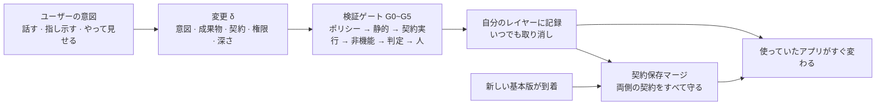

<div align="center">

<!-- LANG-BAR -->
[English](README.md) · [한국어](README.ko.md) · [简体中文](README.zh-CN.md) · **日本語** · [Español](README.es.md)
<!-- /LANG-BAR -->

# Mallangable-AI

**ユーザーがAIに話しかけると、使っていたアプリがその場で変わり、アップデートが来ても生き残る。**

*A vendor-neutral reference architecture for AI-driven malleable software.*

[](https://github.com/Hyunki6040/mallangable-ai/actions/workflows/check.yml)
[](CHANGELOG.ja.md)
[](LICENSE-docs)
[](LICENSE)
[](tools/)

[なぜ必要か](#なぜ必要か) · [中核となる考え方](#中核となる考え方) · [動作の仕組み](#動作の仕組み) · [クイックスタート](#クイックスタート) · [適用する](#自分のプロジェクトに適用する) · [仕様を読む](#ドキュメントマップ) · [貢献](CONTRIBUTING.ja.md)

</div>

`말랑(mallang)` + `-able` = *malleable*。「mallang」は韓国語で「柔らかい、ぷにぷにした」という意味です。叩いて延ばせる、手を入れて使い直せるソフトウェア。

> **状態: v0.2.4 アーキテクチャ定義草案** ([変更履歴](CHANGELOG.ja.md))。実装ではなく**仕様**です。概念モデル、設計空間(design space)、参照アーキテクチャ、JSON Schema、計算ツールを公開します。特定の製品・モデル提供元・エージェントランタイムには縛られません。
>
> **言語版**: English(既定) · 한국어(原文) · 简体中文 · 日本語 · Español。仕様本文は `docs/<言語>/` にあります。韓国語版が原文で、それ以外は翻訳です。翻訳版と原文が異なる場合は原文が優先します。相違点は Issue でお知らせください。

---

## なぜ必要か

**AIのおかげでコードは安くなりました。それでもソフトウェアは相変わらず硬いままです。**

大量生産されたソフトウェアは平均的なユーザーに合わせて作られます。平均から遠いほど、人が道具に自分の働き方を合わせることになります。今では「このリストを締め切り順に、過ぎたものは赤く」程度なら、AIが数秒でコードにしてくれます。それでも毎日使うアプリは変わりません。アプリ生成ツールは*新しい*アプリを作るだけで、すでに使っているアプリを直してはくれないからです。[Ink & Switch](https://www.inkandswitch.com/essay/malleable-software/) が指摘するように、**コード生成だけではソフトウェアは柔らかくなりません。**

詰まっているのはモデルの性能ではなく**構造**です。

| 欠落 | 今起きていること |
| --- | --- |
| **差し込む場所がない** | AIが機能を作っても、既存アプリにはめ込む穴がありません。結局コアのソースを直接パッチすることになります。 |
| **アップデートに耐えられない** | ベンダーが新バージョンを出すとユーザーの修正が壊れます。ユーザー数千人 × リリースごとに繰り返されます。 |
| **制御できない** | 誰が何を変えたのか、そのコードが何にアクセスするのか、費用は誰が払うのかが分かりません。2026年初め、あるエージェントスキルマーケットでは監査対象2,857個のうち341個が悪性でした([The Hacker News](https://thehackernews.com/2026/02/researchers-find-341-malicious-clawhub.html))。原因は「スキルがエージェントの権限をそのまま持って実行される」という構造でした。 |

3つの欠落はまとめて解決しなければなりません。1つだけ解くと残りが破綻します。差し込む場所だけ作ればアップデートで壊れ、アップデートに耐えるようにすれば制御が失われ、制御を締めれば誰も手を入れなくなります。Mallangable-AI はこの3つを**1つのモデルと1つの設計空間**で扱います。

### 他の方式と何が違うか

| 方式 | 既存アプリを直せるか | アップデート後も残るか | リスク制御 |
| --- | :---: | :---: | :---: |
| 設定(Settings) | 狭く | 高い | 高い |
| プラグイン | 開発者のみ | APIが変わると壊れる | エコシステムによる |
| ノーコードビルダー · アプリ生成ツール | いいえ(新しいアプリ) | 該当なし | プラットフォーム依存 |
| 使い捨ての生成UI | いいえ(揮発) | 該当なし | カタログで制限 |
| **Mallangable** | **はい**、拡張ポイントの範囲内で | **設計目標**(契約保存マージ) | **ポリシーの区間で調整** |

## 中核となる考え方

**1. コアはそのままにして、レイヤーだけを積む。**
ユーザーの修正は、ベンダーが公開した**拡張ポイント(extension point)**(ケイパビリティマップ、capability map)の中でだけ起こります。コアをパッチしないので、ベンダーはアップデートを出し続けられます(不変条件 I1)。

**2. すべての変更には「約束リスト(契約)」が付く。**
「今週完了したことだけが表示される」「リストが空なら案内文が出る」のような、実行可能なチェックの一覧です。契約(contract)があってはじめて、アップデート・共有・昇格のときに機械が「正しくマージされたか」を判定できます。契約のない変更は有効になりません(I2)。マージ結果は両側の契約をすべて守らなければならず、守れなければ人に引き渡します(I10)。

**3. 最も弱い表現で作る。**
W3C の[最小パワーの原則(Rule of Least Power)](https://www.w3.org/2001/tag/doc/leastPower.html)をユーザーの変更に適用しました。深さ(depth)が1段上がるごとに、できることと検証すべきことが一緒に増えます。D2 でできることを D4 で作ると拒否します。

| 深さ | 名前 | 成果物 | 例 |
| --- | --- | --- | --- |
| D1 | 外観 | デザイントークン | 「ボタンを大きく、オレンジ色に」 |
| D2 | 組み合わせ | 既存コマンドの組み合わせ・ショートカット・ルール | 「ボタン1つでエクスポート + メール」 |
| D3 | 画面 | 承認済みコンポーネントカタログ上の宣言的UI | 「今日締め切りのリストパネル」 |
| D4 | 動作 | サンドボックス内のコード、権限は明示したものだけ | 「保存時に表を自動ソート」 |
| D5 | コア | コアのソース修正 → ユーザーレイヤーではなく**機能要望**として収集 | 「レンダリングエンジンの交換」 |

**4. 制御はスイッチではなく区間である。**
上位(ベンダー → 組織 → チーム)は上限を狭め、ユーザーはその中から選びます。下位のポリシーは上位より広くなれません(I5)。そして**どのポリシーも消せないユーザー権利の下限(user floor rights)**があります: 取り消し(F1)、セーフモード(F2)、誰が自分のものを見ているかの告知(F3)、エクスポート(F4)、権限の確認(F5)、費用上限(F6)、平易な言葉での説明(F7)。

**5. AIは間違えるし騙される、と仮定する。**
作るAIと判定するAIは分けます(I7)。エージェントは自分で権限を増やせません(I4)。見てはいけないデータはエージェントのコンテキストにも入れません(I6)。ユーザーのデバイス上のチェックは案内にすぎず、権威ある執行は運営者が制御する境界で行います(I8)。

**6. 正解を1つではなく、計算可能な設計空間を渡す。**
個人開発者向けツールとネットワーク分離された公共システムは、同じ構造を使えません。そこで11軸の組み合わせ **1,944,000個** を論理・安全ルールでふるいにかけて**推奨構成 36,772個**に絞り込み、その計算機も一緒に公開します。設計レビューで「なぜこの組み合わせか」にルールIDで答えられます。

## 動作の仕組み



1. **意図**: ユーザーが話す、画面を指し示す、またはやって見せます。
2. **生成**: エージェントがケイパビリティマップを見て、最も低い深さで変更を作ります。変更 = 意図 + 成果物 + 契約 + 必要な権限。
3. **検証**: ゲートを通過します。生成前にまずポリシーの範囲を確認し(G0、コスト0)、隔離されたプレビューで契約を実行し(G2)、別のAIが出所を知らないまま判定し(G4)、権限が増えるなら人が承認します(G5)。
4. **記録**: ユーザーレイヤーに積まれます。直前の状態は常に残っているので、取り消しは定数時間で終わります(I3)。
5. **アップデートを生き残る**: 新しい基本版が来ると、コストの低い順に解決を試みます。通常の 3-way マージ → 構文を認識するマージ → スキーマのキー単位マージ → 検証済み解決の再利用 → マージエージェント → 人(R0~R5)。どの段階でも、結果は両側の契約を通過しなければなりません。

### 変更1つはこのような形です

```yaml
# examples/change.example.yaml (抜粋、値は日本語に訳した) — schemas/change-record.schema.json で検証
id: chg_01JBX7M0A1
summary: 今週完了したことのパネルを追加
intent: 週次の振り返りで、今週完了した項目をひと目で見たい
depth: D3                     # 宣言的な画面。コードなし
points: [sidebar.panel]       # ホストが公開した拡張ポイント
contract:                     # アップデート・マージのたびに再実行される約束
  - id: only-this-week
    check: tree-query
    selector: "sidebar.panel[ext=weekly-done-panel] list > item"
    assert: count == 2
    given: 今週の完了2件、先週の完了1件
    expect: パネルのリストに2件だけ表示
```

---

## Abstract

AI has made code cheap, but software is still rigid. App builders generate *new* apps; they do not let people reshape the tools they already use, and nothing keeps those personal changes alive when the vendor ships an update. Mallangable-AI is a vendor-neutral reference architecture for **malleable software driven by AI agents**. It defines (1) a formal model of hosts, layers, changes, contracts and policies with ten invariants; (2) a five-level change-depth hierarchy that applies the Rule of Least Power to user modifications; (3) an eleven-axis design space whose 1,944,000 raw combinations reduce to 36,772 recommended configurations in 863 structural families, with a calculator to recompute them; (4) an interval-delegation control model with user floor rights no policy can remove; (5) a six-plane reference architecture with ports, a vendor-neutral harness event model and verification gates; (6) contract-preserving merges and lineage propagation so changes survive upstream releases; (7) experience rules for input surfaces, waiting, plain-language vocabulary packs and model connection; and (8) a coupling matrix between twenty business models and the architecture choices they require.

**日本語訳**

AIによってコードは安くなりましたが、ソフトウェアは依然として硬いままです。アプリビルダーは*新しい*アプリを生成するだけで、人々がすでに使っている道具を作り変えることはできず、ベンダーがアップデートを出したときにそうした個人的な変更を生かし続ける仕組みもありません。Mallangable-AI は、**AIエージェントが駆動するマリアブル・ソフトウェア(malleable software)** のためのベンダー中立な参照アーキテクチャです。本仕様は次のものを定義します。(1) ホスト・レイヤー・変更・契約・ポリシーの形式モデルと10個の不変条件、(2) 最小パワーの原則(Rule of Least Power)をユーザーの修正に適用した5段階の変更の深さ階層、(3) 1,944,000個の生の組み合わせが863個の構造ファミリーに属する36,772個の推奨構成に絞り込まれる11軸の設計空間と、それを再計算する計算機、(4) どのポリシーも取り除けないユーザー権利の下限を持つ区間委任型の制御モデル、(5) ポート、ベンダー中立なハーネスイベントモデル、検証ゲートを備えた6プレーンの参照アーキテクチャ、(6) 上流のリリース後も変更が生き残るための契約保存マージと系譜伝播、(7) 入力面・待ち時間・平易な語彙パック・モデル接続に関する体験ルール、(8) 20個のビジネスモデルと、それぞれが要求するアーキテクチャ上の選択との結合行列。

---

## ドキュメントマップ

| 章 | 内容 | 最初に読むべき人 |
| --- | --- | --- |
| [1. 序論](docs/ja/01-introduction.md) | 問題、定義、貢献、関連研究 | 全員 |
| [2. コアモデル](docs/ja/02-core-model.md) | アクター・ホスト・レイヤー・変更・契約・深さ・ポリシー・ライフサイクル・不変条件 I1~I10 | アーキテクト |
| [3. 設計空間](docs/ja/03-design-space.md) | 11軸、制約 L/N/S、組み合わせの数、リファレンスプロファイル P1~P7、選択手順 | プロダクトリーダー、アーキテクト |
| [4. 制御スペクトラム](docs/ja/04-control-spectrum.md) | 区間委任、ノブのカタログ、プリセット、決定主体、ユーザー権利の下限 F1~F7 | プロダクト・セキュリティ・管理者 |
| [5. 参照アーキテクチャ](docs/ja/05-reference-architecture.md) | 6プレーン、配置、ポートインターフェース、フロー、ハーネスイベントモデル、役割、ゲート、ランタイム | エンジニア |
| [6. バージョンと系譜](docs/ja/06-versioning-and-lineage.md) | トポロジー、系譜、伝播アルゴリズム、解決ラダー、契約保存マージ、コストモデル、共有、昇格 | エンジニア |
| [7. 信頼とセキュリティ](docs/ja/07-trust-and-security.md) | 脅威モデル、致命的三要素の切断、計画と実行の分離、情報フローラベル、サプライチェーン | セキュリティ |
| [8. 体験設計](docs/ja/08-experience-design.md) | 入力面、時間ティア T0~T4、生成過程の表現、レシート、用語パック、AIエンジン接続 | デザイナー、PM |
| [9. ビジネス結合](docs/ja/09-business-coupling.md) | BM 20個、プロファイル×BM 行列、非典型的なBM、料金プラン=ポリシー上限 | 創業者、事業 |
| [10. 未解決問題](docs/ja/10-open-problems.md) | 未解決問題13個、Mallang-Bench、準拠レベル、ロードマップ | 研究者、貢献者 |
| [調査ノート](docs/ja/research/) | Harness² 分析、ThinkRail 分析、先行事例調査、敵対的評価 | 貢献者、レビュアー |
| [用語集](docs/ja/glossary.md) · [参考文献](docs/ja/references.md) | | |

## 数字で見る設計空間

`tools/design_space.py` で計算した値です(3章)。

| | 値 |
| --- | ---: |
| 設計軸 | 11個 |
| 生の組み合わせ | 1,944,000 |
| 論理的に成立 | 103,320 (5.31%) |
| 安全規範まで満たす | 61,064 (3.14%) |
| 警告なしで推奨 | **36,772 (1.89%)** |
| 構造ファミリー | 863 |
| 構造を決めた後に残る事業・ポリシーの選択肢 | 平均 57% |

代表的な設計上の矛盾は **「ソースは隠したいが、AIはユーザーのデバイスで動かしたい」** です(ルール L1)。これは成立しません。生の組み合わせを最も多くふるい落とすルールは、深さと表現を揃える L3・L4 です(3.4、順序に依存しない独立違反数を基準とする)。

## リファレンスプロファイル

| | 代表的な状況 | エージェント | トポロジー | 可視性 | モデル調達 |
| --- | --- | --- | --- | --- | --- |
| P1 個人工房型 | 開発者ツール、自分のAIサブスクリプションで手を入れる | デバイス | fork | すべて公開 | ユーザーのサブスクリプション |
| P2 チームキュレーション型 | 社内業務ツール、チームの基本版 | 混合 | lineage | 自分のものだけ | BYOK |
| P3 企業機密型 | ソース非公開の契約 | サーバー | lineage | 非公開 | テナントクラウド |
| P4 大衆消費者型 | 数百万人のユーザー、テーマ・ルールの共有 | サーバー | snapshot | 公開 | クレジット |
| P5 ローカルファースト協働型 | リアルタイム共同編集ドキュメント | デバイス | crdt | 公開 | BYOK |
| P6 マーケットプラットフォーム型 | ユーザー拡張の公開マーケット | 混合 | lineage | 自分のものだけ | クレジット |
| P7 閉域網公共型 | ネットワーク分離、社内モデル | サーバー | lineage | 非公開 | 社内モデル |

11軸すべての値は [`examples/profiles.yaml`](examples/profiles.yaml) にあります。

## アーキテクチャカード

新しいモデルを公開するときにモデルカードを付けるように、このアーキテクチャの用途と限界を書いておきます。

| 項目 | 内容 |
| --- | --- |
| 想定用途 | すでに存在するソフトウェア(Web・デスクトップ・モバイル・社内ツール)にAIベースのユーザー修正機能を入れようとするベンダー・プラットフォームチームの初期アーキテクチャ設計 |
| 範囲外 | プロンプトで新しいアプリを丸ごと作るアプリ生成ツール、保存されない使い捨ての生成UI、隔離なしでコードを実行するプラグインマーケット |
| 前提 | ホストがケイパビリティマップ(拡張ポイント・権限)を公開できる。制御が必要な配備には運営者が制御するサーバー境界がある。モデルは間違うことがあり、インジェクションに弱い |
| 既知の限界 | 弱い契約はマージを通しながら機能を壊す(サイレントな破損)。ユーザーのデバイス上の制御は回避可能。デバイスに配られる実行バンドルは解析されうる。意味的な衝突・機能間の相互作用の検出は未解決 |
| 評価 | Mallang-Bench 指標(10章)。サイレント破損率(SBR)を人の介入率と一緒に報告 |
| 社会的リスク | メンバーの監視ツールとして使われるリスク、労働モニタリング規制、アクセシビリティの退行、スポンサー付きの既定値による推薦の歪み |
| 緩和策 | 可視性の常時告知(F3)、権限増加時の人による承認(I4)、アクセシビリティゲート(G3)、スポンサー表示の義務 |
| ポリシー依存性 | モデル提供元のサブスクリプション・API規約は頻繁に変わる。モデル調達はポートで抽象化し、最低2つの経路を維持すること |

## クイックスタート

```bash
git clone https://github.com/Hyunki6040/mallangable-ai.git && cd mallangable-ai
python3 tools/design_space.py --check all     # 標準ライブラリのみ。P1~P7 をチェック
python3 tools/design_space.py --markdown      # 組み合わせの数とルール別の統計(全列挙、数分かかる)
python3 tools/design_space.py --bm            # プロファイル × ビジネスモデル行列
pip install -r requirements.txt && python3 tools/check_schemas.py   # 例9個の通過 + 禁止文書の拒否の回帰チェック
```

## 自分のプロジェクトに適用する

必要な分だけ持っていけば十分です。以下の段階は互いに独立しており、上にあるほど軽くなります。

| 段階 | 持っていくもの | やること | 成果物 |
| --- | --- | --- | --- |
| 1. 語彙 | 用語・識別子 | 設計文書で `D1~D5`、`I1~I10`、`F1~F7`、ルールIDをそのまま引用する | 「D4 機能は G5 の通過が必要(5.8)」のように根拠付きのレビュー |
| 2. 設計空間 | `tools/design_space.py` | 自分の製品の11軸の値を決めてチェックする | コミット可能なプロファイル JSON と違反・警告のID |
| 3. 計算機の拡張 | 軸・ルール | ファイルをコピーし、`AXES`・`normative()` に自分たちの選択肢・安全原則を追加する | 自組織向けの推奨組み合わせ数とルール統計 |
| 4. データ契約 | `schemas/` | ケイパビリティマップ・マニフェスト・変更記録・ポリシー・用語パックをスキーマで検証する | 実装間でやりとりできる文書形式 |
| 5. アーキテクチャ | 5~7章 | 6プレーン・ポート・ゲートを自分のスタックに対応づけ、ハーネスイベント対応表(5.6)を作る | コンポーネントマップ、脅威モデルのチェックリスト |
| 6. 準拠の主張 | 10.3 | Core → Governed → Sealed の各レベルの条件を項目ごとに確認する | 「Mallangable Core (v0.2.4) 準拠」という検証可能な主張 |

### 段階2: 自分の製品を設計空間に置く

軸の定義(3.2)を見て値を選び、ファイルに保存します。レビュー・ADR と一緒にコミットしておけば、「なぜこの組み合わせか」にルールIDで答えられます。

```bash
cat > my-product.profile.json <<'EOF'
{"A1":"D3","A2":"decl","A3":"client","A4":"none","A5":"hidden","A6":"fork",
 "A7":"proposed","A8":"none","A9":"sub","A10":"none","A11":"preview"}
EOF
python3 tools/design_space.py --profile my-product.profile.json
# → "result": "logical", "violated": "L1"
#   ソースを隠すなら(A5=hidden)、コードに触れるエージェントはサーバー上になければならない(A3=server)
```

結果は `clean`(推奨) · `warned`(警告 `S*`) · `normative`(安全原則違反 `N*`) · `logical`(成立不可 `L*`) のいずれかで、成立する場合はビジネスモデル20個との結合も一緒に出力されます。終了コードは `clean`・`warned` なら 0、それ以外(`normative`・`logical`・入力エラー)なら 1 なので、そのまま CI ゲートとして使えます。重複キーやオブジェクトでない JSON は入力エラーとして拒否します。最も近いリファレンスプロファイル(P1~P7)から出発して1軸ずつ変えてみるのが早道です。

### 段階3: 計算機を自組織に合わせて直す

`tools/design_space.py` はファイル1つで、依存関係はありません。コピーして直してください。

- 選択肢の追加: `AXES` のリストに値を入れます(例: A9 に `"partner_api"`)。
- 自組織の安全原則: `normative()` に `N` ルールを追加します。新しいIDは既存の番号の後ろに付けます(`N7`、`N8` …)。
- 推奨しない組み合わせ: `soft()` に `S` 警告を追加します。
- `LOGICAL_RULES` の**順序は変えません**(「最初の違反」の集計が順序に依存)。主張には順序に依存しない独立・唯一違反数を使ってください。

### 段階4: 自分の文書をスキーマで検証する

`examples/` をコピーして自分のホストに合わせて直してから検証します。YAML・JSON どちらでも、1ファイルに複数文書(`---`)でも構いません。

```bash
python3 tools/check_schemas.py capability-map  my-app/capability-map.yaml
python3 tools/check_schemas.py extension-manifest my-app/extensions/*.yaml
python3 tools/check_schemas.py policy          my-app/policy.yaml
# スキーマ: capability-map | change-record | extension-manifest | lexicon-pack | policy
```

どの言語でも、JSON Schema draft 2020-12 の検証器で `schemas/*.json` をそのまま使えます。スキーマの `$id`(`https://mallangable.ai/schemas/v0.1/…`)は識別子であり、ダウンロードできるアドレスではありません。リポジトリのファイルを直接参照するか、コピーして固定してください。

**スキーマだけでは不十分です。** 文書どうしを比較しなければならないルール(I5 ポリシーの包含関係、I7 生成者 ≠ 判定者)は JSON Schema で表現できないため、`check_schemas.py` は `ACCEPTED (validator MUST check)` と表示します。ランタイムの検証器で必ず別途チェックしてください。

外部から受け取った文書を検証する場合に備えて、`check_schemas.py` は YAML のエイリアス(`*ref`)と 1 MiB を超えるファイルを拒否し、出力中の制御文字・改行をエスケープします(文書のキーを使って端末の制御文字や GitHub Actions の `::error::` 注釈を差し込むことはできません)。判定は出力の文言ではなく、終了コード(0 通過、1 失敗)で読んでください。

### 段階5: アーキテクチャを自分のスタックに対応づける

- [5章](docs/ja/05-reference-architecture.md)のポート(`ModelPort`、`SandboxHost`、`PolicyDecisionPoint` …)ごとに、自分たちの実装を書き込みます。ポートの背後の実装は自由です。
- 使っているエージェントランタイムのイベントを、ハーネスイベントモデル(5.6)に対応づけます。AG-UI・A2A・MCP の対応表が例です。
- [7章](docs/ja/07-trust-and-security.md)の脅威モデルをチェックリストとして使います。特に、ユーザーのデバイス上のチェックは案内にすぎず、権威ある執行は運営者の境界で行うという点(I8)を確認してください。

### この仕様が合わない場合

プロンプトで新しいアプリを丸ごと作るアプリ生成ツール、保存されない使い捨ての生成UI、隔離なしでコードを実行するプラグインマーケットは範囲外です(上記のアーキテクチャカード)。ホストが拡張ポイントを公開できない場合は、段階1~3だけを使ってください。

## リポジトリ構成

```text
mallangable-ai/
├── README.md · CHANGELOG.md · CONTRIBUTING.md   # 英語(既定)。他の言語版は README.<言語>.md など
├── CITATION.cff
├── LICENSE                    # Apache-2.0 (schemas/, examples/, tools/)
├── LICENSE-docs               # CC BY 4.0 (docs/, README などの文書)
├── requirements.txt           # check_schemas.py の依存関係
├── .github/                   # CI(check.yml、読み取り専用トークン)、Issue テンプレート
├── .claude/skills/security-audit/  # Cloudflare セキュリティ監査スキル (MIT、原本固定、修正禁止)
├── docs/<言語>/               # 仕様本文 (1~10章、用語集、参考文献)。en · ko(原文) · zh-CN · ja · es
├── schemas/                   # JSON Schema (draft 2020-12)
│   ├── capability-map.schema.json
│   ├── extension-manifest.schema.json
│   ├── change-record.schema.json
│   ├── policy.schema.json
│   └── lexicon-pack.schema.json
├── examples/                  # スキーマを通過する例
│   ├── capability-map.example.yaml
│   ├── extension-manifest.example.yaml
│   ├── change.example.yaml
│   ├── policy.example.yaml
│   ├── lexicon.{en,ko,zh-CN,ja,es}.yaml
│   └── profiles.yaml
├── docs/<言語>/research/       # 調査ノート (Harness² 分析、ThinkRail 分析、先行事例調査、敵対的評価)
└── tools/
    ├── design_space.py        # 設計空間 · BM 結合の計算機 (標準ライブラリのみ)
    └── check_schemas.py       # 例の検証 + 禁止文書の拒否の回帰チェック / 自分の文書の検証
```

## セキュリティ監査

[cloudflare/security-audit-skill](https://github.com/cloudflare/security-audit-skill) を `.claude/skills/security-audit/` に固定してあります(`UPSTREAM` に原本のコミット、ライセンスは MIT)。Claude Code で「このリポジトリをセキュリティ監査して」と頼むと、このスキルの6段階(偵察 → カバレッジ台帳 → ハンティング → 候補の検証 → findings.json → レポート)が回ります。対象コードはネットワークのない読み取り専用サンドボックスでのみ実行します。

最初の監査(2026-11-05、quick プロファイル、部分監査)の結果と反映内容は [`docs/ja/research/security-audit-2026-11-05.md`](docs/ja/research/security-audit-2026-11-05.md) にあります。

## ロードマップ

| バージョン | 目標 |
| --- | --- |
| **v0.2 (現在)** | 概念モデル・設計空間・参照アーキテクチャ、実行可能な契約スキーマ、禁止文書の回帰チェック |
| v0.3 | ケイパビリティマップ形式の確定、参照ホストアプリ、準拠チェックセット、Mallang-Bench アルファ |
| v1.0 | 外部実装2つ以上が Core レベルに合格、記録仕様の凍結 |

まだ解けていない問題(契約が十分かどうかの判定、機能間の相互作用の検出、プライバシーを守る昇格など13個)は[10章](docs/ja/10-open-problems.md)にあります。

## 表記

- 軸 `A1~A11`、制約 `L`(論理)・`N`(規範)・`S`(警告)、不変条件 `I1~I10`、ユーザー権利の下限 `F1~F7`、ゲート `G0~G5`、解決段階 `R0~R5`、プロファイル `P1~P7`、ビジネスモデル `B1~B20`。
- 出典リンクのない数値(サイズ上限、スコアの重み、コストの例)は**設計提案値**です。
- 要求レベル: 必須(MUST) · 推奨(SHOULD) · 任意(MAY)。

## 貢献

歓迎する貢献:
- **未解決問題** O1(契約の十分性)、O3(機能間の相互作用)、O7(プライバシー保存型の昇格)に対する手法と実験
- 他のエージェントランタイムの**ハーネスイベント対応表**(5.6)
- **参照ホストアプリ**と Mallang-Bench のリクエスト・攻撃セット
- 用語パックの他言語・他分野のパック、仕様翻訳版の校正と新しい言語版

Issue には該当する章とルールID(例: `3.3 L7`、`I10`)を書いてください。識別子のルールとビルド検証の手順は [CONTRIBUTING.md](CONTRIBUTING.ja.md) にあります。

## ライセンス

| 対象 | ライセンス | 意味 |
| --- | --- | --- |
| `docs/`、`README.md` などの文書 | [CC BY 4.0](LICENSE-docs) | 出典を明記すれば複製・翻訳・改変・商用利用が可能 |
| `schemas/`、`examples/`、`tools/` | [Apache-2.0](LICENSE) | 製品コードにそのまま含めることが可能。特許許諾を含む |

スキーマをコピーして使うときは、ファイルと一緒に出典(このリポジトリ、バージョン)を残してください。調査ノートが引用している外部プロジェクトは、それぞれのライセンスに従います。

## 引用

文書・論文・設計レビューで引用するときは、バージョンと節・ルールIDを一緒に書いてください。仕様が変わっても根拠を追跡できます。機械が読む形式は [CITATION.cff](CITATION.cff) です。

```text
Mallangable-AI contributors. Mallangable-AI: A Reference Architecture for AI-Driven Malleable Software. v0.2.4, 2026.
```

```bibtex
@misc{mallangable-ai-2026,
  title  = {Mallangable-AI: A Reference Architecture for AI-Driven Malleable Software},
  author = {{Mallangable-AI contributors}},
  year   = {2026},
  note   = {Version 0.2.4. Specification (en, ko, zh-CN, ja, es), JSON Schemas and tools}
}
```

本文での引用例: 「ユーザー修正の深さは Mallangable-AI 2.6 の D1~D5 に従い、D4 以上は即時に有効化しない(N5)。」
