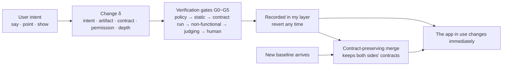

<div align="center">

<!-- LANG-BAR -->
**English** · [한국어](README.ko.md) · [简体中文](README.zh-CN.md) · [日本語](README.ja.md) · [Español](README.es.md)
<!-- /LANG-BAR -->

# Mallangable-AI

**A user tells the AI what they want, the app they are already using changes on the spot, and the change survives the next update.**

*A vendor-neutral reference architecture for AI-driven malleable software.*

[](https://github.com/Hyunki6040/mallangable-ai/actions/workflows/check.yml)
[](CHANGELOG.md)
[](LICENSE-docs)
[](LICENSE)
[](tools/)

[Why it matters](#why-it-matters) · [Core ideas](#core-ideas) · [How it works](#how-it-works) · [Quick start](#quick-start) · [Apply it](#applying-it-to-your-project) · [Read the spec](#document-map) · [Contributing](CONTRIBUTING.md)

</div>

`말랑(mallang)` + `-able` = *malleable*. "Mallang" is Korean for soft or squishy. Software you can hammer into shape and rework to fit.

> **Status: v0.2.4 architecture definition draft** ([changelog](CHANGELOG.md)). This is a **specification**, not an implementation. It publishes a conceptual model, a design space, a reference architecture, JSON Schemas and calculation tools. It is not tied to any particular product, model vendor or agent runtime.
>
> **Editions**: English (default) · Korean (original) · Simplified Chinese · Japanese · Spanish. The spec chapters live in `docs/<language>/`. The Korean edition is the original and the others are translations. Where a translation differs from the original, the original prevails; please report differences as issues.

---

## Why it matters

**AI has made code cheap. Software is still rigid.**

Mass-produced software is built for the average user. The further you are from the average, the more you bend your way of working to fit the tool. Today an AI can write the code for "sort this list by due date and show overdue items in red" in a few seconds. Yet the app I use every day does not change. App builders only make *new* apps; they do not fix the app you already use. As [Ink & Switch](https://www.inkandswitch.com/essay/malleable-software/) points out, **code generation alone does not make software malleable.**

What blocks it is not model capability but **structure**.

| Gap | What happens today |
| --- | --- |
| **No place to put it** | Even when the AI builds a feature, there is no slot to fit it into the existing app. People end up patching the core source directly. |
| **Does not survive updates** | When the vendor ships a new version, user modifications break. Thousands of users × every release. |
| **No control** | Nobody knows who changed what, what that code can access, or who pays. In early 2026, 341 of 2,857 audited skills on one agent skill marketplace were malicious ([The Hacker News](https://thehackernews.com/2026/02/researchers-find-341-malicious-clawhub.html)). The cause was structural: "skills run with the agent's full permissions." |

All three gaps have to be solved together. Solve one and the others blow up. Add a place to put changes and they break on update; make them survive updates and control disappears; tighten control and nobody modifies anything. Mallangable-AI treats all three with **one model and one design space**.

### How it differs from other approaches

| Approach | Modifies the existing app | Survives updates | Risk control |
| --- | :---: | :---: | :---: |
| Settings | Narrowly | High | High |
| Plugins | Developers only | Breaks when the API changes | Varies by ecosystem |
| No-code builders · app generators | No (new app) | N/A | Platform-dependent |
| One-off generative UI | No (ephemeral) | N/A | Limited by catalog |
| **Mallangable** | **Yes**, within extension points | **Design goal** (contract-preserving merge) | **Tuned by policy intervals** |

## Core ideas

**1. Leave the core alone and stack layers.**
User modifications happen only inside the **extension points** the vendor publishes (the capability map). Because the core is never patched, the vendor can keep shipping updates (invariant I1).

**2. Every change carries a "list of promises" (a contract).**
An executable list of checks such as "only tasks completed this week are shown" or "an empty list shows a help message". With a contract, a machine can decide whether a change "merged correctly" during updates, sharing and promotion. A change without a contract is never activated (I2). A merge result must satisfy both sides' contracts; if it cannot, it goes to a person (I10).

**3. Build with the weakest expression that works.**
This applies the W3C [Rule of Least Power](https://www.w3.org/2001/tag/doc/leastPower.html) to user changes. Each step up in depth increases both what can be done and what must be verified. Building with D4 what D2 can do is rejected.

| Depth | Name | Artifact | Example |
| --- | --- | --- | --- |
| D1 | Appearance | Design tokens | "Make the button bigger and orange" |
| D2 | Composition | Combinations of existing commands, shortcuts, rules | "One button to export + email" |
| D3 | Screen | Declarative UI on an approved component catalog | "A panel listing today's deadlines" |
| D4 | Behavior | Code in a sandbox, with only declared permissions | "Auto-sort the table on save" |
| D5 | Core | Core source modification → collected as a **feature request**, not a user layer | "Replace the rendering engine" |

**4. Control is an interval, not a switch.**
Upper levels (vendor → org → team) narrow the ceiling, and the user chooses within it. A lower policy can never be wider than its parent (I5). And there are **user floor rights that no policy can remove**: revert (F1), safe mode (F2), notice of who sees my work (F3), export (F4), permission view (F5), spend cap (F6), plain-language explanation (F7).

**5. Assume the AI is wrong and can be fooled.**
The AI that builds and the AI that judges are kept separate (I7). An agent cannot raise its own permissions (I4). Data that must not be seen is never put into the agent's context either (I6). Checks on the user's device are only advisory; authoritative enforcement happens at a boundary the operator controls (I8).

**6. Not one right answer, but a computable design space.**
A personal developer tool and an air-gapped public-sector system cannot use the same structure. So the **1,944,000** combinations of 11 axes are filtered by logical and safety rules down to **36,772 recommended configurations**, and the calculator is published alongside. In a design review, "why this combination?" can be answered with rule ids.

## How it works



1. **Intent**: the user speaks, points at the screen, or demonstrates.
2. **Generation**: the agent reads the capability map and builds the change at the lowest depth. Change = intent + artifact + contract + required permissions.
3. **Verification**: the change passes the gates. Policy scope is checked before generation (G0, zero cost), the contract runs in an isolated preview (G2), a different AI judges without knowing the source (G4), and a person approves if permissions increase (G5).
4. **Recording**: the change is stacked on the user layer. The previous state is always kept, so revert finishes in constant time (I3).
5. **Surviving updates**: when a new baseline arrives, resolution is tried in order of increasing cost. Plain 3-way merge → syntax-aware merge → schema key-level merge → reuse of a verified resolution → merge agent → human (R0~R5). At every step, the result must pass both sides' contracts.

### What one change looks like

```yaml
# examples/change.example.yaml (excerpt, values translated into English) — validated by schemas/change-record.schema.json
id: chg_01JBX7M0A1
summary: Add a "done this week" panel
intent: I want to see this week's completed items at a glance during the weekly retro
depth: D3                     # declarative screen. no code
points: [sidebar.panel]       # extension point published by the host
contract:                     # promises re-run on update and merge
  - id: only-this-week
    check: tree-query
    selector: "sidebar.panel[ext=weekly-done-panel] list > item"
    assert: count == 2
    given: 2 completed this week, 1 completed last week
    expect: only 2 items shown in the panel list
```

---

## Abstract

AI has made code cheap, but software is still rigid. App builders generate *new* apps; they do not let people reshape the tools they already use, and nothing keeps those personal changes alive when the vendor ships an update. Mallangable-AI is a vendor-neutral reference architecture for **malleable software driven by AI agents**. It defines (1) a formal model of hosts, layers, changes, contracts and policies with ten invariants; (2) a five-level change-depth hierarchy that applies the Rule of Least Power to user modifications; (3) an eleven-axis design space whose 1,944,000 raw combinations reduce to 36,772 recommended configurations in 863 structural families, with a calculator to recompute them; (4) an interval-delegation control model with user floor rights no policy can remove; (5) a six-plane reference architecture with ports, a vendor-neutral harness event model and verification gates; (6) contract-preserving merges and lineage propagation so changes survive upstream releases; (7) experience rules for input surfaces, waiting, plain-language vocabulary packs and model connection; and (8) a coupling matrix between twenty business models and the architecture choices they require.

---

## Document map

| Chapter | Contents | Who should read first |
| --- | --- | --- |
| [1. Introduction](docs/en/01-introduction.md) | Problem, definition, contributions, related work | Everyone |
| [2. Core model](docs/en/02-core-model.md) | Actors, host, layers, changes, contracts, depth, policy, lifecycle, invariants I1~I10 | Architects |
| [3. Design space](docs/en/03-design-space.md) | 11 axes, constraints L/N/S, number of combinations, reference profiles P1~P7, selection procedure | Product leaders, architects |
| [4. Control spectrum](docs/en/04-control-spectrum.md) | Interval delegation, knob catalog, presets, decision makers, user floor rights F1~F7 | Product, security, admins |
| [5. Reference architecture](docs/en/05-reference-architecture.md) | 6 planes, deployment, port interfaces, flows, harness event model, roles, gates, runtime | Engineers |
| [6. Versioning and lineage](docs/en/06-versioning-and-lineage.md) | Topology, lineage, propagation algorithm, resolution ladder, contract-preserving merge, cost model, sharing, promotion | Engineers |
| [7. Trust and security](docs/en/07-trust-and-security.md) | Threat model, breaking the lethal trifecta, plan/execute separation, information-flow labels, supply chain | Security |
| [8. Experience design](docs/en/08-experience-design.md) | Input surfaces, time tiers T0~T4, showing generation progress, receipts, lexicon packs, AI engine connection | Designers, PMs |
| [9. Business coupling](docs/en/09-business-coupling.md) | 20 BMs, profile × BM matrix, atypical BMs, pricing plan = policy ceiling | Founders, business |
| [10. Open problems](docs/en/10-open-problems.md) | 13 open problems, Mallang-Bench, conformance levels, roadmap | Researchers, contributors |
| [Research notes](docs/en/research/) | Harness² analysis, ThinkRail analysis, prior-art survey, adversarial review | Contributors, reviewers |
| [Glossary](docs/en/glossary.md) · [References](docs/en/references.md) | | |

## The design space in numbers

Values computed with `tools/design_space.py` (chapter 3).

| | Value |
| --- | ---: |
| Design axes | 11 |
| Raw combinations | 1,944,000 |
| Logically valid | 103,320 (5.31%) |
| Also meet safety norms | 61,064 (3.14%) |
| Recommended with no warnings | **36,772 (1.89%)** |
| Structural families | 863 |
| Business and policy options left once the structure is fixed | 57% on average |

The archetypal design contradiction is **"I want to hide the source, but I want the AI to run on the user's device"** (rule L1). It cannot hold. The rules that filter out the most raw combinations are L3 and L4, which match depth to representation (3.4, counted by order-independent independent violations).

## Reference profiles

| | Typical situation | Agent | Topology | Visibility | Model sourcing |
| --- | --- | --- | --- | --- | --- |
| P1 Personal workshop | Developer tools, modified with my own AI subscription | Device | fork | Fully public | User subscription |
| P2 Team-curated | Internal business tools, team baseline | Mixed | lineage | Mine only | BYOK |
| P3 Enterprise confidential | Source-closed contract | Server | lineage | Hidden | Tenant cloud |
| P4 Mass consumer | Millions of users, sharing themes and rules | Server | snapshot | Public | Credits |
| P5 Local-first collaborative | Real-time collaborative documents | Device | crdt | Public | BYOK |
| P6 Marketplace platform | Public marketplace of user extensions | Mixed | lineage | Mine only | Credits |
| P7 Air-gapped public sector | Network separation, in-house model | Server | lineage | Hidden | In-house model |

Full values for all 11 axes are in [`examples/profiles.yaml`](examples/profiles.yaml).

## Architecture card

Just as a model card accompanies a new model release, this records the intended use and limits of the architecture.

| Item | Contents |
| --- | --- |
| Intended use | Early architecture design by vendors and platform teams that want to add AI-driven user modification to existing software (web, desktop, mobile, internal tools) |
| Out of scope | App generators that build a whole new app from a prompt, one-off generative UI that is never saved, plugin marketplaces that run code without isolation |
| Assumptions | The host can expose a capability map (extension points, permissions). Deployments that need control have a server boundary controlled by the operator. Models can be wrong and are vulnerable to injection |
| Known limitations | Weak contracts let merges pass while breaking features (silent breakage). Controls on the user's device can be bypassed. Execution bundles shipped to the device can be analyzed. Detection of semantic conflicts and feature interactions is unsolved |
| Evaluation | Mallang-Bench metrics (chapter 10). Report the silent breakage rate (SBR) together with the human intervention rate |
| Social risks | Use as a tool for surveilling members, labor-monitoring regulation, accessibility regressions, recommendation bias from sponsored defaults |
| Mitigations | Always-on visibility notice (F3), human approval for permission increases (I4), accessibility gate (G3), mandatory sponsorship labeling |
| Policy dependencies | Model vendors' subscription and API terms change often. Abstract model sourcing behind a port and keep at least two paths |

## Quick start

```bash
git clone https://github.com/Hyunki6040/mallangable-ai.git && cd mallangable-ai
python3 tools/design_space.py --check all     # stdlib only. checks P1~P7
python3 tools/design_space.py --markdown      # combination counts and per-rule stats (full enumeration, takes a few minutes)
python3 tools/design_space.py --bm            # profile × business model matrix
pip install -r requirements.txt && python3 tools/check_schemas.py   # 9 examples pass + regression check that forbidden documents are rejected
```

## Applying it to your project

Take only as much as you need. The steps below are independent, and the higher ones are lighter.

| Step | What you take | What to do | Result |
| --- | --- | --- | --- |
| 1. Vocabulary | Terms, identifiers | Cite `D1~D5`, `I1~I10`, `F1~F7` and rule ids verbatim in design documents | Reviews with grounds attached, such as "a D4 feature must pass G5 (5.8)" |
| 2. Design space | `tools/design_space.py` | Choose your product's 11 axis values and check them | A committable profile JSON and violation/warning ids |
| 3. Extend the calculator | Axes, rules | Copy the file and add your options and safety principles to `AXES` and `normative()` | Recommended combination counts and rule stats for your org |
| 4. Data contracts | `schemas/` | Validate capability maps, manifests, change records, policies and lexicon packs against the schemas | Document formats that implementations can exchange |
| 5. Architecture | Chapters 5~7 | Map the 6 planes, ports and gates onto your stack, and write a harness event mapping table (5.6) | A component map and a threat-model checklist |
| 6. Conformance claim | 10.3 | Check the Core → Governed → Sealed level conditions item by item | A verifiable claim such as "Conforms to Mallangable Core (v0.2.4)" |

### Step 2: Place your product in the design space

Read the axis definitions (3.2), pick values and save them to a file. Commit it with your review or ADR and you can answer "why this combination?" with rule ids.

```bash
cat > my-product.profile.json <<'EOF'
{"A1":"D3","A2":"decl","A3":"client","A4":"none","A5":"hidden","A6":"fork",
 "A7":"proposed","A8":"none","A9":"sub","A10":"none","A11":"preview"}
EOF
python3 tools/design_space.py --profile my-product.profile.json
# → "result": "logical", "violated": "L1"
#   to hide the source (A5=hidden), the agent that touches code must be on the server (A3=server)
```

The result is one of `clean` (recommended) · `warned` (warnings `S*`) · `normative` (safety principle violation `N*`) · `logical` (infeasible `L*`). If the profile is feasible, its coupling with the 20 business models is reported too. The exit code is 0 for `clean` or `warned` and 1 otherwise (`normative`, `logical`, input error), so it works directly as a CI gate. Duplicate keys or JSON that is not an object are rejected as input errors. Starting from the nearest reference profile (P1~P7) and changing one axis at a time is the fastest way.

### Step 3: Adapt the calculator to your org

`tools/design_space.py` is a single file with no dependencies. Copy it and edit it.

- Add an option: put a value into the list in `AXES` (e.g. `"partner_api"` for A9).
- Your own safety principles: add `N` rules to `normative()`. New ids go after the existing numbers (`N7`, `N8` …).
- Discouraged combinations: add `S` warnings to `soft()`.
- **Do not change the order** of `LOGICAL_RULES` (the "first violation" counts depend on it). For claims, use the order-independent independent and unique violation counts.

### Step 4: Validate your documents against the schemas

Copy `examples/`, adapt it to your host and validate. Both YAML and JSON work, including several documents (`---`) in one file.

```bash
python3 tools/check_schemas.py capability-map  my-app/capability-map.yaml
python3 tools/check_schemas.py extension-manifest my-app/extensions/*.yaml
python3 tools/check_schemas.py policy          my-app/policy.yaml
# schemas: capability-map | change-record | extension-manifest | lexicon-pack | policy
```

Any JSON Schema draft 2020-12 validator, in any language, can use `schemas/*.json` as is. A schema's `$id` (`https://mallangable.ai/schemas/v0.1/…`) is an identifier, not a downloadable address. Reference the repository files directly or copy and pin them.

**Schemas alone are not enough.** Rules that require comparing documents (I5 policy containment, I7 generator ≠ judge) cannot be expressed in JSON Schema, so `check_schemas.py` marks them `ACCEPTED (validator MUST check)`. A runtime validator **MUST** check them separately.

For validating documents received from outside, `check_schemas.py` rejects YAML aliases (`*ref`) and files over 1 MiB, and escapes control characters and newlines in its output (so document keys cannot inject terminal control characters or GitHub Actions `::error::` annotations). Read the verdict from the exit code (0 pass, 1 fail), not from the output text.

### Step 5: Map the architecture onto your stack

- For each port in [chapter 5](docs/en/05-reference-architecture.md) (`ModelPort`, `SandboxHost`, `PolicyDecisionPoint` …), write down your implementation. What sits behind a port is up to you.
- Map the events of the agent runtime you use onto the harness event model (5.6). The AG-UI, A2A and MCP mapping tables are examples.
- Use the threat model in [chapter 7](docs/en/07-trust-and-security.md) as a checklist. In particular, confirm that checks on the user's device are only advisory and that authoritative enforcement happens at the operator boundary (I8).

### When this spec does not fit

App generators that build a whole new app from a prompt, one-off generative UI that is never saved, and plugin marketplaces that run code without isolation are out of scope (see the architecture card above). If your host cannot expose extension points, use only steps 1~3.

## Repository layout

```text
mallangable-ai/
├── README.md · CHANGELOG.md · CONTRIBUTING.md   # English (default). Other editions are README.<lang>.md etc.
├── CITATION.cff
├── LICENSE                    # Apache-2.0 (schemas/, examples/, tools/)
├── LICENSE-docs               # CC BY 4.0 (docs/, README and other documents)
├── requirements.txt           # check_schemas.py dependencies
├── .github/                   # CI (check.yml, read-only token), issue templates
├── .claude/skills/security-audit/  # Cloudflare security audit skill (MIT, pinned upstream, do not modify)
├── docs/<lang>/               # spec chapters (1~10, glossary, references). en · ko (original) · zh-CN · ja · es
├── schemas/                   # JSON Schema (draft 2020-12)
│   ├── capability-map.schema.json
│   ├── extension-manifest.schema.json
│   ├── change-record.schema.json
│   ├── policy.schema.json
│   └── lexicon-pack.schema.json
├── examples/                  # examples that pass the schemas
│   ├── capability-map.example.yaml
│   ├── extension-manifest.example.yaml
│   ├── change.example.yaml
│   ├── policy.example.yaml
│   ├── lexicon.{en,ko,zh-CN,ja,es}.yaml
│   └── profiles.yaml
├── docs/<lang>/research/       # research notes (Harness² analysis, ThinkRail analysis, prior-art survey, adversarial review)
└── tools/
    ├── design_space.py        # design space · BM coupling calculator (stdlib only)
    └── check_schemas.py       # example validation + forbidden-document rejection regression check / validate your documents
```

## Security audit

[cloudflare/security-audit-skill](https://github.com/cloudflare/security-audit-skill) is pinned at `.claude/skills/security-audit/` (upstream commit in `UPSTREAM`, MIT license). In Claude Code, asking "run a security audit on this repo" runs the skill's six stages (recon → coverage ledger → hunt → candidate verification → findings.json → report). Target code runs only in a read-only sandbox with no network.

The results of the first audit (2026-11-05, quick profile, partial audit) and the fixes applied are in [`docs/en/research/security-audit-2026-11-05.md`](docs/en/research/security-audit-2026-11-05.md).

## Roadmap

| Version | Goal |
| --- | --- |
| **v0.2 (current)** | Conceptual model, design space, reference architecture, executable contract schemas, forbidden-document regression checks |
| v0.3 | Finalized capability map format, reference host app, conformance test suite, Mallang-Bench alpha |
| v1.0 | At least 2 external implementations pass the Core level, record format frozen |

The problems not yet solved (deciding whether a contract is sufficient, detecting interactions between features, privacy-preserving promotion and 13 in total) are in [chapter 10](docs/en/10-open-problems.md).

## Notation

- Axes `A1~A11`, constraints `L` (logical) · `N` (normative) · `S` (warning), invariants `I1~I10`, user floor rights `F1~F7`, gates `G0~G5`, resolution steps `R0~R5`, profiles `P1~P7`, business models `B1~B20`.
- Numbers without a source link (size limits, score weights, cost examples) are **design proposal values**.
- Requirement levels: **MUST** · **SHOULD** · **MAY**.

## Contributing

Contributions we welcome:
- Methods and experiments for the **open problems** O1 (contract sufficiency), O3 (feature interaction) and O7 (privacy-preserving promotion)
- **Harness event mapping tables** (5.6) for other agent runtimes
- A **reference host app** and Mallang-Bench request and attack sets
- Lexicon packs for other languages and domains, proofreading of spec translations, and new language editions

In issues, please cite the chapter and rule id (e.g. `3.3 L7`, `I10`). Identifier rules and the build verification procedure are in [CONTRIBUTING.md](CONTRIBUTING.md).

## License

| Scope | License | Meaning |
| --- | --- | --- |
| Documents such as `docs/`, `README.md` | [CC BY 4.0](LICENSE-docs) | Copying, translation, modification and commercial use allowed with attribution |
| `schemas/`, `examples/`, `tools/` | [Apache-2.0](LICENSE) | Can be included as is in product code. Includes a patent grant |

When you copy a schema, keep its source (this repository, version) with the file. External projects cited by the research notes follow their own licenses.

## Citation

When citing in documents, papers or design reviews, include the version and the section or rule id. That way the grounds stay traceable even as the spec changes. The machine-readable format is [CITATION.cff](CITATION.cff).

```text
Mallangable-AI contributors. Mallangable-AI: A Reference Architecture for AI-Driven Malleable Software. v0.2.4, 2026.
```

```bibtex
@misc{mallangable-ai-2026,
  title  = {Mallangable-AI: A Reference Architecture for AI-Driven Malleable Software},
  author = {{Mallangable-AI contributors}},
  year   = {2026},
  note   = {Version 0.2.4. Specification (en, ko, zh-CN, ja, es), JSON Schemas and tools}
}
```

Example in-text citation: "The depth of user modifications follows D1~D5 of Mallangable-AI 2.6, and D4 and above are not activated immediately (N5)."
