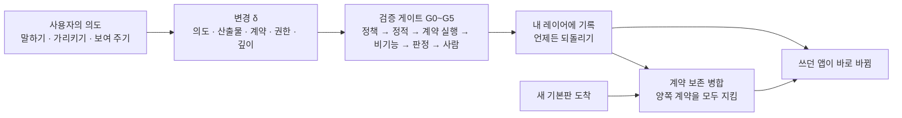

<div align="center">

# Mallangable-AI

**사용자가 AI에게 말하면, 쓰고 있던 앱이 그 자리에서 바뀌고, 업데이트가 와도 살아남는다.**

*A vendor-neutral reference architecture for AI-driven malleable software.*

[](https://github.com/Hyunki6040/mallangable-ai/actions/workflows/check.yml)
[](CHANGELOG.md)
[](LICENSE-docs)
[](LICENSE)
[](tools/)

[왜 필요한가](#왜-필요한가) · [핵심 아이디어](#핵심-아이디어) · [동작 방식](#동작-방식) · [빠른 시작](#빠른-시작) · [적용하기](#내-프로젝트에-적용하기) · [명세 읽기](#문서-지도) · [기여](CONTRIBUTING.md)

</div>

`말랑(mallang)` + `-able` = *malleable*. 두드려 펼 수 있는, 고쳐 쓸 수 있는 소프트웨어.

> **상태: v0.2.2 아키텍처 정의 초안** ([변경 기록](CHANGELOG.md)). 구현체가 아니라 **명세**입니다. 개념 모델, 설계 공간, 참조 아키텍처, JSON Schema, 계산 도구를 공개합니다. 특정 제품·모델 공급사·에이전트 런타임에 묶이지 않습니다.

---

## 왜 필요한가

**AI 덕분에 코드는 싸졌습니다. 그런데 소프트웨어는 여전히 딱딱합니다.**

대량 생산된 소프트웨어는 평균 사용자에 맞춰 만들어집니다. 평균에서 멀수록 사람이 도구에 자기 일하는 방식을 맞춥니다. 이제 "이 목록을 마감순으로, 지난 건 빨갛게" 정도는 AI가 몇 초 만에 코드로 써 줍니다. 그래도 내가 매일 쓰는 앱은 바뀌지 않습니다. 앱 생성기는 *새* 앱을 만들 뿐, 이미 쓰는 앱을 고쳐 주지 않기 때문입니다. [Ink & Switch](https://www.inkandswitch.com/essay/malleable-software/)의 지적처럼 **코드 생성만으로는 소프트웨어가 말랑해지지 않습니다.**

막히는 곳은 모델 성능이 아니라 **구조**입니다.

| 결핍 | 지금 일어나는 일 |
| --- | --- |
| **넣을 자리가 없다** | AI가 기능을 만들어도 기존 앱에 끼울 구멍이 없습니다. 결국 코어 소스를 직접 패치합니다. |
| **업데이트를 못 견딘다** | 제공사가 새 버전을 내면 사용자 수정이 깨집니다. 사용자 수천 명 × 릴리스마다 반복됩니다. |
| **통제할 수 없다** | 누가 무엇을 바꿨는지, 그 코드가 무엇에 접근하는지, 비용은 누가 내는지 모릅니다. 2026년 초 한 에이전트 스킬 마켓에서는 감사 대상 2,857개 중 341개가 악성이었습니다([The Hacker News](https://thehackernews.com/2026/02/researchers-find-341-malicious-clawhub.html)). 원인은 "스킬이 에이전트 권한을 그대로 갖고 실행된다"는 구조였습니다. |

세 결핍을 한꺼번에 풀어야 합니다. 하나만 풀면 나머지가 터집니다. 넣을 자리만 만들면 업데이트 때 깨지고, 업데이트를 견디게 하면 통제가 사라지고, 통제를 조이면 아무도 고치지 않습니다. Mallangable-AI는 이 셋을 **하나의 모델과 하나의 설계 공간**으로 다룹니다.

### 다른 방식과 무엇이 다른가

| 방식 | 기존 앱을 고치나 | 업데이트 뒤에도 남나 | 위험 통제 |
| --- | :---: | :---: | :---: |
| 설정(Settings) | 좁게 | 높음 | 높음 |
| 플러그인 | 개발자만 | API가 바뀌면 깨짐 | 생태계마다 다름 |
| 노코드 빌더 · 앱 생성기 | 아니오(새 앱) | 해당 없음 | 플랫폼 의존 |
| 일회성 생성형 UI | 아니오(휘발) | 해당 없음 | 카탈로그로 제한 |
| **Mallangable** | **예**, 확장 지점 안에서 | **설계 목표**(계약 보존 병합) | **정책 구간으로 조절** |

## 핵심 아이디어

**1. 코어는 그대로 두고 레이어만 쌓는다.**
사용자 수정은 제공사가 공개한 **확장 지점**(기능 지도, capability map) 안에서만 일어납니다. 코어를 패치하지 않으므로 제공사는 계속 업데이트를 낼 수 있습니다(불변식 I1).

**2. 모든 변경에는 '약속 목록(계약)'이 붙는다.**
"이번 주 완료한 일만 보인다", "목록이 비면 안내 문구가 나온다"처럼 실행 가능한 검사 목록입니다. 계약이 있어야 업데이트·공유·승격 때 기계가 "제대로 합쳐졌는지" 판정할 수 있습니다. 계약 없는 변경은 켜지지 않습니다(I2). 병합 결과는 양쪽 계약을 모두 지켜야 하고, 못 지키면 사람에게 넘깁니다(I10).

**3. 가장 약한 표현으로 만든다.**
W3C의 [최소 권한 원칙(Rule of Least Power)](https://www.w3.org/2001/tag/doc/leastPower.html)을 사용자 변경에 적용했습니다. 깊이가 한 단계 오를 때마다 할 수 있는 일과 검증할 일이 함께 늘어납니다. D2로 되는 일을 D4로 만들면 거부합니다.

| 깊이 | 이름 | 산출물 | 예 |
| --- | --- | --- | --- |
| D1 | 외형 | 디자인 토큰 | "버튼을 크게, 주황색으로" |
| D2 | 조합 | 기존 명령의 조합·단축키·규칙 | "버튼 하나로 내보내기 + 메일" |
| D3 | 화면 | 승인된 컴포넌트 카탈로그 위의 선언형 UI | "오늘 마감 목록 패널" |
| D4 | 동작 | 샌드박스 안의 코드, 권한은 명시한 것만 | "저장할 때 표 자동 정렬" |
| D5 | 코어 | 코어 소스 수정 → 사용자 레이어가 아니라 **기능 요청**으로 수집 | "렌더링 엔진 교체" |

**4. 통제는 스위치가 아니라 구간이다.**
상위(제공사 → 조직 → 팀)는 상한을 좁히고, 사용자는 그 안에서 고릅니다. 하위 정책은 상위보다 넓어질 수 없습니다(I5). 그리고 **어떤 정책도 지울 수 없는 사용자 권리 하한**이 있습니다: 되돌리기(F1), 세이프 모드(F2), 누가 내 것을 보는지 고지(F3), 내보내기(F4), 권한 확인(F5), 비용 상한(F6), 쉬운 말 설명(F7).

**5. AI는 틀리고 속는다고 가정한다.**
만든 AI와 판정하는 AI는 따로 둡니다(I7). 에이전트는 스스로 권한을 늘릴 수 없습니다(I4). 보면 안 되는 데이터는 에이전트 맥락에도 넣지 않습니다(I6). 사용자 기기의 검사는 안내일 뿐이고, 권위 있는 집행은 운영자가 통제하는 경계에서 합니다(I8).

**6. 정답 하나가 아니라 계산 가능한 설계 공간을 준다.**
개인 개발자 도구와 망 분리된 공공 시스템은 같은 구조를 쓸 수 없습니다. 그래서 11개 축의 조합 **1,944,000개**를 논리·안전 규칙으로 걸러 **권장 구성 36,772개**로 줄이고, 그 계산기를 함께 공개합니다. 설계 리뷰에서 "왜 이 조합인가"를 규칙 id로 답할 수 있습니다.

## 동작 방식



1. **의도**: 사용자가 말하거나, 화면을 가리키거나, 시연합니다.
2. **생성**: 에이전트가 기능 지도를 보고 가장 낮은 깊이로 변경을 만듭니다. 변경 = 의도 + 산출물 + 계약 + 필요한 권한.
3. **검증**: 게이트를 통과합니다. 생성 전에 정책 범위부터 확인하고(G0, 비용 0), 격리된 미리보기에서 계약을 실행하고(G2), 다른 AI가 출처를 모른 채 판정하고(G4), 권한이 늘면 사람이 승인합니다(G5).
4. **기록**: 사용자 레이어에 쌓입니다. 직전 상태는 항상 남아 있어 되돌리기는 상수 시간에 끝납니다(I3).
5. **업데이트 생존**: 새 기본판이 오면 비용이 낮은 순서로 해결을 시도합니다. 일반 3-way 병합 → 구문 인식 병합 → 스키마 키 단위 병합 → 검증된 해결 재사용 → 병합 에이전트 → 사람(R0~R5). 어느 단계든 결과는 양쪽 계약을 통과해야 합니다.

### 변경 하나는 이렇게 생겼습니다

```yaml
# examples/change.example.yaml (발췌) — schemas/change-record.schema.json 으로 검증
id: chg_01JBX7M0A1
summary: 이번 주 완료한 일 패널 추가
intent: 주간 회고 때 이번 주 완료 항목을 한눈에 보고 싶다
depth: D3                     # 선언형 화면. 코드 없음
points: [sidebar.panel]       # 호스트가 공개한 확장 지점
contract:                     # 업데이트·병합 때 다시 실행되는 약속
  - id: only-this-week
    check: tree-query
    selector: "sidebar.panel[ext=weekly-done-panel] list > item"
    assert: count == 2
    given: 이번 주 완료 2건, 지난주 완료 1건
    expect: 패널 목록에 2건만 표시
```

---

## Abstract (English)

AI has made code cheap, but software is still rigid. App builders generate *new* apps; they do not let people reshape the tools they already use, and nothing keeps those personal changes alive when the vendor ships an update. Mallangable-AI is a vendor-neutral reference architecture for **malleable software driven by AI agents**. It defines (1) a formal model of hosts, layers, changes, contracts and policies with ten invariants; (2) a five-level change-depth hierarchy that applies the Rule of Least Power to user modifications; (3) an eleven-axis design space whose 1,944,000 raw combinations reduce to 36,772 recommended configurations in 863 structural families, with a calculator to recompute them; (4) an interval-delegation control model with user floor rights no policy can remove; (5) a six-plane reference architecture with ports, a vendor-neutral harness event model and verification gates; (6) contract-preserving merges and lineage propagation so changes survive upstream releases; (7) experience rules for input surfaces, waiting, plain-language vocabulary packs and model connection; and (8) a coupling matrix between twenty business models and the architecture choices they require.

**한국어 번역**

AI 덕분에 코드는 싸졌지만 소프트웨어는 여전히 딱딱합니다. 앱 생성기는 *새* 앱을 만들 뿐, 사람들이 이미 쓰는 도구를 고쳐 쓰게 해 주지 않고, 제공사가 업데이트를 내면 그 개인 수정을 지켜 주는 장치도 없습니다. Mallangable-AI는 **AI 에이전트가 이끄는 말랑한 소프트웨어**를 위한 벤더 중립 참조 아키텍처입니다. 이 명세는 (1) 호스트·레이어·변경·계약·정책의 형식 모델과 불변식 10개, (2) 최소 권한 원칙(Rule of Least Power)을 사용자 수정에 적용한 5단계 변경 깊이 계층, (3) 원시 조합 1,944,000개가 구조 패밀리 863개·권장 구성 36,772개로 줄어드는 11축 설계 공간과 이를 다시 계산하는 도구, (4) 어떤 정책도 지울 수 없는 사용자 권리 하한을 가진 구간 위임 통제 모델, (5) 포트·벤더 중립 하네스 이벤트 모델·검증 게이트를 갖춘 6평면 참조 아키텍처, (6) 상위 릴리스 뒤에도 변경이 살아남게 하는 계약 보존 병합과 계보 전파, (7) 입력 표면·기다림 표현·일반 용어팩·모델 연결에 관한 경험 규칙, (8) 사업 모델 20개와 그것이 요구하는 아키텍처 선택 사이의 결합 행렬을 정의합니다.

---

## 문서 지도

| 장 | 내용 | 먼저 읽을 사람 |
| --- | --- | --- |
| [1. 서론](docs/01-introduction.md) | 문제, 정의, 기여, 관련 연구 | 모두 |
| [2. 핵심 모델](docs/02-core-model.md) | 행위자·호스트·레이어·변경·계약·깊이·정책·생애주기·불변식 I1~I10 | 아키텍트 |
| [3. 설계 공간](docs/03-design-space.md) | 11개 축, 제약 L/N/S, 조합의 수, 레퍼런스 프로파일 P1~P7, 선택 절차 | 제품 리더, 아키텍트 |
| [4. 통제 스펙트럼](docs/04-control-spectrum.md) | 구간 위임, 손잡이 카탈로그, 프리셋, 결정 주체, 사용자 권리 하한 F1~F7 | 제품·보안·관리자 |
| [5. 참조 아키텍처](docs/05-reference-architecture.md) | 6평면, 배치, 포트 인터페이스, 흐름, 하네스 이벤트 모델, 역할, 게이트, 런타임 | 엔지니어 |
| [6. 버전과 계보](docs/06-versioning-and-lineage.md) | 토폴로지, 계보, 전파 알고리즘, 해결 사다리, 계약 보존 병합, 비용 모델, 공유, 승격 | 엔지니어 |
| [7. 신뢰와 보안](docs/07-trust-and-security.md) | 위협 모델, 치명적 3요소 끊기, 계획·실행 분리, 정보 흐름 라벨, 공급망 | 보안 |
| [8. 경험 설계](docs/08-experience-design.md) | 입력 표면, 시간 등급 T0~T4, 생성 과정 표현, 영수증, 용어팩, AI 엔진 연결 | 디자이너, PM |
| [9. 비즈니스 결합](docs/09-business-coupling.md) | BM 20개, 프로파일×BM 행렬, 비전형 BM, 요금제=정책 상한 | 창업자, 사업 |
| [10. 열린 문제](docs/10-open-problems.md) | 열린 문제 13개, Mallang-Bench, 준수 등급, 로드맵 | 연구자, 기여자 |
| [조사 노트](docs/research/) | Harness² 분석, ThinkRail 분석, 선행 사례 조사, 적대적 평가 | 기여자, 리뷰어 |
| [용어집](docs/glossary.md) · [참고 문헌](docs/references.md) | | |

## 숫자로 보는 설계 공간

`tools/design_space.py`로 계산한 값입니다(3장).

| | 값 |
| --- | ---: |
| 설계 축 | 11개 |
| 원시 조합 | 1,944,000 |
| 논리적으로 성립 | 103,320 (5.31%) |
| 안전 규범까지 충족 | 61,064 (3.14%) |
| 경고 없이 권장 | **36,772 (1.89%)** |
| 구조 패밀리 | 863 |
| 구조를 정한 뒤 남는 사업·정책 선택지 | 평균 57% |

대표적인 설계 모순은 **"소스는 숨기고 싶은데 AI는 사용자 기기에서 돌리고 싶다"** 입니다(규칙 L1). 성립하지 않습니다. 원시 조합을 가장 많이 걸러 내는 규칙은 깊이와 표현을 맞추는 L3·L4입니다(3.4, 순서와 무관한 독립 위반 수 기준).

## 레퍼런스 프로파일

| | 대표 상황 | 에이전트 | 토폴로지 | 가시성 | 모델 조달 |
| --- | --- | --- | --- | --- | --- |
| P1 개인 공방형 | 개발자 도구, 내 AI 구독으로 고침 | 기기 | fork | 전부 공개 | 사용자 구독 |
| P2 팀 큐레이션형 | 사내 업무 도구, 팀 기본판 | 혼합 | lineage | 내 것만 | BYOK |
| P3 기업 기밀형 | 소스 비공개 계약 | 서버 | lineage | 숨김 | 테넌트 클라우드 |
| P4 대중 소비자형 | 수백만 사용자, 테마·규칙 공유 | 서버 | snapshot | 공개 | 크레딧 |
| P5 로컬 퍼스트 협업형 | 실시간 협업 문서 | 기기 | crdt | 공개 | BYOK |
| P6 마켓 플랫폼형 | 사용자 확장 공개 마켓 | 혼합 | lineage | 내 것만 | 크레딧 |
| P7 폐쇄망 공공형 | 망 분리, 사내 모델 | 서버 | lineage | 숨김 | 사내 모델 |

전체 11축 값은 [`examples/profiles.yaml`](examples/profiles.yaml).

## 아키텍처 카드

새 모델을 공개할 때 모델 카드를 붙이듯, 이 아키텍처의 쓰임과 한계를 적어 둡니다.

| 항목 | 내용 |
| --- | --- |
| 의도된 용도 | 이미 존재하는 소프트웨어(웹·데스크톱·모바일·사내 도구)에 AI 기반 사용자 수정 기능을 넣으려는 제공사·플랫폼 팀의 초기 아키텍처 설계 |
| 범위 밖 | 프롬프트로 새 앱을 통째로 만드는 앱 생성기, 저장되지 않는 일회성 생성형 UI, 격리 없이 코드를 실행하는 플러그인 마켓 |
| 전제 | 호스트가 기능 지도(확장 지점·권한)를 노출할 수 있다. 통제가 필요한 배포에는 운영자가 통제하는 서버 경계가 있다. 모델은 틀릴 수 있고 인젝션에 취약하다 |
| 알려진 한계 | 약한 계약은 병합을 통과시키면서 기능을 망가뜨린다(조용한 파손). 사용자 기기의 통제는 우회 가능하다. 기기로 내려가는 실행 번들은 분석될 수 있다. 의미 충돌·기능 상호작용 탐지는 미해결 |
| 평가 | Mallang-Bench 지표(10장). 조용한 파손률(SBR)을 사람 개입률과 함께 보고 |
| 사회적 위험 | 구성원 감시 도구로 쓰일 위험, 노동 모니터링 규제, 접근성 회귀, 후원 기본값에 의한 추천 왜곡 |
| 완화 | 가시성 상시 고지(F3), 권한 증가 사람 승인(I4), 접근성 게이트(G3), 후원 표시 의무 |
| 정책 의존성 | 모델 공급사의 구독·API 약관은 자주 바뀐다. 모델 조달은 포트로 추상화하고 최소 두 경로를 유지할 것 |

## 빠른 시작

```bash
git clone https://github.com/Hyunki6040/mallangable-ai.git && cd mallangable-ai
python3 tools/design_space.py --check all     # 표준 라이브러리만. P1~P7 검사
python3 tools/design_space.py --markdown      # 조합의 수와 규칙별 통계 (전체 열거, 몇 분 걸림)
python3 tools/design_space.py --bm            # 프로파일 × 사업 모델 행렬
pip install -r requirements.txt && python3 tools/check_schemas.py   # 예시 9개 통과 + 금지 문서 거부 회귀 검사
```

## 내 프로젝트에 적용하기

필요한 만큼만 가져가면 됩니다. 아래 단계는 독립적이며, 위로 갈수록 가볍습니다.

| 단계 | 가져가는 것 | 할 일 | 결과물 |
| --- | --- | --- | --- |
| 1. 어휘 | 용어·식별자 | 설계 문서에서 `D1~D5`, `I1~I10`, `F1~F7`, 규칙 id를 그대로 인용 | "D4 기능은 G5 통과 필요(5.8)"처럼 근거가 붙은 리뷰 |
| 2. 설계 공간 | `tools/design_space.py` | 내 제품의 11축 값을 정해 검사 | 커밋 가능한 프로파일 JSON과 위반·경고 id |
| 3. 계산기 확장 | 축·규칙 | 파일을 복사해 `AXES`·`normative()`에 우리 옵션·안전 원칙 추가 | 우리 조직용 권장 조합 수와 규칙 통계 |
| 4. 데이터 계약 | `schemas/` | 기능 지도·매니페스트·변경 기록·정책·용어팩을 스키마로 검증 | 구현 사이에 주고받을 수 있는 문서 형식 |
| 5. 아키텍처 | 5~7장 | 6평면·포트·게이트를 내 스택에 대응시키고, 하네스 이벤트 대응표(5.6) 작성 | 구성 요소 지도, 위협 모델 점검표 |
| 6. 준수 주장 | 10.3 | Core → Governed → Sealed 등급 조건을 항목별로 확인 | "Mallangable Core (v0.2.2) 준수"라는 검증 가능한 주장 |

### 2단계: 내 제품을 설계 공간에 놓기

축 정의(3.2)를 보고 값을 고른 뒤 파일로 저장합니다. 리뷰·ADR에 함께 커밋하면 "왜 이 조합인가"를 규칙 id로 답할 수 있습니다.

```bash
cat > my-product.profile.json <<'EOF'
{"A1":"D3","A2":"decl","A3":"client","A4":"none","A5":"hidden","A6":"fork",
 "A7":"proposed","A8":"none","A9":"sub","A10":"none","A11":"preview"}
EOF
python3 tools/design_space.py --profile my-product.profile.json
# → "result": "logical", "violated": "L1"
#   소스를 숨기려면(A5=hidden) 코드를 만지는 에이전트가 서버에 있어야 한다(A3=server)
```

결과는 `clean`(권장) · `warned`(경고 `S*`) · `normative`(안전 원칙 위반 `N*`) · `logical`(성립 불가 `L*`) 중 하나이고, 성립하면 사업 모델 20개와의 결합도 함께 나옵니다. 가장 가까운 레퍼런스 프로파일(P1~P7)에서 출발해 한 축씩 바꿔 보는 것이 빠릅니다.

### 3단계: 계산기를 우리 조직에 맞게 고치기

`tools/design_space.py`는 파일 하나, 의존성 없음입니다. 복사해서 고치세요.

- 옵션 추가: `AXES`의 목록에 값을 넣습니다(예: A9에 `"partner_api"`).
- 우리 안전 원칙: `normative()`에 `N` 규칙을 추가합니다. 새 id는 기존 번호 뒤에 붙입니다(`N7`, `N8` …).
- 권장하지 않는 조합: `soft()`에 `S` 경고를 추가합니다.
- `LOGICAL_RULES`의 **순서는 바꾸지 않습니다**("첫 위반" 집계가 순서에 의존). 주장에는 순서와 무관한 독립·유일 위반 수를 쓰세요.

### 4단계: 내 문서를 스키마로 검증하기

`examples/`를 복사해 내 호스트에 맞게 고친 뒤 검증합니다. YAML·JSON 모두, 한 파일에 여러 문서(`---`)도 됩니다.

```bash
python3 tools/check_schemas.py capability-map  my-app/capability-map.yaml
python3 tools/check_schemas.py extension-manifest my-app/extensions/*.yaml
python3 tools/check_schemas.py policy          my-app/policy.yaml
# 스키마: capability-map | change-record | extension-manifest | lexicon-pack | policy
```

어느 언어에서든 JSON Schema draft 2020-12 검증기로 `schemas/*.json`을 그대로 쓸 수 있습니다. 스키마의 `$id`(`https://mallangable.ai/schemas/v0.1/…`)는 식별자이며 내려받을 수 있는 주소가 아닙니다. 저장소 파일을 직접 참조하거나 복사해 고정하세요.

**스키마만으로는 부족합니다.** 문서 사이를 비교해야 하는 규칙(I5 정책 포함 관계, I7 생성자 ≠ 판정자)은 JSON Schema로 표현할 수 없어 `check_schemas.py`가 `ACCEPTED (validator MUST check)`로 표시합니다. 런타임 검증기에서 반드시 따로 검사하세요.

### 5단계: 아키텍처를 내 스택에 대응시키기

- [5장](docs/05-reference-architecture.md)의 포트(`ModelPort`, `SandboxHost`, `PolicyDecisionPoint` …)마다 우리 구현체를 적습니다. 포트 뒤 구현은 자유입니다.
- 쓰는 에이전트 런타임의 이벤트를 하네스 이벤트 모델(5.6)에 대응시킵니다. AG-UI·A2A·MCP 대응표가 예시입니다.
- [7장](docs/07-trust-and-security.md) 위협 모델을 점검표로 씁니다. 특히 사용자 기기의 검사는 안내일 뿐이고 권위 있는 집행은 운영자 경계에서 한다는 점(I8)을 확인하세요.

### 이 명세가 맞지 않는 경우

프롬프트로 새 앱을 통째로 만드는 앱 생성기, 저장되지 않는 일회성 생성형 UI, 격리 없이 코드를 실행하는 플러그인 마켓은 범위 밖입니다(아래 아키텍처 카드). 호스트가 확장 지점을 노출할 수 없다면 1~3단계만 쓰세요.

## 저장소 구조

```text
mallangable-ai/
├── README.md · CHANGELOG.md · CONTRIBUTING.md · CITATION.cff
├── LICENSE                    # Apache-2.0 (schemas/, examples/, tools/)
├── LICENSE-docs               # CC BY 4.0 (docs/, README 등 문서)
├── requirements.txt           # check_schemas.py 의존성
├── .github/                   # CI(check.yml), 이슈 템플릿
├── docs/                      # 명세 본문 (1~10장, 용어집, 참고 문헌)
├── schemas/                   # JSON Schema (draft 2020-12)
│   ├── capability-map.schema.json
│   ├── extension-manifest.schema.json
│   ├── change-record.schema.json
│   ├── policy.schema.json
│   └── lexicon-pack.schema.json
├── examples/                  # 스키마를 통과하는 예시
│   ├── capability-map.example.yaml
│   ├── extension-manifest.example.yaml
│   ├── change.example.yaml
│   ├── policy.example.yaml
│   ├── lexicon.ko.yaml
│   └── profiles.yaml
├── docs/research/             # 조사 노트 (Harness² 분석, ThinkRail 분석, 선행 사례 조사, 적대적 평가)
└── tools/
    ├── design_space.py        # 설계 공간 · BM 결합 계산기 (표준 라이브러리만)
    └── check_schemas.py       # 예시 검증 + 금지 문서 거부 회귀 검사 / 내 문서 검증
```

## 로드맵

| 버전 | 목표 |
| --- | --- |
| **v0.2 (현재)** | 개념 모델·설계 공간·참조 아키텍처, 실행 가능한 계약 스키마, 금지 문서 회귀 검사 |
| v0.3 | 기능 지도 형식 확정, 참조 호스트 앱, 준수 검사 세트, Mallang-Bench 알파 |
| v1.0 | 외부 구현 2개 이상이 Core 등급 통과, 기록 규격 동결 |

아직 풀지 못한 문제(계약이 충분한지 판정하기, 기능 사이 상호작용 탐지, 프라이버시를 지키는 승격 등 13개)는 [10장](docs/10-open-problems.md)에 있습니다.

## 표기

- 축 `A1~A11`, 제약 `L`(논리)·`N`(규범)·`S`(경고), 불변식 `I1~I10`, 사용자 권리 하한 `F1~F7`, 게이트 `G0~G5`, 해결 단계 `R0~R5`, 프로파일 `P1~P7`, 사업 모델 `B1~B20`.
- 출처 링크가 없는 수치(크기 상한, 점수 가중치, 비용 예시)는 **설계 제안값**입니다.
- 요구 수준: 반드시(MUST) · 해야 함(SHOULD) · 할 수 있음(MAY).

## 기여

환영하는 기여:
- **열린 문제** O1(계약 충분성), O3(기능 상호작용), O7(프라이버시 보존 승격)에 대한 방법과 실험
- 다른 에이전트 런타임의 **하네스 이벤트 대응표**(5.6)
- **참조 호스트 앱**과 Mallang-Bench 요청·공격 세트
- 용어팩의 다른 언어·분야 팩

이슈에는 해당 장과 규칙 id(예: `3.3 L7`, `I10`)를 적어 주세요. 식별자 규칙과 빌드 검증 절차는 [CONTRIBUTING.md](CONTRIBUTING.md)에 있습니다.

## 라이선스

| 대상 | 라이선스 | 의미 |
| --- | --- | --- |
| `docs/`, `README.md` 등 문서 | [CC BY 4.0](LICENSE-docs) | 출처를 밝히면 복제·번역·수정·상업적 이용 가능 |
| `schemas/`, `examples/`, `tools/` | [Apache-2.0](LICENSE) | 제품 코드에 그대로 포함 가능. 특허 허여 포함 |

스키마를 복사해 쓸 때는 파일과 함께 출처(이 저장소, 버전)를 남겨 주세요. 조사 노트가 인용한 외부 프로젝트는 각자의 라이선스를 따릅니다.

## 인용

문서·논문·설계 리뷰에서 인용할 때는 버전과 절·규칙 id를 함께 적어 주세요. 명세가 바뀌어도 근거를 추적할 수 있습니다. 기계가 읽는 형식은 [CITATION.cff](CITATION.cff)입니다.

```text
Mallangable-AI contributors. Mallangable-AI: A Reference Architecture for AI-Driven Malleable Software. v0.2.2, 2026.
```

```bibtex
@misc{mallangable-ai-2026,
  title  = {Mallangable-AI: A Reference Architecture for AI-Driven Malleable Software},
  author = {{Mallangable-AI contributors}},
  year   = {2026},
  note   = {Version 0.2.2. Specification (Korean), JSON Schemas and tools}
}
```

본문 인용 예: "사용자 수정의 깊이는 Mallangable-AI 2.6의 D1~D5를 따르고, D4 이상은 즉시 활성화하지 않는다(N5)."
