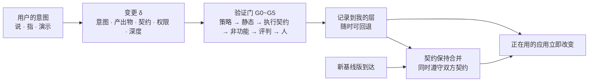

<div align="center">

<!-- LANG-BAR -->
[English](README.md) · [한국어](README.ko.md) · **简体中文** · [日本語](README.ja.md) · [Español](README.es.md)
<!-- /LANG-BAR -->

# Mallangable-AI

**用户对 AI 说一句，正在用的应用当场就改变，而且更新到来后也能保留下来。**

*A vendor-neutral reference architecture for AI-driven malleable software.*

[](https://github.com/Hyunki6040/mallangable-ai/actions/workflows/check.yml)
[](CHANGELOG.zh-CN.md)
[](LICENSE-docs)
[](LICENSE)
[](tools/)

[为什么需要它](#为什么需要它) · [核心思想](#核心思想) · [工作方式](#工作方式) · [快速开始](#快速开始) · [应用](#应用到我的项目) · [阅读规范](#文档地图) · [贡献](CONTRIBUTING.zh-CN.md)

</div>

`말랑(mallang)` + `-able` = *malleable*（mallang 是韩语，意为柔软、软糯）。可以敲打延展、可以改着用的软件。

> **状态：v0.2.4 架构定义草案**（[变更记录](CHANGELOG.zh-CN.md)）。这不是实现，而是**规范**。公开内容包括概念模型、设计空间、参考架构、JSON Schema 和计算工具。不绑定任何特定产品、模型供应商或智能体运行时。
>
> **语言版本**：English（默认）· 韩语（原文）· 简体中文 · 日本語 · Español。规范正文位于 `docs/<语言>/`。韩语版是原文，其余为译文。译文与原文不一致时以原文为准，发现差异请提交 issue 告知。

---

## 为什么需要它

**多亏了 AI，代码变便宜了。可软件依然僵硬。**

大规模生产的软件是按平均用户来做的。离平均越远，人就越要让自己的工作方式去迁就工具。如今像"把这个列表按截止时间排序，过期的标红"这样的需求，AI 几秒钟就能写成代码。可我每天用的应用依然没有变化。因为应用生成器只会做*新*应用，不会修改已经在用的应用。正如 [Ink & Switch](https://www.inkandswitch.com/essay/malleable-software/) 所指出的，**仅靠代码生成，软件不会变得可塑。**

卡住的地方不是模型性能，而是**结构**。

| 缺失 | 现在发生的事 |
| --- | --- |
| **没有可放的位置** | AI 做出了功能，现有应用里却没有可插入的口子。最后只能直接给核心源码打补丁。 |
| **扛不住更新** | 供应商一发布新版本，用户的修改就坏掉。数千名用户 × 每次发布，反复发生。 |
| **无法管控** | 不知道谁改了什么，那段代码访问了什么，费用由谁承担。2026 年初，某个智能体技能市场被审计的 2,857 个技能中有 341 个是恶意的（[The Hacker News](https://thehackernews.com/2026/02/researchers-find-341-malicious-clawhub.html)）。原因在于"技能直接带着智能体的权限运行"这一结构。 |

这三种缺失必须一起解决。只解决一个，其余的就会爆发。只造出放置的位置，更新时就会坏；让它扛得住更新，管控就消失；把管控收紧，就没人去改了。Mallangable-AI 用**一个模型和一个设计空间**来处理这三者。

### 与其他方式有何不同

| 方式 | 能否修改现有应用 | 更新后能否保留 | 风险管控 |
| --- | :---: | :---: | :---: |
| 设置（Settings） | 范围窄 | 高 | 高 |
| 插件 | 仅限开发者 | API 变化即损坏 | 因生态而异 |
| 无代码构建器 · 应用生成器 | 否（新应用） | 不适用 | 依赖平台 |
| 一次性生成式 UI | 否（易逝） | 不适用 | 受目录限制 |
| **Mallangable** | **是**，在扩展点内 | **设计目标**（契约保持合并） | **通过策略区间调节** |

## 核心思想

**1. 核心保持不动，只叠加层。**
用户的修改只发生在供应商公开的**扩展点（extension point）**（能力图，capability map）之内。因为不给核心打补丁，供应商可以持续发布更新（不变式 I1）。

**2. 每个变更都附带"承诺清单（契约）"。**
它是像"只显示本周完成的事项""列表为空时显示提示文字"这样的可执行检查清单。有了契约，在更新、共享、晋升时机器才能判定"是否正确合并"。没有契约的变更不会被启用（I2）。合并结果必须同时遵守双方的契约，做不到就交给人（I10）。

**3. 用最弱的表达方式来做。**
把 W3C 的[最小权力原则（Rule of Least Power）](https://www.w3.org/2001/tag/doc/leastPower.html)应用到用户变更上。深度每上升一级，能做的事和要验证的事就一起增加。D2 能做到的事用 D4 来做，会被拒绝。

| 深度 | 名称 | 产出物 | 例 |
| --- | --- | --- | --- |
| D1 | 外观 | 设计令牌 | "按钮放大，改成橙色" |
| D2 | 组合 | 现有命令的组合·快捷键·规则 | "一个按钮完成导出 + 发邮件" |
| D3 | 界面 | 在已批准组件目录之上的声明式 UI | "今日截止列表面板" |
| D4 | 行为 | 沙箱内的代码，只拥有明确声明的权限 | "保存时自动给表格排序" |
| D5 | 核心 | 修改核心源码 → 不作为用户层，而是作为**功能请求**收集 | "更换渲染引擎" |

**4. 管控不是开关，而是区间。**
上级（供应商 → 组织 → 团队）收窄上限，用户在其中选择。下级策略不能比上级更宽（I5）。并且存在**任何策略都无法删除的用户权利底线（user floor rights）**：回退（F1）、安全模式（F2）、告知谁在看我的东西（F3）、导出（F4）、权限查看（F5）、费用上限（F6）、通俗解释（F7）。

**5. 假定 AI 会出错、会被欺骗。**
生成的 AI 和评判的 AI 分开设置（I7）。智能体不能自行扩大权限（I4）。不该看的数据也不放进智能体的上下文（I6）。用户设备上的检查只是提示，有权威的执行在运营方控制的边界上进行（I8）。

**6. 给出的不是唯一答案，而是可计算的设计空间。**
个人开发者工具和网络隔离的公共系统不能用同一种结构。因此把 11 个轴的 **1,944,000** 种组合用逻辑·安全规则过滤，缩减到 **36,772 种推荐配置**，并一同公开这个计算器。在设计评审中，"为什么是这个组合"可以用规则 id 来回答。

## 工作方式



1. **意图**：用户说出来、在界面上指出来，或者演示一遍。
2. **生成**：智能体查看能力图，以最低深度生成变更。变更 = 意图 + 产出物 + 契约 + 所需权限。
3. **验证**：通过各道门。生成之前先确认策略范围（G0，成本为 0），在隔离的预览中执行契约（G2），由另一个 AI 在不知道来源的情况下评判（G4），权限增加时由人批准（G5）。
4. **记录**：叠加到用户层上。上一个状态始终保留，因此回退在常数时间内完成（I3）。
5. **扛过更新**：新基线版到来时，按成本从低到高依次尝试解决。普通 3-way 合并 → 语法感知合并 → 按 schema 键合并 → 复用已验证的解决方案 → 合并智能体 → 人（R0~R5）。无论哪一步，结果都必须通过双方的契约。

### 一个变更长这样

```yaml
# examples/change.example.yaml（节选，值已译为中文）— 用 schemas/change-record.schema.json 验证
id: chg_01JBX7M0A1
summary: 添加本周已完成事项面板
intent: 每周回顾时想一眼看到本周完成的事项
depth: D3                     # 声明式界面。没有代码
points: [sidebar.panel]       # 宿主公开的扩展点
contract:                     # 更新·合并时会再次执行的承诺
  - id: only-this-week
    check: tree-query
    selector: "sidebar.panel[ext=weekly-done-panel] list > item"
    assert: count == 2
    given: 本周完成 2 项，上周完成 1 项
    expect: 面板列表中只显示 2 项
```

---

## Abstract

AI has made code cheap, but software is still rigid. App builders generate *new* apps; they do not let people reshape the tools they already use, and nothing keeps those personal changes alive when the vendor ships an update. Mallangable-AI is a vendor-neutral reference architecture for **malleable software driven by AI agents**. It defines (1) a formal model of hosts, layers, changes, contracts and policies with ten invariants; (2) a five-level change-depth hierarchy that applies the Rule of Least Power to user modifications; (3) an eleven-axis design space whose 1,944,000 raw combinations reduce to 36,772 recommended configurations in 863 structural families, with a calculator to recompute them; (4) an interval-delegation control model with user floor rights no policy can remove; (5) a six-plane reference architecture with ports, a vendor-neutral harness event model and verification gates; (6) contract-preserving merges and lineage propagation so changes survive upstream releases; (7) experience rules for input surfaces, waiting, plain-language vocabulary packs and model connection; and (8) a coupling matrix between twenty business models and the architecture choices they require.

**简体中文译文**

AI 让代码变得便宜，但软件依然僵硬。应用构建器生成的是*新*应用；它们不让人们改造自己已经在用的工具，而当供应商发布更新时，也没有任何机制让这些个人修改继续存活。Mallangable-AI 是面向**由 AI 智能体驱动的可塑软件（malleable software）**的供应商中立参考架构。它定义了：(1) 宿主、层、变更、契约和策略的形式模型，以及十条不变式；(2) 将最小权力原则（Rule of Least Power）应用于用户修改的五级变更深度层次；(3) 一个十一轴设计空间，其 1,944,000 种原始组合缩减为 863 个结构族中的 36,772 种推荐配置，并附带可重新计算的计算器；(4) 带有任何策略都无法移除的用户权利底线的区间委托管控模型；(5) 具有端口、供应商中立的执行框架（harness）事件模型和验证门的六平面参考架构；(6) 契约保持合并与谱系传播，使变更在上游发布后依然存活；(7) 关于输入界面、等待、通俗用语包和模型连接的体验规则；(8) 二十种商业模式与其所要求的架构选择之间的耦合矩阵。

---

## 文档地图

| 章 | 内容 | 建议先读的人 |
| --- | --- | --- |
| [1. 引言](docs/zh-CN/01-introduction.md) | 问题、定义、贡献、相关研究 | 所有人 |
| [2. 核心模型](docs/zh-CN/02-core-model.md) | 行为者·宿主·层·变更·契约·深度·策略·生命周期·不变式 I1~I10 | 架构师 |
| [3. 设计空间](docs/zh-CN/03-design-space.md) | 11 个轴、约束 L/N/S、组合数、参考配置 P1~P7、选择流程 | 产品负责人、架构师 |
| [4. 管控光谱](docs/zh-CN/04-control-spectrum.md) | 区间委托、旋钮目录、预设、决策主体、用户权利底线 F1~F7 | 产品·安全·管理员 |
| [5. 参考架构](docs/zh-CN/05-reference-architecture.md) | 6 个平面、部署、端口接口、流程、执行框架事件模型、角色、门、运行时 | 工程师 |
| [6. 版本与谱系](docs/zh-CN/06-versioning-and-lineage.md) | 拓扑、谱系、传播算法、解决阶梯、契约保持合并、成本模型、共享、晋升 | 工程师 |
| [7. 信任与安全](docs/zh-CN/07-trust-and-security.md) | 威胁模型、切断致命三要素、计划·执行分离、信息流标签、供应链 | 安全 |
| [8. 体验设计](docs/zh-CN/08-experience-design.md) | 输入界面、时间等级 T0~T4、生成过程呈现、回执、术语包、AI 引擎连接 | 设计师、PM |
| [9. 商业耦合](docs/zh-CN/09-business-coupling.md) | 20 种 BM、配置×BM 矩阵、非典型 BM、资费方案=策略上限 | 创业者、业务 |
| [10. 开放问题](docs/zh-CN/10-open-problems.md) | 13 个开放问题、Mallang-Bench、合规等级、路线图 | 研究者、贡献者 |
| [调研笔记](docs/zh-CN/research/) | Harness² 分析、ThinkRail 分析、先行案例调研、对抗性评估 | 贡献者、评审者 |
| [术语表](docs/zh-CN/glossary.md) · [参考文献](docs/zh-CN/references.md) | | |

## 用数字看设计空间

以下是用 `tools/design_space.py` 计算出的值（第 3 章）。

| | 值 |
| --- | ---: |
| 设计轴 | 11 个 |
| 原始组合 | 1,944,000 |
| 逻辑上成立 | 103,320 (5.31%) |
| 同时满足安全规范 | 61,064 (3.14%) |
| 无警告推荐 | **36,772 (1.89%)** |
| 结构族 | 863 |
| 确定结构后剩下的业务·策略选项 | 平均 57% |

典型的设计矛盾是**"想隐藏源码，却又想让 AI 在用户设备上运行"**（规则 L1）。这不成立。过滤掉原始组合最多的规则是让深度与表达方式相匹配的 L3·L4（3.4，以与顺序无关的独立违规数为准）。

## 参考配置

| | 典型场景 | 智能体 | 拓扑 | 可见性 | 模型获取 |
| --- | --- | --- | --- | --- | --- |
| P1 个人工坊型 | 开发者工具，用我自己的 AI 订阅来改 | 设备 | fork | 全部公开 | 用户订阅 |
| P2 团队策展型 | 公司内部业务工具，团队基线版 | 混合 | lineage | 仅自己的 | BYOK |
| P3 企业保密型 | 源码不公开的合同 | 服务器 | lineage | 隐藏 | 租户云 |
| P4 大众消费型 | 数百万用户，共享主题·规则 | 服务器 | snapshot | 公开 | 积分 |
| P5 本地优先协作型 | 实时协作文档 | 设备 | crdt | 公开 | BYOK |
| P6 市场平台型 | 用户扩展的公开市场 | 混合 | lineage | 仅自己的 | 积分 |
| P7 隔离网络公共型 | 网络隔离，内部模型 | 服务器 | lineage | 隐藏 | 内部模型 |

完整的 11 轴取值见 [`examples/profiles.yaml`](examples/profiles.yaml)。

## 架构卡片

就像发布新模型时附上模型卡一样，这里写下这个架构的用途和局限。

| 项目 | 内容 |
| --- | --- |
| 预期用途 | 想为已有软件（Web·桌面·移动·内部工具）加入基于 AI 的用户修改功能的供应商·平台团队的初期架构设计 |
| 范围之外 | 用提示词整个生成新应用的应用生成器、不保存的一次性生成式 UI、不经隔离就执行代码的插件市场 |
| 前提 | 宿主能够暴露能力图（扩展点·权限）。需要管控的部署中存在运营方控制的服务器边界。模型可能出错，且易受注入攻击 |
| 已知局限 | 弱契约会让合并通过却破坏功能（静默破损）。用户设备上的管控可以被绕过。下发到设备的执行包可能被分析。语义冲突·功能交互的检测尚未解决 |
| 评估 | Mallang-Bench 指标（第 10 章）。将静默破损率（SBR）与人工介入率一起报告 |
| 社会风险 | 被用作监视成员的工具的风险、劳动监控相关法规、无障碍回退、赞助默认值导致的推荐扭曲 |
| 缓解 | 始终告知可见性（F3）、权限增加需人工批准（I4）、无障碍门（G3）、强制标注赞助 |
| 政策依赖 | 模型供应商的订阅·API 条款经常变化。把模型获取抽象为端口，并保持至少两条路径 |

## 快速开始

```bash
git clone https://github.com/Hyunki6040/mallangable-ai.git && cd mallangable-ai
python3 tools/design_space.py --check all     # 仅用标准库。检查 P1~P7
python3 tools/design_space.py --markdown      # 组合数与各规则统计（完整枚举，需要几分钟）
python3 tools/design_space.py --bm            # 配置 × 商业模式矩阵
pip install -r requirements.txt && python3 tools/check_schemas.py   # 9 个示例通过 + 拒绝禁止文档的回归检查
```

## 应用到我的项目

按需取用即可。下面的步骤彼此独立，越靠上越轻量。

| 步骤 | 取用的内容 | 要做的事 | 产出 |
| --- | --- | --- | --- |
| 1. 词汇 | 术语·标识符 | 在设计文档中原样引用 `D1~D5`、`I1~I10`、`F1~F7` 和规则 id | 像"D4 功能需要通过 G5（5.8）"这样附有依据的评审 |
| 2. 设计空间 | `tools/design_space.py` | 确定自己产品的 11 轴取值并检查 | 可提交的配置 JSON 以及违规·警告 id |
| 3. 扩展计算器 | 轴·规则 | 复制文件，在 `AXES`·`normative()` 中加入我们的选项·安全原则 | 适用于我们组织的推荐组合数与规则统计 |
| 4. 数据契约 | `schemas/` | 用 schema 验证能力图·清单·变更记录·策略·术语包 | 可在不同实现之间交换的文档格式 |
| 5. 架构 | 第 5~7 章 | 把 6 个平面·端口·门对应到自己的技术栈，编写执行框架事件对应表（5.6） | 组件地图、威胁模型检查表 |
| 6. 合规声明 | 10.3 | 逐项确认 Core → Governed → Sealed 各等级的条件 | "符合 Mallangable Core (v0.2.4)"这样可验证的声明 |

### 第 2 步：把我的产品放进设计空间

参照轴定义（3.2）选好取值后保存为文件。与评审·ADR 一起提交，就能用规则 id 回答"为什么是这个组合"。

```bash
cat > my-product.profile.json <<'EOF'
{"A1":"D3","A2":"decl","A3":"client","A4":"none","A5":"hidden","A6":"fork",
 "A7":"proposed","A8":"none","A9":"sub","A10":"none","A11":"preview"}
EOF
python3 tools/design_space.py --profile my-product.profile.json
# → "result": "logical", "violated": "L1"
#   要隐藏源码（A5=hidden），操作代码的智能体就必须在服务器上（A3=server）
```

结果是 `clean`（推荐）· `warned`（警告 `S*`）· `normative`（违反安全原则 `N*`）· `logical`（不成立 `L*`）之一；若成立，还会一并给出与 20 种商业模式的耦合情况。`clean`·`warned` 时退出码为 0，其他情况（`normative`·`logical`·输入错误）为 1，因此可以直接用作 CI 门。重复键或非对象的 JSON 会作为输入错误被拒绝。从最接近的参考配置（P1~P7）出发、一次改一个轴，是最快的方法。

### 第 3 步：按我们组织的需要修改计算器

`tools/design_space.py` 是单个文件，没有依赖。复制后修改即可。

- 添加选项：在 `AXES` 的列表中加入取值（例如给 A9 加上 `"partner_api"`）。
- 我们的安全原则：在 `normative()` 中添加 `N` 规则。新 id 接在已有编号之后（`N7`、`N8` …）。
- 不推荐的组合：在 `soft()` 中添加 `S` 警告。
- **不要改变** `LOGICAL_RULES` 的**顺序**（"首个违规"统计依赖顺序）。声明中请使用与顺序无关的独立·唯一违规数。

### 第 4 步：用 schema 验证我的文档

复制 `examples/`，按自己的宿主修改后进行验证。YAML·JSON 都可以，一个文件里放多个文档（`---`）也可以。

```bash
python3 tools/check_schemas.py capability-map  my-app/capability-map.yaml
python3 tools/check_schemas.py extension-manifest my-app/extensions/*.yaml
python3 tools/check_schemas.py policy          my-app/policy.yaml
# schema：capability-map | change-record | extension-manifest | lexicon-pack | policy
```

无论用哪种语言，都可以用 JSON Schema draft 2020-12 验证器直接使用 `schemas/*.json`。schema 的 `$id`（`https://mallangable.ai/schemas/v0.1/…`）是标识符，而不是可下载的地址。请直接引用仓库文件，或复制后固定下来。

**仅靠 schema 是不够的。** 需要在文档之间比较的规则（I5 策略包含关系、I7 生成者 ≠ 评判者）无法用 JSON Schema 表达，因此 `check_schemas.py` 会标为 `ACCEPTED (validator MUST check)`。必须在运行时验证器中另行检查。

为了验证从外部接收的文档，`check_schemas.py` 会拒绝 YAML 别名（`*ref`）和超过 1 MiB 的文件，并对输出中的控制字符·换行进行转义（防止通过文档键注入终端控制字符或 GitHub Actions `::error::` 注释）。请通过退出码（0 通过，1 失败）而不是输出文字来读取判定结果。

### 第 5 步：把架构对应到我的技术栈

- 为[第 5 章](docs/zh-CN/05-reference-architecture.md)的每个端口（`ModelPort`、`SandboxHost`、`PolicyDecisionPoint` …）写下我们的实现。端口背后的实现可以自由选择。
- 把所用智能体运行时的事件对应到执行框架事件模型（5.6）。AG-UI·A2A·MCP 对应表可作为示例。
- 把[第 7 章](docs/zh-CN/07-trust-and-security.md)的威胁模型当作检查表使用。尤其要确认：用户设备上的检查只是提示，有权威的执行在运营方边界上进行（I8）。

### 本规范不适用的情况

用提示词整个生成新应用的应用生成器、不保存的一次性生成式 UI、不经隔离就执行代码的插件市场都在范围之外（见下方架构卡片）。如果宿主无法暴露扩展点，只使用第 1~3 步即可。

## 仓库结构

```text
mallangable-ai/
├── README.md · CHANGELOG.md · CONTRIBUTING.md   # 英语（默认）。其他语言版本为 README.<语言>.md 等
├── CITATION.cff
├── LICENSE                    # Apache-2.0 (schemas/, examples/, tools/)
├── LICENSE-docs               # CC BY 4.0 (docs/、README 等文档)
├── requirements.txt           # check_schemas.py 的依赖
├── .github/                   # CI（check.yml，只读令牌）、issue 模板
├── .claude/skills/security-audit/  # Cloudflare 安全审计技能（MIT，固定原版，禁止修改）
├── docs/<语言>/               # 规范正文（第 1~10 章、术语表、参考文献）。en · ko（原文） · zh-CN · ja · es
├── schemas/                   # JSON Schema (draft 2020-12)
│   ├── capability-map.schema.json
│   ├── extension-manifest.schema.json
│   ├── change-record.schema.json
│   ├── policy.schema.json
│   └── lexicon-pack.schema.json
├── examples/                  # 通过 schema 验证的示例
│   ├── capability-map.example.yaml
│   ├── extension-manifest.example.yaml
│   ├── change.example.yaml
│   ├── policy.example.yaml
│   ├── lexicon.{en,ko,zh-CN,ja,es}.yaml
│   └── profiles.yaml
├── docs/<语言>/research/       # 调研笔记（Harness² 分析、ThinkRail 分析、先行案例调研、对抗性评估）
└── tools/
    ├── design_space.py        # 设计空间 · BM 耦合计算器（仅用标准库）
    └── check_schemas.py       # 示例验证 + 拒绝禁止文档的回归检查 / 验证我的文档
```

## 安全审计

[cloudflare/security-audit-skill](https://github.com/cloudflare/security-audit-skill) 已固定在 `.claude/skills/security-audit/` 中（原版提交记录在 `UPSTREAM`，许可证 MIT）。在 Claude Code 中说"对这个仓库做安全审计"，这个技能的 6 个阶段（侦察 → 覆盖台账 → 狩猎 → 候选验证 → findings.json → 报告）就会运行。目标代码只在无网络的只读沙箱中执行。

首次审计（2026-11-05，quick 配置，部分审计）的结果和处理情况见 [`docs/zh-CN/research/security-audit-2026-11-05.md`](docs/zh-CN/research/security-audit-2026-11-05.md)。

## 路线图

| 版本 | 目标 |
| --- | --- |
| **v0.2（当前）** | 概念模型·设计空间·参考架构、可执行的契约 schema、禁止文档回归检查 |
| v0.3 | 确定能力图格式、参考宿主应用、合规检查集、Mallang-Bench alpha |
| v1.0 | 2 个以上外部实现通过 Core 等级，冻结记录规范 |

尚未解决的问题（判定契约是否充分、检测功能之间的交互、保护隐私的晋升等 13 个）见[第 10 章](docs/zh-CN/10-open-problems.md)。

## 记法

- 轴 `A1~A11`，约束 `L`（逻辑）·`N`（规范）·`S`（警告），不变式 `I1~I10`，用户权利底线 `F1~F7`，门 `G0~G5`，解决步骤 `R0~R5`，配置 `P1~P7`，商业模式 `B1~B20`。
- 没有来源链接的数值（大小上限、分数权重、成本示例）是**设计建议值**。
- 要求级别：必须(MUST) · 应当(SHOULD) · 可以(MAY)。

## 贡献

欢迎的贡献：
- 针对**开放问题** O1（契约充分性）、O3（功能交互）、O7（隐私保护晋升）的方法与实验
- 其他智能体运行时的**执行框架事件对应表**（5.6）
- **参考宿主应用**以及 Mallang-Bench 请求·攻击集
- 术语包的其他语言·领域包，规范译本的校对与新语言版本

提交 issue 时请注明对应章节和规则 id（例如 `3.3 L7`、`I10`）。标识符规则和构建验证流程见 [CONTRIBUTING.zh-CN.md](CONTRIBUTING.zh-CN.md)。

## 许可证

| 对象 | 许可证 | 含义 |
| --- | --- | --- |
| `docs/`、`README.md` 等文档 | [CC BY 4.0](LICENSE-docs) | 注明出处即可复制·翻译·修改·商业使用 |
| `schemas/`, `examples/`, `tools/` | [Apache-2.0](LICENSE) | 可直接包含在产品代码中。包含专利授权 |

复制使用 schema 时，请随文件保留出处（本仓库、版本）。调研笔记所引用的外部项目遵循各自的许可证。

## 引用

在文档·论文·设计评审中引用时，请同时写明版本和章节·规则 id。这样即使规范变化，也能追溯依据。机器可读格式为 [CITATION.cff](CITATION.cff)。

```text
Mallangable-AI contributors. Mallangable-AI: A Reference Architecture for AI-Driven Malleable Software. v0.2.4, 2026.
```

```bibtex
@misc{mallangable-ai-2026,
  title  = {Mallangable-AI: A Reference Architecture for AI-Driven Malleable Software},
  author = {{Mallangable-AI contributors}},
  year   = {2026},
  note   = {Version 0.2.4. Specification (en, ko, zh-CN, ja, es), JSON Schemas and tools}
}
```

正文引用示例："用户修改的深度遵循 Mallangable-AI 2.6 的 D1~D5，D4 及以上不立即启用（N5）。"
