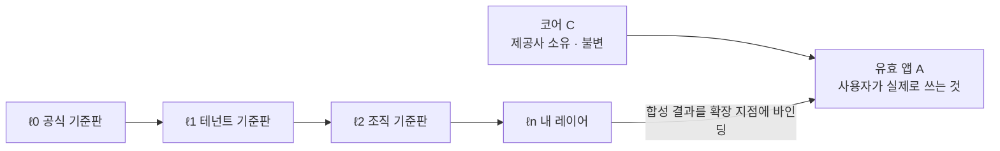
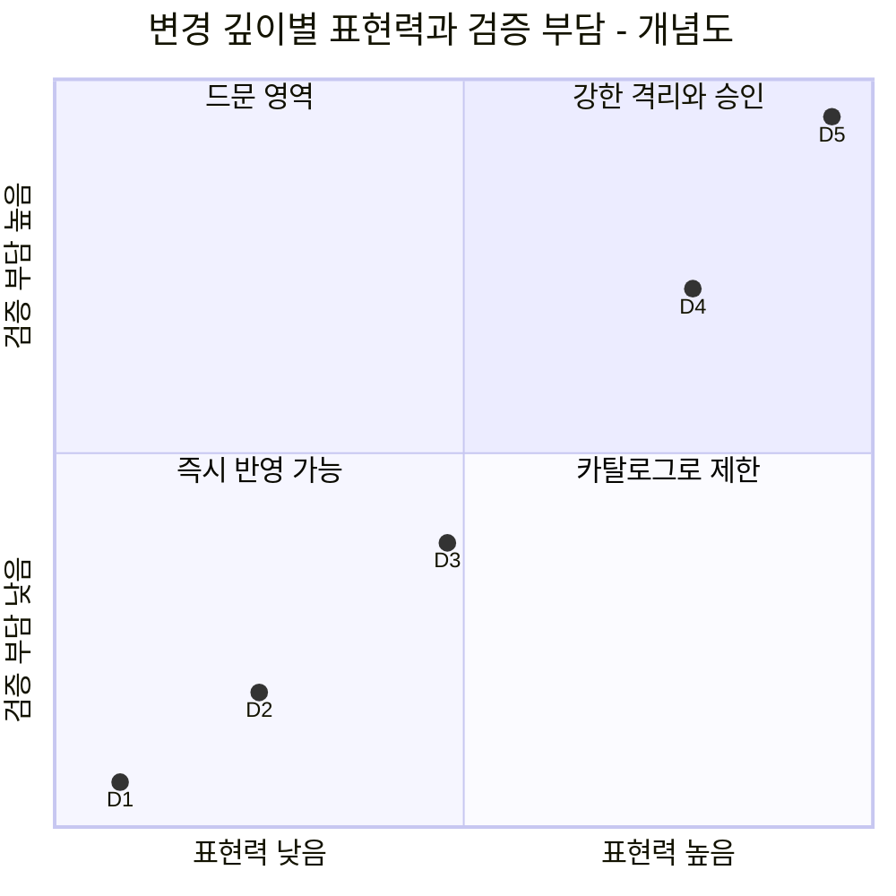
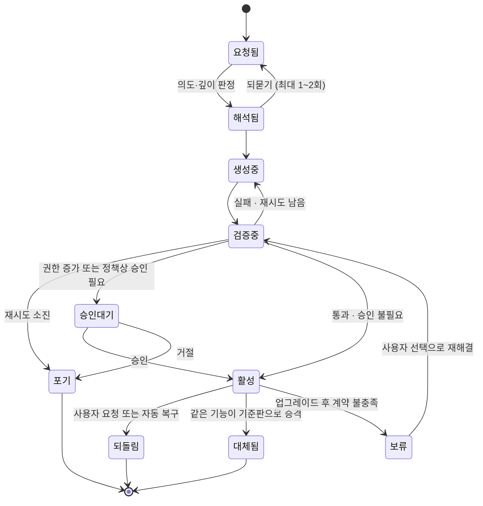

# 2. 핵심 모델 — 호스트, 레이어, 변경, 계약, 정책

> 이 장의 결론: Mallangable 시스템은 **불변 코어 위에 쌓인 레이어 스택**이고, 사용자의 모든 수정은 **의도·산출물·계약·권한을 가진 변경(δ)** 으로 표현된다. 아키텍처가 무엇을 하든 불변식 I1~I10을 깨면 안 된다.

이 장은 구현과 무관한 개념 모델입니다. 이후 장의 모든 컴포넌트·흐름·정책은 여기서 정의한 대상 위에서 동작합니다.

## 2.1 행위자 (Principals)

| 행위자 | 기호 | 역할 | 예 |
| --- | --- | --- | --- |
| 호스트 제공사 (Host Vendor) | `V` | 코어를 만들고 소유. 확장 지점을 정의 | 앱을 만든 회사 |
| 플랫폼 운영자 (Platform Operator) | `O` | 말랑 인프라(제어면)를 운영 | 보통 `V`와 같지만, Mallangable 호스팅 사업자일 수도 있음 |
| 테넌트 관리자 (Tenant Admin) | `T` | 한 고객 조직의 정책·기준판·예산을 관리 | 고객사 IT 관리자 |
| 조직 관리자 (Org Steward) | `G` | 테넌트 안 하위 조직의 기준판을 관리 | 팀 리드 |
| 사용자 (End User) | `U` | 자기 레이어를 수정 | 일반 직원, 개인 사용자 |
| 에이전트 (Agent) | `α` | 사용자·관리자 대신 변경을 만들거나 병합. **사람이 아닌 행위자** | 코드 생성 에이전트, 병합 에이전트 |

권한 위임 방향은 `V → O → T → G → U` 입니다. 에이전트 `α`는 이 사슬 위에 있지 않고, **항상 어떤 사람 행위자의 위임을 받은 단기 주체**로만 존재합니다(I4, I9).

## 2.2 호스트 (Host)

호스트 `H`는 네 요소의 묶음입니다.

```text
H = ⟨ C, X, K, Σ ⟩
  C : 코어(Core). 제공사가 배포하는 불변 부분. 사용자 레이어는 C를 바꾸지 않는다.
  X : 확장 지점(Extension Point)의 집합.
  K : 기능 권한(Capability)의 집합. 확장이 쓸 수 있는 능력의 이름표.
  Σ : 상태 스키마. 확장이 읽고 쓸 수 있는 데이터의 형태.
```

확장 지점 하나는 다음과 같이 정의합니다.

```text
x = ⟨ id, kind, d_min, in, out, stability ⟩
  id        : "sidebar.panel", "editor.on_save" 같은 안정적 식별자
  kind      : token | command | view | hook | service
  d_min     : 이 지점을 쓰는 데 필요한 최소 깊이 (2.6)
  in / out  : 지점이 주는 입력과 기대하는 출력의 스키마
  stability : stable | experimental | deprecated
```

호스트는 확장 지점과 권한의 목록을 **기계가 읽을 수 있는 기능 지도(capability map)** 로 노출해야 합니다(반드시). 에이전트가 API를 추측하게 두면 코어 패치(D5)로 미끄러지기 때문입니다. 코드베이스를 분석해 기능 지도를 자동 생성하는 접근은 [n.codes](https://github.com/yungookim/n.codes)가 보여 줬습니다.

## 2.3 레이어와 유효 앱

사용자가 실제로 쓰는 앱(유효 앱)은 코어 위에 레이어를 순서대로 합성한 결과입니다.

```text
Λ = [ ℓ0, ℓ1, …, ℓn ]          ℓ0 = 제공사 기준판, ℓn = 사용자 자신의 레이어
A = C ⊗ ( ℓ0 ⊕ ℓ1 ⊕ … ⊕ ℓn )
```

- `⊕` (레이어 합성): 같은 키를 건드리면 뒤의 레이어가 앞을 **덮어씁니다(override)**. 선언형 데이터의 기본 의미는 JSON Merge Patch(RFC 7396)입니다. 객체는 키 단위로 덮어쓰고, `null`은 그 키를 지우고, 배열은 통째로 바뀝니다. 배열을 항목 단위로 합치려면 확장 지점 스키마가 병합 키를 선언해야 합니다(6.6 R2). 코드 확장은 확장 지점의 슬롯 단위로 합성합니다.
- `⊗` (코어 적용): 합성된 레이어를 코어의 확장 지점에 바인딩합니다. 코어는 바뀌지 않습니다.
- `⊕`는 결합법칙을 만족해야 합니다(해야 함). 그래야 "기업 기준판 + 조직 기준판"을 미리 합쳐 캐시할 수 있습니다. 이를 위해 레이어끼리 미리 합칠 때 `null`(삭제 표지)을 지우지 않고 남깁니다(반드시). 그래야 합친 레이어를 나중에 적용해도 하나씩 적용한 결과와 같습니다.
- `⊕`와 6장 병합의 관계: `⊕`는 한 계보 안에서 레이어 **사이**를 합성하는 연산이고, 3-way 병합(6.4~6.6)은 한 레이어를 **새 상위 기준판 위로 옮길 때** 그 레이어 안의 수정에만 씁니다.



읽는 법: 오른쪽으로 갈수록 우선순위가 높습니다. 같은 지점을 두 레이어가 건드리면 사용자에게 가까운 레이어가 이기고, 이 '덮어씀'은 업그레이드 때 충돌 후보가 됩니다(6장).

## 2.4 변경 (Change)

사용자 수정의 원자 단위입니다.

```text
δ = ⟨ ι, a, κ, π, d, X_δ, prov ⟩
  ι    : 의도(Intent). 사람이 말한 목적의 요약. "오늘 마감인 일만 위로 올리고 싶다"
  a    : 산출물(Artifact). 선언형 데이터 또는 코드
  κ    : 계약(Contract). 수용 조건의 집합 (2.5)
  π    : 요구 권한. π ⊆ K
  d    : 깊이. D1~D5 (2.6)
  X_δ  : 건드리는 확장 지점들. X_δ ⊆ X
  prov : 출처. 요청자, 승인자, 에이전트, 모델, 부모 변경, 시각
```

같은 의도에서 나온 여러 수정은 같은 **기능(Feature)** 으로 묶입니다. 기능은 변경의 연속이며, 의도와 계약은 기능 단위로 유지됩니다.

## 2.5 계약 (Contract)

계약은 유효 앱 `A`의 **관찰 가능한 행동**에 대한 술어의 집합입니다.

```text
κ = { k1, k2, … },   k_i : A → { 참, 거짓 }
κ(A) = k1(A) ∧ k2(A) ∧ …
```

| 종류 | 예 | 결정성 | 비용 | 강도 |
| --- | --- | --- | --- | --- |
| 구조 질의 (dom/tree query) | "패널에 항목이 2개 보인다" | 결정적 | 낮음 | 강 |
| 단위 검사 (unit) | 순수 함수 입출력 | 결정적 | 낮음 | 강 |
| 스냅샷 (snapshot) | 렌더 결과 비교 | 결정적(환경 고정 시) | 중간 | 중 |
| 판정자 (judge) | 스크린샷을 보고 의도 충족 판정 | **확률적** | 높음 | 약 |

판정자 계약은 확률적이므로 단독으로 쓰면 안 됩니다(해야 함). 결정적 계약이 최소 하나 있어야 병합(6장)에서 근거로 쓸 수 있습니다.

계약이 이 모델의 중심인 이유: 업그레이드·공유·승격 때 코드 diff는 의미를 알려 주지 않습니다. **"이 변경이 무엇을 보장해야 하는가"가 기록돼 있어야** 기계가 병합 결과를 판정할 수 있습니다.

## 2.6 변경 깊이 계층 D1~D5

깊이는 산출물의 **표현력**이자 **위험 등급**입니다. W3C의 최소 권한 원칙은 "필요를 표현할 수 있는 가장 약한 언어를 고르라"고 권합니다. 약한 언어일수록 실행하지 않고도 분석할 수 있고, 재사용하기 쉽고, 보안을 지키기 쉽기 때문입니다([W3C TAG](https://www.w3.org/2001/tag/doc/leastPower.html)). Mallangable은 이 원칙을 사용자 변경에 적용합니다.

| 깊이 | 이름 | 산출물 | 표현력(계산 모델) | 실행 전 분석 | 예 |
| --- | --- | --- | --- | --- | --- |
| D1 | 외형 | 디자인 토큰, 스타일 값 | 유한 키-값 사상 | 완전 | "버튼을 크게, 색을 주황으로" |
| D2 | 조합 | 기존 명령의 조합, 단축키, 규칙 | 유한 명령 집합 위의 루프 없는(또는 횟수 제한) 매크로 | 완전 | "이 버튼 하나로 내보내기+메일 보내기" |
| D3 | 화면 | 승인된 컴포넌트 카탈로그 위의 선언형 UI 트리 + 데이터 바인딩 | 트리 구조 + 권한으로 제한된 질의 | 대부분 | "오늘 마감 목록 패널" |
| D4 | 동작 | 샌드박스 안의 임의 코드 | 튜링 완전, 기능 권한으로만 외부 접근 | 부분(실행해 봐야 앎) | "저장할 때 표를 자동 정렬" |
| D5 | 코어 | 코어 소스 수정 | 제한 없음 | 사실상 불가 | "렌더링 엔진 교체" |



읽는 법: 깊이가 한 단계 오를 때마다 할 수 있는 일과 검증해야 할 일이 함께 늘어납니다. 좌표는 순서를 보여 주는 개념도이며 측정값이 아닙니다.

규칙:
- **최소 깊이 원칙** (반드시): 에이전트는 계약 `κ`를 만족하는 가장 낮은 깊이로 변경을 만들어야 합니다. D2로 되는 일을 D4로 만들면 거부합니다.
- **D5 분리** (반드시): D5는 사용자 레이어가 아니라 제공사가 승인한 **코어 포크**로만 존재합니다. 일반 사용자 흐름에서 D5 요청은 '코어 기능 요청'으로 수집하는 것이 기본값입니다(해야 함). 이 수집 자체가 제공사 로드맵의 가장 정확한 수요 신호가 됩니다.
- 이 계층은 Ink & Switch가 인용한 "완만한 경사(gentle slope)"를 구현합니다. 단계마다 사용자가 새로 이해해야 할 것이 조금씩만 늘어납니다.

## 2.7 정책 (Policy)과 정책 격자

정책 `p`는 각 통제 손잡이(knob)에 대해 허용 범위를 정합니다(4장에서 상세). 정책 사이에는 "더 엄격하다"는 부분 순서가 있습니다.

```text
p ⊑ q   ⇔   p가 허용하는 모든 것은 q도 허용한다   (p가 q보다 엄격하거나 같다)
p ⊓ q   :  둘 다 허용하는 것만 허용하는 정책 (교집합, meet)
```

행위자 사슬을 따라 유효 정책은 교집합으로 계산됩니다.

```text
p_eff(U) = p_V ⊓ p_O ⊓ p_T ⊓ p_G ⊓ p_U
```

- **단조 축소** (반드시): 하위 행위자는 상위가 준 범위 안에서만 좁힐 수 있습니다. `p_child ⊑ p_parent`.
- 예외 하나: **사용자 권리 하한(floor)** 은 어떤 상위 정책도 제거할 수 없습니다(4.6). 예를 들어 "내 변경을 되돌릴 권리"는 하한입니다.

## 2.8 변경의 생애주기



읽는 법: **활성으로 가는 모든 길은 검증을 지납니다.** '보류'는 기준판 업그레이드 뒤 계약이 깨진 변경이 조용히 사라지지 않고 사용자 선택을 기다리는 상태입니다. 사용자가 고른 해결도 검증(G 게이트)을 다시 지나야 활성이 됩니다.

## 2.9 불변식 I1~I10

| # | 불변식 | 왜 필요한가 | 깨지면 생기는 일 | 집행 지점 |
| --- | --- | --- | --- | --- |
| I1 | **코어 불변**: 사용자 레이어의 어떤 변경도 `C`를 바꾸지 않는다 | 업데이트·지원·보안의 기준점 유지 | 사용자마다 다른 코어 → 업데이트 불가 | 경로 접근 통제, 서버 수신 검사 |
| I2 | **계약 동반**: 계약이 비어 있는 변경은 활성화되지 않는다 (`κ ≠ ∅`) | 병합·승격의 판정 근거 | 업그레이드 때 기능이 조용히 죽음 | 기록 단계 검사 |
| I3 | **되돌림 가능성**: 모든 활성 상태는 기록된 직전 상태를 가지며, 되돌림은 생성 없이 상수 시간에 끝난다 | 실험을 겁내지 않게 함 | 사용자가 고치기를 멈춤 | 상태면, 런타임 |
| I4 | **권한 단조성**: 권한 `π`는 권한을 가진 사람의 명시적 승인으로만 늘어난다. 에이전트는 스스로 권한을 늘릴 수 없다 | 프롬프트 인젝션·악성 공유물 방어 | 공유된 변경이 데이터를 빼냄 | 결정 지점(PDP), 런타임 브로커 |
| I5 | **정책 단조 축소**: `p_child ⊑ p_parent` (하한 제외) | 위임 체계의 일관성 | 하위 관리자가 상위 정책을 우회 | 정책 저장소 검사 |
| I6 | **가시성 = 격리 경계**: 어떤 행위자가 보면 안 되는 데이터는 그 행위자가 질의할 수 있는 어떤 맥락(대화하는 에이전트의 맥락 포함)에도 들어가지 않는다 | "에이전트에게 물어보면 다 나온다" 차단 | 소스 비공개 약속 위반 | 역할 분리, 출력 게이트 |
| I7 | **생성·판정 분리**: 산출물을 만든 에이전트 인스턴스와 그것을 판정하는 인스턴스는 다르다 | 자기 채점 편향 방지 | 검증이 형식만 남음 | 하네스 |
| I8 | **신뢰 경계 집행**: 최종 집행은 운영자가 통제하는 경계에서만 한다. 사용자 기기의 검사는 안내용이다. 운영자 경계가 있는 배치에만 적용되며, 서버가 없는 배치(P1·P5)는 이를 보장할 수 없다 | 클라이언트는 우회 가능 | 정책이 장식이 됨 | 서버 수신 검사, 샌드박스 재검증 |
| I9 | **의도 출처**: 모든 변경은 사람의 의도 또는 상위 변경으로 추적된다 | 감사·책임·병합 판단 | 출처 없는 변경이 쌓임 | 기록 규격 |
| I10 | **계약 보존 병합**: 병합 결과는 양쪽 계약을 모두 만족해야 하며, 불가능하면 사람에게 넘긴다 (`κ_up ∧ κ_down`) | 업데이트 생존의 정의 | 병합이 한쪽 기능을 몰래 지움 | 병합 파이프라인 |

준수 판정: 구현이 I1~I7, I9, I10 중 하나라도 **설계상** 보장하지 않으면(운영 실수가 아니라 구조적으로) Mallangable 준수 구현이라고 부르지 않습니다. I8은 Governed 등급 이상의 요건입니다(10.3).

## 2.10 예제: 할 일 앱에 세 가지 변경 넣기

가상의 호스트 "할 일 앱"이 아래 확장 지점을 노출한다고 합시다.

```yaml
extension_points:
  - id: theme.tokens        # D1
  - id: task.row.style      # D1~D2, 조건부 스타일 규칙
  - id: toolbar.command     # D2
  - id: sidebar.panel       # D3
  - id: task.on_complete    # D4, 이벤트 훅
capabilities: [tasks.read, tasks.write, net.slack.post, notify.local]
```

사용자 요청 세 개는 서로 다른 깊이로 떨어집니다.

```yaml
# 요청 1: "마감 지난 일은 빨간색으로 보여줘"  → D2 (조건부 스타일 규칙, 코드 없음)
- intent: 마감이 지난 일을 한눈에 구분하고 싶다
  depth: D2
  points: [task.row.style]
  artifact: { rule: { when: "task.due < today && !task.done", style: { color: "danger" } } }
  permissions: [tasks.read]
  contract:
    - { id: overdue-red, check: tree-query, given: "어제 마감·미완료 1건", expect: "해당 행 색상 = danger" }

# 요청 2: "이번 주 완료한 일을 요약하는 패널"  → D3 (선언형 UI)
- intent: 주간 회고 때 이번 주 완료 항목을 보고 싶다
  depth: D3
  points: [sidebar.panel]
  artifact: { ui: { type: list, source: "tasks where done_at in this_week", item: "{title}" } }
  permissions: [tasks.read]
  contract:
    - { id: only-this-week, check: tree-query, given: "이번 주 2건·지난주 1건", expect: "목록 2건" }

# 요청 3: "일을 완료하면 팀 슬랙에 알려줘"  → D4 (코드 + 외부 전송 권한)
- intent: 완료 사실을 팀에 자동으로 공유하고 싶다
  depth: D4
  points: [task.on_complete]
  artifact: { module: "on_complete.js" }       # 샌드박스 실행
  permissions: [tasks.read, net.slack.post]    # 권한 증가 → 사람 승인 필요 (I4)
  contract:
    - { id: posts-once, check: unit, given: "완료 이벤트 1회", expect: "slack.post 호출 1회" }
```

요청 1을 에이전트가 D4 코드로 만들려 하면 최소 깊이 원칙 위반으로 거부됩니다. 요청 3은 외부로 데이터를 보내는 권한이 새로 생기므로, 검증을 통과해도 사람이 승인하기 전에는 활성화되지 않습니다.

다음 장: [3. 설계 공간](03-design-space.md)
