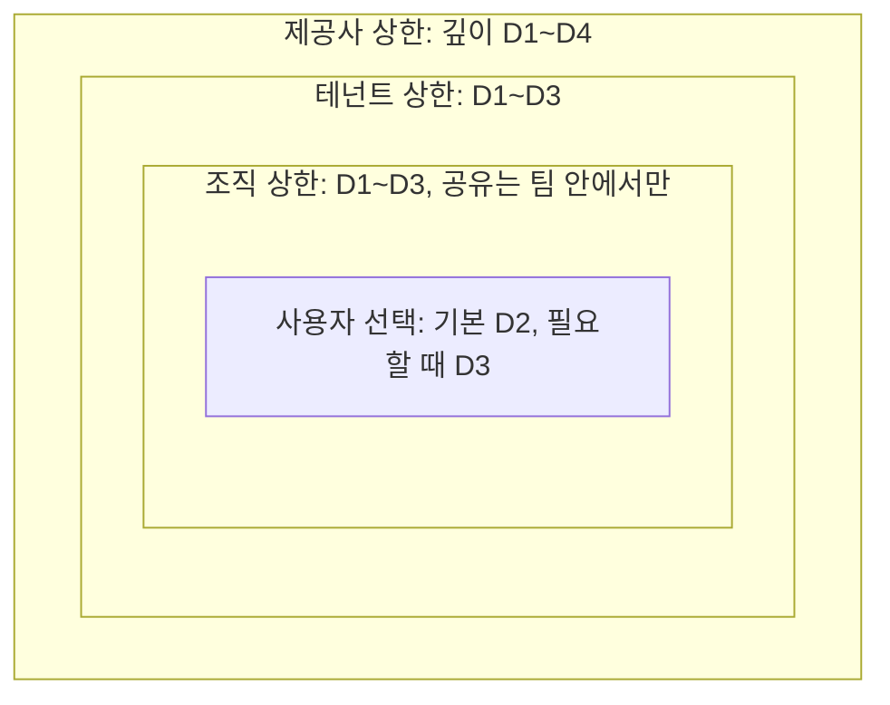
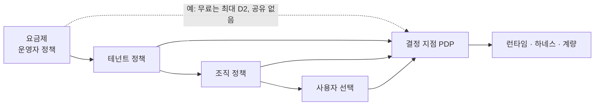

# 4. 통제 스펙트럼 — 사용자에게 무엇을 허용하고, 운영자는 무엇을 통제하나

> 이 장의 결론: 통제는 켜고 끄는 스위치가 아니라 **손잡이(knob)마다의 구간**이다. 상위 행위자는 구간의 **상한(ceiling)** 을 좁히고, 사용자는 그 안에서 고른다. 단, 어떤 정책도 지울 수 없는 **사용자 권리 하한(floor)** 7가지가 있다. 요금제·프리셋·테넌트 정책은 모두 이 구간을 다르게 자른 것일 뿐이다.

## 4.1 문제: 열면 위험하고, 닫으면 말랑하지 않다

- 너무 열면: 보안 사고, 지원 비용 폭증, 업데이트 불가능, 브랜드 일관성 붕괴.
- 너무 닫으면: 설정 화면과 다를 바 없고, 사용자는 결국 우회로(복사한 스크립트, 외부 자동화)를 찾습니다.

필요한 것은 **위임 가능한 연속 통제**입니다. 제공사는 플랫폼 전체의 위험 상한을, 테넌트는 자기 회사의 상한을, 조직은 팀의 상한을 정하고, 사용자는 남은 범위에서 자유롭게 고르는 구조입니다.

## 4.2 구간 위임 모델

각 손잡이 `k`는 위험 순서로 정렬된 값의 영역 `D_k`를 가집니다(예: 깊이 `D1 < D2 < … < D5`). 집합형 손잡이(예: 허용 권한 목록)는 포함 관계로 순서를 매깁니다.

```text
행위자 i가 손잡이 k에 대해 정하는 것:  구간 [f_i, c_i] ⊆ D_k
  c_i : 상한(ceiling). 이보다 위험한 값은 금지
  f_i : 하한(floor). 이보다 덜 주는 것은 금지 (사용자 권리 보장용)

위임 규칙 (반드시):      [f_child, c_child] ⊆ [f_parent, c_parent]
유효 구간:               [f_eff, c_eff] = ⋂ 사슬 위 모든 구간
사용자의 선택:           v_k ∈ [f_eff, c_eff],  기본값 d_k
```



읽는 법: 안쪽 상자는 바깥 상자보다 넓어질 수 없습니다. 사용자가 D4 기능을 원하면, 조직이 아니라 **테넌트 상한**에서 막힌다는 것을 시스템이 알려 줄 수 있어야 합니다("이 기능은 회사 정책상 허용되지 않아요. 요청은 관리자에게 전달할까요?").

이 모델의 장점:
- **설명 가능성**: 거부 이유를 "어느 층의 어떤 상한" 으로 정확히 말할 수 있습니다.
- **합성 가능성**: 교집합이라 순서와 무관하게 계산되고 캐시할 수 있습니다.
- **요금제와의 통일**: 요금제는 운영자가 거는 또 하나의 상한입니다(4.9).

## 4.3 손잡이 카탈로그

| 그룹 | 손잡이 | 값 영역 (위험 낮음 → 높음) | 권장 기본값 | 주로 정하는 행위자 | 관련 축 |
| --- | --- | --- | --- | --- | --- |
| 무엇을 | 최대 깊이 | D1 → D5 | D3 | 제공사·테넌트 | A1 |
| 무엇을 | 확장 지점 허용 목록 | 일부 → 전체 | stable 지점 전체 | 제공사 | A1 |
| 무엇을 | 기능 권한 상한 | 읽기 → 쓰기 → 외부 전송 | 내부 읽기·쓰기 | 테넌트 | A1, A4 |
| 무엇을 | 외부 네트워크 | 차단 → 허용 목록 → 전체 | 차단 | 테넌트 | A4 |
| 어떻게 | 활성화 방식 | gated → preview → live | preview | 테넌트·조직 | A11 |
| 어떻게 | 승인자 | 관리자 → 조직 관리자 → 본인 | 권한 증가 시 관리자 | 테넌트 | A11 |
| 어떻게 | 검증 강도 | 전체 게이트 → 깊이별 생략 | 깊이별 표준(5.8) | 제공사 | — |
| 어떻게 | 기준판 자동 적용 | defer → approve → auto | approve | 테넌트·사용자 | A7 |
| 누구와 | 공유 범위 | 없음 → 테넌트 → 공개 | 테넌트 | 테넌트 | A8 |
| 누구와 | 재공유 | 금지 → 원작자 허용 시 → 자유 | 원작자 허용 시 | 조직 | A8 |
| 누구와 | 코드 가시성 | hidden → own → open | 배포 형태에 따름 | 테넌트 | A5 |
| 얼마나 | 모델 조달 경로 | 테넌트 지정 → 선택 가능 | 테넌트 지정 | 테넌트 | A9 |
| 얼마나 | 품질 등급 | 절약 → 표준 → 고품질 | 표준 | 사용자 | A9 |
| 얼마나 | 예산 상한 | 낮음 → 높음 | 월 상한 + 초과 시 중단 | 테넌트·사용자 | A9 |
| 무엇을 보나 | 관리 가시성 | none → V0 → V3 | V1 (기업 V2) | 테넌트 | A10 |
| 무엇을 보나 | 플랫폼 반출 | 없음 → 집계 → 메타데이터 | 집계 | 테넌트(계약) | A10 |
| 무엇을 보나 | 보존 기간 | 짧음 → 김 | 이벤트 13개월 | 테넌트 | A10 |

## 4.4 스펙트럼 프리셋

손잡이를 하나하나 고르는 대신, 다섯 가지 프리셋으로 시작할 수 있습니다.


| 손잡이 | 잠금 | 큐레이션 | 가드레일 | 개방 | 실험실 |
| --- | --- | --- | --- | --- | --- |
| 최대 깊이 | D1 | D2 (설치는 D3까지) | D3 | D3 | D4 |
| 직접 생성 | 불가 | 불가, 설치만 | 가능 | 가능 | 가능 |
| 기능 권한 | 없음 | 승인 목록 | 내부 읽기·쓰기 | 내부 + 허용 목록 외부 | 요청 시 승인 |
| 활성화 | — | gated | preview | live (D1~D2) | preview |
| 공유 | 없음 | 받기만 | 테넌트 | 테넌트 | 테넌트 |
| 기준판 적용 | 자동 | 자동 | approve | auto | approve |
| 관리 가시성 | V0 | V1 | V2 | V1 | V2 |
| 어울리는 프로파일 | P4 일부 | P6 사용자 | P2, P3 | P1, P5 | P1 개발자 |

프리셋은 출발점입니다. 테넌트는 프리셋을 고른 뒤 개별 손잡이를 더 좁힐 수 있지만, 프리셋보다 넓힐 수는 없습니다(제공사 상한 안에서만).

## 4.5 결정 주체 매트릭스

`결정` = 값을 정함, `상한` = 하위가 고를 범위를 정함, `제안` = 요청만 가능, `—` = 관여 안 함.

| 결정 | 제공사 V | 운영자 O | 테넌트 T | 조직 G | 사용자 U | 에이전트 α |
| --- | --- | --- | --- | --- | --- | --- |
| 확장 지점·기능 지도 정의 | 결정 | — | — | — | 제안 | — |
| 플랫폼 최대 깊이 | 결정 | 상한 | 상한 | 상한 | 선택 | — |
| 기능 권한 부여 | 상한 | — | 상한·승인 | 승인(위임 시) | 요청·승인(자기 범위) | **불가** |
| 기준판 릴리스 | 공식판 결정 | — | 테넌트판 결정 | 조직판 결정 | — | 제안(승격) |
| 기준판 적용 시점 | — | — | 상한 | 상한 | 결정 | 준비만 |
| 공유 | — | 상한(공개 마켓 심사) | 상한 | 상한 | 결정 | — |
| 모델 경로·예산 | — | 상한(요금제) | 결정 | 상한 | 품질 선택 | — |
| 관리 가시성 | — | 반출 상한 | 결정 | — | 확인(하한) | — |
| 변경 생성 | — | — | — | — | 의도 제공 | 생성 |
| 변경 판정 | 검증 규칙 | — | 추가 규칙 | 추가 규칙 | 미리보기 확인 | 판정(생성자와 다른 인스턴스) |

에이전트 열이 핵심입니다. 에이전트는 **생성·판정·제안**은 하지만 **권한 부여·정책 변경·릴리스 결정**은 절대 하지 않습니다(I4, I9).

## 4.6 사용자 권리 하한 (Floor Rights)

어떤 테넌트 정책, 요금제, 프리셋도 아래 권리를 제거할 수 없습니다(반드시). 이 하한이 있어야 사용자가 겁내지 않고 고칩니다.

| # | 권리 | 내용 | 기업 환경에서의 해석 |
| --- | --- | --- | --- |
| F1 | 되돌리기 | 자기 레이어의 어떤 변경도 즉시 되돌릴 수 있다 | 상위 기준판 자체는 되돌릴 수 없지만, 그 위의 내 변경은 항상 가능 |
| F2 | 세이프 모드 | 사용자 레이어를 모두 끈 상태로 시작할 수 있다 | 업무 중단 없이 원인 격리 |
| F3 | 가시성 고지 | 누가 내 변경의 무엇을 볼 수 있는지 항상 확인할 수 있다 | "조직 관리자가 변경 설명까지 볼 수 있어요" 표시 |
| F4 | 내 것 내보내기 | 내가 만든 변경의 의도·계약을 표준 형식으로 내보낼 수 있다 | 산출물(코드) 내보내기는 정책으로 제한 가능 |
| F5 | 권한 확인 | 활성 변경이 가진 권한을 볼 수 있고, 권한 증가는 고지 없이 일어나지 않는다 | 공유받은 기능도 동일 |
| F6 | 비용 상한 | 내게 비용이 발생하면 상한을 정할 수 있고, 넘으면 멈춘다 | 테넌트 부담이면 테넌트 상한이 적용됨을 고지 |
| F7 | 설명 요구 | 어떤 변경에 대해서도 "무엇이 바뀌었나"를 일반 용어로 받을 수 있다 | 변경 영수증(8.6) |

## 4.7 정책 문서

정책은 상속 가능한 선언형 문서입니다. 전체 예시는 [`examples/policy.example.yaml`](../examples/policy.example.yaml), 스키마는 [`schemas/policy.schema.json`](../schemas/policy.schema.json)에 있습니다.

```yaml
policy:
  id: tenant/acme
  level: tenant
  inherits: operator/plan-business      # 요금제도 정책이다
  knobs:
    depth:            { ceiling: D3, default: D2 }
    capabilities:     { ceiling: [tasks.read, tasks.write, notify.local, net.allowlist] }
    network:          { ceiling: allowlist, allowlist: ["hooks.slack.com"] }
    activation:       { ceiling: preview, approver_on_capability_increase: tenant_admin }
    baseline_apply:   { ceiling: auto, default: approve }
    sharing:          { ceiling: tenant, reshare: author_opt_in }
    code_visibility:  { value: own }
    model_route:      { value: tenant_cloud }
    quality_tier:     { ceiling: standard, default: standard }
    budget:           { monthly: 3000, per_user_monthly: 30, on_exceed: stop }
    admin_visibility: { value: V2 }
    platform_export:  { ceiling: V0 }
  floors: [rollback, safe_mode, visibility_notice, export_intents, permission_view, spend_cap, receipt]
```

## 4.8 정책 결정 절차

모든 요청은 `(주체, 행동, 대상, 맥락)`으로 표현되고, 결정 지점(PDP)은 `허용 / 거부 / 승인 필요` 중 하나와 **의무(obligation)** 를 돌려줍니다. 의무는 "허용하되 반드시 해야 하는 일"입니다(기록, 미리보기, 알림 등).

```text
decide(req):
  p ← effective_policy(req.subject)            # 사슬 위 정책의 교집합 (캐시 가능)
  if req.action ∈ FLOOR_ACTIONS:                # 되돌리기·세이프 모드·내보내기 등
      return 허용, 의무=[기록]
  for k in knobs_touched(req):
      if value(req, k) ∉ [p.f_k, p.c_k]:
          return 거부, 이유=(k, 상한을 정한 층)   # "테넌트 정책: 최대 깊이 D3"
  if raises_capabilities(req):
      return 승인 필요, 승인자=p.approver_for(req.capabilities_delta)
  if p.activation(req.depth) == gated:
      return 승인 필요, 승인자=p.gate_approver
  return 허용, 의무=obligations(p, req)         # 예: preview, 감사 기록, 비용 계량
```

배치 원칙:
- **권위 있는 PDP는 운영자 경계(서버)에 있다(I8).** 사용자 기기에는 정책 사본을 두어 빠른 안내를 하되, 최종 판정은 서버가 다시 합니다.
- 오프라인 개인 모드(P1)에는 서버가 없으므로 기기의 PDP가 유일합니다. 이 경우 정책은 "사용자 자신을 보호하는 안전장치"이지 강제 수단이 아닙니다. 문서와 UI에서 이 차이를 숨기지 않습니다. 같은 이유로 서버가 없는 배치(P1·P5)는 I8을 보장하지 못하므로 준수 등급이 Core까지이며 Governed는 될 수 없습니다(10.3).
- **정책 엔진 어댑터** (할 수 있음): 손잡이 구간을 정책 언어로 옮겨 PDP를 구현할 수 있습니다. Cedar는 forbid가 permit을 이기고 맞는 permit이 없으면 거부하며, 결정을 만든 정책 id를 함께 돌려줍니다. 이 id를 `거부(이유·층)`와 영수증(8.6)의 근거로 씁니다.
- **I5 기계 검증** (해야 함): 정책을 저장할 때 `p_child ⊑ p_parent`를 검사합니다. Cedar로 옮긴 경우 SymCC의 포함 검사(`check_implies`)로 반례와 함께 증명할 수 있습니다. 같은 도구의 `check_never_errors`도 함께 돌립니다. Cedar는 평가 오류가 난 정책을 건너뛰므로, 오류 나는 forbid는 조용히 열린 채로 남기 때문입니다.
- **승인의 범위와 수명** (반드시): `승인 필요`에 대한 사람의 답은 범위를 가집니다. **이번만**(이 요청 하나), **이 작업 동안**(이 생성 세션이 끝날 때까지), **항상**(이 사용자·이 레이어에서 계속)입니다. "항상"은 승인한 **대상의 지문**(기능의 content_hash와 권한 목록)에 묶입니다. 기능 내용이나 권한이 바뀌면 승인이 사라지고 다시 묻습니다. 승인 화면에는 "항상"의 범위를 문장으로 적고, "항상"을 "거부" 바로 옆에 두지 않습니다. 긍정 답이 아닌 모든 것(창 닫기, 다른 말로 대답, 중단, 시간 초과)은 거부입니다. 권한을 늘리지 않는 읽기 전용 행동은 묻지 않습니다(승인 피로, 4.10). ThinkRail의 MCP 도구 호출 확인이 같은 구조입니다(거부 · 이번만 · 이 대화에서 · 항상. "항상"은 서버 `command`+`args` 또는 `url`의 SHA-256에 묶임, [JetBrains/thinkrail `agent/mcp/SPEC.md`](https://github.com/JetBrains/thinkrail/blob/c10f8808cee693e4abffeeb1844a132ed0a91cc5/packages/server/src/agent/mcp/SPEC.md#L129-L150)).
- **하한은 엔진보다 먼저**: forbid 우선 규칙 때문에 권리 하한(F1~F7)을 일반 permit으로 넣으면 상위 forbid가 지울 수 있습니다. 위 의사 코드처럼 `FLOOR_ACTIONS` 판정을 엔진 호출 앞에 둡니다.

## 4.9 요금제 = 정책 상한

요금제를 별도 시스템으로 만들지 말고, 운영자가 거는 정책으로 표현합니다.



이렇게 하면 업그레이드 권유도 자연스럽습니다. 거부 이유가 "요금제 상한"이면 그 순간이 가장 정확한 업셀 지점입니다(9.7).

## 4.10 고민할 질문

- 테넌트가 D4를 열었을 때, 그 코드의 결함으로 생긴 피해는 누구 책임인가? 약관과 정책 문서가 같은 말을 해야 합니다.
- 하한 F4(내보내기)와 기업의 지식재산 보호가 충돌할 때, 의도·계약만 내보내는 절충이 충분한가?
- 프리셋 사이를 옮길 때 이미 활성인 변경이 새 상한을 넘으면? 권장: 즉시 끄지 말고 '보류' 상태로 두고 사용자에게 알린다.
- 승인 피로: 승인 요청이 주당 몇 건을 넘으면 승인자가 내용을 읽지 않게 되는가? 이 수치를 측정해 자동 승인 범위를 조정해야 합니다.

다음 장: [5. 참조 아키텍처](05-reference-architecture.md)
