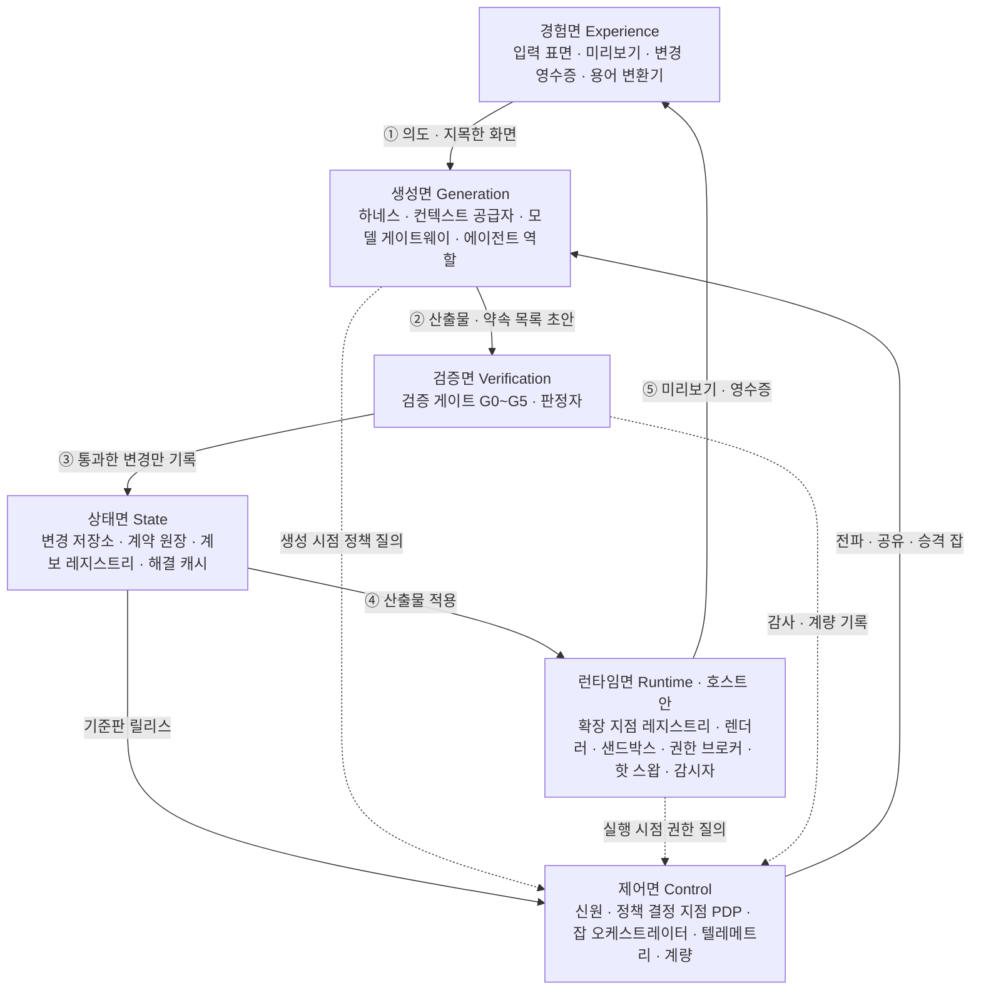
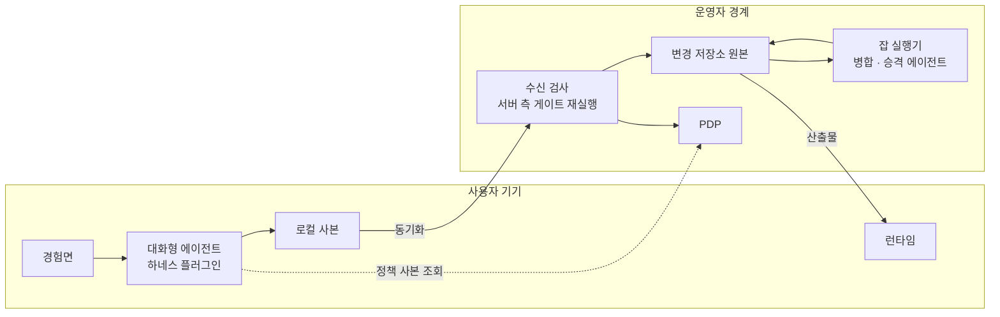
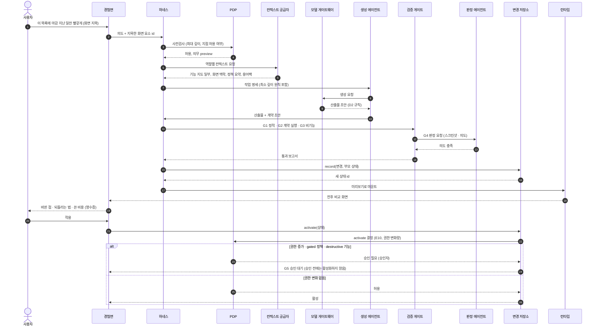
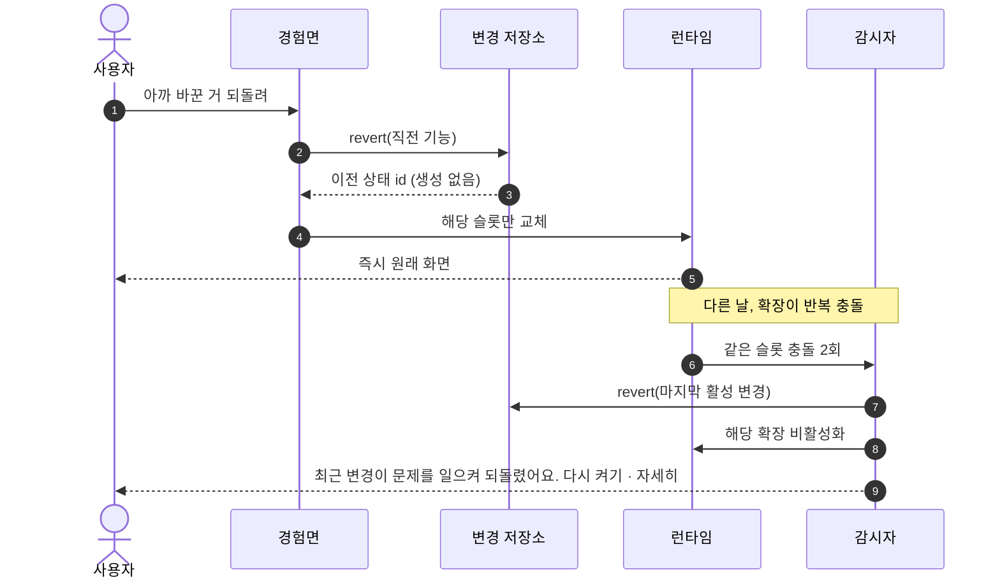
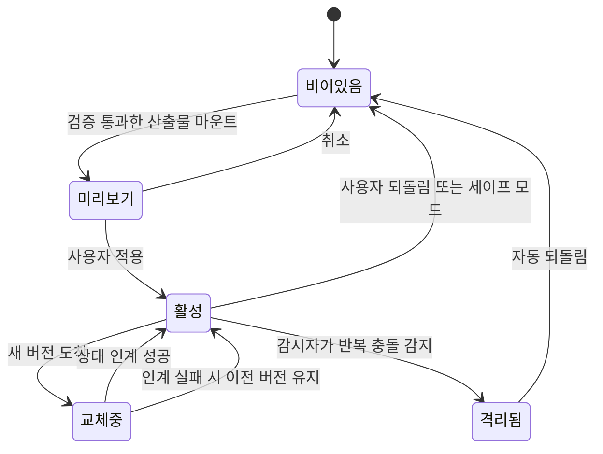

# 5. 참조 아키텍처 — 평면, 컴포넌트, 포트, 흐름, 하네스

> 이 장의 결론: Mallangable 시스템은 **6개 평면**으로 나뉜다. 사용자와 만나는 **경험면**, 호스트 안에서 변경을 실행하는 **런타임면**, AI가 변경을 만드는 **생성면**, 변경을 판정하는 **검증면**, 이력을 지키는 **상태면**, 정책·과금·감사를 맡는 **제어면**. 평면 사이는 **포트(인터페이스)** 로만 연결하고, 구현(어댑터)은 3장의 축 선택에 따라 갈아 끼운다.

## 5.1 전체 구조



읽는 법: 실선 ①~⑤가 변경 하나의 고리입니다. 의도가 생성면으로 가고, 검증을 통과한 것만 기록되고, 기록된 것만 런타임에 적용되고, 결과가 미리보기·영수증으로 사용자에게 돌아옵니다. 기준판이 새로 나오면 제어면이 전파 잡을 만들어 같은 고리를 다시 돌립니다. 점선은 정책 질의입니다. **생성 시점(하네스)과 실행 시점(런타임 브로커)이 같은 PDP에 묻는다**는 점이 핵심입니다. 두 시점의 권한 판단이 갈라지면 "만들 때는 허용됐는데 실행할 때는 금지" 같은 틈이 생깁니다. 평면 안의 컴포넌트는 아래 표와 5.3의 포트 정의에 있습니다.

### 평면별 책임

| 평면 | 책임 | 반드시 지킬 것 |
| --- | --- | --- |
| 경험면 | 의도 수집, 진행 표현, 미리보기, 영수증, 일반 용어 | 사용자에게 보이는 모든 문자열은 용어 변환기를 지남 |
| 생성면 | 의도 해석, 산출물 생성, 병합, 승격 | 모든 쓰기는 도구 호출로만. 원시 저장소 명령 금지 |
| 검증면 | 정책 사전검사, 정적 검사, 계약 실행, 비기능 검사, 판정 | 생성자와 판정자 분리(I7) |
| 런타임면 | 확장 로딩·격리·실행, 권한 중개, 핫 스왑, 복구 | 확장은 브로커 외의 경로로 호스트에 닿지 않음 |
| 상태면 | 레이어 이력, 계약, 계보, 해결 캐시 | 모든 활성 상태는 되돌릴 수 있음(I3) |
| 제어면 | 신원, 정책, 잡, 감사, 계량 | 권위 있는 집행은 여기서만(I8) |

## 5.2 배치 뷰 — 에이전트 위치(A3)에 따라

| 컴포넌트 | `client` | `hybrid` | `server` |
| --- | --- | --- | --- |
| 입력 표면, 미리보기 | 기기 | 기기 | 기기 |
| 에이전트 하네스 | 기기 (사용자가 띄운 에이전트 + 하네스 플러그인) | 대화형 생성: 기기 / 병합·승격: 서버. `own`이면 기기의 생성자에게 상위 레이어 산출물을 주지 않음(5.10, I6) | 서버 샌드박스 |
| 모델 게이트웨이 | 기기 (사용자 구독·키) | 기기 + 서버 | 서버 |
| 검증 게이트 | 기기 (서버 있으면 재검증) | 기기 1차 + 서버 재검증 | 서버 |
| 런타임 | 기기 | 기기 | 기기 (산출물만 내려받음) |
| 변경 저장소 | 기기 (동기화 선택) | 서버가 원본, 기기는 사본 | 서버만 |
| PDP | 기기 (안내용) | 서버 (기기는 캐시) | 서버 |



읽는 법(hybrid 기준): 사용자는 기기에서 대화하며 고치고, 그 결과는 서버 수신 검사를 다시 통과해야 원본이 됩니다. 기준판 병합처럼 사용자 수천 명에게 반복되는 작업은 서버가 맡습니다.

## 5.3 포트와 어댑터

평면 사이 경계를 인터페이스로 정의합니다. 아래는 언어 중립 표기(TypeScript 문법 차용)입니다. 구현은 축 선택에 맞는 어댑터를 끼웁니다.

```ts
// ── 런타임면 ─────────────────────────────────────────
interface ExtensionPointRegistry {
  list(filter?: { depth?: Depth; kind?: PointKind }): ExtensionPoint[];
  capabilityMap(): CapabilityMap;               // 기계 판독형. 에이전트 컨텍스트로 공급
}
interface SandboxHost {                         // 어댑터: SES Compartment | iframe | Worker | 프로세스 | 마이크로VM
  mount(artifact: Artifact, grants: CapabilityGrant[], prevState?: unknown): SlotHandle;
  unmount(slot: SlotHandle): Promise<unknown>;  // 상태 인계용 스냅샷 반환
  limits(slot: SlotHandle): ResourceBudget;
}
interface CapabilityBroker {
  call(slot: SlotHandle, cap: CapabilityId, args: unknown): Promise<unknown>;  // 매 호출 PDP 질의 + 감사 기록
}

// ── 생성면 ───────────────────────────────────────────
interface AgentHarness {                        // 어댑터: 상용 에이전트 + 플러그인 | 자체 에이전트 루프
  run(task: Task, role: AgentRole, budget: Budget): AsyncIterable<HarnessEvent>;
}
interface ContextProvider {
  build(task: Task, role: AgentRole): Context;  // 역할별로 볼 수 있는 것만 (I6)
}
interface ModelPort {                           // 어댑터: 사용자 구독(공식 클라이언트 경유) | API 키 | 크레딧 | 테넌트 클라우드 | 기기 모델
  complete(req: ModelRequest, route: Route): Promise<ModelResponse>;
  estimate(req: ModelRequest, route: Route): CostRange;
}

// ── 검증면 ───────────────────────────────────────────
interface ValidationPort {
  run(change: ChangeDraft, gates: GateId[]): Promise<GateReport>;
}
interface ContractRunner {
  check(contract: Contract, app: EffectiveAppHandle): Promise<ContractResult>;
}

// ── 상태면 ───────────────────────────────────────────
interface ChangeStore {                         // 어댑터: Git식 저장소 | CRDT 문서 | 스냅샷 DB
  record(change: Change, parent: StateId): StateId;   // 원시 커밋 명령 대신 이것만 노출
  activate(state: StateId): void;
  revert(target: StateId | FeatureId): StateId;        // 생성 없이 상수 시간 (I3)
  history(scope: Scope): ChangeRecord[];
}
interface LineageRegistry {
  parent(node: LayerNodeId): LayerNodeId | null;
  release(node: LayerNodeId, tag: BaselineTag): void;
  descendants(node: LayerNodeId): LayerNodeId[];        // 위상 순서
}
interface ResolutionCache {
  lookup(key: ConflictClassKey, scope: VisibilityScope): Resolution | null;
  store(key: ConflictClassKey, scope: VisibilityScope, r: VerifiedResolution): void;
}

// ── 제어면 ───────────────────────────────────────────
interface PolicyDecisionPoint {
  decide(req: AccessRequest): Decision;          // 허용 | 거부(이유·층) | 승인 필요(승인자) + 의무
}
interface JobOrchestrator {
  submit(job: PropagationJob | ShareJob | PromotionJob): JobId;
}
interface TelemetrySink { emit(e: Event & { visibility: VisibilityLabel }): void; }
interface MeteringPort  { record(u: UsageRecord): void; entitlement(subject: Subject): PlanLimits; }

// ── 경험면 ───────────────────────────────────────────
interface LexiconPort {
  render(conceptId: string, level: "basic" | "practitioner" | "developer", locale: string, domain?: string): string;
  lint(text: string, level: string): LexiconViolation[];   // 일반 사용자 화면의 개발 용어 탐지
}
```

설계 원칙:
- `ChangeStore`는 **원시 저장소 명령(commit, push, merge, reset)을 노출하지 않습니다.** 에이전트가 쓸 수 있는 쓰기는 `record`·`activate`·`revert`뿐이고, 이 경계 덕분에 기록 규격(6.11)이 통일됩니다.
- `ModelPort`의 '사용자 구독' 어댑터는 공급사가 허용하는 경로만 구현합니다(8.10).

## 5.4 흐름 1 — 변경 하나가 만들어지는 과정



핵심 지점:
- 3단계의 사전검사로 **생성 전에** 불가능한 요청을 걸러 비용을 아낍니다.
- 7단계의 작업 명세에 최소 깊이 원칙이 들어갑니다. 생성 에이전트가 D4로 만들면 11단계 G1에서 거부됩니다.
- 판정(12~13단계)은 생성 에이전트와 다른 인스턴스가 합니다(I7).
- 기록(15단계)이 활성화 요청(21단계)보다 먼저입니다. 그래서 적용한 모든 상태는 되돌릴 수 있습니다(I3).
- 활성화도 PDP를 거칩니다(22단계, E10). 경험면이 저장소를 불러도 권한이 늘거나 gated 정책이면 G5 승인 전까지 활성 상태가 되지 않습니다.

## 5.5 흐름 2 — 되돌리기와 자동 복구



되돌리기는 **모델을 부르지 않습니다.** 포인터 이동이므로 비용이 0이고 시간 등급 T0(8.4)에 속합니다. "되돌리기가 공짜"라는 사실이 사용자가 실험을 시작하게 만드는 가장 강한 동기입니다.

### 되돌리기는 본 것을 근거로

사용자가 화면을 보는 동안에도 활성 상태는 바뀔 수 있습니다. 기준판 전파(6.5), 다른 기기의 적용, 감시자의 자동 복구가 그렇습니다. 그래서 되돌리기 요청은 **사용자가 본 상태의 id**를 함께 보냅니다: `revert(feature, expect=본 상태 id)`.

- 지금 상태가 `expect`와 다르면 아무것도 바꾸지 않습니다(반드시). 대신 지금 상태를 보여 주고 다시 고르게 합니다. 엉뚱한 상태를 되돌리면 권리 하한 F1이 오히려 사고가 됩니다.
- 되돌리기 결과는 새 상태 id를 돌려주고, 그 id로 **같은 연산을 한 번 더** 하면 되살리기가 됩니다. 되살리기용 별도 장치를 두지 않습니다(해야 함).
- 기록이 사라져 되돌리거나 되살릴 수 없으면 조용히 넘어가지 않고 "더 이상 되돌릴 수 없어요"라고 알립니다(반드시).

ThinkRail의 diff 되돌리기도 같은 규칙을 씁니다. 클라이언트는 내용을 보내지 않고 본 것의 해시만 보내며, 다르면 `STALE_VIEW`로 거부합니다([JetBrains/thinkrail `changes/SPEC.md`](https://github.com/JetBrains/thinkrail/blob/c10f8808cee693e4abffeeb1844a132ed0a91cc5/packages/server/src/changes/SPEC.md#L39-L43), 조사 노트 [T1·T2](research/thinkrail-analysis.md)).

## 5.6 하네스

### 정의

하네스는 **비결정적인 에이전트를 감싸는 결정적 외피**입니다. 에이전트가 무엇을 생각하든, 하네스는 다음 다섯 가지를 강제합니다.

| 책임 | 내용 | 구현 수단 |
| --- | --- | --- |
| 절차 | 깊이 판정 → 계약 작성 → 산출물 → 검증 → 기록 → 활성화 요청 순서 | 스킬·작업 명세, 종료 전 검사 훅 |
| 도구 경계 | 허용된 도구만, 허용된 경로만 | 도구 목록 제한, 경로 접근 훅 |
| 정책 훅 | 생애주기 이벤트마다 PDP 질의 | 이벤트 모델(아래) |
| 예산 | 토큰·시간·재시도 상한 | 모델 게이트웨이 계량, 잡 예산 |
| 출력 계약 | 사용자·다른 에이전트에게 나가는 형식 | 스키마 검사, 출력 게이트 |

에이전트 스킬 표준(SKILL.md)은 절차를 이식 가능하게 배포하는 좋은 수단이지만, 권한 강제는 각 에이전트 구현에 맡겨져 있습니다. 표준의 `allowed-tools` 필드도 실험적이라 에이전트마다 지원이 다릅니다([Agent Skills 명세](https://agentskills.io/specification)). 그래서 **스킬은 절차를, 하네스는 강제를** 맡도록 나눕니다.

### 벤더 중립 이벤트 모델

| id | 이벤트 | 시점 | 막을 수 있나 | 대표 정책 |
| --- | --- | --- | --- | --- |
| E1 | `session.start` | 세션 시작·재개 | 아니오 | 정책 요약·기능 지도·대기 중 업그레이드를 맥락에 주입 |
| E2 | `intent.submit` | 사용자 요청 직후, 모델 처리 전 | 예 | 깊이 분류, D5는 코어 요청으로 수집, 소스 열람 유도 차단(hidden) |
| E3 | `plan.ready` | 에이전트가 계획을 확정 | 예 | 최소 깊이 위반 계획 거부 |
| E4 | `tool.before` | 도구 실행 전 | 예 | 경로 접근 통제, 원시 저장소 명령 차단, 외부 전송 차단 |
| E5 | `tool.after` | 도구 실행 후 | 피드백만 | 증분 검증 결과를 에이전트에 돌려줌, 출력 정화 |
| E6 | `permission.request` | 권한 결정 필요 | 결정으로 | 사람 승인 카드로 라우팅 |
| E7 | `batch.after` | 병렬 도구 호출 묶음 종료 | 예 | 누적 변경량이 크기 규칙 80% 넘으면 기능 단위 기록 지시 |
| E8 | `artifact.ready` | 산출물 초안 완성 | 예 | 검증 게이트 실행 |
| E9 | `record.before` | 변경 기록 직전 | 예 | 계약 존재·기록 규격·크기 검사 |
| E10 | `activate.before` | 활성화 직전 | 예 | 권한 증가면 승인 필요 |
| E11 | `stop.before` | 에이전트 종료 직전 | 예 | 미검증·미기록 변경이 있으면 종료 거부 |
| E12 | `subagent.stop` | 하위 에이전트 종료 | 예 | 판정 결과 스키마 검사 |
| E13 | `output.before` | 사람·다른 에이전트로 나가기 직전 | 치환 가능 | 출력 게이트(코드 유출 탐지, 용어 변환) |
| E14 | `merge.conflict` | 병합 충돌 발견 | — | 해결 사다리 진입(6.6) |
| E15 | `compact.before` | 맥락 압축 직전 | 아니오 | 진행 상태를 원장에 기록 |
| E16 | `session.end` | 세션 종료 | 아니오 | 텔레메트리 전송 |

### 매핑 예: Claude Code 훅

Claude Code 훅은 30개 이상의 이벤트, 다섯 종류의 처리기(명령·HTTP·MCP 도구·프롬프트·에이전트), 관리자 설정으로 사용자 훅을 막는 옵션, 훅 실패 시 동작을 막는 `onFailure: "block"`을 제공합니다([Claude Code 훅 문서](https://code.claude.com/docs/en/hooks.md)). 위 이벤트는 대략 다음처럼 대응합니다.

| Mallangable 이벤트 | Claude Code 훅 이벤트 |
| --- | --- |
| E1 `session.start` | `SessionStart` |
| E2 `intent.submit` | `UserPromptSubmit` |
| E4 `tool.before` | `PreToolUse` |
| E5 `tool.after` | `PostToolUse` (`updatedToolOutput`으로 결과 치환 가능) |
| E6 `permission.request` | `PermissionRequest` |
| E7 `batch.after` | `PostToolBatch` |
| E11 `stop.before` | `Stop` ¹ |
| E12 `subagent.stop` | `SubagentStop` ¹ |
| E15 `compact.before` | `PreCompact` |
| E16 `session.end` | `SessionEnd` |
| E3, E8, E9, E10, E13, E14 | 대응 이벤트 없음 → Mallangable 도구(MCP 서버) 안에서 직접 발생시킴 |

¹ `onFailure: "block"`은 v2.1.295 이상의 command·http 훅에서만 동작하고, `Stop`·`SubagentStop`에는 효과가 없습니다. 훅이 실패하면 E11·E12는 열린 채로 지나갑니다. 그래서 E11·E12를 막는 관문으로 믿지 않습니다. 미검증·미기록 변경 검사는 MCP 도구 쪽(`ChangeStore.record()`·`activate()`)에서도 강제합니다.

다른 에이전트 런타임도 같은 방식으로 대응표를 만들면 됩니다. 대응 이벤트가 없는 것은 **도구 쪽에서 강제**합니다. 예를 들어 E9 `record.before`는 `ChangeStore.record()` 안에서 검사합니다.

대응표는 런타임 판이 바뀌면 낡습니다(위 각주 ¹이 그 예입니다). 그래서 대응표 항목마다 세 가지를 적습니다(해야 함): **무엇을 확인했나**(확인한 동작과 출처), **언제 다시 보나**(런타임 판 갱신 때), **언제 지우나**(런타임이 같은 기능을 직접 제공하면 하네스 쪽 보완을 지움). 판 번호는 의존성 고정 파일 한 곳에만 두고 명세에 다시 적지 않습니다. ThinkRail은 엔진 결함을 메우는 적응마다 이렇게 "다시 볼 것"과 "지워도 되는 조건"을 적은 호환성 대장을 둡니다([JetBrains/thinkrail `pi-compatibility.md`](https://github.com/JetBrains/thinkrail/blob/c10f8808cee693e4abffeeb1844a132ed0a91cc5/pi-compatibility.md#L11-L16)).

Codex CLI도 같은 방식으로 대응됩니다(**공식 문서 확인 필요**): E1 `SessionStart`, E2 `UserPromptSubmit`, E4 `PreToolUse`, E5 `PostToolUse`, E6 `PermissionRequest`, E11 `Stop`, E12 `SubagentStop`, E15 `PreCompact`. 이 목록은 Codex 공식 문서가 아니라 Harness²가 훅 설정을 검사할 때 쓰는 이벤트 집합([google-research/harness2 `substrate/codex.py`](https://github.com/google-research/harness2/blob/1cfe254e8d25b15f37048c3730134686abe60335/harness2/substrate/codex.py#L58-L72))에서 가져왔습니다. 반영 전 Codex 공식 문서와 대조해야 합니다.

경험면은 하네스 이벤트를 그대로 받지 않고 사용자용 진행 신호로 받습니다. [AG-UI](https://docs.ag-ui.com/concepts/events)를 전송 규격으로 쓰면 다음처럼 대응합니다.

| Mallangable | AG-UI | 비고 |
| --- | --- | --- |
| E2 접수 ~ E11 종료 | `RUN_STARTED` · `RUN_FINISHED` · `RUN_ERROR` | |
| 상태어 4개(8.5) | `STEP_STARTED` · `STEP_FINISHED` | step 이름을 상태어 id로 고정 |
| 부분 미리보기(8.5) | `STATE_SNAPSHOT` · `STATE_DELTA`(RFC 6902) | "아직 확인 전" 표시 유지 |
| E6 `permission.request`, 2.8 `승인대기` | `RUN_FINISHED`의 `outcome.type = "interrupt"` → 다음 실행의 `resume[]` | 승인은 새 실행으로 이어짐([AG-UI interrupt](https://docs.ag-ui.com/concepts/interrupts)) |

완료 신호는 하나뿐입니다(반드시). 많은 런타임에서 "한 번의 시도가 끝남"과 "일이 끝남"은 다릅니다. 시도가 끝난 뒤에도 재시도·맥락 압축·대기 중인 후속 요청으로 일이 이어질 수 있습니다. 경험면은 하네스가 E11을 통과시킨 뒤에만 `준비됐어요`를 보여 주고, 시도 경계에서는 상태어를 바꾸지 않습니다. `승인대기`처럼 사람 입력을 기다리는 상태는 **수준 신호**입니다. 사용자가 화면을 봤다고 꺼지지 않고, 입력이 들어와야 꺼집니다. ThinkRail은 `agent_end`를 시도 경계로, `agent_settled`만 완료로 다룹니다([JetBrains/thinkrail `architecture.md` 결정 8](https://github.com/JetBrains/thinkrail/blob/c10f8808cee693e4abffeeb1844a132ed0a91cc5/architecture.md#L141-L156)).

서버 잡을 외부 에이전트에 맡길 때는 [A2A](https://a2a-protocol.org/latest/specification/) 작업 상태(`TASK_STATE_INPUT_REQUIRED`·`TASK_STATE_AUTH_REQUIRED`)가, MCP 도구 안에서는 다중 왕복 요청(`resultType: "input_required"`, [MCP 2026-07-28](https://modelcontextprotocol.io/specification/2026-07-28/changelog))이 같은 자리를 맡습니다.

주의: 사용자 기기의 훅은 사용자가 끌 수 있습니다. 기기 하네스의 훅은 안내이고, 최종 강제는 서버 수신 검사입니다(I8).

형식이 틀린 훅 설정은 많은 런타임에서 오류 없이 **아예 실행되지 않습니다.** 즉 실패하면 열린 채로 남습니다. 하네스 플러그인은 훅 설정을 쓰는 시점에 런타임이 받는 이벤트 이름·처리기 형식으로 검사하고(MUST), 세션 시작(E1) 때 훅이 실제로 등록됐는지 확인합니다(MUST). 에이전트는 정책 훅·가드레일 파일을 고칠 수 없습니다(도구 경계, E4). Harness²도 같은 이유로 Codex 훅 파일을 쓰는 시점에 검사합니다([google-research/harness2 `core/tree.py`](https://github.com/google-research/harness2/blob/1cfe254e8d25b15f37048c3730134686abe60335/harness2/core/tree.py#L216-L251)).

## 5.7 에이전트 역할

| 역할 | 하는 일 | 읽기 | 쓰기 | 외부 통신 | 비고 |
| --- | --- | --- | --- | --- | --- |
| 해석자 Interpreter | 의도 해석, 되묻기, 작업 명세 작성 | 사용자 대화, 기능 지도 | 작업 명세 | 모델만 | hidden 모드에서는 코드를 절대 보지 않음 |
| 생성자 Builder | 산출물·계약 생성 | 자기 레이어, 기능 지도 | 허용 경로의 초안 | 모델·패키지 미러 | 원시 저장소 명령 불가 |
| 기록자 Curator | 기록 규격화, 분할·합치기 | 변경분 | 기록 메타데이터 | 없음 | 규칙 + 소형 모델 |
| 판정자 Reviewer | 의도 충족·품질 판정 | 읽기 전용 | 판정 결과 | 없음 | 생성자와 다른 인스턴스(I7) |
| 병합자 Merger | 기준판·공유 병합 충돌 해결 | 대상 레이어 + 상위 릴리스 | 충돌 영역과 관련 기능 | 모델만 | 계약 약화 금지 |
| 승격자 Promoter | 수렴한 기능을 정규화해 상위에 제안 | 후보 기능들(가시성 범위 안) | 상위의 제안 영역 | 모델만 | 승인은 사람 |
| 설명자 Explainer | 영수증·업그레이드 요약을 일반 용어로 | 변경 메타데이터 | 사용자용 문장 | 없음 | 용어 변환기 경유 |

역할을 나누는 이유는 두 가지입니다. ① 한 에이전트가 비공개 데이터·신뢰할 수 없는 입력·외부 통신을 동시에 가지면 공격이 쉬워집니다(7.3). ② 만든 쪽이 채점하면 검증이 형식만 남습니다.

## 5.8 검증 게이트

| 게이트 | 내용 | 실패 시 |
| --- | --- | --- |
| G0 정책 사전검사 | 깊이·확장 지점·권한이 정책 구간 안인가 | 생성 전에 거부(비용 0) |
| G1 정적 검사 | 스키마, 타입, 금지 API(동적 평가·임의 네트워크·소스 원문 접근), 권한 변화량, 크기 | 이유를 고칠 수 있는 문장으로 에이전트에 돌려줌. 재시도 상한(설계 제안값: 1회)을 넘으면 변경 없이 현재 상태를 유지하고 종료 |
| G2 계약 실행 | 격리된 미리보기 환경에서 계약 전부 실행 | 실패한 계약 id와 관측값 반환 |
| G3 비기능 | 성능 예산(CPU·메모리·시작 시간), 충돌 없음, 접근성 기본 규칙 | 예산 초과 항목 반환 |
| G4 판정 | 판정자가 스크린샷·의도로 의미 충족 판정. 판정자는 산출물이 어느 생성자·하네스·모델 경로에서 왔는지 모름(출처 맹검). 후보가 여럿이면 재현 가능한 시드로 섞은 익명 id로 제시 | 판정 근거 반환 |
| G5 사람 | 권한 증가·gated 정책·되돌릴 수 없는 쓰기(`destructive`) 기능 사용 시만. `destructive` 기능은 활성화 정책과 무관하게 사람 승인 | 승인 대기 |

깊이별 필수 여부 (●필수, ○선택, —해당 없음):

| | G0 | G1 | G2 | G3 | G4 | G5 |
| --- | :-: | :-: | :-: | :-: | :-: | :-: |
| D1 | ● | ● | ○ | — | — | — |
| D2 | ● | ● | ● | ○ | — | 외부 명령 포함 시 |
| D3 | ● | ● | ● | ● | ○ | 새 데이터 권한 시 |
| D4 | ● | ● | ● | ● | ● | 권한 증가 시 |
| D5 | ● | ● | ● | ● | ● | ● |

비용 원칙: 싼 게이트를 앞에 둡니다. G0·G1에서 대부분 거르고, 비싼 G4(모델 호출)는 D3 이상에서만 돌립니다.

### 판정 출력 처리

판정자(G4)의 출력도 모델 출력이므로 믿지 않습니다.

- **형식이 틀리면 실패입니다**(반드시). 판정 단어가 정해진 값(`pass`·`fail`)이 아니거나, 지적의 위치(확장 지점·요소 id)가 맞지 않으면 그 판정은 통과가 아니라 실패이고, 변경은 활성으로 가지 않습니다. 조용히 통과시키지 않습니다.
- **기록은 하네스가 새로 만듭니다**(반드시). 판정 결과를 그대로 저장하지 않고, 정해진 필드(판정·요약·지적)만 골라 새 기록을 만듭니다. 모델이 지어낸 필드(예: `approved_by`, 게이트 결과)는 버립니다. 하네스만 아는 값은 하네스가 채웁니다.
- **지적 없는 실패는 거부합니다**(반드시). `fail`인데 지적이 하나도 없으면 생성자가 고칠 것이 없으므로, 그 판정 자체를 실패한 판정으로 다룹니다.
- **통과 판정은 확정이 아닙니다**(반드시). 이전 판정의 지적이 아직 해결되지 않았으면, 새 판정이 `pass`여도 G4를 통과로 기록하지 않습니다.
- **재시도 상한은 모든 진입점이 함께 씁니다**(반드시). 생성자가 스스로 다시 판정을 요청하는 경로와 사람이 다시 확인을 누르는 경로가 같은 상한(G1 재시도 상한과 같은 계산)을 씁니다. 따로 세면 고침 → 판정 → 고침이 끝나지 않고, 비용 공격자(7.1)가 상한이 없는 쪽으로 돕니다.

ThinkRail의 계획 단계 리뷰도 같은 규칙을 씁니다([JetBrains/thinkrail `host/planReview.SPEC.md`](https://github.com/JetBrains/thinkrail/blob/c10f8808cee693e4abffeeb1844a132ed0a91cc5/packages/server/src/host/planReview.SPEC.md#L62-L119), 조사 노트 [T4~T6](research/thinkrail-analysis.md)).

## 5.9 런타임 세부

### 확장 슬롯의 상태



### 핫 스왑 프로토콜

1. 새 산출물이 G2를 통과하면 런타임은 **숨김 슬롯**에 미리 마운트합니다. 단, G5 승인이 필요한 변경은 승인 뒤에만 권한을 받고 마운트합니다. 승인 전 D4 코드는 권한 0개로만 마운트합니다.
2. 기존 슬롯에서 `getState()`로 상태 스냅샷을 받습니다.
3. 새 버전의 상태 스키마가 다르면 `migrate(prev)`가 반드시 있어야 합니다. 없으면 교체를 거부합니다.
4. `mount(prevState)`가 성공하면 화면 슬롯을 바꾸고 기존 인스턴스를 내립니다. 실패하면 기존 인스턴스를 그대로 둡니다.
5. 코어는 재시작하지 않습니다. 개발 도구의 핫 모듈 교체(HMR)는 개발 빌드 기능이므로, 배포 환경에서는 이 슬롯 단위 교체가 그 역할을 대신합니다.

### 감시자와 세이프 모드

- 같은 슬롯이 정해진 시간 안에 N회(제안값: 2회) 충돌하면 감시자가 마지막 활성 변경을 되돌리고 알립니다.
- 격리·끄기의 단위는 슬롯이 아니라 **기능 전체**입니다(반드시). 한 기능이 여러 슬롯·명령·이벤트 훅에 걸쳐 있으면 그 전부를 함께 끕니다. 하나만 끄면 남은 훅이 계속 돕니다. 꺼진 기능의 영수증과 기록은 계속 보입니다. ThinkRail의 확장 끄기 스위치도 확장이 기여한 도구·스킬을 함께 끄고, 지난 대화를 그리는 렌더러는 남깁니다([JetBrains/thinkrail `architecture.md` 결정 21](https://github.com/JetBrains/thinkrail/blob/c10f8808cee693e4abffeeb1844a132ed0a91cc5/architecture.md#L376-L382)).
- 시작 시 특정 조작(제안: 수정키를 누른 채 실행)으로 **모든 사용자 레이어를 끈 상태**로 부팅합니다(권리 하한 F2).
- 확장별 자원 사용량을 사용자에게 보여 줍니다. 느려진 원인을 사용자가 직접 찾을 수 있어야 합니다.

## 5.10 컨텍스트 공급

에이전트 품질의 대부분은 무엇을 보여 주느냐에서 결정됩니다. 역할별로 공급하는 것과 공급하지 않는 것을 명시합니다.

| 공급 항목 | 해석자 | 생성자 | 병합자 | 판정자 |
| --- | :-: | :-: | :-: | :-: |
| 기능 지도(해당 지점 주변) | ● | ● | ● | ○ |
| 화면 맥락(지목 영역 스크린샷, 요소 id) | ● | ● | — | ● |
| 현재 레이어 스택 요약 | ● | ● | ● | — |
| 정책 요약(구간·의무) | ● | ● | ● | — |
| 용어팩 | ● | — | — | — |
| 관련 기능의 계약 | ○ | ● | ● | ● |
| 자기 레이어 산출물 | hidden이면 — | ● | ● | ● |
| 상위 레이어 산출물 | hidden이면 — | open일 때만. own이면 — (상위 레이어는 타입·기능 지도만) | ● (서버) | ○ |
| 코어 소스 | — | D5 포크에서만 | — | — |

`own`에서 생성자는 사용자와 대화하므로, 생성자 맥락에 들어간 상위 레이어 산출물은 사용자도 결국 읽을 수 있습니다(I6). 그래서 `own`의 생성자는 상위 레이어의 타입 정의와 기능 지도만 받고 산출물은 받지 않습니다. 이 규칙은 생성 위치(5.2)와 무관합니다.

코어 소스 대신 **타입 정의와 기능 지도**를 줍니다. 헤더는 주고 구현은 주지 않는 방식이며, 이렇게 해야 에이전트가 코어를 패치하려는 경향(D5로 미끄러짐)을 구조적으로 줄일 수 있습니다.

## 5.11 텔레메트리 이벤트

모든 이벤트는 저장 시점에 **가시성 라벨**을 갖습니다. 대시보드 질의는 보는 사람의 권한과 이 라벨을 함께 거릅니다(7.5).

```json
{
  "event": "change.activated",
  "ts": "2026-10-28T09:41:12+09:00",
  "tenant": "t_acme", "org": "o_design", "subject": "u_8c1f",
  "feature": "f_01JBX7K2M9Q2", "depth": "D3", "points": ["sidebar.panel"],
  "gates": {"G1": "pass", "G2": "pass", "G3": "pass", "G4": "pass"},
  "gen_ai": {"operation.name": "invoke_agent", "agent.id": "builder@harness-x", "usage.input_tokens": 18200, "usage.output_tokens": 2100},
  "model_cost": {"unit_cost_ref": "route:standard"},
  "policy": {"decision_id": "dec_7Q2…", "revision": "tenant/acme@42"},
  "trace": {"traceparent": "00-…-…-01"},
  "latency_ms": {"total": 41200, "first_preview": 9800},
  "visibility": "V1"
}
```

모델 사용량 속성은 [OpenTelemetry GenAI 의미 규약](https://opentelemetry.io/docs/specs/semconv/gen-ai/)의 이름(`gen_ai.usage.input_tokens`·`gen_ai.usage.output_tokens` 등)을 따릅니다. 이 규약은 아직 Development 상태이므로 구현은 따른 규약 버전을 함께 기록합니다. 정책 결정은 OPA 결정 로그처럼 결정 id(`policy.decision_id`)와 정책 판(`policy.revision`)을 남깁니다. MCP 서버를 거치는 호출은 MCP `_meta`의 `traceparent` 규약으로 같은 추적에 묶습니다.

권장 이벤트 묶음: 세션, 의도(분류·차단·코어 요청), 도구·정책(거부·권한 요청·승인), 변경(검증·기록·활성·되돌림), 런타임(충돌·세이프 모드), 전파(생성·충돌·해결 방법·제안·적용·보류), 공유, 승격, 비용(경고·초과), 보안(출력 정화·비밀값 탐지·긴급 접근).

다음 장: [6. 버전과 계보](06-versioning-and-lineage.md)
