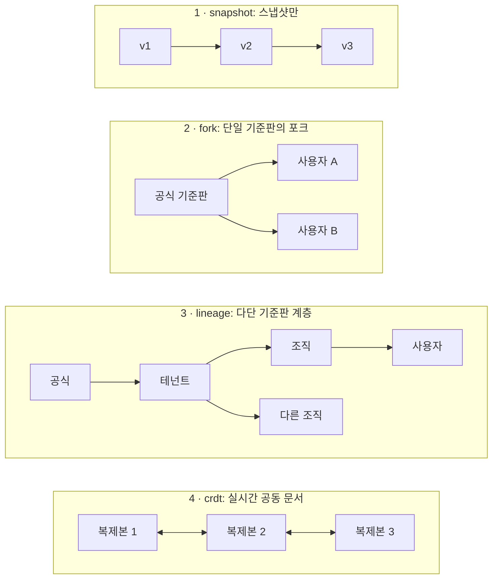
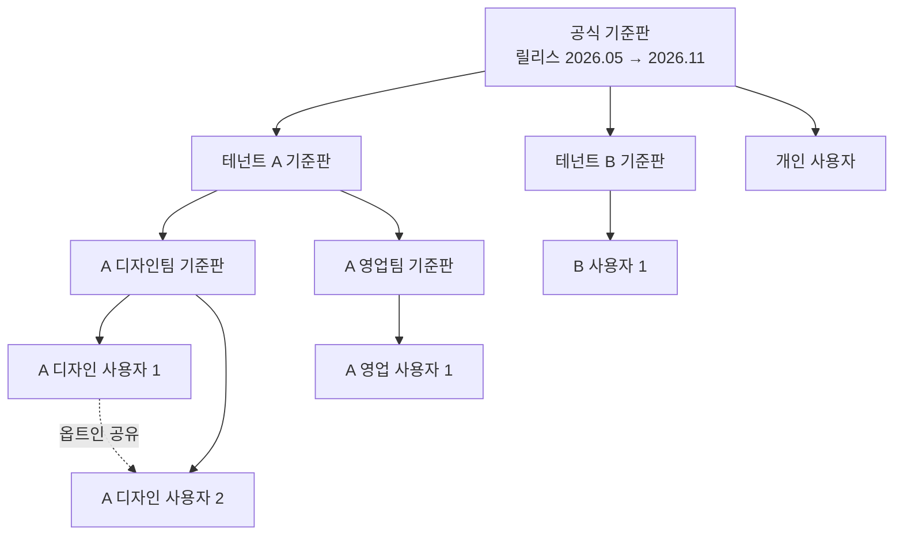
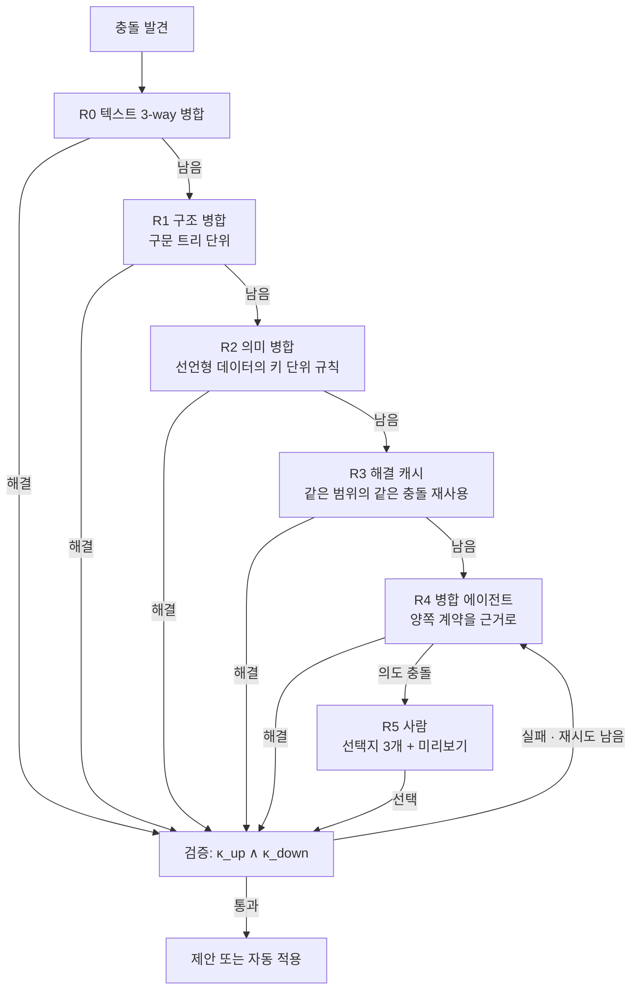
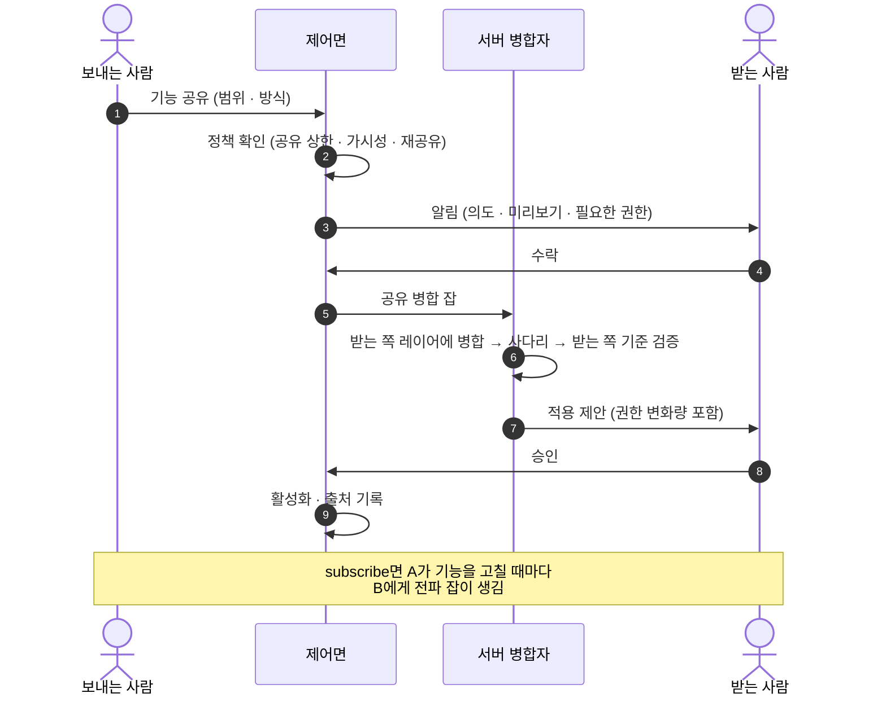
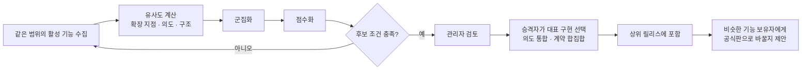

# 6. 버전과 계보 — 사용자 수정이 업데이트를 견디게 하는 법

> 이 장의 결론: 말랑한 소프트웨어의 진짜 비용은 만드는 순간이 아니라 **제공사가 새 버전을 낼 때마다** 발생한다. 이를 감당하려면 ① 격리 단위를 저장소(레이어)로, 작업 단위를 브랜치로 나누고, ② 기준판 계층을 **계보(lineage)** 로 관리하고, ③ 병합을 **계약 보존**으로 정의하고, ④ 같은 충돌을 반복해서 풀지 않도록 **해결 캐시**를 가시성 범위 안에서 공유해야 한다.

## 6.1 왜 버전 관리가 중심 문제인가

사용자 `N`명이 각자 수정을 갖고 있고, 기준판이 1년에 `r`번 바뀌면 1년에 `N × r`번의 병합이 필요합니다. 리눅스 배포판이나 휴대폰 제조사가 상위 소스 위에 자기 패치를 얹어 유지할 때 겪는 "패치 스택 재적용" 문제가, 이제 **모든 사용자 한 명 한 명**에게 생깁니다. 사람이 손으로 풀 수 있는 규모가 아니므로, 병합 자체를 자동화하되 **무엇이 올바른 병합인지**를 기계가 판정할 수 있게 정의해야 합니다.

## 6.2 토폴로지 네 가지



| | snapshot | fork | lineage | crdt |
| --- | --- | --- | --- | --- |
| 격리 | 사용자별 | 사용자별 저장소 | 노드별 저장소 | 문서 단위, 접근자 전원 공유 |
| 상위 업데이트 전파 | 불가 | 단일 단계 | 위상 순서로 다단계 | 자동 수렴 |
| 충돌 처리 | 해당 없음 | 병합 사다리 | 병합 사다리 + 계층 정책 | 구문 충돌 없음, **의미 충돌은 남음** |
| 저장 비용 | 낮음 | 포크 수 × 고유 변경 (공통 객체 공유 가능) | 동일 | 연산 로그 크기 |
| 적합 | 테마·규칙 저장만 하는 소비자 앱 | 개인·소규모 | 기업·공공 | 실시간 협업 |

권고: 미래에 조직 기능이 필요할 가능성이 조금이라도 있으면 저장 모델은 처음부터 `lineage`로 만드세요. `fork`는 깊이 1짜리 계보로 표현됩니다(3.7).

## 6.3 계보 모델

```text
계보 T = (노드, 간선)
  노드 n      : 하나의 레이어 저장소 (공식 기준판, 테넌트 기준판, 조직 기준판, 사용자 레이어)
  간선 n→m    : m은 n을 상위로 둔다 (m은 n의 포크)
  릴리스 r(n) : 노드 n에서 서명된 기준판 태그. 예: 2026.11
  드리프트 δ(m) = m이 반영한 상위 릴리스와 최신 상위 릴리스 사이의 단계 수
```



읽는 법: 실선은 **업데이트가 흐르는 방향**, 점선은 **옆으로 건너가는 공유**입니다. 공식 기준판 2026.11이 나오면 테넌트 A가 먼저 받아들이고, 그다음 디자인팀·영업팀, 마지막으로 각 사용자 순서로 내려갑니다. 계층 깊이는 고객마다 1~3단으로 달라도 됩니다.

## 6.4 격리 단위와 작업 단위

**격리 단위는 저장소, 브랜치는 작업 단위입니다.** 일반적인 Git 호스팅은 브랜치 단위 쓰기 보호는 제공하지만 브랜치 단위 읽기 제한은 제공하지 않는 경우가 대부분이라, 저장소를 내려받을 수 있으면 모든 브랜치가 보입니다. 사용자별 브랜치로 격리하려 하면 이 전제가 깨집니다.

| 참조(ref) | 용도 | 쓰는 주체 |
| --- | --- | --- |
| `main` | 현재 활성 상태. 런타임이 이것을 로드 | 하네스(기록·승인된 병합) |
| `exp/<이름>` | 실험판, 대안 비교 | 하네스 |
| `upgrade/<릴리스>` | 전파 잡의 병합 결과, 승인 대기 | 서버 병합자 |
| `share-in/<공유 id>` | 받은 공유를 병합해 본 결과 | 서버 병합자 |
| 릴리스 태그 | 기준판 릴리스. 기준판 노드에만, 서명 필수 | 관리자 승인 후 하네스 |

병합 방식: 하향 전파는 이력을 보존하는 병합을 씁니다(재배치(rebase) 금지 권장). 사용자 이력이 보존돼야 감사·되돌리기·승격 분석이 가능합니다.

동시 생성: 한 사용자의 생성 작업 둘이 같은 레이어를 동시에 고치면 어느 기능의 변경인지 흐려집니다(I9). 생성 작업마다 `exp/<이름>` 작업 사본을 따로 둡니다(해야 함). 기록자는 작업이 시작될 때의 상태를 기준선으로 잡고, 그 작업이 **바꾼 경로만** 기록합니다. "지금 바뀐 것 전부"를 기록하지 않습니다. 두 작업이 같은 사본에서 겹쳤다면 귀속을 추측하지 않고 겹쳤다고 표시한 뒤 사람이 나누게 합니다. ThinkRail은 계획 단계마다 작업 창을 열어 그 단계가 바꾼 경로만 커밋하고, 다른 대화와 겹친 창은 `shared`로 표시합니다([JetBrains/thinkrail `todos/SPEC.md`](https://github.com/JetBrains/thinkrail/blob/c10f8808cee693e4abffeeb1844a132ed0a91cc5/packages/server/src/todos/SPEC.md#L64-L80)).

포크가 수천 개여도 대부분의 객체는 같은 기준판에서 왔으므로, 저장소 간 공통 객체를 공유하면(예: Git alternates) 저장량은 사용자 수가 아니라 **고유 변경 수**에 비례합니다.

## 6.5 전파 알고리즘

```text
이벤트 구동입니다. 노드 p가 상위 릴리스 r을 `main`에 적용하면 `baseline.applied(p, r)`가 나오고, 그 이벤트가 p의 자식 잡을 만듭니다.

```text
on baseline.applied(p, r):                     # p = 릴리스 노드 자신이거나, r을 적용한 중간 노드
  kids  = children(p)
  waves = canary(kids, ratios=[0.05, 0.25, 1.0], seed=hash(p, r))   # 시드 고정 무작위 표본
  for wave in waves:
    results = parallel_map(m -> propagate(m, p, r), wave)           # 결과를 모은다. 몸체 안 return 없음
    if failure_rate(results, key=(gate_id, contract_id, point)) > threshold:
      halt_propagation(p, r); alert(p.steward); stop

propagate(m, p, r) -> 결과:
  theirs    = p.main@applied(r)                # 원본 r이 아니라 부모가 적용한 결과 (중간 레이어 변경 포함)
  contracts = ⋃_{a ∈ path(root(r), m)} κ(a)    # r을 발행한 노드부터 m까지 경로 위 모든 계약 (I10)
  merged    = merge(base=last_applied(m), ours=m.main, theirs=theirs)   # 6.6 사다리
  if merged.intent_conflict:   return NEEDS_HUMAN(options=3, previews)
  report = gates(merged, contracts)
  while report.fail and retries_left: report = retry_with_feedback(...)
  if report.fail:              return FAILED       # 이전 릴리스 유지, 관리자 알림
  if delta_permissions(merged) == ∅ and policy(m).apply == auto:
    apply(merged); emit baseline.applied(m, r);    return APPLIED
  propose(merged, summary=explain(diff_of_intents)); return PROPOSED
  # 승인되면 그때 apply → emit baseline.applied(m, r). 거절·만료면 m은 이전 릴리스 유지

지원 기간이 끝난 릴리스에 남은 노드: 강제 병합하지 않고 '경고 모드'로 둔다.
```

노드별 잡 상태:

```text
대기 → 병합중 → 검증중 → { 적용됨 | 승인대기 | 사람필요 | 실패 }
승인대기 → 적용됨(승인) | 보류(거절·만료)
사람필요 → 검증중(R5 선택 후)
```

규칙:
- **위상 순서** (반드시): 부모가 릴리스를 적용하기 전에는 자식의 잡을 만들지 않습니다. 자식 잡은 부모의 `baseline.applied` 이벤트로만 생깁니다.
- **승인 대기 중인 부모**: 부모가 `승인대기`·`사람필요`이면 자식은 멈춘 잡이 아니라 **잡이 없는 상태**로 남습니다. 자식 쪽 기능은 이전 릴리스에서 계속 동작하고, 드리프트 δ가 1 늘어난 것으로 표시됩니다. 부모가 승인하면 그 `baseline.applied`가 자식 잡을 만듭니다. 부모가 거절하면 자식에게는 r이 전파되지 않습니다.
- **노드당 진행 중 잡 1개**: 새 릴리스가 오면 기존 잡을 취소하고 최신으로 다시 만듭니다. 단, `승인대기` 잡은 취소하지 않고 새 릴리스 잡과 합쳐 한 번에 승인받게 합니다. 그래야 릴리스 주기가 승인 지연보다 짧아도 영영 적용되지 못하는 일이 없습니다.
- **읽기 실패는 부재가 아니다** (반드시): 병합 입력(`base`·`ours`·`theirs`)이나 상위 레이어를 읽다가 실패하면 그 잡은 `실패`입니다. "그 키가 없다"로 처리하지 않습니다. 레이어 합성에서 없음은 `null`, 곧 삭제이므로(2.3), 읽기 실패를 없음으로 읽으면 전파가 사용자 기능을 조용히 지웁니다. 저장소는 "정말 없음"과 "읽지 못함"을 다른 결과로 돌려줘야 합니다. ThinkRail도 같은 이유로 git이 "경로 없음"이라고 명시한 경우만 부재로 보고 나머지 실패는 전부 오류로 던집니다([JetBrains/thinkrail `changes/SPEC.md`](https://github.com/JetBrains/thinkrail/blob/c10f8808cee693e4abffeeb1844a132ed0a91cc5/packages/server/src/changes/SPEC.md#L119-L122)).
- **카나리아 표본** (반드시): 각 파동은 형제 노드 중 `(p, r)`로 시드를 고정한 무작위 표본입니다. 위상 순서의 앞쪽 몇 %가 아닙니다. 시드가 고정이라 재실행해도 같은 노드가 같은 파동에 들어갑니다.
- **카나리아 중단 조건**: 같은 원인 키 `(게이트 id, 계약 id, 확장 지점)`로 실패하는 비율이 임계값(제안값 10%)을 넘으면 전파를 멈춥니다. 이건 상위 릴리스의 결함일 가능성이 높습니다.

## 6.6 충돌 해결 사다리

싼 방법부터 비싼 방법 순서로 시도합니다. 에이전트는 마지막에서 두 번째, 사람은 마지막입니다.



| 단계 | 방법 | 비용 | 예 |
| --- | --- | --- | --- |
| R0 | 일반 3-way 병합 | 거의 0 | 서로 다른 파일 수정 |
| R1 | 구문 인식 병합 드라이버 (예: tree-sitter 기반 [Mergiraf](https://mergiraf.org/)) | 낮음 | 같은 파일의 다른 함수 수정, import 순서 |
| R2 | 선언형 스키마의 키 단위 병합 규칙 (스키마가 규칙을 선언) | 낮음 | 단축키 목록에 양쪽이 항목 추가 (스키마 필드: capability-map의 `extension_points[].merge`. 값 이름은 [Kubernetes Server-Side Apply](https://kubernetes.io/docs/reference/using-api/server-side-apply/)의 `x-kubernetes-list-type`을 따름. 선언 없는 배열은 [RFC 7396](https://www.rfc-editor.org/rfc/rfc7396)대로 통째 교체) |
| R3 | 검증된 해결 재사용 (Git의 rerere를 범위 공유로 일반화) | 낮음 | 같은 기준판에서 갈라진 수천 사용자의 동일 충돌 |
| R4 | 병합 에이전트 | 높음 | 같은 패널을 상위는 재배치, 사용자는 항목 추가 |
| R5 | 사람 | 가장 높음 | 상위가 사이드바를 없앴는데 사용자는 사이드바 패널을 만듦 |

라이선스 주의: 구문 병합 도구 중 일부는 강한 카피레프트 라이선스를 씁니다(예: Mergiraf는 GPL-3.0-only). 서버에서 별도 프로세스로 호출하는 것과 배포물에 포함하는 것은 의무가 다르므로 배포 형태별로 검토하세요.

## 6.7 계약 보존 병합의 정의

```text
병합 결과 m이 올바르다  ⇔  κ_up(m) ∧ κ_down(m)
의도 충돌               ⇔  ∄ m : κ_up(m) ∧ κ_down(m)
```

두 번째 조건은 일반적으로 판정할 수 없으므로 실무에서는 근사합니다. 병합 에이전트가 정해진 횟수(제안값 3회) 안에 양쪽 계약을 동시에 만족시키지 못하거나, 한쪽 계약을 만족시키면 다른 쪽이 반드시 깨지는 구조임을 근거와 함께 보고하면 의도 충돌로 판정합니다.

병합 에이전트 규칙:
1. 수정 범위는 충돌 영역과 그 충돌이 속한 기능의 파일로 제한합니다.
2. **계약은 강해질 수만 있습니다.** 병합 에이전트가 계약 항목을 지우거나 완화하면 거부합니다(단조성). 예외는 둘이고, 둘 다 에이전트가 아니라 사람이 정합니다.
   - **사용자가 R5에서 "상위 방식으로 옮기기"를 고른 경우**: 깨지는 사용자 계약 항목을 선택 화면에 일반 용어로 보여 주고, 사용자가 명시적으로 동의해야 약화합니다.
   - **확장 지점 폐기(6.12)**: 폐기된 지점에 걸린 계약은 원리적으로 만족할 수 없습니다. 릴리스가 내는 이전 대응표(옛 지점 → 새 지점)로 계약을 옮기고, 옮길 수 없는 항목은 위와 같이 사용자 동의를 받아 약화합니다.
   - 약화는 기록에 `Contract-Migrated: <항목 id> <이전 → 이후 또는 removed> (consent: <사용자·시각>)` 트레일러로 남깁니다(6.11). 동의 없는 약화는 수신 검사에서 거부합니다.
3. 해결 근거(어느 의도를 어떻게 보존했는지)를 기록에 남깁니다.
4. 검증을 통과한 해결만 해결 캐시에 넣습니다. 해결을 만든 노드 밖의 다른 노드 k개 이상(제안값 3)에서 다시 검증된 뒤에 적재합니다(7.1 해결 캐시 오염).

의도 충돌 때 사람에게 주는 선택지 세 가지(권장 형식): **상위 방식으로 옮기기** / **내 방식 유지(상위 변경 일부 보류)** / **둘 다 반영하는 새 설계 요청**. 각각 미리보기를 붙입니다. "상위 방식으로 옮기기"는 사용자 계약 일부를 내려놓는 선택이므로, 어떤 약속이 사라지는지 함께 보여 주고 규칙 2의 동의로 기록합니다.

## 6.8 해결 캐시와 비용 모델

릴리스 하나의 전파 비용 기대값입니다.

```text
E[비용] = N · (c_job + c_val)  +  N · p · m · Σ_r q_r · c_r

  N     : 영향받는 하위 노드 수
  p     : 충돌이 하나 이상 생기는 노드 비율
  m     : 충돌 노드당 평균 충돌 수
  q_r   : 단계 r(R0~R5)에서 해결되는 비율
  c_r   : 단계 r의 충돌 1건 해결 비용 (c_R4는 모델 호출, c_R5는 사람 시간)
  c_val : 노드당 검증 비용 (결정적 계약 위주면 저렴)
```

비용 대부분은 `c_R4`(에이전트)와 `c_R5`(사람)에서 나옵니다. 해결 캐시는 같은 충돌을 **동치류(equivalence class)** 로 묶어 에이전트 호출 수를 줄입니다.

```text
R4 도달 충돌 수 K = N · p · m · q_R4
그중 서로 다른 동치류 수 k  (같은 상위 변경 × 같은 하위 변경 패턴)
캐시 적용 후 에이전트 호출 ≈ k · (1 + 재시도)       캐시 적중률 h = 1 − k / K
```

예시 (모든 값은 가정): 사용자 노드 N=10,000, p=0.3, m=2이면 충돌 6,000건. R0~R2가 70%를 풀면 1,800건이 남습니다. 이 1,800건이 같은 범위 안에서 150개 동치류에 속한다면 에이전트 호출은 1,800회가 아니라 약 150회가 됩니다(h≈0.92). 검증은 여전히 10,000번 돌지만 결정적 계약이라 저렴합니다.

**범위 제한** (반드시): 해결 캐시는 가시성 범위(테넌트 또는 조직)를 넘어 공유하지 않습니다. 한 고객의 해결에는 그 고객의 코드 조각이 들어 있기 때문입니다. 이 제한 때문에 캐시 효율이 떨어지는 부분은 **공식 해결 레시피**로 보완합니다. 제공사가 공식 릴리스를 낼 때, 공개된 공식 확장·흔한 패턴에 대한 해결 방법을 릴리스와 함께 배포하는 방식입니다(9.5의 B18).

## 6.9 공유

공유 단위는 저장소가 아니라 **기능(의도+계약+산출물)** 입니다.

```yaml
share:
  id: shr_01JBY2
  feature: f_01JBX7K2M9Q2
  source: { node: "t_acme/o_design/u_alice", state: "3f9c2e1" }
  scope: user:u_bob | org:o_design | tenant:t_acme | public
  mode: copy | subscribe          # subscribe면 원본이 바뀔 때마다 받는 쪽에 전파 잡이 생김
  code_visibility: visible | hidden
  reshare: forbidden | author_opt_in | free
  expires_at: null
```



규칙:
- 받는 쪽은 **처음부터 다시 검증하고 권한을 다시 승인**합니다. "믿는 동료가 만들었다"는 이유로 생략하지 않습니다(7.7).
- 철회는 이후 업데이트만 끊습니다. 이미 병합된 내용은 받은 사람의 것입니다.
- 모든 공유 병합에는 출처가 남습니다(6.11의 `Shared-From`).
- **수락은 그때의 내용에만** (반드시): 받는 사람의 수락과 권한 승인은 수락 시점의 내용 해시에 묶입니다. `subscribe` 공유에서 보낸 사람이 고친 판은 새 내용이므로, 권한이 그대로여도 받는 쪽 검증을 다시 거치고, 권한이 늘었으면 다시 승인받습니다. 첫 수락이 이후 판까지 덮으면 "설치 후 원격에서 내용을 바꿨다"(7.7)와 같은 구멍이 생깁니다.
- **받은 기능은 내 이름을 가로채지 못한다** (반드시): 받은 공유 기능이 내가 이미 쓰는 명령 이름·단축키·확장 지점 id와 겹치면, 내 것이 이기고 받은 쪽은 이름을 바꾸거나 꺼진 채로 들어옵니다. 레이어 합성의 "사용자에 가까운 쪽이 이김"(2.3)은 그대로이고, 이 규칙은 받은 공유물이 식별자를 가로채는 경우에만 적용합니다.
- ThinkRail은 복제한 저장소에 신뢰를 줄 때 **그때 있던 스킬만** 확인된 것으로 치고, 나중에 pull·브랜치로 생긴 스킬은 `pending-ack`로 다시 묻습니다. 같은 이름이면 내장 → 개인 → 프로젝트 순으로 이겨, 저장소가 내 스킬을 가리지 못합니다([JetBrains/thinkrail `agent/SPEC.md`](https://github.com/JetBrains/thinkrail/blob/c10f8808cee693e4abffeeb1844a132ed0a91cc5/packages/server/src/agent/SPEC.md#L991-L1000)).

## 6.10 승격 — 여러 사람이 같은 걸 만들면 기준판으로

목표: "서로 다른 사람들이 독립적으로 비슷한 기능을 만들었고, 계속 쓰고 있다"를 찾아 상위 기준판에 올립니다. 아래에서 위로 올라가는 혁신 경로입니다.



유사도와 점수 (가중치는 제안값):

```text
sim(f_i, f_j) = 0.4 · Jaccard(X_i, X_j)                 # 건드린 확장 지점 집합
              + 0.4 · cos(embed(ι_i), embed(ι_j))        # 의도 요약 임베딩
              + 0.2 · struct(a_i, a_j)                   # 산출물 구조 유사도 (V3 허용 범위에서만)

score(군집) = 2.0 · log2(1 + 독립 사용자 수)
            + 1.5 · 14일 유지율
            + 1.0 · 군집 응집도
            − 1.0 · 권한 위험도
            − 0.5 · 검증 실패율

후보 조건(제안): 독립 사용자 3명 이상 또는 범위 내 활성 사용자의 5% 이상, 14일 유지율 80% 이상
```

승격 뒤 사용자가 공식판으로 바꾸면 사용자 기능은 `대체됨` 상태가 됩니다(2.8). 같은 일을 하는 기능이 두 벌 남지 않게 해서 이후 병합 비용을 줄입니다.

경계: 테넌트를 넘는 신호는 집계(V0)·메타데이터(V1)만 씁니다. **고객이 만든 산출물은 명시적 옵트인과 라이선스 없이는 공식 기준판에 넣지 않습니다.** 기본은 제공사가 공식 기능을 직접 만드는 것입니다. 공개(A8=public) 공유물은 원작자가 승격과 라이선스 조건에 명시적으로 동의했을 때만 승격하고(9.5 B10·B19), 테넌트 내부 산출물은 테넌트 계약상 옵트인 없이는 테넌트 밖으로 올리지 않습니다. 이 원칙을 문서로 약속하는 것이 기업 고객 신뢰의 전제입니다.

## 6.11 기록 규격

에이전트가 원시 저장소 명령을 쓰지 못하고 `ChangeStore.record()`로만 기록하기 때문에, 모든 기록이 같은 형식을 가집니다. Git 기반 구현을 위한 메시지 규격 예입니다(관례적 커밋 형식을 바탕으로 범위를 확장 지점 id로 고정).

```text
<type>(<확장 지점 id>): <결과형 요약, 50자 이내>

<본문: 무엇을, 왜. 5줄 이내>

Feature-Id: f_01JBX7K2M9Q2
Intent: 주간 회고 때 이번 주 완료 항목을 보고 싶다
Depth: D3
Points: sidebar.panel
Contract: features/f_01JBX7K2M9Q2/contract.yaml
Validation: pass val_8f21
Agent: builder@harness-x
Permissions-Delta: +tasks.read                 (권한 변화 시)
Overrides: layers/org/sidebar/layout.json      (상위 소유 항목 덮어쓸 때)
Upstream: official@2026.11                     (전파 병합 시)
Shared-From: t_acme/o_design/u_alice@3f9c2e1   (공유 병합 시)
Resolved: r0=3 r1=1 r2=0 r3=2 r4=1 r5=0        (병합 시 해결 단계 분포)
Contract-Migrated: k3 removed (consent: u_alice@2026-11-02T09:12Z)   (계약 약화 시, 6.7 규칙 2)
Prompt-Hash: sha256:…                          (원문은 가시성 정책에 따라 원장에만)
```

| type | 쓰임 |
| --- | --- |
| `feat` / `fix` / `style` / `refactor` / `perf` | 사용자 변경 |
| `revert` | 되돌림 |
| `upgrade` | 기준판 전파 병합 |
| `share` | 공유 병합 |
| `promote` | 승격 반영 |
| `chore` | 메타데이터 정리 |

크기 규칙(제안값): 기록 1건 = 기능 1개, 파일 20개 이하, 변경 400줄 이하(생성 파일 제외). 넘으면 기록자가 확장 지점 단위로 나눕니다. 같은 기능·같은 세션·10분 이내의 잔수정은 합칩니다. 이 규칙이 지켜져야 대시보드가 "기능 단위"로 집계할 수 있고, 승격 후보 분석이 가능합니다. 기계 판독 스키마는 [`schemas/change-record.schema.json`](../schemas/change-record.schema.json).

## 6.12 확장 지점 API의 진화

제공사의 확장 지점이 바뀌면 그 위의 모든 사용자 변경이 영향을 받습니다.

- 확장 지점에 의미 기반 버전(semver)을 붙입니다. `stable` 지점의 호환성을 깨는 변경은 **최소 두 번의 기준판 릴리스 동안 이전 버전과 병행**합니다(해야 함).
- 릴리스마다 기능 지도의 차이(추가·폐기·변경)를 기계 판독형으로 발행합니다. 병합 에이전트는 이 차이를 컨텍스트로 받습니다. 폐기에는 옛 지점 → 새 지점 대응표를 붙입니다. 계약 이전은 이 표를 따릅니다(6.7 규칙 2).
- **영향 반경** = 해당 지점에 의존하는 활성 기능 수. 폐기 결정 전에 측정합니다. 영향 반경이 큰 지점의 폐기는 공식 해결 레시피를 함께 내야 합니다.

## 6.13 CRDT 토폴로지의 주의점

CRDT는 구문 충돌을 없애지만 의미 충돌은 그대로 둡니다. 두 사람이 동시에 같은 규칙의 조건을 다르게 고치면 둘 다 반영된 이상한 조건이 생길 수 있습니다. 또 실행 코드를 실시간 동기화하면 **반쯤 작성된 코드가 다른 사용자 화면에서 실행**될 수 있습니다(S7). 권고:
- CRDT 토폴로지에서는 최대 깊이를 D3 이하로 둡니다.
- 변경 단위의 계약 검사는 동기화가 아니라 **활성화 시점**에 돌립니다.
- 실험은 CRDT 문서의 브랜치(분기 사본)에서 하고, 활성화 때 본 문서에 합칩니다.

다음 장: [7. 신뢰와 보안](07-trust-and-security.md)
