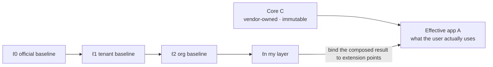
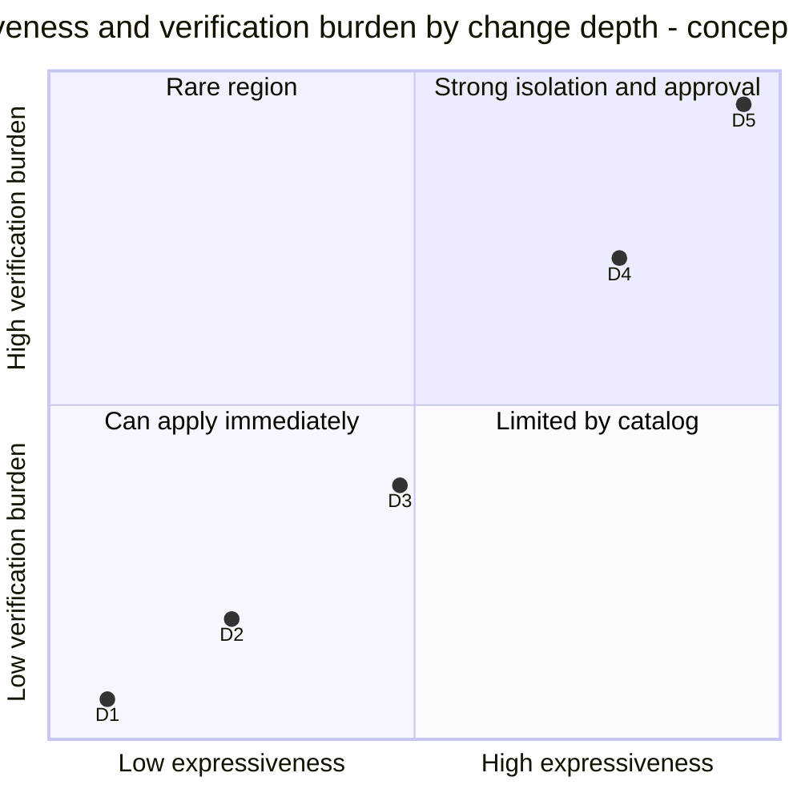
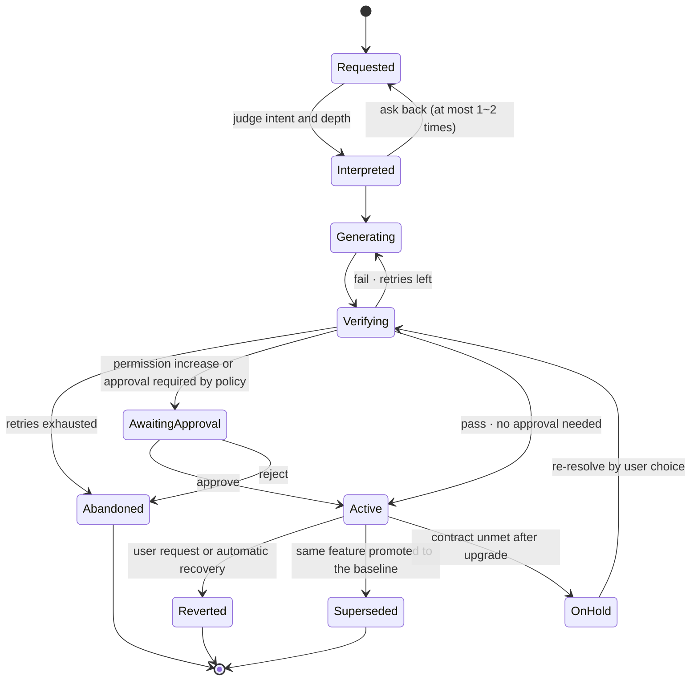

<!-- LANG-BAR -->
**English** · [한국어](../ko/02-core-model.md) · [简体中文](../zh-CN/02-core-model.md) · [日本語](../ja/02-core-model.md) · [Español](../es/02-core-model.md)
<!-- /LANG-BAR -->

# 2. Core model — host, layers, changes, contracts, policy

> Conclusion of this chapter: a Mallangable system is a **stack of layers on top of an immutable core**, and every user modification is expressed as a **change (δ) with an intent, artifact, contract and permissions**. Whatever the architecture does, it must not break invariants I1~I10.

This chapter is an implementation-independent conceptual model. Every component, flow and policy in the following chapters operates on the objects defined here.

## 2.1 Principals

| Principal | Symbol | Role | Example |
| --- | --- | --- | --- |
| Host Vendor | `V` | Builds and owns the core. Defines extension points | The company that made the app |
| Platform Operator | `O` | Runs the mallang infrastructure (control plane) | Usually the same as `V`, but may be a Mallangable hosting provider |
| Tenant Admin | `T` | Manages one customer organization's policy, baseline and budget | The customer's IT administrator |
| Org Steward | `G` | Manages the baseline of a sub-organization within a tenant | Team lead |
| End User | `U` | Modifies their own layer | Regular employee, individual user |
| Agent | `α` | Builds or merges changes on behalf of users and admins. **A non-human principal** | Code generation agent, merge agent |

Permissions are delegated in the direction `V → O → T → G → U`. The agent `α` is not on this chain; it exists **only as a short-lived subject that always holds a delegation from some human principal** (I4, I9).

## 2.2 Host

A host `H` is a bundle of four elements.

```text
H = ⟨ C, X, K, Σ ⟩
  C : Core. The immutable part the vendor ships. User layers do not change C.
  X : the set of Extension Points.
  K : the set of Capabilities. Name tags for the abilities an extension may use.
  Σ : state schema. The shape of the data an extension may read and write.
```

One extension point is defined as follows.

```text
x = ⟨ id, kind, d_min, in, out, stability ⟩
  id        : a stable identifier such as "sidebar.panel" or "editor.on_save"
  kind      : token | command | view | hook | service
  d_min     : the minimum depth needed to use this point (2.6)
  in / out  : schemas of the input the point provides and the output it expects
  stability : stable | experimental | deprecated
```

The host **MUST** expose its list of extension points and capabilities as a **machine-readable capability map**. If agents are left to guess the API, they slide into core patches (D5). [n.codes](https://github.com/yungookim/n.codes) demonstrated an approach that generates the capability map automatically by analyzing the codebase.

## 2.3 Layers and the effective app

The app the user actually uses (the effective app) is the result of composing layers in order on top of the core.

```text
Λ = [ ℓ0, ℓ1, …, ℓn ]          ℓ0 = vendor baseline, ℓn = the user's own layer
A = C ⊗ ( ℓ0 ⊕ ℓ1 ⊕ … ⊕ ℓn )
```

- `⊕` (layer composition): when two layers touch the same key, the later layer **overrides** the earlier one. The default semantics for declarative data is JSON Merge Patch (RFC 7396). Objects are overwritten key by key, `null` deletes that key, and arrays are replaced whole. To merge arrays item by item, the extension point schema must declare a merge key (6.6 R2). Code extensions are composed per slot of the extension point.
- `⊗` (core application): binds the composed layers to the core's extension points. The core does not change.
- `⊕` **SHOULD** be associative. That makes it possible to pre-merge and cache "enterprise baseline + org baseline". To that end, when layers are pre-merged, `null` (the deletion marker) **MUST** be kept rather than dropped. Only then does applying the merged layer later give the same result as applying the layers one by one.
- Relation between `⊕` and the merge in chapter 6: `⊕` is the operation that composes **between** layers within one lineage; 3-way merge (6.4~6.6) is used only on the modifications inside a layer **when that layer is moved onto a new upstream baseline**.



How to read it: priority increases to the right. If two layers touch the same point, the layer closer to the user wins, and this "override" becomes a conflict candidate on upgrade (chapter 6).

## 2.4 Change

The atomic unit of user modification.

```text
δ = ⟨ ι, a, κ, π, d, X_δ, prov ⟩
  ι    : Intent. A summary of the purpose a person stated. "I want only tasks due today moved to the top"
  a    : Artifact. Declarative data or code
  κ    : Contract. A set of acceptance conditions (2.5)
  π    : required permissions. π ⊆ K
  d    : depth. D1~D5 (2.6)
  X_δ  : the extension points touched. X_δ ⊆ X
  prov : provenance. Requester, approver, agent, model, parent change, timestamp
```

Several modifications that come from the same intent are grouped into the same **feature**. A feature is a sequence of changes, and the intent and contract are maintained per feature.

## 2.5 Contract

A contract is a set of predicates over the **observable behavior** of the effective app `A`.

```text
κ = { k1, k2, … },   k_i : A → { true, false }
κ(A) = k1(A) ∧ k2(A) ∧ …
```

| Kind | Example | Determinism | Cost | Strength |
| --- | --- | --- | --- | --- |
| Structural query (dom/tree query) | "The panel shows 2 items" | Deterministic | Low | Strong |
| Unit check (unit) | Input/output of a pure function | Deterministic | Low | Strong |
| Snapshot (snapshot) | Comparing render output | Deterministic (with a fixed environment) | Medium | Medium |
| Judge (judge) | Looking at a screenshot and judging whether the intent is met | **Probabilistic** | High | Weak |

Because judge contracts are probabilistic, they **SHOULD** not be used alone. There must be at least one deterministic contract for it to serve as grounds in merging (chapter 6).

Why the contract is the center of this model: during upgrades, sharing and promotion, a code diff does not tell you the meaning. **Only when "what this change must guarantee" is recorded** can a machine judge the result of a merge.

## 2.6 Change depth hierarchy D1~D5

Depth is both the **expressiveness** and the **risk level** of an artifact. The W3C Rule of Least Power recommends "choosing the least powerful language that can express the need", because the weaker the language, the easier it is to analyze without running, to reuse, and to keep secure ([W3C TAG](https://www.w3.org/2001/tag/doc/leastPower.html)). Mallangable applies this principle to user changes.

| Depth | Name | Artifact | Expressiveness (computation model) | Analysis before execution | Example |
| --- | --- | --- | --- | --- | --- |
| D1 | Appearance | Design tokens, style values | Finite key-value mapping | Complete | "Make the button bigger and the color orange" |
| D2 | Composition | Combinations of existing commands, shortcuts, rules | Loop-free (or iteration-bounded) macros over a finite command set | Complete | "One button to export + send email" |
| D3 | Screen | Declarative UI tree + data binding on an approved component catalog | Tree structure + queries limited by permissions | Mostly | "A panel listing today's deadlines" |
| D4 | Behavior | Arbitrary code in a sandbox | Turing-complete, external access only through capabilities | Partial (you have to run it to know) | "Auto-sort the table on save" |
| D5 | Core | Core source modification | Unlimited | Practically impossible | "Replace the rendering engine" |



How to read it: each step up in depth increases both what can be done and what must be verified. The coordinates are a concept diagram showing order, not measurements.

Rules:
- **Least-depth rule** (**MUST**): the agent must build the change at the lowest depth that satisfies the contract `κ`. Building with D4 what D2 can do is rejected.
- **D5 separation** (**MUST**): D5 exists only as a vendor-approved **core fork**, not as a user layer. In the normal user flow, the default is to collect D5 requests as "core feature requests" (**SHOULD**). This collection itself becomes the most accurate demand signal for the vendor's roadmap.
- This hierarchy implements the "gentle slope" cited by Ink & Switch. At each step, what the user has to newly understand increases only a little.

## 2.7 Policy and the policy lattice

A policy `p` sets the allowed range for each control knob (detailed in chapter 4). Policies have a partial order "is stricter than".

```text
p ⊑ q   ⇔   everything p allows, q also allows   (p is stricter than or equal to q)
p ⊓ q   :  the policy that allows only what both allow (intersection, meet)
```

Along the principal chain, the effective policy is computed as the intersection.

```text
p_eff(U) = p_V ⊓ p_O ⊓ p_T ⊓ p_G ⊓ p_U
```

- **Monotone narrowing** (**MUST**): a lower principal can only narrow within the range the upper one gave. `p_child ⊑ p_parent`.
- One exception: **user floor rights** cannot be removed by any upper policy (4.6). For example, "the right to revert my changes" is a floor.

## 2.8 Change lifecycle



How to read it: **every path to Active passes through verification.** "OnHold" is the state in which a change whose contract broke after a baseline upgrade does not silently disappear but waits for the user's choice. A resolution the user picks must also pass verification (the G gates) again before becoming Active.

## 2.9 Invariants I1~I10

| # | Invariant | Why it is needed | What happens if broken | Enforcement point |
| --- | --- | --- | --- | --- |
| I1 | **Core immutability**: no change in a user layer modifies `C` | Keeps a reference point for updates, support and security | A different core per user → updates impossible | Path access control, server receive-check |
| I2 | **Contract required**: a change with an empty contract is not activated (`κ ≠ ∅`) | Grounds for judging merges and promotions | Features silently die on upgrade | Check at the recording stage |
| I3 | **Revertibility**: every active state has a recorded previous state, and revert finishes in constant time without generation | Lets people experiment without fear | Users stop modifying | State plane, runtime |
| I4 | **Permission monotonicity**: permissions `π` increase only through explicit approval by a person who holds the permission. An agent cannot increase its own permissions | Defense against prompt injection and malicious shared items | A shared change exfiltrates data | Decision point (PDP), runtime broker |
| I5 | **Policy monotone narrowing**: `p_child ⊑ p_parent` (excluding floors) | Consistency of the delegation system | A lower admin bypasses upper policy | Policy store check |
| I6 | **Visibility = isolation boundary**: data a principal must not see does not enter any context that principal can query (including the context of an agent it converses with) | Blocks "ask the agent and it tells you everything" | Breach of the source-confidentiality promise | Role separation, output gate |
| I7 | **Generation/judging separation**: the agent instance that built an artifact and the instance that judges it are different | Prevents self-grading bias | Verification becomes a formality | Harness |
| I8 | **Trust boundary enforcement**: final enforcement happens only at a boundary the operator controls. Checks on the user's device are advisory. Applies only to deployments with an operator boundary; serverless deployments (P1, P5) cannot guarantee it | Clients can be bypassed | Policy becomes decoration | Server receive-check, sandbox re-verification |
| I9 | **Intent provenance**: every change traces back to a human intent or an upstream change | Audit, accountability, merge decisions | Changes with no provenance pile up | Record format |
| I10 | **Contract-preserving merge**: a merge result must satisfy both sides' contracts, and if that is impossible it goes to a person (`κ_up ∧ κ_down`) | The definition of surviving updates | A merge secretly deletes one side's feature | Merge pipeline |

Conformance: if an implementation does not guarantee any one of I1~I7, I9 or I10 **by design** (structurally, not through an operational mistake), it is not called a conforming Mallangable implementation. I8 is a requirement of the Governed level and above (10.3).

## 2.10 Example: three changes to a to-do app

Suppose a hypothetical host "to-do app" exposes the extension points below.

```yaml
extension_points:
  - id: theme.tokens        # D1
  - id: task.row.style      # D1~D2, conditional style rules
  - id: toolbar.command     # D2
  - id: sidebar.panel       # D3
  - id: task.on_complete    # D4, event hook
capabilities: [tasks.read, tasks.write, net.slack.post, notify.local]
```

Three user requests land at different depths.

```yaml
# Request 1: "Show overdue tasks in red"  → D2 (conditional style rule, no code)
- intent: I want to tell overdue tasks apart at a glance
  depth: D2
  points: [task.row.style]
  artifact: { rule: { when: "task.due < today && !task.done", style: { color: "danger" } } }
  permissions: [tasks.read]
  contract:
    - { id: overdue-red, check: tree-query, given: "1 task due yesterday, not done", expect: "that row's color = danger" }

# Request 2: "A panel summarizing tasks completed this week"  → D3 (declarative UI)
- intent: I want to see this week's completed items during the weekly retro
  depth: D3
  points: [sidebar.panel]
  artifact: { ui: { type: list, source: "tasks where done_at in this_week", item: "{title}" } }
  permissions: [tasks.read]
  contract:
    - { id: only-this-week, check: tree-query, given: "2 this week, 1 last week", expect: "2 items in the list" }

# Request 3: "Tell the team Slack when I complete a task"  → D4 (code + external send permission)
- intent: I want completions shared with the team automatically
  depth: D4
  points: [task.on_complete]
  artifact: { module: "on_complete.js" }       # runs in a sandbox
  permissions: [tasks.read, net.slack.post]    # permission increase → human approval required (I4)
  contract:
    - { id: posts-once, check: unit, given: "1 completion event", expect: "slack.post called once" }
```

If the agent tries to build request 1 as D4 code, it is rejected for violating the least-depth rule. Request 3 newly gains a permission to send data outside, so even if it passes verification, it is not activated until a person approves it.

Next chapter: [3. Design space](03-design-space.md)
