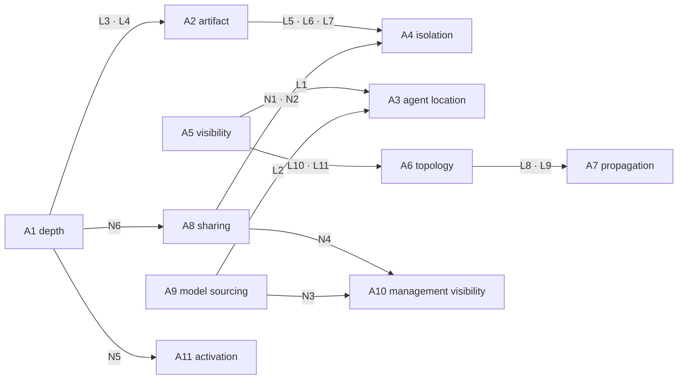
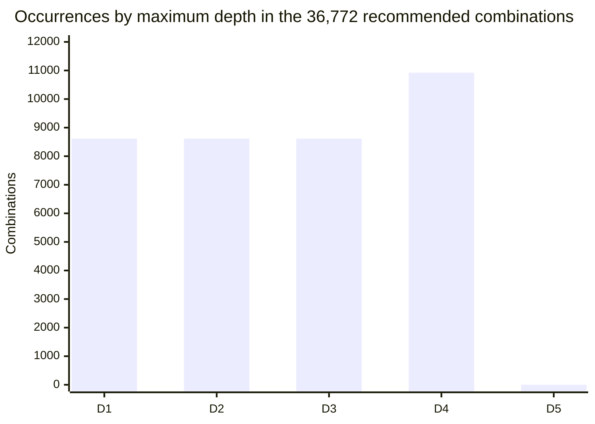
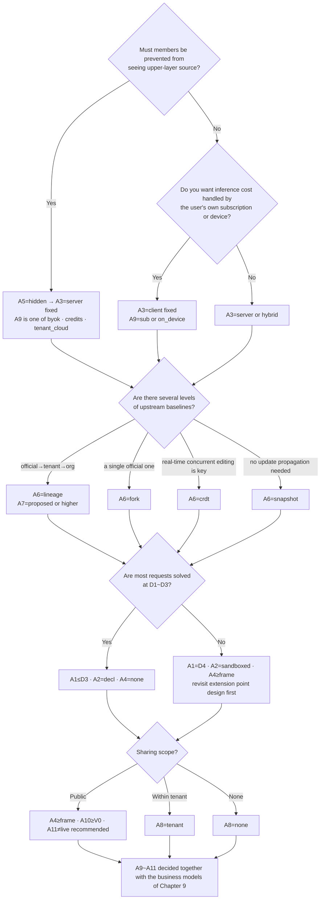
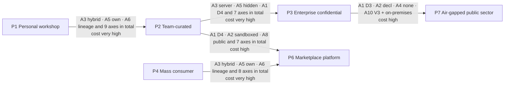

<!-- LANG-BAR -->
**English** · [한국어](../ko/03-design-space.md) · [简体中文](../zh-CN/03-design-space.md) · [日本語](../ja/03-design-space.md) · [Español](../es/03-design-space.md)
<!-- /LANG-BAR -->

# 3. Design space — choices, constraints, and the number of combinations

> Conclusion of this chapter: the Mallangable architecture is not one architecture but **a combination of 11 axes**. Of **1,944,000** raw combinations, **5.31%** are logically consistent, **3.14%** also respect the safety norms, and **36,772 (1.89%)** can be recommended without warnings. These recommended combinations group structurally into **863 families**, and even after the structure is fixed, the business and policy axes stay open by **57%** on average. In other words, **structural decisions come first and carefully; business decisions can come later and lightly.**

## 3.1 Why define it as a 'design space'

The same "fix the app with AI" demands entirely different architectures for a personal desktop app, a consumer mobile app, and an enterprise work tool that needs closed source. Instead of offering a single right answer, decomposing the choices into axes and stating the constraints between axes makes three things possible.

1. **Mechanically filter out combinations that make no sense.** Example: "hide the code from the user" and "the agent runs on the user's device" cannot both hold (L1).
2. **Set the order of decisions.** Some axes need a data migration to change; others change with a single setting (3.7).
3. **Connect to business options.** You can compute which axis values each BM requires (Chapter 9).

This approach is the same as the **feature model** of software product line engineering. A valid product configuration is a combination of features that satisfies the cross-tree constraints, and dynamic software product lines (DSPL), which change configuration at run time, check these constraints at run time ([Capilla et al., 2014](https://research.chalmers.se/publication/198081)). The difference in Mallangable is that the configuring party is not only the vendor but also the user and the AI.

The axes come in two groups.

- **Structural axes A1~A8**: determine the data model, deployment, and security boundaries. Changing them has a high migration cost.
- **Economic and policy axes A9~A11**: determine the cost structure, management scope, and user experience. Most of them change by configuration.

## 3.2 Axis definitions

### A1. Maximum change depth — "how far can the user change things"

| Option | Meaning | Good fit | Cost |
| --- | --- | --- | --- |
| `D1` | Appearance only | Consumer apps where brand consistency comes first | Almost no malleability |
| `D2` | Up to combinations of existing features | Work automation, shortcuts and rules | Cannot create new screens |
| `D3` | Up to declarative screens | Most work tools. More than half of the recommended combinations are here | Requires designing a component catalog |
| `D4` | Up to sandboxed code | Developer and power-user tools | Sandbox, verification, and approval costs |
| `D5` | Up to the core | Internal-only forks, research | Effectively gives up surviving updates |

Questions to consider
- What % of user requests are solved at D1~D3? If preliminary research shows this ratio is low, it is a sign that extension point design is lacking.
- When you open D4, who reads that code and takes responsibility for it?
- Maximum depth is a **ceiling**. Actual changes are made at a lower depth according to the least-depth rule (2.6).

### A2. Artifact representation — "what is a change expressed in"

| Option | Meaning | Good fit | Cost |
| --- | --- | --- | --- |
| `decl` | Declarative data only (JSON/YAML, A2UI-style UI descriptions) | Safety and analyzability come first | Limited expressiveness |
| `sandboxed` | Sandbox-only code (host APIs only through a broker) | D4 (2.6) | Requires a sandbox runtime |
| `native` | Code with the same privileges as the host (plugin or source patch) | D5, inside a trusted group | Hard to isolate, supply-chain risk |

Questions to consider
- Can the declarative schema be extended to cover most user requests? The wider the declarative scope, the cheaper verification, merging, and sharing all become.
- If you allow code artifacts, the language and runtime version of that code also become part of the contract.

### A3. Agent location — "where does the AI that makes changes run"

| Option | Meaning | Good fit | Cost |
| --- | --- | --- | --- |
| `client` | User device (including agents launched by the user) | Individual users, offline, using the user's subscription | Control is advisory only (I8), code cannot be closed |
| `server` | Operator server sandbox | Enterprise and public sector, closed code | Inference cost borne by the operator or tenant |
| `hybrid` | Interactive generation on the device, merge, propagation, and promotion on the server | Teams and organizations | Maintaining two execution environments |

Questions to consider
- Who pays for inference? This question decides A3 and A9 together.
- Can the server **re-verify** results made by an agent on the user's device (I8)?

### A4. Execution isolation — "what is generated code confined in"

| Option | Meaning | What it blocks | What it cannot block |
| --- | --- | --- | --- |
| `none` | No isolation (not applicable if declarative) | — | Everything |
| `lang` | Language-level isolation (e.g. Compartments in [Hardened JS/SES](https://github.com/endojs/endo), Wasm) | Global pollution, direct API access | Resource exhaustion in the same process, side channels |
| `frame` | Origin-separated iframe or webview ([MCP Apps](https://modelcontextprotocol.io/seps/1865-mcp-apps-interactive-user-interfaces-for-mcp) mandates sandboxed iframes) | Access to host DOM and storage | UI that deceives the user |
| `proc` | Separate process or microVM | Memory, file, and network access | Exfiltration through allowed channels |

Questions to consider
- What is the message format of the only passage (broker) that crosses the isolation boundary? It must be an auditable format.
- Once sharing opens (A8), the isolation requirement goes up (N1, N2).

### A5. Code visibility — "what source can the user see"

| Option | Meaning | Good fit | Cost |
| --- | --- | --- | --- |
| `open` | Can see the source of all layers | Individuals, open communities | Cannot protect the intellectual property of upper layers |
| `own` | Sees only their own layer | When the organization baseline contains in-house know-how | Requires a layer-separated topology (L10) |
| `hidden` | Sees no source at all, receives only the results | Enterprise and public sector where closed source is mandatory | Server agent required (L1), output gate required |

Questions to consider
- Core principle: **code that the agent can read can eventually be read by the person talking to that agent.** That is why `hidden` is not a policy flag but a placement decision (7.8).
- Execution bundles sent down to the client can be analyzed even if obfuscated. It is better to put core logic that must be protected in server-side extension points.

### A6. Version topology — "what shape does change history accumulate in"

| Option | Meaning | Good fit | Cost |
| --- | --- | --- | --- |
| `snapshot` | Per-user snapshot history only, relation to upstream not tracked | The simplest consumer apps | Cannot propagate baseline updates (L8) |
| `fork` | User repository = fork of a single baseline | Individuals and small groups | Cannot express organizational hierarchy |
| `lineage` | Fork network of a multi-level baseline hierarchy (official→tenant→org→user) | Enterprise | Requires a propagation pipeline (S3) |
| `crdt` | Real-time synchronized document ([Automerge](https://automerge.org/docs/reference/documents/conflicts/) family) | Simultaneous collaboration | Semantic conflicts remain, concurrent code editing is risky (S7) |

Questions to consider
- The number of users N multiplied by the baseline release frequency r is the number of merge operations per year. This number determines most of the architecture cost (6.8).
- A hybrid that uses CRDT for data (declarative) and Git-style lineage for code is also possible, but this document assumes one topology per system by default.

### A7. Baseline propagation — "when upstream changes, how does downstream follow"

| Option | Meaning | Good fit | Cost |
| --- | --- | --- | --- |
| `none` | No propagation | Snapshot topology, one-off customization | User layer gradually goes stale |
| `manual` | A person merges by hand | Developer users | Most users cannot |
| `proposed` | Agent merges and verifies, proposes; a person approves | Default recommended value | Approval fatigue |
| `auto` | Auto-applied if verification passes + permissions unchanged | Large user bases | Fallout from wrong automatic merges |

Questions to consider
- Have you defined the conditions for automatic application so that a machine can decide them, such as "all contracts pass + no permission change + canary passes"?
- What do you do with users left on a baseline whose support period has ended? Forced merges break trust (6.5).

### A8. Sharing scope — "whom can I give a change I made"

| Option | Meaning | Good fit | Cost |
| --- | --- | --- | --- |
| `none` | No sharing | Personal use, confidential environments | Everyone builds the same thing separately |
| `tenant` | Only within the same tenant | Enterprise | In-tenant review system |
| `public` | Public beyond the tenant | Communities and marketplaces | Supply-chain attack surface (7.7) |

Questions to consider
- The unit of sharing must be a **feature (intent + contract + artifact)**, not a repository. Only then can the receiving side rerun the same verification.
- Public sharing must not be opened without curation, isolation, and permission display, as the ClawHub case shows (N1, N4).

### A9. Model sourcing — "whose account and cost does inference run on"

| Option | Meaning | Good fit | Cost |
| --- | --- | --- | --- |
| `sub` | User's personal subscription. **Only inside the provider's official client** | Individuals, developers | Cannot be used for server work (L2). Exposed to changes in provider terms |
| `byok` | API key of the user or tenant | Teams, power users | Key management UX |
| `credits` | Operator bundles and sells inference | Consumers, small and mid-sized teams | Operator bears cost and abuse risk |
| `tenant_cloud` | Tenant's cloud contract (e.g. Bedrock, Vertex) or in-house model | Enterprise and public sector | Diversifying provider adapters |
| `on_device` | Local model on the user's device | Offline, privacy | Quality limits (S6) |

Questions to consider
- As of 2026, some providers prohibit by their terms the use of consumer subscription auth tokens in third-party products (Anthropic case: [The Register, 2026.02](https://www.theregister.com/2026/02/20/anthropic_clarifies_ban_third_party_claude_access)). `sub` is safe only when designed as "the user launches the provider's official agent directly and connects our skills and tools to it" (8.10, 9.6).
- Provider policies change often. Model sourcing **MUST** be abstracted behind a port (5.3).

### A10. Management visibility — "how much does the administrator see"

| Option | Meaning |
| --- | --- |
| `none` | No central collection |
| `V0` | Aggregates only (totals per tenant or organization) |
| `V1` | Metadata (number, size, depth, extension point, and verification results of changes; users pseudonymized) |
| `V2` | V1 + change messages and intent summaries, real names |
| `V3` | V2 + code diffs and content |

Questions to consider
- Visibility is a trade between administrator convenience and member trust. The current visibility level must **always** be shown on the user's screen (4.6 floor).
- Even commit metadata can become personal data when linked to an individual. Review of the applicable jurisdiction's law is needed.

### A11. Activation mode — "when is a verified change turned on"

| Option | Meaning | Good fit |
| --- | --- | --- |
| `live` | Applied immediately once verification passes | D1~D2, individuals |
| `preview` | User applies after a preview | Default recommended value |
| `gated` | Applied after approval by a designated approver | Enterprise, publicly shared items |

## 3.3 Constraints

### Dependencies between axes



How to read: an arrow means "the value of the earlier axis narrows the options of the later axis." The most important point is that **A5 (visibility) and A9 (model sourcing) jointly bind A3 (agent location)**. Closed source and using the user's subscription pull A3 in opposite directions, so you cannot want both at once.

### Logical constraints L — impossible, or redundant with the same meaning

| Rule | Condition | Reason |
| --- | --- | --- |
| L1 | `A5=hidden ⇒ A3=server` | If the agent that touches the code is on the user's side, the code cannot be hidden |
| L2 | `A9∈{sub, on_device} ⇒ A3≠server` | A personal subscription (terms) and a device model (physical location) cannot be used for server work |
| L3 | `A1∈{D1,D2,D3} ⇒ A2=decl` | 2.6: D1~D3 are declarative. If you allow code artifacts, it is D4 |
| L4 | `A1=D4 ⇒ A2=sandboxed`, `A1=D5 ⇒ A2=native` | 2.6: behavior changes are sandboxed code, core changes are native code |
| L5 | `A2=decl ⇒ A4=none` | Normalization: without executable code the execution isolation axis is meaningless |
| L6 | `A2=sandboxed ⇒ A4≠none` | Sandboxed artifacts need a sandbox |
| L7 | `A2=native ⇒ A4∈{none, proc}` | Putting host-privileged code in language or frame isolation means it is no longer host-privileged |
| L8 | `A6=snapshot ⇒ A7=none` | If the upstream relation is not tracked, there is nothing to propagate |
| L9 | `A6=crdt ⇒ A7≠manual` | CRDT merges automatically, so there is no manual merge step |
| L10 | `A5=own ⇒ A6∈{fork, lineage}` | 'See only my own' holds only in a layer-separated topology |
| L11 | `A5=hidden ⇒ A6≠crdt` | CRDT replicas live on the client, so the code cannot be hidden |

### Normative constraints N — possible, but forbidden by Mallangable safety principles

| Rule | Condition | Basis |
| --- | --- | --- |
| N1 | code artifact ∧ `A8=public` ⇒ `A4∈{frame, proc}` | Publicly shared items are a supply-chain attack path (7.7) |
| N2 | `A2=native` ∧ `A8≠none` ⇒ `A4=proc` | Shared host-privileged code needs at least process separation |
| N3 | `A9=credits` ⇒ `A10≠none` | Resale billing requires metering |
| N4 | `A8=public` ⇒ `A10≠none` | A public marketplace requires an audit trail |
| N5 | `A1∈{D4,D5}` ⇒ `A11≠live` | Behavior and core changes are not turned on immediately without preview or approval |
| N6 | `A1=D5` ⇒ `A8=none ∧ A6≠snapshot` | D5 is not a user layer but a vendor-approved core fork (I1, 2.6). It is not shared and tracks the baseline |

### Warnings S — allowed but not recommended

| Rule | Condition | Risk |
| --- | --- | --- |
| S1 | code artifact ∧ `A8=public` ∧ `A11=live` | Immediate installation of publicly shared code |
| S2 | `A2=native` ∧ `A4=none` | Host-privileged code without isolation (limit to personal use) |
| S3 | `A6=lineage` ∧ `A7∈{none, manual}` | Hierarchy built but propagation not assisted → drift accumulates |
| S4 | `A1=D5` ∧ `A6∈{fork, lineage}` | Per-user core forks → merge cost explodes |
| S5 | `A3=hybrid` ∧ `A9=sub` | Model unavailable at the server stage → semantic conflicts must be sent back to the device |
| S6 | `A9=on_device` ∧ `A1≥D4` | Generating behavior code with a device model → higher failure rate |
| S7 | `A6=crdt` ∧ `A1≥D4` | Risk of half-written code being executed for other users |

## 3.4 Number of combinations

This is the result of `tools/design_space.py` enumerating every combination of the 11 axes and applying the constraints above.

| Stage | Combinations | Share of total |
| --- | ---: | ---: |
| Raw combinations Ω = 5×3×3×4×3×4×4×3×5×5×3 | 1,944,000 | 100% |
| Logically consistent (passes L) | 103,320 | 5.31% |
| Normatively consistent (passes L+N) | 61,064 | 3.14% |
| Recommended (no warnings) | 36,772 | 1.89% |

- Number of structural families (A1~A8 combinations) among recommended combinations: **863**
- Average economic and policy completions (A9~A11 combinations) per family: **42.61 / 75** (57%)
- Distribution of completion counts: 96 families with 72 completions, 96 with 57, 138 with 42, 198 with 28, 66 with 24, and so on. No family has all 75 open (because of N3, at least 3 are always excluded).

Combinations filtered by each rule. **First violation** counts each combination only under the first rule it violates, so the numbers change if the rule order changes. **Independent violation** is the number of combinations violating that rule regardless of order, and **unique violation** is the number of combinations violating only that one rule (combinations that would survive if only this rule were removed).

| Logical rule | First violation | Independent violation | Unique violation |
| --- | ---: | ---: | ---: |
| L3 | 501,120 | 777,600 | 193,725 |
| L4 | 334,080 | 518,400 | 90,405 |
| L5 | 187,920 | 486,000 | 116,235 |
| L1 | 432,000 | 432,000 | 32,400 |
| L8 | 31,320 | 364,500 | 17,280 |
| L10 | 18,720 | 324,000 | 18,720 |
| L7 | 41,760 | 324,000 | 25,830 |
| L2 | 259,200 | 259,200 | 20,880 |
| L11 | 3,240 | 162,000 | 3,240 |
| L6 | 20,880 | 162,000 | 12,915 |
| L9 | 10,440 | 121,500 | 4,680 |

| Normative rule | Combinations filtered | Warning rule | Combinations affected |
| --- | ---: | --- | ---: |
| N5 | 15,738 | S3 | 12,400 |
| N1 | 8,610 | S5 | 4,420 |
| N6 | 5,332 | S4 | 4,416 |
| N3 | 4,347 | S6 | 3,800 |
| N2 | 4,305 | S7 | 3,600 |
| N4 | 3,924 | S2 | 2,580 |

How often each depth appears among the recommended combinations:



### Interpretation

1. **Most combinations make no sense or are redundant.** 95% of raw combinations drop out at the logical constraints. By independent violation count, the rules that filter the most are L3 and L4, which align depth and representation (the definition in 2.6), and the normalization rule L5. Setting normalization aside, L1 (closed source requires a server agent) is the largest pure contradiction. Combination counts are unrelated to how often designers make that requirement, so read this table only as "how much does each rule narrow the space."
2. **One path per depth.** When the definition that D1~D3 are declarative and D4 is sandboxed code (2.6) is imposed as a rule, the recommended combinations per depth split evenly: 8,616 each for D1~D3 and 10,924 for D4. Artifact representation becomes a value that follows once depth is set.
3. **D5 is not among the recommended combinations.** D5 is not a user layer but a core fork (2.6, I1), so N6 forbids sharing and snapshot, and all the remaining combinations hit the S4 (per-user core fork) warning. Modifying the core is a vendor process outside the design space.
4. **Structure and business are largely separable.** Even after choosing a structural family, 57% of business and policy combinations remain. However, the moment you choose `A3=server`, 2 of the 5 model sourcing options (`sub`, `on_device`) drop out, so agent location is a structural decision that directly binds model sourcing.
5. **The most common warning is S3 (hierarchy present but no propagation assistance).** It is a signal that teams introducing a baseline hierarchy must build a propagation pipeline along with it.
6. **Sensitive to value resolution.** Values that no rule distinguishes, like V0~V3 of A10, simply multiply the combination count. Compare by rule id and ratio rather than absolute numbers.

## 3.5 Reference profiles

These are 7 representative points of the design space. All are judged 'recommended (clean)' by the calculator (`python3 tools/design_space.py --check all`). P1 and P5, which have no server, cannot guarantee I8, so their conformance level goes up to Core only (10.3). Profiles that need code (P1, P3, P6) are set to D4, and profiles where declarative is enough are set to D3 or below (2.6, L3, L4).

| Axis | P1 Personal workshop | P2 Team-curated | P3 Enterprise confidential | P4 Mass consumer | P5 Local-first collaborative | P6 Marketplace platform | P7 Air-gapped public sector |
| --- | --- | --- | --- | --- | --- | --- | --- |
| A1 depth | D4 | D3 | D4 | D2 | D3 | D4 | D3 |
| A2 artifact | sandboxed | decl | sandboxed | decl | decl | sandboxed | decl |
| A3 agent | client | hybrid | server | server | client | hybrid | server |
| A4 isolation | frame | none | proc | none | none | frame | none |
| A5 visibility | open | own | hidden | open | open | own | hidden |
| A6 topology | fork | lineage | lineage | snapshot | crdt | lineage | lineage |
| A7 propagation | proposed | proposed | proposed | none | auto | proposed | proposed |
| A8 sharing | none | tenant | tenant | public | tenant | public | tenant |
| A9 model | sub | byok | tenant_cloud | credits | byok | credits | tenant_cloud |
| A10 visibility | none | V2 | V2 | V1 | none | V1 | V3 |
| A11 activation | preview | preview | gated | live | preview | gated | gated |

| Profile | Typical situation | Key trade-off |
| --- | --- | --- |
| P1 Personal workshop | Desktop tool for developers. Users fix it with their own AI subscription | Minimal operating cost, control is advisory only |
| P2 Team-curated | In-house work tool. Know-how accumulates in the organization baseline | Server merge cost, approval fatigue |
| P3 Enterprise confidential | Enterprise customers for whom closed source is a contract condition | All inference on the server, output gate required |
| P4 Mass consumer | Consumer app with millions of users. Sharing themes and automation rules | Safety secured by limiting depth to D2 |
| P5 Local-first collaborative | Real-time collaborative document tool | Semantic conflict detection is the open task, declarative up to D3 (S7) |
| P6 Marketplace platform | Public marketplace of user-built extensions | Curation, isolation, and audit costs |
| P7 Air-gapped public sector | Network-separated environment, in-house model | On-premises operation, highest-level audit |

## 3.6 Selection procedure

Do not pick all 11 axes at once; answer first the questions that narrow the structure the most.



How to read: the first two questions decide A3, and A3 decides half of the business model. That is why "closed source" and "who bears inference cost" must be settled at the very start of product planning.

## 3.7 Evolution paths and axis change costs

A product starts in one profile and moves to another. Each axis has a different cost to change.

| Cost class | Axes | Reason |
| --- | --- | --- |
| Low (configuration change) | A9 model sourcing, A10 management visibility, A11 activation | Policy and routing settings. No migration of existing data needed |
| Medium (feature addition) | A1 maximum depth, A8 sharing scope | Needs new extension points, catalogs, and curation systems. Existing changes stay as they are |
| High (runtime replacement) | A2 artifact, A4 isolation | Existing code artifacts must be moved to a new runtime |
| Very high (data migration) | A3 agent location, A5 visibility, A6 topology | Storage location, history structure, and trust boundaries change |



Practical recommendation: you do not need to build P3 or P7 from the start, but **if you might go there later, store A6 as `lineage` from the start.** A single baseline (fork) can be expressed as a lineage of depth 1, so keeping only the data model lineage-shaped greatly reduces migration cost.

## 3.8 Using the calculator

```bash
python3 tools/design_space.py --markdown        # regenerate the tables in 3.4
python3 tools/design_space.py --check all       # check the reference profiles
python3 tools/design_space.py --bm              # profile × business model coupling matrix (Chapter 9)
python3 tools/design_space.py --bm-stats        # feasibility ratio per BM over all recommended combinations
python3 tools/design_space.py --profile '{"A1":"D4","A2":"sandboxed","A3":"client","A4":"frame","A5":"open","A6":"fork","A7":"proposed","A8":"none","A9":"sub","A10":"none","A11":"preview"}'
```

If your product has options that are missing, add them to `AXES`, write your organization's safety principles as rules in `normative()`, and recompute. The purpose of this tool is **to let you state "why this combination" by rule id in design reviews.**

Next chapter: [4. Control spectrum](04-control-spectrum.md)
