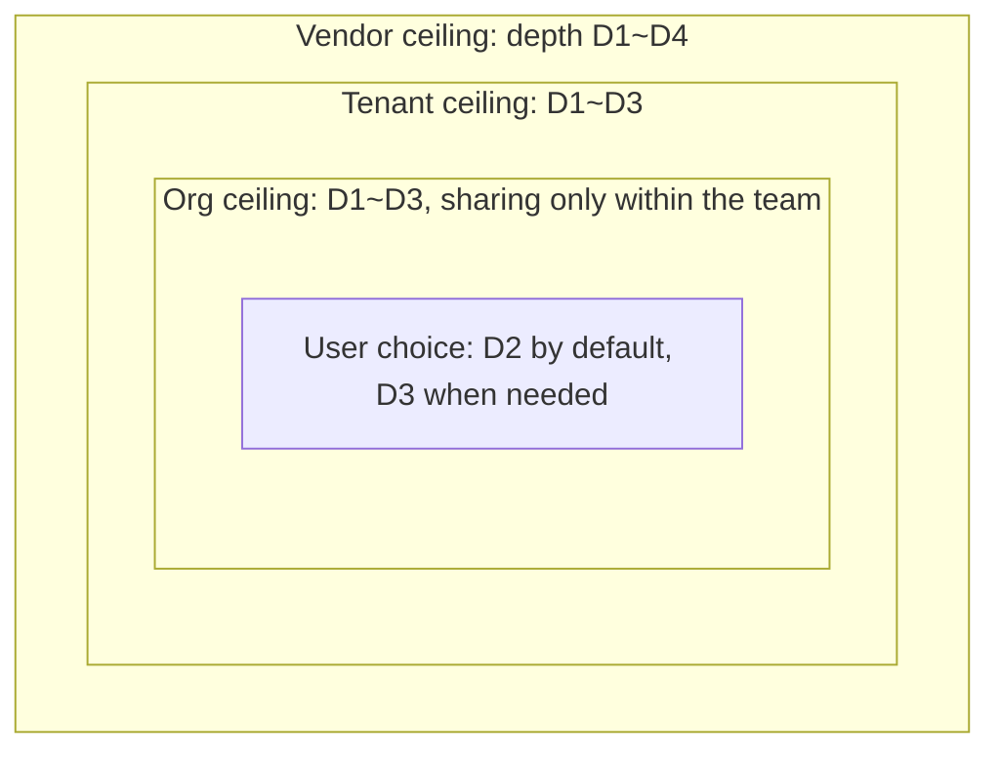
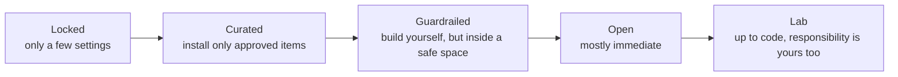
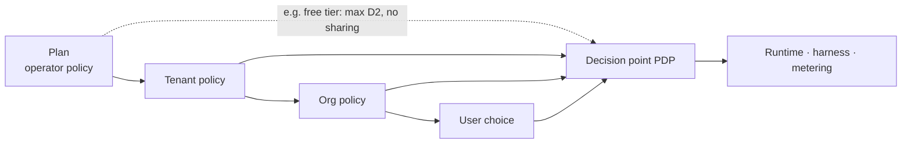

<!-- LANG-BAR -->
**English** · [한국어](../ko/04-control-spectrum.md) · [简体中文](../zh-CN/04-control-spectrum.md) · [日本語](../ja/04-control-spectrum.md) · [Español](../es/04-control-spectrum.md)
<!-- /LANG-BAR -->

# 4. Control spectrum — what to allow users, and what operators control

> Conclusion of this chapter: control is not an on/off switch but **a range per knob**. Higher actors narrow the range's **ceiling**, and the user chooses within it. However, there are 7 **user floor rights** that no policy can erase. Plans, presets, and tenant policies are all just different cuts of this range.

## 4.1 The problem: open it and it is dangerous, close it and it is not malleable

- Too open: security incidents, exploding support costs, updates become impossible, brand consistency collapses.
- Too closed: no different from a settings screen, and users end up finding workarounds (copied scripts, external automation).

What is needed is **delegable continuous control**. The vendor sets the risk ceiling of the whole platform, the tenant sets its company's ceiling, the organization sets the team's ceiling, and the user chooses freely within the remaining range.

## 4.2 Range delegation model

Each knob `k` has a value domain `D_k` sorted in order of risk (e.g. depth `D1 < D2 < … < D5`). Set-valued knobs (e.g. a list of allowed permissions) are ordered by inclusion.

```text
What actor i sets for knob k:  range [f_i, c_i] ⊆ D_k
  c_i : ceiling. Values riskier than this are forbidden
  f_i : floor. Giving less than this is forbidden (to guarantee user rights)

Delegation rule (MUST):   [f_child, c_child] ⊆ [f_parent, c_parent]
Effective range:          [f_eff, c_eff] = ⋂ all ranges along the chain
User's choice:            v_k ∈ [f_eff, c_eff],  default d_k
```



How to read: an inner box cannot become wider than the outer box. If a user wants a D4 feature, the system must be able to tell them that it is blocked at the **tenant ceiling**, not by the organization ("This feature is not allowed by company policy. Shall I forward the request to your administrator?").

Advantages of this model:
- **Explainability**: the reason for a denial can be stated exactly as "which ceiling at which level."
- **Composability**: since it is an intersection, it is computed independently of order and can be cached.
- **Unification with plans**: a plan is just one more ceiling set by the operator (4.9).

## 4.3 Knob catalog

| Group | Knob | Value domain (low risk → high) | Recommended default | Main deciding actor | Related axis |
| --- | --- | --- | --- | --- | --- |
| What | Maximum depth | D1 → D5 | D3 | Vendor, tenant | A1 |
| What | Extension point allowlist | some → all | all stable points | Vendor | A1 |
| What | Capability ceiling | read → write → external send | internal read and write | Tenant | A1, A4 |
| What | External network | blocked → allowlist → all | blocked | Tenant | A4 |
| How | Activation mode | gated → preview → live | preview | Tenant, org | A11 |
| How | Approver | administrator → org administrator → self | administrator on capability increase | Tenant | A11 |
| How | Verification strength | all gates → skip by depth | standard per depth (5.8) | Vendor | — |
| How | Automatic baseline application | defer → approve → auto | approve | Tenant, user | A7 |
| With whom | Sharing scope | none → tenant → public | tenant | Tenant | A8 |
| With whom | Resharing | forbidden → if the author allows → free | if the author allows | Org | A8 |
| With whom | Code visibility | hidden → own → open | depends on deployment form | Tenant | A5 |
| How much | Model sourcing route | tenant-designated → selectable | tenant-designated | Tenant | A9 |
| How much | Quality tier | economy → standard → high quality | standard | User | A9 |
| How much | Budget ceiling | low → high | monthly ceiling + stop when exceeded | Tenant, user | A9 |
| What is seen | Management visibility | none → V0 → V3 | V1 (enterprise V2) | Tenant | A10 |
| What is seen | Platform export | none → aggregates → metadata | aggregates | Tenant (contract) | A10 |
| What is seen | Retention period | short → long | events 13 months | Tenant | A10 |

## 4.4 Spectrum presets

Instead of choosing knobs one by one, you can start from five presets.



| Knob | Locked | Curated | Guardrailed | Open | Lab |
| --- | --- | --- | --- | --- | --- |
| Maximum depth | D1 | D2 (installs up to D3) | D3 | D3 | D4 |
| Self-creation | not possible | not possible, install only | possible | possible | possible |
| Capabilities | none | approved list | internal read and write | internal + allowlisted external | approved on request |
| Activation | — | gated | preview | live (D1~D2) | preview |
| Sharing | none | receive only | tenant | tenant | tenant |
| Baseline application | automatic | automatic | approve | auto | approve |
| Management visibility | V0 | V1 | V2 | V1 | V2 |
| Matching profiles | part of P4 | P6 users | P2, P3 | P1, P5 | P1 developers |

Presets are starting points. After choosing a preset, a tenant can narrow individual knobs further, but cannot widen them beyond the preset (only within the vendor ceiling).

## 4.5 Decision authority matrix

`decide` = sets the value, `ceiling` = sets the range the lower level can choose from, `propose` = can only request, `—` = not involved.

| Decision | Vendor V | Operator O | Tenant T | Org G | User U | Agent α |
| --- | --- | --- | --- | --- | --- | --- |
| Define extension points and capability map | decide | — | — | — | propose | — |
| Platform maximum depth | decide | ceiling | ceiling | ceiling | choose | — |
| Grant capabilities | ceiling | — | ceiling, approve | approve (if delegated) | request, approve (own scope) | **not allowed** |
| Baseline release | decide official edition | — | decide tenant edition | decide org edition | — | propose (promotion) |
| When to apply baseline | — | — | ceiling | ceiling | decide | prepare only |
| Sharing | — | ceiling (public marketplace review) | ceiling | ceiling | decide | — |
| Model route and budget | — | ceiling (plan) | decide | ceiling | choose quality | — |
| Management visibility | — | export ceiling | decide | — | check (floor) | — |
| Change creation | — | — | — | — | provide intent | generate |
| Change judging | verification rules | — | additional rules | additional rules | check preview | judge (an instance different from the generator) |

The agent column is the key. The agent does **generate, judge, and propose**, but never does **grant capabilities, change policy, or decide releases** (I4, I9).

## 4.6 User floor rights (Floor Rights)

No tenant policy, plan, or preset can remove the rights below (**MUST**). These floors must exist for users to make changes without fear.

| # | Right | Content | Interpretation in enterprise environments |
| --- | --- | --- | --- |
| F1 | Revert | Any change in their own layer can be reverted immediately | The upstream baseline itself cannot be reverted, but my changes on top of it always can |
| F2 | Safe mode | Can start with all user layers turned off | Isolate the cause without stopping work |
| F3 | Visibility notice | Can always check who can see what of my changes | Display such as "Your org administrator can see change descriptions too" |
| F4 | Export my work | Can export the intent and contract of changes I made in a standard format | Exporting artifacts (code) can be restricted by policy |
| F5 | Permission view | Can see the permissions active changes hold, and permission increases do not happen without notice | Same for features received through sharing |
| F6 | Spend cap | If costs fall on me, I can set a cap, and it stops when exceeded | If the tenant pays, notify that the tenant cap applies |
| F7 | Explanation on request | For any change, can receive "what changed" in plain terms | Change receipt (8.6) |

## 4.7 Policy documents

A policy is an inheritable declarative document. The full example is in [`examples/policy.example.yaml`](../../examples/policy.example.yaml), and the schema is in [`schemas/policy.schema.json`](../../schemas/policy.schema.json).

```yaml
policy:
  id: tenant/acme
  level: tenant
  inherits: operator/plan-business      # a plan is a policy too
  knobs:
    depth:            { ceiling: D3, default: D2 }
    capabilities:     { ceiling: [tasks.read, tasks.write, notify.local, net.slack.post] }
    network:          { ceiling: allowlist, allowlist: ["hooks.slack.com"] }
    activation:       { ceiling: preview, approver_on_capability_increase: tenant_admin }
    baseline_apply:   { ceiling: auto, default: approve }
    sharing:          { ceiling: tenant, reshare: author_opt_in }
    code_visibility:  { value: own }
    model_route:      { value: tenant_cloud }
    quality_tier:     { ceiling: standard, default: standard }
    budget:           { monthly: 3000, per_user_monthly: 30, on_exceed: stop }
    admin_visibility: { value: V2 }
    platform_export:  { ceiling: V0 }
  floors: [rollback, safe_mode, visibility_notice, export_intents, permission_view, spend_cap, receipt]
```

## 4.8 Policy decision procedure

Every request is expressed as `(subject, action, target, context)`, and the decision point (PDP) returns one of `allow / deny / approval required` together with **obligations**. An obligation is "something that must be done while allowing" (logging, preview, notification, and so on).

```text
decide(req):
  p ← effective_policy(req.subject)            # intersection of policies along the chain (cacheable)
  if req.action ∈ FLOOR_ACTIONS and floor_scoped(req):   # revert, safe mode, export, etc.
      return allow, obligations=[log]
  if req.action == revert:                      # revert outside the floor scope = judged the same as activation
      req ← as_activate(req.target)             # includes redo, re-enable, and lifting a hold
  for k in knobs_touched(req):
      if value(req, k) ∉ [p.f_k, p.c_k]:
          return deny, reason=(k, level that set the ceiling)   # "Tenant policy: maximum depth D3"
  if raises_capabilities(req):
      return approval required, approver=p.approver_for(req.capabilities_delta)
  if uses_destructive(req):                     # destructive capabilities go to G5 regardless of activation policy (5.8)
      return approval required, approver=p.gate_approver
  if p.activation(req.depth) == gated:
      return approval required, approver=p.gate_approver
  return allow, obligations=obligations(p, req)         # e.g. preview, audit log, cost metering
```

`floor_scoped(req)` is true only when all of the following hold (**MUST**). If any one is violated, the request is judged not as a floor action but as an ordinary request.
- The subject is the **person** who owns the target layer (not an agent, a watchdog, or a user of another layer). A watchdog's automatic recovery is allowed only when it reduces permissions, and it is logged.
- For a revert, the target is a **previous state** of the same layer, and the result's effective depth and permissions are **within** (⊆) the current active state and the current effective policy. Moves that increase permissions or depth again, such as redo, "re-enable" (5.4), and lifting a hold, are judged as activation (E10).
- Safe mode only turns things off, and export covers intent and contract (F2, F4).

Placement principles:
- **The authoritative PDP sits at the operator boundary (server) (I8).** A copy of the policy is kept on the user's device for quick guidance, but the server makes the final decision again.
- In offline personal mode (P1) there is no server, so the device's PDP is the only one. In this case the policy is "a safety device that protects the users themselves," not an enforcement mechanism. Documents and UI do not hide this difference. For the same reason, deployments without a server (P1, P5) cannot guarantee I8, so their conformance level goes up to Core only and cannot be Governed (10.3).
- **Policy engine adapter** (**MAY**): the PDP can be implemented by translating knob ranges into a policy language. In Cedar, forbid overrides permit, the request is denied if no permit matches, and the ids of the policies that produced the decision are returned with it. Use these ids as the basis for `deny (reason, level)` and the receipt (8.6).
- **Machine verification of I5** (**SHOULD**): when saving a policy, check `p_child ⊑ p_parent`. If translated into Cedar, SymCC's implication check (`check_implies`) can prove it, with counterexamples. Run the same tool's `check_never_errors` as well. Cedar skips policies that raise evaluation errors, so a forbid that errors stays silently open.
- **Scope and lifetime of approvals** (**MUST**): a person's answer to `approval required` has a scope: **just this once** (this one request), **for this task** (until this generation session ends), and **always** (continuing for this user and this layer). "Always" is bound to the **fingerprint of the approved target** (the feature's content_hash and permission list). If the feature content or permissions change, the approval disappears and the question is asked again. The approval screen states the scope of "always" in a sentence and does not place "always" right next to "deny." Anything that is not an affirmative answer (closing the window, answering with something else, aborting, timing out) is a denial. Read-only actions that do not increase permissions are not asked about (approval fatigue, 4.10). ThinkRail's MCP tool-call confirmation has the same structure (deny · just this once · in this conversation · always. "Always" is bound to the SHA-256 of the server `command`+`args` or `url`, [JetBrains/thinkrail `agent/mcp/SPEC.md`](https://github.com/JetBrains/thinkrail/blob/c10f8808cee693e4abffeeb1844a132ed0a91cc5/packages/server/src/agent/mcp/SPEC.md#L129-L150)).
- **Floors before the engine**: because of the forbid-first rule, if the floor rights (F1~F7) are put in as ordinary permits, an upstream forbid can erase them. Place the `FLOOR_ACTIONS` check before the engine call, as in the pseudo-code above.

## 4.9 Plan = policy ceiling

Do not build plans as a separate system; express them as a policy set by the operator.



This also makes upgrade prompts natural. If the reason for a denial is "plan ceiling," that moment is the most accurate upsell point (9.7).

## 4.10 Questions to consider

- When a tenant opens D4, who is responsible for damage caused by defects in that code? The terms of service and the policy document must say the same thing.
- When floor F4 (export) conflicts with an enterprise's intellectual property protection, is the compromise of exporting only intent and contract enough?
- When moving between presets, what if already-active changes exceed the new ceiling? Recommendation: do not turn them off immediately; put them in a 'held' state and notify the user.
- Approval fatigue: beyond how many approval requests per week do approvers stop reading the content? This figure must be measured to adjust the scope of automatic approval.

Next chapter: [5. Reference architecture](05-reference-architecture.md)
