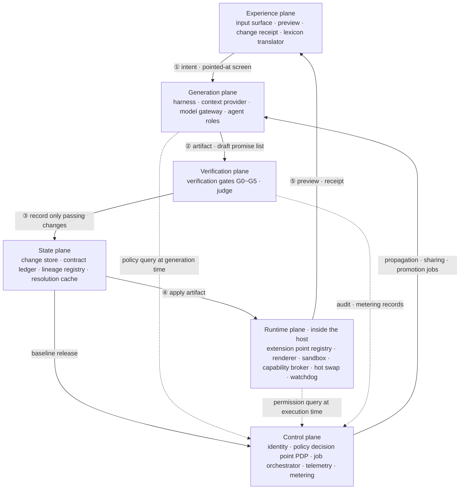
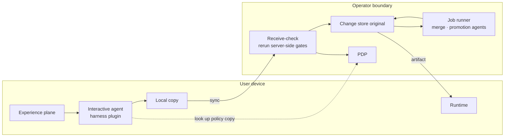
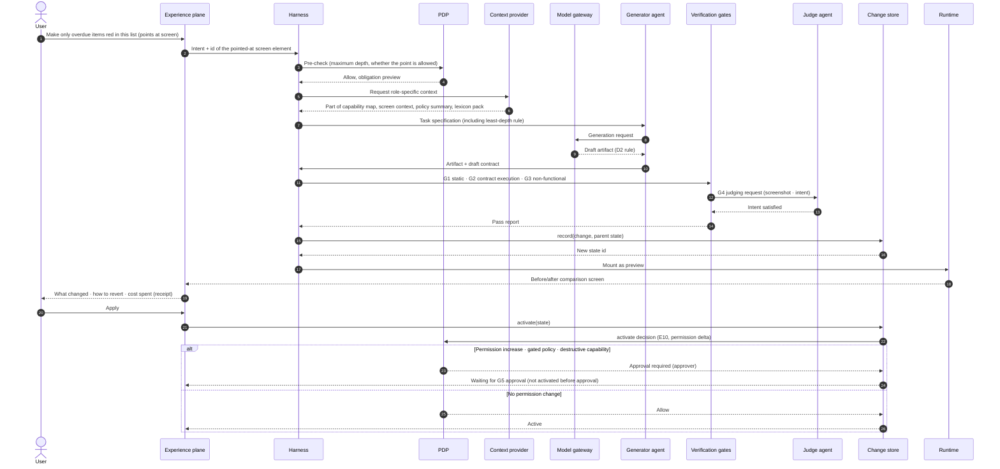
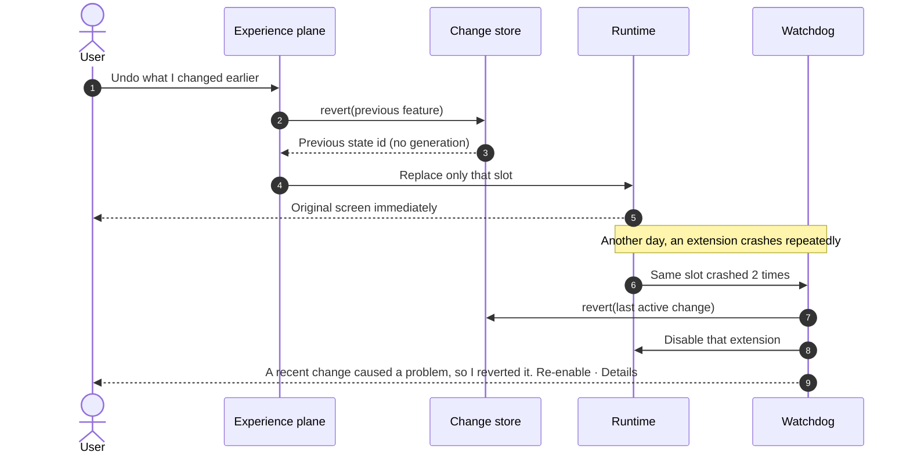
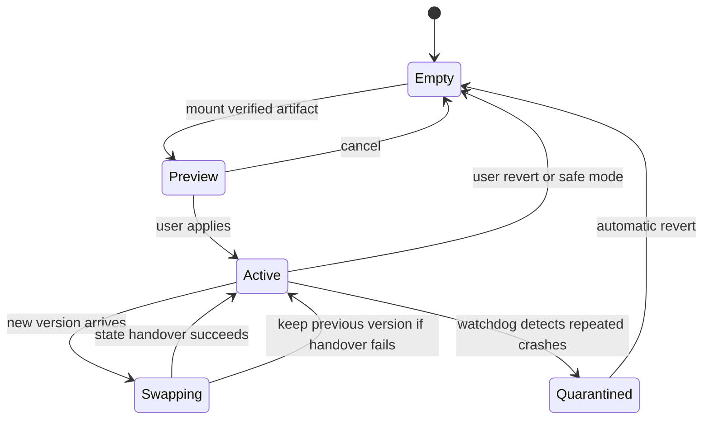

<!-- LANG-BAR -->
**English** · [한국어](../ko/05-reference-architecture.md) · [简体中文](../zh-CN/05-reference-architecture.md) · [日本語](../ja/05-reference-architecture.md) · [Español](../es/05-reference-architecture.md)
<!-- /LANG-BAR -->

# 5. Reference architecture — planes, components, ports, flows, harness

> Conclusion of this chapter: a Mallangable system is divided into **6 planes**: the **experience plane** that meets the user, the **runtime plane** that executes changes inside the host, the **generation plane** where the AI makes changes, the **verification plane** that judges changes, the **state plane** that keeps history, and the **control plane** in charge of policy, billing, and audit. The planes are connected only through **ports (interfaces)**, and implementations (adapters) are swapped according to the axis choices in Chapter 3.

## 5.1 Overall structure



How to read: the solid lines ①~⑤ are the loop of a single change. The intent goes to the generation plane, only what passes verification is recorded, only what is recorded is applied in the runtime, and the result returns to the user as a preview and receipt. When a new baseline is released, the control plane creates a propagation job and runs the same loop again. The dotted lines are policy queries. The key point is that **generation time (harness) and execution time (runtime broker) ask the same PDP**. If the permission decisions at the two times diverge, gaps appear such as "allowed when built but forbidden when run." The components inside the planes are in the table below and in the port definitions of 5.3.

### Responsibilities per plane

| Plane | Responsibility | Must hold |
| --- | --- | --- |
| Experience plane | Intent collection, progress display, preview, receipts, plain terms | Every user-visible string passes through the lexicon translator |
| Generation plane | Intent interpretation, artifact generation, merge, promotion | All writes only through tool calls. Raw repository commands forbidden |
| Verification plane | Policy pre-check, static checks, contract execution, non-functional checks, judging | Generator and judge separated (I7) |
| Runtime plane | Extension loading, isolation, and execution, capability brokering, hot swap, recovery | Extensions do not reach the host by any path other than the broker |
| State plane | Layer history, contracts, lineage, resolution cache | Every active state can be reverted (I3) |
| Control plane | Identity, policy, jobs, audit, metering | Authoritative enforcement only here (I8) |

## 5.2 Deployment view — by agent location (A3)

| Component | `client` | `hybrid` | `server` |
| --- | --- | --- | --- |
| Input surface, preview | device | device | device |
| Agent harness | device (agent launched by the user + harness plugin) | interactive generation: device / merge and promotion: server. With `own`, upper-layer artifacts are not given to the device's generator (5.10, I6) | server sandbox |
| Model gateway | device (user subscription or key) | device + server | server |
| Verification gates | device (re-verified if there is a server) | device first pass + server re-verification | server |
| Runtime | device | device | device (downloads artifacts only) |
| Change store | device (sync optional) | server holds the original, device holds a copy | server only |
| PDP | device (advisory) | server (device caches) | server |



How to read (hybrid case): the user makes changes on the device through conversation, and the result becomes the original only after passing the server receive-check again. Work repeated across thousands of users, such as baseline merges, is handled by the server.

## 5.3 Ports and adapters

The boundaries between planes are defined as interfaces. Below is a language-neutral notation (borrowing TypeScript syntax). Implementations plug in adapters that match the axis choices.

```ts
// ── Runtime plane ────────────────────────────────────
interface ExtensionPointRegistry {
  list(filter?: { depth?: Depth; kind?: PointKind }): ExtensionPoint[];
  capabilityMap(): CapabilityMap;               // machine-readable. Supplied as agent context
}
interface SandboxHost {                         // adapters: SES Compartment | iframe | Worker | process | microVM
  mount(artifact: Artifact, grants: CapabilityGrant[], prevState?: unknown): SlotHandle;
  unmount(slot: SlotHandle): Promise<unknown>;  // returns a snapshot for state handover
  limits(slot: SlotHandle): ResourceBudget;
}
interface CapabilityBroker {
  call(slot: SlotHandle, cap: CapabilityId, args: unknown): Promise<unknown>;  // PDP query + audit log on every call
}

// ── Generation plane ─────────────────────────────────
interface AgentHarness {                        // adapters: commercial agent + plugin | in-house agent loop
  run(task: Task, role: AgentRole, budget: Budget): AsyncIterable<HarnessEvent>;
}
interface ContextProvider {
  build(task: Task, role: AgentRole): Context;  // only what each role may see (I6)
}
interface ModelPort {                           // adapters: user subscription (via official client) | API key | credits | tenant cloud | device model
  complete(req: ModelRequest, route: Route): Promise<ModelResponse>;
  estimate(req: ModelRequest, route: Route): CostRange;
}

// ── Verification plane ───────────────────────────────
interface ValidationPort {
  run(change: ChangeDraft, gates: GateId[]): Promise<GateReport>;
}
interface ContractRunner {
  check(contract: Contract, app: EffectiveAppHandle): Promise<ContractResult>;
}

// ── State plane ──────────────────────────────────────
interface ChangeStore {                         // adapters: Git-style repository | CRDT document | snapshot DB
  record(change: Change, parent: StateId): StateId;   // exposes only this instead of raw commit commands
  activate(state: StateId): void;
  revert(target: StateId | FeatureId): StateId;        // constant time with no generation (I3)
  history(scope: Scope): ChangeRecord[];
}
interface LineageRegistry {
  parent(node: LayerNodeId): LayerNodeId | null;
  release(node: LayerNodeId, tag: BaselineTag): void;
  descendants(node: LayerNodeId): LayerNodeId[];        // topological order
}
interface ResolutionCache {
  lookup(key: ConflictClassKey, scope: VisibilityScope): Resolution | null;
  store(key: ConflictClassKey, scope: VisibilityScope, r: VerifiedResolution): void;
}

// ── Control plane ────────────────────────────────────
interface PolicyDecisionPoint {
  decide(req: AccessRequest): Decision;          // allow | deny (reason, level) | approval required (approver) + obligations
}
interface JobOrchestrator {
  submit(job: PropagationJob | ShareJob | PromotionJob): JobId;
}
interface TelemetrySink { emit(e: Event & { visibility: VisibilityLabel }): void; }
interface MeteringPort  { record(u: UsageRecord): void; entitlement(subject: Subject): PlanLimits; }

// ── Experience plane ─────────────────────────────────
interface LexiconPort {
  render(conceptId: string, level: "basic" | "practitioner" | "developer", locale: string, domain?: string): string;
  lint(text: string, level: string): LexiconViolation[];   // detects developer terms on general-user screens
}
```

Design principles:
- `ChangeStore` **does not expose raw repository commands (commit, push, merge, reset).** The only writes an agent can make are `record`, `activate`, and `revert`, and thanks to this boundary the recording format (6.11) stays uniform.
- The 'user subscription' adapter of `ModelPort` implements only the paths the provider allows (8.10).

## 5.4 Flow 1 — how a single change is made



Key points:
- The pre-check in step 3 filters out impossible requests **before generation**, saving cost.
- The least-depth rule goes into the task specification in step 7. If the generator agent builds it at D4, it is rejected at G1 in step 11.
- Judging (steps 12~13) is done by an instance different from the generator agent (I7).
- Recording (step 15) comes before the activation request (step 21). That is why every applied state can be reverted (I3).
- Activation also goes through the PDP (step 22, E10). Even if the experience plane calls the store, if permissions increase or the policy is gated, it does not become active until G5 approval.

## 5.5 Flow 2 — revert and automatic recovery



Revert **does not call the model.** It is a pointer move, so its cost is 0 and it belongs to time tier T0 (8.4). The fact that "revert is free" is the strongest motivation for users to start experimenting.

### Revert based on what was seen

The active state can change even while the user is looking at the screen: baseline propagation (6.5), application on another device, and the watchdog's automatic recovery all do this. So a revert request sends along **the id of the state the user saw**: `revert(feature, expect=id of the seen state)`.

- If the current state differs from `expect`, nothing is changed (**MUST**). Instead, show the current state and let the user choose again. Reverting the wrong state turns floor right F1 into an accident.
- The revert result returns a new state id, and doing **the same operation once more** with that id is a redo. No separate mechanism is kept for redo (**SHOULD**). However, redo and "re-enable" after a watchdog's automatic recovery increase permissions and depth again, so they go through the same PDP decision as activation (E10), not the floor right (F1) (**MUST**, 4.8 `floor_scoped`). If the ceiling was lowered or the approval disappeared in the meantime, the result is approval required or deny.
- If the record has disappeared and it cannot be reverted or redone, do not pass over it silently; say "This can no longer be undone" (**MUST**).

ThinkRail's diff revert uses the same rule. The client does not send the content, only a hash of what it saw, and if it differs, the request is rejected with `STALE_VIEW` ([JetBrains/thinkrail `changes/SPEC.md`](https://github.com/JetBrains/thinkrail/blob/c10f8808cee693e4abffeeb1844a132ed0a91cc5/packages/server/src/changes/SPEC.md#L39-L43), research notes [T1·T2](research/thinkrail-analysis.md)).

## 5.6 Harness

### Definition

The harness is **a deterministic shell that wraps a non-deterministic agent**. Whatever the agent thinks, the harness enforces the following five things.

| Responsibility | Content | Means of implementation |
| --- | --- | --- |
| Procedure | Order: depth decision → contract writing → artifact → verification → recording → activation request | Skills and task specifications, pre-exit check hook |
| Tool boundary | Only allowed tools, only allowed paths | Restricted tool list, path access hook |
| Policy hooks | PDP query at every lifecycle event | Event model (below) |
| Budget | Ceilings on tokens, time, and retries | Model gateway metering, job budget |
| Output contract | Format of what goes out to users and other agents | Schema checks, output gate |

The agent skills standard (SKILL.md) is a good way to distribute procedures portably, but permission enforcement is left to each agent implementation. The standard's `allowed-tools` field is also experimental, and support differs by agent ([Agent Skills specification](https://agentskills.io/specification)). So the split is: **skills carry the procedure, the harness carries the enforcement**.

### Vendor-neutral event model

| id | Event | When | Can it block | Typical policy |
| --- | --- | --- | --- | --- |
| E1 | `session.start` | Session start or resume | No | Inject policy summary, capability map, and pending upgrades into context |
| E2 | `intent.submit` | Right after the user request, before model processing | Yes | Depth classification, collect D5 as core requests, block attempts to elicit source viewing (hidden) |
| E3 | `plan.ready` | Agent finalizes its plan | Yes | Reject plans that violate least depth |
| E4 | `tool.before` | Before tool execution | Yes | Path access control, block raw repository commands, block external sends |
| E5 | `tool.after` | After tool execution | Feedback only | Return incremental verification results to the agent, sanitize output |
| E6 | `permission.request` | Permission decision needed | By decision | Route to a human approval card |
| E7 | `batch.after` | End of a batch of parallel tool calls | Yes | If cumulative change volume exceeds 80% of the size rule, instruct feature-level recording |
| E8 | `artifact.ready` | Draft artifact complete | Yes | Run verification gates |
| E9 | `record.before` | Just before recording a change | Yes | Check contract presence, recording format, and size |
| E10 | `activate.before` | Just before activation | Yes | Approval required if permissions increase |
| E11 | `stop.before` | Just before the agent exits | Yes | Refuse to exit if there are unverified or unrecorded changes |
| E12 | `subagent.stop` | Subagent exits | Yes | Schema check of judging results |
| E13 | `output.before` | Just before going out to a person or another agent | Can substitute | Output gate (code leak detection, lexicon translation) |
| E14 | `merge.conflict` | Merge conflict found | — | Enter the resolution ladder (6.6) |
| E15 | `compact.before` | Just before context compaction | No | Record progress state in the ledger |
| E16 | `session.end` | Session end | No | Send telemetry |

### Mapping example: Claude Code hooks

Claude Code hooks provide more than 30 events, five kinds of handlers (command, HTTP, MCP tool, prompt, agent), an option for administrator settings to block user hooks, and `onFailure: "block"`, which blocks the action when a hook fails ([Claude Code hooks documentation](https://code.claude.com/docs/en/hooks.md)). The events above map roughly as follows.

| Mallangable event | Claude Code hook event |
| --- | --- |
| E1 `session.start` | `SessionStart` |
| E2 `intent.submit` | `UserPromptSubmit` |
| E4 `tool.before` | `PreToolUse` |
| E5 `tool.after` | `PostToolUse` (result can be substituted with `updatedToolOutput`) |
| E6 `permission.request` | `PermissionRequest` |
| E7 `batch.after` | `PostToolBatch` |
| E11 `stop.before` | `Stop` ¹ |
| E12 `subagent.stop` | `SubagentStop` ¹ |
| E15 `compact.before` | `PreCompact` |
| E16 `session.end` | `SessionEnd` |
| E3, E8, E9, E10, E13, E14 | No corresponding event → raised directly inside the Mallangable tools (MCP server) |

¹ `onFailure: "block"` works only for command and http hooks in v2.1.295 and later, and has no effect on `Stop` or `SubagentStop`. If the hook fails, E11 and E12 pass through open. So E11 and E12 are not trusted as blocking checkpoints. The check for unverified or unrecorded changes is also enforced on the MCP tool side (`ChangeStore.record()`, `activate()`).

Other agent runtimes can get a mapping table the same way. Anything without a corresponding event is **enforced on the tool side**. For example, E9 `record.before` is checked inside `ChangeStore.record()`.

A mapping table goes stale when the runtime version changes (footnote ¹ above is an example). So each mapping entry records three things (**SHOULD**): **what was checked** (the behavior checked and its source), **when to look again** (on a runtime version update), and **when to delete it** (when the runtime provides the same function directly, delete the harness-side workaround). Version numbers live in only one place, the dependency pin file, and are not repeated in the spec. ThinkRail keeps a compatibility ledger like this, recording "what to recheck" and "conditions under which it can be deleted" for every adaptation that patches over an engine defect ([JetBrains/thinkrail `pi-compatibility.md`](https://github.com/JetBrains/thinkrail/blob/c10f8808cee693e4abffeeb1844a132ed0a91cc5/pi-compatibility.md#L11-L16)).

Codex CLI maps the same way (**needs confirmation against official documentation**): E1 `SessionStart`, E2 `UserPromptSubmit`, E4 `PreToolUse`, E5 `PostToolUse`, E6 `PermissionRequest`, E11 `Stop`, E12 `SubagentStop`, E15 `PreCompact`. This list was taken not from the official Codex documentation but from the event set Harness² uses when checking hook settings ([google-research/harness2 `substrate/codex.py`](https://github.com/google-research/harness2/blob/1cfe254e8d25b15f37048c3730134686abe60335/harness2/substrate/codex.py#L58-L72)). It must be checked against the official Codex documentation before adoption.

The experience plane does not receive harness events as they are but as progress signals for the user. If [AG-UI](https://docs.ag-ui.com/concepts/events) is used as the transport, they map as follows.

| Mallangable | AG-UI | Notes |
| --- | --- | --- |
| E2 accepted ~ E11 exit | `RUN_STARTED` · `RUN_FINISHED` · `RUN_ERROR` | |
| 4 status words (8.5) | `STEP_STARTED` · `STEP_FINISHED` | step names fixed to status word ids |
| Partial preview (8.5) | `STATE_SNAPSHOT` · `STATE_DELTA` (RFC 6902) | keep the "not yet checked" indicator |
| E6 `permission.request`, 2.8 `awaiting-approval` | `outcome.type = "interrupt"` of `RUN_FINISHED` → `resume[]` of the next run | approval continues as a new run ([AG-UI interrupt](https://docs.ag-ui.com/concepts/interrupts)) |

There is only one completion signal (**MUST**). In many runtimes, "one attempt finished" and "the work finished" are different. Even after an attempt ends, the work can continue through retries, context compaction, or queued follow-up requests. The experience plane shows `Ready` only after the harness lets E11 through, and does not change the status word at attempt boundaries. A state that waits for human input, like `awaiting-approval`, is a **level signal**. It does not turn off because the user looked at the screen; it turns off only when input comes in. ThinkRail treats `agent_end` as an attempt boundary and only `agent_settled` as completion ([JetBrains/thinkrail `architecture.md` decision 8](https://github.com/JetBrains/thinkrail/blob/c10f8808cee693e4abffeeb1844a132ed0a91cc5/architecture.md#L141-L156)).

When server jobs are delegated to external agents, [A2A](https://a2a-protocol.org/latest/specification/) task states (`TASK_STATE_INPUT_REQUIRED`, `TASK_STATE_AUTH_REQUIRED`) fill the same role, and inside MCP tools, multi-round-trip requests (`resultType: "input_required"`, [MCP 2026-07-28](https://modelcontextprotocol.io/specification/2026-07-28/changelog)) do.

Caution: hooks on the user's device can be turned off by the user. Hooks in the device harness are advisory, and final enforcement is the server receive-check (I8).

In many runtimes, a malformed hook setting **simply does not run**, with no error. That is, it stays open on failure. The harness plugin checks hook settings at write time against the event names and handler formats the runtime accepts (MUST), and at session start (E1) confirms that the hooks were actually registered (MUST). The agent cannot modify policy hooks or guardrail files (tool boundary, E4). Harness² checks Codex hook files at write time for the same reason ([google-research/harness2 `core/tree.py`](https://github.com/google-research/harness2/blob/1cfe254e8d25b15f37048c3730134686abe60335/harness2/core/tree.py#L216-L251)).

## 5.7 Agent roles

| Role | What it does | Read | Write | External communication | Notes |
| --- | --- | --- | --- | --- | --- |
| Interpreter | Interpret intent, ask back, write task specifications | User conversation, capability map | Task specification | Model only | Never sees code in hidden mode |
| Builder | Generate artifacts and contracts | Own layer, capability map | Drafts in allowed paths | Model, package mirror | No raw repository commands |
| Curator | Normalize records, split and combine | Changes | Record metadata | None | Rules + small model |
| Reviewer | Judge intent satisfaction and quality | Read-only | Judging result | None | An instance different from the builder (I7) |
| Merger | Resolve baseline and sharing merge conflicts | Target layer + upstream release | Conflict regions and related features | Model only | Weakening contracts forbidden |
| Promoter | Normalize converged features and propose them upstream | Candidate features (within visibility scope) | Upstream proposal area | Model only | Approval by a person |
| Explainer | Receipts and upgrade summaries in plain terms | Change metadata | User-facing sentences | None | Via the lexicon translator |

There are two reasons for splitting roles. ① If one agent holds private data, untrusted input, and external communication at the same time, attacks become easy (7.3). ② If the maker does the grading, verification becomes a formality.

## 5.8 Verification gates

| Gate | Content | On failure |
| --- | --- | --- |
| G0 policy pre-check | Are depth, extension point, and permissions within the policy range | Rejected before generation (cost 0) |
| G1 static checks | Schema, types, forbidden APIs (dynamic evaluation, arbitrary network, access to raw source), permission delta, size | Return the reason to the agent as a fixable sentence. If the retry ceiling (design proposal value: 1) is exceeded, keep the current state without changes and stop |
| G2 contract execution | Run all contracts in an isolated preview environment | Return failed contract ids and observed values |
| G3 non-functional | Performance budget (CPU, memory, startup time), no crashes, basic accessibility rules | Return items over budget |
| G4 judging | The judge decides semantic satisfaction from screenshots and intent. The judge does not know which generator, harness, or model route the artifact came from (source-blind judging). If there are several candidates, present them under anonymous ids shuffled with a reproducible seed | Return the basis for the judgment |
| G5 human | Only for permission increases, gated policies, or use of capabilities with irreversible writes (`destructive`). `destructive` capabilities need human approval regardless of activation policy | Wait for approval |

Required per depth (● required, ○ optional, — not applicable):

| | G0 | G1 | G2 | G3 | G4 | G5 |
| --- | :-: | :-: | :-: | :-: | :-: | :-: |
| D1 | ● | ● | ○ | — | — | — |
| D2 | ● | ● | ● | ○ | — | when external commands are included |
| D3 | ● | ● | ● | ● | ○ | on new data permissions |
| D4 | ● | ● | ● | ● | ● | on permission increase |
| D5 | ● | ● | ● | ● | ● | ● |

Cost principle: put cheap gates first. Filter out most at G0 and G1, and run the expensive G4 (model call) only at D3 and above.

### Handling judge output

The judge's (G4) output is also model output, so it is not trusted.

- **Malformed output is a failure** (**MUST**). If the verdict word is not one of the fixed values (`pass`, `fail`), or the location of a finding (extension point, element id) does not match, the verdict is a failure, not a pass, and the change does not go active. It is not let through silently.
- **The harness creates the record anew** (**MUST**). It does not store the judging result as is; it picks only the defined fields (verdict, summary, findings) and creates a new record. Fields made up by the model (e.g. `approved_by`, gate results) are discarded. Values only the harness knows are filled in by the harness.
- **A failure without findings is rejected** (**MUST**). If the verdict is `fail` but there are no findings, the generator has nothing to fix, so the verdict itself is treated as a failed judgment.
- **A pass verdict is not final** (**MUST**). If findings from a previous judgment are still unresolved, G4 is not recorded as passed even if the new verdict is `pass`.
- **All entry points share the retry ceiling** (**MUST**). The path where the generator requests judging again on its own and the path where a person presses re-check use the same ceiling (the same count as the G1 retry ceiling). If counted separately, fix → judge → fix never ends, and a cost attacker (7.1) loops through the side with no ceiling.

ThinkRail's plan-stage review uses the same rules ([JetBrains/thinkrail `host/planReview.SPEC.md`](https://github.com/JetBrains/thinkrail/blob/c10f8808cee693e4abffeeb1844a132ed0a91cc5/packages/server/src/host/planReview.SPEC.md#L62-L119), research notes [T4~T6](research/thinkrail-analysis.md)).

## 5.9 Runtime details

### Extension slot states



### Hot swap protocol

1. When a new artifact passes G2, the runtime pre-mounts it in a **hidden slot**. However, a change that needs G5 approval receives permissions and is mounted only after approval. Before approval, D4 code is mounted only with 0 permissions.
2. Get a state snapshot from the existing slot with `getState()`.
3. If the new version's state schema differs, `migrate(prev)` **MUST** exist. If it does not, the swap is refused.
4. If `mount(prevState)` succeeds, switch the screen slot and take down the existing instance. If it fails, leave the existing instance as is.
5. The core is not restarted. Hot module replacement (HMR) in development tools is a development build feature, so in deployed environments this slot-level swap takes over that role.

### Watchdog and safe mode

- If the same slot crashes N times (proposed value: 2) within a set time, the watchdog reverts the last active change and notifies the user.
- The unit of quarantine and disabling is the **whole feature**, not the slot (**MUST**). If a feature spans several slots, commands, and event hooks, all of them are turned off together. If only one is turned off, the remaining hooks keep running. The receipts and records of a disabled feature remain visible. ThinkRail's extension kill switch also turns off the tools and skills the extension contributed, and keeps the renderers that draw past conversations ([JetBrains/thinkrail `architecture.md` decision 21](https://github.com/JetBrains/thinkrail/blob/c10f8808cee693e4abffeeb1844a132ed0a91cc5/architecture.md#L376-L382)).
- A specific action at startup (proposal: launch while holding a modifier key) boots with **all user layers turned off** (floor right F2).
- Show the user the resource usage per extension. Users must be able to find the cause of a slowdown themselves.

## 5.10 Context supply

Most of an agent's quality is decided by what it is shown. State explicitly what is and is not supplied per role.

| Supplied item | Interpreter | Builder | Merger | Reviewer |
| --- | :-: | :-: | :-: | :-: |
| Capability map (around the relevant point) | ● | ● | ● | ○ |
| Screen context (screenshot of the pointed-at area, element ids) | ● | ● | — | ● |
| Summary of the current layer stack | ● | ● | ● | — |
| Policy summary (ranges, obligations) | ● | ● | ● | — |
| Lexicon pack | ● | — | — | — |
| Contracts of related features | ○ | ● | ● | ● |
| Own-layer artifacts | — if hidden | ● | ● | ● |
| Upper-layer artifacts | — if hidden | only when open. — if own (upper layers give types and capability map only) | ● (server) | ○ |
| Core source | — | only in a D5 fork | — | — |

In `own`, the builder talks with the user, so upper-layer artifacts placed in the builder's context can eventually be read by the user (I6). That is why the `own` builder receives only the type definitions and capability map of upper layers, not their artifacts. This rule is independent of where generation happens (5.2).

Instead of core source, give **type definitions and the capability map**. It is a way of giving the headers but not the implementation, and doing this structurally reduces the agent's tendency to patch the core (sliding into D5).

## 5.11 Telemetry events

Every event carries a **visibility label** at the time it is stored. Dashboard queries filter by both the viewer's permissions and this label (7.5).

```json
{
  "event": "change.activated",
  "ts": "2026-10-28T09:41:12+09:00",
  "tenant": "t_acme", "org": "o_design", "subject": "u_8c1f",
  "feature": "f_01JBX7K2M9Q2", "depth": "D3", "points": ["sidebar.panel"],
  "gates": {"G1": "pass", "G2": "pass", "G3": "pass", "G4": "pass"},
  "gen_ai": {"operation.name": "invoke_agent", "agent.id": "builder@harness-x", "usage.input_tokens": 18200, "usage.output_tokens": 2100},
  "model_cost": {"unit_cost_ref": "route:standard"},
  "policy": {"decision_id": "dec_7Q2…", "revision": "tenant/acme@42"},
  "trace": {"traceparent": "00-…-…-01"},
  "latency_ms": {"total": 41200, "first_preview": 9800},
  "visibility": "V1"
}
```

Model usage attributes follow the names of the [OpenTelemetry GenAI semantic conventions](https://opentelemetry.io/docs/specs/semconv/gen-ai/) (`gen_ai.usage.input_tokens`, `gen_ai.usage.output_tokens`, and so on). These conventions are still in Development status, so implementations also record the convention version they followed. Policy decisions leave a decision id (`policy.decision_id`) and policy revision (`policy.revision`), like OPA decision logs. Calls that pass through an MCP server are tied to the same trace with the `traceparent` convention in MCP `_meta`.

Recommended event groups: session, intent (classification, blocking, core requests), tools and policy (denial, permission request, approval), change (verification, recording, activation, revert), runtime (crash, safe mode), propagation (creation, conflict, resolution method, proposal, application, hold), sharing, promotion, cost (warning, overrun), security (output sanitization, secret detection, emergency access).

Next chapter: [6. Versioning and lineage](06-versioning-and-lineage.md)
