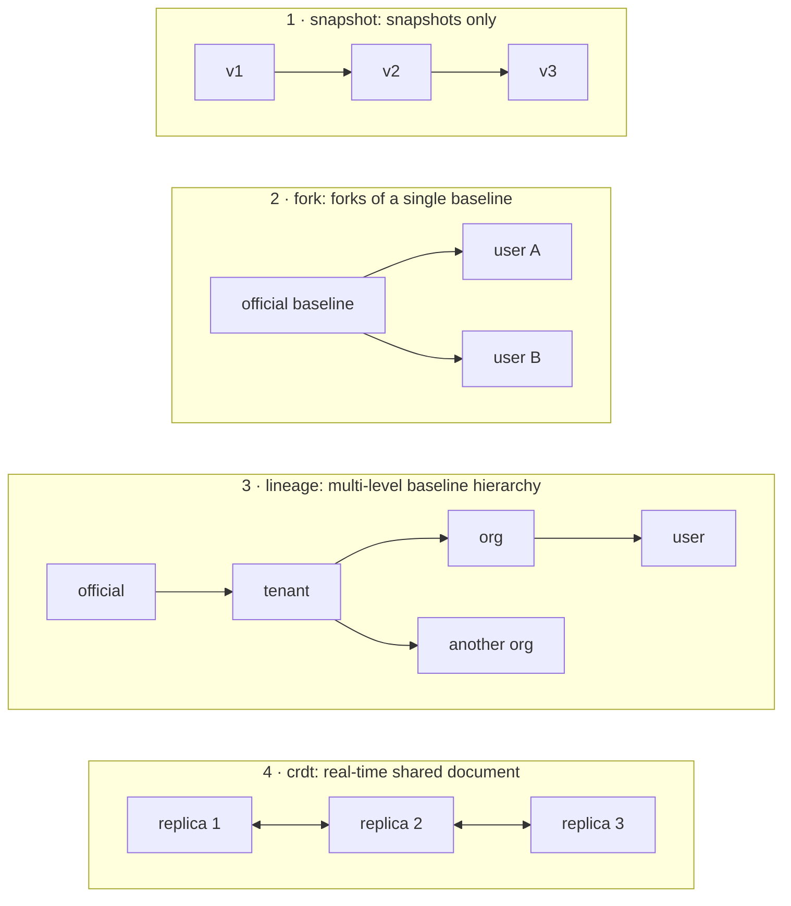
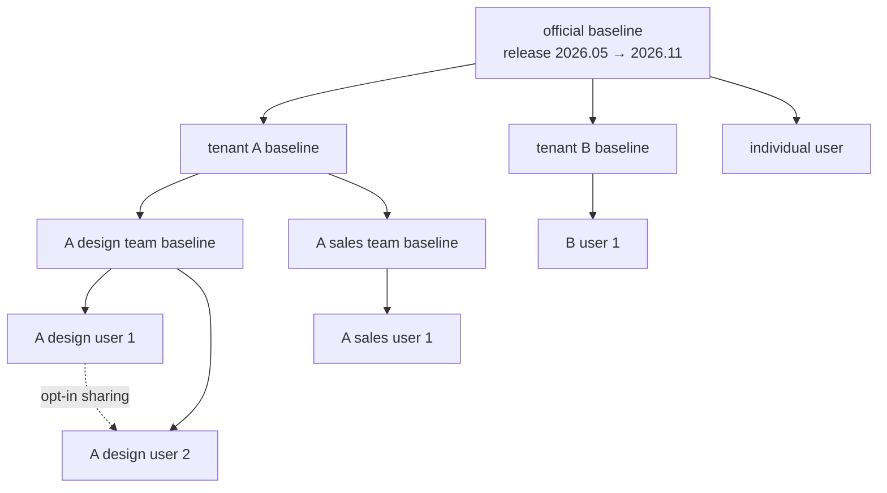
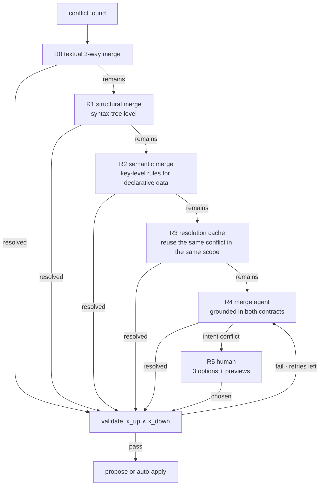
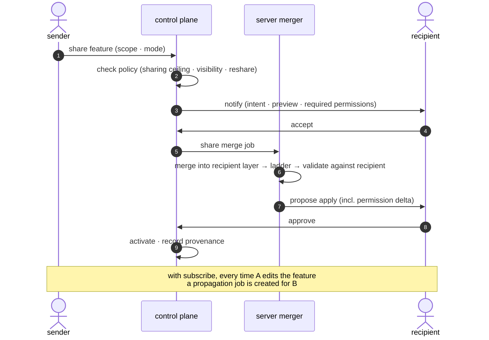
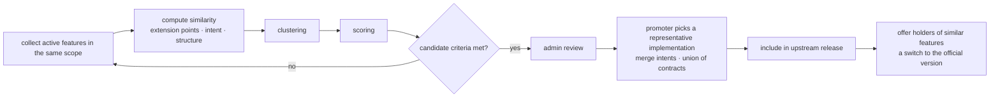

<!-- LANG-BAR -->
**English** · [한국어](../ko/06-versioning-and-lineage.md) · [简体中文](../zh-CN/06-versioning-and-lineage.md) · [日本語](../ja/06-versioning-and-lineage.md) · [Español](../es/06-versioning-and-lineage.md)
<!-- /LANG-BAR -->

# 6. Versioning and lineage — how user modifications survive updates

> Conclusion of this chapter: the real cost of malleable software does not arise at the moment of creation but **every time the vendor ships a new version**. To absorb it, you must ① split the isolation unit as the repository (layer) and the work unit as the branch, ② manage the baseline hierarchy as a **lineage**, ③ define merging as **contract-preserving**, and ④ share a **resolution cache** within the visibility scope so the same conflict is not resolved over and over.

## 6.1 Why version management is the central problem

If `N` users each have their own modifications and the baseline changes `r` times a year, `N × r` merges are needed per year. The "patch stack reapplication" problem that Linux distributions and phone manufacturers face when they maintain their own patches on top of upstream source now arises for **every single user**. This is not a scale people can resolve by hand, so the merge itself must be automated, and **what counts as a correct merge** must be defined so that a machine can judge it.

## 6.2 Four topologies



| | snapshot | fork | lineage | crdt |
| --- | --- | --- | --- | --- |
| Isolation | per user | per-user repository | per-node repository | per document, shared by everyone with access |
| Upstream update propagation | not possible | single level | multi-level in topological order | automatic convergence |
| Conflict handling | not applicable | merge ladder | merge ladder + hierarchy policy | no syntactic conflicts, **semantic conflicts remain** |
| Storage cost | low | number of forks × unique changes (common objects can be shared) | same | size of operation log |
| Fits | consumer apps that only store themes and rules | individuals and small groups | enterprise and public sector | real-time collaboration |

Recommendation: if there is even a small chance that org features will be needed in the future, build the storage model as `lineage` from the start. `fork` is expressed as a lineage of depth 1 (3.7).

## 6.3 The lineage model

```text
lineage T = (nodes, edges)
  node n      : one layer repository (official baseline, tenant baseline, org baseline, user layer)
  edge n→m    : m has n as its upstream (m is a fork of n)
  release r(n): a signed baseline tag on node n. e.g. 2026.11
  drift δ(m)  = number of steps between the upstream release m has applied and the latest upstream release
```



How to read it: solid lines are **the direction updates flow**, dotted lines are **sideways sharing**. When official baseline 2026.11 comes out, tenant A takes it first, then the design team and the sales team, and finally each user, in that order. Hierarchy depth may vary from 1 to 3 levels per customer.

## 6.4 Isolation unit and work unit

**The isolation unit is the repository; the branch is the work unit.** Typical Git hosting offers per-branch write protection but in most cases does not offer per-branch read restriction, so anyone who can download the repository can see every branch. Trying to isolate users with per-user branches breaks on this premise.

| Ref | Purpose | Written by |
| --- | --- | --- |
| `main` | Current active state. The runtime loads this | harness (records and approved merges) |
| `exp/<name>` | Experimental version, comparing alternatives | harness |
| `upgrade/<release>` | Merge result of a propagation job, awaiting approval | server merger |
| `share-in/<share id>` | Result of trial-merging a received share | server merger |
| Release tag | Baseline release. Only on baseline nodes, signature required | harness after admin approval |

Merge method: downward propagation uses history-preserving merges (rebase is recommended against). User history must be preserved for auditing, revert, and promotion analysis to work.

Concurrent generation: if two generation jobs of one user modify the same layer at the same time, it becomes unclear which feature a change belongs to (I9). Each generation job gets its own `exp/<name>` working copy (**SHOULD**). The recorder takes the state at the start of the job as its baseline and records **only the paths that job changed**. It does not record "everything that has changed right now." If two jobs overlapped in the same copy, it does not guess the attribution; it marks them as overlapping and lets a person split them. ThinkRail opens a work window for each plan step, commits only the paths that step changed, and marks windows that overlapped with another conversation as `shared` ([JetBrains/thinkrail `todos/SPEC.md`](https://github.com/JetBrains/thinkrail/blob/c10f8808cee693e4abffeeb1844a132ed0a91cc5/packages/server/src/todos/SPEC.md#L64-L80)).

Even with thousands of forks, most objects come from the same baseline, so if repositories share common objects (e.g. Git alternates), storage grows in proportion to the **number of unique changes**, not the number of users.

## 6.5 Propagation algorithm

```text
It is event-driven. When node p applies upstream release r to `main`, `baseline.applied(p, r)` is emitted, and that event creates jobs for p's children.

```text
on baseline.applied(p, r):                     # p = the release node itself, or an intermediate node that applied r
  kids  = children(p)
  waves = canary(kids, ratios=[0.05, 0.25, 1.0], seed=hash(p, r))   # seeded random sample
  for wave in waves:
    results = parallel_map(m -> propagate(m, p, r), wave)           # collect results. no return inside the body
    if failure_rate(results, key=(gate_id, contract_id, point)) > threshold:
      halt_propagation(p, r); alert(p.steward); stop

propagate(m, p, r) -> result:
  theirs    = p.main@applied(r)                # not the original r but the result the parent applied (incl. intermediate layer changes)
  contracts = ⋃_{a ∈ path(root(r), m)} κ(a)    # all contracts on the path from the node that published r to m (I10)
  merged    = merge(base=last_applied(m), ours=m.main, theirs=theirs)   # 6.6 ladder
  if merged.intent_conflict:   return NEEDS_HUMAN(options=3, previews)
  report = gates(merged, contracts)
  while report.fail and retries_left: report = retry_with_feedback(...)
  if report.fail:              return FAILED       # keep previous release, notify admin
  if delta_permissions(merged) == ∅ and policy(m).apply == auto:
    d = activate(merged)                       # ChangeStore.activate → PDP(E10). gated, destructive, and fingerprint-bound approvals are caught here
    if d == allow: emit baseline.applied(m, r); return APPLIED
    # if approval required or deny, fall through to propose below
  propose(merged, summary=explain(diff_of_intents)); return PROPOSED
  # once approved, apply → emit baseline.applied(m, r). if rejected or expired, m keeps the previous release

`apply` and `activate` are not a separate path that skips the activation decision (5.4, E10) (**MUST**). Even with no permission increase, if the activation policy is gated, the change uses a destructive capability, or an "always" approval was bound to a content_hash that has changed, the PDP returns `approval required` and the propagation becomes PROPOSED. `delta_permissions` is recomputed from the manifest of the merge result, not taken from the change record's self-report.

Nodes left on a release whose support period has ended: do not force-merge; leave them in 'warning mode'.
```

Job states per node:

```text
waiting → merging → validating → { applied | awaiting-approval | needs-human | failed }
awaiting-approval → applied (approved) | on-hold (rejected or expired)
needs-human → validating (after R5 choice)
```

Rules:
- **Topological order** (**MUST**): do not create a child's job before the parent has applied the release. Child jobs are created only by the parent's `baseline.applied` event.
- **Parent awaiting approval**: if the parent is `awaiting-approval` or `needs-human`, the child is left in a state with **no job**, not with a paused job. The child's features keep working on the previous release, and drift δ is shown as increased by 1. When the parent approves, that `baseline.applied` creates the child's job. If the parent rejects, r is not propagated to the child.
- **One in-progress job per node**: when a new release arrives, cancel the existing job and recreate it for the latest one. However, an `awaiting-approval` job is not cancelled; it is combined with the new release's job so both are approved at once. Otherwise, if the release cycle is shorter than the approval delay, the release could never be applied.
- **A read failure is not absence** (**MUST**): if reading the merge inputs (`base`, `ours`, `theirs`) or an upstream layer fails, that job is `failed`. It is not treated as "that key does not exist." In layer composition, absence is `null`, that is, deletion (2.3), so reading a read failure as absence makes propagation silently delete user features. The store must return "truly absent" and "could not read" as different results. ThinkRail, for the same reason, treats a path as absent only when git explicitly says "path does not exist" and throws every other failure as an error ([JetBrains/thinkrail `changes/SPEC.md`](https://github.com/JetBrains/thinkrail/blob/c10f8808cee693e4abffeeb1844a132ed0a91cc5/packages/server/src/changes/SPEC.md#L119-L122)).
- **Canary sample** (**MUST**): each wave is a random sample of sibling nodes seeded with `(p, r)`. It is not the first few percent in topological order. Because the seed is fixed, the same nodes fall into the same wave on a rerun.
- **Canary halt condition**: if the rate of failures with the same cause key `(gate id, contract id, extension point)` exceeds a threshold (proposed value 10%), stop propagation. This most likely indicates a defect in the upstream release.

## 6.6 Conflict resolution ladder

Try the cheapest method first and the most expensive last. The agent is second to last; the human is last.



| Step | Method | Cost | Example |
| --- | --- | --- | --- |
| R0 | Ordinary 3-way merge | near 0 | edits to different files |
| R1 | Syntax-aware merge driver (e.g. tree-sitter-based [Mergiraf](https://mergiraf.org/)) | low | edits to different functions in the same file, import order |
| R2 | Key-level merge rules for a declarative schema (the schema declares the rules) | low | both sides add entries to the shortcut list (schema field: capability-map `extension_points[].merge`. Value names follow `x-kubernetes-list-type` from [Kubernetes Server-Side Apply](https://kubernetes.io/docs/reference/using-api/server-side-apply/). Arrays without a declaration are replaced wholesale per [RFC 7396](https://www.rfc-editor.org/rfc/rfc7396)) |
| R3 | Reuse of a verified resolution (Git's rerere generalized to scoped sharing) | low | the identical conflict for thousands of users forked from the same baseline |
| R4 | Merge agent | high | upstream rearranges a panel while the user adds an item to the same panel |
| R5 | Human | highest | upstream removed the sidebar while the user built a sidebar panel |

License caution: some syntactic merge tools use strong copyleft licenses (e.g. Mergiraf is GPL-3.0-only). Calling one as a separate process on a server and including it in a distribution carry different obligations, so review each distribution form.

## 6.7 Definition of contract-preserving merge

```text
merge result m is correct  ⇔  κ_up(m) ∧ κ_down(m)
intent conflict            ⇔  ∄ m : κ_up(m) ∧ κ_down(m)
```

The second condition is undecidable in general, so in practice it is approximated. If the merge agent cannot satisfy both contracts at once within a fixed number of attempts (proposed value 3), or reports with evidence that the structure is such that satisfying one contract necessarily breaks the other, it is judged an intent conflict.

Merge agent rules:
1. The scope of edits is limited to the conflict region and the files of the feature that conflict belongs to.
2. **Contracts can only get stronger.** If the merge agent removes or relaxes a contract item, it is rejected (monotonicity). There are two exceptions, and in both a person decides, not the agent.
   - **The user chose "move to the upstream way" at R5**: the user contract items that would break are shown in plain terms on the choice screen, and they are weakened only with the user's explicit consent.
   - **Extension point deprecation (6.12)**: a contract attached to a deprecated point cannot in principle be satisfied. The contract is moved using the migration table (old point → new point) the release publishes, and items that cannot be moved are weakened with user consent as above.
   - A weakening is recorded with the trailer `Contract-Migrated: <item id> <before → after or removed> (consent: <user·time>)` (6.11). Weakening without consent is rejected at the receive-check.
3. Record the resolution rationale (which intent was preserved and how).
4. Put only resolutions that passed validation into the resolution cache. Load them only after they have been re-validated on k or more other nodes (proposed value 3) outside the node that produced the resolution (7.1 resolution cache poisoning).

Three options given to the person in an intent conflict (recommended format): **move to the upstream way** / **keep my way (hold back part of the upstream change)** / **request a new design that reflects both**. Each comes with a preview. "Move to the upstream way" is a choice that gives up part of the user contract, so it shows which promises disappear and is recorded as consent under rule 2.

## 6.8 Resolution cache and cost model

Expected propagation cost of one release:

```text
E[cost] = N · (c_job + c_val)  +  N · p · m · Σ_r q_r · c_r

  N     : number of affected downstream nodes
  p     : fraction of nodes with at least one conflict
  m     : average number of conflicts per conflicting node
  q_r   : fraction resolved at step r (R0~R5)
  c_r   : cost of resolving 1 conflict at step r (c_R4 is model calls, c_R5 is human time)
  c_val : validation cost per node (cheap if mostly deterministic contracts)
```

Most of the cost comes from `c_R4` (agent) and `c_R5` (human). The resolution cache groups identical conflicts into an **equivalence class** to reduce the number of agent calls.

```text
conflicts reaching R4  K = N · p · m · q_R4
of which, number of distinct equivalence classes k  (same upstream change × same downstream change pattern)
agent calls after cache ≈ k · (1 + retries)       cache hit rate h = 1 − k / K
```

Example (all values are assumptions): with user nodes N=10,000, p=0.3, m=2, there are 6,000 conflicts. If R0~R2 resolve 70%, 1,800 remain. If these 1,800 belong to 150 equivalence classes within the same scope, agent calls are about 150 instead of 1,800 (h≈0.92). Validation still runs 10,000 times, but with deterministic contracts it is cheap.

**Scope restriction** (**MUST**): the resolution cache is not shared beyond the visibility scope (tenant or org). A customer's resolution contains fragments of that customer's code. The loss of cache efficiency from this restriction is offset with **official resolution recipes**: when the vendor ships an official release, it distributes resolutions for public official extensions and common patterns along with the release (B18 in 9.5).

## 6.9 Sharing

The unit of sharing is not a repository but a **feature (intent + contract + artifact)**.

```yaml
share:
  id: shr_01JBY2
  feature: f_01JBX7K2M9Q2
  source: { node: "t_acme/o_design/u_alice", state: "3f9c2e1" }
  scope: user:u_bob | org:o_design | tenant:t_acme | public
  mode: copy | subscribe          # with subscribe, a propagation job is created on the receiving side every time the original changes
  code_visibility: visible | hidden
  reshare: forbidden | author_opt_in | free
  expires_at: null
```



Rules:
- The recipient **re-validates from scratch and re-approves permissions**. This is not skipped because "a trusted colleague made it" (7.7).
- Revocation only cuts off future updates. Content already merged belongs to the recipient.
- Every share merge leaves provenance (`Shared-From` in 6.11).
- **Acceptance covers only the content at that time** (**MUST**): the recipient's acceptance and permission approval are bound to the content hash at the time of acceptance. In a `subscribe` share, a version the sender edited is new content, so it goes through recipient-side validation again even if permissions are unchanged, and is re-approved if permissions increased. If the first acceptance covered later versions too, the same hole as "content changed remotely after install" (7.7) would open.
- **A received feature cannot hijack my names** (**MUST**): if a received shared feature collides with a command name, shortcut, or extension point id I already use, mine wins and the received one comes in renamed or turned off. The layer composition rule "the side closer to the user wins" (2.3) is unchanged; this rule applies only when a received share would hijack an identifier.
- When ThinkRail grants trust to a cloned repository, it counts **only the skills present at that time** as acknowledged, and asks again with `pending-ack` for skills that arrive later through pull or branches. When names collide, built-in → personal → project wins in that order, so a repository cannot shadow my skills ([JetBrains/thinkrail `agent/SPEC.md`](https://github.com/JetBrains/thinkrail/blob/c10f8808cee693e4abffeeb1844a132ed0a91cc5/packages/server/src/agent/SPEC.md#L991-L1000)).

## 6.10 Promotion — when many people build the same thing, it goes to the baseline

Goal: find cases where "different people independently built similar features and keep using them," and raise them into the upstream baseline. This is a bottom-up innovation path.



Similarity and score (weights are proposed values):

```text
sim(f_i, f_j) = 0.4 · Jaccard(X_i, X_j)                 # set of extension points touched
              + 0.4 · cos(embed(ι_i), embed(ι_j))        # embedding of intent summary
              + 0.2 · struct(a_i, a_j)                   # artifact structure similarity (only within V3-permitted scope)

score(cluster) = 2.0 · log2(1 + number of independent users)
               + 1.5 · 14-day retention
               + 1.0 · cluster cohesion
               − 1.0 · permission risk
               − 0.5 · validation failure rate

candidate criteria (proposed): 3 or more independent users or 5% or more of active users in scope, 14-day retention 80% or more
```

After promotion, if a user switches to the official version, the user's feature becomes `superseded` (2.8). This prevents two copies of features doing the same thing from remaining and reduces later merge cost.

Boundary: signals that cross tenants use only aggregates (V0) and metadata (V1). **Artifacts made by customers are not put into the official baseline without explicit opt-in and a license.** The default is for the vendor to build the official feature itself. Public (A8=public) shares are promoted only when the original author has explicitly agreed to promotion and the license terms (9.5 B10, B19), and artifacts inside a tenant are not raised outside the tenant without opt-in under the tenant contract. Promising this principle in writing is a precondition for enterprise customer trust.

## 6.11 Record format

Because the agent cannot use raw repository commands and records only through `ChangeStore.record()`, every record has the same format. Here is an example message format for a Git-based implementation (based on the conventional commit format, with the scope fixed to the extension point id).

```text
<type>(<extension point id>): <outcome-style summary, 50 chars or fewer>

<body: what and why. 5 lines or fewer>

Feature-Id: f_01JBX7K2M9Q2
Intent: I want to see this week's completed items during the weekly retrospective
Depth: D3
Points: sidebar.panel
Contract: features/f_01JBX7K2M9Q2/contract.yaml
Validation: pass val_8f21
Agent: builder@harness-x
Permissions-Delta: +tasks.read                 (when permissions change)
Overrides: layers/org/sidebar/layout.json      (when overriding an upstream-owned item)
Upstream: official@2026.11                     (on propagation merge)
Shared-From: t_acme/o_design/u_alice@3f9c2e1   (on share merge)
Resolved: r0=3 r1=1 r2=0 r3=2 r4=1 r5=0        (on merge, distribution of resolution steps)
Contract-Migrated: k3 removed (consent: u_alice@2026-11-02T09:12Z)   (on contract weakening, 6.7 rule 2)
Prompt-Hash: sha256:…                          (original text only in the ledger, per visibility policy)
```

| type | Use |
| --- | --- |
| `feat` / `fix` / `style` / `refactor` / `perf` | user change |
| `revert` | revert |
| `upgrade` | baseline propagation merge |
| `share` | share merge |
| `promote` | applying a promotion |
| `chore` | metadata cleanup |

Size rules (proposed values): 1 record = 1 feature, 20 files or fewer, 400 changed lines or fewer (excluding generated files). If exceeded, the recorder splits it by extension point. Small follow-up edits to the same feature in the same session within 10 minutes are combined. These rules must hold for the dashboard to aggregate "by feature" and for promotion candidate analysis to work. Machine-readable schema: [`schemas/change-record.schema.json`](../../schemas/change-record.schema.json).

## 6.12 Evolution of the extension point API

When the vendor's extension points change, every user change on top of them is affected.

- Attach semantic versions (semver) to extension points. A breaking change to a `stable` point **runs in parallel with the previous version for at least two baseline releases** (**SHOULD**).
- Publish the capability map diff (added, deprecated, changed) in machine-readable form with every release. The merge agent receives this diff as context. Deprecations come with an old point → new point migration table. Contract migration follows this table (6.7 rule 2).
- **Blast radius** = the number of active features depending on that point. Measure it before deciding on a deprecation. Deprecating a point with a large blast radius must ship with an official resolution recipe.

## 6.13 Caveats of the CRDT topology

CRDTs remove syntactic conflicts but leave semantic conflicts as they are. If two people edit the condition of the same rule differently at the same time, a strange condition reflecting both can result. Also, if executable code is synchronized in real time, **half-written code can run on another user's screen** (S7). Recommendations:
- In the CRDT topology, keep the maximum depth at D3 or below.
- Run per-change contract checks at **activation time**, not at synchronization.
- Do experiments in a branch (forked copy) of the CRDT document, and merge into the main document on activation.

Next chapter: [7. Trust and security](07-trust-and-security.md)
