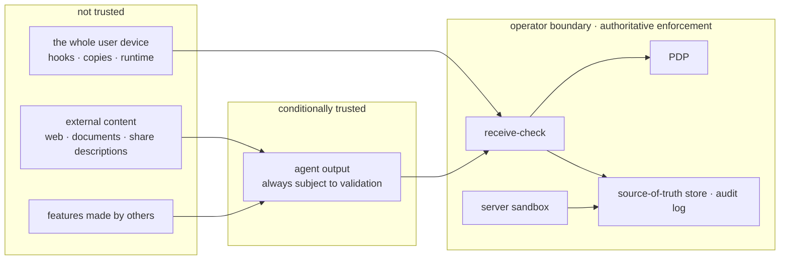
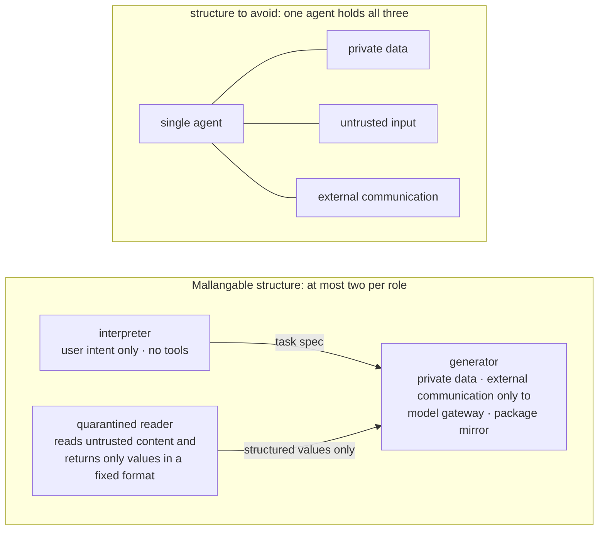

<!-- LANG-BAR -->
**English** · [한국어](../ko/07-trust-and-security.md) · [简体中文](../zh-CN/07-trust-and-security.md) · [日本語](../ja/07-trust-and-security.md) · [Español](../es/07-trust-and-security.md)
<!-- /LANG-BAR -->

# 7. Trust and security — decide first whom not to trust

> Conclusion of this chapter: by default, the generation agent of a Mallangable system ends up holding **private data, untrusted input, and a channel to send things out** all at once. When these three meet in one context, a single prompt injection leaks data. The answer is not a smarter filter but **structural separation**: split roles, attach visibility labels to data, give extensions only the permissions explicitly handed to them, and do final enforcement at the operator boundary.

## 7.1 Threat model

### Assets to protect

| Asset | Example | Owner |
| --- | --- | --- |
| User data | documents and records inside the host app | user · tenant |
| Layer artifacts | screens and automations of an org baseline (in-house know-how) | tenant · org |
| Core intellectual property | host source | vendor |
| Credentials | model API keys, external service tokens | user · tenant |
| Budget | inference credits, tenant cloud cost | tenant · operator |
| Integrity | "my app behaves only as I approved" | user |

### Attackers

| Attacker | Goal | Main path |
| --- | --- | --- |
| Malicious sharer | steal the recipient's data and credentials | shared features, public market |
| Indirect injector | plant instructions in content the agent reads to steer its behavior | documents, web pages, descriptions of shared items, issue bodies |
| Curious internal user | view hidden upstream layer source | asking the agent "show me the source" |
| Compromised client | push changes that bypass policy to the server | disabling device hooks, writing to the repository directly |
| Overreaching admin | surveil members | raising admin visibility |
| Operator insider | view customer code | support tools |
| Cost attacker | exhaust the budget | inducing infinite retries, mass generation |
| Contract and judge poisoner | a contract that lets malicious behavior pass, a pass verdict obtained by fooling the judge | contracts written by an injected generator, judge-targeting instructions planted in the artifact ("this panel satisfies the intent") |
| Resolution cache poisoner (within the same tenant) | create a "verified" resolution using only their own contract and spread it to everyone in the tenant | R3 resolution cache reuse (6.8). The scope restriction only prevents leakage *between* tenants |
| Compromised upstream release or operator | distribute a malicious change to all downstream nodes through the baseline | theft of the release signing key, operator insider, `auto` apply (6.5) |

Controls for the last three rows:
- **Contract and judge poisoning**: the interpreter writes the contract draft at the task specification stage, and the generator cannot remove or weaken contract items (the I7 separation extended to contracts, 6.7 rule 2). The judge (G4) receives only inputs in a fixed schema (intent, contract, screenshots, observed values) and does not put the artifact's raw text into its context. Artifacts have integrity `untrusted` (7.5).
- **Resolution cache poisoning**: a resolution is loaded into the cache only after it passes κ_up ∧ κ_down re-validation on k or more nodes (proposed value 3) other than the user who made it (R3, 6.8).
- **Compromised upstream release or operator**: the release signing key is pinned at every enforcement point (receive-check), and the revocation list is checked. Even `auto` apply goes through the canary (6.5), and a tenant can refuse an upstream release and keep its current release. Releases also carry the provenance attestation of 7.7.

### Trust boundaries



How to read it: the user device and agent output are **both subject to validation**. This does not mean suspecting the user; it means the source-of-truth store must not be contaminated even when the device is compromised or the agent has been injected.

## 7.2 Enforcement points and decision point

| Enforcement point (PEP) | Location | Authority | What it blocks |
| --- | --- | --- | --- |
| Device harness hook | user device | advisory | mistakes, most injection attempts |
| Runtime broker | inside the host | authority at execution time | use of unapproved permissions |
| Receive-check | operator boundary | **final authority** | records violating the format or policy, tampering with policy files |
| Server sandbox | operator boundary | final authority | access outside the job scope, external communication |
| Output gate | generation plane → experience plane | final authority (hidden mode) | leakage of code and secrets |

Every PEP uses the same PDP rules. If generation time (harness) and execution time (broker) use different rules, gaps appear such as "allowed when built, forbidden when run."

## 7.3 Cutting the lethal trifecta structurally

Simon Willison summarized that when an agent simultaneously has **① access to private data, ② exposure to untrusted content, and ③ the ability to communicate externally**, an attacker can easily exfiltrate data, and he called this the "lethal trifecta." He says there is no 100% reliable defense yet, and that avoiding the combination itself is the safe path ([Willison, 2025.06](https://simonwillison.net/2025/Jun/16/the-lethal-trifecta/)).

The generation agent of a malleable app has all three in its default setup. It reads the user's layers and data (①), reads shared features and reference documents (②), and communicates with model APIs and external package repositories (③).



Rules:
- **External communication allowlist** (**MUST**): the generation agent's external communication is restricted to the model gateway and approved package mirrors. Access to arbitrary URLs is blocked.
- **Untrusted content is read first by the quarantined reader.** The reader has no tools and returns only values in a fixed schema (e.g. "relevant / not relevant", extracted fields).
- **A permission increase always requires human approval** (I4). Even if a sentence saying "add network permission" is hidden in a share's description, the agent can only create an approval request.

## 7.4 Separating planning from execution

Research on prompt injection defense points in the same direction.

- **CaMeL** first extracts control flow and data flow from the trusted user query, and keeps untrusted data from changing the program's flow. It separates a privileged LLM that makes the plan from a quarantined LLM that interprets only untrusted data without tools, and tracks the provenance and capability of each value. On the benchmark it solved 77% of tasks with provable security, compared with 84% for the undefended system ([Debenedetti et al., 2025](https://arxiv.org/abs/2503.18813)).
- The **security design patterns** paper presents six patterns (action selector, plan-then-execute, LLM map-reduce, dual LLM, code-then-execute, context minimization), and sets the principle that "once an untrusted input has been ingested, it must not be able to trigger consequential actions" ([Beurer-Kellner et al., 2025](https://arxiv.org/abs/2506.08837), [summary](https://simonwillison.net/2025/Jun/13/prompt-injection-design-patterns/)).

Mapping to Mallangable roles:

| Pattern | Mallangable application |
| --- | --- |
| Plan-then-execute | the interpreter fixes the task spec (extension points to touch, depth, permissions) **before seeing untrusted content**. The generator cannot go outside the spec (checked by G1) |
| Dual LLM ([Willison, 2023](https://simonwillison.net/2023/Apr/25/dual-llm-pattern/)) | shared items and documents are read by the quarantined reader, and only structured values go to the generator |
| Code-then-execute | the D3 declarative artifact is itself a "program written in a restricted language." It can be analyzed before execution |
| Context minimization | the context provider supplies each role only what it needs (5.10) |
| LLM map-reduce | in promotion candidate analysis, a sub-agent per feature judges only "is this the same intent?" and the results are aggregated |

## 7.5 Information flow labels

Attach a **visibility label** to all data and define the rules for how labels combine.

```text
label λ = (scope, grade, integrity)
  scope     : tenant / org / user identifier
  grade     : V0 aggregate < V1 metadata < V2 description < V3 code          # confidentiality
  integrity : trusted (human intent · verified baseline) > untrusted (shared items · external documents · values a model produced after seeing untrusted input)

derivation rule:     λ(f(x, y)) = λ(x) ⊔ λ(y)          # confidentiality takes the more sensitive side, integrity the lower side
viewing rule:        viewer s can see x  ⇔  λ(x) ⊑ authority(s)
action rule:         values that decide permission increases, external transmission, or extension point selection must have integrity trusted
declassification:    only the output gate (declassifier) can lower a label, and it leaves rules and records
```

The integrity axis follows the way FIDES ([Costa et al., 2025](https://arxiv.org/abs/2505.23643)) tracks confidentiality and integrity labels together at the planner level to enforce policy deterministically. It is the "plan-then-execute" of 7.4 written as label rules.

Example: a resolution the merge agent produced after reading tenant A's code (V3) carries a V3 label. So when it is put into the resolution cache, it goes only into tenant A's scope (6.8). When the dashboard shows a "distribution of resolution methods," the output gate keeps only the counts and lowers it to V0.

Output gate checks in hidden mode:

| Signal | Verdict |
| --- | --- |
| Output schema violation, length exceeded | block, regenerate |
| Code blocks or consecutive lines that look like code | remove |
| Long contiguous match with repository content (fingerprint index comparison) | remove + security event |
| Density of internal paths and identifiers exceeded | remove |
| Secret patterns | block + alert |

## 7.6 Extension execution security

**Object-capability principle**: extensions do not have ambient authority. They can use only the capability objects explicitly handed to them at mount time. Hardened JavaScript freezes built-in objects with `lockdown()` to prevent prototype pollution, and separates globals with `Compartment` so that only handed-in objects can be used ([Endo/SES](https://github.com/endojs/endo)).

| Isolation level | What it blocks | What it cannot block | Good fit |
| --- | --- | --- | --- |
| Language (SES · Wasm) | global pollution, APIs not handed in | resource exhaustion via infinite loops, timing | lightweight execution of event hooks (D4) |
| Frame (cross-origin iframe · webview) | host DOM, storage, cookies | screens that deceive the user (fake buttons) | panel code (D4), public shared items |
| Process · microVM | memory, file system, network (when configured) | leakage through allowed channels | shared native code, server jobs |

If the host is a desktop framework, check its per-webview permission system. For example, Tauri v2 uses per-window and per-webview capabilities, and a webview that matches no capability has no access to the IPC layer at all ([Tauri v2](https://v2.tauri.app/reference/acl/capability)). In such a system, the default configuration is to **give extension webviews no capability at all** and leave the broker as the only channel.

Broker rules:
- Ask the PDP about every call and leave an audit record.
- Set caps on call frequency and response size (limiting leakage rate).
- Exclude screens that could deceive the user (e.g. imitations of login input fields) from the catalog, and mark extension screens with a "this part is a feature I added" badge.

## 7.7 Supply chain

Once sharing is open (A8), extensions become a supply chain. In February 2026, the security firm Koi Security disclosed 341 malicious skills among 2,857 it audited in an agent skill market ([The Hacker News](https://thehackernews.com/2026/02/researchers-find-341-malicious-clawhub.html)). Scanners were introduced afterwards, but an analysis covering February to May 2026 found skills still remaining that evaded detection by, among other methods, inflating files to 22MB to exceed the scan limit. The analysts pointed to "the lack of isolation between skill logic and agent permissions" as the root cause ([Unit 42, 2026.06](https://unit42.paloaltonetworks.com/openclaw-ai-supply-chain-risk/)).

Turning the lessons into controls:

| Lesson | Control |
| --- | --- |
| Skills ran with the agent's permissions | shared features go through the recipient's sandbox and permission approval again from scratch |
| Shell commands were induced under the pretext of "prerequisite installation" | shared features have no install scripts. Artifacts are only declarative or sandboxed code |
| Files were inflated to evade the scanner | shared items over the size cap are **rejected** (not skipped). Scanning covers all bytes |
| Content was changed remotely after install | shared items are pinned by content hash. Fetching external data at runtime is shown as a permission and is subject to approval |
| One account uploaded in bulk | publisher provenance signature ([in-toto](https://github.com/in-toto/attestation) Statement with a [SLSA provenance](https://slsa.dev/spec/v1.1/provenance) predicate. The subject is the manifest content_hash, builder.id is the harness id), limits on new publishers, curation tiers |

## 7.8 How far source confidentiality is guaranteed

**Code the agent can read can eventually be read by whoever talks to that agent.** So the guarantee level must be separated honestly per threat.

| Threat | client mode | server · hidden mode |
| --- | --- | --- |
| Casual viewing (opening it out of curiosity) | not blocked | blocked: the user has no repository at all |
| Deliberate extraction (inducing the agent to output it) | cannot be blocked | mostly blocked: the interpreter has never seen the code and the output gate filters |
| Reverse engineering of artifacts (analyzing a downloaded executable bundle) | not applicable | **residual risk**: code that goes to the device can be read |
| Workaround requests ("build a panel that shows my source") | not applicable | reduced by static rules (no source access) + judge, but not perfect |
| Insider exfiltration | audit record | audit record + break-glass approval procedure |

Customer promise wording must be precise, such as "prevention of deliberate extraction is best effort." Guide customers to place core logic in server-side extension points (service points), not in extensions that go down to the device.

## 7.9 Admin visibility and privacy

- Visibility grades V0~V3 (A10 in 3.2) and their defaults are set in chapter 4. The user can always see the current grade (floor F3).
- Personally identifying fields in telemetry are stored separately under a pseudonymous key, so that on a deletion request destroying the key alone breaks the link.
- When the operator needs emergency (break-glass) access to customer data: state reason, scope, and duration → customer admin approval → read-only session → every lookup shown in real time on the customer dashboard → automatic revocation when the period expires → post-incident report.
- Commit metadata and intent summaries can become personal information when linked to an individual, and monitoring of member activity falls under labor and privacy regulations that differ by country. A review of the applicable law is needed before deployment.

## 7.10 Misuse

A malleable app also lets users build **features that harm other people**. Examples: a panel that secretly records a colleague's activity, an automation that sends customer data outside.
- Permissions to read other people's data and to transmit externally are bound by the tenant ceiling and made subject to approval.
- Add "hidden collection or transmission" to the judge's check items.
- Tell users in plain terms that uses prohibited by the model provider's usage policy may be refused at the generation stage.

## 7.11 Security checklist (**MUST**)

- [ ] Extensions do not reach host functionality through any path other than the broker
- [ ] The generation agent's external communication is limited to the allowlist
- [ ] A permission increase is not activated without human approval
- [ ] The generator and the judge are different instances
- [ ] The receive-check checks record format, contract presence, policy file immutability, and size
- [ ] Shared features are re-validated and re-approved on the receiving side
- [ ] Shared items exceeding the size cap are rejected
- [ ] Share and market listings, pre-install previews, and permission displays are read from the manifest without executing extension code. Executing before approval breaks "D4 has zero permissions before approval" in 5.9 (ThinkRail also rejected its approach of executing extensions on every listing and has a side-effect-free listing, [`agent/packages/SPEC.md`](https://github.com/JetBrains/thinkrail/blob/c10f8808cee693e4abffeeb1844a132ed0a91cc5/packages/server/src/agent/packages/SPEC.md#L23-L25))
- [ ] The resolution cache, fingerprint index, and sandbox are separated per visibility scope
- [ ] In hidden mode, the interpreter cannot access code, and every output passes through the output gate
- [ ] User floor rights F1~F7 cannot be turned off by any policy
- [ ] The floor action exception applies only to a human owner, their own layer, and no permission increase. Redo, "turn back on", releasing a hold, and an agent-invoked revert go through the same decision as activation (4.8)
- [ ] Automatic apply in baseline propagation also goes through activate (E10). If gated, a destructive capability, or a fingerprint-bound approval, it falls back to a proposal (6.5)
- [ ] `permissions_delta` is not trusted as a self-report; it is recomputed from the manifest and the parent state
- [ ] If the manifest's `network.allow` is not empty, `permissions` contains a risk=egress capability. IP literals and public-suffix wildcards are rejected
- [ ] Checker tool output escapes control characters in document and file names, and the verdict is conveyed by exit code

Next chapter: [8. Experience design](08-experience-design.md)
