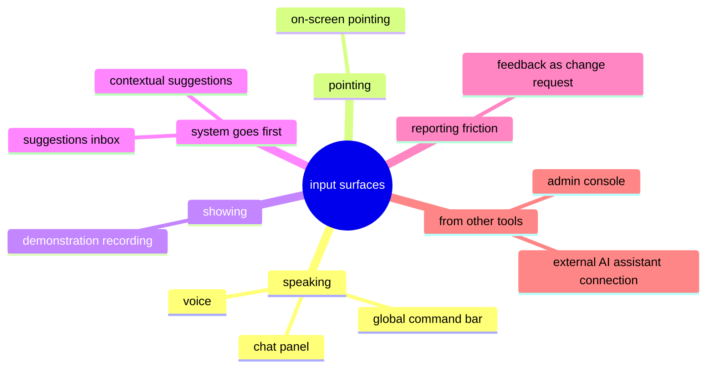
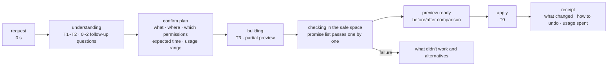
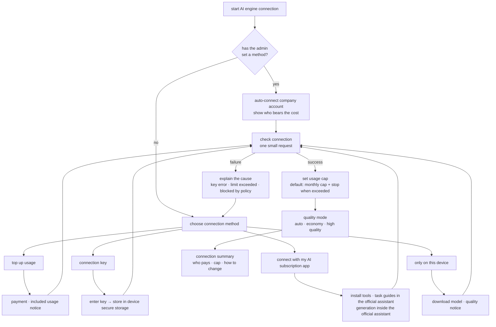

<!-- LANG-BAR -->
**English** · [한국어](../ko/08-experience-design.md) · [简体中文](../zh-CN/08-experience-design.md) · [日本語](../ja/08-experience-design.md) · [Español](../es/08-experience-design.md)
<!-- /LANG-BAR -->

# 8. Experience design — where to listen, how to show the wait, and what words to use

> Conclusion of this chapter: users do not want "AI edits the code." They want **"it changes the way I said, and if I don't like it, it goes right back."** So the experience plane needs ① input that lets you point at things while speaking, ② honest progress expressions per time tier, ③ progress shown as "the list of promises passing one by one," ④ a lexicon pack that hides developer terms, and ⑤ an AI engine connection flow that respects terms of service.

## 8.1 Experience principles

| # | Principle | Meaning |
| --- | --- | --- |
| X1 | In the language of intent | the user says only "what they want." The system decides depth, extension points, and permissions, and shows them in plain terms |
| X2 | Make it pointable | the user must be able to say "this." Pointing on screen is the most precise context |
| X3 | Undo first | the way to undo is visible before the apply button. Revert is immediate and free |
| X4 | Be honest about the wait | state the time and usage it will take as a range in advance, and show progress as real progress |
| X5 | No developer terms | words like commit, branch, and merge do not appear on basic-level screens |
| X6 | Make cost visible | if there is a cost borne by the user, show the range before generation and the actual value after |

## 8.2 Input surfaces



| Surface | How it is used | Strength | Caution | Depths mainly handled |
| --- | --- | --- | --- | --- |
| Global command bar | open with a shortcut and type one sentence | fast from anywhere | lacks context → attach the current screen automatically | D1~D4 |
| On-screen pointing | in "fix mode," click an element and speak | **the extension point id is set automatically**, greatly reducing interpretation errors | core areas are marked "this can't be changed" | D1~D3 |
| Chat panel | multi-turn conversation in a side panel | complex requests, follow-up questions | when the conversation gets long, summarize it into a task spec and confirm | all |
| Voice | request by speaking | hands-busy situations | do the confirmation step on screen | D1~D2 |
| Demonstration recording | "watch what I do and build it the same way" | repetitive procedures that are hard to explain in words | show a personal-data indicator during recording, specify scope | D2 |
| Contextual suggestions | after repeating the same action, "want me to do this automatically?" | opportunities the user did not know about | cap on suggestion frequency (proposed: once a day), turn off | D2 |
| Suggestions inbox | received shared features, arrival of a new default edition | benefits even passive users | emphasize permission changes | all |
| Feedback conversion | an "this is inconvenient" report is itself a change request | lowest entry barrier | distinguish reports going to the vendor from my own modification requests | all |
| External AI assistant connection | the AI assistant the user uses modifies the app through tools | developers, automation | harness enforcement required | all |
| Admin console | editing the org default edition, reviewing promotions | org-level improvements | show blast radius (number of users) | D1~D4 |

Demonstration recording belongs to the "programming by demonstration" family, and contextual suggestions go the opposite direction: the system detects repetition and suggests first. In both cases the result often lands in D2 (a combination of existing features), so they are safe and fast.

## 8.3 Collecting intent

1. **At most 1~2 follow-up questions** (**SHOULD**). If more are needed, build a preview from the most plausible interpretation and let the user correct it on top of the preview. People find it easier to look at a result and fix it than to answer questions.
2. **Simpler way first** (**MUST**, the experience version of the least-depth rule): if the request can be met with settings or a combination of existing features, show that first. "I could build a new panel, but if you turn on the 'overdue only' filter in the current list, it works right away."
3. **Confirm the scope in words**: before running, play it back in one line. "I'll add a 'Done this week' list below the sidebar. It only uses permission to read tasks."
4. **Say what you can't do, too**: when a policy ceiling is hit, state which level's rule it is and the next action (ask an admin).

## 8.4 Time tiers T0~T4

There are three boundaries in perceived response time. Within 0.1 seconds feels instantaneous, within 1 second keeps the flow of thought unbroken, and 10 seconds is the limit for keeping attention. Beyond 10 seconds, a progress indicator showing expected completion is needed, and when the amount of work is unknown, it is better to show the items being processed one by one by name ([NN/g](https://www.nngroup.com/articles/response-times-3-important-limits/)).

| Tier | Time | Work | Experience pattern | Example wording |
| --- | --- | --- | --- | --- |
| T0 | under 0.1 s | revert, applying D1 tokens, switching previews | optimistic immediate update, no progress indicator | (nothing shown) |
| T1 | 0.1~1 s | applying D2 shortcuts and rules | immediate update + small confirmation toast | "Applied · Undo" |
| T2 | 1~10 s | short generation (interpreting D1~D2 sentences, simple rules) | small progress indicator + stage wording | "Understanding…" |
| T3 | 10 s ~ a few minutes | D3 and D4 generation and validation | **staged progress + promise list pass display + partial preview**, tell the user they can do other things | "Building · about 30 s~1 min · I'll let you know when it's done" |
| T4 | minutes ~ days | new default edition propagation, org approval, share acceptance | background + notification + scheduled apply time | "The new default edition is ready · applying Friday afternoon" |

Deployment speed expectations: personal changes must finish within T0~T3, and default edition propagation (T4) is intentionally slow because of staged rollout (canary). Explain it to users as "We don't apply it to everyone at once; we apply it in turn while checking that nothing goes wrong."

## 8.5 How to show the generation process



### Fix the status words at four

`Understanding` → `Building` → `Checking` → `Ready`. Use the same words on every surface. If status words differ between screens, users cannot tell whether the same task is in progress.

### Progress indicator = promise list

The progress of T3 work is shown not as a vague percentage but as **the pass status of the contract (promise list)**. This matches the principle of showing processed items by name when the amount of work is unknown, and at the same time naturally tells the user "what is guaranteed."

```text
Checking (2/3)
  ✓ Shows only tasks completed this week
  ✓ If nothing was completed, shows "Nothing completed this week"
  … Checking that the screen doesn't slow down
```

### Partial preview

Declarative screens (D3) can be drawn as their structure forms, even in the middle of generation. A2UI, a generative UI standard, also supports receiving and drawing messages progressively ([A2UI description in the Lynx docs](https://lynxjs.org/react/genui/a2ui)). However, a partial preview carries a "not yet checked" marker to distinguish it from the finished product.

### Expressing failure

A failure **MUST** contain three things: **what didn't work** (in plain terms), **why** (one line on the policy or technical reason), and **what you can do now** (a simpler alternative, ask an admin, try again).

```text
The 'notify the team chat when done' feature hasn't been turned on yet.
It sends content outside, so company policy requires admin approval.
[Ask admin for approval]  [Show only on my screen instead of notifying]  [Cancel]
```

## 8.6 Change receipt

A record card left after every apply (user floor right F7).

```text
Change receipt · October 28, 9:41 AM
What: Added a 'Done this week' list to the sidebar
Where: bottom of the sidebar
Allowed scope: read tasks (no newly added permissions)
List of promises: all 3 checked
Usage: about 0.3 credits (this month 4.1 / 30)
Who can see it: me, team admin (up to the change description)
Undo: [Undo now] or say "undo the last one"
```

## 8.7 The revert experience

- By voice or text: "undo the last one," "back to yesterday." If the interpretation is ambiguous, show the 3 most recent changes.
- Time slider: flip through recent states as thumbnails and pick one.
- Safe mode: if the app is acting strangely, choose "start in default mode" at startup. My changes are not deleted, only turned off.
- Auto-recovery notice: "The 'auto sort' you added recently caused errors, so I turned it off for now. [Turn back on] [Details]".

## 8.8 New default edition and share proposals

```text
A new team default edition is out (2026.11)
- 6 of the 7 features you made carried over as they are
- 1 needs your choice: 'sidebar this-week list'
  In the new default edition, the sidebar became tabs
  [Move to tabs (recommended)]  [Keep the old way]  [Rebuild so both work]
- Preview the 3 screens that change ▸
[Apply now]  [Apply Friday afternoon]  [Later]
```

The three options are the same as the intent conflict options in 6.7. Share proposals use the same format, adding "who sent it" and "newly required allowed scope."

## 8.9 Lexicon pack

### Why it is needed

The inside of this system is full of development concepts such as version control, permissions, and sandboxes. To an ordinary user, "Resolve conflicts and merge?" sounds like a warning. A lexicon pack is a dictionary that **links one concept id to expressions per level, domain, and language**, and every string on the experience plane and every user-facing answer from the agent goes through this dictionary.

### Structure

```text
concept id (stable)
 └ expressions per level: basic (general) · practitioner · developer
    └ domain overrides: education · healthcare · enterprise …
       └ language: ko · en …
```

- Users get `basic` by default. Turning on "show details" on screen gives `practitioner`; the developer setting gives `developer`.
- Domain packs are added by the vendor or the tenant (chapter 9, B13).

### Mapping table (default English)

| Concept id | Developer term | Ordinary user expression (basic) | One-line description |
| --- | --- | --- | --- |
| change | change | what you changed | what you changed in one go |
| feature | feature | feature I made | a bundle of things changed for the same purpose |
| record | commit | save point | a point you can return to at any time |
| branch | branch | trial version | a copy for trying things without touching the original |
| merge | merge | combine | joining two versions into one |
| conflict | conflict | overlapping part | both sides changed the same place differently |
| intent_conflict | intent conflict | part that needs your choice | both cannot be satisfied at the same time |
| revert | rollback | undo | going back to a previous state |
| baseline | baseline · LTS | default edition (official default edition · company default edition · team default edition) | the version everyone uses as a starting point |
| release | release | new default edition | a new default edition comes out |
| fork | fork | my copy | my version branched off from the default edition |
| extension_point | extension point | place you can change | a location where the app allows modification |
| capability | permission | allowed scope | the data and actions a feature can use |
| sandbox | sandbox | safe space | a place to run things first without affecting anything else |
| validation | validation | check | testing whether it works as promised |
| contract | contract · acceptance criteria | list of promises | what this feature must always keep |
| diff | diff | what changed | the difference between before and after |
| activate | deploy · activate | apply | actually turning it on |
| safe_mode | safe mode | start in default mode | start with all my changes turned off |
| quarantine | quarantine | paused for now | stopping a feature that caused a problem |
| depth | depth D1~D4 | how much it changes (look · combination · screen · behavior) | how deeply it changes things |
| policy_ceiling | policy ceiling | range your company allows | the limit set by the admin |
| canary | canary deployment | apply in turn | applying to some first and checking for problems |
| drift | drift | behind the default edition | how far you are from reflecting the latest default edition |
| subscribe_share | subscription share | keep receiving | when the sender edits it, I also get an update proposal |
| promotion | promotion | adopted as an official feature | a feature many people made goes into the default edition |
| audit_log | audit log | activity history | who did what and when |
| visibility | admin visibility V0~V3 | what admins can see | how much information the admin can see |
| agent | agent | AI assistant | the AI that makes changes for you |
| model | model | AI engine | the brain the AI assistant uses |
| api_key | API key | connection key | a secret code for using the AI engine |
| tokens | tokens | usage | how much of the AI engine you used |
| route_quality | model routing | quality mode (economy · standard · high quality) | the balance of speed, cost, and quality |

### Where it applies

| Point | Method |
| --- | --- |
| UI strings | written only as concept ids, `LexiconPort.render` at render time |
| The agent's user-facing answers | at the output stage (E13), the explainer role rewrites them at the basic level |
| Error and denial messages | the PDP's denial reason code → concept id → sentence |
| Receipts and upgrade summaries | generated by the explainer role, must pass lint |
| Development process | lint the UI string repository to block forbidden words on basic screens (commit, branch, merge, token, API, etc.) at build time |

### Storage and provenance

- **Store as concept ids** (**MUST**): data that is stored or travels between devices, such as receipts, notifications, and records, does not contain finished sentences but `concept id + arguments`. The sentence is built when shown. That way, when the user changes level (basic ↔ developer) or language, past receipts change too. Names the user or agent gave directly (feature names, etc.) are shown as they are.
- **A lexicon pack is data and has a defined provenance** (**MUST**): a lexicon pack holds only strings, not code. The only parties that can install a lexicon pack are the vendor and the tenant (domain packs, chapter 9 B13) and the user's own settings; **shared features and non-upstream layers cannot change the lexicon pack.** Otherwise a received feature could change permission warning wording ("access patient information") into mild words and obtain approval (F5).
- **Fallback order**: exact language of the domain pack → exact language of the base pack → default language of the base pack → the concept id itself. Fall back per string, so that one missing entry does not switch the whole screen to another language.
- ThinkRail likewise does not put translated text into stored or transmitted data, and reads user language files only from the global data folder so that "a cloned repository cannot rewrite the UI" ([JetBrains/thinkrail `architecture.md` decision 23](https://github.com/JetBrains/thinkrail/blob/c10f8808cee693e4abffeeb1844a132ed0a91cc5/architecture.md#L430-L454)). However, ThinkRail does not translate agent output, whereas Mallangable has the explainer rewrite it for basic users (table above).

### Domain override examples

| Concept | Default | Education | Hospital work | In-house work |
| --- | --- | --- | --- | --- |
| feature | feature I made | my class tool | my work tool | my work tool |
| baseline | default edition | school default edition | hospital standard screen | our team standard |
| capability: read personal data | read information | view student information | **access patient information** (stronger warning) | view customer information |
| share | share | share with fellow teachers | share with the same department | share with the team |

Full example: [`examples/lexicon.en.yaml`](../../examples/lexicon.en.yaml), schema: [`schemas/lexicon-pack.schema.json`](../../schemas/lexicon-pack.schema.json).

## 8.10 AI engine (model) connection

### Connection methods (names shown to users)

| Name shown to users | Internal route (A9) | When | User experience |
| --- | --- | --- | --- |
| Use the company account | `tenant_cloud` | set up by the admin | used right away with no choice screen. Shows who pays |
| Top up usage | `credits` | the easiest start | included usage + top-ups, monthly cap |
| Paste a connection key | `byok` | users and teams that already have an AI service account | paste key → check connection → set cap |
| Connect with my AI subscription app | `sub` | users already using the provider's official AI assistant | add this app's "tools" and "task guides" to the official assistant. Generation happens inside that assistant |
| Use only on this device | `on_device` | offline, privacy | download the model, quality notice ("suited to simple changes") |

### Flow



### Terms-of-service principles for subscription connection

- Each provider has a different policy, and policies change often. In February 2026, Anthropic stated explicitly that using authentication tokens obtained from Free, Pro, or Max subscriptions in other products, tools, or services (including the Agent SDK) violates its consumer terms, with exceptions for API key access or cases it explicitly permits ([The Register](https://www.theregister.com/2026/02/20/anthropic_clarifies_ban_third_party_claude_access)). In the same period, there were also reports of some providers partnering with specific third-party tools to open up subscription use ([summary article](https://falcao.org/posts/anthropic-claude-access-crackdown-ecosystem-fallout/)).
- So there is one design principle: **the "subscription connection" adapter implements only routes the provider has permitted in writing, and is turned on and off with a per-provider flag.** Subscriptions of providers with no permitted route are supported only by "attaching our tools to the official assistant" (`sub` in the table above). In that case generation happens inside the official client the user launched, and our app does not handle tokens.
- Server-side work (merging, promotion, etc.) does not use the user's personal subscription (L2).

### Security and cost display

- Connection keys are kept only in the device's secure storage (OS keychain, etc.) or the tenant's secret management system. They are never put into the change store, logs, or agent context (**MUST**).
- When operating as an MCP tool inside the official assistant, as on the `sub` route, do not take connection keys or external service tokens through the conversation or form mode input. The MCP specification requires URL mode elicitation for secrets and credentials ([2026-07-28 edition](https://modelcontextprotocol.io/specification/2026-07-28/client/elicitation)). I6 holds only if the key never once enters the agent context.
- In the same edition, MCP Sampling is slated for deprecation ([changelog](https://modelcontextprotocol.io/specification/2026-07-28/changelog)). Do not build a `ModelPort` adapter that offloads model calls to the MCP client.
- Before generation, show a **range** with `ModelPort.estimate()` ("about 0.2~0.5 credits"). A single number is easy to get wrong, and getting it wrong loses trust.
- The default is **monthly cap + stop when exceeded** (floor F6). When exceeded, let the user choose among "You've used up this month's usage. Raise the cap · Continue in economy mode · Wait until next month."
- Fallback routes for limit overruns and provider outages (e.g. standard → economy mode) are written into policy in advance, and the user is told that the route changed.

## 8.11 Business touchpoints in the connection process

The detailed models are in chapter 9; here only the touchpoints that arise on the experience plane are summarized.

| Touchpoint | Form | Related BM |
| --- | --- | --- |
| First connection | plan includes usage → top-ups | B3 credit margin |
| Quality mode choice | high quality mode on a higher plan | B15 quality tiers |
| Using a connection key | platform fee (validation, storage, propagation costs) | B4 BYOK platform fee |
| Company account connection | enterprise connectors, audit features | B6 governance, B7 confidential execution |
| Outcome-based display | "charge only for changes that passed validation" option | B16 outcome-based billing |
| Provider sign-up guidance | only when a provider partner program exists | B14 provider partnership |

## 8.12 Accessibility and language

- Make the before/after comparison of previews read as a "list of what changed" in screen readers too.
- On-screen pointing mode must also let users cycle through and pick elements with the keyboard.
- Generated extensions are also checked against basic accessibility rules (contrast, labels, keyboard operation) at G3. User modifications must not break accessibility.
- Default wording is written in Korean, and English is shown alongside it or provided through the lexicon pack language switch.

## 8.13 Experience metrics

| Metric | Definition | Why watch it |
| --- | --- | --- |
| Time to first change | from install (or feature discovery) to the first apply | entry barrier |
| Follow-up question count | average per request | interpretation quality |
| Drop-off per stage | share who gave up at each stage: understanding, planning, building, checking, preview | where the wait breaks down |
| Preview apply rate | share of previews that were applied | result quality |
| Revert within 24 hours | share reverted within 24 hours of applying | hidden quality problems |
| Receipt open rate | share of receipts expanded | demand for trust and transparency |
| Actual vs. estimated cost | share of cases where actual cost fell within the estimated range | cost trust |
| Basic-level lint violations | number of developer terms exposed in shipped strings and answers | lexicon pack quality |

Next chapter: [9. Business coupling](09-business-coupling.md)
