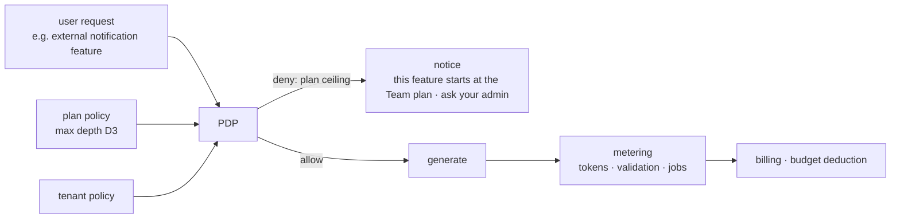

<!-- LANG-BAR -->
**English** · [한국어](../ko/09-business-coupling.md) · [简体中文](../zh-CN/09-business-coupling.md) · [日本語](../ja/09-business-coupling.md) · [Español](../es/09-business-coupling.md)
<!-- /LANG-BAR -->

# 9. Business coupling — business models are tied to architecture choices

> Conclusion of this chapter: a business model (BM) is not something laid on top of the architecture later. **Agent location (A3), topology (A6), sharing scope (A8), admin visibility (A10), and model sourcing (A9)** determine what can be sold. This chapter defines 20 BMs as axis conditions and computes whether each is possible per reference profile. It then presents two unifying principles: **a pricing plan is a policy ceiling**, and **the least-depth rule is both a security principle and a cost principle**.

## 9.1 Why they must be designed together

- As seen in chapter 3, structural axes are expensive to change and business axes are cheap to change. But **some business axis values exist only under specific structures.** Example: to sell source-confidential execution (B7), you need a server agent and hidden visibility from the start.
- Conversely, the business model chosen first can also force the structure. If you sell inference bundled (B3), metering, budgets, and abuse prevention become mandatory, and this requires admin visibility V0 or higher (N3).

## 9.2 Value units and cost drivers

| Value unit (what people pay for) | Cost driver (what costs money) |
| --- | --- |
| Active users · seats | inference tokens (generation, judging, merging) |
| Completed changes (passed validation) | validation runs (sandbox, contracts, screenshots) |
| Baseline survival (still works after updates) | propagation jobs (number of users × number of releases, 6.8) |
| Sharing · installs | curation and review staff |
| Admin and audit features | storage · telemetry |
| Confidential execution environment | server sandbox · on-premises operation |

Contribution margin of one change:

```text
margin(δ) = price(δ) − [ tokens(δ) × unit_price(route) + c_validate(depth) + c_store + c_support / number of changes ]
```

`tokens` and `c_validate` grow with depth. Building at D4 something that D2 can do is expensive (extra model calls and judging gates) and risky. So **the least-depth rule (2.6) is both a security principle and a cost principle**. The experience in which the interpreter suggests a simpler way first (8.3) raises user satisfaction and margin at the same time.

## 9.3 BM catalog

| id | BM | Billing unit | Required architecture condition | Metering · enforcement point |
| --- | --- | --- | --- | --- |
| B1 | License sales | one-time per device or user | none | license server |
| B2 | Seat subscription | monthly seat | none (value rises the more server features there are) | identity · metering |
| B3 | Inference credit margin | usage | `A9=credits` (+ N3: `A10≥V0`) | model gateway |
| B4 | BYOK platform fee | monthly flat or per job | `A9∈{byok, tenant_cloud}`, complete if server features exist | job runner · metering |
| B5 | Sharing market commission | a fixed percentage of paid feature sales | `A8=public` (internal settlement within a tenant) | sharing service |
| B6 | Governance add-on | monthly per tenant | `A10≥V1` | dashboard · audit |
| B7 | Confidential execution premium | monthly per tenant | `A3=server` ∧ `A5=hidden` | server sandbox · output gate |
| B8 | Baseline support contract | annual contract | `A6=lineage` ∧ `A7∈{proposed, auto}` | lineage registry · job runner |
| B9 | Upgrade survival guarantee | monthly per active feature | `A6∈{fork, lineage}` ∧ `A7∈{proposed, auto}` | propagation pipeline · contract execution |
| B10 | Promotion revenue sharing | reward per promotion | `A6=lineage` (complete with sharing and V1 or higher) | promotion pipeline |
| B11 | Local developer matching | fee per match | complete if visibility is open/own, only in-tenant experts if hidden | escalation queue |
| B12 | Demand signal reports | report subscription | `A10≠none` | telemetry aggregation |
| B13 | Lexicon and domain packs | pack license | none | lexicon renderer |
| B14 | Model provider partnership | per provider partnership terms | `A9≠on_device`, only when the provider has an official program | model gateway |
| B15 | Quality tier differentiation | plan differentiation | `A9=credits` (BYOK and tenant cloud conditional on server routing) | model gateway routing |
| B16 | Outcome-based billing | per change that passed validation | `A10≠none` ∧ `A9∈{credits, byok, tenant_cloud}` | verification gate + metering |
| B17 | Runtime OEM license | annual license | none (open spec + commercial implementation) | — |
| B18 | Resolution recipe subscription | subscription | `A6∈{fork, lineage}` ∧ `A7∈{proposed, auto}` | resolution cache · release |
| B19 | Revenue sharing for productized features | sales revenue sharing | `A8=public` | sharing service · promotion |
| B20 | Sponsored default slot (caution) | impressions · conversions | `A8=public`, only when disclosure obligations are met | capability map · recommendations |

## 9.4 Reference profile × BM coupling matrix

Results computed by `python3 tools/design_space.py --bm`. ● possible as is, ◐ conditional (requires an operating arrangement or external contract), ○ structurally impossible.

| BM | Name | P1 Personal workshop | P2 Team-curated | P3 Enterprise confidential | P4 Mass consumer | P5 Local-first collaborative | P6 Marketplace platform | P7 Air-gapped public sector |
| --- | --- | :-: | :-: | :-: | :-: | :-: | :-: | :-: |
| B1 | License sales | ● | ● | ● | ● | ● | ● | ● |
| B2 | Seat subscription | ● | ● | ● | ● | ● | ● | ● |
| B3 | Inference credit margin | ○ | ○ | ○ | ● | ○ | ● | ○ |
| B4 | BYOK platform fee | ○ | ● | ● | ○ | ◐ | ○ | ● |
| B5 | Sharing market commission | ○ | ◐ | ◐ | ● | ◐ | ● | ◐ |
| B6 | Governance add-on | ○ | ● | ● | ● | ○ | ● | ● |
| B7 | Confidential execution premium | ○ | ○ | ● | ◐ | ○ | ○ | ● |
| B8 | Baseline support contract | ◐ | ● | ● | ○ | ○ | ● | ● |
| B9 | Upgrade survival guarantee | ● | ● | ● | ○ | ○ | ● | ● |
| B10 | Promotion revenue sharing | ○ | ● | ● | ○ | ○ | ● | ● |
| B11 | Local developer matching | ◐ | ● | ◐ | ● | ● | ● | ◐ |
| B12 | Demand signal reports | ○ | ● | ● | ● | ○ | ● | ● |
| B13 | Lexicon and domain packs | ● | ● | ● | ● | ● | ● | ● |
| B14 | Model provider partnership | ◐ | ◐ | ◐ | ◐ | ◐ | ◐ | ◐ |
| B15 | Quality tier differentiation | ○ | ◐ | ◐ | ● | ○ | ● | ◐ |
| B16 | Outcome-based billing | ○ | ◐ | ◐ | ● | ○ | ● | ◐ |
| B17 | Runtime OEM license | ● | ● | ● | ● | ● | ● | ● |
| B18 | Resolution recipe subscription | ● | ● | ● | ○ | ○ | ● | ● |
| B19 | Revenue sharing for productized features | ○ | ◐ | ◐ | ● | ◐ | ● | ◐ |
| B20 | Sponsored default slot | ○ | ○ | ○ | ◐ | ○ | ◐ | ○ |

Share of all 36,772 recommended combinations in which each BM is possible (`--bm-stats`):

| BM | Name | ● possible | ◐ conditional | ○ impossible |
| --- | --- | ---: | ---: | ---: |
| B1·B2·B13·B17 | License · seat · lexicon pack · OEM | 100.0% | 0.0% | 0.0% |
| B12 | Demand signal reports | 88.8% | 0.0% | 11.2% |
| B6 | Governance add-on | 66.6% | 22.2% | 11.2% |
| B11 | Local developer matching | 56.7% | 43.3% | 0.0% |
| B9·B18 | Upgrade survival guarantee · resolution recipes | 53.7% | 0.0% | 46.3% |
| B4 | BYOK platform fee | 40.4% | 16.3% | 43.3% |
| B5·B19 | Sharing market · productization revenue sharing | 27.4% | 36.3% | 36.3% |
| B8 | Baseline support contract | 26.9% | 26.9% | 46.3% |
| B3 | Inference credit margin | 24.2% | 0.0% | 75.8% |
| B15 | Quality tier differentiation | 24.2% | 40.4% | 35.5% |
| B16 | Outcome-based billing | 24.2% | 48.3% | 27.5% |
| B10 | Promotion revenue sharing | 11.7% | 15.2% | 73.1% |
| B7 | Confidential execution premium | 11.0% | 23.3% | 65.7% |
| B14 | Model provider partnership | 0.0% | 89.0% | 11.0% |
| B20 | Sponsored default slot | 0.0% | 27.4% | 72.6% |

### Interpretation

- **BMs that work everywhere (B1, B2, B13, B17) offer weak differentiation.** The BMs that sell value unique to malleable architecture are the ones that **only hold when lineage and propagation exist**, such as B9 (survival guarantee), B18 (resolution recipes), B8 (baseline contract), and B10 (promotion revenue sharing). These are possible in only about half of the recommended combinations.
- **The most expensive differentiation is B7 (confidential execution).** Only 11.0% of combinations allow it, and it requires a server agent, hidden mode, and an output gate all together. For the same reason, it is hard for competitors to follow.
- **Credit margin (B3) is narrower than expected.** It is impossible in 76% of recommended combinations. The moment you support user subscriptions, BYOK, or tenant cloud, you give up inference margin and must earn money from platform value (B4, B6, B9).
- **P1 Personal workshop fundamentally cannot earn inference margin.** It runs on the user's subscription (sub). Licenses, survival guarantees, and recipes fit it instead.

## 9.5 Atypical BMs — detours that use the structure

These are approaches outside the usual "seats × monthly fee" frame that are possible because of this architecture. All can be designed lawfully, but each has conditions that must be kept.

| BM | Idea | Why only this structure makes it possible | Conditions to keep |
| --- | --- | --- | --- |
| B9 Upgrade survival guarantee | sell "your feature will still work in the next default edition." If it breaks, free rebuild or credit refund | the contract (κ) lets a machine judge "it works" | only features with deterministic contracts on stable extension points. State the judging criteria in the terms |
| B18 Resolution recipe subscription | ship resolutions for representative conflicts together with each default edition → lower user inference cost | resolution cache and equivalence class structure (6.8) | generate recipes only from public patterns, not from customer artifacts |
| B10 Promotion revenue sharing | reward when a feature I made is adopted into an org or official default edition | promotion pipeline and provenance records (6.10) | inside a company, follow the rights assignment in the employment contract. A public ecosystem needs contributor terms. Adoption into the **official** default edition only with the original author's explicit opt-in and license agreement (6.10 boundary) |
| B11 Local developer matching | connect intent conflicts and core requests to verified human experts | escalation points are structurally defined (R5, D5 collection) | access is consent-based and time-limited, every access is audit-logged |
| B12 Demand signal reports | aggregate what users are trying to build (demand per extension point, top core requests) and provide it as input to the vendor roadmap | every change is recorded with intent, depth, and extension point | V0 and V1 aggregates only, a minimum aggregation size threshold (e.g. k or more tenants), contractual opt-in |
| B19 Revenue sharing for productized features | promote widely shared features into official paid extensions and share revenue with the original author | share provenance, install counts, and retention are recorded | explicit opt-in and license agreement from the original author (6.10 boundary), published sharing rate. Only public (A8=public) shared items |
| B20 Sponsored default slot | external services sponsor being the default integration for a specific extension point | the capability map explicitly represents integration targets | **"Sponsored" label, users can change it at any time, the sponsorship is disclosed in agent recommendations**. Review of advertising disclosure regulations is mandatory |

## 9.6 Model sourcing and BM

| Sourcing route | Inference margin | How we earn | Policy risk |
| --- | --- | --- | --- |
| `sub` user subscription | none | license · seats · survival guarantee | the provider may forbid third-party use or change its terms. Only via delegation to the official client |
| `byok` | none | platform fee (validation, storage, propagation) | low |
| `credits` | yes | margin + quality tiers | cost fluctuation, abuse, provider resale terms |
| `tenant_cloud` | none | enterprise contracts · governance · confidential execution | low (customer contract reuses the existing cloud contract) |
| `on_device` | none | license · domain packs | quality limits |

Facts as of 2026: in February, Anthropic stated explicitly that using authentication tokens obtained from Free, Pro, or Max subscriptions in other products, tools, or services (including the Agent SDK) violates its consumer terms; the exceptions under the terms are access via API key or cases it explicitly permits ([The Register](https://www.theregister.com/2026/02/20/anthropic_clarifies_ban_third_party_claude_access)). From April it then blocked subscription use by third-party harnesses, and from June 15 partly reversed this by giving, for programmatic use outside Claude Code, a monthly credit separate from the subscription (deducted at list price, no rollover) ([summary article](https://falcao.org/posts/anthropic-claude-access-crackdown-ecosystem-fallout/)). According to the same article, other providers chose to partner with third-party tools and open up subscription use. **Provider policies change several times even within a year.** Therefore:

- Model sourcing **MUST** be abstracted behind a port (5.3), and permitted routes per provider are managed as configuration.
- A business plan must not depend on one provider's subscription policy. Always keep at least two routes open (e.g. BYOK + credits).

## 9.7 Pricing plan = policy ceiling

A pricing plan is an operator policy that cuts the knob intervals of chapter 4 differently. There is no need to build a separate "feature flag system," and the moment the denial reason is "plan ceiling" is the most precise time to suggest an upgrade.

| Knob | Free | Personal | Team | Enterprise | Public sector · air-gapped |
| --- | --- | --- | --- | --- | --- |
| Maximum depth | D2 | D4 | D3 | D4 | D3~D4 |
| Sharing | receive only | none | tenant | tenant (+ reviewed public) | tenant |
| Baseline hierarchy | official only | official only | official → team | official → enterprise → org | official → agency → department |
| Model sourcing | small included credits | subscription connection · BYOK · credits | BYOK · credits | tenant cloud · BYOK | in-house model |
| Quality mode | economy | standard | standard · high quality | all | customer-specified |
| Admin visibility | — | — | V1 | V2 (V3 option) | V3 |
| Survival guarantee (B9) | — | option | included | included + support contract (B8) | support contract |
| Confidential execution (B7) | — | — | — | option | default |



## 9.8 Connection to service logic

| BM | Metering event | Enforcement point | Behavior on failure |
| --- | --- | --- | --- |
| B3 credits | `model.call` (tokens · route) | model gateway | budget exceeded → stop or suggest economy mode |
| B4 BYOK fee | `job.completed` (propagation · sharing · promotion) | job runner | unpaid → stop server jobs, device features keep working |
| B6 governance | active admins · dashboard access | control plane | on downgrade, V2 → V1 |
| B9 survival guarantee | `upgrade.applied`, `change.held` (held for unmet contract) | propagation pipeline | when a hold occurs, automatically create a free rebuild job |
| B16 outcome billing | `change.activated` + gate pass record | verification plane | failed generations are not billed |
| B10 promotion sharing | `promotion.released` + provenance | promotion pipeline | if provenance is unknown, hold the payout |
| B12 demand reports | `core_request.recorded`, aggregation per extension point | telemetry | exclude items below the minimum aggregation size |

Principle: **billing events come from the same event stream as the control plane's audit records.** If the billing basis and the audit basis drift apart, nothing can be explained in a dispute.

## 9.9 Business metrics

| Metric | Definition |
| --- | --- |
| Active modifier ratio | share of weekly active users who applied 1 or more changes |
| Active features per user | average number of active features (a proxy for switching cost) |
| Baseline survival rate | share of features that survived a release through auto-apply or proposal (determines B9's cost) |
| Cost per change | average inference and validation cost by depth |
| Contribution margin per tenant | revenue − (inference + validation + propagation + support) |
| Promotion rate | share of promotion candidates that actually made it into a release |
| Share install rate | share of received shared features that were applied |
| Top core requests | top list of requests collected as D5 (vendor roadmap signal) |

## 9.10 Questions to consider

- If the survival guarantee (B9) is judged by contract pass, how do you prevent the moral hazard of users deliberately writing weak contracts? Recommendation: guarantee only features whose contract sufficiency the judge has approved.
- Will promotion revenue sharing (B10) inside a company be tied to the compensation system, or kept as recognition only (badges, performance credit)? It needs review for conflicts with employment contracts and performance evaluation policies.
- Demand signal reports (B12) are an internal asset when the operator and the vendor are the same company, and a product for sale when they are different. Either way, it must be stated in the customer contract.
- Sponsored slots (B20) can undermine the neutrality of agent recommendations. If you include them, state the sponsorship in both the user-facing view and the agent context, and start with an approach that does not affect recommendation order.

Next chapter: [10. Open problems and evaluation](10-open-problems.md)
