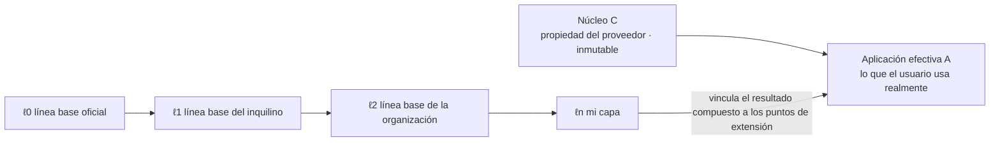
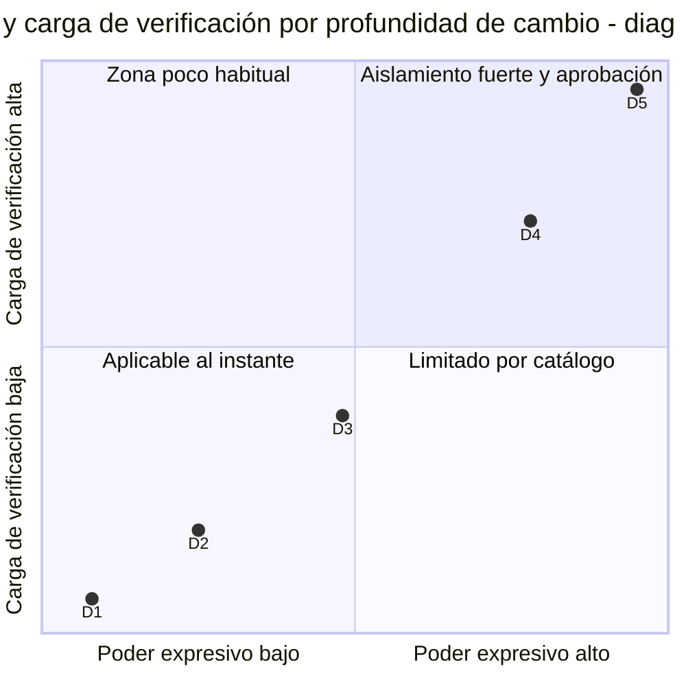
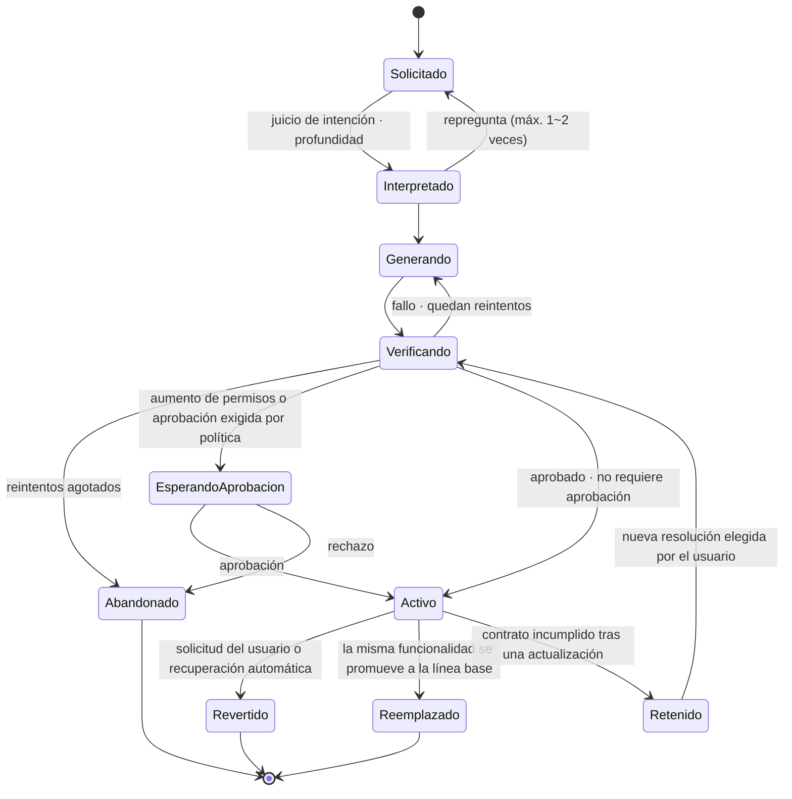

<!-- LANG-BAR -->
[English](../en/02-core-model.md) · [한국어](../ko/02-core-model.md) · [简体中文](../zh-CN/02-core-model.md) · [日本語](../ja/02-core-model.md) · **Español**
<!-- /LANG-BAR -->

# 2. Modelo central: anfitrión, capa, cambio, contrato, política

> Conclusión de este capítulo: un sistema Mallangable es **una pila de capas sobre un núcleo inmutable**, y toda modificación del usuario se expresa como **un cambio (δ) con intención, artefacto, contrato y permisos**. Haga lo que haga la arquitectura, no debe romper las invariantes I1~I10.

Este capítulo es un modelo conceptual independiente de la implementación. Todos los componentes, flujos y políticas de los capítulos siguientes operan sobre los objetos definidos aquí.

## 2.1 Actores (Principals)

| Actor | Símbolo | Rol | Ejemplo |
| --- | --- | --- | --- |
| Proveedor del anfitrión (Host Vendor) | `V` | Crea y posee el núcleo. Define los puntos de extensión | La empresa que hizo la aplicación |
| Operador de plataforma (Platform Operator) | `O` | Opera la infraestructura maleable (plano de control) | Normalmente es el mismo que `V`, pero puede ser un proveedor de hosting de Mallangable |
| Administrador del inquilino (Tenant Admin) | `T` | Gestiona la política, la línea base y el presupuesto de una organización cliente | Administrador de TI de la empresa cliente |
| Administrador de la organización (Org Steward) | `G` | Gestiona la línea base de una suborganización dentro del inquilino | Líder de equipo |
| Usuario (End User) | `U` | Modifica su propia capa | Empleado común, usuario individual |
| Agente (Agent) | `α` | Crea o fusiona cambios en nombre de usuarios y administradores. **Un actor que no es una persona** | Agente de generación de código, agente de fusión |

La delegación de permisos va en la dirección `V → O → T → G → U`. El agente `α` no está en esta cadena; existe únicamente como **un sujeto de corta vida que siempre actúa por delegación de algún actor humano** (I4, I9).

## 2.2 Anfitrión (Host)

El anfitrión (host) `H` es un conjunto de cuatro elementos.

```text
H = ⟨ C, X, K, Σ ⟩
  C : núcleo (Core). La parte inmutable que distribuye el proveedor. Las capas de usuario no cambian C.
  X : el conjunto de puntos de extensión (Extension Point).
  K : el conjunto de capacidades (Capability). Etiquetas con nombre de las facultades que una extensión puede usar.
  Σ : esquema de estado. La forma de los datos que una extensión puede leer y escribir.
```

Un punto de extensión se define así.

```text
x = ⟨ id, kind, d_min, in, out, stability ⟩
  id        : identificador estable como "sidebar.panel", "editor.on_save"
  kind      : token | command | view | hook | service
  d_min     : profundidad mínima necesaria para usar este punto (2.6)
  in / out  : esquemas de la entrada que da el punto y de la salida que espera
  stability : stable | experimental | deprecated
```

El anfitrión DEBE (MUST) exponer la lista de puntos de extensión y permisos como **un mapa de capacidades (capability map) legible por máquina**. Si se deja que el agente adivine la API, se acaba deslizando hacia parches del núcleo (D5). [n.codes](https://github.com/yungookim/n.codes) mostró un enfoque que genera automáticamente el mapa de capacidades analizando el código fuente.

## 2.3 Capas y aplicación efectiva

La aplicación que el usuario usa realmente (aplicación efectiva, effective app) es el resultado de componer en orden las capas (layers) sobre el núcleo.

```text
Λ = [ ℓ0, ℓ1, …, ℓn ]          ℓ0 = línea base del proveedor, ℓn = la capa propia del usuario
A = C ⊗ ( ℓ0 ⊕ ℓ1 ⊕ … ⊕ ℓn )
```

- `⊕` (composición de capas): si dos capas tocan la misma clave, la posterior **sobrescribe (override)** a la anterior. El significado por defecto para datos declarativos es JSON Merge Patch (RFC 7396). Los objetos se sobrescriben clave a clave, `null` elimina esa clave y los arrays se reemplazan enteros. Para fusionar arrays elemento a elemento, el esquema del punto de extensión debe declarar una clave de fusión (6.6 R2). Las extensiones de código se componen por ranuras del punto de extensión.
- `⊗` (aplicación al núcleo): vincula las capas compuestas a los puntos de extensión del núcleo. El núcleo no cambia.
- `⊕` DEBERÍA (SHOULD) ser asociativa. Así se puede precomponer y cachear "línea base de la empresa + línea base de la organización". Para ello, al precomponer capas, los `null` (marcadores de eliminación) DEBEN (MUST) conservarse y no borrarse. Solo así aplicar más tarde la capa compuesta da el mismo resultado que aplicarlas una por una.
- Relación entre `⊕` y la fusión del capítulo 6: `⊕` es la operación que compone **entre** capas dentro de un mismo linaje, y la fusión 3-way (6.4~6.6) se usa solo para las modificaciones de una capa **al trasladarla sobre una nueva línea base superior**.



Cómo leerlo: cuanto más a la derecha, mayor prioridad. Si dos capas tocan el mismo punto, gana la capa más cercana al usuario, y esa 'sobrescritura' se convierte en candidata a conflicto en las actualizaciones (capítulo 6).

## 2.4 Cambio (Change)

Es la unidad atómica de modificación del usuario.

```text
δ = ⟨ ι, a, κ, π, d, X_δ, prov ⟩
  ι    : intención (Intent). Resumen del propósito expresado por una persona. "Quiero subir arriba solo lo que vence hoy"
  a    : artefacto (Artifact). Datos declarativos o código
  κ    : contrato (Contract). Conjunto de condiciones de aceptación (2.5)
  π    : permisos requeridos. π ⊆ K
  d    : profundidad. D1~D5 (2.6)
  X_δ  : los puntos de extensión que toca. X_δ ⊆ X
  prov : procedencia. Solicitante, aprobador, agente, modelo, cambio padre, fecha y hora
```

Varias modificaciones que provienen de la misma intención se agrupan en la misma **funcionalidad (Feature)**. Una funcionalidad es una sucesión de cambios, y la intención y el contrato se mantienen a nivel de funcionalidad.

## 2.5 Contrato (Contract)

Un contrato es un conjunto de predicados sobre el **comportamiento observable** de la aplicación efectiva `A`.

```text
κ = { k1, k2, … },   k_i : A → { verdadero, falso }
κ(A) = k1(A) ∧ k2(A) ∧ …
```

| Tipo | Ejemplo | Determinismo | Costo | Fuerza |
| --- | --- | --- | --- | --- |
| Consulta estructural (dom/tree query) | "Se ven 2 elementos en el panel" | Determinista | Bajo | Fuerte |
| Prueba unitaria (unit) | Entradas y salidas de una función pura | Determinista | Bajo | Fuerte |
| Instantánea (snapshot) | Comparación del resultado renderizado | Determinista (con entorno fijo) | Medio | Media |
| Juez (judge) | Juzga a partir de una captura si se cumple la intención | **Probabilístico** | Alto | Débil |

Como los contratos de juez son probabilísticos, NO DEBERÍAN (SHOULD) usarse solos. Debe haber al menos un contrato determinista para que pueda servir de fundamento en la fusión (capítulo 6).

Por qué el contrato es el centro de este modelo: en actualizaciones, comparticiones y promociones, un diff de código no dice nada del significado. **Solo si está registrado "qué debe garantizar este cambio"** puede una máquina juzgar el resultado de una fusión.

## 2.6 Jerarquía de profundidad de cambio D1~D5

La profundidad (depth) es a la vez el **poder expresivo** y el **nivel de riesgo** del artefacto. El principio de mínimo poder del W3C recomienda "elegir el lenguaje más débil que pueda expresar la necesidad". Cuanto más débil es el lenguaje, más fácil es analizarlo sin ejecutarlo, reutilizarlo y mantenerlo seguro ([W3C TAG](https://www.w3.org/2001/tag/doc/leastPower.html)). Mallangable aplica este principio a los cambios del usuario.

| Profundidad | Nombre | Artefacto | Poder expresivo (modelo de cómputo) | Análisis antes de ejecutar | Ejemplo |
| --- | --- | --- | --- | --- | --- |
| D1 | Apariencia | Tokens de diseño, valores de estilo | Aplicación finita clave-valor | Completo | "Botón más grande, color naranja" |
| D2 | Composición | Combinaciones de comandos existentes, atajos, reglas | Macros sin bucles (o con número limitado de repeticiones) sobre un conjunto finito de comandos | Completo | "Con este único botón, exportar + enviar por correo" |
| D3 | Pantalla | Árbol de UI declarativa sobre un catálogo de componentes aprobado + vinculación de datos | Estructura de árbol + consultas limitadas por permisos | Mayormente | "Panel con la lista de lo que vence hoy" |
| D4 | Comportamiento | Código arbitrario dentro de un sandbox | Turing completo, acceso externo solo mediante capacidades | Parcial (hay que ejecutarlo para saberlo) | "Ordenar la tabla automáticamente al guardar" |
| D5 | Núcleo | Modificación del código fuente del núcleo | Sin límites | Prácticamente imposible | "Reemplazar el motor de renderizado" |



Cómo leerlo: cada nivel de profundidad que se sube aumenta a la vez lo que se puede hacer y lo que hay que verificar. Las coordenadas son un diagrama conceptual que muestra el orden, no valores medidos.

Reglas:
- **Regla de profundidad mínima (least-depth rule)** (DEBE (MUST)): el agente debe crear el cambio en la profundidad más baja que satisfaga el contrato `κ`. Si algo que puede hacerse en D2 se hace en D4, se rechaza.
- **Separación de D5** (DEBE (MUST)): D5 no existe en la capa del usuario, sino únicamente como un **fork del núcleo** aprobado por el proveedor. En el flujo de usuario general, lo predeterminado DEBERÍA (SHOULD) ser recoger las solicitudes D5 como 'solicitud de funcionalidad del núcleo'. Esa misma recolección se convierte en la señal de demanda más precisa para la hoja de ruta del proveedor.
- Esta jerarquía implementa la "pendiente suave (gentle slope)" que cita Ink & Switch. En cada nivel, lo que el usuario tiene que entender de nuevo aumenta solo un poco.

## 2.7 Política (Policy) y retículo de políticas

Una política `p` fija el intervalo permitido para cada perilla de control (knob) (en detalle en el capítulo 4). Entre políticas hay un orden parcial "es más estricta que".

```text
p ⊑ q   ⇔   todo lo que p permite, q también lo permite   (p es más estricta que q o igual)
p ⊓ q   :  la política que solo permite lo que ambas permiten (intersección, meet)
```

A lo largo de la cadena de actores, la política efectiva se calcula como intersección.

```text
p_eff(U) = p_V ⊓ p_O ⊓ p_T ⊓ p_G ⊓ p_U
```

- **Reducción monótona** (DEBE (MUST)): un actor inferior solo puede estrechar dentro del intervalo que le dio el superior. `p_child ⊑ p_parent`.
- Una excepción: los **derechos mínimos del usuario (floor)** no pueden ser eliminados por ninguna política superior (4.6). Por ejemplo, "el derecho a revertir mis cambios" es un piso.

## 2.8 Ciclo de vida de un cambio



Cómo leerlo: **todo camino hacia Activo pasa por la verificación.** 'Retenido' es el estado en el que un cambio cuyo contrato se rompió tras una actualización de la línea base no desaparece en silencio, sino que espera la elección del usuario. La resolución que elija el usuario también debe volver a pasar la verificación (puertas G) para quedar activa.

## 2.9 Invariantes I1~I10

| # | Invariante | Por qué hace falta | Qué ocurre si se rompe | Punto de aplicación |
| --- | --- | --- | --- | --- |
| I1 | **Núcleo inmutable**: ningún cambio de una capa de usuario modifica `C` | Mantener el punto de referencia para actualizaciones, soporte y seguridad | Un núcleo distinto por usuario → actualizaciones imposibles | Control de acceso por rutas, verificación de recepción en el servidor |
| I2 | **Contrato obligatorio**: un cambio con contrato vacío no se activa (`κ ≠ ∅`) | Fundamento para juzgar fusiones y promociones | Las funcionalidades mueren en silencio en las actualizaciones | Verificación en la etapa de registro |
| I3 | **Reversibilidad**: todo estado activo tiene registrado su estado inmediatamente anterior, y revertir termina en tiempo constante sin generar nada | Que no dé miedo experimentar | El usuario deja de modificar | Plano de estado, runtime |
| I4 | **Monotonía de permisos**: los permisos `π` solo aumentan con la aprobación explícita de una persona que tenga esos permisos. Un agente no puede ampliar sus propios permisos | Defensa contra la inyección de prompts y lo compartido malicioso | Un cambio compartido extrae datos | Punto de decisión (PDP), intermediario del runtime |
| I5 | **Reducción monótona de políticas**: `p_child ⊑ p_parent` (salvo los pisos) | Coherencia del sistema de delegación | Un administrador inferior elude la política superior | Verificación en el almacén de políticas |
| I6 | **Visibilidad = límite de aislamiento**: los datos que un actor no debe ver no entran en ningún contexto que ese actor pueda consultar (incluido el contexto del agente con el que conversa) | Bloquear "si se lo preguntas al agente, te lo cuenta todo" | Se viola la promesa de no divulgar el código fuente | Separación de roles, puerta de salida |
| I7 | **Separación de generación y juicio**: la instancia de agente que creó el artefacto y la que lo juzga son distintas | Evitar el sesgo de autocalificación | La verificación queda en pura formalidad | Harness |
| I8 | **Aplicación en el límite de confianza**: la aplicación final solo se hace en un límite controlado por el operador. Las verificaciones en el dispositivo del usuario son orientativas. Se aplica solo a despliegues con límite del operador; los despliegues sin servidor (P1 · P5) no pueden garantizarla | El cliente se puede eludir | La política se vuelve decorativa | Verificación de recepción en el servidor, nueva verificación en el sandbox |
| I9 | **Procedencia de la intención**: todo cambio se puede rastrear hasta una intención humana o un cambio superior | Auditoría, responsabilidad, juicio de fusiones | Se acumulan cambios sin procedencia | Especificación de registros |
| I10 | **Fusión que preserva contratos**: el resultado de una fusión debe satisfacer los contratos de ambas partes y, si no es posible, se pasa a una persona (`κ_up ∧ κ_down`) | Definición de sobrevivir a las actualizaciones | La fusión elimina a escondidas la funcionalidad de una de las partes | Pipeline de fusión |

Juicio de conformidad: si una implementación no garantiza **por diseño** (estructuralmente, no por un error de operación) alguna de I1~I7, I9, I10, no se la llama implementación conforme con Mallangable. I8 es un requisito del nivel Governed o superior (10.3).

## 2.10 Ejemplo: tres cambios en una aplicación de tareas

Supongamos que un anfitrión ficticio, la "aplicación de tareas", expone los siguientes puntos de extensión.

```yaml
extension_points:
  - id: theme.tokens        # D1
  - id: task.row.style      # D1~D2, reglas de estilo condicional
  - id: toolbar.command     # D2
  - id: sidebar.panel       # D3
  - id: task.on_complete    # D4, hook de evento
capabilities: [tasks.read, tasks.write, net.slack.post, notify.local]
```

Tres solicitudes del usuario caen en profundidades distintas.

```yaml
# Solicitud 1: "muéstrame en rojo las tareas vencidas"  → D2 (regla de estilo condicional, sin código)
- intent: Quiero distinguir de un vistazo las tareas vencidas
  depth: D2
  points: [task.row.style]
  artifact: { rule: { when: "task.due < today && !task.done", style: { color: "danger" } } }
  permissions: [tasks.read]
  contract:
    - { id: overdue-red, check: tree-query, given: "1 tarea con vencimiento ayer y sin completar", expect: "color de esa fila = danger" }

# Solicitud 2: "un panel que resuma lo completado esta semana"  → D3 (UI declarativa)
- intent: Quiero ver lo completado esta semana en la retrospectiva semanal
  depth: D3
  points: [sidebar.panel]
  artifact: { ui: { type: list, source: "tasks where done_at in this_week", item: "{title}" } }
  permissions: [tasks.read]
  contract:
    - { id: only-this-week, check: tree-query, given: "2 de esta semana · 1 de la semana pasada", expect: "2 elementos en la lista" }

# Solicitud 3: "cuando complete una tarea, avisa en el Slack del equipo"  → D4 (código + permiso de envío externo)
- intent: Quiero compartir automáticamente con el equipo que se completó una tarea
  depth: D4
  points: [task.on_complete]
  artifact: { module: "on_complete.js" }       # ejecución en sandbox
  permissions: [tasks.read, net.slack.post]    # aumento de permisos → requiere aprobación humana (I4)
  contract:
    - { id: posts-once, check: unit, given: "1 evento de completado", expect: "1 llamada a slack.post" }
```

Si el agente intenta hacer la solicitud 1 como código D4, se rechaza por violar la regla de profundidad mínima. La solicitud 3 añade un permiso nuevo para enviar datos hacia fuera, así que, aunque pase la verificación, no se activa hasta que una persona la apruebe.

Siguiente capítulo: [3. Espacio de diseño](03-design-space.md)
