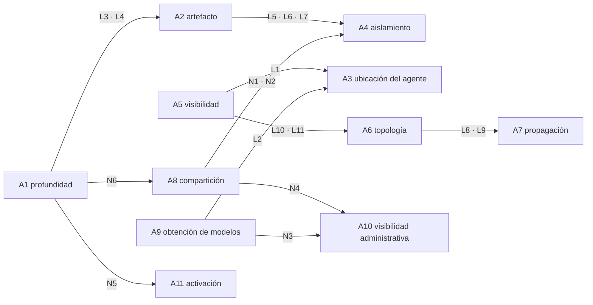
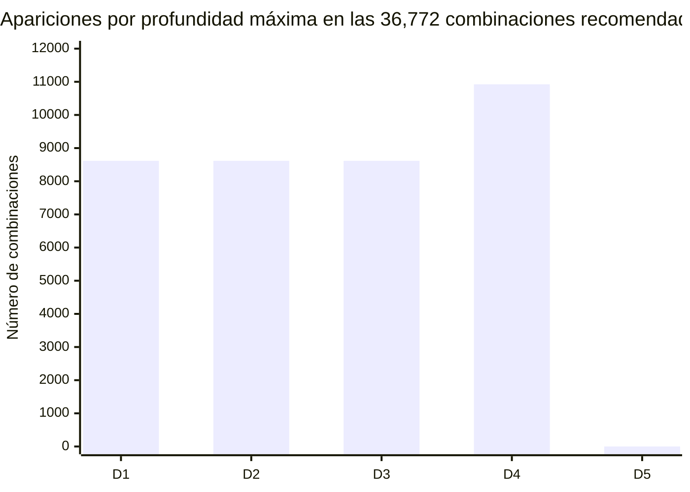
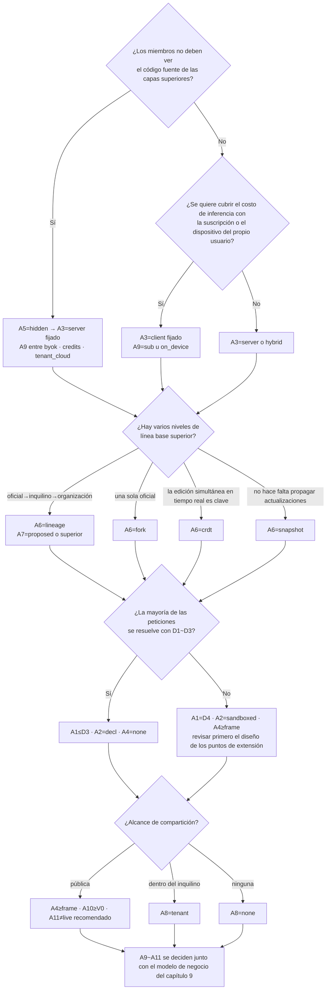
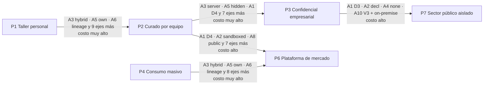

<!-- LANG-BAR -->
[English](../en/03-design-space.md) · [한국어](../ko/03-design-space.md) · [简体中文](../zh-CN/03-design-space.md) · [日本語](../ja/03-design-space.md) · **Español**
<!-- /LANG-BAR -->

# 3. Espacio de diseño: opciones, restricciones y número de combinaciones

> Conclusión de este capítulo: la arquitectura Mallangable no es una sola, sino **una combinación de 11 ejes**. De las **1,944,000** combinaciones brutas, el **5.31%** es lógicamente coherente, el **3.14%** cumple además las normas de seguridad, y **36,772 (1.89%)** se pueden recomendar sin advertencias. Estas combinaciones recomendadas se agrupan estructuralmente en **863 familias**, y los ejes de negocio y política siguen abiertos en promedio en un **57%** incluso después de fijar la estructura. Es decir, **las decisiones estructurales se toman primero y con cuidado; las decisiones de negocio, después y con ligereza**.

## 3.1 Por qué definirlo como un "espacio de diseño"

Aunque se trate del mismo "arreglar una aplicación con IA", una aplicación de escritorio personal, una aplicación móvil de consumo y una herramienta de trabajo empresarial que exige código fuente cerrado requieren arquitecturas completamente distintas. En lugar de presentar una única respuesta correcta, si se descomponen las opciones en ejes y se explicitan las restricciones entre ejes, se hacen posibles tres cosas.

1. **Filtrar mecánicamente las combinaciones que no tienen sentido.** Ejemplo: "ocultar el código al usuario" y "el agente se ejecuta en el dispositivo del usuario" no pueden cumplirse a la vez (L1).
2. **Fijar el orden de las decisiones.** Algunos ejes requieren migrar datos para cambiarlos; otros cambian con un solo ajuste (3.7).
3. **Conectarlo con las opciones de negocio.** Se puede calcular qué valores de eje exige cada BM (capítulo 9).

Este enfoque equivale al **modelo de características (feature model)** de la ingeniería de líneas de productos de software. Una configuración de producto válida es una combinación de características que satisface las restricciones cruzadas, y las líneas de productos dinámicas (DSPL), que cambian la configuración durante la ejecución, comprueban estas restricciones en tiempo de ejecución ([Capilla et al., 2014](https://research.chalmers.se/publication/198081)). En Mallangable, la diferencia es que quien configura no es solo el proveedor, sino también el usuario y la IA.

Los ejes se dividen en dos grupos.

- **Ejes estructurales A1~A8**: determinan el modelo de datos, el despliegue y los límites de seguridad. Cambiarlos implica un alto costo de migración.
- **Ejes económicos y de política A9~A11**: determinan la estructura de costos, el alcance de la administración y la experiencia del usuario. La mayoría cambia mediante configuración.

## 3.2 Definición de los ejes

### A1. Profundidad máxima de cambio: "hasta dónde puede cambiar el usuario"

| Opción | Significado | Dónde encaja bien | Costo |
| --- | --- | --- | --- |
| `D1` | Solo apariencia | Aplicaciones de consumo donde la coherencia de marca es lo primero | Casi no hay maleabilidad |
| `D2` | Hasta la combinación de funcionalidades existentes | Automatización del trabajo, atajos y reglas | No se pueden crear pantallas nuevas |
| `D3` | Hasta pantallas declarativas | La mayoría de las herramientas de trabajo. Más de la mitad de las combinaciones recomendadas está aquí | Hay que diseñar un catálogo de componentes |
| `D4` | Hasta código en sandbox | Herramientas para desarrolladores y usuarios avanzados | Costo de sandbox, verificación y aprobación |
| `D5` | Hasta el núcleo | Forks exclusivamente internos, investigación | Prácticamente se renuncia a sobrevivir a las actualizaciones |

Preguntas a considerar
- ¿Qué porcentaje de las peticiones de los usuarios se resuelve con D1~D3? Si en una investigación previa esta proporción resulta baja, es señal de que el diseño de los puntos de extensión (extension point) es insuficiente.
- Al abrir D4, ¿quién lee ese código y quién responde por él?
- La profundidad máxima es un **techo** (ceiling). Los cambios reales se construyen más abajo, según la regla de profundidad mínima (least-depth rule) (2.6).

### A2. Representación del artefacto: "con qué se expresa un cambio"

| Opción | Significado | Dónde encaja bien | Costo |
| --- | --- | --- | --- |
| `decl` | Solo datos declarativos (JSON/YAML, descripción de UI al estilo A2UI) | Donde la seguridad y la analizabilidad son lo primero | Límites de expresividad |
| `sandboxed` | Código exclusivo de sandbox (las API del anfitrión solo vía bróker) | D4 (2.6) | Requiere un runtime de sandbox |
| `native` | Código con los mismos privilegios que el anfitrión (plugin o parche de código fuente) | D5, dentro de un grupo de confianza | Difícil de aislar, riesgo de cadena de suministro |

Preguntas a considerar
- ¿Se puede ampliar el esquema declarativo para que cubra la mayoría de las peticiones de los usuarios? Cuanto más amplio sea el alcance declarativo, más baratos resultan la verificación, la fusión y la compartición.
- Si se permiten artefactos de código, el lenguaje y la versión del runtime de ese código también pasan a formar parte del contrato.

### A3. Ubicación del agente: "dónde se ejecuta la IA que crea los cambios"

| Opción | Significado | Dónde encaja bien | Costo |
| --- | --- | --- | --- |
| `client` | Dispositivo del usuario (incluye agentes lanzados por el usuario) | Usuarios individuales, sin conexión, aprovechar la suscripción del usuario | El control es solo orientativo (I8), no se puede cerrar el código |
| `server` | Sandbox en el servidor del operador | Empresas y sector público, código cerrado | El costo de inferencia lo asumen el operador o el inquilino |
| `hybrid` | Generación conversacional en el dispositivo; fusión, propagación y promoción en el servidor | Equipos y organizaciones | Mantener dos entornos de ejecución |

Preguntas a considerar
- ¿Quién paga el costo de inferencia? Esta pregunta determina A3 y A9 a la vez.
- ¿Puede el servidor **volver a verificar** el resultado creado por el agente en el dispositivo del usuario (I8)?

### A4. Aislamiento de ejecución: "en qué queda encerrado el código generado"

| Opción | Significado | Lo que impide | Lo que no impide |
| --- | --- | --- | --- |
| `none` | Sin aislamiento (no aplica si es declarativo) | — | Todo |
| `lang` | Aislamiento a nivel de lenguaje (p. ej., Compartment de [Hardened JS/SES](https://github.com/endojs/endo), Wasm) | Contaminación global, acceso directo a API | Agotamiento de recursos en el mismo proceso, canales laterales |
| `frame` | iframe o webview con origen separado ([MCP Apps](https://modelcontextprotocol.io/seps/1865-mcp-apps-interactive-user-interfaces-for-mcp) hace obligatorio el iframe en sandbox) | Acceso al DOM y al almacenamiento del anfitrión | UI que engaña al usuario |
| `proc` | Proceso separado o microVM | Acceso a memoria, archivos y red | Filtración a través de canales permitidos |

Preguntas a considerar
- ¿Cuál es el formato de los mensajes del único canal (el bróker) que cruza el límite de aislamiento? Debe ser un formato auditable.
- Si se abre la compartición (A8), aumentan los requisitos de aislamiento (N1, N2).

### A5. Visibilidad del código: "qué código fuente puede ver el usuario"

| Opción | Significado | Dónde encaja bien | Costo |
| --- | --- | --- | --- |
| `open` | Se puede ver el código fuente de todas las capas | Particulares, comunidades abiertas | No se puede proteger la propiedad intelectual de las capas superiores |
| `own` | Solo ve su propia capa | Cuando la línea base (baseline) de la organización contiene conocimiento interno | Requiere una topología con capas separadas (L10) |
| `hidden` | No ve ningún código fuente, solo recibe resultados | Empresas y sector público donde el código cerrado es obligatorio | Agente en servidor obligatorio (L1), requiere puerta de salida |

Preguntas a considerar
- Principio clave: **el código que un agente puede leer acaba pudiéndolo leer también quien le habla a ese agente.** Por eso `hidden` no es un indicador de política, sino una decisión de ubicación (7.8).
- Los paquetes de ejecución que bajan al cliente pueden analizarse aunque estén ofuscados. Es mejor colocar la lógica central que hay que proteger en puntos de extensión del lado del servidor.

### A6. Topología de versiones: "qué forma toma el historial de cambios"

| Opción | Significado | Dónde encaja bien | Costo |
| --- | --- | --- | --- |
| `snapshot` | Solo historial de instantáneas por usuario, sin rastrear la relación con lo superior | Las aplicaciones de consumo más simples | No se pueden propagar las actualizaciones de la línea base (L8) |
| `fork` | Repositorio del usuario = fork de una única línea base | Particulares y pequeña escala | No puede expresar jerarquías organizativas |
| `lineage` | Red de forks de una jerarquía de líneas base en varios niveles (oficial→inquilino→organización→usuario) | Empresas | Requiere un pipeline de propagación (S3) |
| `crdt` | Documentos sincronizados en tiempo real (familia [Automerge](https://automerge.org/docs/reference/documents/conflicts/)) | Colaboración simultánea | Persisten los conflictos semánticos y la edición simultánea de código es peligrosa (S7) |

Preguntas a considerar
- El número de usuarios N multiplicado por la frecuencia de publicación de la línea base r da el número anual de operaciones de fusión. Esta cifra determina la mayor parte del costo de la arquitectura (6.8).
- También es posible un híbrido que combine CRDT para los datos (declarativos) y un linaje (lineage) al estilo Git para el código, pero este documento toma como base una topología por sistema.

### A7. Propagación de la línea base: "cómo siguen los niveles inferiores cuando cambia el superior"

| Opción | Significado | Dónde encaja bien | Costo |
| --- | --- | --- | --- |
| `none` | Sin propagación | Topología de instantáneas, personalización puntual | La capa del usuario envejece poco a poco |
| `manual` | Una persona fusiona directamente | Usuarios desarrolladores | La mayoría de los usuarios no puede hacerlo |
| `proposed` | El agente fusiona y verifica y lo propone; una persona lo aprueba | Valor recomendado por defecto | Fatiga de aprobación |
| `auto` | Se aplica automáticamente si pasa la verificación y los permisos no cambian | Gran número de usuarios | Repercusión de una fusión automática errónea |

Preguntas a considerar
- ¿Se han definido las condiciones de aplicación automática de forma que una máquina pueda juzgarlas, por ejemplo "pasan todos los contratos + ningún cambio de permisos + pasa el canario"?
- ¿Qué se hace con los usuarios que siguen en una línea base cuyo periodo de soporte terminó? Una fusión forzada rompe la confianza (6.5).

### A8. Alcance de compartición: "a quién puedo dar los cambios que hice"

| Opción | Significado | Dónde encaja bien | Costo |
| --- | --- | --- | --- |
| `none` | Sin compartición | Uso personal, entornos confidenciales | Todos crean lo mismo por separado |
| `tenant` | Solo dentro del mismo inquilino | Empresas | Sistema de revisión dentro del inquilino |
| `public` | Público más allá del inquilino | Comunidades y mercados | Superficie de ataque de la cadena de suministro (7.7) |

Preguntas a considerar
- La unidad de compartición no debe ser el repositorio, sino la **funcionalidad (intención + contrato + artefacto)**. Solo así el receptor puede volver a ejecutar la misma verificación.
- La compartición pública no debe abrirse sin curación, aislamiento e indicación de permisos, como muestra el caso de ClawHub (N1, N4).

### A9. Obtención de modelos: "con la cuenta y el costo de quién se hace la inferencia"

| Opción | Significado | Dónde encaja bien | Costo |
| --- | --- | --- | --- |
| `sub` | Suscripción personal del usuario. **Solo dentro del cliente oficial del proveedor** | Particulares, desarrolladores | No sirve para tareas del servidor (L2). Expuesto a cambios en los términos del proveedor |
| `byok` | Clave de API del usuario o del inquilino | Equipos, usuarios avanzados | UX de gestión de claves |
| `credits` | El operador empaqueta y vende la inferencia | Consumidores, equipos pequeños y medianos | El operador asume el riesgo de costos y de abuso |
| `tenant_cloud` | Contrato de nube del inquilino (p. ej., Bedrock, Vertex) o modelo interno | Empresas y sector público | Diversificar los adaptadores de proveedores |
| `on_device` | Modelo local en el dispositivo del usuario | Sin conexión, privacidad | Límites de calidad (S6) |

Preguntas a considerar
- A fecha de 2026, algunos proveedores prohíben en sus términos usar tokens de autenticación de suscripciones de consumo en productos de terceros (caso de Anthropic: [The Register, 2026.02](https://www.theregister.com/2026/02/20/anthropic_clarifies_ban_third_party_claude_access)). Para que `sub` sea seguro, solo debe diseñarse como "el usuario lanza directamente el agente oficial del proveedor y conecta a él nuestras skills y herramientas" (8.10, 9.6).
- Las políticas de los proveedores cambian a menudo. La obtención de modelos DEBE (MUST) abstraerse mediante un puerto (5.3).

### A10. Visibilidad administrativa: "hasta dónde ve el administrador"

| Opción | Significado |
| --- | --- |
| `none` | Sin recopilación central |
| `V0` | Solo agregados (totales por inquilino u organización) |
| `V1` | Metadatos (número, tamaño y profundidad de los cambios, punto de extensión, resultado de verificación; usuarios con seudónimo) |
| `V2` | V1 + mensajes de cambio y resúmenes de intención, con nombre real |
| `V3` | V2 + diff del código y su contenido |

Preguntas a considerar
- La visibilidad es un intercambio entre la comodidad del administrador y la confianza de los miembros. El nivel de visibilidad actual debe mostrarse **siempre** en la pantalla del usuario (piso de 4.6).
- Incluso los metadatos de commit pueden convertirse en datos personales cuando se vinculan a una persona. Se necesita una revisión de la legislación aplicable.

### A11. Modo de activación: "cuándo se enciende un cambio verificado"

| Opción | Significado | Dónde encaja bien |
| --- | --- | --- |
| `live` | Se aplica en cuanto pasa la verificación | D1~D2, particulares |
| `preview` | El usuario lo aplica tras una vista previa | Valor recomendado por defecto |
| `gated` | Se aplica tras la aprobación de un aprobador designado | Empresas, elementos compartidos públicamente |

## 3.3 Restricciones

### Dependencias entre ejes



Cómo leerlo: una flecha significa "el valor del eje de origen reduce las opciones del eje de destino". Lo más importante es que **A5 (visibilidad) y A9 (obtención de modelos) atan juntos a A3 (ubicación del agente)**. El código cerrado y el aprovechamiento de la suscripción del usuario tiran de A3 en direcciones opuestas, por lo que no se pueden querer ambos a la vez.

### Restricciones lógicas L: imposibles o duplicados con el mismo significado

| Regla | Condición | Motivo |
| --- | --- | --- |
| L1 | `A5=hidden ⇒ A3=server` | Si el agente que toca el código está del lado del usuario, el código no se puede ocultar |
| L2 | `A9∈{sub, on_device} ⇒ A3≠server` | La suscripción personal (por términos) y el modelo en el dispositivo (por ubicación física) no se pueden usar para tareas del servidor |
| L3 | `A1∈{D1,D2,D3} ⇒ A2=decl` | 2.6: D1~D3 son declarativos. Si se permite un artefacto de código, eso es D4 |
| L4 | `A1=D4 ⇒ A2=sandboxed`, `A1=D5 ⇒ A2=native` | 2.6: los cambios de comportamiento son código en sandbox; los cambios del núcleo, código nativo |
| L5 | `A2=decl ⇒ A4=none` | Normalización: si no hay código ejecutable, el eje de aislamiento de ejecución no tiene sentido |
| L6 | `A2=sandboxed ⇒ A4≠none` | Un artefacto en sandbox necesita un sandbox |
| L7 | `A2=native ⇒ A4∈{none, proc}` | Si el código con privilegios de anfitrión se mete en un aislamiento de lenguaje o de marco, deja de tener privilegios de anfitrión |
| L8 | `A6=snapshot ⇒ A7=none` | Si no se rastrea la relación con lo superior, no hay nada que propagar |
| L9 | `A6=crdt ⇒ A7≠manual` | CRDT fusiona automáticamente, así que no existe un paso de fusión manual |
| L10 | `A5=own ⇒ A6∈{fork, lineage}` | "Ver solo lo mío" solo es posible en una topología con capas separadas |
| L11 | `A5=hidden ⇒ A6≠crdt` | Las réplicas CRDT están en el cliente, así que el código no se puede ocultar |

### Restricciones normativas N: posibles, pero prohibidas por los principios de seguridad de Mallangable

| Regla | Condición | Fundamento |
| --- | --- | --- |
| N1 | Artefacto de código ∧ `A8=public` ⇒ `A4∈{frame, proc}` | Los elementos compartidos públicamente son una vía de ataque a la cadena de suministro (7.7) |
| N2 | `A2=native` ∧ `A8≠none` ⇒ `A4=proc` | El código compartido con privilegios de anfitrión requiere, como mínimo, separación de procesos |
| N3 | `A9=credits` ⇒ `A10≠none` | Cobrar por reventa requiere medición |
| N4 | `A8=public` ⇒ `A10≠none` | Un mercado público requiere rastro de auditoría |
| N5 | `A1∈{D4,D5}` ⇒ `A11≠live` | Los cambios de comportamiento y del núcleo no se encienden de inmediato sin vista previa ni aprobación |
| N6 | `A1=D5` ⇒ `A8=none ∧ A6≠snapshot` | D5 no es una capa del usuario, sino un fork del núcleo aprobado por el proveedor (I1, 2.6). No se comparte y sigue a la línea base |

### Advertencias S: permitidas, pero no recomendadas

| Regla | Condición | Riesgo |
| --- | --- | --- |
| S1 | Artefacto de código ∧ `A8=public` ∧ `A11=live` | Instalación inmediata de código compartido públicamente |
| S2 | `A2=native` ∧ `A4=none` | Código con privilegios de anfitrión sin aislamiento (limitarlo al uso personal) |
| S3 | `A6=lineage` ∧ `A7∈{none, manual}` | Se creó la jerarquía pero no se ayuda a propagar → acumulación de deriva (drift) |
| S4 | `A1=D5` ∧ `A6∈{fork, lineage}` | Fork del núcleo por usuario → explosión del costo de fusión |
| S5 | `A3=hybrid` ∧ `A9=sub` | No se puede usar el modelo en la etapa del servidor → los conflictos semánticos deben devolverse al dispositivo |
| S6 | `A9=on_device` ∧ `A1≥D4` | Generar código de comportamiento con un modelo en el dispositivo → aumenta la tasa de fallos |
| S7 | `A6=crdt` ∧ `A1≥D4` | Riesgo de que código a medio escribir se ejecute para otros usuarios |

## 3.4 Número de combinaciones

Este es el resultado de que `tools/design_space.py` enumere todas las combinaciones de los 11 ejes y aplique las restricciones anteriores.

| Etapa | Número de combinaciones | Respecto al total |
| --- | ---: | ---: |
| Combinaciones brutas Ω = 5×3×3×4×3×4×4×3×5×5×3 | 1,944,000 | 100% |
| Coherencia lógica (pasa L) | 103,320 | 5.31% |
| Coherencia normativa (pasa L+N) | 61,064 | 3.14% |
| Recomendadas (sin advertencias) | 36,772 | 1.89% |

- Número de familias estructurales (structural family) de las combinaciones recomendadas (combinaciones de A1~A8): **863**
- Promedio de completaciones económicas y de política (combinaciones de A9~A11) por familia: **42.61 / 75** (57%)
- Distribución del número de completaciones: 96 familias con 72 completaciones, 96 con 57, 138 con 42, 198 con 28, 66 con 24, etc. Ninguna familia tiene abiertas las 75 (por N3, siempre faltan al menos 3).

Número de combinaciones filtradas por regla. La **primera violación** se cuenta solo en la primera regla que viola cada combinación, por lo que las cifras cambian si cambia el orden de las reglas. La **violación independiente** es el número de combinaciones que violan esa regla sin importar el orden, y la **violación única** es el número de combinaciones que violan solo esa regla (las combinaciones que sobrevivirían si se quitara solo esa regla).

| Regla lógica | Primera violación | Violación independiente | Violación única |
| --- | ---: | ---: | ---: |
| L3 | 501,120 | 777,600 | 193,725 |
| L4 | 334,080 | 518,400 | 90,405 |
| L5 | 187,920 | 486,000 | 116,235 |
| L1 | 432,000 | 432,000 | 32,400 |
| L8 | 31,320 | 364,500 | 17,280 |
| L10 | 18,720 | 324,000 | 18,720 |
| L7 | 41,760 | 324,000 | 25,830 |
| L2 | 259,200 | 259,200 | 20,880 |
| L11 | 3,240 | 162,000 | 3,240 |
| L6 | 20,880 | 162,000 | 12,915 |
| L9 | 10,440 | 121,500 | 4,680 |

| Regla normativa | Combinaciones filtradas | Regla de advertencia | Combinaciones afectadas |
| --- | ---: | --- | ---: |
| N5 | 15,738 | S3 | 12,400 |
| N1 | 8,610 | S5 | 4,420 |
| N6 | 5,332 | S4 | 4,416 |
| N3 | 4,347 | S6 | 3,800 |
| N2 | 4,305 | S7 | 3,600 |
| N4 | 3,924 | S2 | 2,580 |

Número de apariciones de cada profundidad dentro de las combinaciones recomendadas:



### Interpretación

1. **La mayoría de las combinaciones no tiene sentido o es redundante.** El 95% de las combinaciones brutas cae en las restricciones lógicas. Las reglas que más filtran por número de violaciones independientes son L3·L4 (la definición de 2.6), que alinean profundidad y representación, y la regla de normalización L5. Sin contar la normalización, L1 (el código cerrado exige un agente en servidor) es la mayor contradicción pura. El número de combinaciones no guarda relación con la frecuencia con que los diseñadores plantean ese requisito, así que esta tabla solo debe leerse como "cuánto reduce el espacio cada regla".
2. **Cada profundidad tiene un solo camino.** Si la definición (2.6) de que D1~D3 son declarativos y D4 es código en sandbox se impone como regla, las combinaciones recomendadas por profundidad se reparten de forma pareja: 8,616 para cada una de D1~D3 y 10,924 para D4. La representación del artefacto pasa a ser un valor que se deriva al fijar la profundidad.
3. **D5 no está en las combinaciones recomendadas.** D5 no es una capa del usuario, sino un fork del núcleo (2.6, I1), así que N6 prohíbe la compartición y snapshot, y todas las combinaciones restantes caen en la advertencia S4 (fork del núcleo por usuario). La modificación del núcleo es un proceso del proveedor fuera del espacio de diseño.
4. **Estructura y negocio están en gran medida separados.** Incluso después de fijar la familia estructural, queda el 57% de las combinaciones de negocio y política. Sin embargo, en cuanto se elige `A3=server` desaparecen 2 de las 5 opciones de obtención de modelos (`sub`, `on_device`), así que la ubicación del agente es una decisión estructural que ata directamente la obtención de modelos.
5. **La advertencia más frecuente es S3 (hay jerarquía pero no ayuda a la propagación).** Es una señal de que los equipos que introducen una jerarquía de líneas base deben construir también el pipeline de propagación.
6. **Es sensible a la resolución de los valores.** Los valores que ninguna regla distingue, como V0~V3 de A10, multiplican el número de combinaciones tal cual. Compare por id de regla y por proporciones, más que por cifras absolutas.

## 3.5 Perfiles de referencia

Son 7 puntos representativos del espacio de diseño. Todos se juzgan como "recomendados (clean)" en la calculadora (`python3 tools/design_space.py --check all`). P1 y P5, que no tienen servidor, no pueden garantizar I8, por lo que su nivel de conformidad (conformance level) llega como máximo a Core (10.3). Los perfiles que necesitan código (P1·P3·P6) se fijan en D4, y los perfiles a los que les basta lo declarativo, en D3 o menos (2.6, L3·L4).

| Eje | P1 Taller personal | P2 Curado por equipo | P3 Confidencial empresarial | P4 Consumo masivo | P5 Colaborativo local-first | P6 Plataforma de mercado | P7 Sector público aislado |
| --- | --- | --- | --- | --- | --- | --- | --- |
| A1 profundidad | D4 | D3 | D4 | D2 | D3 | D4 | D3 |
| A2 artefacto | sandboxed | decl | sandboxed | decl | decl | sandboxed | decl |
| A3 agente | client | hybrid | server | server | client | hybrid | server |
| A4 aislamiento | frame | none | proc | none | none | frame | none |
| A5 visibilidad | open | own | hidden | open | open | own | hidden |
| A6 topología | fork | lineage | lineage | snapshot | crdt | lineage | lineage |
| A7 propagación | proposed | proposed | proposed | none | auto | proposed | proposed |
| A8 compartición | none | tenant | tenant | public | tenant | public | tenant |
| A9 modelo | sub | byok | tenant_cloud | credits | byok | credits | tenant_cloud |
| A10 visibilidad | none | V2 | V2 | V1 | none | V1 | V3 |
| A11 activación | preview | preview | gated | live | preview | gated | gated |

| Perfil | Situación representativa | Compromiso clave |
| --- | --- | --- |
| P1 Taller personal | Herramienta de escritorio para desarrolladores. El usuario la arregla con su propia suscripción de IA | Costo operativo mínimo, control solo orientativo |
| P2 Curado por equipo | Herramienta de trabajo interna. Se acumula conocimiento en la línea base de la organización | Costo de fusión en servidor, fatiga de aprobación |
| P3 Confidencial empresarial | Clientes empresariales para quienes el código cerrado es condición contractual | Toda la inferencia en el servidor, puerta de salida obligatoria |
| P4 Consumo masivo | Aplicación de consumo con millones de usuarios. Compartición de temas y reglas de automatización | Limitar la profundidad a D2 para garantizar la seguridad |
| P5 Colaborativo local-first | Herramienta de documentos con colaboración en tiempo real | La detección de conflictos semánticos es la tarea pendiente; declarativo hasta D3 (S7) |
| P6 Plataforma de mercado | Mercado público de extensiones creadas por usuarios | Costos de curación, aislamiento y auditoría |
| P7 Sector público aislado | Entorno con red aislada, modelo interno | Operación on-premise, auditoría del más alto nivel |

## 3.6 Procedimiento de selección

No elija los 11 ejes de una vez; responda primero las preguntas que más reducen la estructura.



Cómo leerlo: las dos primeras preguntas determinan A3, y A3 determina la mitad del modelo de negocio. Por eso "el código cerrado" y "quién asume el costo de inferencia" deben decidirse al principio de la planificación del producto.

## 3.7 Rutas de evolución y costo de cambiar ejes

Un producto empieza en un perfil y se desplaza hacia otro. El costo de cambio es distinto en cada eje.

| Nivel de costo | Eje | Motivo |
| --- | --- | --- |
| Bajo (cambio de configuración) | A9 obtención de modelos, A10 visibilidad administrativa, A11 activación | Configuración de política y enrutamiento. No hace falta migrar datos existentes |
| Medio (añadir funcionalidad) | A1 profundidad máxima, A8 alcance de compartición | Requiere nuevos puntos de extensión, catálogos y sistemas de curación. Los cambios existentes quedan igual |
| Alto (sustitución del runtime) | A2 artefacto, A4 aislamiento | Hay que trasladar los artefactos de código existentes a un nuevo runtime |
| Muy alto (migración de datos) | A3 ubicación del agente, A5 visibilidad, A6 topología | Cambian la ubicación del almacenamiento, la estructura del historial y los límites de confianza |



Recomendación práctica: no hace falta construir P3 o P7 desde el principio, pero **si existe la posibilidad de llegar ahí más adelante, almacene A6 como `lineage` desde el principio.** Una única línea base (fork) puede expresarse como un linaje de profundidad 1, así que basta con que el modelo de datos sea de tipo linaje para reducir mucho el costo de migración.

## 3.8 Uso de la calculadora

```bash
python3 tools/design_space.py --markdown        # regenera las tablas de 3.4
python3 tools/design_space.py --check all       # comprueba los perfiles de referencia
python3 tools/design_space.py --bm              # matriz perfil × modelo de negocio (capítulo 9)
python3 tools/design_space.py --bm-stats        # proporción factible por BM sobre todas las combinaciones recomendadas
python3 tools/design_space.py --profile '{"A1":"D4","A2":"sandboxed","A3":"client","A4":"frame","A5":"open","A6":"fork","A7":"proposed","A8":"none","A9":"sub","A10":"none","A11":"preview"}'
```

Si su producto tiene opciones que no están, añádalas a `AXES`, y escriba los principios de seguridad de su organización como reglas en `normative()` antes de volver a calcular. **El propósito de esta herramienta es que en una revisión de diseño se pueda responder "por qué esta combinación" con ids de reglas.**

Siguiente capítulo: [4. Espectro de control](04-control-spectrum.md)
