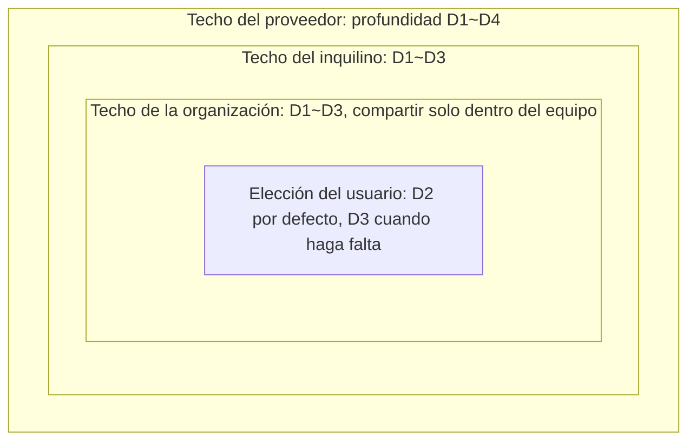
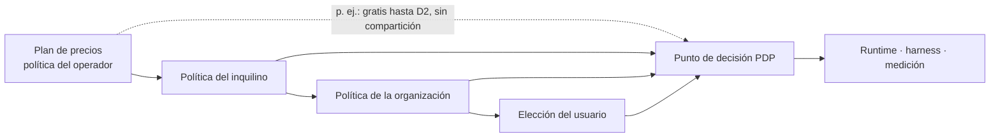

<!-- LANG-BAR -->
[English](../en/04-control-spectrum.md) · [한국어](../ko/04-control-spectrum.md) · [简体中文](../zh-CN/04-control-spectrum.md) · [日本語](../ja/04-control-spectrum.md) · **Español**
<!-- /LANG-BAR -->

# 4. Espectro de control: qué se permite al usuario y qué controla el operador

> Conclusión de este capítulo: el control no es un interruptor de encendido y apagado, sino **un intervalo por cada perilla (knob)**. Los actores superiores estrechan el **techo (ceiling)** del intervalo, y el usuario elige dentro de él. Sin embargo, existen 7 **derechos mínimos del usuario (floor)** que ninguna política puede borrar. Los planes de precios, los presets y las políticas del inquilino no son más que distintas maneras de recortar este intervalo.

## 4.1 El problema: abrir es peligroso y cerrar quita maleabilidad

- Si se abre demasiado: incidentes de seguridad, explosión de los costos de soporte, actualizaciones imposibles, colapso de la coherencia de marca.
- Si se cierra demasiado: no se diferencia de una pantalla de configuración, y el usuario acaba buscando atajos (scripts copiados, automatización externa).

Lo que se necesita es un **control continuo y delegable**. El proveedor fija el techo de riesgo de toda la plataforma, el inquilino (tenant) el techo de su empresa, la organización el techo del equipo, y el usuario elige libremente dentro del rango restante.

## 4.2 Modelo de delegación por intervalos

Cada perilla `k` tiene un dominio de valores `D_k` ordenado por riesgo (p. ej., profundidad `D1 < D2 < … < D5`). Las perillas de tipo conjunto (p. ej., la lista de permisos autorizados) se ordenan por inclusión.

```text
Lo que el actor i fija para la perilla k:  intervalo [f_i, c_i] ⊆ D_k
  c_i : techo (ceiling). Se prohíben valores más peligrosos que este
  f_i : piso (floor). Se prohíbe dar menos que esto (para garantizar los derechos del usuario)

Regla de delegación (DEBE):  [f_child, c_child] ⊆ [f_parent, c_parent]
Intervalo efectivo:          [f_eff, c_eff] = ⋂ todos los intervalos de la cadena
Elección del usuario:        v_k ∈ [f_eff, c_eff],  valor por defecto d_k
```



Cómo leerlo: una caja interior no puede ser más ancha que la exterior. Si el usuario quiere una funcionalidad D4, el sistema debe poder indicarle que se bloquea en el **techo del inquilino**, no en el de la organización ("Esta funcionalidad no está permitida por la política de la empresa. ¿Quiere que enviemos la solicitud al administrador?").

Ventajas de este modelo:
- **Explicabilidad**: el motivo de un rechazo puede expresarse con exactitud como "qué techo de qué nivel".
- **Componibilidad**: al ser una intersección, se calcula con independencia del orden y se puede almacenar en caché.
- **Unificación con los planes de precios**: un plan de precios es simplemente otro techo que impone el operador (4.9).

## 4.3 Catálogo de perillas

| Grupo | Perilla | Dominio de valores (riesgo bajo → alto) | Valor por defecto recomendado | Actor que suele fijarla | Eje relacionado |
| --- | --- | --- | --- | --- | --- |
| Qué | Profundidad máxima | D1 → D5 | D3 | Proveedor, inquilino | A1 |
| Qué | Lista de puntos de extensión permitidos | Algunos → todos | Todos los puntos stable | Proveedor | A1 |
| Qué | Techo de capacidades (capability) | Lectura → escritura → envío externo | Lectura y escritura internas | Inquilino | A1, A4 |
| Qué | Red externa | Bloqueada → lista permitida → toda | Bloqueada | Inquilino | A4 |
| Cómo | Modo de activación | gated → preview → live | preview | Inquilino, organización | A11 |
| Cómo | Aprobador | Administrador → administrador de la organización → uno mismo | Administrador cuando aumentan los permisos | Inquilino | A11 |
| Cómo | Intensidad de verificación | Todas las puertas → omisión según profundidad | Estándar por profundidad (5.8) | Proveedor | — |
| Cómo | Aplicación automática de la línea base | defer → approve → auto | approve | Inquilino, usuario | A7 |
| Con quién | Alcance de compartición | Ninguno → inquilino → público | Inquilino | Inquilino | A8 |
| Con quién | Recompartición | Prohibida → si el autor lo permite → libre | Si el autor lo permite | Organización | A8 |
| Con quién | Visibilidad del código | hidden → own → open | Según la forma de despliegue | Inquilino | A5 |
| Cuánto | Vía de obtención de modelos | Designada por el inquilino → elegible | Designada por el inquilino | Inquilino | A9 |
| Cuánto | Nivel de calidad | Ahorro → estándar → alta calidad | Estándar | Usuario | A9 |
| Cuánto | Techo de presupuesto | Bajo → alto | Techo mensual + detención si se supera | Inquilino, usuario | A9 |
| Qué se ve | Visibilidad administrativa | none → V0 → V3 | V1 (empresas V2) | Inquilino | A10 |
| Qué se ve | Exportación a la plataforma | Ninguna → agregados → metadatos | Agregados | Inquilino (contrato) | A10 |
| Qué se ve | Periodo de retención | Corto → largo | Eventos 13 meses | Inquilino | A10 |

## 4.4 Presets del espectro

En lugar de elegir las perillas una por una, se puede empezar con cinco presets.


| Perilla | Bloqueado | Curado | Barandillas | Abierto | Laboratorio |
| --- | --- | --- | --- | --- | --- |
| Profundidad máxima | D1 | D2 (instalación hasta D3) | D3 | D3 | D4 |
| Creación propia | No | No, solo instalación | Sí | Sí | Sí |
| Capacidades | Ninguna | Lista aprobada | Lectura y escritura internas | Internas + externas de la lista permitida | Aprobación a petición |
| Activación | — | gated | preview | live (D1~D2) | preview |
| Compartición | Ninguna | Solo recibir | Inquilino | Inquilino | Inquilino |
| Aplicación de la línea base | Automática | Automática | approve | auto | approve |
| Visibilidad administrativa | V0 | V1 | V2 | V1 | V2 |
| Perfil adecuado | Parte de P4 | Usuarios de P6 | P2, P3 | P1, P5 | P1 desarrolladores |

Los presets son un punto de partida. El inquilino puede estrechar más cada perilla después de elegir un preset, pero no puede ampliarla más allá del preset (solo dentro del techo del proveedor).

## 4.5 Matriz de quién decide

`decide` = fija el valor, `techo` = fija el rango que pueden elegir los niveles inferiores, `propone` = solo puede solicitar, `—` = no interviene.

| Decisión | Proveedor V | Operador O | Inquilino T | Organización G | Usuario U | Agente α |
| --- | --- | --- | --- | --- | --- | --- |
| Definir puntos de extensión y mapa de capacidades (capability map) | decide | — | — | — | propone | — |
| Profundidad máxima de la plataforma | decide | techo | techo | techo | elige | — |
| Conceder capacidades | techo | — | techo y aprobación | aprobación (si se delega) | solicita y aprueba (en su propio ámbito) | **no puede** |
| Publicación de la línea base | decide la versión oficial | — | decide la versión del inquilino | decide la versión de la organización | — | propone (promoción) |
| Momento de aplicación de la línea base | — | — | techo | techo | decide | solo prepara |
| Compartición | — | techo (revisión del mercado público) | techo | techo | decide | — |
| Vía de modelo y presupuesto | — | techo (plan de precios) | decide | techo | elige la calidad | — |
| Visibilidad administrativa | — | techo de exportación | decide | — | consulta (piso) | — |
| Creación de cambios | — | — | — | — | aporta la intención | genera |
| Juicio de cambios | reglas de verificación | — | reglas adicionales | reglas adicionales | revisa la vista previa | juzga (instancia distinta del generador) |

La columna del agente es la clave. El agente **genera, juzga y propone**, pero nunca **concede permisos, cambia políticas ni decide publicaciones** (I4, I9).

## 4.6 Derechos mínimos del usuario (Floor Rights)

Ninguna política de inquilino, plan de precios ni preset puede eliminar los siguientes derechos (DEBE). Solo con este piso los usuarios se atreven a modificar sin miedo.

| # | Derecho | Contenido | Interpretación en entornos empresariales |
| --- | --- | --- | --- |
| F1 | Revertir | Se puede revertir de inmediato cualquier cambio de la propia capa | La línea base superior en sí no se puede revertir, pero los cambios propios sobre ella siempre sí |
| F2 | Modo seguro | Se puede arrancar con todas las capas del usuario desactivadas | Aislar la causa sin interrumpir el trabajo |
| F3 | Aviso de visibilidad | Siempre se puede consultar quién puede ver qué de mis cambios | Indicar "El administrador de la organización puede ver incluso la descripción de los cambios" |
| F4 | Exportar lo mío | Se pueden exportar en formato estándar la intención y el contrato de los cambios que hice | La exportación de artefactos (código) puede restringirse por política |
| F5 | Ver permisos | Se pueden ver los permisos que tiene un cambio activo, y ningún aumento de permisos ocurre sin aviso | Lo mismo para las funcionalidades recibidas por compartición |
| F6 | Techo de gasto | Si se me generan costos, puedo fijar un techo, y al superarlo se detiene | Si los asume el inquilino, se avisa de que se aplica el techo del inquilino |
| F7 | Explicación a petición | Para cualquier cambio se puede recibir "qué cambió" en términos comunes | Recibo de cambio (change receipt) (8.6) |

## 4.7 Documento de política

La política (policy) es un documento declarativo heredable. El ejemplo completo está en [`examples/policy.example.yaml`](../../examples/policy.example.yaml) y el esquema en [`schemas/policy.schema.json`](../../schemas/policy.schema.json).

```yaml
policy:
  id: tenant/acme
  level: tenant
  inherits: operator/plan-business      # el plan de precios también es una política
  knobs:
    depth:            { ceiling: D3, default: D2 }
    capabilities:     { ceiling: [tasks.read, tasks.write, notify.local, net.slack.post] }
    network:          { ceiling: allowlist, allowlist: ["hooks.slack.com"] }
    activation:       { ceiling: preview, approver_on_capability_increase: tenant_admin }
    baseline_apply:   { ceiling: auto, default: approve }
    sharing:          { ceiling: tenant, reshare: author_opt_in }
    code_visibility:  { value: own }
    model_route:      { value: tenant_cloud }
    quality_tier:     { ceiling: standard, default: standard }
    budget:           { monthly: 3000, per_user_monthly: 30, on_exceed: stop }
    admin_visibility: { value: V2 }
    platform_export:  { ceiling: V0 }
  floors: [rollback, safe_mode, visibility_notice, export_intents, permission_view, spend_cap, receipt]
```

## 4.8 Procedimiento de decisión de políticas

Toda solicitud se expresa como `(sujeto, acción, objeto, contexto)`, y el punto de decisión (PDP) devuelve uno de `allow / deny / approval required` junto con **obligaciones (obligation)**. Una obligación es "algo que se permite pero que obligatoriamente hay que hacer" (registro, vista previa, notificación, etc.).

```text
decide(req):
  p ← effective_policy(req.subject)            # intersección de las políticas de la cadena (cacheable)
  if req.action ∈ FLOOR_ACTIONS and floor_scoped(req):   # revertir, modo seguro, exportar, etc.
      return allow, obligations=[log]
  if req.action == revert:                      # revertir fuera del ámbito del piso = mismo juicio que una activación
      req ← as_activate(req.target)             # incluye rehacer, volver a activar y levantar la suspensión
  for k in knobs_touched(req):
      if value(req, k) ∉ [p.f_k, p.c_k]:
          return deny, reason=(k, nivel que fijó el techo)   # "Política del inquilino: profundidad máxima D3"
  if raises_capabilities(req):
      return approval required, approver=p.approver_for(req.capabilities_delta)
  if uses_destructive(req):                     # las capacidades destructivas van a G5 con independencia de la política de activación (5.8)
      return approval required, approver=p.gate_approver
  if p.activation(req.depth) == gated:
      return approval required, approver=p.gate_approver
  return allow, obligations=obligations(p, req)         # p. ej.: preview, registro de auditoría, medición de costos
```

`floor_scoped(req)` solo es verdadero cuando se cumple todo lo siguiente (DEBE). Si se incumple cualquiera, se juzga como una solicitud normal y no como una acción de piso.
- El sujeto es la **persona** propietaria de la capa objetivo (no un agente, un supervisor ni un usuario de otra capa). La recuperación automática del supervisor solo se permite cuando reduce permisos, y se registra.
- Si es una reversión, el objetivo es un **estado anterior** de la misma capa, y la profundidad y los permisos efectivos del resultado están **dentro** (⊆) del estado activo actual y de la política efectiva vigente. Los movimientos que vuelven a aumentar permisos o profundidad, como rehacer, "volver a activar" (5.4) o levantar una suspensión, se juzgan como una activación (E10).
- El modo seguro solo desactiva, y la exportación se limita a intención y contrato (F2, F4).

Principios de ubicación:
- **El PDP con autoridad está en el límite del operador (servidor) (I8).** En el dispositivo del usuario se guarda una copia de la política para orientar rápidamente, pero el juicio final lo vuelve a hacer el servidor.
- En el modo personal sin conexión (P1) no hay servidor, así que el PDP del dispositivo es el único. En este caso, la política es "una salvaguarda que protege al propio usuario", no un medio de imposición. Esta diferencia no se oculta ni en la documentación ni en la UI. Por la misma razón, los despliegues sin servidor (P1·P5) no pueden garantizar I8, por lo que su nivel de conformidad llega como máximo a Core y no pueden ser Governed (10.3).
- **Adaptador de motor de políticas** (PUEDE): se puede implementar el PDP trasladando los intervalos de las perillas a un lenguaje de políticas. En Cedar, forbid gana a permit, se deniega si no hay ningún permit que coincida, y se devuelve junto con la decisión el id de la política que la produjo. Este id se usa como fundamento de `deny(reason·layer)` y del recibo (8.6).
- **Verificación automática de I5** (DEBERÍA): al guardar una política se comprueba `p_child ⊑ p_parent`. Si se ha trasladado a Cedar, se puede demostrar con un contraejemplo mediante la comprobación de inclusión de SymCC (`check_implies`). Conviene ejecutar también `check_never_errors` de la misma herramienta, porque Cedar omite las políticas que producen errores de evaluación, de modo que un forbid que falla queda abierto en silencio.
- **Ámbito y vigencia de la aprobación** (DEBE): la respuesta de una persona a `approval required` tiene un ámbito: **solo esta vez** (esta única solicitud), **durante esta tarea** (hasta que termine esta sesión de generación) y **siempre** (de forma continua para este usuario y esta capa). "Siempre" queda ligado a la **huella del objeto** aprobado (el content_hash de la funcionalidad y la lista de permisos). Si cambia el contenido o los permisos de la funcionalidad, la aprobación desaparece y se vuelve a preguntar. En la pantalla de aprobación se escribe en una frase el alcance de "siempre", y "siempre" no se coloca justo al lado de "denegar". Todo lo que no sea una respuesta afirmativa (cerrar la ventana, responder otra cosa, interrumpir, agotar el tiempo) es una denegación. No se pregunta por acciones de solo lectura que no aumenten permisos (fatiga de aprobación, 4.10). La confirmación de llamadas a herramientas MCP de ThinkRail tiene la misma estructura (denegar · solo esta vez · en esta conversación · siempre. "Siempre" queda ligado al SHA-256 de `command`+`args` o de `url` del servidor, [JetBrains/thinkrail `agent/mcp/SPEC.md`](https://github.com/JetBrains/thinkrail/blob/c10f8808cee693e4abffeeb1844a132ed0a91cc5/packages/server/src/agent/mcp/SPEC.md#L129-L150)).
- **El piso va antes que el motor**: por la regla de prioridad de forbid, si los derechos mínimos (F1~F7) se meten como permit normales, un forbid superior puede borrarlos. Como en el pseudocódigo anterior, el juicio de `FLOOR_ACTIONS` se coloca antes de llamar al motor.

## 4.9 Plan de precios = techo de política

No construya los planes de precios como un sistema aparte; expréselos como una política que impone el operador.



Así, las invitaciones a mejorar de plan también resultan naturales. Si el motivo del rechazo es "techo del plan de precios", ese es el punto de venta adicional más preciso (9.7).

## 4.10 Preguntas a considerar

- Cuando un inquilino abre D4, ¿quién responde por los daños causados por defectos de ese código? Los términos de servicio y el documento de política deben decir lo mismo.
- Cuando el piso F4 (exportar) choca con la protección de la propiedad intelectual de la empresa, ¿basta el compromiso de exportar solo la intención y el contrato?
- ¿Qué pasa si, al pasar de un preset a otro, un cambio ya activo supera el nuevo techo? Recomendación: no desactivarlo de inmediato, sino dejarlo en estado "suspendido" e informar al usuario.
- Fatiga de aprobación: ¿a partir de cuántas solicitudes de aprobación por semana el aprobador deja de leer su contenido? Hay que medir esta cifra para ajustar el alcance de la aprobación automática.

Siguiente capítulo: [5. Arquitectura de referencia](05-reference-architecture.md)
