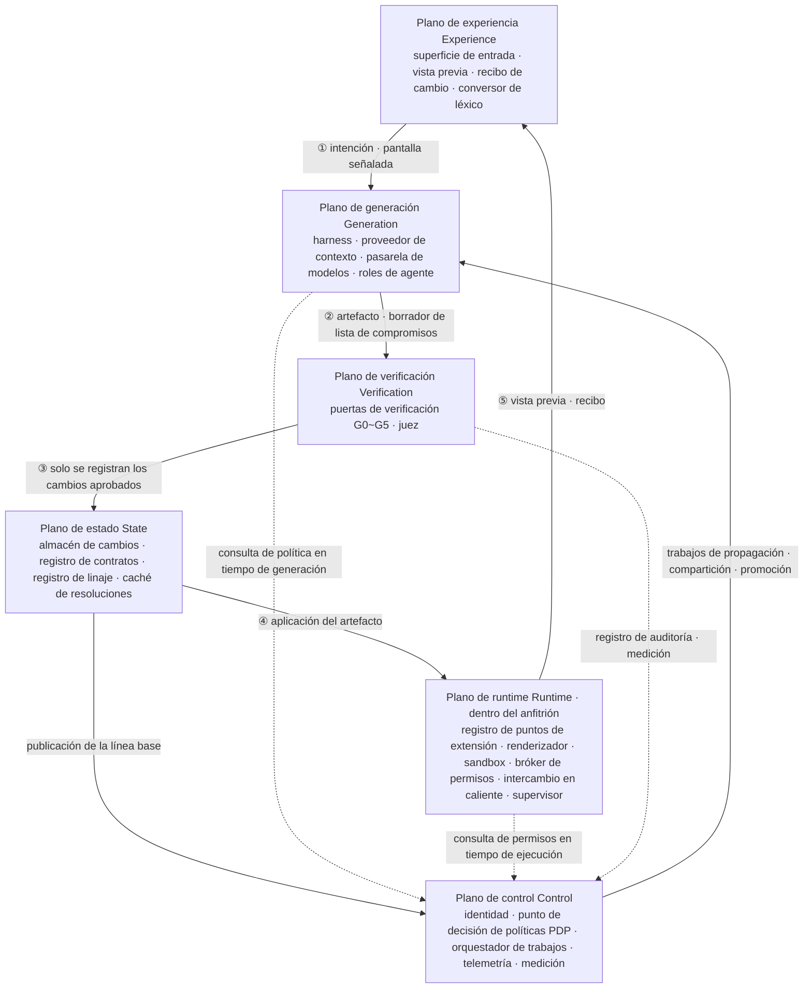
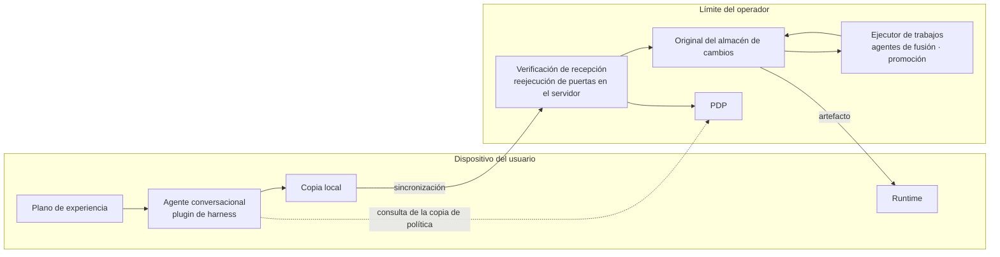
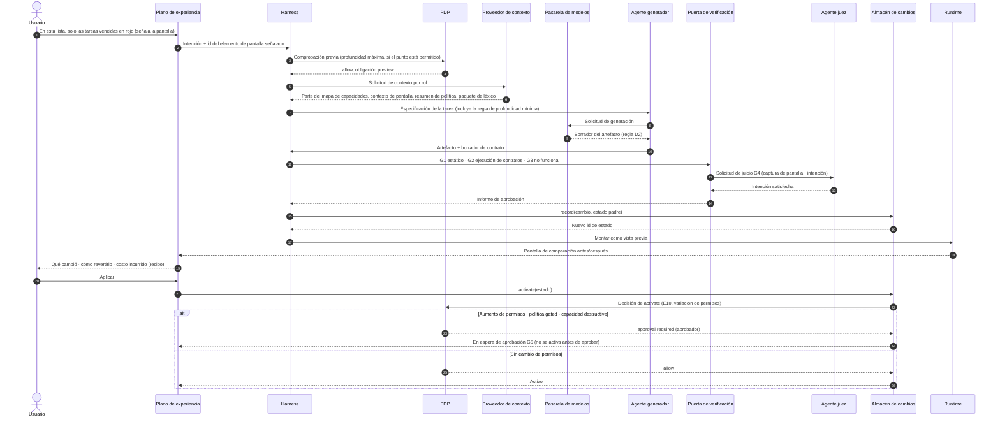
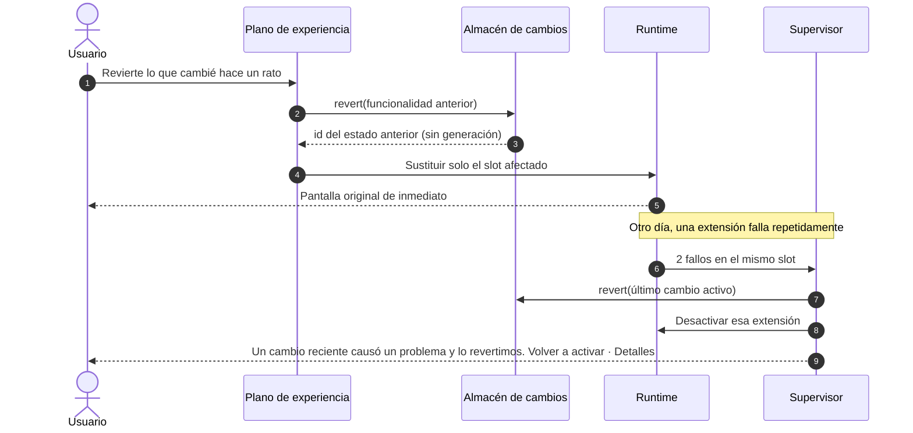
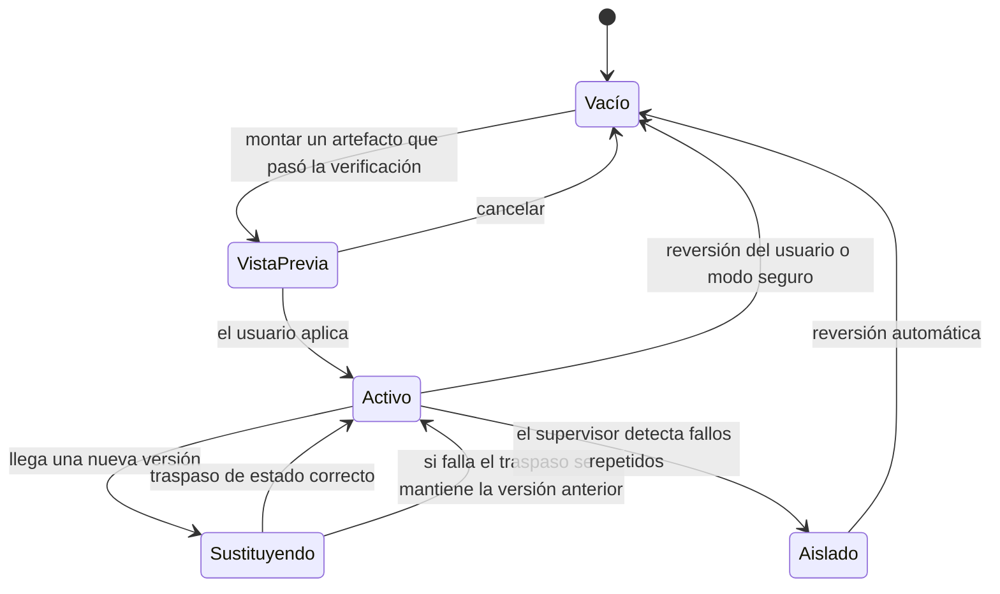

<!-- LANG-BAR -->
[English](../en/05-reference-architecture.md) · [한국어](../ko/05-reference-architecture.md) · [简体中文](../zh-CN/05-reference-architecture.md) · [日本語](../ja/05-reference-architecture.md) · **Español**
<!-- /LANG-BAR -->

# 5. Arquitectura de referencia: planos, componentes, puertos, flujos y harness

> Conclusión de este capítulo: un sistema Mallangable se divide en **6 planos (plane)**: el **plano de experiencia**, que se encuentra con el usuario; el **plano de runtime**, que ejecuta los cambios dentro del anfitrión (host); el **plano de generación**, donde la IA crea los cambios; el **plano de verificación**, que juzga los cambios; el **plano de estado**, que custodia el historial; y el **plano de control**, que se ocupa de políticas, facturación y auditoría. Los planos se conectan solo mediante **puertos (interfaces)**, y las implementaciones (adaptadores) se intercambian según las elecciones de ejes del capítulo 3.

## 5.1 Estructura general



Cómo leerlo: las líneas continuas ①~⑤ forman el ciclo de un cambio. La intención (intent) va al plano de generación, solo se registra lo que pasa la verificación, solo se aplica en el runtime lo registrado, y el resultado vuelve al usuario como vista previa y recibo. Cuando sale una nueva línea base (baseline), el plano de control crea un trabajo de propagación y vuelve a recorrer el mismo ciclo. Las líneas discontinuas son consultas de política. Lo clave es que **el momento de generación (harness) y el momento de ejecución (bróker del runtime) preguntan al mismo PDP**. Si los juicios de permisos de ambos momentos divergen, aparecen huecos del tipo "se permitió al crearlo, pero se prohíbe al ejecutarlo". Los componentes de cada plano están en la tabla siguiente y en la definición de puertos de 5.3.

### Responsabilidades por plano

| Plano | Responsabilidad | Lo que DEBE (MUST) cumplir |
| --- | --- | --- |
| Plano de experiencia | Recoger la intención, representar el progreso, vista previa, recibo, términos comunes | Toda cadena visible para el usuario pasa por el conversor de léxico |
| Plano de generación | Interpretar la intención, generar artefactos, fusionar, promover | Toda escritura se hace solo mediante llamadas a herramientas. Se prohíben los comandos de repositorio en bruto |
| Plano de verificación | Comprobación previa de políticas, análisis estático, ejecución de contratos, comprobaciones no funcionales, juicio | Separación entre generador y juez (I7) |
| Plano de runtime | Carga, aislamiento y ejecución de extensiones, intermediación de permisos, intercambio en caliente, recuperación | Las extensiones no llegan al anfitrión por ninguna vía que no sea el bróker |
| Plano de estado | Historial de capas, contratos, linaje, caché de resoluciones | Todo estado activo se puede revertir (I3) |
| Plano de control | Identidad, políticas, trabajos, auditoría, medición | La aplicación con autoridad se hace solo aquí (I8) |

## 5.2 Vista de despliegue según la ubicación del agente (A3)

| Componente | `client` | `hybrid` | `server` |
| --- | --- | --- | --- |
| Superficie de entrada, vista previa | Dispositivo | Dispositivo | Dispositivo |
| Harness del agente | Dispositivo (agente lanzado por el usuario + plugin de harness) | Generación conversacional: dispositivo / fusión y promoción: servidor. Si es `own`, no se dan artefactos de capas superiores al generador del dispositivo (5.10, I6) | Sandbox del servidor |
| Pasarela de modelos | Dispositivo (suscripción o clave del usuario) | Dispositivo + servidor | Servidor |
| Puerta de verificación | Dispositivo (reverificación si hay servidor) | Primera pasada en el dispositivo + reverificación en el servidor | Servidor |
| Runtime | Dispositivo | Dispositivo | Dispositivo (solo descarga artefactos) |
| Almacén de cambios | Dispositivo (sincronización opcional) | El servidor tiene el original y el dispositivo una copia | Solo servidor |
| PDP | Dispositivo (orientativo) | Servidor (el dispositivo tiene caché) | Servidor |



Cómo leerlo (para hybrid): el usuario modifica conversando en el dispositivo, y el resultado debe volver a pasar la verificación de recepción (receive-check) del servidor para convertirse en el original. Las tareas que se repiten para miles de usuarios, como la fusión de la línea base, las asume el servidor.

## 5.3 Puertos y adaptadores

Los límites entre planos se definen como interfaces. Lo siguiente es una notación neutral respecto al lenguaje (toma prestada la sintaxis de TypeScript). La implementación conecta el adaptador que corresponda a la elección de ejes.

```ts
// ── Plano de runtime ─────────────────────────────────
interface ExtensionPointRegistry {
  list(filter?: { depth?: Depth; kind?: PointKind }): ExtensionPoint[];
  capabilityMap(): CapabilityMap;               // Legible por máquina. Se suministra como contexto del agente
}
interface SandboxHost {                         // Adaptador: SES Compartment | iframe | Worker | proceso | microVM
  mount(artifact: Artifact, grants: CapabilityGrant[], prevState?: unknown): SlotHandle;
  unmount(slot: SlotHandle): Promise<unknown>;  // Devuelve una instantánea para el traspaso de estado
  limits(slot: SlotHandle): ResourceBudget;
}
interface CapabilityBroker {
  call(slot: SlotHandle, cap: CapabilityId, args: unknown): Promise<unknown>;  // Consulta al PDP en cada llamada + registro de auditoría
}

// ── Plano de generación ──────────────────────────────
interface AgentHarness {                        // Adaptador: agente comercial + plugin | bucle de agente propio
  run(task: Task, role: AgentRole, budget: Budget): AsyncIterable<HarnessEvent>;
}
interface ContextProvider {
  build(task: Task, role: AgentRole): Context;  // Solo lo que cada rol puede ver (I6)
}
interface ModelPort {                           // Adaptador: suscripción del usuario (vía cliente oficial) | clave de API | créditos | nube del inquilino | modelo en el dispositivo
  complete(req: ModelRequest, route: Route): Promise<ModelResponse>;
  estimate(req: ModelRequest, route: Route): CostRange;
}

// ── Plano de verificación ────────────────────────────
interface ValidationPort {
  run(change: ChangeDraft, gates: GateId[]): Promise<GateReport>;
}
interface ContractRunner {
  check(contract: Contract, app: EffectiveAppHandle): Promise<ContractResult>;
}

// ── Plano de estado ──────────────────────────────────
interface ChangeStore {                         // Adaptador: repositorio al estilo Git | documento CRDT | BD de instantáneas
  record(change: Change, parent: StateId): StateId;   // Solo se expone esto en lugar de comandos de commit en bruto
  activate(state: StateId): void;
  revert(target: StateId | FeatureId): StateId;        // Tiempo constante sin generación (I3)
  history(scope: Scope): ChangeRecord[];
}
interface LineageRegistry {
  parent(node: LayerNodeId): LayerNodeId | null;
  release(node: LayerNodeId, tag: BaselineTag): void;
  descendants(node: LayerNodeId): LayerNodeId[];        // Orden topológico
}
interface ResolutionCache {
  lookup(key: ConflictClassKey, scope: VisibilityScope): Resolution | null;
  store(key: ConflictClassKey, scope: VisibilityScope, r: VerifiedResolution): void;
}

// ── Plano de control ─────────────────────────────────
interface PolicyDecisionPoint {
  decide(req: AccessRequest): Decision;          // allow | deny(motivo·nivel) | approval required(aprobador) + obligaciones
}
interface JobOrchestrator {
  submit(job: PropagationJob | ShareJob | PromotionJob): JobId;
}
interface TelemetrySink { emit(e: Event & { visibility: VisibilityLabel }): void; }
interface MeteringPort  { record(u: UsageRecord): void; entitlement(subject: Subject): PlanLimits; }

// ── Plano de experiencia ─────────────────────────────
interface LexiconPort {
  render(conceptId: string, level: "basic" | "practitioner" | "developer", locale: string, domain?: string): string;
  lint(text: string, level: string): LexiconViolation[];   // Detecta términos de desarrollo en pantallas de usuarios comunes
}
```

Principios de diseño:
- `ChangeStore` **no expone comandos de repositorio en bruto (commit, push, merge, reset).** Las únicas escrituras que puede usar el agente son `record`·`activate`·`revert`, y gracias a este límite se unifica la norma de registro (6.11).
- El adaptador de "suscripción del usuario" de `ModelPort` solo implementa las vías que permite el proveedor (8.10).

## 5.4 Flujo 1: cómo se crea un cambio



Puntos clave:
- La comprobación previa del paso 3 filtra las solicitudes imposibles **antes de generar** y ahorra costos.
- La especificación de la tarea del paso 7 incluye la regla de profundidad mínima. Si el agente generador lo construye en D4, lo rechaza G1 en el paso 11.
- El juicio (pasos 12~13) lo hace una instancia distinta del agente generador (I7).
- El registro (paso 15) va antes que la solicitud de activación (paso 21). Por eso todo estado aplicado se puede revertir (I3).
- La activación también pasa por el PDP (paso 22, E10). Aunque el plano de experiencia llame al almacén, si aumentan los permisos o la política es gated, no pasa a estado activo hasta la aprobación G5.

## 5.5 Flujo 2: reversión y recuperación automática



La reversión **no llama al modelo.** Es un movimiento de puntero, así que su costo es 0 y pertenece al nivel de tiempo (time tier) T0 (8.4). El hecho de que "revertir sea gratis" es la motivación más fuerte para que el usuario empiece a experimentar.

### La reversión se basa en lo que se vio

El estado activo puede cambiar incluso mientras el usuario mira la pantalla: la propagación de la línea base (6.5), la aplicación desde otro dispositivo o la recuperación automática del supervisor. Por eso la solicitud de reversión envía también **el id del estado que vio el usuario**: `revert(feature, expect=id del estado visto)`.

- Si el estado actual difiere de `expect`, no se cambia nada (DEBE). En su lugar, se muestra el estado actual y se pide volver a elegir. Si se revierte un estado equivocado, el derecho mínimo F1 se convierte en un accidente.
- El resultado de la reversión devuelve un nuevo id de estado, y si se hace **la misma operación otra vez** con ese id, se obtiene un rehacer. No se crea un mecanismo aparte para rehacer (DEBERÍA). Sin embargo, rehacer y "volver a activar" tras una recuperación automática del supervisor vuelven a aumentar permisos y profundidad, por lo que no pasan por el derecho mínimo (F1), sino por el mismo juicio del PDP que una activación (E10) (DEBE, `floor_scoped` de 4.8). Si entretanto bajó el techo o desapareció la aprobación, el resultado es approval required o deny.
- Si el registro desapareció y no se puede revertir ni rehacer, no se omite en silencio, sino que se avisa "Ya no se puede revertir" (DEBE).

La reversión de diffs de ThinkRail usa la misma regla. El cliente no envía el contenido, solo el hash de lo que vio, y si difiere lo rechaza con `STALE_VIEW` ([JetBrains/thinkrail `changes/SPEC.md`](https://github.com/JetBrains/thinkrail/blob/c10f8808cee693e4abffeeb1844a132ed0a91cc5/packages/server/src/changes/SPEC.md#L39-L43), notas de investigación [T1·T2](research/thinkrail-analysis.md)).

## 5.6 Harness

### Definición

El harness es **una envoltura determinista que rodea a un agente no determinista**. Piense lo que piense el agente, el harness impone las cinco cosas siguientes.

| Responsabilidad | Contenido | Medio de implementación |
| --- | --- | --- |
| Procedimiento | Orden: juicio de profundidad → redacción del contrato → artefacto → verificación → registro → solicitud de activación | Skills y especificación de tareas, hook de comprobación antes de terminar |
| Límite de herramientas | Solo herramientas permitidas, solo rutas permitidas | Restricción de la lista de herramientas, hook de acceso a rutas |
| Hooks de política | Consulta al PDP en cada evento del ciclo de vida | Modelo de eventos (abajo) |
| Presupuesto | Techos de tokens, tiempo y reintentos | Medición en la pasarela de modelos, presupuesto del trabajo |
| Contrato de salida | Formato de lo que sale hacia el usuario y otros agentes | Comprobación de esquema, puerta de salida |

El estándar de skills de agente (SKILL.md) es un buen medio para distribuir procedimientos de forma portable, pero la imposición de permisos queda a cargo de cada implementación de agente. El campo `allowed-tools` del estándar también es experimental y su soporte varía según el agente ([especificación de Agent Skills](https://agentskills.io/specification)). Por eso se reparte así: **la skill se ocupa del procedimiento y el harness de la imposición**.

### Modelo de eventos neutral respecto al proveedor

| id | Evento | Momento | ¿Puede bloquear? | Política representativa |
| --- | --- | --- | --- | --- |
| E1 | `session.start` | Inicio o reanudación de sesión | No | Inyectar en el contexto el resumen de política, el mapa de capacidades y las actualizaciones pendientes |
| E2 | `intent.submit` | Justo después de la petición del usuario, antes del procesamiento del modelo | Sí | Clasificación de profundidad, recoger D5 como petición de núcleo, bloquear intentos de ver el código fuente (hidden) |
| E3 | `plan.ready` | El agente confirma el plan | Sí | Rechazar planes que violan la profundidad mínima |
| E4 | `tool.before` | Antes de ejecutar una herramienta | Sí | Control de acceso a rutas, bloqueo de comandos de repositorio en bruto, bloqueo de envíos externos |
| E5 | `tool.after` | Después de ejecutar una herramienta | Solo retroalimentación | Devolver al agente los resultados de verificación incremental, depurar la salida |
| E6 | `permission.request` | Se necesita una decisión de permisos | Mediante la decisión | Enrutar a una tarjeta de aprobación humana |
| E7 | `batch.after` | Fin de un lote de llamadas paralelas a herramientas | Sí | Si el volumen acumulado de cambios supera el 80% de la regla de tamaño, ordenar el registro por funcionalidad |
| E8 | `artifact.ready` | Borrador del artefacto completado | Sí | Ejecutar las puertas de verificación |
| E9 | `record.before` | Justo antes de registrar el cambio | Sí | Comprobar existencia del contrato, norma de registro y tamaño |
| E10 | `activate.before` | Justo antes de activar | Sí | Si aumentan los permisos, approval required |
| E11 | `stop.before` | Justo antes de que termine el agente | Sí | Rechazar la terminación si hay cambios sin verificar o sin registrar |
| E12 | `subagent.stop` | Fin de un subagente | Sí | Comprobar el esquema del resultado del juicio |
| E13 | `output.before` | Justo antes de salir hacia personas u otros agentes | Puede sustituir | Puerta de salida (detección de fugas de código, conversión de léxico) |
| E14 | `merge.conflict` | Se detecta un conflicto de fusión | — | Entrar en la escalera de resolución (6.6) |
| E15 | `compact.before` | Justo antes de compactar el contexto | No | Registrar el estado de progreso en el registro |
| E16 | `session.end` | Fin de sesión | No | Envío de telemetría |

### Ejemplo de correspondencia: hooks de Claude Code

Los hooks de Claude Code ofrecen más de 30 eventos, cinco tipos de manejadores (comando, HTTP, herramienta MCP, prompt, agente), una opción para bloquear hooks de usuario mediante configuración del administrador, y `onFailure: "block"`, que bloquea la acción cuando falla un hook ([documentación de hooks de Claude Code](https://code.claude.com/docs/en/hooks.md)). Los eventos anteriores se corresponden aproximadamente así.

| Evento Mallangable | Evento de hook de Claude Code |
| --- | --- |
| E1 `session.start` | `SessionStart` |
| E2 `intent.submit` | `UserPromptSubmit` |
| E4 `tool.before` | `PreToolUse` |
| E5 `tool.after` | `PostToolUse` (puede sustituir el resultado con `updatedToolOutput`) |
| E6 `permission.request` | `PermissionRequest` |
| E7 `batch.after` | `PostToolBatch` |
| E11 `stop.before` | `Stop` ¹ |
| E12 `subagent.stop` | `SubagentStop` ¹ |
| E15 `compact.before` | `PreCompact` |
| E16 `session.end` | `SessionEnd` |
| E3, E8, E9, E10, E13, E14 | Sin evento correspondiente → se generan directamente dentro de las herramientas de Mallangable (servidor MCP) |

¹ `onFailure: "block"` solo funciona en hooks command·http de la v2.1.295 o superior, y no tiene efecto en `Stop`·`SubagentStop`. Si el hook falla, E11·E12 quedan abiertos. Por eso no se confía en E11·E12 como barreras de bloqueo. La comprobación de cambios sin verificar o sin registrar también se impone del lado de las herramientas MCP (`ChangeStore.record()`·`activate()`).

Para otros runtimes de agentes basta con crear una tabla de correspondencia de la misma manera. Lo que no tenga evento correspondiente **se impone del lado de la herramienta**. Por ejemplo, E9 `record.before` se comprueba dentro de `ChangeStore.record()`.

La tabla de correspondencia queda obsoleta cuando cambia la versión del runtime (la nota ¹ anterior es un ejemplo). Por eso, en cada entrada de la tabla se anotan tres cosas (DEBERÍA): **qué se comprobó** (el comportamiento comprobado y su fuente), **cuándo volver a revisarlo** (al actualizar la versión del runtime) y **cuándo borrarlo** (cuando el runtime ofrezca directamente la misma funcionalidad, se borra el complemento del harness). El número de versión se guarda solo en un lugar, el archivo de fijación de dependencias, y no se repite en la especificación. ThinkRail mantiene un registro de compatibilidad que anota así, para cada adaptación que tapa un defecto del motor, "qué volver a revisar" y "en qué condiciones se puede borrar" ([JetBrains/thinkrail `pi-compatibility.md`](https://github.com/JetBrains/thinkrail/blob/c10f8808cee693e4abffeeb1844a132ed0a91cc5/pi-compatibility.md#L11-L16)).

Codex CLI se corresponde de la misma manera (**requiere comprobación con la documentación oficial**): E1 `SessionStart`, E2 `UserPromptSubmit`, E4 `PreToolUse`, E5 `PostToolUse`, E6 `PermissionRequest`, E11 `Stop`, E12 `SubagentStop`, E15 `PreCompact`. Esta lista no procede de la documentación oficial de Codex, sino del conjunto de eventos que Harness² usa para comprobar la configuración de hooks ([google-research/harness2 `substrate/codex.py`](https://github.com/google-research/harness2/blob/1cfe254e8d25b15f37048c3730134686abe60335/harness2/substrate/codex.py#L58-L72)). Antes de aplicarla hay que cotejarla con la documentación oficial de Codex.

El plano de experiencia no recibe los eventos del harness tal cual, sino como señales de progreso para el usuario. Si se usa [AG-UI](https://docs.ag-ui.com/concepts/events) como norma de transporte, se corresponden así.

| Mallangable | AG-UI | Observaciones |
| --- | --- | --- |
| Desde la recepción E2 hasta el fin E11 | `RUN_STARTED` · `RUN_FINISHED` · `RUN_ERROR` | |
| 4 palabras de estado (8.5) | `STEP_STARTED` · `STEP_FINISHED` | El nombre del step se fija al id de la palabra de estado |
| Vista previa parcial (8.5) | `STATE_SNAPSHOT` · `STATE_DELTA`(RFC 6902) | Se mantiene la indicación "aún sin comprobar" |
| E6 `permission.request`, `pendiente de aprobación` de 2.8 | `outcome.type = "interrupt"` de `RUN_FINISHED` → `resume[]` de la siguiente ejecución | La aprobación continúa como una nueva ejecución ([AG-UI interrupt](https://docs.ag-ui.com/concepts/interrupts)) |

Solo hay una señal de finalización (DEBE). En muchos runtimes, "terminó un intento" y "terminó el trabajo" son cosas distintas. Incluso después de terminar un intento, el trabajo puede continuar con reintentos, compactación del contexto o peticiones de seguimiento pendientes. El plano de experiencia solo muestra `Listo` después de que el harness deje pasar E11, y no cambia la palabra de estado en los límites de intento. Los estados que esperan una entrada humana, como `pendiente de aprobación`, son **señales de nivel**. No se apagan porque el usuario haya visto la pantalla; se apagan cuando llega la entrada. ThinkRail trata `agent_end` como límite de intento y solo `agent_settled` como finalización ([JetBrains/thinkrail `architecture.md` decisión 8](https://github.com/JetBrains/thinkrail/blob/c10f8808cee693e4abffeeb1844a132ed0a91cc5/architecture.md#L141-L156)).

Cuando se encargan trabajos del servidor a agentes externos, ocupan el mismo lugar los estados de tarea de [A2A](https://a2a-protocol.org/latest/specification/) (`TASK_STATE_INPUT_REQUIRED`·`TASK_STATE_AUTH_REQUIRED`), y dentro de las herramientas MCP, las solicitudes de múltiples idas y vueltas (`resultType: "input_required"`, [MCP 2026-07-28](https://modelcontextprotocol.io/specification/2026-07-28/changelog)).

Atención: el usuario puede desactivar los hooks de su dispositivo. Los hooks del harness del dispositivo son orientativos, y la imposición final es la verificación de recepción del servidor (I8).

En muchos runtimes, una configuración de hooks con formato incorrecto **no se ejecuta en absoluto** y sin dar error. Es decir, si falla, queda abierta. El plugin de harness comprueba la configuración de hooks en el momento de escribirla con los nombres de eventos y formatos de manejador que acepta el runtime (MUST), y al inicio de la sesión (E1) confirma que los hooks se registraron realmente (MUST). El agente no puede modificar los hooks de política ni los archivos de barandillas (límite de herramientas, E4). Harness² también comprueba los archivos de hooks de Codex en el momento de escribirlos por la misma razón ([google-research/harness2 `core/tree.py`](https://github.com/google-research/harness2/blob/1cfe254e8d25b15f37048c3730134686abe60335/harness2/core/tree.py#L216-L251)).

## 5.7 Roles de agente

| Rol | Qué hace | Lectura | Escritura | Comunicación externa | Observaciones |
| --- | --- | --- | --- | --- | --- |
| Intérprete Interpreter | Interpreta la intención, repregunta, redacta la especificación de la tarea | Conversación con el usuario, mapa de capacidades | Especificación de la tarea | Solo el modelo | En modo hidden nunca ve el código |
| Generador Builder | Genera artefactos y contratos | Su propia capa, mapa de capacidades | Borradores en rutas permitidas | Modelo, espejo de paquetes | No puede usar comandos de repositorio en bruto |
| Registrador Curator | Normaliza los registros, divide y une | Diferencias del cambio | Metadatos de registro | Ninguna | Reglas + modelo pequeño |
| Juez Reviewer | Juzga el cumplimiento de la intención y la calidad | Solo lectura | Resultado del juicio | Ninguna | Instancia distinta del generador (I7) |
| Fusionador Merger | Resuelve conflictos de fusión de la línea base y de compartición | Capa objetivo + publicación superior | Zona en conflicto y funcionalidades relacionadas | Solo el modelo | Prohibido debilitar contratos |
| Promotor Promoter | Normaliza funcionalidades convergentes y las propone al nivel superior | Funcionalidades candidatas (dentro del alcance de visibilidad) | Zona de propuestas del nivel superior | Solo el modelo | La aprobación la da una persona |
| Explicador Explainer | Recibos y resúmenes de actualización en términos comunes | Metadatos de cambios | Frases para el usuario | Ninguna | Pasa por el conversor de léxico |

Hay dos razones para separar los roles. ① Si un mismo agente tiene a la vez datos privados, entradas no confiables y comunicación externa, el ataque resulta fácil (7.3). ② Si quien lo construyó lo califica, la verificación se queda en mera formalidad.

## 5.8 Puertas de verificación

| Puerta | Contenido | Si falla |
| --- | --- | --- |
| G0 Comprobación previa de políticas | ¿Están la profundidad, el punto de extensión y los permisos dentro del intervalo de la política? | Rechazo antes de generar (costo 0) |
| G1 Análisis estático | Esquema, tipos, API prohibidas (evaluación dinámica, red arbitraria, acceso al código fuente original), variación de permisos, tamaño | Se devuelve al agente el motivo como una frase corregible. Si se supera el techo de reintentos (valor de diseño propuesto: 1 vez), se termina manteniendo el estado actual sin cambios |
| G2 Ejecución de contratos | Ejecutar todos los contratos en un entorno de vista previa aislado | Se devuelven los ids de los contratos fallidos y los valores observados |
| G3 No funcional | Presupuesto de rendimiento (CPU, memoria, tiempo de arranque), sin fallos, reglas básicas de accesibilidad | Se devuelven los elementos que superan el presupuesto |
| G4 Juicio | El juez juzga el cumplimiento del significado con capturas de pantalla y la intención. El juez no sabe de qué generador, harness o vía de modelo procede el artefacto (evaluación ciega al origen). Si hay varios candidatos, se presentan con ids anónimos mezclados con una semilla reproducible | Se devuelve el fundamento del juicio |
| G5 Persona | Solo cuando hay aumento de permisos, política gated o uso de capacidades de escritura irreversible (`destructive`). Las capacidades `destructive` requieren aprobación humana con independencia de la política de activación | En espera de aprobación |

Obligatoriedad por profundidad (●obligatorio, ○opcional, —no aplica):

| | G0 | G1 | G2 | G3 | G4 | G5 |
| --- | :-: | :-: | :-: | :-: | :-: | :-: |
| D1 | ● | ● | ○ | — | — | — |
| D2 | ● | ● | ● | ○ | — | Si incluye comandos externos |
| D3 | ● | ● | ● | ● | ○ | Si hay nuevos permisos de datos |
| D4 | ● | ● | ● | ● | ● | Si aumentan los permisos |
| D5 | ● | ● | ● | ● | ● | ● |

Principio de costo: las puertas baratas van delante. G0·G1 filtran la mayor parte, y la costosa G4 (llamada al modelo) solo se ejecuta en D3 o superior.

### Tratamiento de la salida del juicio

La salida del juez (G4) también es salida de un modelo, así que no se confía en ella.

- **Si el formato es incorrecto, es un fallo** (DEBE). Si la palabra del juicio no es uno de los valores fijados (`pass`·`fail`) o la ubicación de una observación (punto de extensión, id de elemento) no coincide, ese juicio no es un aprobado sino un fallo, y el cambio no pasa a activo. No se deja pasar en silencio.
- **El registro lo crea de nuevo el harness** (DEBE). No se guarda el resultado del juicio tal cual; se seleccionan solo los campos fijados (juicio, resumen, observaciones) y se crea un registro nuevo. Se descartan los campos inventados por el modelo (p. ej., `approved_by`, resultados de puertas). Los valores que solo conoce el harness los rellena el harness.
- **Se rechaza el fallo sin observaciones** (DEBE). Si es `fail` pero no tiene ninguna observación, el generador no tiene nada que corregir, así que ese juicio se trata como un juicio fallido.
- **Un juicio aprobatorio no es definitivo** (DEBE). Si las observaciones del juicio anterior aún no se han resuelto, G4 no se registra como aprobada aunque el nuevo juicio sea `pass`.
- **Todos los puntos de entrada comparten el techo de reintentos** (DEBE). La vía en la que el generador pide por sí mismo un nuevo juicio y la vía en la que una persona pulsa volver a comprobar usan el mismo techo (el mismo cálculo que el techo de reintentos de G1). Si se cuentan por separado, el ciclo corregir → juzgar → corregir no termina nunca, y un atacante de costos (7.1) da vueltas por el lado que no tiene techo.

La revisión en la fase de planificación de ThinkRail usa la misma regla ([JetBrains/thinkrail `host/planReview.SPEC.md`](https://github.com/JetBrains/thinkrail/blob/c10f8808cee693e4abffeeb1844a132ed0a91cc5/packages/server/src/host/planReview.SPEC.md#L62-L119), notas de investigación [T4~T6](research/thinkrail-analysis.md)).

## 5.9 Detalles del runtime

### Estados de un slot de extensión



### Protocolo de intercambio en caliente

1. Cuando un nuevo artefacto pasa G2, el runtime lo monta de antemano en un **slot oculto**. Sin embargo, los cambios que requieren aprobación G5 solo reciben permisos y se montan después de la aprobación. Antes de la aprobación, el código D4 solo se monta con 0 permisos.
2. Se obtiene una instantánea del estado del slot existente con `getState()`.
3. Si el esquema de estado de la nueva versión es distinto, DEBE existir `migrate(prev)`. Si no existe, se rechaza la sustitución.
4. Si `mount(prevState)` tiene éxito, se cambia el slot de pantalla y se retira la instancia existente. Si falla, la instancia existente se deja tal cual.
5. El núcleo no se reinicia. El reemplazo de módulos en caliente (HMR) de las herramientas de desarrollo es una funcionalidad de las compilaciones de desarrollo, así que en entornos de despliegue esta sustitución por slot cumple ese papel.

### Supervisor y modo seguro

- Si el mismo slot falla N veces (valor propuesto: 2) dentro de un tiempo determinado, el supervisor revierte el último cambio activo y avisa.
- La unidad de aislamiento y desactivación no es el slot, sino **la funcionalidad completa** (DEBE). Si una funcionalidad abarca varios slots, comandos y hooks de eventos, se desactivan todos juntos. Si solo se desactiva uno, los hooks restantes siguen funcionando. El recibo y el registro de una funcionalidad desactivada siguen siendo visibles. El interruptor de desactivación de extensiones de ThinkRail también desactiva juntas las herramientas y skills aportadas por la extensión, y conserva el renderizador que dibuja las conversaciones pasadas ([JetBrains/thinkrail `architecture.md` decisión 21](https://github.com/JetBrains/thinkrail/blob/c10f8808cee693e4abffeeb1844a132ed0a91cc5/architecture.md#L376-L382)).
- Al arrancar, con una acción concreta (propuesta: ejecutar manteniendo pulsada una tecla modificadora), se arranca con **todas las capas del usuario desactivadas** (derecho mínimo F2).
- Se muestra al usuario el uso de recursos de cada extensión. El usuario debe poder encontrar por sí mismo la causa de la lentitud.

## 5.10 Suministro de contexto

La mayor parte de la calidad de un agente se decide por lo que se le muestra. Se explicita qué se suministra y qué no a cada rol.

| Elemento suministrado | Intérprete | Generador | Fusionador | Juez |
| --- | :-: | :-: | :-: | :-: |
| Mapa de capacidades (alrededor del punto afectado) | ● | ● | ● | ○ |
| Contexto de pantalla (captura de la zona señalada, ids de elementos) | ● | ● | — | ● |
| Resumen de la pila de capas actual | ● | ● | ● | — |
| Resumen de política (intervalos, obligaciones) | ● | ● | ● | — |
| Paquete de léxico | ● | — | — | — |
| Contratos de funcionalidades relacionadas | ○ | ● | ● | ● |
| Artefactos de la propia capa | — si es hidden | ● | ● | ● |
| Artefactos de capas superiores | — si es hidden | Solo si es open. — si es own (de las capas superiores solo tipos y mapa de capacidades) | ● (servidor) | ○ |
| Código fuente del núcleo | — | Solo en forks D5 | — | — |

En `own`, el generador conversa con el usuario, así que los artefactos de capas superiores que entren en el contexto del generador acaban pudiéndolos leer también el usuario (I6). Por eso, en `own` el generador solo recibe las definiciones de tipos y el mapa de capacidades de las capas superiores, no sus artefactos. Esta regla no depende de la ubicación de la generación (5.2).

En lugar del código fuente del núcleo se dan **las definiciones de tipos y el mapa de capacidades**. Es la forma de dar las cabeceras pero no la implementación, y así se reduce estructuralmente la tendencia del agente a intentar parchear el núcleo (deslizarse hacia D5).

## 5.11 Eventos de telemetría

Todo evento tiene una **etiqueta de visibilidad (visibility label)** en el momento de almacenarse. Las consultas del panel filtran a la vez por los permisos de quien mira y por esta etiqueta (7.5).

```json
{
  "event": "change.activated",
  "ts": "2026-10-28T09:41:12+09:00",
  "tenant": "t_acme", "org": "o_design", "subject": "u_8c1f",
  "feature": "f_01JBX7K2M9Q2", "depth": "D3", "points": ["sidebar.panel"],
  "gates": {"G1": "pass", "G2": "pass", "G3": "pass", "G4": "pass"},
  "gen_ai": {"operation.name": "invoke_agent", "agent.id": "builder@harness-x", "usage.input_tokens": 18200, "usage.output_tokens": 2100},
  "model_cost": {"unit_cost_ref": "route:standard"},
  "policy": {"decision_id": "dec_7Q2…", "revision": "tenant/acme@42"},
  "trace": {"traceparent": "00-…-…-01"},
  "latency_ms": {"total": 41200, "first_preview": 9800},
  "visibility": "V1"
}
```

Los atributos de uso del modelo siguen los nombres de las [convenciones semánticas GenAI de OpenTelemetry](https://opentelemetry.io/docs/specs/semconv/gen-ai/) (`gen_ai.usage.input_tokens`·`gen_ai.usage.output_tokens`, etc.). Estas convenciones aún están en estado Development, así que la implementación registra también la versión de las convenciones que siguió. Las decisiones de política dejan, como los registros de decisiones de OPA, el id de la decisión (`policy.decision_id`) y la versión de la política (`policy.revision`). Las llamadas que pasan por un servidor MCP se vinculan a la misma traza mediante la convención `traceparent` de `_meta` de MCP.

Grupos de eventos recomendados: sesión, intención (clasificación, bloqueo, petición de núcleo), herramientas y políticas (rechazo, solicitud de permisos, aprobación), cambios (verificación, registro, activación, reversión), runtime (fallos, modo seguro), propagación (creación, conflicto, método de resolución, propuesta, aplicación, suspensión), compartición, promoción, costos (advertencia, exceso) y seguridad (depuración de la salida, detección de secretos, acceso de emergencia).

Siguiente capítulo: [6. Versiones y linaje](06-versioning-and-lineage.md)
