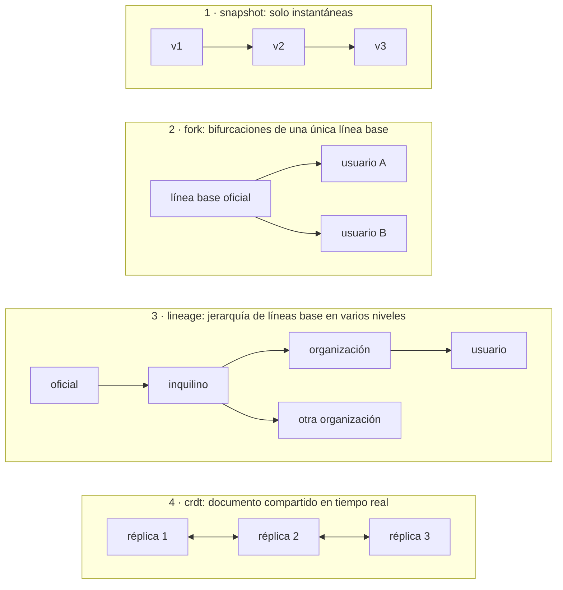
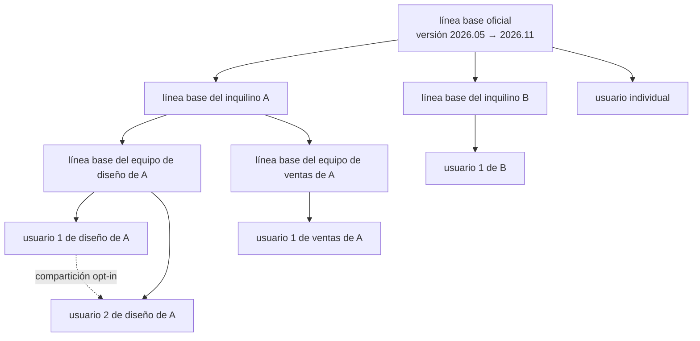
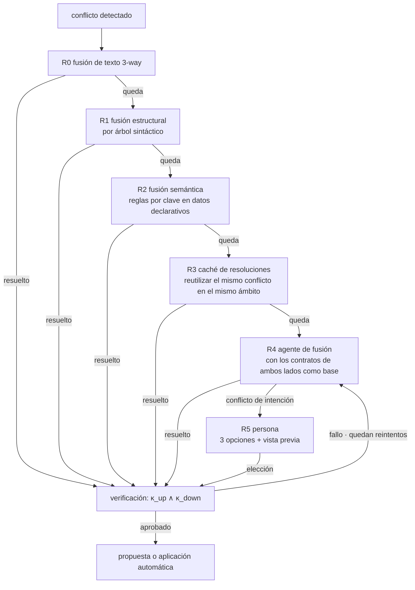
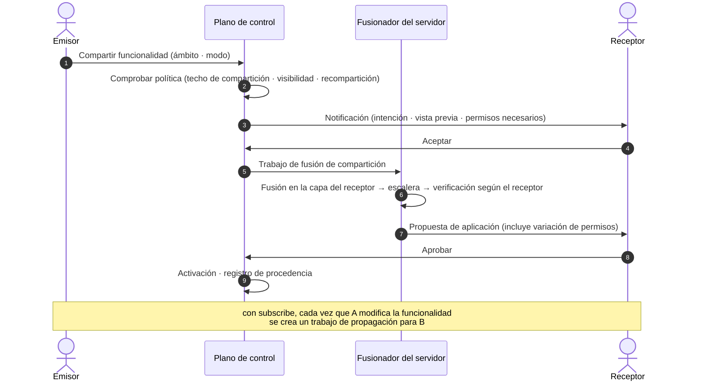
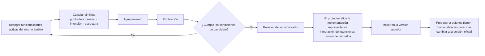

<!-- LANG-BAR -->
[English](../en/06-versioning-and-lineage.md) · [한국어](../ko/06-versioning-and-lineage.md) · [简体中文](../zh-CN/06-versioning-and-lineage.md) · [日本語](../ja/06-versioning-and-lineage.md) · **Español**
<!-- /LANG-BAR -->

# 6. Versiones y linaje: cómo hacer que las modificaciones del usuario sobrevivan a las actualizaciones

> Conclusión de este capítulo: el coste real del software maleable (malleable software) no aparece en el momento de crearlo, sino **cada vez que el proveedor (vendor) publica una nueva versión**. Para asumirlo hay que ① separar la unidad de aislamiento en repositorios (capas, layers) y la unidad de trabajo en ramas, ② gestionar la jerarquía de líneas base (baselines) como un **linaje (lineage)**, ③ definir la fusión como **preservación de contratos**, y ④ compartir una **caché de resoluciones (resolution cache)** dentro del ámbito de visibilidad para no resolver una y otra vez el mismo conflicto.

## 6.1 Por qué el control de versiones es el problema central

Si `N` usuarios tienen cada uno sus propias modificaciones y la línea base cambia `r` veces al año, hacen falta `N × r` fusiones al año. El problema de "reaplicar la pila de parches" que sufren las distribuciones de Linux o los fabricantes de teléfonos cuando mantienen sus propios parches sobre el código fuente de origen aparece ahora para **todos y cada uno de los usuarios**. No es una escala que una persona pueda resolver a mano, así que hay que automatizar la fusión misma y, además, definir **qué es una fusión correcta** de forma que una máquina pueda juzgarlo.

## 6.2 Cuatro topologías



| | snapshot | fork | lineage | crdt |
| --- | --- | --- | --- | --- |
| Aislamiento | Por usuario | Repositorio por usuario | Repositorio por nodo | Por documento, compartido por todos los que acceden |
| Propagación de actualizaciones superiores | Imposible | Un solo nivel | Varios niveles en orden topológico | Convergencia automática |
| Gestión de conflictos | No aplica | Escalera de fusión | Escalera de fusión + política jerárquica | Sin conflictos sintácticos, **quedan los conflictos semánticos** |
| Coste de almacenamiento | Bajo | Número de forks × cambios únicos (los objetos comunes se pueden compartir) | Igual | Tamaño del registro de operaciones |
| Adecuado para | Apps de consumo que solo guardan temas y reglas | Personal, pequeña escala | Empresa, sector público | Colaboración en tiempo real |

Recomendación: si existe la más mínima posibilidad de que en el futuro se necesiten funcionalidades de organización, construya el modelo de almacenamiento como `lineage` desde el principio. `fork` se expresa como un linaje de profundidad 1 (3.7).

## 6.3 Modelo de linaje

```text
linaje T = (nodos, aristas)
  nodo n         : un repositorio de capa (línea base oficial, línea base del inquilino, línea base de la organización, capa del usuario)
  arista n→m     : m tiene a n como superior (m es un fork de n)
  versión r(n)   : etiqueta firmada de línea base en el nodo n. Ej.: 2026.11
  deriva δ(m) = número de pasos entre la versión superior que m ha incorporado y la versión superior más reciente
```



Cómo leerlo: las líneas continuas indican la **dirección en que fluyen las actualizaciones**; la línea discontinua, una **compartición lateral**. Cuando sale la línea base oficial 2026.11, primero la incorpora el inquilino (tenant) A, después los equipos de diseño y de ventas y, por último, cada usuario. La profundidad de la jerarquía puede variar de 1 a 3 niveles según el cliente.

## 6.4 Unidad de aislamiento y unidad de trabajo

**La unidad de aislamiento es el repositorio; la rama es la unidad de trabajo.** La mayoría de los servicios de alojamiento Git ofrecen protección de escritura por rama, pero no restricción de lectura por rama, de modo que si se puede descargar el repositorio, todas las ramas son visibles. Si se intenta aislar con una rama por usuario, esta premisa se rompe.

| Referencia (ref) | Uso | Quién escribe |
| --- | --- | --- |
| `main` | Estado activo actual. El runtime carga esta | Harness (registros y fusiones aprobadas) |
| `exp/<nombre>` | Versión experimental, comparación de alternativas | Harness |
| `upgrade/<versión>` | Resultado de fusión del trabajo de propagación, pendiente de aprobación | Fusionador del servidor |
| `share-in/<id de compartición>` | Resultado de fusionar de prueba una compartición recibida | Fusionador del servidor |
| Etiqueta de versión | Versión de línea base. Solo en nodos de línea base, firma obligatoria | Harness, tras la aprobación del administrador |

Método de fusión: la propagación descendente usa una fusión que conserva el historial (se recomienda prohibir el rebase). El historial del usuario debe conservarse para que sean posibles la auditoría, la reversión y el análisis de promoción.

Generación concurrente: si dos trabajos de generación de un mismo usuario modifican la misma capa a la vez, se pierde claridad sobre a qué funcionalidad pertenece cada cambio (I9). Cada trabajo de generación tiene su propia copia de trabajo `exp/<nombre>` (DEBERÍA). El registrador toma como línea de referencia el estado en el momento en que empieza el trabajo y registra **solo las rutas que ese trabajo cambió**. No registra "todo lo que ha cambiado ahora". Si dos trabajos se solaparon en la misma copia, no adivina la atribución: marca que se solaparon y deja que una persona los separe. ThinkRail abre una ventana de trabajo para cada paso del plan, hace commit solo de las rutas que ese paso cambió y marca como `shared` las ventanas que se solapan con otra conversación ([JetBrains/thinkrail `todos/SPEC.md`](https://github.com/JetBrains/thinkrail/blob/c10f8808cee693e4abffeeb1844a132ed0a91cc5/packages/server/src/todos/SPEC.md#L64-L80)).

Aunque haya miles de forks, la mayoría de los objetos provienen de la misma línea base, así que si se comparten los objetos comunes entre repositorios (p. ej., Git alternates), el almacenamiento crece en proporción al **número de cambios únicos**, no al número de usuarios.

## 6.5 Algoritmo de propagación

```text
Está dirigido por eventos. Cuando el nodo p aplica la versión superior r a `main`, se emite `baseline.applied(p, r)`, y ese evento crea los trabajos de los hijos de p.

```text
on baseline.applied(p, r):                     # p = el propio nodo de la versión, o un nodo intermedio que aplicó r
  kids  = children(p)
  waves = canary(kids, ratios=[0.05, 0.25, 1.0], seed=hash(p, r))   # muestra aleatoria con semilla fija
  for wave in waves:
    results = parallel_map(m -> propagate(m, p, r), wave)           # recoge los resultados. Sin return dentro del cuerpo
    if failure_rate(results, key=(gate_id, contract_id, point)) > threshold:
      halt_propagation(p, r); alert(p.steward); stop

propagate(m, p, r) -> resultado:
  theirs    = p.main@applied(r)                # no la r original, sino el resultado que aplicó el padre (incluye cambios de capas intermedias)
  contracts = ⋃_{a ∈ path(root(r), m)} κ(a)    # todos los contratos del camino desde el nodo que publicó r hasta m (I10)
  merged    = merge(base=last_applied(m), ours=m.main, theirs=theirs)   # escalera de 6.6
  if merged.intent_conflict:   return NEEDS_HUMAN(options=3, previews)
  report = gates(merged, contracts)
  while report.fail and retries_left: report = retry_with_feedback(...)
  if report.fail:              return FAILED       # se mantiene la versión anterior, se avisa al administrador
  if delta_permissions(merged) == ∅ and policy(m).apply == auto:
    d = activate(merged)                       # ChangeStore.activate → PDP(E10). Aquí se detienen las aprobaciones gated, destructivas o ligadas a huella
    if d == permitir: emit baseline.applied(m, r); return APPLIED
    # si es requiere aprobación o denegar, se baja al propose de abajo
  propose(merged, summary=explain(diff_of_intents)); return PROPOSED
  # si se aprueba, entonces apply → emit baseline.applied(m, r). Si se rechaza o caduca, m mantiene la versión anterior

`apply` y `activate` no son una vía aparte que se salte el juicio de activación (5.4, E10) (DEBE). Aunque no aumenten los permisos, si la política de activación es gated, si se usa una funcionalidad destructiva o si una aprobación "siempre" estaba ligada a un content_hash que ha cambiado, el PDP devuelve `requiere aprobación` y la propagación pasa a PROPOSED. `delta_permissions` no se toma de lo que el registro de cambio declara sobre sí mismo, sino que se recalcula a partir del manifiesto del resultado de la fusión.

Nodos que se quedan en una versión cuyo periodo de soporte ha terminado: no se fuerza la fusión; se dejan en "modo de advertencia".
```

Estados del trabajo por nodo:

```text
en espera → fusionando → verificando → { aplicado | pendiente de aprobación | requiere humano | fallido }
pendiente de aprobación → aplicado (aprobado) | en suspenso (rechazado o caducado)
requiere humano → verificando (tras elegir en R5)
```

Reglas:
- **Orden topológico** (DEBE): no se crea el trabajo de un hijo antes de que el padre aplique la versión. Los trabajos de los hijos solo nacen del evento `baseline.applied` del padre.
- **Padre pendiente de aprobación**: si el padre está en `pendiente de aprobación` o `requiere humano`, el hijo no queda con un trabajo detenido, sino en un **estado sin trabajo**. Las funcionalidades del hijo siguen funcionando sobre la versión anterior y la deriva (drift) δ se muestra aumentada en 1. Si el padre aprueba, su `baseline.applied` crea el trabajo del hijo. Si el padre rechaza, r no se propaga al hijo.
- **Un trabajo en curso por nodo**: cuando llega una versión nueva, se cancela el trabajo existente y se vuelve a crear con la más reciente. Sin embargo, los trabajos en `pendiente de aprobación` no se cancelan, sino que se combinan con el trabajo de la nueva versión para aprobarlos de una sola vez. Así, aunque el ciclo de versiones sea más corto que el retraso de aprobación, no se da el caso de que nunca lleguen a aplicarse.
- **Un fallo de lectura no es ausencia** (DEBE): si falla la lectura de las entradas de la fusión (`base`, `ours`, `theirs`) o de una capa superior, ese trabajo es `fallido`. No se trata como "esa clave no existe". En la composición de capas, la ausencia es `null`, es decir, un borrado (2.3), de modo que si un fallo de lectura se interpreta como ausencia, la propagación borra en silencio funcionalidades del usuario. El almacén debe devolver resultados distintos para "de verdad no existe" y "no se pudo leer". ThinkRail, por la misma razón, solo considera ausencia el caso en que git indica explícitamente "la ruta no existe" y lanza como error todos los demás fallos ([JetBrains/thinkrail `changes/SPEC.md`](https://github.com/JetBrains/thinkrail/blob/c10f8808cee693e4abffeeb1844a132ed0a91cc5/packages/server/src/changes/SPEC.md#L119-L122)).
- **Muestra canaria** (DEBE): cada oleada es una muestra aleatoria de los nodos hermanos con semilla fijada por `(p, r)`. No es el primer tanto por ciento del orden topológico. Como la semilla es fija, al volver a ejecutar los mismos nodos entran en la misma oleada.
- **Condición de parada canaria**: si la proporción de fallos con la misma clave de causa `(id de puerta, id de contrato, punto de extensión)` supera el umbral (valor propuesto 10%), se detiene la propagación. Es probable que se trate de un defecto de la versión superior.

## 6.6 Escalera de resolución de conflictos

Se intenta de lo más barato a lo más caro. El agente es el penúltimo; la persona, el último.



| Paso | Método | Coste | Ejemplo |
| --- | --- | --- | --- |
| R0 | Fusión 3-way convencional | Casi 0 | Modificaciones en archivos distintos |
| R1 | Controlador de fusión consciente de la sintaxis (p. ej., [Mergiraf](https://mergiraf.org/), basado en tree-sitter) | Bajo | Modificaciones en funciones distintas del mismo archivo, orden de import |
| R2 | Reglas de fusión por clave en esquemas declarativos (el esquema declara la regla) | Bajo | Ambos lados añaden entradas a la lista de atajos de teclado (campo de esquema: `extension_points[].merge` de capability-map. Los nombres de valor siguen `x-kubernetes-list-type` de [Kubernetes Server-Side Apply](https://kubernetes.io/docs/reference/using-api/server-side-apply/). Los arrays sin declaración se sustituyen enteros según [RFC 7396](https://www.rfc-editor.org/rfc/rfc7396)) |
| R3 | Reutilización de resoluciones verificadas (generalización del rerere de Git a compartición por ámbito) | Bajo | El mismo conflicto en miles de usuarios que divergieron de la misma línea base |
| R4 | Agente de fusión | Alto | Arriba se reubica un panel y el usuario le añade elementos |
| R5 | Persona | El más alto | Arriba se eliminó la barra lateral y el usuario creó un panel de barra lateral |

Advertencia de licencia: algunas herramientas de fusión sintáctica usan licencias copyleft fuertes (p. ej., Mergiraf es GPL-3.0-only). Invocarlas como proceso separado en el servidor e incluirlas en lo que se distribuye conllevan obligaciones distintas, así que revíselo para cada forma de distribución.

## 6.7 Definición de fusión que preserva contratos

```text
el resultado de fusión m es correcto  ⇔  κ_up(m) ∧ κ_down(m)
conflicto de intención                ⇔  ∄ m : κ_up(m) ∧ κ_down(m)
```

La segunda condición no se puede decidir en general, así que en la práctica se aproxima. Se juzga que hay conflicto de intención (intent conflict) si el agente de fusión no logra satisfacer a la vez los contratos de ambos lados dentro de un número fijo de intentos (valor propuesto 3) o si informa, con pruebas, de que la estructura es tal que satisfacer un contrato rompe necesariamente el otro.

Reglas del agente de fusión:
1. El alcance de la modificación se limita a la zona en conflicto y a los archivos de la funcionalidad a la que pertenece ese conflicto.
2. **Los contratos solo pueden hacerse más fuertes.** Si el agente de fusión borra o relaja un elemento de contrato, se rechaza (monotonía). Hay dos excepciones, y en ambas decide una persona, no el agente.
   - **Cuando el usuario elige "pasar al modo superior" en R5**: los elementos del contrato del usuario que se romperían se muestran en la pantalla de selección en términos comunes, y solo se debilitan si el usuario da su consentimiento explícito.
   - **Retirada de un punto de extensión (6.12)**: los contratos ligados a un punto retirado no pueden satisfacerse por principio. Se trasladan siguiendo la tabla de correspondencias que publica la versión (punto antiguo → punto nuevo), y los elementos que no se pueden trasladar se debilitan con el consentimiento del usuario, como arriba.
   - El debilitamiento queda en el registro como el trailer `Contract-Migrated: <id del elemento> <antes → después o removed> (consent: <usuario·instante>)` (6.11). Un debilitamiento sin consentimiento se rechaza en la verificación de recepción (receive-check).
3. Se deja en el registro la justificación de la resolución (qué intención se conservó y cómo).
4. Solo las resoluciones que pasaron la verificación entran en la caché de resoluciones. Se cargan después de volver a verificarse en k o más nodos distintos del que creó la resolución (valor propuesto 3) (7.1 envenenamiento de la caché de resoluciones).

Las tres opciones que se dan a la persona en caso de conflicto de intención (formato recomendado): **pasar al modo superior** / **mantener mi modo (aplazar parte del cambio superior)** / **pedir un nuevo diseño que refleje ambos**. Cada una lleva una vista previa. "Pasar al modo superior" es una opción que renuncia a parte del contrato del usuario, así que se muestra también qué promesas desaparecen y se registra con el consentimiento de la regla 2.

## 6.8 Caché de resoluciones y modelo de costes

Este es el valor esperado del coste de propagación de una versión.

```text
E[coste] = N · (c_job + c_val)  +  N · p · m · Σ_r q_r · c_r

  N     : número de nodos inferiores afectados
  p     : proporción de nodos en los que surge al menos un conflicto
  m     : número medio de conflictos por nodo en conflicto
  q_r   : proporción que se resuelve en el paso r (R0~R5)
  c_r   : coste de resolver 1 conflicto en el paso r (c_R4 son llamadas al modelo, c_R5 es tiempo de personas)
  c_val : coste de verificación por nodo (barato si predominan los contratos deterministas)
```

La mayor parte del coste sale de `c_R4` (agente) y `c_R5` (persona). La caché de resoluciones agrupa los conflictos iguales en **clases de equivalencia (equivalence class)** y reduce el número de llamadas al agente.

```text
número de conflictos que llegan a R4 K = N · p · m · q_R4
de ellos, número de clases de equivalencia distintas k  (mismo cambio superior × mismo patrón de cambio inferior)
llamadas al agente tras aplicar la caché ≈ k · (1 + reintentos)       tasa de acierto de la caché h = 1 − k / K
```

Ejemplo (todos los valores son supuestos): con N=10,000 nodos de usuario, p=0.3 y m=2, hay 6,000 conflictos. Si R0~R2 resuelven el 70%, quedan 1,800. Si esos 1,800 pertenecen a 150 clases de equivalencia dentro del mismo ámbito, las llamadas al agente no son 1,800 sino unas 150 (h≈0.92). La verificación sigue ejecutándose 10,000 veces, pero es barata porque los contratos son deterministas.

**Límite de ámbito** (DEBE): la caché de resoluciones no se comparte más allá del ámbito de visibilidad (inquilino u organización). Esto se debe a que la resolución de un cliente contiene fragmentos de código de ese cliente. La pérdida de eficiencia de la caché que causa esta restricción se compensa con **recetas de resolución oficiales**: cuando el proveedor publica una versión oficial, distribuye junto con ella la forma de resolver los conflictos con las extensiones oficiales públicas y los patrones habituales (B18 de 9.5).

## 6.9 Compartición

La unidad de compartición no es el repositorio, sino la **funcionalidad (intención + contrato + artefactos)**.

```yaml
share:
  id: shr_01JBY2
  feature: f_01JBX7K2M9Q2
  source: { node: "t_acme/o_design/u_alice", state: "3f9c2e1" }
  scope: user:u_bob | org:o_design | tenant:t_acme | public
  mode: copy | subscribe          # con subscribe, cada vez que cambia el original se crea un trabajo de propagación en el lado receptor
  code_visibility: visible | hidden
  reshare: forbidden | author_opt_in | free
  expires_at: null
```



Reglas:
- El receptor **vuelve a verificar desde cero y vuelve a aprobar los permisos**. No se omite por el motivo de que "lo hizo un compañero de confianza" (7.7).
- La revocación solo corta las actualizaciones posteriores. Lo que ya se fusionó pertenece al receptor.
- Toda fusión de compartición deja constancia de su procedencia (`Shared-From` de 6.11).
- **La aceptación vale solo para el contenido de ese momento** (DEBE): la aceptación y la aprobación de permisos del receptor quedan ligadas al hash del contenido en el momento de aceptar. En una compartición `subscribe`, la versión modificada por el emisor es contenido nuevo, así que vuelve a pasar la verificación del receptor aunque los permisos no cambien, y si los permisos aumentaron se vuelve a pedir aprobación. Si la primera aceptación cubriera también las versiones posteriores, se abriría el mismo agujero que "cambiar el contenido en remoto después de la instalación" (7.7).
- **Una funcionalidad recibida no puede apropiarse de mis nombres** (DEBE): si una funcionalidad compartida recibida coincide con un nombre de comando, un atajo de teclado o un id de punto de extensión que yo ya uso, gana el mío y la recibida entra renombrada o desactivada. La regla de composición de capas "gana el lado más cercano al usuario" (2.3) se mantiene; esta regla se aplica solo cuando un elemento compartido recibido intenta apropiarse de un identificador.
- ThinkRail, al conceder confianza a un repositorio clonado, considera verificadas **solo las skills que había en ese momento**, y vuelve a preguntar con `pending-ack` por las skills que aparecen después mediante pull o ramas. Ante el mismo nombre gana en el orden integrada → personal → proyecto, de modo que un repositorio no puede ocultar mis skills ([JetBrains/thinkrail `agent/SPEC.md`](https://github.com/JetBrains/thinkrail/blob/c10f8808cee693e4abffeeb1844a132ed0a91cc5/packages/server/src/agent/SPEC.md#L991-L1000)).

## 6.10 Promoción: si varias personas crean lo mismo, pasa a la línea base

Objetivo: detectar que "personas distintas han creado de forma independiente funcionalidades parecidas y las siguen usando" y subirlas a la línea base superior. Es la vía de innovación de abajo arriba.



Similitud y puntuación (los pesos son valores propuestos):

```text
sim(f_i, f_j) = 0.4 · Jaccard(X_i, X_j)                 # conjunto de puntos de extensión tocados
              + 0.4 · cos(embed(ι_i), embed(ι_j))        # embedding del resumen de intención
              + 0.2 · struct(a_i, a_j)                   # similitud estructural de artefactos (solo dentro del rango que permite V3)

score(grupo) = 2.0 · log2(1 + número de usuarios independientes)
             + 1.5 · retención a 14 días
             + 1.0 · cohesión del grupo
             − 1.0 · riesgo de permisos
             − 0.5 · tasa de fallos de verificación

condiciones de candidato (propuesta): 3 o más usuarios independientes o el 5% o más de los usuarios activos del ámbito, retención a 14 días del 80% o más
```

Si tras la promoción el usuario cambia a la versión oficial, su funcionalidad pasa al estado `sustituida` (2.8). Así no quedan dos copias de funcionalidades que hacen lo mismo y se reduce el coste de las fusiones posteriores.

Límites: las señales que cruzan inquilinos usan solo agregados (V0) y metadatos (V1). **Los artefactos creados por clientes no se incorporan a la línea base oficial sin opt-in explícito y licencia.** Por defecto, es el proveedor quien crea directamente las funcionalidades oficiales. Los elementos compartidos públicos (A8=public) solo se promocionan cuando el autor original ha aceptado de forma explícita la promoción y las condiciones de licencia (B10·B19 de 9.5), y los artefactos internos de un inquilino no se suben fuera del inquilino sin opt-in según el contrato del inquilino. Comprometerse por escrito con este principio es la condición previa para la confianza de los clientes empresariales.

## 6.11 Formato de registro

Como el agente no puede usar comandos de repositorio en bruto y solo registra mediante `ChangeStore.record()`, todos los registros tienen el mismo formato. Este es un ejemplo de formato de mensaje para una implementación basada en Git (a partir del formato de commits convencionales, con el ámbito fijado al id del punto de extensión).

```text
<type>(<id del punto de extensión>): <resumen orientado al resultado, 50 caracteres como máximo>

<cuerpo: qué y por qué. 5 líneas como máximo>

Feature-Id: f_01JBX7K2M9Q2
Intent: quiero ver los elementos completados de esta semana en la retrospectiva semanal
Depth: D3
Points: sidebar.panel
Contract: features/f_01JBX7K2M9Q2/contract.yaml
Validation: pass val_8f21
Agent: builder@harness-x
Permissions-Delta: +tasks.read                 (si cambian los permisos)
Overrides: layers/org/sidebar/layout.json      (si se sobrescribe un elemento propiedad de un nivel superior)
Upstream: official@2026.11                     (en fusiones de propagación)
Shared-From: t_acme/o_design/u_alice@3f9c2e1   (en fusiones de compartición)
Resolved: r0=3 r1=1 r2=0 r3=2 r4=1 r5=0        (distribución de pasos de resolución en fusiones)
Contract-Migrated: k3 removed (consent: u_alice@2026-11-02T09:12Z)   (al debilitar un contrato, regla 2 de 6.7)
Prompt-Hash: sha256:…                          (el texto original, solo en el libro mayor según la política de visibilidad)
```

| type | Uso |
| --- | --- |
| `feat` / `fix` / `style` / `refactor` / `perf` | Cambios del usuario |
| `revert` | Reversión |
| `upgrade` | Fusión de propagación de línea base |
| `share` | Fusión de compartición |
| `promote` | Incorporación de una promoción |
| `chore` | Limpieza de metadatos |

Reglas de tamaño (valores propuestos): 1 registro = 1 funcionalidad, 20 archivos como máximo, 400 líneas de cambio como máximo (excluidos los archivos generados). Si se superan, el registrador lo divide por punto de extensión. Los retoques de la misma funcionalidad, en la misma sesión y en menos de 10 minutos se combinan. Estas reglas deben cumplirse para que el panel pueda agregar "por funcionalidad" y para que sea posible el análisis de candidatos a promoción. El esquema legible por máquina es [`schemas/change-record.schema.json`](../../schemas/change-record.schema.json).

## 6.12 Evolución de la API de puntos de extensión

Cuando cambian los puntos de extensión del proveedor, todos los cambios de usuario construidos sobre ellos se ven afectados.

- Los puntos de extensión llevan versionado semántico (semver). Los cambios que rompen la compatibilidad de un punto `stable` **conviven con la versión anterior durante al menos dos versiones de línea base** (DEBERÍA).
- En cada versión se publica, en formato legible por máquina, la diferencia del mapa de capacidades (capability map) (altas, retiradas, cambios). El agente de fusión recibe esta diferencia como contexto. Las retiradas llevan una tabla de correspondencias punto antiguo → punto nuevo. La migración de contrato (contract migration) sigue esta tabla (regla 2 de 6.7).
- **Radio de impacto** = número de funcionalidades activas que dependen de ese punto. Se mide antes de decidir una retirada. La retirada de un punto con un radio de impacto grande debe publicarse junto con una receta de resolución oficial.

## 6.13 Precauciones con la topología CRDT

CRDT elimina los conflictos sintácticos, pero deja intactos los conflictos semánticos. Si dos personas modifican a la vez de forma distinta la condición de una misma regla, puede surgir una condición extraña que refleje ambas. Además, si se sincroniza código ejecutable en tiempo real, **código a medio escribir puede ejecutarse en la pantalla de otro usuario** (S7). Recomendaciones:
- En la topología CRDT, la profundidad máxima se limita a D3 o menos.
- La comprobación de contratos por unidad de cambio se ejecuta en el **momento de la activación**, no en la sincronización.
- Los experimentos se hacen en una rama (copia bifurcada) del documento CRDT y se fusionan con el documento principal al activarse.

Siguiente capítulo: [7. Confianza y seguridad](07-trust-and-security.md)
