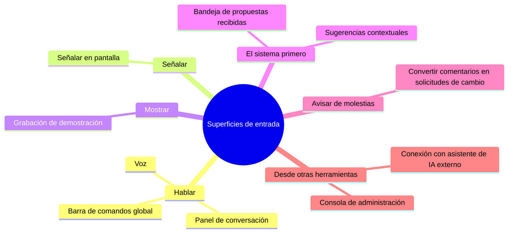
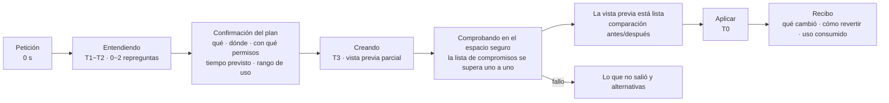
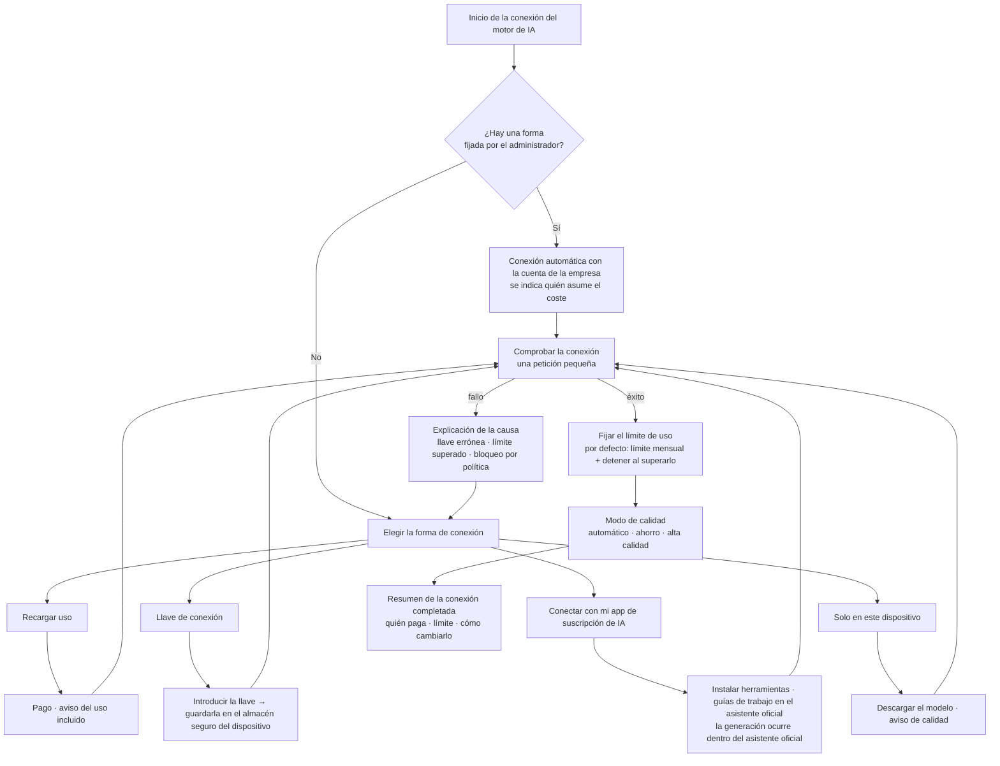

<!-- LANG-BAR -->
[English](../en/08-experience-design.md) · [한국어](../ko/08-experience-design.md) · [简体中文](../zh-CN/08-experience-design.md) · [日本語](../ja/08-experience-design.md) · **Español**
<!-- /LANG-BAR -->

# 8. Diseño de la experiencia: dónde escuchar, cómo mostrar la espera y con qué palabras hablar

> Conclusión de este capítulo: el usuario no quiere que "la IA modifique el código". Quiere que **"cambie tal como lo dije y, si no me gusta, vuelva atrás al instante"**. Por eso el plano de experiencia debe contar con ① una entrada en la que se pueda señalar y hablar, ② una representación honesta del progreso según el nivel de tiempo (time tier), ③ un indicador de progreso que muestre "la lista de compromisos superándose uno a uno", ④ un paquete de léxico (lexicon pack) que oculte la jerga de desarrollo y ⑤ un flujo de conexión con el motor de IA que respete las condiciones de uso.

## 8.1 Principios de experiencia

| # | Principio | Significado |
| --- | --- | --- |
| X1 | En el lenguaje de la intención | El usuario solo dice "qué quiere". La profundidad, los puntos de extensión y los permisos los decide el sistema y los muestra en términos comunes |
| X2 | Que se pueda señalar | Hay que poder decir "esto". Señalar en la pantalla es el contexto más preciso |
| X3 | Primero la vuelta atrás | La forma de revertir se ve antes que el botón de aplicar. Revertir es inmediato y gratuito |
| X4 | Esperar con honestidad | Se anuncian de antemano el tiempo y el uso como un rango, y el progreso se muestra con el avance real |
| X5 | Sin jerga de desarrollo | En las pantallas de nivel básico no aparecen palabras como commit, rama o fusión |
| X6 | Que el coste se vea | Si hay coste a cargo del usuario, se muestra el rango antes de generar y el valor real después |

## 8.2 Superficies de entrada



| Superficie | Forma de uso | Punto fuerte | Precaución | Profundidad que suele cubrir |
| --- | --- | --- | --- | --- |
| Barra de comandos global | Se abre con un atajo y se escribe una frase | Rápida en cualquier lugar | Falta de contexto → se adjunta automáticamente la pantalla actual | D1~D4 |
| Señalar en pantalla | En el "modo de edición", pulsar un elemento y hablar | **El id del punto de extensión se fija automáticamente**, lo que reduce mucho los errores de interpretación | Las zonas del núcleo se marcan con "aquí no se puede cambiar" | D1~D3 |
| Panel de conversación | Conversación de varios turnos en un panel lateral | Peticiones complejas, repreguntas | Si la conversación se alarga, se resume en una especificación del trabajo para confirmarla | Todas |
| Voz | Pedir hablando | Situaciones con las manos ocupadas | Paso de confirmación en pantalla | D1~D2 |
| Grabación de demostración | "Mira lo que hago y hazlo igual" | Procedimientos repetitivos difíciles de explicar con palabras | Indicar datos personales durante la grabación, delimitar el alcance | D2 |
| Sugerencias contextuales | Si se repite la misma operación, "¿quiere que lo haga automáticamente?" | Oportunidades que el usuario no conocía | Límite de frecuencia de sugerencias (propuesta: 1 al día), opción de desactivar | D2 |
| Bandeja de propuestas recibidas | Funcionalidades compartidas recibidas, llegada de una nueva versión base | También benefician a usuarios pasivos | Resaltar los cambios de permisos | Todas |
| Conversión de comentarios | Avisar "esto es incómodo" ya es una solicitud de cambio | Barrera de entrada mínima | Distinguir los avisos que van al proveedor de las solicitudes de modificación propias | Todas |
| Conexión con asistente de IA externo | El asistente de IA que usa el usuario modifica la app mediante herramientas | Desarrolladores, automatización | Aplicación obligatoria del harness | Todas |
| Consola de administración | Edición de la versión base de la organización, revisión de promociones | Mejoras a nivel de organización | Mostrar el alcance del impacto (número de usuarios) | D1~D4 |

La grabación de demostración pertenece a la familia de la "programación por demostración (programming by demonstration)", y las sugerencias contextuales van en la dirección contraria: el sistema detecta la repetición y propone primero. En ambos casos el resultado suele caer en D2 (combinación de funcionalidades existentes), por lo que es seguro y rápido.

## 8.3 Recogida de la intención

1. **Repreguntar 1~2 veces como máximo** (DEBERÍA). Si hace falta más, se crea una vista previa con la interpretación más plausible y se deja corregir sobre la vista previa. A las personas les resulta más fácil corregir viendo un resultado que respondiendo preguntas.
2. **Primero el método más sencillo** (DEBE; versión de experiencia de la regla de profundidad mínima (least-depth rule)): si la petición se resuelve con un ajuste o combinando funcionalidades existentes, se muestra eso primero. "Podría crear un panel nuevo, pero si activa el filtro 'solo vencidas' en la lista actual, ya lo tiene."
3. **Confirmar el alcance con palabras**: antes de ejecutar se devuelve en una línea. "Voy a añadir debajo de la barra lateral una lista de 'tareas completadas esta semana'. Solo usaré permiso de lectura de tareas."
4. **Decir también lo que no se puede hacer**: si se choca con un techo de política, se indica de qué nivel es la regla y cuál es la siguiente acción (pedírselo al administrador).

## 8.4 Niveles de tiempo T0~T4

En el tiempo de respuesta que perciben las personas hay tres límites. Por debajo de 0.1 segundos se percibe como reacción inmediata; por debajo de 1 segundo, como algo que no interrumpe el hilo del pensamiento; y 10 segundos es el límite para mantener la atención. Por encima de 10 segundos hace falta un indicador de progreso que muestre la finalización prevista, y cuando no se conoce el volumen de trabajo es mejor mostrar por su nombre, uno a uno, los elementos que se están procesando ([NN/g](https://www.nngroup.com/articles/response-times-3-important-limits/)).

| Nivel | Tiempo | Tareas | Patrón de experiencia | Ejemplo de texto |
| --- | --- | --- | --- | --- |
| T0 | Menos de 0.1 s | Revertir, aplicar tokens D1, cambiar de vista previa | Reflejo inmediato optimista, sin indicador de progreso | (sin indicación) |
| T1 | 0.1~1 s | Aplicar atajos y reglas D2 | Reflejo inmediato + pequeño aviso de confirmación | "Aplicado · Deshacer" |
| T2 | 1~10 s | Generación corta (interpretación de frases D1~D2, reglas sencillas) | Pequeño indicador de progreso + texto de la fase | "Entendiendo…" |
| T3 | De 10 s a varios minutos | Generación y verificación D3·D4 | **Progreso por fases + indicación de los compromisos superados + vista previa parcial**, con aviso de que se puede hacer otra cosa | "Creando · entre 30 s y 1 min · le aviso cuando termine" |
| T4 | De varios minutos a varios días | Propagación de una nueva versión base, aprobación de la organización, aceptación de comparticiones | Segundo plano + notificación + programación del momento de aplicación | "La nueva versión base está lista · se aplicará el viernes por la tarde" |

Expectativas de velocidad de despliegue: los cambios personales deben terminar dentro de T0~T3, y la propagación de la versión base (T4) es lenta a propósito por la aplicación escalonada (canario). Al usuario se le explica: "No lo aplicamos a todos a la vez, sino por turnos, comprobando que no haya problemas".

## 8.5 Cómo mostrar el proceso de generación



### Cuatro palabras de estado fijas

`Entendiendo` → `Creando` → `Comprobando` → `Listo`. Se usan las mismas palabras en todas las superficies. Si las palabras de estado cambian de una pantalla a otra, el usuario no puede saber si se trata de la misma tarea en curso.

### Indicador de progreso = lista de compromisos

El progreso de una tarea T3 no se muestra como un porcentaje vago, sino como **el estado de cumplimiento del contrato (la lista de compromisos)**. Es el mismo principio de mostrar por su nombre los elementos procesados cuando no se conoce el volumen de trabajo y, a la vez, comunica de forma natural "qué se garantiza".

```text
Comprobando (2/3)
  ✓ Solo se ven las tareas completadas esta semana
  ✓ Si no hay tareas completadas, se muestra "Esta semana no ha completado ninguna tarea"
  … Comprobando que la pantalla no se vuelva lenta
```

### Vista previa parcial

Las pantallas declarativas (D3) se pueden ir dibujando a medida que aparece su estructura, incluso a mitad de la generación. A2UI, un estándar de UI generativa, también admite recibir mensajes de forma progresiva y dibujarlos ([explicación de A2UI en la documentación de Lynx](https://lynxjs.org/react/genui/a2ui)). Eso sí, la vista previa parcial lleva la marca "todavía sin comprobar" para distinguirla del producto terminado.

### Cómo expresar un fallo

Un fallo siempre contiene tres cosas: **qué no salió** (en términos comunes), **por qué** (una línea sobre la política o la técnica) y **qué se puede hacer ahora** (una alternativa más sencilla, pedírselo al administrador, volver a intentarlo).

```text
La funcionalidad 'Avisar en el chat del equipo al completar' todavía no está activada.
Como envía contenido al exterior, la política de la empresa exige la aprobación del administrador.
[Pedir aprobación al administrador]  [Mostrar solo en mi pantalla en lugar de avisar]  [Cancelar]
```

## 8.6 Recibo de cambio

Es la tarjeta de registro que queda tras cada aplicación (derecho mínimo del usuario F7).

```text
Recibo de cambio · 28 de octubre, 9:41
Qué: se añadió a la barra lateral la lista 'Tareas completadas esta semana'
Dónde: parte inferior de la barra lateral
Permisos: lectura de tareas (no se añadieron permisos nuevos)
Lista de compromisos: los 3 comprobados
Uso: unos 0.3 créditos (este mes 4.1 / 30)
Quién puede verlo: yo, el administrador del equipo (hasta la descripción del cambio)
Revertir: [Revertir ahora] o decir "deshaz lo de antes"
```

## 8.7 Experiencia de reversión

- Hablando: "deshaz lo de antes", "como estaba ayer". Si la interpretación es ambigua, se muestran los 3 cambios más recientes.
- Deslizador de tiempo: se repasan los estados recientes como miniaturas y se elige uno.
- Modo seguro (safe mode): si la app se comporta de forma rara, al arrancar se elige "Iniciar en modo básico". Mis cambios no se borran; solo quedan desactivados.
- Aviso de recuperación automática: "La 'ordenación automática' que añadió hace poco provocaba un error y la hemos desactivado temporalmente. [Volver a activar] [Detalles]".

## 8.8 Propuestas de nueva versión base y de compartición

```text
Ha salido una nueva versión base del equipo (2026.11)
- 6 de las 7 funcionalidades que creó se trasladaron sin cambios
- 1 necesita que elija: 'Lista semanal en la barra lateral'
  En la nueva versión base, la barra lateral se ha convertido en pestañas
  [Pasar a pestañas (recomendado)]  [Mantener el modo anterior]  [Rehacerlo para que funcionen ambos]
- Vista previa de las 3 pantallas que cambian ▸
[Aplicar ahora]  [Aplicar el viernes por la tarde]  [Más tarde]
```

Las tres opciones son las mismas que las del conflicto de intención de 6.7. Las propuestas de compartición usan el mismo formato y añaden "quién lo envió" y "los permisos nuevos que hacen falta".

## 8.9 Paquete de léxico (Lexicon Pack)

### Por qué hace falta

El interior de este sistema está lleno de conceptos de desarrollo como control de versiones, permisos y sandbox. Para un usuario corriente, "¿resuelvo el conflicto y fusiono?" suena a mensaje de advertencia. El paquete de léxico es un diccionario que **asocia a un único id de concepto expresiones por nivel, por dominio y por idioma**, y todas las cadenas del plano de experiencia y las respuestas del agente dirigidas al usuario pasan por él.

### Estructura

```text
id de concepto (estable)
 └ expresiones por nivel: basic (general) · practitioner (profesional) · developer (desarrollador)
    └ sobrescritura por dominio: education · healthcare · enterprise …
       └ idioma: ko · en …
```

- El usuario está por defecto en `basic`. Si activa "ver detalles" en la pantalla, pasa a `practitioner`; en la configuración de desarrollador, a `developer`.
- Los paquetes de dominio los añade el proveedor o el inquilino (B13 del capítulo 9).

### Tabla de correspondencias (español básico)

| id de concepto | Término de desarrollo | Expresión para el usuario general (basic) | Explicación en una línea |
| --- | --- | --- | --- |
| change | cambio | lo que cambié | lo que se cambió de una sola vez |
| feature | funcionalidad | función que creé | conjunto de cambios hechos con el mismo propósito |
| record | commit | punto de guardado | un punto al que siempre se puede volver |
| branch | rama | versión de prueba | una copia para probar sin tocar el original |
| merge | fusión | unir | juntar dos versiones en una |
| conflict | conflicto | parte que se superpone | ambos lados cambiaron el mismo lugar de forma distinta |
| intent_conflict | conflicto de intención | parte que necesita una elección | no se pueden cumplir las dos cosas a la vez |
| revert | rollback | deshacer | volver al estado anterior |
| baseline | línea base · LTS | versión base (versión base oficial · versión base de la empresa · versión base del equipo) | la versión que todos usan como punto de partida |
| release | release | nueva versión base | salió una nueva versión base |
| fork | fork | mi copia | mi versión, separada de la versión base |
| extension_point | punto de extensión | lugar que se puede cambiar | un lugar donde la aplicación permite modificaciones |
| capability | permiso | lo permitido | los datos y acciones que puede usar una función |
| sandbox | sandbox | espacio seguro | un lugar para probar primero sin afectar a nada más |
| validation | verificación | comprobación | revisar que funciona según lo prometido |
| contract | contrato · condiciones de aceptación | lista de promesas | lo que esta función debe cumplir siempre |
| diff | diferencias | qué cambió | la diferencia entre antes y después |
| activate | despliegue · activación | aplicar | encenderlo de verdad |
| safe_mode | modo seguro | iniciar en modo básico | iniciar con todos mis cambios apagados |
| quarantine | cuarentena | apagado por ahora | detener la función que causó el problema |
| depth | profundidad D1~D4 | cuánto se cambia (aspecto · combinación · pantalla · comportamiento) | con cuánta profundidad se cambia |
| policy_ceiling | techo de política | lo que permite la empresa | el límite que fijó el administrador |
| canary | despliegue canario | aplicar por turnos | aplicar primero a una parte y comprobar si hay problemas |
| drift | deriva | atrasado respecto a la versión base | cuánto falta por incorporar de la versión base más reciente |
| subscribe_share | compartición por suscripción | seguir recibiendo | si quien lo envió lo corrige, yo también recibo una propuesta de actualización |
| promotion | promoción | adoptado como función oficial | una función creada por varias personas entra en la versión base |
| audit_log | registro de auditoría | historial de actividad | quién hizo qué y cuándo |
| visibility | visibilidad de gestión V0~V3 | lo que ve el administrador | cuánta información puede ver el administrador |
| agent | agente | asistente de IA | la IA que crea los cambios |
| model | modelo | motor de IA | el cerebro que usa el asistente de IA |
| api_key | clave de API | llave de conexión | un código secreto para usar el motor de IA |
| tokens | tokens | uso | cuánto se ha usado el motor de IA |
| route_quality | enrutamiento de modelos | modo de calidad (ahorro · estándar · alta calidad) | el equilibrio entre velocidad, coste y calidad |

### Puntos de aplicación

| Punto | Método |
| --- | --- |
| Cadenas de la UI | Se escriben solo con ids de concepto y se renderizan con `LexiconPort.render` |
| Respuestas del agente dirigidas al usuario | En la fase de salida (E13), el rol de explicador las reescribe en nivel basic |
| Mensajes de error y de rechazo | Código de motivo de rechazo del PDP → id de concepto → frase |
| Recibos y resúmenes de actualización | Los genera el rol de explicador; pasar el lint es obligatorio |
| Proceso de desarrollo | Se aplica un lint al almacén de cadenas de la UI para bloquear en la fase de build las palabras prohibidas en pantallas basic (commit, rama, fusión, merge, token, API, etc.) |

### Almacenamiento y procedencia

- **Se guarda por id de concepto** (DEBE): en los datos que se almacenan o viajan entre dispositivos, como recibos, notificaciones y registros, no se guardan frases terminadas, sino `id de concepto + argumentos`. La frase se construye al mostrarla. Así, si el usuario cambia de nivel (basic ↔ developer) o de idioma, los recibos anteriores también cambian. Los nombres que pusieron directamente el usuario o el agente (nombres de funcionalidades, etc.) se muestran tal cual.
- **El paquete de léxico es un dato y su procedencia está fijada** (DEBE): el paquete de léxico solo contiene cadenas, no código. Solo pueden instalar paquetes de léxico el proveedor y el inquilino (paquetes de dominio, B13 del capítulo 9) y la propia configuración del usuario; **las funcionalidades compartidas y las capas que no sean superiores no pueden cambiar el paquete de léxico.** De lo contrario, una funcionalidad recibida podría suavizar el texto de advertencia de permisos ("acceso a información de pacientes") y conseguir así la aprobación (F5).
- **Orden de sustitución**: idioma exacto del paquete de dominio → idioma exacto del paquete básico → idioma por defecto del paquete básico → el propio id de concepto. La sustitución se hace por cadena para que la falta de una sola entrada no haga que toda la pantalla cambie a otro idioma.
- ThinkRail tampoco guarda textos traducidos en los datos almacenados o transmitidos, y lee los archivos de idioma del usuario solo de la carpeta de datos global para que "un repositorio clonado no pueda reescribir la UI" ([JetBrains/thinkrail `architecture.md` decisión 23](https://github.com/JetBrains/thinkrail/blob/c10f8808cee693e4abffeeb1844a132ed0a91cc5/architecture.md#L430-L454)). Sin embargo, ThinkRail no traduce la salida del agente, mientras que Mallangable hace que el explicador la reescriba para los usuarios basic (tabla anterior).

### Ejemplo de sobrescritura por dominio

| Concepto | Básico | Educación | Trabajo hospitalario | Trabajo interno de empresa |
| --- | --- | --- | --- | --- |
| feature | función que creé | mi herramienta de clase | mi herramienta de trabajo | mi herramienta de trabajo |
| baseline | versión base | versión base de la escuela | pantalla estándar del hospital | estándar de nuestro equipo |
| capability: lectura de datos personales | ver información | ver información de los estudiantes | **acceso a información de pacientes** (advertencia reforzada) | ver información de clientes |
| share | compartir | compartir con colegas docentes | compartir con el mismo servicio | compartir con el equipo |

Ejemplo completo: [`examples/lexicon.es.yaml`](../../examples/lexicon.es.yaml); esquema: [`schemas/lexicon-pack.schema.json`](../../schemas/lexicon-pack.schema.json).

## 8.10 Conexión del motor de IA (modelo)

### Formas de conexión (nombres que ve el usuario)

| Nombre que ve el usuario | Ruta interna (A9) | Cuándo | Experiencia del usuario |
| --- | --- | --- | --- |
| Usar con la cuenta de la empresa | `tenant_cloud` | Lo configuró el administrador | Uso directo sin pantalla de selección. Se indica quién paga el coste |
| Usar recargando uso | `credits` | El inicio más fácil | Uso incluido + recargas, límite mensual |
| Pegar una llave de conexión | `byok` | Usuarios y equipos que ya tienen cuenta en un servicio de IA | Pegar la llave → comprobar la conexión → fijar el límite |
| Conectar con mi app de suscripción de IA | `sub` | Usuarios que ya usan el asistente de IA oficial del proveedor | Se añaden al asistente oficial las "herramientas" y las "guías de trabajo" de esta app. La generación ocurre dentro de ese asistente |
| Usar solo en este dispositivo | `on_device` | Sin conexión, privacidad | Descargar el modelo, aviso de calidad ("adecuado para cambios sencillos") |

### Flujo



### Principios sobre condiciones de uso en la conexión por suscripción

- Cada proveedor tiene políticas distintas que cambian a menudo. En febrero de 2026, Anthropic declaró explícitamente que usar los tokens de autenticación obtenidos con las suscripciones Free, Pro y Max en otros productos, herramientas o servicios (incluido el Agent SDK) viola las condiciones para consumidores, con excepciones para el acceso mediante clave de API o los casos permitidos de forma explícita ([The Register](https://www.theregister.com/2026/02/20/anthropic_clarifies_ban_third_party_claude_access)). En cambio, en la misma época también se informó de casos en que algunos proveedores se asociaron con determinadas herramientas de terceros y abrieron el uso de la suscripción ([artículo de resumen](https://falcao.org/posts/anthropic-claude-access-crackdown-ecosystem-fallout/)).
- Por eso el principio de diseño es uno solo: **el adaptador de "conexión por suscripción" implementa únicamente las vías que el proveedor permite por escrito, y se activa y desactiva con un indicador por proveedor.** La suscripción de un proveedor que no tiene vías permitidas solo se admite mediante el método de "acoplar nuestras herramientas al asistente oficial" (`sub` en la tabla anterior). En ese caso, la generación ocurre dentro del cliente oficial que abrió el usuario, y nuestra app no maneja tokens.
- Para las tareas del lado del servidor (fusión, promoción, etc.) no se usa la suscripción personal del usuario (L2).

### Seguridad e indicación de costes

- Las llaves de conexión se guardan solo en el almacén seguro del dispositivo (llavero del sistema operativo, etc.) o en el sistema de gestión de secretos del inquilino. Nunca se ponen en el almacén de cambios, en los registros ni en el contexto del agente (DEBE).
- Cuando se funciona como herramienta MCP dentro del asistente oficial, como en la ruta `sub`, las llaves de conexión y los tokens de servicios externos no se reciben por la conversación ni como entrada en modo form. La especificación MCP exige usar elicitation en modo URL para secretos y credenciales ([edición 2026-07-28](https://modelcontextprotocol.io/specification/2026-07-28/client/elicitation)). I6 solo se cumple si la llave no entra ni una vez en el contexto del agente.
- En esa misma edición, MCP Sampling queda marcado para retirada ([cambios](https://modelcontextprotocol.io/specification/2026-07-28/changelog)). No se construye el adaptador `ModelPort` delegando las llamadas al modelo en el cliente MCP.
- Antes de generar se muestra un **rango** con `ModelPort.estimate()` ("unos 0.2~0.5 créditos"). Una cifra única es fácil que falle y, si falla, se pierde la confianza.
- El valor por defecto es **límite mensual + detener al superarlo** (piso F6). Al superarlo se deja elegir entre "Ha agotado el uso de este mes. Subir el límite · continuar en modo ahorro · esperar al mes que viene".
- Las rutas alternativas en caso de superar el límite o de caída del proveedor (p. ej., estándar → modo ahorro) se fijan de antemano en la política, y se informa al usuario del cambio.

## 8.11 Puntos de contacto comerciales en el proceso de conexión

El modelo detallado está en el capítulo 9; aquí solo se resumen los puntos de contacto que surgen en el plano de experiencia.

| Punto de contacto | Forma | BM relacionado |
| --- | --- | --- |
| Primera conexión | El plan incluye uso → recargas | B3 margen sobre créditos |
| Elección del modo de calidad | El modo de alta calidad es de un plan superior | B15 niveles de calidad |
| Uso de llave de conexión | Tarifa de uso de la plataforma (coste de verificación, almacenamiento y propagación) | B4 tarifa de plataforma BYOK |
| Conexión con cuenta de la empresa | Conectores empresariales, funciones de auditoría | B6 gobernanza, B7 ejecución confidencial |
| Indicación basada en resultados | Opción "cobrar solo los cambios que pasaron la verificación" | B16 cobro por resultado |
| Aviso de alta con el proveedor | Solo cuando existe un programa de asociación con el proveedor | B14 asociación con proveedores |

## 8.12 Accesibilidad e idioma

- La comparación antes/después de la vista previa también se lee como "lista de cambios" en los lectores de pantalla.
- El modo de señalar en pantalla debe permitir recorrer y elegir elementos también con el teclado.
- Las extensiones generadas también se comprueban en G3 frente a las reglas básicas de accesibilidad (contraste, etiquetas, manejo con teclado). Las modificaciones del usuario no deben romper la accesibilidad.
- Los textos por defecto se escriben en coreano, y el inglés se ofrece en paralelo o mediante el cambio de idioma del paquete de léxico.

## 8.13 Métricas de experiencia

| Métrica | Definición | Por qué se mira |
| --- | --- | --- |
| Tiempo hasta el primer cambio | Desde la instalación (o el descubrimiento de la funcionalidad) hasta la primera aplicación | Barrera de entrada |
| Número de repreguntas | Media por petición | Calidad de la interpretación |
| Abandono por fase | Proporción de abandonos en cada fase: entender, planificar, crear, comprobar, vista previa | Dónde se rompe la espera |
| Tasa de aplicación de vistas previas | Proporción de vistas previas que se aplicaron | Calidad del resultado |
| Reversión en 24 horas | Proporción de cambios revertidos en las 24 horas siguientes a su aplicación | Problemas de calidad ocultos |
| Tasa de consulta de recibos | Proporción de recibos que se abrieron | Demanda de confianza y transparencia |
| Coste real frente al previsto | Proporción de casos en que el coste real quedó dentro del rango previsto | Confianza en los costes |
| Violaciones del lint de nivel básico | Número de exposiciones de jerga de desarrollo en las cadenas y respuestas publicadas | Calidad del paquete de léxico |

Siguiente capítulo: [9. Acoplamiento con el negocio](09-business-coupling.md)
