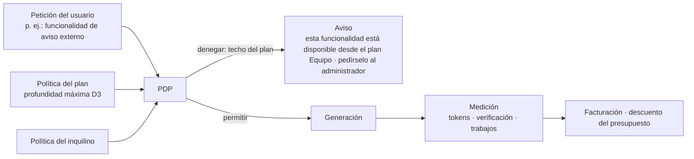

<!-- LANG-BAR -->
[English](../en/09-business-coupling.md) · [한국어](../ko/09-business-coupling.md) · [简体中文](../zh-CN/09-business-coupling.md) · [日本語](../ja/09-business-coupling.md) · **Español**
<!-- /LANG-BAR -->

# 9. Acoplamiento con el negocio: el modelo de negocio está ligado a las decisiones de arquitectura

> Conclusión de este capítulo: el modelo de negocio (BM) no es algo que se coloca después encima de la arquitectura. **La ubicación del agente (A3), la topología (A6), el ámbito de compartición (A8), la visibilidad de gestión (A10) y la obtención de modelos (A9)** determinan qué se puede vender. Este capítulo define 20 BM como condiciones sobre los ejes y calcula su viabilidad para cada perfil de referencia (reference profile). Además, presenta dos principios integradores: **un plan de precios es un techo de política** y **la regla de profundidad mínima es a la vez un principio de seguridad y un principio de costes**.

## 9.1 Por qué hay que diseñarlos juntos

- Como se vio en el capítulo 3, los ejes estructurales son caros de cambiar y los ejes de negocio cambian con poco coste. Sin embargo, **algunos valores de los ejes de negocio solo existen en determinadas estructuras.** Ejemplo: para vender ejecución con código fuente confidencial (B7), el agente en servidor y la visibilidad hidden tienen que existir desde el principio.
- A la inversa, el modelo de negocio elegido al principio también puede imponer la estructura. Si se vende la inferencia incluida (B3), la medición, el presupuesto y la prevención de abusos pasan a ser imprescindibles, y eso exige una visibilidad de gestión de V0 o superior (N3).

## 9.2 Unidades de valor e impulsores de coste

| Unidad de valor (por qué se paga) | Impulsor de coste (en qué se gasta) |
| --- | --- |
| Usuarios activos, puestos | Tokens de inferencia (generación, juicio, fusión) |
| Cambios completados (que pasaron la verificación) | Ejecución de verificaciones (sandbox, contratos, capturas de pantalla) |
| Supervivencia en la versión base (siguen funcionando tras las actualizaciones) | Trabajos de propagación (número de usuarios × número de versiones, 6.8) |
| Compartición, instalación | Personal de curación y revisión |
| Funciones de gestión y auditoría | Almacenamiento, telemetría |
| Entorno de ejecución confidencial | Sandbox del servidor, operación on-premises |

Margen de contribución de un cambio:

```text
margin(δ) = price(δ) − [ tokens(δ) × unit_price(route) + c_validate(depth) + c_store + c_support / número de cambios ]
```

`tokens` y `c_validate` crecen con la profundidad. Hacer en D4 lo que se resuelve en D2 es caro (más llamadas al modelo y puertas de juicio) y arriesgado. Por eso **la regla de profundidad mínima (2.6) es a la vez un principio de seguridad y un principio de costes**. La experiencia en la que el intérprete propone primero el método más sencillo (8.3) mejora a la vez la satisfacción del usuario y el margen.

## 9.3 Catálogo de BM

| id | BM | Unidad de cobro | Condición de arquitectura necesaria | Punto de medición y aplicación |
| --- | --- | --- | --- | --- |
| B1 | Venta de licencias | Pago único por dispositivo o usuario | Ninguna | Servidor de licencias |
| B2 | Suscripción por puesto | Puesto mensual | Ninguna (cuantas más funciones de servidor, más valor) | Identidad, medición |
| B3 | Margen sobre créditos de inferencia | Uso | `A9=credits` (+ N3: `A10≥V0`) | Pasarela del modelo |
| B4 | Tarifa de plataforma BYOK | Cuota mensual fija o por trabajo | `A9∈{byok, tenant_cloud}`, completo si hay funciones de servidor | Ejecutor de trabajos, medición |
| B5 | Comisión del mercado de compartición | Porcentaje de las ventas de funcionalidades de pago | `A8=public` (dentro del inquilino, liquidación interna) | Servicio de compartición |
| B6 | Complemento de gobernanza | Cuota mensual por inquilino | `A10≥V1` | Panel, auditoría |
| B7 | Prima de ejecución confidencial | Cuota mensual por inquilino | `A3=server` ∧ `A5=hidden` | Sandbox del servidor, puerta de salida |
| B8 | Contrato de soporte de línea base | Contrato anual | `A6=lineage` ∧ `A7∈{proposed, auto}` | Registro de linaje, ejecutor de trabajos |
| B9 | Garantía de supervivencia a las actualizaciones | Mensual por funcionalidad activa | `A6∈{fork, lineage}` ∧ `A7∈{proposed, auto}` | Canal de propagación, ejecución de contratos |
| B10 | Reparto por promoción | Recompensa por promoción | `A6=lineage` (completo con compartición y V1 o superior) | Canal de promoción |
| B11 | Conexión con desarrolladores locales | Comisión por conexión | Completo con visibilidad open/own; con hidden, solo expertos internos del inquilino | Cola de escalado |
| B12 | Informe de señales de demanda | Suscripción al informe | `A10≠none` | Agregación de telemetría |
| B13 | Paquetes de léxico y de dominio | Licencia del paquete | Ninguna | Conversor de léxico |
| B14 | Asociación con proveedores de modelos | Según las condiciones de asociación del proveedor | `A9≠on_device`, solo si existe un programa oficial del proveedor | Pasarela del modelo |
| B15 | Diferenciación por niveles de calidad | Diferenciación por plan | `A9=credits` (BYOK y nube del inquilino, condicional si el enrutamiento es en servidor) | Enrutamiento de la pasarela del modelo |
| B16 | Cobro por resultado | Por cambio que pasó la verificación | `A10≠none` ∧ `A9∈{credits, byok, tenant_cloud}` | Puerta de verificación + medición |
| B17 | Licencia OEM del runtime | Licencia anual | Ninguna (especificación abierta + implementación comercial) | — |
| B18 | Suscripción a recetas de resolución | Suscripción | `A6∈{fork, lineage}` ∧ `A7∈{proposed, auto}` | Caché de resoluciones, versiones |
| B19 | Reparto por productización de funcionalidades | Reparto de las ventas | `A8=public` | Servicio de compartición, promoción |
| B20 | Espacio patrocinado de valor por defecto (precaución) | Exposición, conversión | `A8=public`, solo si se cumple la obligación de indicarlo | Mapa de capacidades, recomendaciones |

## 9.4 Matriz de combinación perfil de referencia × BM

Resultado del cálculo de `python3 tools/design_space.py --bm`. ● viable tal cual, ◐ condicional (requiere una forma de operación o contratos externos), ○ imposible por estructura.

| BM | Nombre | P1 Taller personal | P2 Curado por equipo | P3 Confidencial empresarial | P4 Consumo masivo | P5 Colaborativo local-first | P6 Plataforma de mercado | P7 Sector público aislado |
| --- | --- | :-: | :-: | :-: | :-: | :-: | :-: | :-: |
| B1 | Venta de licencias | ● | ● | ● | ● | ● | ● | ● |
| B2 | Suscripción por puesto | ● | ● | ● | ● | ● | ● | ● |
| B3 | Margen sobre créditos de inferencia | ○ | ○ | ○ | ● | ○ | ● | ○ |
| B4 | Tarifa de plataforma BYOK | ○ | ● | ● | ○ | ◐ | ○ | ● |
| B5 | Comisión del mercado de compartición | ○ | ◐ | ◐ | ● | ◐ | ● | ◐ |
| B6 | Complemento de gobernanza | ○ | ● | ● | ● | ○ | ● | ● |
| B7 | Prima de ejecución confidencial | ○ | ○ | ● | ◐ | ○ | ○ | ● |
| B8 | Contrato de soporte de línea base | ◐ | ● | ● | ○ | ○ | ● | ● |
| B9 | Garantía de supervivencia a las actualizaciones | ● | ● | ● | ○ | ○ | ● | ● |
| B10 | Reparto por promoción | ○ | ● | ● | ○ | ○ | ● | ● |
| B11 | Conexión con desarrolladores locales | ◐ | ● | ◐ | ● | ● | ● | ◐ |
| B12 | Informe de señales de demanda | ○ | ● | ● | ● | ○ | ● | ● |
| B13 | Paquetes de léxico y de dominio | ● | ● | ● | ● | ● | ● | ● |
| B14 | Asociación con proveedores de modelos | ◐ | ◐ | ◐ | ◐ | ◐ | ◐ | ◐ |
| B15 | Diferenciación por niveles de calidad | ○ | ◐ | ◐ | ● | ○ | ● | ◐ |
| B16 | Cobro por resultado | ○ | ◐ | ◐ | ● | ○ | ● | ◐ |
| B17 | Licencia OEM del runtime | ● | ● | ● | ● | ● | ● | ● |
| B18 | Suscripción a recetas de resolución | ● | ● | ● | ○ | ○ | ● | ● |
| B19 | Reparto por productización de funcionalidades | ○ | ◐ | ◐ | ● | ◐ | ● | ◐ |
| B20 | Espacio patrocinado de valor por defecto | ○ | ○ | ○ | ◐ | ○ | ◐ | ○ |

Proporción en que cada BM es viable sobre el total de 36,772 combinaciones recomendadas (`--bm-stats`):

| BM | Nombre | ● viable | ◐ condicional | ○ imposible |
| --- | --- | ---: | ---: | ---: |
| B1·B2·B13·B17 | Licencias · puestos · paquetes de léxico · OEM | 100.0% | 0.0% | 0.0% |
| B12 | Informe de señales de demanda | 88.8% | 0.0% | 11.2% |
| B6 | Complemento de gobernanza | 66.6% | 22.2% | 11.2% |
| B11 | Conexión con desarrolladores locales | 56.7% | 43.3% | 0.0% |
| B9·B18 | Garantía de supervivencia a las actualizaciones · recetas de resolución | 53.7% | 0.0% | 46.3% |
| B4 | Tarifa de plataforma BYOK | 40.4% | 16.3% | 43.3% |
| B5·B19 | Mercado de compartición · reparto por productización | 27.4% | 36.3% | 36.3% |
| B8 | Contrato de soporte de línea base | 26.9% | 26.9% | 46.3% |
| B3 | Margen sobre créditos de inferencia | 24.2% | 0.0% | 75.8% |
| B15 | Diferenciación por niveles de calidad | 24.2% | 40.4% | 35.5% |
| B16 | Cobro por resultado | 24.2% | 48.3% | 27.5% |
| B10 | Reparto por promoción | 11.7% | 15.2% | 73.1% |
| B7 | Prima de ejecución confidencial | 11.0% | 23.3% | 65.7% |
| B14 | Asociación con proveedores de modelos | 0.0% | 89.0% | 11.0% |
| B20 | Espacio patrocinado de valor por defecto | 0.0% | 27.4% | 72.6% |

### Interpretación

- **Los BM que funcionan en cualquier parte (B1·B2·B13·B17) diferencian poco.** Los BM que venden el valor propio de la arquitectura maleable son los que **solo se sostienen si hay linaje y propagación**, como B9 (garantía de supervivencia), B18 (recetas de resolución), B8 (contrato de línea base) y B10 (reparto por promoción). Solo son viables en aproximadamente la mitad de las combinaciones recomendadas.
- **La diferenciación más cara es B7 (ejecución confidencial)**. Solo el 11.0% de las combinaciones la permiten, y exige contar a la vez con agente en servidor, hidden y puerta de salida. Por eso mismo, a la competencia también le cuesta alcanzarla.
- **El margen sobre créditos (B3) es más estrecho de lo que parece.** Es imposible en el 76% de las combinaciones recomendadas. En cuanto se admiten la suscripción del usuario, BYOK o la nube del inquilino, hay que renunciar al margen de inferencia y ganar dinero con el valor de la plataforma (B4·B6·B9).
- **El perfil P1 Taller personal no puede generar margen de inferencia por definición.** Funciona con la suscripción del usuario (sub). En su lugar, encajan las licencias, la garantía de supervivencia y las recetas.

## 9.5 BM atípicos: atajos que aprovechan la estructura

Son formas que, fuera del molde habitual de "puestos × cuota mensual", son posibles precisamente por esta arquitectura. Todas se pueden diseñar de forma legal, pero cada una tiene condiciones que hay que cumplir.

| BM | Idea | Por qué solo es posible con esta estructura | Condiciones que hay que cumplir |
| --- | --- | --- | --- |
| B9 Garantía de supervivencia a las actualizaciones | Se vende "su funcionalidad seguirá funcionando en la próxima versión base". Si se rompe, reconstrucción gratuita o reembolso en créditos | Gracias al contrato (κ), una máquina puede juzgar si "funciona" | Solo para funcionalidades con contratos deterministas y construidas sobre puntos de extensión stable. Criterios de juicio explícitos en las condiciones |
| B18 Suscripción a recetas de resolución | Al publicar una versión base se distribuye también la forma de resolver los conflictos típicos → menor coste de inferencia para el usuario | Estructura de caché de resoluciones y clases de equivalencia (6.8) | Las recetas se generan solo a partir de patrones públicos, no de artefactos de clientes |
| B10 Reparto por promoción | Recompensa si una funcionalidad que creé se adopta en la versión base de la organización u oficial | Canal de promoción y registro de procedencia (6.10) | Dentro de una empresa, la titularidad de los derechos sigue el contrato laboral. En un ecosistema público hacen falta condiciones de contribución. La adopción en la versión base **oficial** solo con opt-in explícito y aceptación de licencia del autor original (límites de 6.10) |
| B11 Conexión con desarrolladores locales | Conecta los conflictos de intención y las peticiones al núcleo con expertos humanos verificados | Los puntos de escalado están definidos estructuralmente (R5, recogida de D5) | Acceso con permisos temporales basados en consentimiento, registro de auditoría de todos los accesos |
| B12 Informe de señales de demanda | Agrega qué intentan crear los usuarios (demanda por punto de extensión, peticiones al núcleo más frecuentes) y lo ofrece como material para la hoja de ruta del proveedor | Todos los cambios se registran con intención, profundidad y punto de extensión | Solo agregados V0·V1, criterio de tamaño mínimo de agregación (p. ej., k o más inquilinos), opt-in contractual |
| B19 Reparto por productización de funcionalidades | Se promociona una funcionalidad muy compartida a extensión oficial de pago y se reparten los ingresos con el autor original | Se registran la procedencia de la compartición, el número de instalaciones y la retención | Opt-in explícito y aceptación de licencia del autor original (límites de 6.10), tasa de reparto pública. Solo para elementos compartidos públicos (A8=public) |
| B20 Espacio patrocinado de valor por defecto | Un servicio externo patrocina ser el destino de integración por defecto de un punto de extensión concreto | El mapa de capacidades expresa de forma explícita los destinos de integración | **Indicación de "patrocinado", el usuario puede cambiarlo en cualquier momento, se informa del patrocinio en las recomendaciones del agente**. Revisión obligatoria de la normativa sobre indicación de publicidad |

## 9.6 Obtención de modelos y BM

| Vía de obtención | Margen de inferencia | Cómo ganamos dinero | Riesgo de política |
| --- | --- | --- | --- |
| `sub` suscripción del usuario | No | Licencias, puestos, garantía de supervivencia | El proveedor puede prohibir el uso por terceros o cambiar las condiciones. Solo mediante delegación en el cliente oficial |
| `byok` | No | Tarifa de plataforma (verificación, almacenamiento, propagación) | Bajo |
| `credits` | Sí | Margen + niveles de calidad | Variación de costes, abusos, condiciones de reventa del proveedor |
| `tenant_cloud` | No | Contratos empresariales, gobernanza, ejecución confidencial | Bajo (el contrato del cliente reutiliza su contrato de nube existente) |
| `on_device` | No | Licencias, paquetes de dominio | Límites de calidad |

Hechos de 2026: en febrero, Anthropic declaró explícitamente que usar los tokens de autenticación obtenidos con las suscripciones Free, Pro y Max en otros productos, herramientas o servicios (incluido el Agent SDK) viola las condiciones para consumidores; las excepciones previstas en las condiciones son el acceso mediante clave de API o los casos permitidos de forma explícita ([The Register](https://www.theregister.com/2026/02/20/anthropic_clarifies_ban_third_party_claude_access)). Después, a partir de abril, bloqueó el uso de la suscripción en harness de terceros y, desde el 15 de junio, lo revirtió en parte con un sistema que da, para el uso programático fuera de Claude Code, créditos mensuales separados de la suscripción (descontados a precio de lista, sin acumulación) ([artículo de resumen](https://falcao.org/posts/anthropic-claude-access-crackdown-ecosystem-fallout/)). Según el mismo artículo, otros proveedores optaron por asociarse con herramientas de terceros y abrir el uso de la suscripción. **Las políticas de los proveedores cambian varias veces en un mismo año.** Por eso:

- La obtención de modelos se abstrae siempre tras un puerto (5.3), y las vías permitidas de cada proveedor se gestionan como configuración.
- El plan de negocio no debe depender de la política de suscripción de un único proveedor. Se mantienen siempre abiertas al menos dos vías (p. ej., BYOK + créditos).

## 9.7 Plan de precios = techo de política

Un plan de precios es una política de operador que corta de forma distinta los rangos de las perillas (knobs) del capítulo 4. No hace falta construir un "sistema de flags de funcionalidades" aparte, y el momento más preciso para sugerir una mejora de plan es cuando el motivo del rechazo es "techo del plan".

| Perilla | Gratuito | Personal | Equipo | Empresa | Sector público · red aislada |
| --- | --- | --- | --- | --- | --- |
| Profundidad máxima | D2 | D4 | D3 | D4 | D3~D4 |
| Compartición | Solo recibir | Ninguna | Inquilino | Inquilino (+ público revisado) | Inquilino |
| Jerarquía de versiones base | Solo oficial | Solo oficial | Oficial → equipo | Oficial → empresa → organización | Oficial → institución → departamento |
| Obtención de modelos | Pocos créditos incluidos | Conexión por suscripción · BYOK · créditos | BYOK · créditos | Nube del inquilino · BYOK | Modelo interno |
| Modo de calidad | Ahorro | Estándar | Estándar · alta calidad | Todos | Lo que designe el cliente |
| Visibilidad de gestión | — | — | V1 | V2 (V3 opcional) | V3 |
| Garantía de supervivencia (B9) | — | Opcional | Incluida | Incluida + contrato de soporte (B8) | Contrato de soporte |
| Ejecución confidencial (B7) | — | — | — | Opcional | Por defecto |



## 9.8 Conexión con la lógica del servicio

| BM | Evento de medición | Punto de aplicación | Comportamiento ante fallo |
| --- | --- | --- | --- |
| B3 créditos | `model.call` (tokens, ruta) | Pasarela del modelo | Presupuesto superado → detener o proponer el modo ahorro |
| B4 tarifa BYOK | `job.completed` (propagación, compartición, promoción) | Ejecutor de trabajos | Impago → se detienen los trabajos del servidor, se mantienen las funciones del dispositivo |
| B6 gobernanza | Administradores activos, accesos al panel | Plano de control | Al bajar de nivel, V2 → V1 |
| B9 garantía de supervivencia | `upgrade.applied`, `change.held` (suspendido por incumplir el contrato) | Canal de propagación | Si hay una suspensión, se crea automáticamente un trabajo de reconstrucción gratuita |
| B16 cobro por resultado | `change.activated` + registro de puertas superadas | Plano de verificación | Las generaciones fallidas no se cobran |
| B10 reparto por promoción | `promotion.released` + procedencia | Canal de promoción | Si la procedencia es desconocida, el reparto queda en suspenso |
| B12 informe de demanda | `core_request.recorded`, agregación por punto de extensión | Telemetría | Se excluyen los elementos que no alcanzan el tamaño mínimo de agregación |

Principio: **los eventos de cobro salen del mismo flujo de eventos que el registro de auditoría del plano de control.** Si las pruebas de facturación y las de auditoría van por separado, no se puede dar una explicación en caso de disputa.

## 9.9 Métricas de negocio

| Métrica | Definición |
| --- | --- |
| Proporción de modificadores activos | Proporción de usuarios activos semanales que aplicaron 1 cambio o más |
| Funcionalidades activas por usuario | Número medio de funcionalidades activas (indicador indirecto del coste de cambio) |
| Tasa de supervivencia en la versión base | Proporción de funcionalidades que sobrevivieron, de forma automática o por propuesta, tras una versión (determina el coste de B9) |
| Coste por cambio | Coste medio de inferencia y verificación por profundidad |
| Margen de contribución por inquilino | Ingresos − (inferencia + verificación + propagación + soporte) |
| Tasa de promoción | Proporción de candidatos a promoción que entraron realmente en una versión |
| Tasa de instalación de comparticiones | Proporción de funcionalidades compartidas recibidas que se aplicaron |
| Peticiones al núcleo más frecuentes | Lista de las peticiones más frecuentes recogidas como D5 (señal para la hoja de ruta del proveedor) |

## 9.10 Preguntas para reflexionar

- Si el criterio de juicio de la garantía de supervivencia (B9) es superar el contrato, ¿cómo se evita el riesgo moral de que el usuario escriba a propósito contratos débiles? Recomendación: solo cubrir funcionalidades cuyo contrato haya sido aprobado como suficiente por el juez.
- El reparto por promoción (B10), dentro de una empresa, ¿se vincula al sistema de recompensas o se deja solo como reconocimiento (insignias, méritos)? Hay que revisar que no choque con los contratos laborales ni con las políticas de evaluación del desempeño.
- El informe de señales de demanda (B12) es un activo interno cuando el operador y el proveedor son la misma empresa, y un producto a la venta cuando son distintos. En cualquier caso, debe constar en el contrato con el cliente.
- El espacio patrocinado (B20) puede perjudicar la neutralidad de las recomendaciones del agente. Si se incluye, indique el patrocinio tanto al usuario como en el contexto del agente, y empiece por una forma que no afecte al orden de las recomendaciones.

Siguiente capítulo: [10. Problemas abiertos y evaluación](10-open-problems.md)
