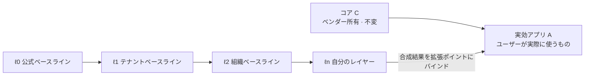
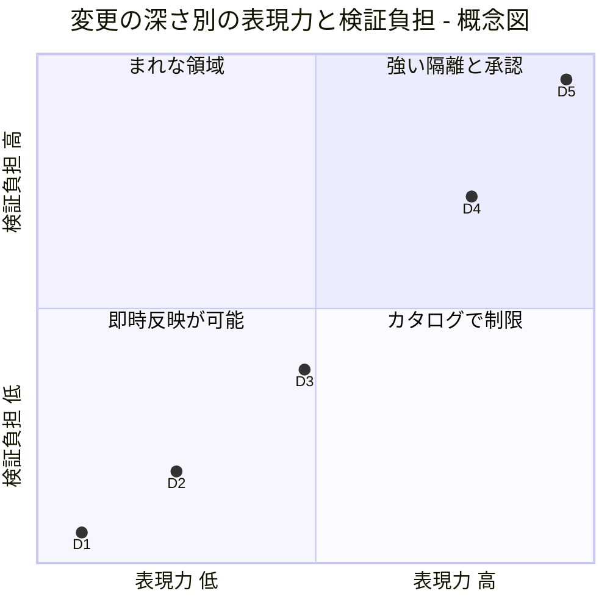
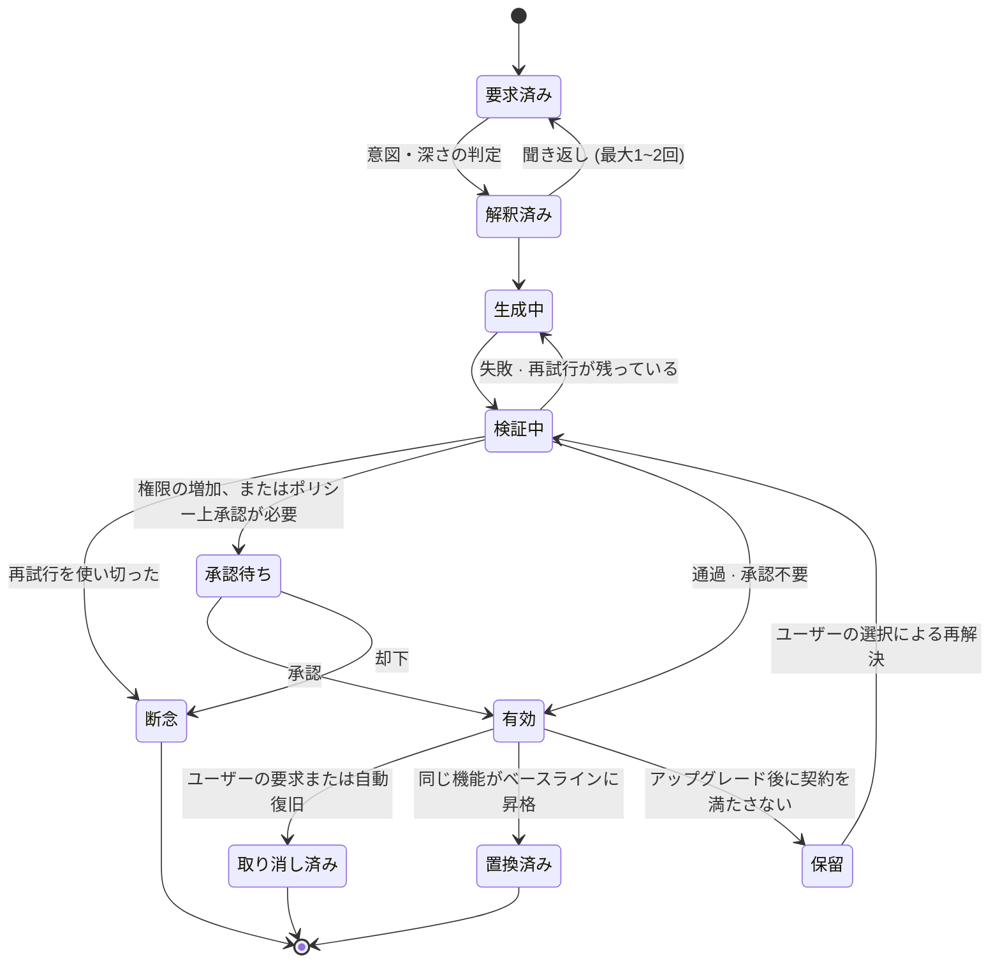

<!-- LANG-BAR -->
[English](../en/02-core-model.md) · [한국어](../ko/02-core-model.md) · [简体中文](../zh-CN/02-core-model.md) · **日本語** · [Español](../es/02-core-model.md)
<!-- /LANG-BAR -->

# 2. コアモデル — ホスト、レイヤー、変更、契約、ポリシー

> この章の結論: Mallangable システムは**不変のコアの上に積まれたレイヤースタック**であり、ユーザーのすべての修正は**意図・成果物・契約・権限を持つ変更(δ)** として表現される。アーキテクチャが何をしようとも、不変条件 I1~I10 を破ってはならない。

この章は実装に依存しない概念モデルです。以降の章のすべてのコンポーネント・フロー・ポリシーは、ここで定義した対象の上で動作します。

## 2.1 アクター (Principals)

| アクター | 記号 | 役割 | 例 |
| --- | --- | --- | --- |
| ホストベンダー (Host Vendor) | `V` | コアを作り、所有する。拡張ポイントを定義 | アプリを作った会社 |
| プラットフォーム運営者 (Platform Operator) | `O` | マリアブル基盤(コントロールプレーン)を運営 | 通常は `V` と同じだが、Mallangable のホスティング事業者の場合もある |
| テナント管理者 (Tenant Admin) | `T` | 1つの顧客組織のポリシー・ベースライン・予算を管理 | 顧客企業の IT 管理者 |
| 組織管理者 (Org Steward) | `G` | テナント内の下位組織のベースラインを管理 | チームリーダー |
| ユーザー (End User) | `U` | 自分のレイヤーを修正 | 一般社員、個人ユーザー |
| エージェント (Agent) | `α` | ユーザー・管理者の代わりに変更を作る、またはマージする。**人ではないアクター** | コード生成エージェント、マージエージェント |

権限委任の方向は `V → O → T → G → U` です。エージェント `α` はこの連鎖の上にはおらず、**常にいずれかの人間のアクターから委任を受けた短期の主体**としてのみ存在します(I4、I9)。

## 2.2 ホスト (Host)

ホスト(host) `H` は4つの要素のまとまりです。

```text
H = ⟨ C, X, K, Σ ⟩
  C : コア(Core)。ベンダーが配布する不変の部分。ユーザーレイヤーは C を変えない。
  X : 拡張ポイント(Extension Point)の集合。
  K : ケイパビリティ(Capability)の集合。拡張が使える能力の名札。
  Σ : 状態スキーマ。拡張が読み書きできるデータの形。
```

拡張ポイント1つは次のように定義します。

```text
x = ⟨ id, kind, d_min, in, out, stability ⟩
  id        : "sidebar.panel"、"editor.on_save" のような安定した識別子
  kind      : token | command | view | hook | service
  d_min     : このポイントを使うのに必要な最小の深さ (2.6)
  in / out  : ポイントが与える入力と期待する出力のスキーマ
  stability : stable | experimental | deprecated
```

ホストは拡張ポイントと権限の一覧を、**機械が読めるケイパビリティマップ(capability map)** として公開しなければなりません(必須)。エージェントにAPIを推測させると、コアのパッチ(D5)へと滑り落ちるからです。コードベースを分析してケイパビリティマップを自動生成するアプローチは [n.codes](https://github.com/yungookim/n.codes) が示しました。

## 2.3 レイヤーと実効アプリ

ユーザーが実際に使うアプリ(実効アプリ、effective app)は、コアの上にレイヤー(layer)を順番に合成した結果です。

```text
Λ = [ ℓ0, ℓ1, …, ℓn ]          ℓ0 = ベンダーのベースライン、ℓn = ユーザー自身のレイヤー
A = C ⊗ ( ℓ0 ⊕ ℓ1 ⊕ … ⊕ ℓn )
```

- `⊕` (レイヤー合成): 同じキーに触れると、後のレイヤーが前のレイヤーを**上書き(override)** します。宣言的データの既定の意味は JSON Merge Patch(RFC 7396)です。オブジェクトはキー単位で上書きし、`null` はそのキーを消し、配列は丸ごと置き換わります。配列を項目単位でまとめるには、拡張ポイントのスキーマがマージキーを宣言しなければなりません(6.6 R2)。コード拡張は拡張ポイントのスロット単位で合成します。
- `⊗` (コアへの適用): 合成されたレイヤーをコアの拡張ポイントにバインドします。コアは変わりません。
- `⊕` は結合法則を満たすべきです(推奨)。そうすれば「企業ベースライン + 組織ベースライン」を事前にまとめてキャッシュできます。このため、レイヤーどうしを事前にまとめるときは `null`(削除の目印)を消さずに残します(必須)。そうすれば、まとめたレイヤーを後で適用しても、1つずつ適用した結果と同じになります。
- `⊕` と6章のマージの関係: `⊕` は1つの系譜の中でレイヤーの**間**を合成する演算であり、3-way マージ(6.4~6.6)は1つのレイヤーを**新しい上位ベースラインの上に移すときに**、そのレイヤー内の修正にだけ使います。



読み方: 右に行くほど優先順位が高くなります。同じポイントに2つのレイヤーが触れると、ユーザーに近いレイヤーが勝ち、この「上書き」はアップグレードの際に衝突の候補になります(6章)。

## 2.4 変更 (Change)

ユーザーの修正の原子単位です。

```text
δ = ⟨ ι, a, κ, π, d, X_δ, prov ⟩
  ι    : 意図(Intent)。人が述べた目的の要約。「今日締め切りのことだけ上に上げたい」
  a    : 成果物(Artifact)。宣言的データまたはコード
  κ    : 契約(Contract)。受け入れ条件の集合 (2.5)
  π    : 要求権限。π ⊆ K
  d    : 深さ。D1~D5 (2.6)
  X_δ  : 触れる拡張ポイント群。X_δ ⊆ X
  prov : 出所。要求者、承認者、エージェント、モデル、親の変更、時刻
```

同じ意図から生まれた複数の修正は、同じ**機能(Feature)** にまとめられます。機能は変更の連なりであり、意図と契約は機能単位で維持されます。

## 2.5 契約 (Contract)

契約(contract)は、実効アプリ `A` の**観測可能な振る舞い**に対する述語の集合です。

```text
κ = { k1, k2, … },   k_i : A → { 真, 偽 }
κ(A) = k1(A) ∧ k2(A) ∧ …
```

| 種類 | 例 | 決定性 | コスト | 強度 |
| --- | --- | --- | --- | --- |
| 構造クエリ (dom/tree query) | 「パネルに項目が2つ表示される」 | 決定的 | 低 | 強 |
| 単体テスト (unit) | 純粋関数の入出力 | 決定的 | 低 | 強 |
| スナップショット (snapshot) | レンダリング結果の比較 | 決定的(環境固定時) | 中 | 中 |
| 判定者 (judge) | スクリーンショットを見て意図を満たすか判定 | **確率的** | 高 | 弱 |

判定者の契約は確率的なので、単独で使ってはいけません(推奨)。決定的な契約が最低1つあってはじめて、マージ(6章)で根拠として使えます。

契約がこのモデルの中心である理由: アップグレード・共有・昇格のとき、コードの diff は意味を教えてくれません。**「この変更が何を保証しなければならないか」が記録されていてはじめて**、機械がマージ結果を判定できます。

## 2.6 変更の深さ階層 D1~D5

深さ(depth)は成果物の**表現力**であり、**リスクの等級**でもあります。W3C の最小パワーの原則(Rule of Least Power)は「必要を表現できる最も弱い言語を選べ」と勧めています。弱い言語ほど、実行せずに分析でき、再利用しやすく、セキュリティを守りやすいからです([W3C TAG](https://www.w3.org/2001/tag/doc/leastPower.html))。Mallangable はこの原則をユーザーの変更に適用します。

| 深さ | 名前 | 成果物 | 表現力(計算モデル) | 実行前の分析 | 例 |
| --- | --- | --- | --- | --- | --- |
| D1 | 外観 | デザイントークン、スタイル値 | 有限のキー・値写像 | 完全 | 「ボタンを大きく、色をオレンジに」 |
| D2 | 組み合わせ | 既存コマンドの組み合わせ、ショートカット、ルール | 有限のコマンド集合上のループのない(または回数制限付きの)マクロ | 完全 | 「このボタン1つでエクスポート+メール送信」 |
| D3 | 画面 | 承認済みコンポーネントカタログ上の宣言的UIツリー + データバインディング | ツリー構造 + 権限で制限されたクエリ | ほぼ可能 | 「今日締め切りのリストパネル」 |
| D4 | 動作 | サンドボックス内の任意のコード | チューリング完全、ケイパビリティを通じてのみ外部にアクセス | 部分的(実行してみないと分からない) | 「保存時に表を自動ソート」 |
| D5 | コア | コアのソース修正 | 制限なし | 事実上不可能 | 「レンダリングエンジンの交換」 |



読み方: 深さが1段上がるごとに、できることと検証すべきことが一緒に増えます。座標は順序を示す概念図であり、測定値ではありません。

ルール:
- **最小深さの原則(least-depth rule)** (必須): エージェントは契約 `κ` を満たす最も低い深さで変更を作らなければなりません。D2 でできることを D4 で作ると拒否します。
- **D5 の分離** (必須): D5 はユーザーレイヤーではなく、ベンダーが承認した**コアのフォーク**としてのみ存在します。一般ユーザーのフローでは、D5 のリクエストは「コア機能の要望」として収集するのが既定値です(推奨)。この収集そのものが、ベンダーのロードマップにとって最も正確な需要シグナルになります。
- この階層は Ink & Switch が引用した「緩やかな傾斜(gentle slope)」を実装します。段階ごとに、ユーザーが新たに理解すべきことは少しずつしか増えません。

## 2.7 ポリシー (Policy) とポリシー束

ポリシー(policy) `p` は、各制御ノブ(knob)について許可範囲を定めます(詳細は4章)。ポリシーの間には「より厳しい」という半順序があります。

```text
p ⊑ q   ⇔   p が許すものはすべて q も許す   (p は q より厳しいか、同じ)
p ⊓ q   :  両方が許すものだけを許すポリシー (共通部分、meet)
```

アクターの連鎖に沿って、実効ポリシーは共通部分として計算されます。

```text
p_eff(U) = p_V ⊓ p_O ⊓ p_T ⊓ p_G ⊓ p_U
```

- **単調縮小** (必須): 下位のアクターは、上位が与えた範囲の中でのみ狭められます。`p_child ⊑ p_parent`。
- 例外が1つ: **ユーザー権利の下限(floor)** は、どの上位ポリシーも取り除けません(4.6)。たとえば「自分の変更を取り消す権利」は下限です。

## 2.8 変更のライフサイクル



読み方: **有効へ向かうすべての道は検証を通ります。** 「保留」は、ベースラインのアップグレード後に契約が壊れた変更が、黙って消えずにユーザーの選択を待っている状態です。ユーザーが選んだ解決も、検証(G ゲート)を再び通ってはじめて有効になります。

## 2.9 不変条件 I1~I10

| # | 不変条件 | なぜ必要か | 破られると起きること | 執行ポイント |
| --- | --- | --- | --- | --- |
| I1 | **コア不変**: ユーザーレイヤーのどの変更も `C` を変えない | アップデート・サポート・セキュリティの基準点を維持 | ユーザーごとに異なるコア → アップデート不能 | パスのアクセス制御、サーバーの受信検査 |
| I2 | **契約の同伴**: 契約が空の変更は有効化されない (`κ ≠ ∅`) | マージ・昇格の判定根拠 | アップグレード時に機能が黙って死ぬ | 記録段階のチェック |
| I3 | **取り消し可能性**: すべての有効な状態は記録された直前の状態を持ち、取り消しは生成なしで定数時間で終わる | 実験を怖がらないようにする | ユーザーが手を入れるのをやめる | 状態プレーン、ランタイム |
| I4 | **権限の単調性**: 権限 `π` は、権限を持つ人の明示的な承認によってのみ増える。エージェントは自分で権限を増やせない | プロンプトインジェクション・悪性の共有物への防御 | 共有された変更がデータを抜き出す | 決定ポイント(PDP)、ランタイムブローカー |
| I5 | **ポリシーの単調縮小**: `p_child ⊑ p_parent` (下限を除く) | 委任体系の一貫性 | 下位の管理者が上位のポリシーを迂回 | ポリシーストアのチェック |
| I6 | **可視性 = 隔離境界**: あるアクターが見てはならないデータは、そのアクターが問い合わせられるどのコンテキスト(対話しているエージェントのコンテキストを含む)にも入らない | 「エージェントに聞けば全部出てくる」を遮断 | ソース非公開の約束の違反 | 役割分離、出力ゲート |
| I7 | **生成・判定の分離**: 成果物を作ったエージェントインスタンスと、それを判定するインスタンスは異なる | 自己採点バイアスの防止 | 検証が形だけになる | ハーネス |
| I8 | **信頼境界での執行**: 最終的な執行は、運営者が制御する境界でのみ行う。ユーザーのデバイス上のチェックは案内用である。運営者の境界がある配置にのみ適用され、サーバーのない配置(P1・P5)はこれを保証できない | クライアントは迂回可能 | ポリシーが飾りになる | サーバーの受信検査、サンドボックスでの再検証 |
| I9 | **意図の出所**: すべての変更は、人の意図または上位の変更まで追跡できる | 監査・責任・マージの判断 | 出所のない変更が積み上がる | 記録仕様 |
| I10 | **契約保存マージ**: マージ結果は両側の契約をすべて満たさなければならず、不可能なら人に引き渡す (`κ_up ∧ κ_down`) | アップデートを生き残ることの定義 | マージが一方の機能をこっそり消す | マージパイプライン |

準拠の判定: 実装が I1~I7、I9、I10 のいずれか1つでも**設計上**保証しない場合(運用上のミスではなく構造的に)、Mallangable 準拠の実装とは呼びません。I8 は Governed レベル以上の要件です(10.3)。

## 2.10 例: ToDoアプリに3つの変更を入れる

仮想のホスト「ToDoアプリ」が、以下の拡張ポイントを公開しているとします。

```yaml
extension_points:
  - id: theme.tokens        # D1
  - id: task.row.style      # D1~D2、条件付きスタイルルール
  - id: toolbar.command     # D2
  - id: sidebar.panel       # D3
  - id: task.on_complete    # D4、イベントフック
capabilities: [tasks.read, tasks.write, net.slack.post, notify.local]
```

ユーザーの3つのリクエストは、それぞれ異なる深さに落ちます。

```yaml
# リクエスト1: 「締め切りを過ぎたタスクは赤で表示して」  → D2 (条件付きスタイルルール、コードなし)
- intent: 締め切りを過ぎたタスクをひと目で見分けたい
  depth: D2
  points: [task.row.style]
  artifact: { rule: { when: "task.due < today && !task.done", style: { color: "danger" } } }
  permissions: [tasks.read]
  contract:
    - { id: overdue-red, check: tree-query, given: "昨日締め切り・未完了 1件", expect: "該当行の色 = danger" }

# リクエスト2: 「今週完了したタスクを要約するパネル」  → D3 (宣言的UI)
- intent: 週次の振り返りで、今週完了した項目を見たい
  depth: D3
  points: [sidebar.panel]
  artifact: { ui: { type: list, source: "tasks where done_at in this_week", item: "{title}" } }
  permissions: [tasks.read]
  contract:
    - { id: only-this-week, check: tree-query, given: "今週 2件・先週 1件", expect: "リスト 2件" }

# リクエスト3: 「タスクを完了したらチームの Slack に知らせて」  → D4 (コード + 外部送信権限)
- intent: 完了したことをチームに自動で共有したい
  depth: D4
  points: [task.on_complete]
  artifact: { module: "on_complete.js" }       # サンドボックスで実行
  permissions: [tasks.read, net.slack.post]    # 権限の増加 → 人の承認が必要 (I4)
  contract:
    - { id: posts-once, check: unit, given: "完了イベント 1回", expect: "slack.post 呼び出し 1回" }
```

リクエスト1をエージェントが D4 のコードで作ろうとすると、最小深さの原則への違反として拒否されます。リクエスト3は外部にデータを送る権限が新たに生じるため、検証を通過しても、人が承認するまでは有効化されません。

次の章: [3. 設計空間](03-design-space.md)
