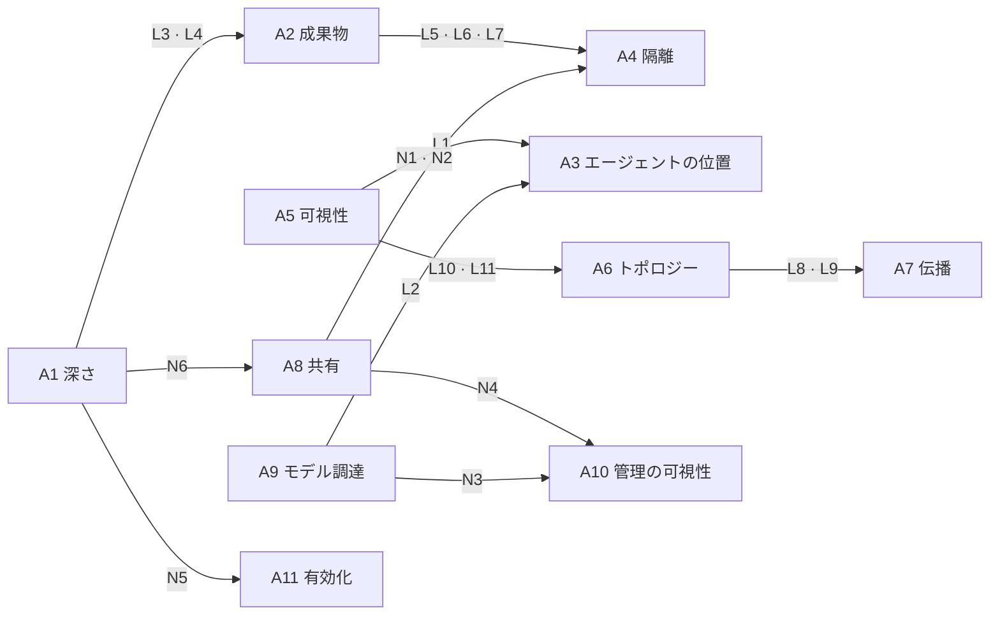
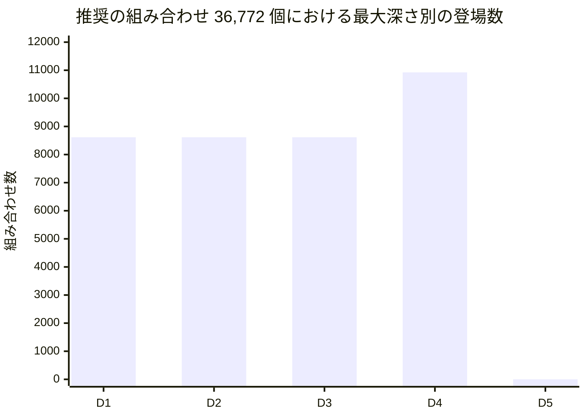
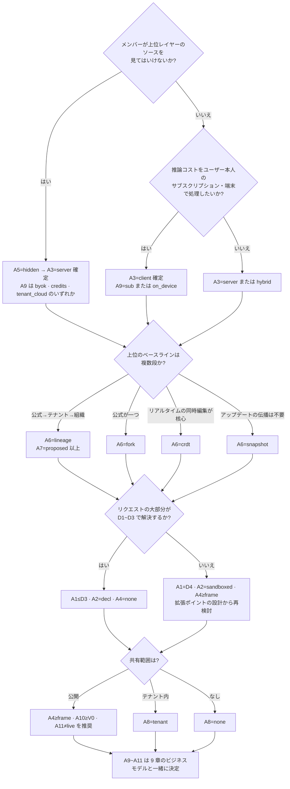
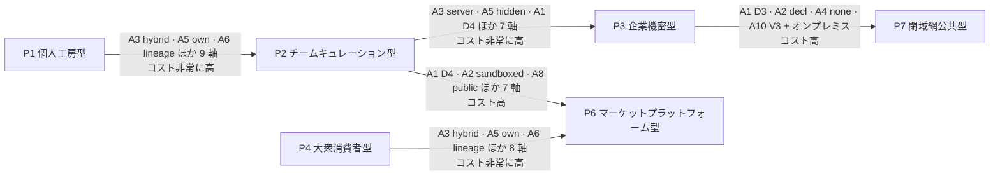

<!-- LANG-BAR -->
[English](../en/03-design-space.md) · [한국어](../ko/03-design-space.md) · [简体中文](../zh-CN/03-design-space.md) · **日本語** · [Español](../es/03-design-space.md)
<!-- /LANG-BAR -->

# 3. 設計空間 — 選択肢、制約、組み合わせの数

> この章の結論: Mallangable アーキテクチャは一つではなく、**11 本の軸の組み合わせ**である。生の組み合わせ **1,944,000 個**のうち、論理的に成立するのは **5.31%**、安全規範まで守るのは **3.14%**、警告なしで推奨できるのは **36,772 個(1.89%)** である。この推奨の組み合わせは構造的に **863 個のファミリー**にまとまり、事業・ポリシーの軸は構造が決まった後も平均 **57%** が開いている。つまり、**構造の決定は先に慎重に、事業の決定は後で軽く**行える。

## 3.1 なぜ「設計空間(design space)」として定義するのか

同じ「AI でアプリを直す」でも、個人用のデスクトップアプリ、消費者向けモバイルアプリ、ソース非公開が必要な企業の業務ツールでは、まったく異なるアーキテクチャが求められます。正解を一つ示す代わりに、選択肢を軸に分解し、軸の間の制約を明示すると、三つのことが可能になります。

1. **意味をなさない組み合わせを機械的にふるい落とす。** 例: 「コードをユーザーに隠す」と「エージェントがユーザーの端末で動く」は同時に成立しません(L1)。
2. **決定の順序を決める。** ある軸は変えるのにデータ移行が必要で、ある軸は設定一つで変わります(3.7)。
3. **事業の選択肢と結び付ける。** 各 BM がどの軸の値を要求するかを計算できます(9 章)。

このアプローチは、ソフトウェアプロダクトライン工学の**フィーチャーモデル(feature model)** と同じです。有効な製品構成とは、フィーチャーの組み合わせのうち交差制約を満たすものであり、実行中に構成を変える動的プロダクトライン(DSPL)は、この制約をランタイムで検査します([Capilla et al., 2014](https://research.chalmers.se/publication/198081))。Mallangable では、構成の主体がベンダー(vendor)だけでなくユーザーと AI でもある点が異なります。

軸は二つの束に分かれます。

- **構造軸 A1~A8**: データモデル・配布・セキュリティ境界を決めます。変えると移行コストが大きくなります。
- **経済・ポリシー軸 A9~A11**: コスト構造・管理範囲・ユーザー体験を決めます。ほとんどは設定で変わります。

## 3.2 軸の定義

### A1. 最大変更深さ — 「ユーザーはどこまで変えられるか」

| オプション | 意味 | 合う場所 | 代償 |
| --- | --- | --- | --- |
| `D1` | 外観のみ | ブランドの一貫性が最優先の消費者アプリ | マリアブルさがほとんどない |
| `D2` | 既存機能の組み合わせまで | 業務の自動化、ショートカット・ルール | 新しい画面を作れない |
| `D3` | 宣言型の画面まで | ほとんどの業務ツール。推奨の組み合わせの半分以上がここ | コンポーネントカタログの設計が必要 |
| `D4` | サンドボックスのコードまで | 開発者・パワーユーザー向けツール | サンドボックス・検証・承認のコスト |
| `D5` | コアまで | 社内専用のフォーク、研究用 | アップデートでの生存を事実上放棄 |

考えるべき問い
- ユーザーのリクエストの何 % が D1~D3 で解決されるか? 事前調査でこの比率が低ければ、拡張ポイント(extension point)の設計が不足しているサインです。
- D4 を開放するとき、そのコードを誰が読み、責任を負うのか?
- 最大深さ(depth)は**上限**です。実際の変更は最小深さの原則(least-depth rule, 2.6)に従い、より低く作られます。

### A2. 成果物の表現 — 「変更は何で表現されるか」

| オプション | 意味 | 合う場所 | 代償 |
| --- | --- | --- | --- |
| `decl` | 宣言型データのみ (JSON/YAML、A2UI 式の UI 記述) | 安全性・分析可能性が最優先 | 表現力の限界 |
| `sandboxed` | サンドボックス専用のコード (ホスト API はブローカー経由のみ) | D4 (2.6) | サンドボックスランタイムが必要 |
| `native` | ホストと同じ権限のコード (プラグインまたはソースパッチ) | D5、信頼グループの内部 | 隔離が難しい、サプライチェーンのリスク |

考えるべき問い
- 宣言型スキーマを、ユーザーのリクエストの大部分を覆うように拡張できるか? 宣言型の範囲が広いほど、検証・マージ・共有がすべて安くなります。
- コードの成果物を許すと、そのコードの言語・ランタイムのバージョンも契約(contract)の一部になります。

### A3. エージェントの位置 — 「変更を作る AI はどこで動くか」

| オプション | 意味 | 合う場所 | 代償 |
| --- | --- | --- | --- |
| `client` | ユーザーの端末 (ユーザーが起動したエージェントを含む) | 個人ユーザー、オフライン、ユーザーのサブスクリプション活用 | 統制は案内レベル(I8)、コード非公開は不可 |
| `server` | 運営者のサーバーのサンドボックス | 企業・公共、コード非公開 | 推論コストを運営者・テナントが負担 |
| `hybrid` | 対話型の生成は端末、マージ・伝播・昇格はサーバー | チーム・組織 | 二つの実行環境を維持 |

考えるべき問い
- 推論コストを誰が払うのか? この問いが A3 と A9 を同時に決めます。
- ユーザーの端末のエージェントが作った結果を、サーバーが**もう一度検証**できるか(I8)?

### A4. 実行の隔離 — 「生成されたコードは何に閉じ込められるか」

| オプション | 意味 | 防げるもの | 防げないもの |
| --- | --- | --- | --- |
| `none` | 隔離なし (宣言型なら該当なし) | — | すべて |
| `lang` | 言語レベルの隔離 (例: [Hardened JS/SES](https://github.com/endojs/endo) の Compartment、Wasm) | グローバルの汚染、API への直接アクセス | 同一プロセスでの資源枯渇、サイドチャネル |
| `frame` | オリジンを分けた iframe・Web ビュー ([MCP Apps](https://modelcontextprotocol.io/seps/1865-mcp-apps-interactive-user-interfaces-for-mcp) はサンドボックス iframe を義務化) | ホストの DOM・ストレージへのアクセス | ユーザーを欺く UI |
| `proc` | 別プロセス・マイクロ VM | メモリ・ファイル・ネットワークへのアクセス | 許可されたチャネルを通じた流出 |

考えるべき問い
- 隔離境界を越える唯一の通路(ブローカー)のメッセージ形式は何か? 監査可能な形式でなければなりません。
- 共有が開かれると(A8)、隔離の要求が上がります(N1, N2)。

### A5. コードの可視性 — 「ユーザーはどのソースを見られるか」

| オプション | 意味 | 合う場所 | 代償 |
| --- | --- | --- | --- |
| `open` | すべてのレイヤーのソースを見られる | 個人、オープンなコミュニティ | 上位レイヤーの知的財産を保護できない |
| `own` | 自分のレイヤーだけを見る | 組織のベースラインに社内のノウハウが入っているとき | レイヤーを分けたトポロジーが必要(L10) |
| `hidden` | どのソースも見ず、結果物だけを受け取る | ソース非公開が必須の企業・公共 | サーバーのエージェントが必須(L1)、出力ゲートが必要 |

考えるべき問い
- 核心の原理: **エージェントが読めるコードは、そのエージェントに話しかける人も結局は読める。** だから `hidden` はポリシーのフラグではなく、配置の決定です(7.8)。
- クライアントに降りる実行バンドルは、難読化しても解析され得ます。守るべき核心ロジックはサーバー側の拡張ポイントに置くほうがよいでしょう。

### A6. バージョントポロジー — 「変更履歴はどんな形で積み上がるか」

| オプション | 意味 | 合う場所 | 代償 |
| --- | --- | --- | --- |
| `snapshot` | ユーザーごとのスナップショット履歴のみ、上位との関係は追跡しない | 最も単純な消費者アプリ | ベースラインのアップデートを伝播できない(L8) |
| `fork` | ユーザーのリポジトリ = 単一ベースラインのフォーク | 個人・小規模 | 組織の階層を表現できない |
| `lineage` | 多段のベースライン階層(公式→テナント→組織→ユーザー)のフォークネットワーク | 企業 | 伝播パイプラインが必要(S3) |
| `crdt` | リアルタイム同期文書([Automerge](https://automerge.org/docs/reference/documents/conflicts/) 系) | 同時協働 | 意味の衝突は残り、コードの同時編集は危険(S7) |

考えるべき問い
- ユーザー数 N とベースラインのリリース頻度 r を掛けた値が、年間のマージ作業数です。この数がアーキテクチャのコストの大部分を決めます(6.8)。
- データ(宣言型)は CRDT、コードは Git 式の系譜(lineage)で混ぜるハイブリッドも可能ですが、この文書は一つのシステムに一つのトポロジーを基本とします。

### A7. ベースラインの伝播 — 「上位が変わると下位はどう追随するか」

| オプション | 意味 | 合う場所 | 代償 |
| --- | --- | --- | --- |
| `none` | 伝播なし | スナップショットのトポロジー、一回限りのカスタマイズ | ユーザーレイヤーがだんだん古くなる |
| `manual` | 人が直接マージ | 開発者ユーザー | ほとんどのユーザーにはできない |
| `proposed` | エージェントがマージ・検証して提案し、人が承認 | 基本の推奨値 | 承認疲れ |
| `auto` | 検証通過 + 権限不変なら自動適用 | 大規模なユーザー | 誤った自動マージの波及 |

考えるべき問い
- 自動適用の条件を「契約をすべて通過 + 権限の変化なし + カナリア通過」のように、機械が判定できる形で定義したか?
- サポート期間が終わったベースラインに残ったユーザーはどうするのか? 強制マージは信頼を壊します(6.5)。

### A8. 共有範囲 — 「自分が作った変更を誰に渡せるか」

| オプション | 意味 | 合う場所 | 代償 |
| --- | --- | --- | --- |
| `none` | 共有なし | 個人用、機密環境 | 同じものを皆が別々に作る |
| `tenant` | 同じテナントの中だけ | 企業 | テナント内の検収体制 |
| `public` | テナントを越えて公開 | コミュニティ・マーケット | サプライチェーンの攻撃面(7.7) |

考えるべき問い
- 共有の単位はリポジトリではなく**機能(意図+契約+成果物)** でなければなりません。そうしてこそ、受け取る側が同じ検証をもう一度実行できます。
- 公開共有は、ClawHub の事例のように、キュレーション・隔離・権限表示なしに開いてはいけません(N1, N4)。

### A9. モデル調達 — 「推論は誰のアカウント・コストで行うか」

| オプション | 意味 | 合う場所 | 代償 |
| --- | --- | --- | --- |
| `sub` | ユーザー個人のサブスクリプション。**ベンダーの公式クライアントの中でのみ** | 個人、開発者 | サーバーの作業には使えない(L2)。ベンダーの規約変更にさらされる |
| `byok` | ユーザー・テナントの API キー | チーム、パワーユーザー | キー管理の UX |
| `credits` | 運営者が推論をまとめて販売 | 消費者、中小チーム | 原価・不正利用のリスクを運営者が負う |
| `tenant_cloud` | テナントのクラウド契約(例: Bedrock、Vertex)や社内モデル | 企業・公共 | 提供者アダプターの多様化 |
| `on_device` | ユーザーの端末のローカルモデル | オフライン、プライバシー | 品質の限界(S6) |

考えるべき問い
- 2026 年現在、一部のベンダーは、消費者向けサブスクリプションの認証トークンを第三者製品で使うことを規約で禁止しています(Anthropic の事例: [The Register, 2026.02](https://www.theregister.com/2026/02/20/anthropic_clarifies_ban_third_party_claude_access))。`sub` は「ユーザーがベンダーの公式エージェントを自分で起動し、そこに私たちのスキル・ツールを接続する」形でのみ設計してこそ安全です(8.10, 9.6)。
- ベンダーのポリシーはよく変わります。モデル調達(model sourcing)は必ずポート(5.3)で抽象化しなければなりません。

### A10. 管理の可視性 — 「管理者は何まで見るか」

| オプション | 意味 |
| --- | --- |
| `none` | 中央での収集なし |
| `V0` | 集計のみ (テナント・組織単位の合計) |
| `V1` | メタデータ (変更の数・大きさ・深さ・拡張ポイント・検証結果、ユーザーは仮名) |
| `V2` | V1 + 変更メッセージ・意図の要約、実名 |
| `V3` | V2 + コードの diff と内容 |

考えるべき問い
- 可視性は、管理者の利便とメンバーの信頼との交換です。現在の可視性レベルは、ユーザーの画面に**常に**表示されなければなりません(4.6 の下限)。
- コミットのメタデータも、個人と結び付けば個人情報になり得ます。管轄の法律の検討が必要です。

### A11. 有効化方式 — 「検証された変更はいつオンになるか」

| オプション | 意味 | 合う場所 |
| --- | --- | --- |
| `live` | 検証を通過したら即時反映 | D1~D2、個人 |
| `preview` | プレビューの後にユーザーが適用 | 基本の推奨値 |
| `gated` | 指定された承認者の承認後に適用 | 企業、公開共有物 |

## 3.3 制約

### 軸の間の依存関係



読み方: 矢印は「前の軸の値が後ろの軸の選択肢を狭める」という意味です。**A5(可視性)と A9(モデル調達)が A3(エージェントの位置)を一緒に縛る**という点が最も重要です。ソース非公開とユーザーのサブスクリプション活用は、A3 を互いに反対の方向へ引っ張るため、同時には望めません。

### 論理制約 L — 成立し得ないもの、または同じ意味の重複

| 規則 | 条件 | 理由 |
| --- | --- | --- |
| L1 | `A5=hidden ⇒ A3=server` | コードに触れるエージェントがユーザー側にあれば、コードは隠せない |
| L2 | `A9∈{sub, on_device} ⇒ A3≠server` | 個人のサブスクリプション(規約)と端末のモデル(物理的な位置)は、サーバーの作業に使えない |
| L3 | `A1∈{D1,D2,D3} ⇒ A2=decl` | 2.6: D1~D3 は宣言型。コードの成果物を許すなら、それは D4 である |
| L4 | `A1=D4 ⇒ A2=sandboxed`, `A1=D5 ⇒ A2=native` | 2.6: 動作の変更はサンドボックスのコード、コアの変更はネイティブのコード |
| L5 | `A2=decl ⇒ A4=none` | 正規化: 実行コードがなければ、実行の隔離の軸は意味がない |
| L6 | `A2=sandboxed ⇒ A4≠none` | サンドボックスの成果物にはサンドボックスが必要 |
| L7 | `A2=native ⇒ A4∈{none, proc}` | ホスト権限のコードを言語・フレームの隔離に入れると、もはやホスト権限ではない |
| L8 | `A6=snapshot ⇒ A7=none` | 上位との関係を追跡しなければ、伝播する対象がない |
| L9 | `A6=crdt ⇒ A7≠manual` | CRDT は自動マージなので、手動マージの段階がない |
| L10 | `A5=own ⇒ A6∈{fork, lineage}` | 「自分のものだけを見る」は、レイヤーが分かれたトポロジーでのみ成立 |
| L11 | `A5=hidden ⇒ A6≠crdt` | CRDT のレプリカはクライアントにあるので、コードを隠せない |

### 規範制約 N — 成立はするが Mallangable の安全原則が禁止するもの

| 規則 | 条件 | 根拠 |
| --- | --- | --- |
| N1 | コードの成果物 ∧ `A8=public` ⇒ `A4∈{frame, proc}` | 公開共有物はサプライチェーン攻撃の通路(7.7) |
| N2 | `A2=native` ∧ `A8≠none` ⇒ `A4=proc` | 共有されるホスト権限のコードは、最低でもプロセス分離 |
| N3 | `A9=credits` ⇒ `A10≠none` | 再販売の課金には計量が必要 |
| N4 | `A8=public` ⇒ `A10≠none` | 公開マーケットには監査証跡が必要 |
| N5 | `A1∈{D4,D5}` ⇒ `A11≠live` | 動作・コアの変更は、プレビュー・承認なしに即時オンにしない |
| N6 | `A1=D5` ⇒ `A8=none ∧ A6≠snapshot` | D5 はユーザーレイヤーではなく、ベンダーが承認したコアのフォーク(I1, 2.6)。共有せず、ベースラインを追跡する |

### 警告 S — 許可するが推奨しないもの

| 規則 | 条件 | リスク |
| --- | --- | --- |
| S1 | コードの成果物 ∧ `A8=public` ∧ `A11=live` | 公開共有されたコードの即時インストール |
| S2 | `A2=native` ∧ `A4=none` | 隔離のないホスト権限のコード (個人用に限定すること) |
| S3 | `A6=lineage` ∧ `A7∈{none, manual}` | 階層は作ったのに伝播を助けない → ドリフトの蓄積 |
| S4 | `A1=D5` ∧ `A6∈{fork, lineage}` | ユーザーごとのコアのフォーク → マージコストの急増 |
| S5 | `A3=hybrid` ∧ `A9=sub` | サーバーの段階でモデルを使えない → 意味の衝突を端末に差し戻す必要がある |
| S6 | `A9=on_device` ∧ `A1≥D4` | 端末のモデルで動作コードを生成 → 失敗率の上昇 |
| S7 | `A6=crdt` ∧ `A1≥D4` | 書きかけのコードが他のユーザーのもとで実行されるリスク |

## 3.4 組み合わせの数

`tools/design_space.py` が 11 本の軸のすべての組み合わせを列挙し、上の制約を適用した結果です。

| 段階 | 組み合わせ数 | 全体比 |
| --- | ---: | ---: |
| 生の組み合わせ Ω = 5×3×3×4×3×4×4×3×5×5×3 | 1,944,000 | 100% |
| 論理整合 (L を通過) | 103,320 | 5.31% |
| 規範整合 (L+N を通過) | 61,064 | 3.14% |
| 推奨 (警告なし) | 36,772 | 1.89% |

- 推奨の組み合わせの構造ファミリー(structural family、A1~A8 の組み合わせ)の数: **863**
- ファミリーあたりの経済・ポリシーの完成(A9~A11 の組み合わせ)の平均: **42.61 / 75** (57%)
- 完成数の分布: 完成 72 個が 96 ファミリー、57 個が 96、42 個が 138、28 個が 198、24 個が 66 など。75 個すべてが開いているファミリーはありません(N3 のため、最低 3 個は常に抜けます)。

規則ごとにふるい落とされた組み合わせの数。**最初の違反**は、各組み合わせを最初に違反した規則にだけ集計するため、規則の順序が変われば数も変わります。**独立違反**は順序に関係なくその規則に違反した組み合わせの数、**唯一違反**はその規則一つだけに違反した組み合わせの数です(この規則だけを外せば生き残る組み合わせ)。

| 論理規則 | 最初の違反 | 独立違反 | 唯一違反 |
| --- | ---: | ---: | ---: |
| L3 | 501,120 | 777,600 | 193,725 |
| L4 | 334,080 | 518,400 | 90,405 |
| L5 | 187,920 | 486,000 | 116,235 |
| L1 | 432,000 | 432,000 | 32,400 |
| L8 | 31,320 | 364,500 | 17,280 |
| L10 | 18,720 | 324,000 | 18,720 |
| L7 | 41,760 | 324,000 | 25,830 |
| L2 | 259,200 | 259,200 | 20,880 |
| L11 | 3,240 | 162,000 | 3,240 |
| L6 | 20,880 | 162,000 | 12,915 |
| L9 | 10,440 | 121,500 | 4,680 |

| 規範規則 | ふるい落とされた組み合わせ | 警告規則 | 該当する組み合わせ |
| --- | ---: | --- | ---: |
| N5 | 15,738 | S3 | 12,400 |
| N1 | 8,610 | S5 | 4,420 |
| N6 | 5,332 | S4 | 4,416 |
| N3 | 4,347 | S6 | 3,800 |
| N2 | 4,305 | S7 | 3,600 |
| N4 | 3,924 | S2 | 2,580 |

推奨の組み合わせの中で、各深さが登場する回数:



### 解釈

1. **ほとんどの組み合わせは意味をなさないか、重複である。** 生の組み合わせの 95% が論理制約で抜けます。独立違反の数で最も多くふるい落とす規則は、深さと表現を合わせる L3・L4(2.6 の定義)と、正規化の規則 L5 です。正規化を除くと、L1(ソース非公開にはサーバーのエージェントが必須)が最大の純粋な矛盾です。組み合わせの数は、設計者がその要求をどれほど頻繁に出すかとは無関係なので、この表は「どの規則が空間をどれだけ狭めるか」としてのみ読みます。
2. **深さごとに道は一つである。** D1~D3 は宣言型、D4 はサンドボックスのコードという定義(2.6)を規則としてかけると、深さ別の推奨の組み合わせは D1~D3 がそれぞれ 8,616 個、D4 が 10,924 個と均等に分かれます。成果物の表現は、深さを決めれば付いてくる値になります。
3. **D5 は推奨の組み合わせにない。** D5 はユーザーレイヤーではなくコアのフォーク(2.6, I1)なので、N6 が共有と snapshot を禁止し、残った組み合わせはすべて S4(ユーザーごとのコアのフォーク)の警告にかかります。コアの修正は、設計空間の外にあるベンダーのプロセスです。
4. **構造と事業はおおむね分離される。** 構造ファミリーを決めた後も、事業・ポリシーの組み合わせの 57% が残ります。ただし `A3=server` を選んだ瞬間に、モデル調達の 5 個のうち 2 個(`sub`, `on_device`)が抜けるため、エージェントの位置はモデル調達を直接縛る構造の決定です。
5. **最も多い警告は S3(階層はあるのに伝播の補助がない)** です。ベースラインの階層を導入するチームは、伝播パイプラインも一緒に作らなければならないというサインです。
6. **値の解像度に敏感である。** A10 の V0~V3 のように、どの規則も区別しない値は組み合わせの数をそのまま掛け合わせます。絶対的な数値よりも、規則 id と比率で比較してください。

## 3.5 リファレンスプロファイル

設計空間の代表点 7 個です。すべて計算機で「推奨(clean)」と判定されます(`python3 tools/design_space.py --check all`)。サーバーのない P1・P5 は I8 を保証できないため、準拠レベル(conformance level)は Core までです(10.3)。コードが必要なプロファイル(P1・P3・P6)は D4、宣言型で十分なプロファイルは D3 以下にします(2.6, L3・L4)。

| 軸 | P1 個人工房型 | P2 チームキュレーション型 | P3 企業機密型 | P4 大衆消費者型 | P5 ローカルファースト協働型 | P6 マーケットプラットフォーム型 | P7 閉域網公共型 |
| --- | --- | --- | --- | --- | --- | --- | --- |
| A1 深さ | D4 | D3 | D4 | D2 | D3 | D4 | D3 |
| A2 成果物 | sandboxed | decl | sandboxed | decl | decl | sandboxed | decl |
| A3 エージェント | client | hybrid | server | server | client | hybrid | server |
| A4 隔離 | frame | none | proc | none | none | frame | none |
| A5 可視性 | open | own | hidden | open | open | own | hidden |
| A6 トポロジー | fork | lineage | lineage | snapshot | crdt | lineage | lineage |
| A7 伝播 | proposed | proposed | proposed | none | auto | proposed | proposed |
| A8 共有 | none | tenant | tenant | public | tenant | public | tenant |
| A9 モデル | sub | byok | tenant_cloud | credits | byok | credits | tenant_cloud |
| A10 可視性 | none | V2 | V2 | V1 | none | V1 | V3 |
| A11 有効化 | preview | preview | gated | live | preview | gated | gated |

| プロファイル | 代表的な状況 | 核心のトレードオフ |
| --- | --- | --- |
| P1 個人工房型 | 開発者向けのデスクトップツール。ユーザーが自分の AI サブスクリプションで直す | 運用コストは最小、統制は案内レベル |
| P2 チームキュレーション型 | 社内の業務ツール。組織のベースラインにノウハウを蓄積 | サーバーでのマージコスト、承認疲れ |
| P3 企業機密型 | ソース非公開が契約条件の企業顧客 | すべての推論がサーバー、出力ゲートが必須 |
| P4 大衆消費者型 | 数百万ユーザーの消費者アプリ。テーマ・自動化ルールの共有 | 深さを D2 に制限して安全を確保 |
| P5 ローカルファースト協働型 | リアルタイム協働の文書ツール | 意味の衝突の検知が課題、宣言型 D3 まで(S7) |
| P6 マーケットプラットフォーム型 | ユーザー製の拡張の公開マーケット | キュレーション・隔離・監査のコスト |
| P7 閉域網公共型 | ネットワーク分離環境、社内モデル | オンプレミスでの運用、最高レベルの監査 |

## 3.6 選択の手順

11 本の軸を一度に選ばず、構造を最も大きく狭める問いから答えます。



読み方: 最初の二つの問いが A3 を決め、A3 がビジネスモデルの半分を決めます。だから「ソース非公開」と「推論コストの負担主体」は、製品企画の一番最初に決めなければなりません。

## 3.7 進化の経路と軸の変更コスト

製品はあるプロファイルから始まり、別のプロファイルへ移っていきます。軸ごとに変えるコストが異なります。

| コスト等級 | 軸 | 理由 |
| --- | --- | --- |
| 低 (設定変更) | A9 モデル調達、A10 管理の可視性、A11 有効化 | ポリシー・ルーティングの設定。既存データの移行は不要 |
| 中 (機能追加) | A1 最大深さ、A8 共有範囲 | 新しい拡張ポイント・カタログ・キュレーション体制が必要。既存の変更はそのまま |
| 高 (ランタイムの交換) | A2 成果物、A4 隔離 | 既存のコードの成果物を新しいランタイムへ移す必要がある |
| 非常に高 (データ移行) | A3 エージェントの位置、A5 可視性、A6 トポロジー | 保存場所・履歴構造・信頼境界が変わる |



実務上の勧告: 最初から P3 や P7 を作る必要はありませんが、**後で移る可能性があるなら、A6 は最初から `lineage` で保存せよ。** 単一のベースライン(fork)は深さ 1 の系譜として表現できるので、データモデルさえ系譜型にしておけば、移行コストは大きく減ります。

## 3.8 計算機の使い方

```bash
python3 tools/design_space.py --markdown        # 3.4 の表を再生成
python3 tools/design_space.py --check all       # リファレンスプロファイルの検査
python3 tools/design_space.py --bm              # プロファイル × ビジネスモデルの結合行列 (9 章)
python3 tools/design_space.py --bm-stats        # 推奨の組み合わせ全体における BM 別の可能比率
python3 tools/design_space.py --profile '{"A1":"D4","A2":"sandboxed","A3":"client","A4":"frame","A5":"open","A6":"fork","A7":"proposed","A8":"none","A9":"sub","A10":"none","A11":"preview"}'
```

自分の製品にないオプションがあれば `AXES` に追加し、自分の組織の安全原則は `normative()` に規則として書いて、もう一度計算してください。**設計レビューで「なぜこの組み合わせなのか」を規則 id で言えるようにすること**が、このツールの目的です。

次の章: [4. 統制スペクトラム](04-control-spectrum.md)
