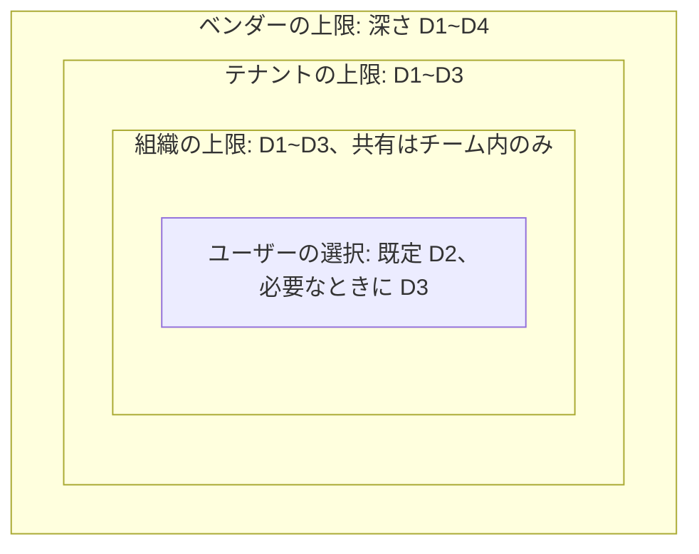
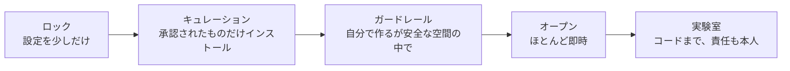
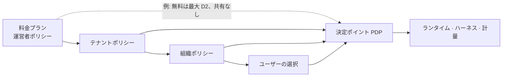

<!-- LANG-BAR -->
[English](../en/04-control-spectrum.md) · [한국어](../ko/04-control-spectrum.md) · [简体中文](../zh-CN/04-control-spectrum.md) · **日本語** · [Español](../es/04-control-spectrum.md)
<!-- /LANG-BAR -->

# 4. 統制スペクトラム — ユーザーに何を許し、運営者は何を統制するか

> この章の結論: 統制はオン・オフのスイッチではなく、**ノブ(knob)ごとの区間**である。上位のアクターは区間の**上限(ceiling)** を狭め、ユーザーはその中から選ぶ。ただし、どのポリシーも消せない**ユーザー権利の下限(floor)** が 7 つある。料金プラン・プリセット・テナント(tenant)ポリシーは、どれもこの区間を異なる形で切り取ったものにすぎない。

## 4.1 問題: 開けば危険で、閉じればマリアブルでない

- 開きすぎると: セキュリティ事故、サポートコストの急増、アップデート不能、ブランドの一貫性の崩壊。
- 閉じすぎると: 設定画面と変わらず、ユーザーは結局抜け道(コピーしたスクリプト、外部の自動化)を探します。

必要なのは**委任可能な連続的統制**です。ベンダー(vendor)はプラットフォーム全体のリスク上限を、テナントは自社の上限を、組織(org)はチームの上限を決め、ユーザーは残った範囲で自由に選ぶ構造です。

## 4.2 区間委任モデル

各ノブ `k` は、リスク順に並べた値の領域 `D_k` を持ちます(例: 深さ(depth) `D1 < D2 < … < D5`)。集合型のノブ(例: 許可するケイパビリティの一覧)は包含関係で順序を付けます。

```text
アクター i がノブ k について決めるもの:  区間 [f_i, c_i] ⊆ D_k
  c_i : 上限(ceiling)。これより危険な値は禁止
  f_i : 下限(floor)。これより少なく与えることは禁止 (ユーザー権利の保障用)

委任規則 (必須):         [f_child, c_child] ⊆ [f_parent, c_parent]
実効区間:               [f_eff, c_eff] = ⋂ チェーン上のすべての区間
ユーザーの選択:         v_k ∈ [f_eff, c_eff],  デフォルト値 d_k
```



読み方: 内側の箱は外側の箱より広くなれません。ユーザーが D4 の機能を望んだ場合、組織ではなく**テナントの上限**で止められていることを、システムが伝えられなければなりません(「この機能は会社のポリシーで許可されていません。管理者にリクエストを送りますか?」)。

このモデルの利点:
- **説明可能性**: 拒否の理由を「どの層のどの上限」と正確に言えます。
- **合成可能性**: 共通部分なので順序に関係なく計算でき、キャッシュできます。
- **料金プランとの統一**: 料金プランは運営者(operator)がかけるもう一つの上限です(4.9)。

## 4.3 ノブカタログ

| グループ | ノブ | 値の領域 (リスク低 → 高) | 推奨デフォルト値 | 主に決めるアクター | 関連する軸 |
| --- | --- | --- | --- | --- | --- |
| 何を | 最大深さ | D1 → D5 | D3 | ベンダー・テナント | A1 |
| 何を | 拡張ポイントの許可リスト | 一部 → 全体 | stable なポイント全体 | ベンダー | A1 |
| 何を | ケイパビリティの上限 | 読み取り → 書き込み → 外部送信 | 内部の読み取り・書き込み | テナント | A1, A4 |
| 何を | 外部ネットワーク | 遮断 → 許可リスト → 全体 | 遮断 | テナント | A4 |
| どのように | 有効化方式 | gated → preview → live | preview | テナント・組織 | A11 |
| どのように | 承認者 | 管理者 → 組織管理者 → 本人 | 権限増加時は管理者 | テナント | A11 |
| どのように | 検証の強度 | 全ゲート → 深さ別の省略 | 深さ別の標準(5.8) | ベンダー | — |
| どのように | ベースラインの自動適用 | defer → approve → auto | approve | テナント・ユーザー | A7 |
| 誰と | 共有範囲 | なし → テナント → 公開 | テナント | テナント | A8 |
| 誰と | 再共有 | 禁止 → 原作者が許可した場合 → 自由 | 原作者が許可した場合 | 組織 | A8 |
| 誰と | コードの可視性 | hidden → own → open | 配布形態による | テナント | A5 |
| どれだけ | モデル調達経路 | テナント指定 → 選択可能 | テナント指定 | テナント | A9 |
| どれだけ | 品質等級 | 節約 → 標準 → 高品質 | 標準 | ユーザー | A9 |
| どれだけ | 予算上限 | 低 → 高 | 月の上限 + 超過時は停止 | テナント・ユーザー | A9 |
| 何を見るか | 管理の可視性 | none → V0 → V3 | V1 (企業は V2) | テナント | A10 |
| 何を見るか | プラットフォームへの持ち出し | なし → 集計 → メタデータ | 集計 | テナント(契約) | A10 |
| 何を見るか | 保存期間 | 短 → 長 | イベント 13 か月 | テナント | A10 |

## 4.4 スペクトラムプリセット

ノブを一つずつ選ぶ代わりに、5 つのプリセットから始められます。



| ノブ | ロック | キュレーション | ガードレール | オープン | 実験室 |
| --- | --- | --- | --- | --- | --- |
| 最大深さ | D1 | D2 (インストールは D3 まで) | D3 | D3 | D4 |
| 自分での生成 | 不可 | 不可、インストールのみ | 可 | 可 | 可 |
| ケイパビリティ | なし | 承認リスト | 内部の読み取り・書き込み | 内部 + 許可リストの外部 | 要求時に承認 |
| 有効化 | — | gated | preview | live (D1~D2) | preview |
| 共有 | なし | 受け取りのみ | テナント | テナント | テナント |
| ベースラインの適用 | 自動 | 自動 | approve | auto | approve |
| 管理の可視性 | V0 | V1 | V2 | V1 | V2 |
| 合うプロファイル | P4 の一部 | P6 のユーザー | P2, P3 | P1, P5 | P1 の開発者 |

プリセットは出発点です。テナントはプリセットを選んだ後、個々のノブをさらに狭められますが、プリセットより広げることはできません(ベンダーの上限の中でのみ)。

## 4.5 決定主体マトリクス

`決定` = 値を決める、`上限` = 下位が選べる範囲を決める、`提案` = 要求のみ可能、`—` = 関与しない。

| 決定 | ベンダー V | 運営者 O | テナント T | 組織 G | ユーザー U | エージェント α |
| --- | --- | --- | --- | --- | --- | --- |
| 拡張ポイント・ケイパビリティマップの定義 | 決定 | — | — | — | 提案 | — |
| プラットフォームの最大深さ | 決定 | 上限 | 上限 | 上限 | 選択 | — |
| ケイパビリティの付与 | 上限 | — | 上限・承認 | 承認(委任時) | 要求・承認(自分の範囲) | **不可** |
| ベースラインのリリース | 公式版を決定 | — | テナント版を決定 | 組織版を決定 | — | 提案(昇格) |
| ベースラインの適用時期 | — | — | 上限 | 上限 | 決定 | 準備のみ |
| 共有 | — | 上限(公開マーケットの審査) | 上限 | 上限 | 決定 | — |
| モデル経路・予算 | — | 上限(料金プラン) | 決定 | 上限 | 品質の選択 | — |
| 管理の可視性 | — | 持ち出しの上限 | 決定 | — | 確認(下限) | — |
| 変更の生成 | — | — | — | — | 意図の提供 | 生成 |
| 変更の判定 | 検証規則 | — | 追加規則 | 追加規則 | プレビューの確認 | 判定(生成者とは別のインスタンス) |

エージェントの列が要です。エージェントは**生成・判定・提案**は行いますが、**権限付与・ポリシー変更・リリース決定**は決して行いません(I4, I9)。

## 4.6 ユーザー権利の下限 (Floor Rights)

どのテナントポリシー、料金プラン、プリセットも、以下の権利を取り除くことはできません(必須)。この下限があってこそ、ユーザーは怖がらずに手を加えます。

| # | 権利 | 内容 | 企業環境での解釈 |
| --- | --- | --- | --- |
| F1 | 取り消し | 自分のレイヤーのどの変更も、すぐに取り消せる | 上位のベースライン自体は取り消せないが、その上の自分の変更は常に可能 |
| F2 | セーフモード | ユーザーレイヤーをすべてオフにした状態で起動できる | 業務を止めずに原因を隔離 |
| F3 | 可視性の告知 | 自分の変更の何を誰が見られるかを、常に確認できる | 「組織管理者は変更の説明まで見られます」と表示 |
| F4 | 自分のものの書き出し | 自分が作った変更の意図・契約を標準形式で書き出せる | 成果物(コード)の書き出しはポリシーで制限可能 |
| F5 | 権限の確認 | 有効な変更が持つ権限を見られ、権限の増加は告知なしに起きない | 共有された機能も同じ |
| F6 | コスト上限 | 自分にコストが発生する場合は上限を決められ、超えると止まる | テナント負担ならテナントの上限が適用されることを告知 |
| F7 | 説明の要求 | どの変更についても「何が変わったか」を平易な言葉で受け取れる | 変更レシート(8.6) |

## 4.7 ポリシー文書

ポリシーは継承可能な宣言型の文書です。完全な例は [`examples/policy.example.yaml`](../../examples/policy.example.yaml)、スキーマは [`schemas/policy.schema.json`](../../schemas/policy.schema.json) にあります。

```yaml
policy:
  id: tenant/acme
  level: tenant
  inherits: operator/plan-business      # 料金プランもポリシーである
  knobs:
    depth:            { ceiling: D3, default: D2 }
    capabilities:     { ceiling: [tasks.read, tasks.write, notify.local, net.slack.post] }
    network:          { ceiling: allowlist, allowlist: ["hooks.slack.com"] }
    activation:       { ceiling: preview, approver_on_capability_increase: tenant_admin }
    baseline_apply:   { ceiling: auto, default: approve }
    sharing:          { ceiling: tenant, reshare: author_opt_in }
    code_visibility:  { value: own }
    model_route:      { value: tenant_cloud }
    quality_tier:     { ceiling: standard, default: standard }
    budget:           { monthly: 3000, per_user_monthly: 30, on_exceed: stop }
    admin_visibility: { value: V2 }
    platform_export:  { ceiling: V0 }
  floors: [rollback, safe_mode, visibility_notice, export_intents, permission_view, spend_cap, receipt]
```

## 4.8 ポリシー決定の手順

すべてのリクエストは `(主体, 行為, 対象, 文脈)` で表され、決定ポイント(PDP)は `許可 / 拒否 / 承認が必要` のいずれかと**義務(obligation)** を返します。義務とは「許可するが必ず行わなければならないこと」です(記録、プレビュー、通知など)。

```text
decide(req):
  p ← effective_policy(req.subject)            # チェーン上のポリシーの共通部分 (キャッシュ可能)
  if req.action ∈ FLOOR_ACTIONS and floor_scoped(req):   # 取り消し・セーフモード・書き出しなど
      return 許可, 義務=[記録]
  if req.action == revert:                      # 下限の範囲外の取り消し = 有効化と同じ判定
      req ← as_activate(req.target)             # やり直し・再オン・保留解除を含む
  for k in knobs_touched(req):
      if value(req, k) ∉ [p.f_k, p.c_k]:
          return 拒否, 理由=(k, 上限を決めた層)   # 「テナントポリシー: 最大深さ D3」
  if raises_capabilities(req):
      return 承認が必要, 承認者=p.approver_for(req.capabilities_delta)
  if uses_destructive(req):                     # 破壊的な機能は有効化ポリシーに関係なく G5 (5.8)
      return 承認が必要, 承認者=p.gate_approver
  if p.activation(req.depth) == gated:
      return 承認が必要, 承認者=p.gate_approver
  return 許可, 義務=obligations(p, req)         # 例: preview、監査記録、コスト計量
```

`floor_scoped(req)` は、次のすべてを満たすときにのみ真です(必須)。一つでも破れば、下限の行為ではなく一般のリクエストとして判定します。
- 主体が対象レイヤーを所有する**人**である(エージェント・監視者・他のレイヤーのユーザーではない)。監視者による自動復旧は、権限を減らす方向のときにのみ許可し、記録する。
- 取り消しであれば、対象は同じレイヤーの**以前の状態**であり、結果の実効深さ・権限が、現在の有効な状態と現在の実効ポリシーの**中**にある(⊆)。やり直し・「再オン」(5.4)・保留解除のように権限や深さを再び増やす移動は、有効化(E10)として判定する。
- セーフモードはオフにするだけで、書き出しは意図・契約の範囲である(F2, F4)。

配置の原則:
- **権威ある PDP は運営者の境界(サーバー)にある(I8)。** ユーザーの端末にはポリシーの写しを置いて素早い案内をしますが、最終判定はサーバーがもう一度行います。
- オフラインの個人モード(P1)にはサーバーがないため、端末の PDP が唯一です。この場合のポリシーは「ユーザー自身を守る安全装置」であって強制手段ではありません。文書と UI でこの違いを隠しません。同じ理由で、サーバーのない配置(P1・P5)は I8 を保証できないため、準拠レベル(conformance level)は Core までで、Governed にはなれません(10.3)。
- **ポリシーエンジンアダプター** (任意): ノブの区間をポリシー言語に移して PDP を実装できます。Cedar は forbid が permit に勝ち、該当する permit がなければ拒否し、決定を下したポリシーの id を一緒に返します。この id を `拒否(理由・層)` とレシート(8.6)の根拠に使います。
- **I5 の機械検証** (推奨): ポリシーを保存するときに `p_child ⊑ p_parent` を検査します。Cedar に移した場合、SymCC の包含検査(`check_implies`)で反例とともに証明できます。同じツールの `check_never_errors` も一緒に実行します。Cedar は評価エラーが起きたポリシーを飛ばすため、エラーになる forbid は黙って開いたまま残るからです。
- **承認の範囲と寿命** (必須): `承認が必要` に対する人の回答は範囲を持ちます。**今回だけ**(このリクエスト一つ)、**この作業の間**(この生成セッションが終わるまで)、**常に**(このユーザー・このレイヤーで継続)です。「常に」は承認した**対象の指紋**(機能の content_hash と権限一覧)に結び付けられます。機能の内容や権限が変われば承認は消え、もう一度尋ねます。承認画面には「常に」の範囲を文章で書き、「常に」を「拒否」のすぐ隣に置きません。肯定の回答以外のすべて(ウィンドウを閉じる、別のことを答える、中断、タイムアウト)は拒否です。権限を増やさない読み取り専用の行為は尋ねません(承認疲れ、4.10)。ThinkRail の MCP ツール呼び出し確認が同じ構造です(拒否 · 今回だけ · この会話で · 常に。「常に」はサーバーの `command`+`args` または `url` の SHA-256 に結び付けられる、[JetBrains/thinkrail `agent/mcp/SPEC.md`](https://github.com/JetBrains/thinkrail/blob/c10f8808cee693e4abffeeb1844a132ed0a91cc5/packages/server/src/agent/mcp/SPEC.md#L129-L150))。
- **下限はエンジンより先に**: forbid 優先の規則があるため、権利の下限(F1~F7)を通常の permit として入れると、上位の forbid が消してしまえます。上の擬似コードのように、`FLOOR_ACTIONS` の判定をエンジン呼び出しの前に置きます。

## 4.9 料金プラン = ポリシーの上限

料金プランを別のシステムとして作らず、運営者がかけるポリシーとして表現します。



こうすればアップグレードの勧めも自然です。拒否の理由が「料金プランの上限」であれば、その瞬間が最も正確なアップセルのポイントです(9.7)。

## 4.10 考えるべき問い

- テナントが D4 を開放したとき、そのコードの欠陥で生じた被害は誰の責任か? 利用規約とポリシー文書が同じことを言わなければなりません。
- 下限 F4(書き出し)と企業の知的財産保護が衝突するとき、意図・契約だけを書き出す折衷で十分か?
- プリセット間を移るとき、すでに有効な変更が新しい上限を超えたら? 推奨: すぐにオフにせず「保留」状態にして、ユーザーに知らせる。
- 承認疲れ: 承認リクエストが週に何件を超えると、承認者は内容を読まなくなるか? この数値を測定して自動承認の範囲を調整しなければなりません。

次の章: [5. リファレンスアーキテクチャ](05-reference-architecture.md)
