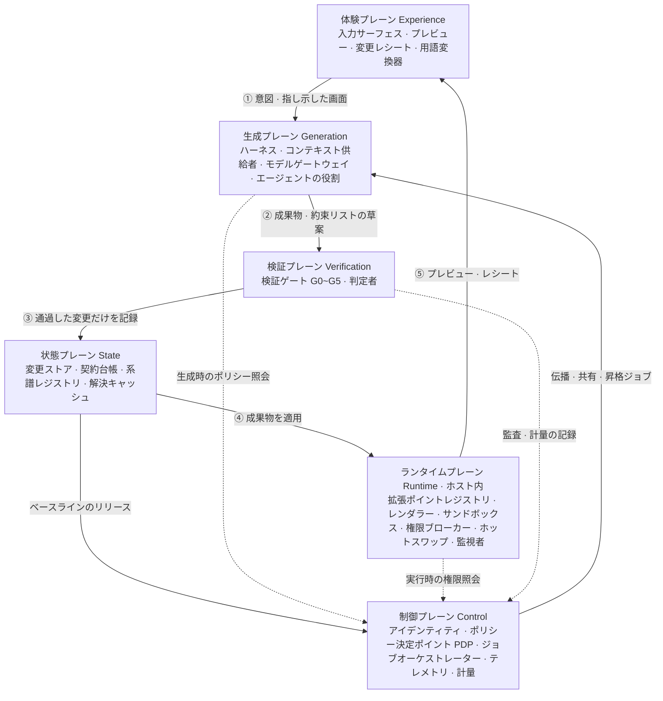
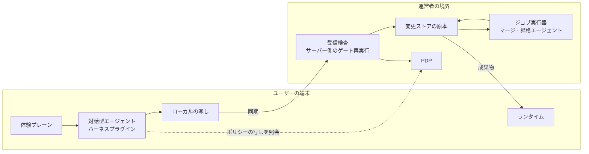
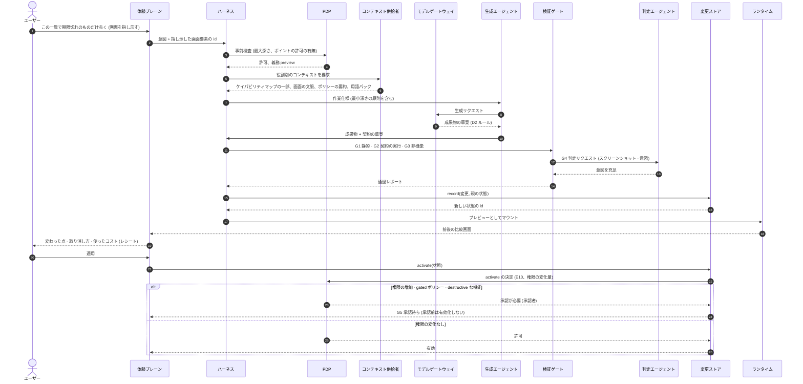
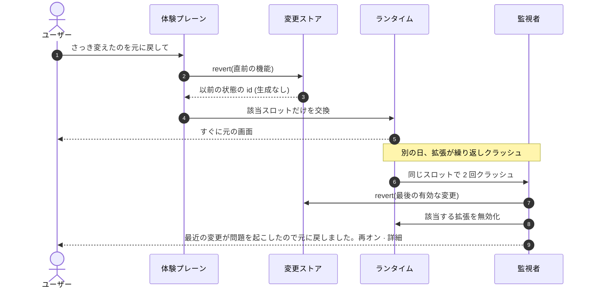
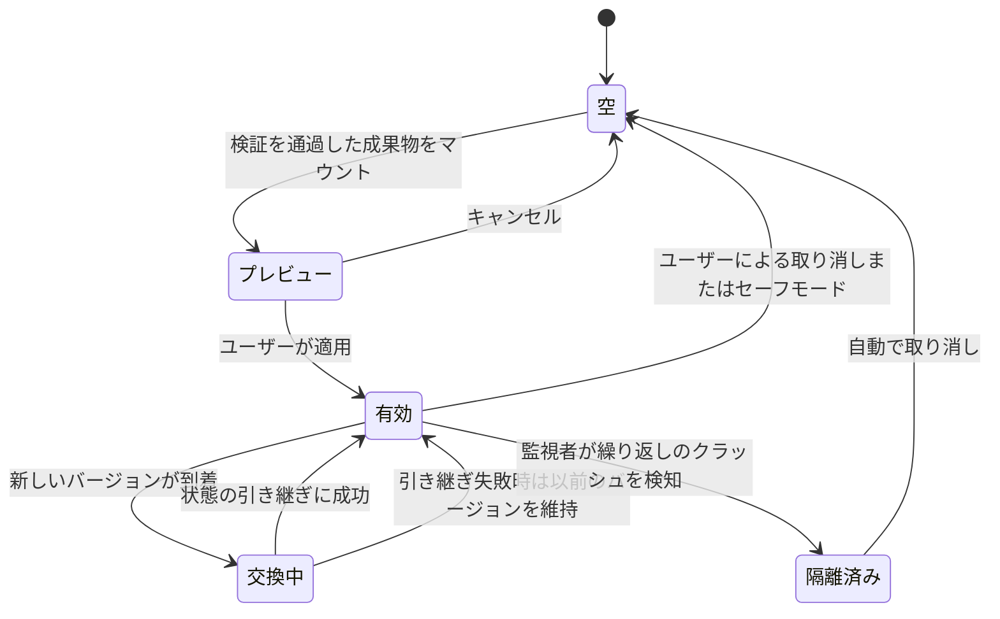

<!-- LANG-BAR -->
[English](../en/05-reference-architecture.md) · [한국어](../ko/05-reference-architecture.md) · [简体中文](../zh-CN/05-reference-architecture.md) · **日本語** · [Español](../es/05-reference-architecture.md)
<!-- /LANG-BAR -->

# 5. リファレンスアーキテクチャ — プレーン、コンポーネント、ポート、フロー、ハーネス

> この章の結論: Mallangable システムは **6 つのプレーン(plane)** に分かれる。ユーザーと接する**体験プレーン**、ホスト(host)の中で変更を実行する**ランタイムプレーン**、AI が変更を作る**生成プレーン**、変更を判定する**検証プレーン**、履歴を守る**状態プレーン**、ポリシー・課金・監査を担う**制御プレーン**である。プレーンの間は**ポート(インターフェース)** だけで接続し、実装(アダプター)は 3 章の軸の選択に従って差し替える。

## 5.1 全体構造



読み方: 実線 ①~⑤ が変更一つのループです。意図が生成プレーンへ行き、検証を通過したものだけが記録され、記録されたものだけがランタイムに適用され、結果がプレビュー・レシートとしてユーザーに戻ります。ベースライン(baseline)が新たに出ると、制御プレーンが伝播ジョブを作って同じループをもう一度回します。点線はポリシー照会です。**生成時(ハーネス)と実行時(ランタイムブローカー)が同じ PDP に尋ねる**という点が要です。二つの時点の権限判断が食い違うと、「作るときは許可されたのに、実行するときは禁止」のような隙間が生じます。プレーン内のコンポーネントは、下の表と 5.3 のポート定義にあります。

### プレーンごとの責任

| プレーン | 責任 | 必ず守ること |
| --- | --- | --- |
| 体験プレーン | 意図の収集、進行の表現、プレビュー、レシート、平易な用語 | ユーザーに見えるすべての文字列は用語変換器を通る |
| 生成プレーン | 意図の解釈、成果物の生成、マージ、昇格 | すべての書き込みはツール呼び出しのみ。生のリポジトリコマンドは禁止 |
| 検証プレーン | ポリシーの事前検査、静的検査、契約の実行、非機能検査、判定 | 生成者と判定者の分離(I7) |
| ランタイムプレーン | 拡張のロード・隔離・実行、権限の仲介、ホットスワップ、復旧 | 拡張はブローカー以外の経路でホストに触れない |
| 状態プレーン | レイヤー履歴、契約、系譜、解決キャッシュ | すべての有効な状態は取り消せる(I3) |
| 制御プレーン | アイデンティティ、ポリシー、ジョブ、監査、計量 | 権威ある執行はここでのみ(I8) |

## 5.2 配置ビュー — エージェントの位置(A3)ごと

| コンポーネント | `client` | `hybrid` | `server` |
| --- | --- | --- | --- |
| 入力サーフェス、プレビュー | 端末 | 端末 | 端末 |
| エージェントハーネス | 端末 (ユーザーが起動したエージェント + ハーネスプラグイン) | 対話型の生成: 端末 / マージ・昇格: サーバー。`own` なら端末の生成者に上位レイヤーの成果物を渡さない(5.10, I6) | サーバーのサンドボックス |
| モデルゲートウェイ | 端末 (ユーザーのサブスクリプション・キー) | 端末 + サーバー | サーバー |
| 検証ゲート | 端末 (サーバーがあれば再検証) | 端末で一次 + サーバーで再検証 | サーバー |
| ランタイム | 端末 | 端末 | 端末 (成果物だけをダウンロード) |
| 変更ストア | 端末 (同期は選択) | サーバーが原本、端末は写し | サーバーのみ |
| PDP | 端末 (案内用) | サーバー (端末はキャッシュ) | サーバー |



読み方(hybrid の場合): ユーザーは端末で対話しながら直し、その結果はサーバーの受信検査(receive-check)をもう一度通過して初めて原本になります。ベースラインのマージのように数千人のユーザーに繰り返される作業は、サーバーが担います。

## 5.3 ポートとアダプター

プレーン間の境界をインターフェースとして定義します。以下は言語中立の表記(TypeScript の文法を借用)です。実装には、軸の選択に合ったアダプターをはめ込みます。

```ts
// ── ランタイムプレーン ─────────────────────────────────────────
interface ExtensionPointRegistry {
  list(filter?: { depth?: Depth; kind?: PointKind }): ExtensionPoint[];
  capabilityMap(): CapabilityMap;               // 機械可読形式。エージェントのコンテキストとして供給
}
interface SandboxHost {                         // アダプター: SES Compartment | iframe | Worker | プロセス | マイクロ VM
  mount(artifact: Artifact, grants: CapabilityGrant[], prevState?: unknown): SlotHandle;
  unmount(slot: SlotHandle): Promise<unknown>;  // 状態引き継ぎ用のスナップショットを返す
  limits(slot: SlotHandle): ResourceBudget;
}
interface CapabilityBroker {
  call(slot: SlotHandle, cap: CapabilityId, args: unknown): Promise<unknown>;  // 呼び出しごとに PDP 照会 + 監査記録
}

// ── 生成プレーン ───────────────────────────────────────────
interface AgentHarness {                        // アダプター: 商用エージェント + プラグイン | 自前のエージェントループ
  run(task: Task, role: AgentRole, budget: Budget): AsyncIterable<HarnessEvent>;
}
interface ContextProvider {
  build(task: Task, role: AgentRole): Context;  // 役割ごとに見てよいものだけ (I6)
}
interface ModelPort {                           // アダプター: ユーザーのサブスクリプション(公式クライアント経由) | API キー | クレジット | テナントクラウド | 端末モデル
  complete(req: ModelRequest, route: Route): Promise<ModelResponse>;
  estimate(req: ModelRequest, route: Route): CostRange;
}

// ── 検証プレーン ───────────────────────────────────────────
interface ValidationPort {
  run(change: ChangeDraft, gates: GateId[]): Promise<GateReport>;
}
interface ContractRunner {
  check(contract: Contract, app: EffectiveAppHandle): Promise<ContractResult>;
}

// ── 状態プレーン ───────────────────────────────────────────
interface ChangeStore {                         // アダプター: Git 式リポジトリ | CRDT 文書 | スナップショット DB
  record(change: Change, parent: StateId): StateId;   // 生のコミットコマンドの代わりにこれだけを公開
  activate(state: StateId): void;
  revert(target: StateId | FeatureId): StateId;        // 生成なしで定数時間 (I3)
  history(scope: Scope): ChangeRecord[];
}
interface LineageRegistry {
  parent(node: LayerNodeId): LayerNodeId | null;
  release(node: LayerNodeId, tag: BaselineTag): void;
  descendants(node: LayerNodeId): LayerNodeId[];        // トポロジカル順
}
interface ResolutionCache {
  lookup(key: ConflictClassKey, scope: VisibilityScope): Resolution | null;
  store(key: ConflictClassKey, scope: VisibilityScope, r: VerifiedResolution): void;
}

// ── 制御プレーン ───────────────────────────────────────────
interface PolicyDecisionPoint {
  decide(req: AccessRequest): Decision;          // 許可 | 拒否(理由・層) | 承認が必要(承認者) + 義務
}
interface JobOrchestrator {
  submit(job: PropagationJob | ShareJob | PromotionJob): JobId;
}
interface TelemetrySink { emit(e: Event & { visibility: VisibilityLabel }): void; }
interface MeteringPort  { record(u: UsageRecord): void; entitlement(subject: Subject): PlanLimits; }

// ── 体験プレーン ───────────────────────────────────────────
interface LexiconPort {
  render(conceptId: string, level: "basic" | "practitioner" | "developer", locale: string, domain?: string): string;
  lint(text: string, level: string): LexiconViolation[];   // 一般ユーザー画面の開発用語を検出
}
```

設計原則:
- `ChangeStore` は**生のリポジトリコマンド(commit, push, merge, reset)を公開しません。** エージェントが使える書き込みは `record`・`activate`・`revert` だけであり、この境界のおかげで記録の規格(6.11)が統一されます。
- `ModelPort` の「ユーザーのサブスクリプション」アダプターは、ベンダーが許可する経路だけを実装します(8.10)。

## 5.4 フロー 1 — 変更が一つ作られる過程



要点:
- ステップ 3 の事前検査で、**生成の前に**不可能なリクエストをふるい落としてコストを節約します。
- ステップ 7 の作業仕様に最小深さの原則が入ります。生成エージェントが D4 で作ると、ステップ 11 の G1 で拒否されます。
- 判定(ステップ 12~13)は、生成エージェントとは別のインスタンスが行います(I7)。
- 記録(ステップ 15)が有効化のリクエスト(ステップ 21)より先です。だから適用したすべての状態は取り消せます(I3)。
- 有効化も PDP を経由します(ステップ 22、E10)。体験プレーンがストアを呼んでも、権限が増えるか gated ポリシーであれば、G5 の承認までは有効な状態になりません。

## 5.5 フロー 2 — 取り消しと自動復旧



取り消し(revert)は**モデルを呼びません。** ポインターの移動なのでコストはゼロで、時間ティア(time tier) T0(8.4)に属します。「取り消しは無料」という事実が、ユーザーに実験を始めさせる最も強い動機です。

### 取り消しは見たものを根拠に

ユーザーが画面を見ている間にも、有効な状態は変わり得ます。ベースラインの伝播(6.5)、別の端末での適用、監視者の自動復旧がそうです。だから取り消しのリクエストは、**ユーザーが見た状態の id** を一緒に送ります: `revert(feature, expect=見た状態の id)`。

- 今の状態が `expect` と異なれば、何も変えません(必須)。代わりに今の状態を見せて、もう一度選ばせます。見当違いの状態を取り消すと、権利の下限 F1 がかえって事故になります。
- 取り消しの結果は新しい状態の id を返し、その id で**同じ演算をもう一度**行うと、やり直し(redo)になります。やり直し用の別の仕組みは置きません(推奨)。ただし、やり直しと、監視者の自動復旧の後の「再オン」は権限・深さを再び増やすため、権利の下限(F1)ではなく、有効化と同じ PDP の判定(E10)を経ます(必須、4.8 `floor_scoped`)。その間に上限が下がっていたり承認が消えていたりすれば、承認が必要または拒否になります。
- 記録が消えて取り消しもやり直しもできない場合は、黙って済ませず「これ以上元に戻せません」と知らせます(必須)。

ThinkRail の diff の取り消しも同じ規則を使います。クライアントは内容を送らず、見たもののハッシュだけを送り、異なれば `STALE_VIEW` で拒否します([JetBrains/thinkrail `changes/SPEC.md`](https://github.com/JetBrains/thinkrail/blob/c10f8808cee693e4abffeeb1844a132ed0a91cc5/packages/server/src/changes/SPEC.md#L39-L43)、調査ノート [T1・T2](research/thinkrail-analysis.md))。

## 5.6 ハーネス

### 定義

ハーネス(harness)は、**非決定的なエージェントを包む決定的な外殻**です。エージェントが何を考えようと、ハーネスは次の五つを強制します。

| 責任 | 内容 | 実装手段 |
| --- | --- | --- |
| 手順 | 深さの判定 → 契約の作成 → 成果物 → 検証 → 記録 → 有効化のリクエストの順序 | スキル・作業仕様、終了前の検査フック |
| ツールの境界 | 許可されたツールだけ、許可された経路だけ | ツール一覧の制限、経路アクセスのフック |
| ポリシーフック | ライフサイクルイベントごとに PDP を照会 | イベントモデル(下記) |
| 予算 | トークン・時間・リトライの上限 | モデルゲートウェイの計量、ジョブの予算 |
| 出力の契約 | ユーザー・他のエージェントへ出ていく形式 | スキーマ検査、出力ゲート |

エージェントスキルの標準(SKILL.md)は手順を移植可能な形で配布する良い手段ですが、権限の強制は各エージェントの実装に任されています。標準の `allowed-tools` フィールドも実験的なので、エージェントごとにサポートが異なります([Agent Skills 仕様](https://agentskills.io/specification))。だから**スキルは手順を、ハーネスは強制を**担うように分けます。

### ベンダー中立のイベントモデル

| id | イベント | 時点 | 阻止できるか | 代表的なポリシー |
| --- | --- | --- | --- | --- |
| E1 | `session.start` | セッションの開始・再開 | いいえ | ポリシーの要約・ケイパビリティマップ・保留中のアップグレードを文脈に注入 |
| E2 | `intent.submit` | ユーザーのリクエスト直後、モデル処理の前 | はい | 深さの分類、D5 はコアへのリクエストとして収集、ソース閲覧の誘導を遮断(hidden) |
| E3 | `plan.ready` | エージェントが計画を確定 | はい | 最小深さに違反する計画を拒否 |
| E4 | `tool.before` | ツール実行の前 | はい | 経路アクセスの統制、生のリポジトリコマンドの遮断、外部送信の遮断 |
| E5 | `tool.after` | ツール実行の後 | フィードバックのみ | 増分検証の結果をエージェントに返す、出力の浄化 |
| E6 | `permission.request` | 権限の決定が必要 | 決定によって | 人の承認カードへルーティング |
| E7 | `batch.after` | 並列ツール呼び出しの束が終了 | はい | 累積の変更量がサイズ規則の 80% を超えたら機能単位の記録を指示 |
| E8 | `artifact.ready` | 成果物の草案が完成 | はい | 検証ゲートを実行 |
| E9 | `record.before` | 変更記録の直前 | はい | 契約の存在・記録の規格・サイズの検査 |
| E10 | `activate.before` | 有効化の直前 | はい | 権限の増加なら承認が必要 |
| E11 | `stop.before` | エージェント終了の直前 | はい | 未検証・未記録の変更があれば終了を拒否 |
| E12 | `subagent.stop` | サブエージェントの終了 | はい | 判定結果のスキーマ検査 |
| E13 | `output.before` | 人・他のエージェントへ出ていく直前 | 置換可能 | 出力ゲート(コード流出の検出、用語変換) |
| E14 | `merge.conflict` | マージ衝突の発見 | — | 解決ラダーに入る(6.6) |
| E15 | `compact.before` | 文脈圧縮の直前 | いいえ | 進行状態を台帳に記録 |
| E16 | `session.end` | セッションの終了 | いいえ | テレメトリの送信 |

### マッピング例: Claude Code のフック

Claude Code のフックは、30 以上のイベント、5 種類のハンドラー(コマンド・HTTP・MCP ツール・プロンプト・エージェント)、管理者設定でユーザーのフックを阻止するオプション、フック失敗時に動作を止める `onFailure: "block"` を提供します([Claude Code フックのドキュメント](https://code.claude.com/docs/en/hooks.md))。上のイベントは、おおよそ次のように対応します。

| Mallangable のイベント | Claude Code のフックイベント |
| --- | --- |
| E1 `session.start` | `SessionStart` |
| E2 `intent.submit` | `UserPromptSubmit` |
| E4 `tool.before` | `PreToolUse` |
| E5 `tool.after` | `PostToolUse` (`updatedToolOutput` で結果を置換可能) |
| E6 `permission.request` | `PermissionRequest` |
| E7 `batch.after` | `PostToolBatch` |
| E11 `stop.before` | `Stop` ¹ |
| E12 `subagent.stop` | `SubagentStop` ¹ |
| E15 `compact.before` | `PreCompact` |
| E16 `session.end` | `SessionEnd` |
| E3, E8, E9, E10, E13, E14 | 対応するイベントなし → Mallangable のツール(MCP サーバー)の中で直接発生させる |

¹ `onFailure: "block"` は v2.1.295 以上の command・http フックでのみ動作し、`Stop`・`SubagentStop` には効果がありません。フックが失敗すると、E11・E12 は開いたまま通過します。だから E11・E12 を阻止する関門としては信頼しません。未検証・未記録の変更の検査は、MCP ツール側(`ChangeStore.record()`・`activate()`)でも強制します。

他のエージェントランタイムも、同じやり方で対応表を作ればよいです。対応するイベントがないものは**ツール側で強制**します。例えば E9 `record.before` は `ChangeStore.record()` の中で検査します。

対応表は、ランタイムの版が変わると古くなります(上の脚注 ¹ がその例です)。だから対応表の項目ごとに三つのことを書きます(推奨): **何を確認したか**(確認した動作と出所)、**いつ見直すか**(ランタイムの版の更新時)、**いつ消すか**(ランタイムが同じ機能を直接提供したら、ハーネス側の補完を消す)。版番号は依存関係の固定ファイル一か所にだけ置き、仕様に書き直しません。ThinkRail は、エンジンの欠陥を埋める適応ごとに、このように「見直すべきこと」と「消してよい条件」を書いた互換性台帳を置いています([JetBrains/thinkrail `pi-compatibility.md`](https://github.com/JetBrains/thinkrail/blob/c10f8808cee693e4abffeeb1844a132ed0a91cc5/pi-compatibility.md#L11-L16))。

Codex CLI も同じやり方で対応します(**公式ドキュメントでの確認が必要**): E1 `SessionStart`、E2 `UserPromptSubmit`、E4 `PreToolUse`、E5 `PostToolUse`、E6 `PermissionRequest`、E11 `Stop`、E12 `SubagentStop`、E15 `PreCompact`。この一覧は Codex の公式ドキュメントではなく、Harness² がフック設定を検査するときに使うイベント集合([google-research/harness2 `substrate/codex.py`](https://github.com/google-research/harness2/blob/1cfe254e8d25b15f37048c3730134686abe60335/harness2/substrate/codex.py#L58-L72))から取ったものです。反映の前に Codex の公式ドキュメントと照合しなければなりません。

体験プレーンはハーネスのイベントをそのまま受け取らず、ユーザー向けの進行シグナルとして受け取ります。[AG-UI](https://docs.ag-ui.com/concepts/events) を転送規格として使うと、次のように対応します。

| Mallangable | AG-UI | 備考 |
| --- | --- | --- |
| E2 受付 ~ E11 終了 | `RUN_STARTED` · `RUN_FINISHED` · `RUN_ERROR` | |
| 状態語 4 個(8.5) | `STEP_STARTED` · `STEP_FINISHED` | step の名前を状態語の id に固定 |
| 部分プレビュー(8.5) | `STATE_SNAPSHOT` · `STATE_DELTA`(RFC 6902) | 「まだ確認前」の表示を維持 |
| E6 `permission.request`、2.8 `承認待ち` | `RUN_FINISHED` の `outcome.type = "interrupt"` → 次の実行の `resume[]` | 承認は新しい実行へつながる([AG-UI interrupt](https://docs.ag-ui.com/concepts/interrupts)) |

完了シグナルは一つだけです(必須)。多くのランタイムでは、「一回の試行が終わった」と「仕事が終わった」は異なります。試行が終わった後も、リトライ・文脈圧縮・待機中の後続リクエストによって仕事が続くことがあります。体験プレーンは、ハーネスが E11 を通過させた後にのみ `準備できました` を表示し、試行の境界では状態語を変えません。`承認待ち` のように人の入力を待つ状態は**レベルシグナル**です。ユーザーが画面を見たからといって消えず、入力が入って初めて消えます。ThinkRail は `agent_end` を試行の境界として、`agent_settled` だけを完了として扱います([JetBrains/thinkrail `architecture.md` 決定 8](https://github.com/JetBrains/thinkrail/blob/c10f8808cee693e4abffeeb1844a132ed0a91cc5/architecture.md#L141-L156))。

サーバーのジョブを外部のエージェントに任せるときは [A2A](https://a2a-protocol.org/latest/specification/) のタスク状態(`TASK_STATE_INPUT_REQUIRED`・`TASK_STATE_AUTH_REQUIRED`)が、MCP ツールの中では複数往復のリクエスト(`resultType: "input_required"`、[MCP 2026-07-28](https://modelcontextprotocol.io/specification/2026-07-28/changelog))が、同じ役割を担います。

注意: ユーザーの端末のフックは、ユーザーがオフにできます。端末のハーネスのフックは案内であり、最終的な強制はサーバーの受信検査です(I8)。

形式が誤ったフック設定は、多くのランタイムでエラーなしに**まったく実行されません。** つまり、失敗すると開いたまま残ります。ハーネスプラグインは、フック設定を書き込む時点で、ランタイムが受け付けるイベント名・ハンドラー形式で検査し(MUST)、セッション開始(E1)のときにフックが実際に登録されたかを確認します(MUST)。エージェントはポリシーフック・ガードレールのファイルを書き換えられません(ツールの境界、E4)。Harness² も同じ理由で、Codex のフックファイルを書き込む時点で検査します([google-research/harness2 `core/tree.py`](https://github.com/google-research/harness2/blob/1cfe254e8d25b15f37048c3730134686abe60335/harness2/core/tree.py#L216-L251))。

## 5.7 エージェントの役割

| 役割 | 行うこと | 読み取り | 書き込み | 外部通信 | 備考 |
| --- | --- | --- | --- | --- | --- |
| 解釈者 Interpreter | 意図の解釈、聞き返し、作業仕様の作成 | ユーザーとの対話、ケイパビリティマップ | 作業仕様 | モデルのみ | hidden モードではコードを決して見ない |
| 生成者 Builder | 成果物・契約の生成 | 自分のレイヤー、ケイパビリティマップ | 許可された経路の草案 | モデル・パッケージミラー | 生のリポジトリコマンドは不可 |
| 記録者 Curator | 記録の規格化、分割・統合 | 変更分 | 記録のメタデータ | なし | ルール + 小型モデル |
| 判定者 Reviewer | 意図の充足・品質の判定 | 読み取り専用 | 判定結果 | なし | 生成者とは別のインスタンス(I7) |
| マージ担当 Merger | ベースライン・共有のマージ衝突の解決 | 対象レイヤー + 上位のリリース | 衝突領域と関連する機能 | モデルのみ | 契約の弱体化は禁止 |
| 昇格担当 Promoter | 収束した機能を正規化して上位に提案 | 候補の機能(可視性の範囲内) | 上位の提案領域 | モデルのみ | 承認は人 |
| 説明者 Explainer | レシート・アップグレードの要約を平易な用語で | 変更のメタデータ | ユーザー向けの文 | なし | 用語変換器を経由 |

役割を分ける理由は二つです。① 一つのエージェントが非公開データ・信頼できない入力・外部通信を同時に持つと、攻撃が容易になります(7.3)。② 作った側が採点すると、検証は形式だけが残ります。

## 5.8 検証ゲート

| ゲート | 内容 | 失敗時 |
| --- | --- | --- |
| G0 ポリシーの事前検査 | 深さ・拡張ポイント・権限がポリシーの区間内か | 生成の前に拒否(コスト 0) |
| G1 静的検査 | スキーマ、型、禁止 API(動的評価・任意のネットワーク・ソース原文へのアクセス)、権限の変化量、サイズ | 理由を修正可能な文でエージェントに返す。リトライの上限(設計提案値: 1 回)を超えたら、変更せずに現在の状態を維持して終了 |
| G2 契約の実行 | 隔離されたプレビュー環境で契約をすべて実行 | 失敗した契約の id と観測値を返す |
| G3 非機能 | 性能予算(CPU・メモリ・起動時間)、クラッシュなし、アクセシビリティの基本ルール | 予算を超えた項目を返す |
| G4 判定 | 判定者がスクリーンショット・意図で意味の充足を判定。判定者は、成果物がどの生成者・ハーネス・モデル経路から来たかを知らない(出所ブラインド判定)。候補が複数あれば、再現可能なシードで混ぜた匿名の id で提示 | 判定の根拠を返す |
| G5 人 | 権限の増加・gated ポリシー・取り消せない書き込み(`destructive`)の機能を使うときのみ。`destructive` な機能は、有効化ポリシーに関係なく人の承認 | 承認待ち |

深さ別の必須かどうか (●必須、○選択、—該当なし):

| | G0 | G1 | G2 | G3 | G4 | G5 |
| --- | :-: | :-: | :-: | :-: | :-: | :-: |
| D1 | ● | ● | ○ | — | — | — |
| D2 | ● | ● | ● | ○ | — | 外部コマンドを含むとき |
| D3 | ● | ● | ● | ● | ○ | 新しいデータ権限のとき |
| D4 | ● | ● | ● | ● | ● | 権限の増加時 |
| D5 | ● | ● | ● | ● | ● | ● |

コストの原則: 安いゲートを前に置きます。G0・G1 でほとんどをふるい落とし、高価な G4(モデル呼び出し)は D3 以上でのみ実行します。

### 判定出力の処理

判定者(G4)の出力もモデルの出力なので、信用しません。

- **形式が誤っていれば失敗です**(必須)。判定の語が決められた値(`pass`・`fail`)でない場合や、指摘の位置(拡張ポイント・要素 id)が合わない場合、その判定は通過ではなく失敗であり、変更は有効へ進みません。黙って通過させません。
- **記録はハーネスが新たに作ります**(必須)。判定結果をそのまま保存せず、決められたフィールド(判定・要約・指摘)だけを選んで新しい記録を作ります。モデルがでっち上げたフィールド(例: `approved_by`、ゲートの結果)は捨てます。ハーネスだけが知る値は、ハーネスが埋めます。
- **指摘のない失敗は拒否します**(必須)。`fail` なのに指摘が一つもなければ、生成者には直すものがないので、その判定自体を失敗した判定として扱います。
- **通過の判定は確定ではありません**(必須)。以前の判定の指摘がまだ解決されていなければ、新しい判定が `pass` でも G4 を通過として記録しません。
- **リトライの上限はすべての入口が共有します**(必須)。生成者が自分でもう一度判定を求める経路と、人がもう一度確認を押す経路は、同じ上限(G1 のリトライ上限と同じ計算)を使います。別々に数えると、修正 → 判定 → 修正が終わらず、コスト攻撃者(7.1)は上限のない側で回ります。

ThinkRail の計画段階のレビューも同じ規則を使います([JetBrains/thinkrail `host/planReview.SPEC.md`](https://github.com/JetBrains/thinkrail/blob/c10f8808cee693e4abffeeb1844a132ed0a91cc5/packages/server/src/host/planReview.SPEC.md#L62-L119)、調査ノート [T4~T6](research/thinkrail-analysis.md))。

## 5.9 ランタイムの詳細

### 拡張スロットの状態



### ホットスワップのプロトコル

1. 新しい成果物が G2 を通過すると、ランタイムは**隠しスロット**に先にマウントします。ただし、G5 の承認が必要な変更は、承認の後にのみ権限を受けてマウントします。承認前の D4 のコードは、権限 0 個でのみマウントします。
2. 既存のスロットから `getState()` で状態のスナップショットを受け取ります。
3. 新しいバージョンの状態スキーマが異なれば、`migrate(prev)` が必ずなければなりません。なければ交換を拒否します。
4. `mount(prevState)` が成功すれば画面のスロットを替え、既存のインスタンスを下ろします。失敗すれば既存のインスタンスをそのまま残します。
5. コアは再起動しません。開発ツールのホットモジュールリプレースメント(HMR)は開発ビルドの機能なので、本番環境ではこのスロット単位の交換がその役割を代わりに担います。

### 監視者とセーフモード

- 同じスロットが決められた時間内に N 回(提案値: 2 回)クラッシュすると、監視者は最後の有効な変更を取り消して知らせます。
- 隔離・オフの単位は、スロットではなく**機能全体**です(必須)。一つの機能が複数のスロット・コマンド・イベントフックにまたがっていれば、そのすべてを一緒にオフにします。一つだけオフにすると、残ったフックが動き続けます。オフにした機能のレシートと記録は引き続き見えます。ThinkRail の拡張のキルスイッチも、拡張が提供したツール・スキルを一緒にオフにし、過去の会話を描くレンダラーは残します([JetBrains/thinkrail `architecture.md` 決定 21](https://github.com/JetBrains/thinkrail/blob/c10f8808cee693e4abffeeb1844a132ed0a91cc5/architecture.md#L376-L382))。
- 起動時に特定の操作(提案: 修飾キーを押したまま起動)で、**すべてのユーザーレイヤーをオフにした状態**で起動します(権利の下限 F2)。
- 拡張ごとの資源使用量をユーザーに見せます。遅くなった原因をユーザーが自分で探せなければなりません。

## 5.10 コンテキストの供給

エージェントの品質の大部分は、何を見せるかで決まります。役割ごとに、供給するものと供給しないものを明示します。

| 供給項目 | 解釈者 | 生成者 | マージ担当 | 判定者 |
| --- | :-: | :-: | :-: | :-: |
| ケイパビリティマップ(該当ポイントの周辺) | ● | ● | ● | ○ |
| 画面の文脈(指し示した領域のスクリーンショット、要素 id) | ● | ● | — | ● |
| 現在のレイヤースタックの要約 | ● | ● | ● | — |
| ポリシーの要約(区間・義務) | ● | ● | ● | — |
| 用語パック | ● | — | — | — |
| 関連する機能の契約 | ○ | ● | ● | ● |
| 自分のレイヤーの成果物 | hidden なら — | ● | ● | ● |
| 上位レイヤーの成果物 | hidden なら — | open のときのみ。own なら — (上位レイヤーは型・ケイパビリティマップのみ) | ● (サーバー) | ○ |
| コアのソース | — | D5 のフォークでのみ | — | — |

`own` では生成者がユーザーと対話するため、生成者の文脈に入った上位レイヤーの成果物は、ユーザーも結局は読めます(I6)。だから `own` の生成者は、上位レイヤーの型定義とケイパビリティマップだけを受け取り、成果物は受け取りません。この規則は生成の位置(5.2)とは無関係です。

コアのソースの代わりに**型定義とケイパビリティマップ**を渡します。ヘッダーは渡し、実装は渡さないやり方であり、こうしてこそ、エージェントがコアにパッチを当てようとする傾向(D5 への滑り落ち)を構造的に減らせます。

## 5.11 テレメトリイベント

すべてのイベントは、保存の時点で**可視性ラベル(visibility label)** を持ちます。ダッシュボードの照会は、見る人の権限とこのラベルを一緒にフィルタリングします(7.5)。

```json
{
  "event": "change.activated",
  "ts": "2026-10-28T09:41:12+09:00",
  "tenant": "t_acme", "org": "o_design", "subject": "u_8c1f",
  "feature": "f_01JBX7K2M9Q2", "depth": "D3", "points": ["sidebar.panel"],
  "gates": {"G1": "pass", "G2": "pass", "G3": "pass", "G4": "pass"},
  "gen_ai": {"operation.name": "invoke_agent", "agent.id": "builder@harness-x", "usage.input_tokens": 18200, "usage.output_tokens": 2100},
  "model_cost": {"unit_cost_ref": "route:standard"},
  "policy": {"decision_id": "dec_7Q2…", "revision": "tenant/acme@42"},
  "trace": {"traceparent": "00-…-…-01"},
  "latency_ms": {"total": 41200, "first_preview": 9800},
  "visibility": "V1"
}
```

モデルの使用量の属性は、[OpenTelemetry GenAI セマンティック規約](https://opentelemetry.io/docs/specs/semconv/gen-ai/)の名前(`gen_ai.usage.input_tokens`・`gen_ai.usage.output_tokens` など)に従います。この規約はまだ Development 状態なので、実装は従った規約のバージョンも一緒に記録します。ポリシーの決定は、OPA の決定ログのように決定 id(`policy.decision_id`)とポリシーの版(`policy.revision`)を残します。MCP サーバーを経由する呼び出しは、MCP `_meta` の `traceparent` 規約で同じトレースに束ねます。

推奨するイベントの束: セッション、意図(分類・遮断・コアへのリクエスト)、ツール・ポリシー(拒否・権限要求・承認)、変更(検証・記録・有効化・取り消し)、ランタイム(クラッシュ・セーフモード)、伝播(生成・衝突・解決方法・提案・適用・保留)、共有、昇格、コスト(警告・超過)、セキュリティ(出力の浄化・秘密値の検出・緊急アクセス)。

次の章: [6. バージョンと系譜](06-versioning-and-lineage.md)
