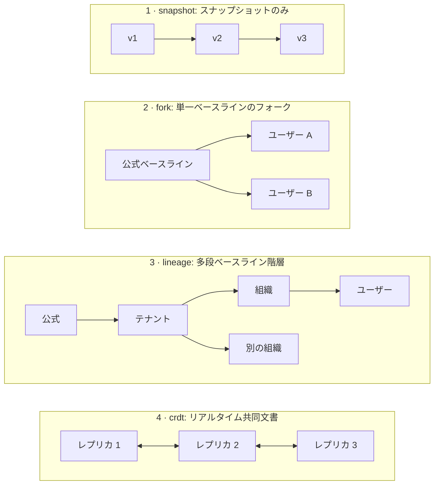
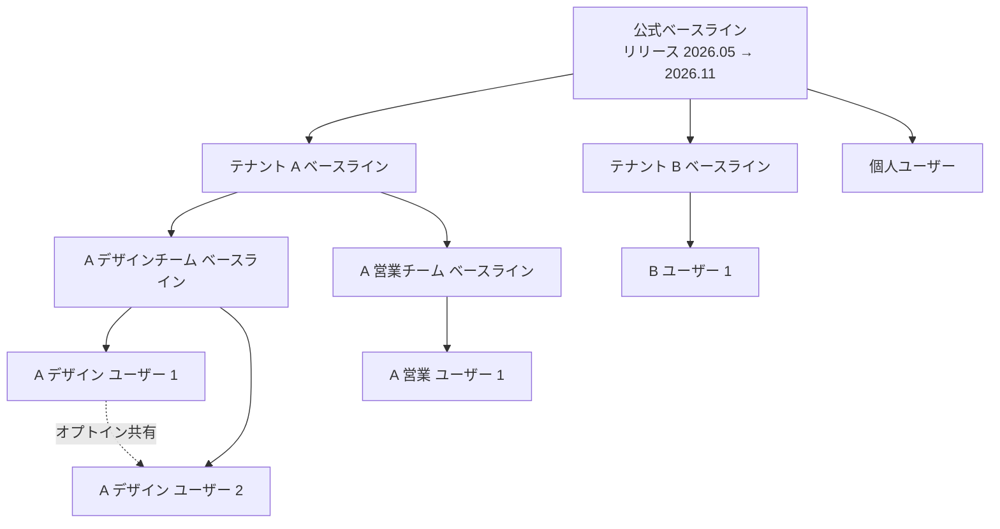
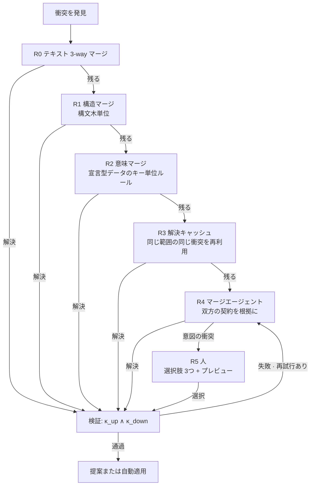
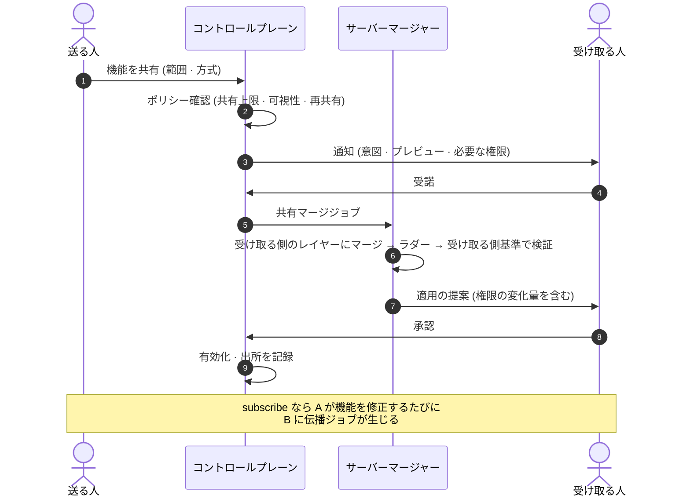
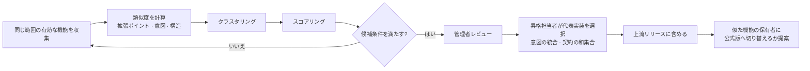

<!-- LANG-BAR -->
[English](../en/06-versioning-and-lineage.md) · [한국어](../ko/06-versioning-and-lineage.md) · [简体中文](../zh-CN/06-versioning-and-lineage.md) · **日本語** · [Español](../es/06-versioning-and-lineage.md)
<!-- /LANG-BAR -->

# 6. バージョンと系譜 — ユーザーの修正をアップデートに耐えさせる方法

> この章の結論: マリアブル・ソフトウェア(malleable software)の本当のコストは、作る瞬間ではなく**ベンダー(vendor)が新しいバージョンを出すたびに**発生する。これを引き受けるには、① 隔離単位をリポジトリ(レイヤー(layer))に、作業単位をブランチに分け、② ベースライン(baseline)の階層を**系譜(lineage)** として管理し、③ マージを**契約保存(contract-preserving)** として定義し、④ 同じ衝突を何度も解かずに済むよう**解決キャッシュ(resolution cache)** を可視性の範囲内で共有しなければならない。

## 6.1 なぜバージョン管理が中心問題なのか

ユーザー `N` 人がそれぞれ修正を持ち、ベースラインが1年に `r` 回変わるなら、1年に `N × r` 回のマージが必要です。Linux ディストリビューションやスマートフォンメーカーが上流ソースの上に自前のパッチを載せて維持するときに直面する「パッチスタックの再適用」問題が、今度は**ユーザー一人ひとり全員**に生じます。人が手で解ける規模ではないため、マージそのものを自動化しつつ、**何が正しいマージなのか**を機械が判定できるように定義しなければなりません。

## 6.2 4つのトポロジー



| | snapshot | fork | lineage | crdt |
| --- | --- | --- | --- | --- |
| 隔離 | ユーザーごと | ユーザーごとのリポジトリ | ノードごとのリポジトリ | 文書単位、アクセス者全員で共有 |
| 上流アップデートの伝播 | 不可 | 単一段階 | トポロジカル順で多段階 | 自動収束 |
| 衝突処理 | 該当なし | マージラダー | マージラダー + 階層ポリシー | 構文衝突なし、**意味衝突は残る** |
| 保存コスト | 低い | フォーク数 × 固有の変更(共通オブジェクトは共有可能) | 同じ | 操作ログのサイズ |
| 適合 | テーマ・ルールの保存だけを行う消費者アプリ | 個人・小規模 | 企業・公共 | リアルタイム協働 |

推奨: 将来、組織機能が必要になる可能性が少しでもあるなら、保存モデルは最初から `lineage` で作ってください。`fork` は深さ1の系譜として表現されます(3.7)。

## 6.3 系譜モデル

```text
系譜 T = (ノード, エッジ)
  ノード n     : 1つのレイヤーリポジトリ(公式ベースライン、テナントベースライン、組織ベースライン、ユーザーレイヤー)
  エッジ n→m   : m は n を上流に持つ(m は n のフォーク)
  リリース r(n): ノード n で署名されたベースラインタグ。例: 2026.11
  ドリフト δ(m) = m が反映した上流リリースと最新の上流リリースとの間の段階数
```



読み方: 実線は**アップデートが流れる方向**、点線は**横に渡る共有**です。公式ベースライン 2026.11 が出ると、テナント A がまず取り込み、次にデザインチーム・営業チーム、最後に各ユーザーの順に下りていきます。階層の深さは顧客ごとに1~3段で異なってかまいません。

## 6.4 隔離単位と作業単位

**隔離単位はリポジトリ、ブランチは作業単位です。** 一般的な Git ホスティングはブランチ単位の書き込み保護は提供しても、ブランチ単位の読み取り制限は提供しないことがほとんどなので、リポジトリをダウンロードできればすべてのブランチが見えます。ユーザーごとのブランチで隔離しようとすると、この前提が崩れます。

| 参照(ref) | 用途 | 書き込む主体 |
| --- | --- | --- |
| `main` | 現在の有効な状態。ランタイムがこれをロード | ハーネス(記録・承認済みのマージ) |
| `exp/<名前>` | 実験版、代替案の比較 | ハーネス |
| `upgrade/<リリース>` | 伝播ジョブのマージ結果、承認待ち | サーバーマージャー |
| `share-in/<共有 id>` | 受け取った共有をマージしてみた結果 | サーバーマージャー |
| リリースタグ | ベースラインのリリース。ベースラインノードのみ、署名必須 | 管理者の承認後にハーネス |

マージ方式: 下方向の伝播には履歴を保存するマージを使います(リベース(rebase)禁止を推奨)。ユーザーの履歴が保存されてこそ、監査・取り消し・昇格分析が可能になります。

同時生成: 1人のユーザーの生成作業2つが同じレイヤーを同時に修正すると、どの機能の変更なのかが曖昧になります(I9)。生成作業ごとに `exp/<名前>` の作業コピーを別に用意します(推奨(SHOULD))。記録者は作業が始まった時点の状態をベースラインとして取り、その作業が**変えたパスだけ**を記録します。「今変わったものすべて」を記録しません。2つの作業が同じコピー上で重なった場合は、帰属を推測せず、重なったと表示したうえで人に分けてもらいます。ThinkRail は計画の段階ごとに作業ウィンドウを開き、その段階が変えたパスだけをコミットし、他の会話と重なったウィンドウは `shared` と表示します([JetBrains/thinkrail `todos/SPEC.md`](https://github.com/JetBrains/thinkrail/blob/c10f8808cee693e4abffeeb1844a132ed0a91cc5/packages/server/src/todos/SPEC.md#L64-L80))。

フォークが数千個あっても、ほとんどのオブジェクトは同じベースラインから来ているため、リポジトリ間で共通オブジェクトを共有すれば(例: Git alternates)、保存量はユーザー数ではなく**固有の変更数**に比例します。

## 6.5 伝播アルゴリズム

```text
イベント駆動です。ノード p が上流リリース r を `main` に適用すると `baseline.applied(p, r)` が発行され、そのイベントが p の子ジョブを作ります。

```text
on baseline.applied(p, r):                     # p = リリースノード自身、または r を適用した中間ノード
  kids  = children(p)
  waves = canary(kids, ratios=[0.05, 0.25, 1.0], seed=hash(p, r))   # シード固定のランダム標本
  for wave in waves:
    results = parallel_map(m -> propagate(m, p, r), wave)           # 結果を集める。本体内に return なし
    if failure_rate(results, key=(gate_id, contract_id, point)) > threshold:
      halt_propagation(p, r); alert(p.steward); stop

propagate(m, p, r) -> 結果:
  theirs    = p.main@applied(r)                # 元の r ではなく親が適用した結果(中間レイヤーの変更を含む)
  contracts = ⋃_{a ∈ path(root(r), m)} κ(a)    # r を発行したノードから m までの経路上のすべての契約 (I10)
  merged    = merge(base=last_applied(m), ours=m.main, theirs=theirs)   # 6.6 ラダー
  if merged.intent_conflict:   return NEEDS_HUMAN(options=3, previews)
  report = gates(merged, contracts)
  while report.fail and retries_left: report = retry_with_feedback(...)
  if report.fail:              return FAILED       # 以前のリリースを維持、管理者に通知
  if delta_permissions(merged) == ∅ and policy(m).apply == auto:
    d = activate(merged)                       # ChangeStore.activate → PDP(E10)。gated・破壊的・指紋に紐づいた承認はここで止まる
    if d == allow: emit baseline.applied(m, r); return APPLIED
    # approval required・deny なら下の propose に進む
  propose(merged, summary=explain(diff_of_intents)); return PROPOSED
  # 承認されたらその時点で apply → emit baseline.applied(m, r)。拒否・期限切れなら m は以前のリリースを維持

`apply`・`activate` は有効化判定(5.4、E10)を飛ばす別経路ではありません(必須(MUST))。権限の増加がなくても、有効化ポリシーが gated であるか、破壊的な機能を使うか、「常に」の承認が変更された content_hash に紐づいていたなら、PDP は `approval required` を返し、伝播は PROPOSED になります。`delta_permissions` は変更記録の自己申告ではなく、マージ結果のマニフェストから再計算します。

サポート期間が終了したリリースに残るノード: 強制マージせず「警告モード」に置く。
```

ノードごとのジョブ状態:

```text
待機 → マージ中 → 検証中 → { 適用済み | 承認待ち | 人が必要 | 失敗 }
承認待ち → 適用済み(承認) | 保留(拒否・期限切れ)
人が必要 → 検証中(R5 の選択後)
```

ルール:
- **トポロジカル順**(必須): 親がリリースを適用する前には、子のジョブを作りません。子ジョブは親の `baseline.applied` イベントによってのみ生まれます。
- **承認待ちの親**: 親が `承認待ち`・`人が必要` の場合、子は停止したジョブではなく**ジョブのない状態**のまま残ります。子側の機能は以前のリリースで動作し続け、ドリフト δ が1増えたものとして表示されます。親が承認すると、その `baseline.applied` が子ジョブを作ります。親が拒否すると、子には r は伝播しません。
- **ノードあたり進行中のジョブは1つ**: 新しいリリースが来たら既存のジョブを取り消し、最新で作り直します。ただし `承認待ち` のジョブは取り消さず、新しいリリースのジョブとまとめて一度に承認を受けるようにします。そうすれば、リリース周期が承認の遅延より短くても、永遠に適用されないという事態を防げます。
- **読み取り失敗は不在ではない**(必須): マージ入力(`base`・`ours`・`theirs`)や上流レイヤーの読み取りに失敗したら、そのジョブは `失敗` です。「そのキーは存在しない」として扱いません。レイヤー合成において「なし」は `null`、つまり削除なので(2.3)、読み取り失敗を「なし」と読むと、伝播がユーザーの機能を黙って消してしまいます。ストレージは「本当にない」と「読めなかった」を別の結果として返さなければなりません。ThinkRail も同じ理由で、git が「パスなし」と明示した場合だけを不在とみなし、それ以外の失敗はすべてエラーとして投げます([JetBrains/thinkrail `changes/SPEC.md`](https://github.com/JetBrains/thinkrail/blob/c10f8808cee693e4abffeeb1844a132ed0a91cc5/packages/server/src/changes/SPEC.md#L119-L122))。
- **カナリア標本**(必須): 各ウェーブは、兄弟ノードのうち `(p, r)` でシードを固定したランダム標本です。トポロジカル順の先頭数%ではありません。シードが固定なので、再実行しても同じノードが同じウェーブに入ります。
- **カナリア停止条件**: 同じ原因キー `(ゲート id, 契約 id, 拡張ポイント)` で失敗する割合がしきい値(提案値 10%)を超えたら、伝播を止めます。これは上流リリースの欠陥である可能性が高いからです。

## 6.6 衝突解決ラダー

安い方法から高い方法の順に試します。エージェントは最後から2番目、人は最後です。



| 段階 | 方法 | コスト | 例 |
| --- | --- | --- | --- |
| R0 | 一般的な 3-way マージ | ほぼ 0 | 別々のファイルの修正 |
| R1 | 構文を認識するマージドライバー(例: tree-sitter ベースの [Mergiraf](https://mergiraf.org/)) | 低い | 同じファイルの別の関数の修正、import の順序 |
| R2 | 宣言型スキーマのキー単位マージルール(スキーマがルールを宣言) | 低い | ショートカット一覧に双方が項目を追加(スキーマフィールド: capability-map の `extension_points[].merge`。値の名前は [Kubernetes Server-Side Apply](https://kubernetes.io/docs/reference/using-api/server-side-apply/) の `x-kubernetes-list-type` に従う。宣言のない配列は [RFC 7396](https://www.rfc-editor.org/rfc/rfc7396) のとおり丸ごと置き換え) |
| R3 | 検証済みの解決の再利用(Git の rerere を範囲共有へ一般化) | 低い | 同じベースラインから分岐した数千ユーザーの同一衝突 |
| R4 | マージエージェント | 高い | 同じパネルを上流は再配置、ユーザーは項目を追加 |
| R5 | 人 | 最も高い | 上流がサイドバーをなくしたのに、ユーザーはサイドバーのパネルを作った |

ライセンス上の注意: 構文マージツールの一部は強いコピーレフトライセンスを採用しています(例: Mergiraf は GPL-3.0-only)。サーバーで別プロセスとして呼び出すことと、配布物に含めることとでは義務が異なるため、配布形態ごとに検討してください。

## 6.7 契約保存マージの定義

```text
マージ結果 m が正しい  ⇔  κ_up(m) ∧ κ_down(m)
意図の衝突             ⇔  ∄ m : κ_up(m) ∧ κ_down(m)
```

2つ目の条件は一般には判定できないため、実務では近似します。マージエージェントが決められた回数(提案値 3回)以内に双方の契約を同時に満たせない場合、または一方の契約を満たすと他方が必ず壊れる構造であることを根拠とともに報告した場合、意図の衝突(intent conflict)と判定します。

マージエージェントのルール:
1. 修正範囲は、衝突領域とその衝突が属する機能のファイルに限定します。
2. **契約は強くなることしかできません。** マージエージェントが契約項目を削除したり緩和したりしたら拒否します(単調性)。例外は2つあり、どちらもエージェントではなく人が決めます。
   - **ユーザーが R5 で「上流の方式に移る」を選んだ場合**: 壊れるユーザー契約の項目を選択画面に平易な言葉で示し、ユーザーが明示的に同意した場合にだけ弱めます。
   - **拡張ポイントの廃止(6.12)**: 廃止されたポイントに掛かっている契約は原理的に満たせません。リリースが出す移行対応表(旧ポイント → 新ポイント)で契約を移し、移せない項目は上と同様にユーザーの同意を得て弱めます。
   - 弱化は記録に `Contract-Migrated: <項目 id> <変更前 → 変更後 または removed> (consent: <ユーザー・時刻>)` トレーラーとして残します(6.11)。同意のない弱化は受信検査で拒否します。
3. 解決の根拠(どの意図をどのように保存したか)を記録に残します。
4. 検証を通過した解決だけを解決キャッシュに入れます。解決を作ったノード以外の k 個以上(提案値 3)のノードで再検証されてから格納します(7.1 解決キャッシュの汚染)。

意図の衝突時に人に示す3つの選択肢(推奨形式): **上流の方式に移る** / **自分の方式を維持(上流の変更の一部を保留)** / **両方を反映する新しい設計を依頼**。それぞれにプレビューを付けます。「上流の方式に移る」はユーザー契約の一部を手放す選択なので、どの約束がなくなるのかを併せて示し、ルール2の同意として記録します。

## 6.8 解決キャッシュとコストモデル

リリース1つあたりの伝播コストの期待値です。

```text
E[コスト] = N · (c_job + c_val)  +  N · p · m · Σ_r q_r · c_r

  N     : 影響を受ける下位ノード数
  p     : 衝突が1つ以上生じるノードの割合
  m     : 衝突ノードあたりの平均衝突数
  q_r   : 段階 r(R0~R5)で解決される割合
  c_r   : 段階 r での衝突1件の解決コスト(c_R4 はモデル呼び出し、c_R5 は人の時間)
  c_val : ノードあたりの検証コスト(決定的な契約が中心なら安価)
```

コストの大部分は `c_R4`(エージェント)と `c_R5`(人)から生じます。解決キャッシュは同じ衝突を**同値類(equivalence class)** にまとめ、エージェントの呼び出し回数を減らします。

```text
R4 に到達する衝突数 K = N · p · m · q_R4
そのうち互いに異なる同値類の数 k  (同じ上流変更 × 同じ下位変更パターン)
キャッシュ適用後のエージェント呼び出し ≈ k · (1 + 再試行)       キャッシュヒット率 h = 1 − k / K
```

例(すべての値は仮定): ユーザーノード N=10,000、p=0.3、m=2 なら衝突は 6,000件。R0~R2 が 70% を解けば 1,800件が残ります。この 1,800件が同じ範囲内で 150個の同値類に属するなら、エージェント呼び出しは 1,800回ではなく約 150回になります(h≈0.92)。検証は依然として 10,000回実行されますが、決定的な契約なので安価です。

**範囲の制限**(必須): 解決キャッシュは可視性の範囲(テナントまたは組織)を越えて共有しません。ある顧客の解決には、その顧客のコード片が含まれているからです。この制限によってキャッシュ効率が落ちる部分は、**公式解決レシピ**で補います。ベンダーが公式リリースを出す際に、公開されている公式拡張・よくあるパターンに対する解決方法をリリースと一緒に配布する方式です(9.5 の B18)。

## 6.9 共有

共有単位はリポジトリではなく**機能(意図+契約+成果物)** です。

```yaml
share:
  id: shr_01JBY2
  feature: f_01JBX7K2M9Q2
  source: { node: "t_acme/o_design/u_alice", state: "3f9c2e1" }
  scope: user:u_bob | org:o_design | tenant:t_acme | public
  mode: copy | subscribe          # subscribe なら原本が変わるたびに受け取る側に伝播ジョブが生じる
  code_visibility: visible | hidden
  reshare: forbidden | author_opt_in | free
  expires_at: null
```



ルール:
- 受け取る側は**最初から検証し直し、権限を承認し直します**。「信頼する同僚が作った」という理由で省略しません(7.7)。
- 撤回は以後のアップデートを断つだけです。すでにマージされた内容は受け取った人のものです。
- すべての共有マージには出所が残ります(6.11 の `Shared-From`)。
- **受諾はその時点の内容に対してだけ**(必須): 受け取る人の受諾と権限承認は、受諾時点の内容ハッシュに紐づきます。`subscribe` 共有で送り手が修正した版は新しい内容なので、権限が同じでも受け取る側の検証をもう一度通し、権限が増えていれば改めて承認を受けます。最初の受諾が以後の版まで覆うと、「インストール後にリモートで内容を変えた」(7.7)のと同じ穴が生じます。
- **受け取った機能は自分の名前を乗っ取れない**(必須): 受け取った共有機能が、自分がすでに使っているコマンド名・ショートカット・拡張ポイント id と重なる場合、自分のものが勝ち、受け取った側は名前を変えるか無効の状態で入ってきます。レイヤー合成の「ユーザーに近い側が勝つ」(2.3)はそのままで、このルールは受け取った共有物が識別子を乗っ取る場合にだけ適用します。
- ThinkRail は、クローンしたリポジトリに信頼を与えるとき**その時点で存在したスキルだけ**を確認済みとみなし、後から pull・ブランチで生じたスキルは `pending-ack` として改めて尋ねます。同じ名前なら 組み込み → 個人 → プロジェクト の順で勝ち、リポジトリが自分のスキルを覆い隠せないようにしています([JetBrains/thinkrail `agent/SPEC.md`](https://github.com/JetBrains/thinkrail/blob/c10f8808cee693e4abffeeb1844a132ed0a91cc5/packages/server/src/agent/SPEC.md#L991-L1000))。

## 6.10 昇格 — 複数の人が同じものを作ったらベースラインへ

目標: 「互いに異なる人々が独立に似た機能を作り、使い続けている」状態を見つけ、上流のベースラインに上げます。下から上へ上がるイノベーションの経路です。



類似度とスコア(重みは提案値):

```text
sim(f_i, f_j) = 0.4 · Jaccard(X_i, X_j)                 # 触れた拡張ポイントの集合
              + 0.4 · cos(embed(ι_i), embed(ι_j))        # 意図要約の埋め込み
              + 0.2 · struct(a_i, a_j)                   # 成果物の構造類似度(V3 で許可された範囲でのみ)

score(クラスタ) = 2.0 · log2(1 + 独立ユーザー数)
              + 1.5 · 14日継続率
              + 1.0 · クラスタ凝集度
              − 1.0 · 権限リスク度
              − 0.5 · 検証失敗率

候補条件(提案): 独立ユーザー3人以上、または範囲内の有効ユーザーの5%以上、かつ14日継続率80%以上
```

昇格後にユーザーが公式版へ切り替えると、ユーザーの機能は `置き換え済み` の状態になります(2.8)。同じことをする機能が2つ残らないようにして、以後のマージコストを減らします。

境界: テナントを越えるシグナルは集計(V0)・メタデータ(V1)だけを使います。**顧客が作った成果物は、明示的なオプトインとライセンスなしには公式ベースラインに入れません。** 基本はベンダーが公式機能を自ら作ることです。公開(A8=public)の共有物は、原作者が昇格とライセンス条件に明示的に同意した場合にだけ昇格し(9.5 B10・B19)、テナント内部の成果物は、テナント契約上オプトインなしにはテナントの外へ上げません。この原則を文書で約束することが、企業顧客の信頼の前提です。

## 6.11 記録規格

エージェントは生のリポジトリコマンドを使えず `ChangeStore.record()` でしか記録しないため、すべての記録が同じ形式を持ちます。Git ベースの実装向けのメッセージ規格の例です(慣習的なコミット形式をベースに、スコープを拡張ポイント id に固定)。

```text
<type>(<拡張ポイント id>): <結果形の要約、50文字以内>

<本文: 何を、なぜ。5行以内>

Feature-Id: f_01JBX7K2M9Q2
Intent: 週次の振り返りのときに今週完了した項目を見たい
Depth: D3
Points: sidebar.panel
Contract: features/f_01JBX7K2M9Q2/contract.yaml
Validation: pass val_8f21
Agent: builder@harness-x
Permissions-Delta: +tasks.read                 (権限が変化した場合)
Overrides: layers/org/sidebar/layout.json      (上流所有の項目を上書きする場合)
Upstream: official@2026.11                     (伝播マージの場合)
Shared-From: t_acme/o_design/u_alice@3f9c2e1   (共有マージの場合)
Resolved: r0=3 r1=1 r2=0 r3=2 r4=1 r5=0        (マージ時の解決段階の分布)
Contract-Migrated: k3 removed (consent: u_alice@2026-11-02T09:12Z)   (契約を弱める場合、6.7 ルール2)
Prompt-Hash: sha256:…                          (原文は可視性ポリシーに従い台帳にのみ)
```

| type | 用途 |
| --- | --- |
| `feat` / `fix` / `style` / `refactor` / `perf` | ユーザーの変更 |
| `revert` | 取り消し |
| `upgrade` | ベースラインの伝播マージ |
| `share` | 共有マージ |
| `promote` | 昇格の反映 |
| `chore` | メタデータの整理 |

サイズルール(提案値): 記録1件 = 機能1つ、ファイル20個以下、変更400行以下(生成ファイルを除く)。超えた場合は記録者が拡張ポイント単位で分割します。同じ機能・同じセッション・10分以内の細かな修正はまとめます。このルールが守られてこそ、ダッシュボードが「機能単位」で集計でき、昇格候補の分析が可能になります。機械可読スキーマは [`schemas/change-record.schema.json`](../../schemas/change-record.schema.json)。

## 6.12 拡張ポイント API の進化

ベンダーの拡張ポイントが変わると、その上にあるすべてのユーザー変更が影響を受けます。

- 拡張ポイントにセマンティックバージョン(semver)を付けます。`stable` ポイントの互換性を壊す変更は、**最低2回のベースラインリリースの間、以前のバージョンと並行**させます(推奨)。
- リリースごとに、ケイパビリティマップ(capability map)の差分(追加・廃止・変更)を機械可読形式で発行します。マージエージェントはこの差分をコンテキストとして受け取ります。廃止には 旧ポイント → 新ポイント の対応表を付けます。契約移行(contract migration)はこの表に従います(6.7 ルール2)。
- **影響半径** = そのポイントに依存する有効な機能の数。廃止を決定する前に測定します。影響半径の大きいポイントの廃止は、公式解決レシピを併せて出さなければなりません。

## 6.13 CRDT トポロジーの注意点

CRDT は構文衝突をなくしますが、意味衝突はそのまま残します。2人が同時に同じルールの条件を別々に修正すると、両方が反映された奇妙な条件が生じることがあります。また、実行コードをリアルタイムで同期すると、**書きかけのコードが他のユーザーの画面で実行される**ことがあります(S7)。推奨:
- CRDT トポロジーでは最大の深さを D3 以下にします。
- 変更単位の契約検査は、同期時ではなく**有効化の時点**で実行します。
- 実験は CRDT 文書のブランチ(分岐コピー)で行い、有効化のときに本文書に統合します。

次の章: [7. 信頼とセキュリティ](07-trust-and-security.md)
