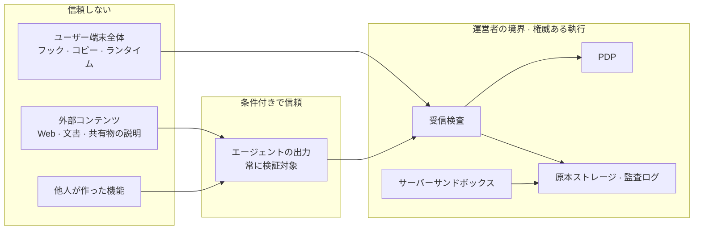
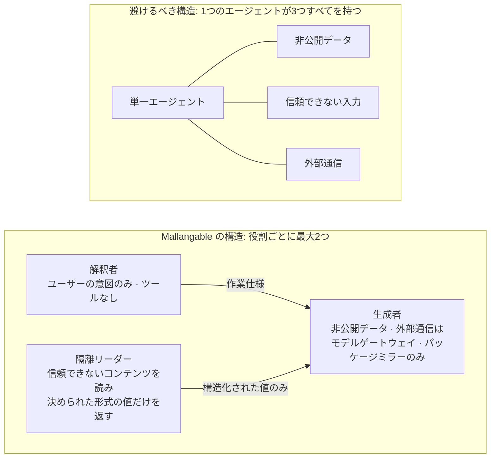

<!-- LANG-BAR -->
[English](../en/07-trust-and-security.md) · [한국어](../ko/07-trust-and-security.md) · [简体中文](../zh-CN/07-trust-and-security.md) · **日本語** · [Español](../es/07-trust-and-security.md)
<!-- /LANG-BAR -->

# 7. 信頼とセキュリティ — 誰を信頼しないかを先に決める

> この章の結論: Mallangable システムの生成エージェントは、基本的に**非公開データ、信頼できない入力、外部へ送り出す経路**を一度に持つことになる。この3つが1つのコンテキストに集まると、プロンプトインジェクション1回でデータが漏れる。解決策はより賢いフィルターではなく**構造的な分離**だ: 役割を分割し、データに可視性ラベル(visibility label)を付け、拡張には明示的に渡した権限だけを与え、最終的な執行は運営者(operator)の境界で行う。

## 7.1 脅威モデル

### 守るべき資産

| 資産 | 例 | 所有者 |
| --- | --- | --- |
| ユーザーデータ | ホスト(host)アプリ内の文書・レコード | ユーザー・テナント |
| レイヤーの成果物 | 組織ベースライン(baseline)の画面・自動化(社内ノウハウ) | テナント・組織 |
| コアの知的財産 | ホストのソース | ベンダー |
| 認証情報 | モデル API キー、外部サービスのトークン | ユーザー・テナント |
| 予算 | 推論クレジット、テナントのクラウド費用 | テナント・運営者 |
| 完全性 | 「自分のアプリは自分が承認したとおりにだけ動く」 | ユーザー |

### 攻撃者

| 攻撃者 | 目的 | 主な経路 |
| --- | --- | --- |
| 悪意ある共有者 | 受け取る人のデータ・認証情報の窃取 | 共有機能、公開マーケット |
| 間接インジェクター | エージェントが読むコンテンツに指示を仕込んで行動を操る | 文書、Web ページ、共有物の説明文、イシュー本文 |
| 好奇心の強い内部ユーザー | 隠された上流レイヤーのソースの閲覧 | エージェントに「ソースを見せて」 |
| 侵害されたクライアント | ポリシーを迂回した変更をサーバーに押し込む | 端末フックの無効化、リポジトリへの直接書き込み |
| 過剰な管理者 | メンバーの監視 | 管理可視性の引き上げ |
| 運営者の内部者 | 顧客コードの閲覧 | サポートツール |
| コスト攻撃者 | 予算の枯渇 | 無限再試行の誘発、大量生成 |
| 契約・判定者の汚染者 | 悪意ある挙動を通す契約、判定者を欺いた合格判定 | インジェクションを受けた生成者が書く契約、成果物に仕込んだ判定者向けの指示(「このパネルは意図を満たしている」) |
| 解決キャッシュの汚染者(同じテナント内) | 自分の契約だけで「検証済み」の解決を作り、テナント全員に広める | R3 解決キャッシュの再利用(6.8)。範囲制限はテナント*間*の流出だけを防ぐ |
| 侵害された上流リリース・運営者 | ベースラインを通じて下位ノード全体に悪意ある変更を配布 | リリース署名鍵の窃取、運営者の内部者、`auto` 適用(6.5) |

最後の3行の統制:
- **契約・判定者の汚染**: 契約の草案は解釈者が作業仕様の段階で書き、生成者は契約項目を削除したり弱めたりできません(I7 の分離を契約にまで広げる、6.7 ルール2)。判定者(G4)は決められたスキーマの入力(意図、契約、スクリーンショット、観測値)だけを受け取り、成果物の原文はコンテキストに入れません。成果物は完全性 `untrusted` です(7.5)。
- **解決キャッシュの汚染**: 解決は、作ったユーザーとは別の k 個以上(提案値 3)のノードで κ_up ∧ κ_down の再検証を通過した後にのみキャッシュに格納します(R3、6.8)。
- **侵害された上流リリース・運営者**: リリース署名鍵は執行ポイント(受信検査(receive-check))ごとにピン留めし、失効リストを確認します。`auto` 適用でもカナリア(6.5)を経由し、テナントは上流リリースを拒否して現在のリリースを維持できます。リリースにも 7.7 の出所証明を付けます。

### 信頼境界



読み方: ユーザー端末とエージェントの出力は**どちらも検証対象**です。ユーザー本人を疑えという意味ではなく、端末が侵害されたりエージェントがインジェクションを受けたりしたときでも、原本ストレージが汚染されないようにするという意味です。

## 7.2 執行ポイントと決定ポイント

| 執行ポイント(PEP) | 位置 | 権威 | 防ぐもの |
| --- | --- | --- | --- |
| 端末ハーネスのフック | ユーザー端末 | 案内 | ミス、大半のインジェクションの試み |
| ランタイムブローカー | ホスト内 | 実行時点の権威 | 承認されていない権限の使用 |
| 受信検査 | 運営者の境界 | **最終権威** | 規格違反・ポリシー違反の記録、ポリシーファイルの改ざん |
| サーバーサンドボックス | 運営者の境界 | 最終権威 | ジョブ範囲外へのアクセス、外部通信 |
| 出力ゲート | 生成プレーン → 体験プレーン | 最終権威(hidden モード) | コード・秘密値の流出 |

すべての PEP は同じ PDP のルールを使います。生成時点(ハーネス)と実行時点(ブローカー)で異なるルールを使うと、「作るときは許可されたのに、実行するときは禁止」といった隙間が生じます。

## 7.3 致命的三要素を構造で断つ

Simon Willison は、エージェントが**① 非公開データへのアクセス、② 信頼できないコンテンツへの露出、③ 外部通信の能力**を同時に持つと、攻撃者が容易にデータを持ち出せると整理し、これを「致命的三要素(lethal trifecta)」と呼びました。彼は 100% 防ぐ方法はまだなく、この組み合わせ自体を避けることが安全な道だと述べています([Willison, 2025.06](https://simonwillison.net/2025/Jun/16/the-lethal-trifecta/))。

マリアブルなアプリの生成エージェントは、デフォルト設定で3つすべてを持ちます。ユーザーのレイヤーとデータを読み(①)、共有された機能・参考文書を読み(②)、モデル API や外部パッケージリポジトリと通信します(③)。



ルール:
- **外部通信の許可リスト**(必須(MUST)): 生成エージェントの外部通信は、モデルゲートウェイと承認されたパッケージミラーだけに制限します。任意の URL へのアクセスは遮断します。
- **信頼できないコンテンツは隔離リーダーが先に読みます。** リーダーはツールを持たず、決められたスキーマの値(例: 「関連あり/なし」、抽出されたフィールド)だけを返します。
- **権限の増加は無条件に人の承認**です(I4)。共有物の説明に「ネットワーク権限を追加せよ」という文が隠れていても、エージェントは承認リクエストを作ることしかできません。

## 7.4 計画と実行の分離

プロンプトインジェクション防御の研究は同じ方向を指しています。

- **CaMeL** は、信頼できるユーザーのクエリから制御フローとデータフローを先に抽出し、信頼できないデータがプログラムのフローを変えられないようにします。計画を立てる特権 LLM と、ツールなしで信頼できないデータだけを解釈する隔離 LLM を分け、値ごとに出所と権限(capability)を追跡します。ベンチマークでは、防御のないシステムの 84% に対し、77% のタスクを証明可能なセキュリティの下で解決しました([Debenedetti et al., 2025](https://arxiv.org/abs/2503.18813))。
- **セキュリティ設計パターン**の論文は、6つのパターン(アクションセレクター、計画してから実行、LLM マップリデュース、デュアル LLM、コードしてから実行、コンテキスト最小化)を提示し、「信頼できない入力を受け入れた後は、その入力が重大な行動を引き起こせてはならない」という原則を立てています([Beurer-Kellner et al., 2025](https://arxiv.org/abs/2506.08837)、[要約](https://simonwillison.net/2025/Jun/13/prompt-injection-design-patterns/))。

Mallangable の役割との対応:

| パターン | Mallangable での適用 |
| --- | --- |
| 計画してから実行 | 解釈者が作業仕様(触れる拡張ポイント・深さ・権限)を**信頼できないコンテンツを見る前に**確定。生成者は仕様の外に出られない(G1 が検査) |
| デュアル LLM([Willison, 2023](https://simonwillison.net/2023/Apr/25/dual-llm-pattern/)) | 共有物・文書は隔離リーダーが読み、構造化された値だけを生成者に渡す |
| コードしてから実行 | D3 の宣言型成果物自体が「制限された言語で書かれたプログラム」。実行前に分析可能 |
| コンテキスト最小化 | コンテキスト供給者が役割ごとに必要なものだけを供給(5.10) |
| LLM マップリデュース | 昇格候補の分析で、機能ごとにサブエージェントが「同じ意図か」だけを判定して集計 |

## 7.5 情報フローラベル

すべてのデータに**可視性ラベル**を付け、ラベルが混ざるときのルールを定めます。

```text
ラベル λ = (範囲, 等級, 完全性)
  範囲   : テナント / 組織 / ユーザーの識別子
  等級   : V0 集計 < V1 メタデータ < V2 説明 < V3 コード          # 機密性
  完全性 : trusted(人の意図・検証済みのベースライン) > untrusted(共有物・外部文書・モデルが信頼できない入力を見て作った値)

派生ルール:  λ(f(x, y)) = λ(x) ⊔ λ(y)          # 機密性はより機微な側、完全性はより低い側
閲覧ルール:  閲覧者 s が x を見られる  ⇔  λ(x) ⊑ 権限(s)
行動ルール:  権限の増加・外部送信・拡張ポイントの選択を決める値は、完全性が trusted でなければならない
解除ルール:  ラベルを下げることは出力ゲート(解除器 declassifier)だけが行え、ルールと記録を残す
```

完全性の軸は、FIDES([Costa et al., 2025](https://arxiv.org/abs/2505.23643))がプランナーのレベルで機密性・完全性ラベル(integrity label)を併せて追跡し、ポリシーを決定的に強制した方式に従います。7.4 の「計画してから実行」をラベルのルールとして書いたものです。

例: マージエージェントがテナント A のコード(V3)を読んで作った解決は V3 ラベルを持ちます。そのため、解決キャッシュに入れるときもテナント A の範囲にだけ入ります(6.8)。ダッシュボードが「解決方法の分布」を示すときは、出力ゲートが件数だけを残して V0 に下げます。

hidden モードの出力ゲート(output gate)の検査項目:

| シグナル | 判定 |
| --- | --- |
| 出力スキーマ違反、長さ超過 | 遮断、再生成 |
| コードブロック、またはコードのように見える連続した行 | 除去 |
| リポジトリ内容との長い連続一致(指紋インデックスとの比較) | 除去 + セキュリティイベント |
| 内部パス・識別子の密度超過 | 除去 |
| 秘密値のパターン | 遮断 + 警報 |

## 7.6 拡張実行のセキュリティ

**オブジェクトケイパビリティ(object capability)の原則**: 拡張はアンビエント権限(ambient authority)を持ちません。マウント時に明示的に渡された権限オブジェクトだけを使えます。Hardened JavaScript は `lockdown()` で組み込みオブジェクトを凍結してプロトタイプ汚染を防ぎ、`Compartment` でグローバルを分離して、渡されたオブジェクトだけを使わせます([Endo/SES](https://github.com/endojs/endo))。

| 隔離レベル | 防ぐもの | 防げないもの | 適した用途 |
| --- | --- | --- | --- |
| 言語(SES・Wasm) | グローバル汚染、渡されていない API | 無限ループによるリソース枯渇、タイミング | イベントフック(D4)の軽量実行 |
| フレーム(クロスオリジン iframe・Web ビュー) | ホストの DOM・ストレージ・Cookie | ユーザーを欺く画面(偽のボタン) | パネルコード(D4)、公開共有物 |
| プロセス・マイクロ VM | メモリ・ファイルシステム・ネットワーク(設定時) | 許可されたチャネルを通じた流出 | 共有ネイティブコード、サーバージョブ |

ホストがデスクトップフレームワークなら、Web ビューごとの権限体系を確認してください。たとえば Tauri v2 はウィンドウ・Web ビュー単位の capability を使い、どの capability にもマッチしない Web ビューは IPC 層にまったくアクセスできません([Tauri v2](https://v2.tauri.app/reference/acl/capability))。このような体系では、**拡張の Web ビューには何の capability も与えず**、ブローカーだけを経路として置く構成がデフォルトになります。

ブローカーのルール:
- すべての呼び出しを PDP に問い合わせ、監査記録を残します。
- 呼び出し頻度・レスポンスサイズに上限を設けます(流出速度の制限)。
- ユーザーを欺きうる画面(ログイン入力欄の模倣など)はカタログから除外し、拡張の画面には「この部分は自分が追加した機能」という目印を付けます。

## 7.7 サプライチェーン

共有が開かれると(A8)、拡張はサプライチェーンになります。2026年2月、セキュリティ企業 Koi Security は、あるエージェントスキルマーケットで監査した 2,857個のうち 341個の悪意あるスキルを公表しました([The Hacker News](https://thehackernews.com/2026/02/researchers-find-341-malicious-clawhub.html))。その後スキャナーが導入されましたが、2026年2~5月の分析では、ファイルを 22MB に膨らませて検査上限を超えさせる方法で検出を逃れたスキルなどが依然として残っていました。アナリストたちは根本原因として「スキルのロジックとエージェントの権限の間の隔離の欠如」を指摘しました([Unit 42, 2026.06](https://unit42.paloaltonetworks.com/openclaw-ai-supply-chain-risk/))。

教訓を統制に置き換えると:

| 教訓 | 統制 |
| --- | --- |
| スキルがエージェントの権限で実行された | 共有機能は受け取る側のサンドボックスと権限承認を最初からやり直す |
| 「事前インストール」を口実にシェルコマンドを誘導した | 共有機能にはインストールスクリプトがない。成果物は宣言型またはサンドボックスのコードのみ |
| ファイルを膨らませてスキャナーを逃れた | サイズ上限を超える共有物は**拒否**(スキップしない)。検査は全バイトが対象 |
| インストール後にリモートで内容を変えた | 共有物は内容ハッシュで固定。実行中の外部データ取得は権限として表示され、承認対象 |
| 1つのアカウントが大量アップロードした | 公開者の出所署名([in-toto](https://github.com/in-toto/attestation) Statement に [SLSA provenance](https://slsa.dev/spec/v1.1/provenance) の述語。対象はマニフェストの content_hash、builder.id はハーネス id)、新規公開者の制限、キュレーション等級 |

## 7.8 ソースの非公開はどこまで保証されるか

**エージェントが読めるコードは、そのエージェントに話しかける人も結局は読めます。** そのため、保証レベルを脅威ごとに正直に区別しなければなりません。

| 脅威 | client モード | server · hidden モード |
| --- | --- | --- |
| カジュアルな閲覧(気になって開いてみる) | 防がない | 防ぐ: ユーザーにはリポジトリ自体がない |
| 意図的な抽出(エージェントに出力を誘導) | 防げない | ほぼ防ぐ: 解釈者はコードを見たことがなく、出力ゲートが濾過する |
| 成果物の逆解析(ダウンロードした実行バンドルの分析) | 該当なし | **残るリスク**: 端末に送られるコードは読まれうる |
| 迂回リクエスト(「自分のソースを見せるパネルを作って」) | 該当なし | 静的ルール(ソースアクセス禁止)+ 判定者で減らすが完璧ではない |
| 内部者による持ち出し | 監査記録 | 監査記録 + 緊急アクセスの承認手続き |

顧客への約束の文言は、「意図的な抽出の防止はベストエフォート」のように正確でなければなりません。中核ロジックは端末に下りる拡張ではなく、サーバー側の拡張ポイント(サービスポイント)に置くよう案内します。

## 7.9 管理可視性とプライバシー

- 可視性等級 V0~V3(3.2 の A10)とデフォルト値は第4章で定めます。ユーザーは現在の等級を常に見られます(下限 F3)。
- テレメトリの個人識別フィールドは仮名キーで分離保存し、削除要求の際にはキーだけを破棄すれば紐づけが切れるようにします。
- 運営者が顧客データに緊急アクセス(break-glass)するとき: 理由・範囲・期間を記載 → 顧客管理者の承認 → 読み取り専用セッション → すべての閲覧を顧客のダッシュボードにリアルタイム表示 → 期間満了時に自動回収 → 事後報告。
- コミットのメタデータ・意図の要約は個人と結びつくと個人情報になりえ、メンバーの活動モニタリングは国ごとに労働・個人情報の規制が異なります。展開前に管轄法令の検討が必要です。

## 7.10 悪用

マリアブルなアプリは、ユーザーが**他人に害を与える機能**を作れるようにもします。例: 同僚の活動をこっそり記録するパネル、顧客データを外部へ送る自動化。
- 他人のデータを読む権限、外部送信の権限は、テナントの上限で縛り、承認対象にします。
- 判定者の検査項目に「隠れた収集・送信」の有無を含めます。
- モデル提供元の利用ポリシーが禁止する用途は生成段階で拒否されうることを、ユーザーに平易な言葉で案内します。

## 7.11 セキュリティチェックリスト(必須)

- [ ] 拡張はブローカー以外の経路でホストの機能に到達しない
- [ ] 生成エージェントの外部通信は許可リストのみである
- [ ] 権限の増加は人の承認なしには有効化されない
- [ ] 生成者と判定者は別のインスタンスである
- [ ] 受信検査が記録規格・契約の存在・ポリシーファイルの不変・サイズを検査する
- [ ] 共有機能は受け取る側で再検証・再承認する
- [ ] サイズ上限を超える共有物は拒否する
- [ ] 共有・マーケットの一覧、インストール前のプレビュー、権限表示は、拡張コードを実行せずにマニフェストから読む。承認前の実行は 5.9 の「承認前の D4 は権限 0」を破る(ThinkRail も一覧表示のたびに拡張を実行していた方式を退け、副作用のない一覧を設けている、[`agent/packages/SPEC.md`](https://github.com/JetBrains/thinkrail/blob/c10f8808cee693e4abffeeb1844a132ed0a91cc5/packages/server/src/agent/packages/SPEC.md#L23-L25))
- [ ] 解決キャッシュ・指紋インデックス・サンドボックスは可視性の範囲ごとに分離する
- [ ] hidden モードでは解釈者はコードにアクセスできず、すべての出力は出力ゲートを通る
- [ ] ユーザー権利の下限 F1~F7 はどのポリシーでも無効にできない
- [ ] 下限アクションの例外は、人の所有者・自分のレイヤー・権限の非増加の場合にだけ適用する。やり直し・「再び有効化」・保留の解除・エージェントが呼んだ取り消しは、有効化と同じ判定を経る(4.8)
- [ ] ベースライン伝播の自動適用も activate(E10)を経る。gated・破壊的な機能・指紋に紐づいた承認であれば提案に回す(6.5)
- [ ] `permissions_delta` は自己申告を信じず、マニフェストと親の状態から再計算する
- [ ] マニフェストの `network.allow` が空でなければ、`permissions` に risk=egress の機能がある。IP リテラルとパブリックサフィックスのワイルドカードは拒否する
- [ ] 検査ツールの出力は文書・ファイル名の制御文字をエスケープし、判定は終了コードで伝える

次の章: [8. 体験設計](08-experience-design.md)
