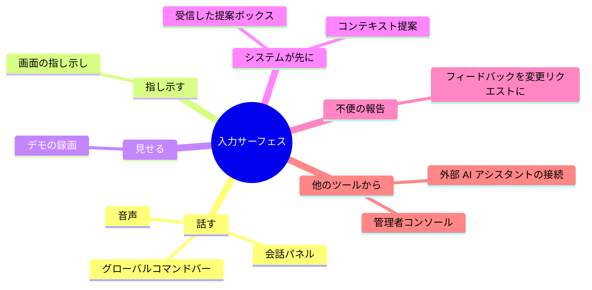
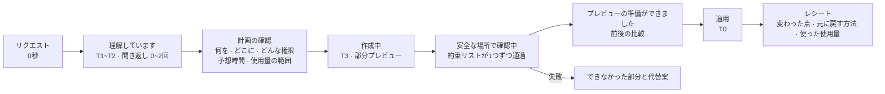
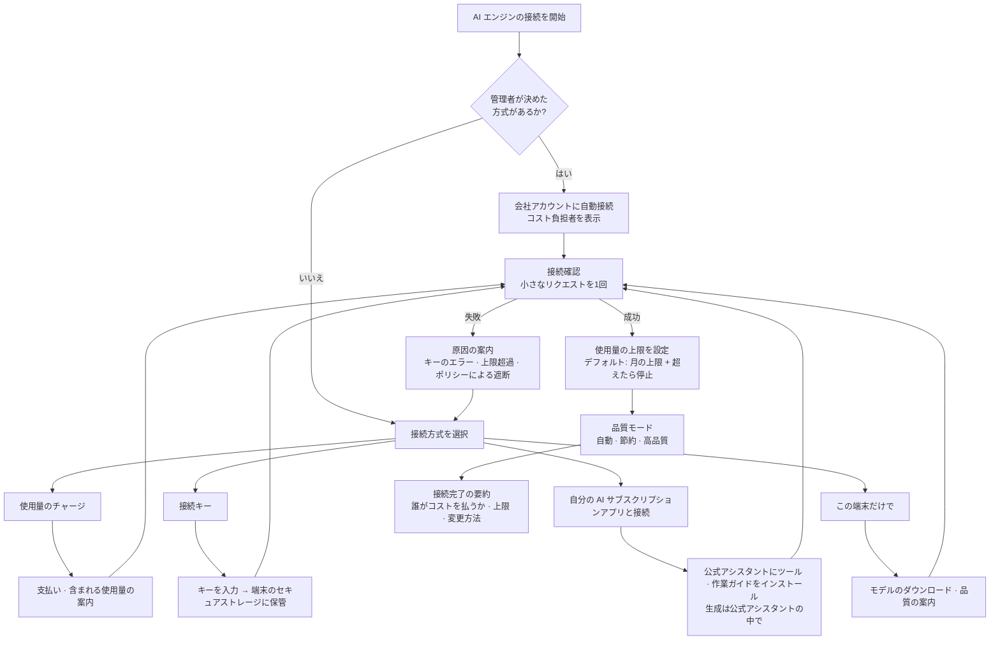

<!-- LANG-BAR -->
[English](../en/08-experience-design.md) · [한국어](../ko/08-experience-design.md) · [简体中文](../zh-CN/08-experience-design.md) · **日本語** · [Español](../es/08-experience-design.md)
<!-- /LANG-BAR -->

# 8. 体験設計 — どこで聞き、待ち時間をどう見せ、どんな言葉で話すか

> この章の結論: ユーザーは「AI がコードを直す」ことを望んでいない。**「自分が言ったとおりに変わり、気に入らなければすぐ元に戻る」** ことを望んでいる。そのため体験プレーン(plane)は、① 指し示して話せる入力、② 時間ティア(time tier)ごとに正直な進行表現、③ 進行表示を「約束リストが1つずつ通過していく様子」として見せること、④ 開発用語を隠す用語パック(lexicon pack)、⑤ 規約を守る AI エンジン接続フローを備えなければならない。

## 8.1 体験の原則

| # | 原則 | 意味 |
| --- | --- | --- |
| X1 | 意図の言葉で | ユーザーは「何を望むか」だけを言う。深さ・拡張ポイント・権限はシステムが判定し、平易な言葉で示す |
| X2 | 指し示せるように | 「これ」と言えなければならない。画面の指し示しが最も正確なコンテキストだ |
| X3 | 元に戻す方法が先 | 適用ボタンより元に戻す方法が先に見える。取り消しは即時、無料 |
| X4 | 待ち時間を正直に | かかる時間と使用量を事前に範囲で伝え、進行は実際の進捗で示す |
| X5 | 開発用語なしで | 基本レベルの画面にはコミット・ブランチ・マージといった言葉が出てこない |
| X6 | コストが見えるように | ユーザー負担のコストがあれば、生成前に範囲を、生成後に実際の値を示す |

## 8.2 入力サーフェス



| サーフェス | 使い方 | 強み | 注意 | 主に扱う深さ |
| --- | --- | --- | --- | --- |
| グローバルコマンドバー | ショートカットで開き、1文を入力 | どこからでも速い | コンテキスト不足 → 現在の画面を自動添付 | D1~D4 |
| 画面の指し示し | 「修正モード」で要素を押して話す | **拡張ポイント id が自動で決まり**、解釈ミスが大きく減る | コア領域は「ここは変更できません」と表示 | D1~D3 |
| 会話パネル | 横のパネルで複数回やりとり | 複雑な要求、聞き返し | 会話が長くなったら作業仕様に要約して確認 | すべて |
| 音声 | 話して依頼 | 手がふさがっている状況 | 確認ステップは画面で | D1~D2 |
| デモの録画 | 「自分がやるのを見て、そのとおりに作って」 | 言葉で説明しにくい反復手順 | 録画中は個人情報の表示、範囲の指定 | D2 |
| コンテキスト提案 | 同じ操作を繰り返すと「自動でやりましょうか?」 | ユーザーが知らなかった機会 | 提案頻度の上限(提案: 1日1回)、オフにできる | D2 |
| 受信した提案ボックス | 共有された機能、新しい基本版の到着 | 受け身のユーザーにも恩恵 | 権限の変化を強調 | すべて |
| フィードバックの変換 | 「これ不便です」という報告がそのまま変更リクエスト | 参入障壁が最も低い | ベンダーへ送る報告と自分の修正リクエストを区別 | すべて |
| 外部 AI アシスタントの接続 | ユーザーが使う AI アシスタントがツールでアプリを修正 | 開発者、自動化 | ハーネスの強制が必須 | すべて |
| 管理者コンソール | 組織の基本版の編集、昇格のレビュー | 組織単位の改善 | 影響範囲(ユーザー数)の表示 | D1~D4 |

デモの録画は「デモンストレーションによるプログラミング(programming by demonstration)」の系統で、コンテキスト提案はその逆方向です。システムが反復を検知して先に提案します。どちらも結果は D2(既存機能の組み合わせ)に落ちることが多く、安全で速いです。

## 8.3 意図の収集

1. **聞き返しは最大1~2回**(推奨(SHOULD))。それ以上必要なら、最もありそうな解釈でプレビューを作り、プレビューの上で修正してもらいます。人は質問されるより、成果物を見て修正するほうを簡単に感じます。
2. **より単純な方法を先に**(必須(MUST)、最小深さの原則(least-depth rule)の体験版): リクエストが設定や既存機能の組み合わせで解決するなら、それを先に示します。「新しいパネルを作ることもできますが、今の一覧で『期限切れのものだけ』フィルターをオンにすればすぐにできます。」
3. **範囲を言葉で確認**: 実行前に1行で返します。「サイドバーの下に『今週完了したこと』の一覧を追加します。タスクの読み取り権限だけを使います。」
4. **できないことも伝える**: ポリシーの上限に引っかかったら、どの層のルールなのかと次の行動(管理者に依頼)を示します。

## 8.4 時間ティア T0~T4

人が感じる応答時間には3つの境界があります。0.1秒以内は即時の反応として、1秒以内は思考の流れが途切れないものとして、10秒は注意を保てる限界として感じられます。10秒を超えると完了予測を示す進行表示が必要で、作業量がわからないときは処理中の項目を1つずつ名前で示すほうがよいとされます([NN/g](https://www.nngroup.com/articles/response-times-3-important-limits/))。

| ティア | 時間 | 該当する作業 | 体験パターン | 文言の例 |
| --- | --- | --- | --- | --- |
| T0 | 0.1秒未満 | 取り消し、D1 トークンの適用、プレビューの切り替え | 楽観的な即時反映、進行表示なし | (表示なし) |
| T1 | 0.1~1秒 | D2 ショートカット・ルールの適用 | 即時反映 + 小さな確認トースト | 「適用しました · 元に戻す」 |
| T2 | 1~10秒 | 短い生成(D1~D2 の文の解釈、簡単なルール) | 小さな進行表示 + 段階の文言 | 「理解しています…」 |
| T3 | 10秒~数分 | D3・D4 の生成と検証 | **段階型の進行 + 約束リストの通過表示 + 部分プレビュー**、他のことをしていてよいと案内 | 「作成中 · 約30秒~1分 · 終わったらお知らせします」 |
| T4 | 数分~数日 | 新しい基本版の伝播、組織の承認、共有の受諾 | バックグラウンド + 通知 + 適用時点の予約 | 「新しい基本版の準備ができました · 金曜の午後に適用」 |

展開速度の期待値: 個人の変更は T0~T3 のうちに終わらなければならず、基本版の伝播(T4)は段階的適用(カナリア)のため意図的に遅くなっています。ユーザーには「全員に一度に適用せず、問題がないか見ながら順番に適用します」と説明します。

## 8.5 生成過程の見せ方



### 状態を表す言葉は4つに固定

`理解しています` → `作成中` → `確認しています` → `準備ができました`。すべてのサーフェスで同じ言葉を使います。状態を表す言葉が画面ごとに違うと、ユーザーは同じ作業が進行中なのか判断できません。

### 進行表示 = 約束リスト

T3 の作業の進捗率は、漠然としたパーセントではなく**契約(約束リスト)の通過状況**で示します。作業量がわからないときは処理項目を名前で示せという原則と同じであり、同時に「何を保証するのか」を自然に伝えます。

```text
確認しています (2/3)
  ✓ 今週完了したことだけが表示されます
  ✓ 完了したことがなければ「今週完了したことはありません」と表示されます
  … 画面が遅くならないか確認しています
```

### 部分プレビュー

宣言型の画面(D3)は、生成の途中でも構造ができた順に描いて見せることができます。生成 UI の標準である A2UI も、メッセージを段階的に受け取って描画する方式をサポートしています([Lynx ドキュメントの A2UI の説明](https://lynxjs.org/react/genui/a2ui))。ただし、部分プレビューには「まだ確認前」の表示を付けて完成品と区別します。

### 失敗の表現

失敗には必ず3つを含めます。**何ができなかったのか**(平易な言葉)、**なぜなのか**(ポリシー・技術の1行)、**今できること**(より単純な代替案、管理者への依頼、再試行)。

```text
「完了したらチームチャットに通知」機能はまだオンにしていません。
外部に内容を送る機能なので、会社のポリシー上、管理者の承認が必要です。
[管理者に承認を依頼]  [通知の代わりに自分の画面にだけ表示]  [キャンセル]
```

## 8.6 変更レシート

すべての適用の後に残る記録カードです(ユーザー権利の下限(user floor rights) F7)。

```text
変更レシート · 10月28日 午前9:41
何を: サイドバーに「今週完了したこと」の一覧を追加しました
どこに: サイドバーの下側
許可範囲: タスクの読み取り (新たに追加された許可なし)
約束リスト: 3つすべて確認済み
使用量: 約 0.3 クレジット (今月 4.1 / 30)
誰が見られるか: 自分、チーム管理者(変更の説明まで)
元に戻す: [今すぐ元に戻す] または「さっきのを元に戻して」と話す
```

## 8.7 取り消しの体験

- 言葉で: 「さっきのを元に戻して」「昨日の状態に」。解釈が曖昧なら最近の変更3つを示します。
- 時間スライダー: 最近の状態をサムネイルでめくって選びます。
- セーフモード(safe mode): アプリがおかしければ、起動時に「基本モードで起動」を選びます。自分の変更は消えず、オフになっているだけです。
- 自動復旧の通知: 「最近追加した『自動並べ替え』がエラーを起こしたので、いったんオフにしました。[再び有効化] [詳細]」。

## 8.8 新しい基本版・共有の提案

```text
チームの基本版が新しく出ました (2026.11)
- 自分が作った機能7つのうち6つはそのまま移行されました
- 1つは選択が必要です: 「サイドバーの今週の一覧」
  新しい基本版ではサイドバーがタブに変わりました
  [タブに移す (おすすめ)]  [以前の方式を維持]  [両方が動くように作り直す]
- 変わる画面3か所のプレビュー ▸
[今すぐ適用]  [金曜の午後に適用]  [後で]
```

3つの選択肢は、6.7 の意図の衝突(intent conflict)の選択肢と同じです。共有の提案も同じ形式に「誰が送ったか」と「新たに必要な許可範囲」を加えます。

## 8.9 用語パック(Lexicon Pack)

### なぜ必要なのか

このシステムの内部は、バージョン管理・権限・サンドボックスといった開発の概念で満ちています。一般のユーザーにとって「衝突を解決してマージしますか?」は警告文のように聞こえます。用語パックは**概念 id 1つにレベル別・分野別・言語別の表現を結びつけた**辞書であり、体験プレーンのすべての文字列とエージェントのユーザー向け回答がこの辞書を経由します。

### 構造

```text
概念 id (安定)
 └ レベル別の表現: basic(一般) · practitioner(実務者) · developer(開発者)
    └ 分野による上書き: education · healthcare · enterprise …
       └ 言語: ko · en …
```

- ユーザーは基本的に `basic`。画面の「詳しく見る」をオンにすると `practitioner`、開発者設定で `developer`。
- 分野パックはベンダーやテナントが追加します(第9章 B13)。

### 対応表(基本: 日本語)

| 概念 id | 開発用語 | 一般ユーザー向けの表現 (basic) | 1行の説明 |
| --- | --- | --- | --- |
| change | 変更 | 変えたもの | 一度に変えた内容 |
| feature | 機能 | 自分が作った機能 | 同じ目的で変えたもののまとまり |
| record | コミット | 保存ポイント | いつでも戻ってこられるポイント |
| branch | ブランチ | 実験版 | 元のものに触れずに試してみるコピー |
| merge | マージ | 合わせる | 2つのバージョンを1つに合わせる |
| conflict | 衝突 | 重なる部分 | 双方が同じ場所を別々に変えた |
| intent_conflict | 意図の衝突 | 選択が必要な部分 | 2つを同時には満たせない |
| revert | ロールバック | 元に戻す | 以前の状態に戻る |
| baseline | ベースライン · LTS | 基本版 (公式の基本版 · 会社の基本版 · チームの基本版) | 皆が出発点として使うバージョン |
| release | リリース | 新しい基本版 | 基本版が新しく出る |
| fork | フォーク | 自分のコピー | 基本版から分かれた自分のバージョン |
| extension_point | 拡張ポイント | 変えられる場所 | アプリが修正を許可した位置 |
| capability | 権限 | 許可範囲 | 機能が使えるデータと行動 |
| sandbox | サンドボックス | 安全な場所 | 他に影響を与えずに先に動かしてみる場所 |
| validation | 検証 | 確認 | 約束どおりに動くかの検査 |
| contract | 契約 · 受け入れ条件 | 約束リスト | この機能が必ず守るべきこと |
| diff | 差分 | 変わった点 | 前と後の違い |
| activate | デプロイ · 有効化 | 適用 | 実際にオンにする |
| safe_mode | セーフモード | 基本モードで起動 | 自分の変更をすべてオフにして起動 |
| quarantine | 隔離 | いったんオフ | 問題を起こした機能を止める |
| depth | 深さ D1~D4 | 変える度合い (見た目 · 組み合わせ · 画面 · 動作) | どれだけ深く変えるか |
| policy_ceiling | ポリシーの上限 | 会社が許可した範囲 | 管理者が決めた限度 |
| canary | カナリアデプロイ | 順番に適用 | 一部から適用して問題を確認 |
| drift | ドリフト | 基本版より遅れている | 最新の基本版を反映していない度合い |
| subscribe_share | 購読型の共有 | 受け取り続ける | 送った人が修正すると自分も更新の提案を受ける |
| promotion | 昇格 | 公式機能として採用 | 複数の人が作った機能が基本版に入る |
| audit_log | 監査ログ | 活動記録 | 誰がいつ何をしたか |
| visibility | 管理可視性 V0~V3 | 管理者に見える範囲 | 管理者が見られる情報の度合い |
| agent | エージェント | AI アシスタント | 変更を作ってくれる AI |
| model | モデル | AI エンジン | AI アシスタントが使う頭脳 |
| api_key | API キー | 接続キー | AI エンジンを使うための秘密のコード |
| tokens | トークン | 使用量 | AI エンジンを使った量 |
| route_quality | モデルルーティング | 品質モード (節約 · 標準 · 高品質) | 速度・コスト・品質のバランス |

### 適用ポイント

| ポイント | 方式 |
| --- | --- |
| UI 文字列 | 概念 id だけで記述し、レンダリング時に `LexiconPort.render` |
| エージェントのユーザー向け回答 | 出力段階(E13)で説明者の役割が basic レベルに書き直す |
| エラー・拒否メッセージ | PDP の拒否理由コード → 概念 id → 文 |
| レシート・アップグレードの要約 | 説明者の役割が生成、lint の通過が必須 |
| 開発プロセス | UI 文字列のリポジトリに lint をかけ、basic 画面の禁止語(コミット、ブランチ、マージ、併合、トークン、API など)をビルド段階で遮断 |

### 保存と出所

- **保存は概念 id で**(必須): レシート・通知・記録のように保存されたり端末間をやりとりしたりするデータには、完成した文を入れず `概念 id + 引数` を入れます。文は表示するときに作ります。そうすれば、ユーザーがレベル(basic ↔ developer)や言語を変えたとき、過去のレシートも一緒に変わります。ユーザーやエージェントが自ら付けた名前(機能名など)はそのまま表示します。
- **用語パックはデータであり、出所が決まっている**(必須): 用語パックは文字列だけを持ち、コードを持ちません。用語パックを入れられるのはベンダー・テナント(分野パック、第9章 B13)とユーザー自身の設定だけで、**共有機能や上流ではないレイヤーは用語パックを変えられません。** そうでなければ、受け取った機能が権限警告の文言(「患者情報へのアクセス」)を穏やかな言葉に変えて承認を引き出せてしまいます(F5)。
- **フォールバック順序**: 分野パックの正確な言語 → 基本パックの正確な言語 → 基本パックのデフォルト言語 → 概念 id そのもの。欠けた項目1つのせいで画面全体が別の言語に変わらないよう、文字列単位でフォールバックします。
- ThinkRail も保存・通信データに翻訳文を入れず、ユーザーの言語ファイルはグローバルなデータフォルダからだけ読み込み、「クローンしたリポジトリが UI を書き換えられないように」しています([JetBrains/thinkrail `architecture.md` 決定 23](https://github.com/JetBrains/thinkrail/blob/c10f8808cee693e4abffeeb1844a132ed0a91cc5/architecture.md#L430-L454))。ただし ThinkRail はエージェントの出力を翻訳しませんが、Mallangable は basic ユーザーのために説明者が書き直します(上の表)。

### 分野による上書きの例

| 概念 | 基本 | 教育 | 病院業務 | 社内業務 |
| --- | --- | --- | --- | --- |
| feature | 自分が作った機能 | 自分の授業ツール | 自分の業務ツール | 自分の業務ツール |
| baseline | 基本版 | 学校の基本版 | 病院の標準画面 | うちのチームの標準 |
| capability: 個人データの読み取り | 情報の読み取り | 生徒情報を見る | **患者情報へのアクセス**(警告を強化) | 顧客情報を見る |
| share | 共有 | 同僚の先生と分け合う | 同じ科と分け合う | チームに共有 |

全体の例: [`examples/lexicon.ja.yaml`](../../examples/lexicon.ja.yaml)、スキーマ: [`schemas/lexicon-pack.schema.json`](../../schemas/lexicon-pack.schema.json)。

## 8.10 AI エンジン(モデル)の接続

### 接続方式(ユーザーに見える名前)

| ユーザーに見える名前 | 内部経路(A9) | いつ | ユーザー体験 |
| --- | --- | --- | --- |
| 会社のアカウントで使う | `tenant_cloud` | 管理者が設定済み | 選択画面なしですぐに使用。誰がコストを払うかを表示 |
| 使用量をチャージして使う | `credits` | 最も簡単な始め方 | 含まれる使用量 + チャージ、月の上限 |
| 接続キーを貼り付ける | `byok` | すでに AI サービスのアカウントを持つユーザー・チーム | キーを貼り付け → 接続確認 → 上限設定 |
| 自分の AI サブスクリプションアプリと接続 | `sub` | 提供元の公式 AI アシスタントをすでに使っているユーザー | 公式アシスタントにこのアプリの「ツール」と「作業ガイド」を追加。生成はそのアシスタントの中で行われる |
| この端末だけで使う | `on_device` | オフライン・プライバシー | モデルのダウンロード、品質の案内(「簡単な変更に適しています」) |

### フロー



### サブスクリプション接続に関する規約の原則

- 提供元ごとにポリシーが異なり、頻繁に変わります。2026年2月、Anthropic は Free・Pro・Max のサブスクリプションで得た認証トークンを他の製品・ツール・サービス(Agent SDK を含む)で使うことを消費者規約違反と明記し、例外を API キーによるアクセスや明示的に許可した場合としました([The Register](https://www.theregister.com/2026/02/20/anthropic_clarifies_ban_third_party_claude_access))。一方、同時期に一部の提供元が特定のサードパーティーツールと提携し、サブスクリプションでの利用を開放した事例も報じられました([まとめ記事](https://falcao.org/posts/anthropic-claude-access-crackdown-ecosystem-fallout/))。
- そのため設計原則は1つです。**「サブスクリプション接続」アダプターは提供元が文書で許可した経路だけを実装し、提供元ごとのフラグでオン・オフする。** 許可された経路のない提供元のサブスクリプションは、「公式アシスタントに自分たちのツールを付ける」方式(上の表の `sub`)でのみサポートします。この場合、生成はユーザーが起動した公式クライアントの中で行われ、自分たちのアプリはトークンを扱いません。
- サーバー側の作業(マージ・昇格など)には、ユーザー個人のサブスクリプションを使いません(L2)。

### セキュリティとコストの表示

- 接続キーは、端末のセキュアストレージ(OS のキーチェーンなど)かテナントのシークレット管理システムにだけ置きます。変更リポジトリ・ログ・エージェントのコンテキストには決して入れません(必須)。
- `sub` 経路のように公式アシスタントの中で MCP ツールとして動作するときは、接続キーや外部サービスのトークンを会話や form モードの入力で受け取りません。MCP 仕様は、秘密値・認証情報には URL モードの elicitation を使うよう求めています([2026-07-28 版](https://modelcontextprotocol.io/specification/2026-07-28/client/elicitation))。キーがエージェントのコンテキストに一度も入らないことで、I6 が守られます。
- 同じ版で MCP Sampling は廃止予定です([変更点](https://modelcontextprotocol.io/specification/2026-07-28/changelog))。モデル呼び出しを MCP クライアントに肩代わりさせる方式で `ModelPort` アダプターを作りません。
- 生成前に `ModelPort.estimate()` で**範囲**を示します(「約 0.2~0.5 クレジット」)。単一の数字は外れやすく、外れると信頼を失います。
- デフォルトは**月の上限 + 超えたら停止**です(下限 F6)。超えたら「今月の使用量を使い切りました。上限を上げる · 節約モードで続ける · 来月まで待つ」から選んでもらいます。
- 上限超過・提供元の障害時の代替経路(例: 標準 → 節約モード)はポリシーに事前に記載し、切り替わったことをユーザーに知らせます。

## 8.11 接続プロセスに付随するビジネス接点

詳しいモデルは第9章にあり、ここでは体験プレーンで生じる接点だけを整理します。

| 接点 | 形態 | 関連する BM |
| --- | --- | --- |
| 初回接続 | 料金プランに含まれる使用量を提供 → チャージ | B3 クレジットマージン |
| 品質モードの選択 | 高品質モードは上位の料金プラン | B15 品質等級 |
| 接続キーの使用 | プラットフォーム利用料(検証・保存・伝播のコスト) | B4 BYOK プラットフォーム料金 |
| 会社アカウントの接続 | 企業コネクター・監査機能 | B6 ガバナンス、B7 機密実行 |
| 成果基準の表示 | 「検証を通過した変更にだけ課金」オプション | B16 成果単位の課金 |
| 提供元への加入案内 | 提供元の提携プログラムがある場合のみ | B14 提供元との提携 |

## 8.12 アクセシビリティと言語

- プレビューの前後比較は、スクリーンリーダーでも「変わった点の一覧」として読まれるようにします。
- 画面の指し示しモードは、キーボードでも要素を巡回して選べなければなりません。
- 生成された拡張も、アクセシビリティの基本ルール(コントラスト、ラベル、キーボード操作)を G3 で検査します。ユーザーの修正がアクセシビリティを損なってはなりません。
- 基本の文言は韓国語で書き、英語は併記するか、用語パックの言語切り替えで提供します。

## 8.13 体験指標

| 指標 | 定義 | なぜ見るのか |
| --- | --- | --- |
| 最初の変更までの時間 | インストール(または機能の発見)から最初の適用まで | 参入障壁 |
| 聞き返しの回数 | リクエストあたりの平均 | 解釈の品質 |
| 段階別の離脱 | 理解・計画・作成・確認・プレビューの各段階で諦めた割合 | どこで待ち時間が崩れるか |
| プレビューの適用率 | プレビューのうち適用した割合 | 結果の品質 |
| 24時間以内の取り消し | 適用後24時間以内に元に戻した割合 | 隠れた品質の問題 |
| レシートの閲覧率 | レシートを開いて見た割合 | 信頼・透明性への需要 |
| 予想に対する実際のコスト | 実際のコストが予想範囲内に収まった割合 | コストへの信頼 |
| 基本レベルの lint 違反 | リリースされた文字列・回答のうち開発用語が露出した件数 | 用語パックの品質 |

次の章: [9. ビジネスとの結合](09-business-coupling.md)
