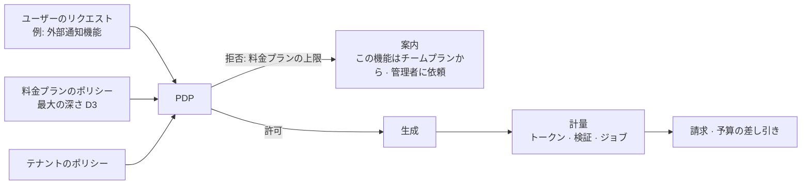

<!-- LANG-BAR -->
[English](../en/09-business-coupling.md) · [한국어](../ko/09-business-coupling.md) · [简体中文](../zh-CN/09-business-coupling.md) · **日本語** · [Español](../es/09-business-coupling.md)
<!-- /LANG-BAR -->

# 9. ビジネスとの結合 — ビジネスモデルはアーキテクチャの選択に縛られている

> この章の結論: ビジネスモデル(business model, BM)は、アーキテクチャの上に後から載せるものではない。**エージェントの位置(A3)、トポロジー(A6)、共有範囲(A8)、管理可視性(A10)、モデル調達(A9)** が、何を売れるかを決める。この章は20個の BM を軸の条件として定義し、リファレンスプロファイル(reference profile)ごとに可否を計算する。そして2つの統合原則を示す: **料金プランはポリシーの上限である**、**最小深さの原則(least-depth rule)はセキュリティの原則であり、原価の原則でもある**。

## 9.1 なぜ一緒に設計すべきなのか

- 第3章で見たとおり、構造の軸は変えるのに高くつき、ビジネスの軸は安く変えられます。ところが、**あるビジネス軸の値は特定の構造でしか存在しません。** 例: ソース非公開の実行を売るには(B7)、サーバーエージェントと hidden 可視性が最初からなければなりません。
- 逆に、最初に選んだビジネスモデルが構造を強制することもあります。推論をまとめて売るなら(B3)、計量・予算・不正利用防止が必須になり、これは管理可視性 V0 以上(N3)を要求します。

## 9.2 価値単位と原価ドライバー

| 価値単位(何にお金を払うか) | 原価ドライバー(何にお金がかかるか) |
| --- | --- |
| アクティブユーザー・シート | 推論トークン(生成・判定・マージ) |
| 完成した変更(検証通過) | 検証の実行(サンドボックス・契約・スクリーンショット) |
| 基本版での存続(アップデート後も動作) | 伝播ジョブ(ユーザー数 × リリース数、6.8) |
| 共有・インストール | キュレーション・審査の人員 |
| 管理・監査機能 | 保存・テレメトリ |
| 機密実行環境 | サーバーサンドボックス・オンプレミス運用 |

変更1つあたりの貢献利益:

```text
margin(δ) = price(δ) − [ tokens(δ) × unit_price(route) + c_validate(depth) + c_store + c_support / 変更数 ]
```

`tokens` と `c_validate` は深さに応じて大きくなります。D2 でできることを D4 で作ると、高くつき(モデル呼び出し・判定ゲートの追加)危険です。そのため**最小深さの原則(2.6)はセキュリティの原則であると同時に原価の原則**です。解釈者がより単純な方法を先に提案する体験(8.3)は、ユーザー満足とマージンを同時に高めます。

## 9.3 BM カタログ

| id | BM | 課金単位 | 必要なアーキテクチャ条件 | 計量・執行ポイント |
| --- | --- | --- | --- | --- |
| B1 | ライセンス販売 | 端末・ユーザーあたり1回 | なし | ライセンスサーバー |
| B2 | シートサブスクリプション | 月額シート | なし(サーバー機能があるほど価値が上がる) | アイデンティティ・計量 |
| B3 | 推論クレジットマージン | 使用量 | `A9=credits`(+ N3: `A10≥V0`) | モデルゲートウェイ |
| B4 | BYOK プラットフォーム料金 | 月額固定またはジョブ単位 | `A9∈{byok, tenant_cloud}`、サーバー機能があれば完全 | ジョブ実行器・計量 |
| B5 | 共有マーケット手数料 | 有料機能の販売額の一定割合 | `A8=public`(テナント内部は内部精算) | 共有サービス |
| B6 | ガバナンスアドオン | テナント月額 | `A10≥V1` | ダッシュボード・監査 |
| B7 | 機密実行プレミアム | テナント月額 | `A3=server` ∧ `A5=hidden` | サーバーサンドボックス・出力ゲート |
| B8 | ベースラインサポート契約 | 年間契約 | `A6=lineage` ∧ `A7∈{proposed, auto}` | 系譜レジストリ・ジョブ実行器 |
| B9 | アップグレード存続保証 | 有効な機能あたり月額 | `A6∈{fork, lineage}` ∧ `A7∈{proposed, auto}` | 伝播パイプライン・契約の実行 |
| B10 | 昇格分配 | 昇格1件あたりの報酬 | `A6=lineage`(+ 共有・V1 以上なら完全) | 昇格パイプライン |
| B11 | 地域の開発者との連携 | 連携1件あたりの手数料 | 可視性が open/own なら完全、hidden ならテナント内部の専門家のみ | エスカレーションキュー |
| B12 | 需要シグナルレポート | レポートの購読 | `A10≠none` | テレメトリの集計 |
| B13 | 用語・ドメインパック | パックライセンス | なし | 用語変換器 |
| B14 | モデル提供元との提携 | 提供元の提携条件による | `A9≠on_device`、提供元の公式プログラムがある場合のみ | モデルゲートウェイ |
| B15 | 品質等級の差別化 | 料金プランの差別化 | `A9=credits`(BYOK・テナントクラウドはサーバールーティング時に条件付き) | モデルゲートウェイのルーティング |
| B16 | 成果単位の課金 | 検証を通過した変更あたり | `A10≠none` ∧ `A9∈{credits, byok, tenant_cloud}` | 検証ゲート + 計量 |
| B17 | ランタイム OEM ライセンス | 年間ライセンス | なし(仕様は公開 + 実装は商用) | — |
| B18 | 解決レシピの購読 | 購読 | `A6∈{fork, lineage}` ∧ `A7∈{proposed, auto}` | 解決キャッシュ・リリース |
| B19 | 機能の製品化分配 | 販売額の分配 | `A8=public` | 共有サービス・昇格 |
| B20 | スポンサー付きデフォルト枠(注意) | 露出・コンバージョン | `A8=public`、表示義務を満たす場合のみ | ケイパビリティマップ・推薦 |

## 9.4 リファレンスプロファイル × BM 結合行列

`python3 tools/design_space.py --bm` の計算結果です。● そのまま可能、◐ 条件付き(運用方式・外部契約が必要)、○ 構造上不可能。

| BM | 名前 | P1 個人工房 | P2 チームキュレーション | P3 企業機密 | P4 大衆消費者 | P5 ローカルファースト | P6 マーケットプラットフォーム | P7 閉域網公共 |
| --- | --- | :-: | :-: | :-: | :-: | :-: | :-: | :-: |
| B1 | ライセンス販売 | ● | ● | ● | ● | ● | ● | ● |
| B2 | シートサブスクリプション | ● | ● | ● | ● | ● | ● | ● |
| B3 | 推論クレジットマージン | ○ | ○ | ○ | ● | ○ | ● | ○ |
| B4 | BYOK プラットフォーム料金 | ○ | ● | ● | ○ | ◐ | ○ | ● |
| B5 | 共有マーケット手数料 | ○ | ◐ | ◐ | ● | ◐ | ● | ◐ |
| B6 | ガバナンスアドオン | ○ | ● | ● | ● | ○ | ● | ● |
| B7 | 機密実行プレミアム | ○ | ○ | ● | ◐ | ○ | ○ | ● |
| B8 | ベースラインサポート契約 | ◐ | ● | ● | ○ | ○ | ● | ● |
| B9 | アップグレード存続保証 | ● | ● | ● | ○ | ○ | ● | ● |
| B10 | 昇格分配 | ○ | ● | ● | ○ | ○ | ● | ● |
| B11 | 地域の開発者との連携 | ◐ | ● | ◐ | ● | ● | ● | ◐ |
| B12 | 需要シグナルレポート | ○ | ● | ● | ● | ○ | ● | ● |
| B13 | 用語・ドメインパック | ● | ● | ● | ● | ● | ● | ● |
| B14 | モデル提供元との提携 | ◐ | ◐ | ◐ | ◐ | ◐ | ◐ | ◐ |
| B15 | 品質等級の差別化 | ○ | ◐ | ◐ | ● | ○ | ● | ◐ |
| B16 | 成果単位の課金 | ○ | ◐ | ◐ | ● | ○ | ● | ◐ |
| B17 | ランタイム OEM ライセンス | ● | ● | ● | ● | ● | ● | ● |
| B18 | 解決レシピの購読 | ● | ● | ● | ○ | ○ | ● | ● |
| B19 | 機能の製品化分配 | ○ | ◐ | ◐ | ● | ◐ | ● | ◐ |
| B20 | スポンサー付きデフォルト枠 | ○ | ○ | ○ | ◐ | ○ | ◐ | ○ |

推奨される組み合わせ 36,772個全体において、各 BM が可能な割合(`--bm-stats`):

| BM | 名前 | ● 可能 | ◐ 条件付き | ○ 不可能 |
| --- | --- | ---: | ---: | ---: |
| B1·B2·B13·B17 | ライセンス・シート・用語パック・OEM | 100.0% | 0.0% | 0.0% |
| B12 | 需要シグナルレポート | 88.8% | 0.0% | 11.2% |
| B6 | ガバナンスアドオン | 66.6% | 22.2% | 11.2% |
| B11 | 地域の開発者との連携 | 56.7% | 43.3% | 0.0% |
| B9·B18 | アップグレード存続保証・解決レシピ | 53.7% | 0.0% | 46.3% |
| B4 | BYOK プラットフォーム料金 | 40.4% | 16.3% | 43.3% |
| B5·B19 | 共有マーケット・製品化分配 | 27.4% | 36.3% | 36.3% |
| B8 | ベースラインサポート契約 | 26.9% | 26.9% | 46.3% |
| B3 | 推論クレジットマージン | 24.2% | 0.0% | 75.8% |
| B15 | 品質等級の差別化 | 24.2% | 40.4% | 35.5% |
| B16 | 成果単位の課金 | 24.2% | 48.3% | 27.5% |
| B10 | 昇格分配 | 11.7% | 15.2% | 73.1% |
| B7 | 機密実行プレミアム | 11.0% | 23.3% | 65.7% |
| B14 | モデル提供元との提携 | 0.0% | 89.0% | 11.0% |
| B20 | スポンサー付きデフォルト枠 | 0.0% | 27.4% | 72.6% |

### 解釈

- **どこでも成り立つ BM(B1・B2・B13・B17)は差別化が弱いです。** マリアブルなアーキテクチャ固有の価値を売る BM は、B9(存続保証)、B18(解決レシピ)、B8(ベースライン契約)、B10(昇格分配)のように、**系譜と伝播があって初めて成立する**ものです。これらは推奨される組み合わせの半分程度でしか可能ではありません。
- **最も高くつく差別化は B7(機密実行)** です。可能な組み合わせは 11.0% だけで、サーバーエージェント・hidden・出力ゲートをすべて揃えなければなりません。そのぶん競合が追いつくのも困難です。
- **クレジットマージン(B3)は思ったより狭いです。** 推奨される組み合わせの 76% で不可能です。ユーザーのサブスクリプション・BYOK・テナントクラウドをサポートした瞬間に推論マージンは諦め、プラットフォームの価値(B4・B6・B9)で稼がなければなりません。
- **P1 個人工房型は推論マージンを原理的に出せません。** ユーザーのサブスクリプション(sub)で動くからです。代わりに、ライセンス・存続保証・レシピが適しています。

## 9.5 非典型的な BM — 構造を利用した迂回路

通常の「シート × 月額」の枠の外で、このアーキテクチャだからこそ可能になる方式です。いずれも合法的に設計できますが、それぞれ守るべき条件があります。

| BM | アイデア | なぜこの構造でのみ可能なのか | 守るべき条件 |
| --- | --- | --- | --- |
| B9 アップグレード存続保証 | 「次の基本版でもあなたの機能は動作する」を売る。壊れたら無償で再構成、またはクレジットを返金 | 契約(κ)があるため「動作する」を機械で判定できる | 決定的な契約がある機能、stable 拡張ポイント上の機能だけが対象。規約に判定基準を明記 |
| B18 解決レシピの購読 | 基本版を出すときに代表的な衝突の解決方法を一緒に配布 → ユーザーの推論コストを削減 | 解決キャッシュと同値類の構造(6.8) | 顧客の成果物ではなく、公開パターンだけからレシピを生成 |
| B10 昇格分配 | 自分が作った機能が組織・公式の基本版に採用されたら報酬 | 昇格パイプラインと出所の記録(6.10) | 企業内部では雇用契約上の権利帰属に従う。公開エコシステムには貢献規約が必要。**公式**基本版への採用は、原作者の明示的なオプトインとライセンスへの同意がある場合のみ(6.10 の境界) |
| B11 地域の開発者との連携 | 意図の衝突・コアへのリクエストを、検証済みの人間の専門家につなぐ | エスカレーションポイントが構造的に定義されている(R5、D5 の収集) | アクセスは同意に基づく期間限定の権限、すべてのアクセスを監査記録 |
| B12 需要シグナルレポート | ユーザーが何を作ろうとしているか(拡張ポイント別の需要、コアへのリクエストの上位)を集計し、ベンダーのロードマップ資料として提供 | すべての変更が意図・深さ・拡張ポイントとともに記録される | V0・V1 の集計のみ、最小集計サイズ(例: k 個以上のテナント)の基準、契約上のオプトイン |
| B19 機能の製品化分配 | 広く共有された機能を公式の有料拡張に昇格し、原作者と収益を分配 | 共有の出所・インストール数・継続率が記録される | 原作者の明示的なオプトインとライセンスへの同意(6.10 の境界)、分配率の公開。公開(A8=public)の共有物だけが対象 |
| B20 スポンサー付きデフォルト枠 | 外部サービスが特定の拡張ポイントのデフォルトの連携先になるようスポンサー | ケイパビリティマップが連携先を明示的に表現する | **「スポンサー」の表示、ユーザーがいつでも変更可能、エージェントの推薦でスポンサーの事実を告知**。広告表示規制の検討が必須 |

## 9.6 モデル調達と BM

| 調達経路 | 推論マージン | 自分たちの稼ぎ方 | ポリシーリスク |
| --- | --- | --- | --- |
| `sub` ユーザーのサブスクリプション | なし | ライセンス・シート・存続保証 | 提供元が第三者による利用を禁止したり条件を変えたりしうる。公式クライアントへの委任方式でのみ |
| `byok` | なし | プラットフォーム料金(検証・保存・伝播) | 低い |
| `credits` | あり | マージン + 品質等級 | 原価の変動、不正利用、提供元の再販条件 |
| `tenant_cloud` | なし | 企業契約・ガバナンス・機密実行 | 低い(顧客契約が既存のクラウド契約を再利用) |
| `on_device` | なし | ライセンス・ドメインパック | 品質の限界 |

2026年の事実関係: Anthropic は2月に、Free・Pro・Max のサブスクリプションで得た認証トークンを他の製品・ツール・サービス(Agent SDK を含む)で使うことは消費者規約違反であると明記し、規約上の例外は API キーでアクセスする場合や明示的に許可した場合です([The Register](https://www.theregister.com/2026/02/20/anthropic_clarifies_ban_third_party_claude_access))。その後4月からサードパーティーハーネスでのサブスクリプション利用を止めましたが、6月15日からは Claude Code の外でのプログラマティックな利用に、サブスクリプションとは別の月次クレジット(定価から差し引き、繰り越しなし)を与える方式で一部を元に戻しました([まとめ記事](https://falcao.org/posts/anthropic-claude-access-crackdown-ecosystem-fallout/))。同じ記事によれば、他の提供元はサードパーティーツールと提携してサブスクリプション利用を開放する方向を選びました。**提供元のポリシーは1年のうちにも何度も変わります。** そのため:

- モデル調達(model sourcing)は必ずポートで抽象化し(5.3)、提供元ごとの許可経路を設定で管理します。
- 事業計画が1つの提供元のサブスクリプションポリシーに依存してはなりません。最低2つの経路(例: BYOK + クレジット)を常に開けておきます。

## 9.7 料金プラン = ポリシーの上限

料金プランは、第4章のノブ(knob)の区間を異なる形で切り分けた運営者ポリシーです。別途「機能フラグシステム」を作る必要はなく、拒否理由が「料金プランの上限」であるときが最も的確なアップグレード勧誘のタイミングになります。

| ノブ | 無料 | 個人 | チーム | 企業 | 公共・閉域網 |
| --- | --- | --- | --- | --- | --- |
| 最大の深さ | D2 | D4 | D3 | D4 | D3~D4 |
| 共有 | 受け取りのみ | なし | テナント | テナント(+審査済みの公開) | テナント |
| 基本版の階層 | 公式のみ | 公式のみ | 公式 → チーム | 公式 → 企業 → 組織 | 公式 → 機関 → 部署 |
| モデル調達 | 含まれるクレジット少量 | サブスクリプション接続・BYOK・クレジット | BYOK・クレジット | テナントクラウド・BYOK | 社内モデル |
| 品質モード | 節約 | 標準 | 標準・高品質 | すべて | 顧客指定 |
| 管理可視性 | — | — | V1 | V2(V3 オプション) | V3 |
| 存続保証(B9) | — | オプション | 含む | 含む + サポート契約(B8) | サポート契約 |
| 機密実行(B7) | — | — | — | オプション | 標準 |



## 9.8 サービスロジックとの接続

| BM | 計量イベント | 執行ポイント | 失敗時の動作 |
| --- | --- | --- | --- |
| B3 クレジット | `model.call`(トークン・経路) | モデルゲートウェイ | 予算超過 → 停止または節約モードを提案 |
| B4 BYOK 料金 | `job.completed`(伝播・共有・昇格) | ジョブ実行器 | 未払い → サーバージョブを停止、端末の機能は維持 |
| B6 ガバナンス | アクティブな管理者・ダッシュボードへのアクセス | コントロールプレーン | 等級の引き下げ時に V2 → V1 |
| B9 存続保証 | `upgrade.applied`、`change.held`(契約を満たさないための保留) | 伝播パイプライン | 保留が発生したら無償の再構成ジョブを自動生成 |
| B16 成果課金 | `change.activated` + ゲート通過の記録 | 検証プレーン | 失敗した生成には課金しない |
| B10 昇格分配 | `promotion.released` + 出所 | 昇格パイプライン | 出所が不明なら分配を保留 |
| B12 需要レポート | `core_request.recorded`、拡張ポイント別の集計 | テレメトリ | 最小集計サイズに満たない項目は除外 |

原則: **課金イベントは、コントロールプレーンの監査記録と同じイベントストリームから生じる。** 請求の根拠と監査の根拠が別々に動いていると、紛争時に説明できません。

## 9.9 ビジネス指標

| 指標 | 定義 |
| --- | --- |
| アクティブ修正者の割合 | 週次アクティブユーザーのうち変更を1件以上適用した割合 |
| ユーザーあたりの有効な機能 | 有効な機能の平均数(スイッチングコストの代理指標) |
| 基本版での存続率 | リリース後に自動・提案で生き残った機能の割合(B9 の原価を決める) |
| 変更あたりの原価 | 深さ別の平均推論・検証コスト |
| テナント別の貢献利益 | 売上 −(推論 + 検証 + 伝播 + サポート) |
| 昇格率 | 昇格候補のうち実際にリリースに入った割合 |
| 共有インストール率 | 共有された機能のうち適用された割合 |
| コアへのリクエストの上位 | D5 で収集されたリクエストの上位リスト(ベンダーのロードマップのシグナル) |

## 9.10 検討すべき問い

- 存続保証(B9)の判定基準を契約の通過に置くとき、ユーザーがわざと弱い契約を書くモラルハザードをどう防ぐか? 推奨: 保証の対象は、判定者が契約の十分性を承認した機能だけにする。
- 昇格分配(B10)は企業内部で報酬制度と結びつけるのか、それとも評価(バッジ・実績)だけにとどめるのか? 労働契約・人事評価ポリシーと衝突しないか検討が必要です。
- 需要シグナルレポート(B12)は、運営者とベンダーが同じ会社なら内部資産であり、異なるなら販売商品です。どちらであっても顧客契約に明記しなければなりません。
- スポンサー枠(B20)は、エージェントの推薦の中立性を損なう可能性があります。入れるのであれば、スポンサーの事実をユーザーとエージェントのコンテキストの両方に明示し、推薦の順序に影響を与えない方式から始めてください。

次の章: [10. 未解決の問題と評価](10-open-problems.md)
