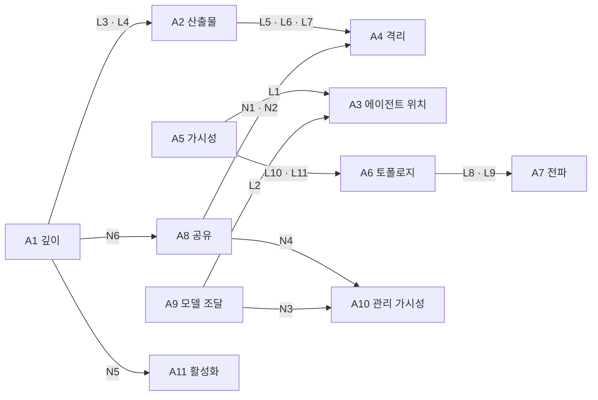
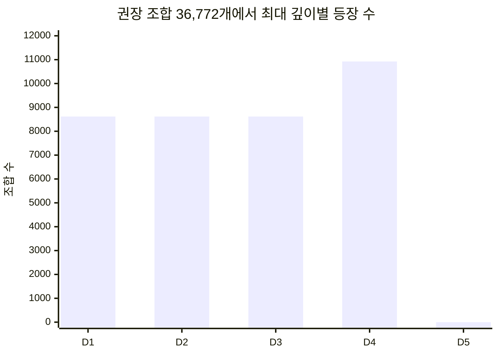
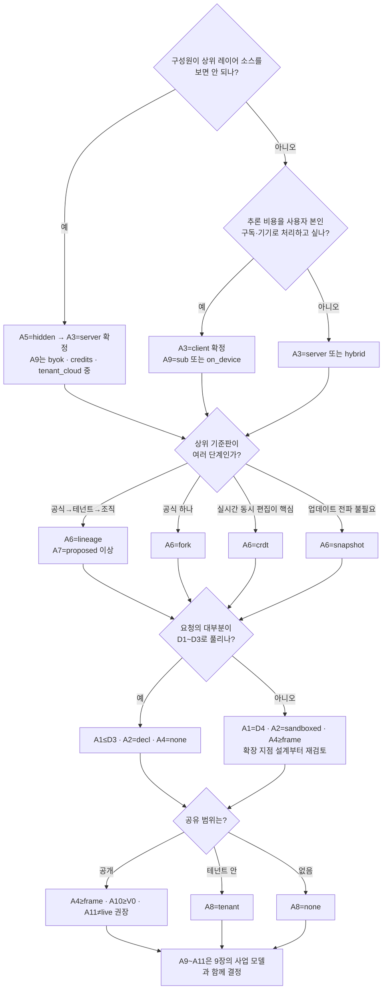
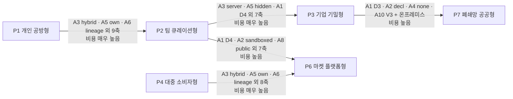

<!-- LANG-BAR -->
[English](../en/03-design-space.md) · **한국어** · [简体中文](../zh-CN/03-design-space.md) · [日本語](../ja/03-design-space.md) · [Español](../es/03-design-space.md)
<!-- /LANG-BAR -->

# 3. 설계 공간 — 선택지, 제약, 조합의 수

> 이 장의 결론: Mallangable 아키텍처는 하나가 아니라 **11개 축의 조합**이다. 원시 조합 **1,944,000개** 중 논리적으로 성립하는 것은 **5.31%**, 안전 규범까지 지키는 것은 **3.14%**, 경고 없이 권장할 수 있는 것은 **36,772개(1.89%)** 다. 이 권장 조합은 구조적으로 **863개 패밀리**로 묶이고, 사업·정책 축은 구조가 정해진 뒤에도 평균 **57%** 가 열려 있다. 즉 **구조 결정은 먼저, 신중하게, 사업 결정은 나중에, 가볍게** 할 수 있다.

## 3.1 왜 '설계 공간'으로 정의하나

같은 "AI로 앱 고치기"라도 개인용 데스크톱 앱, 소비자 모바일 앱, 소스 비공개가 필요한 기업 업무 도구는 전혀 다른 아키텍처를 요구합니다. 정답 하나를 제시하는 대신, 선택지를 축으로 분해하고 축 사이의 제약을 명시하면 세 가지가 가능해집니다.

1. **말이 안 되는 조합을 기계적으로 걸러 낸다.** 예: "코드를 사용자에게 숨긴다"와 "에이전트가 사용자 기기에서 돈다"는 동시에 성립할 수 없습니다(L1).
2. **결정의 순서를 정한다.** 어떤 축은 바꾸려면 데이터 이전이 필요하고, 어떤 축은 설정 하나로 바뀝니다(3.7).
3. **사업 선택지와 연결한다.** 각 BM이 어떤 축 값을 요구하는지 계산할 수 있습니다(9장).

이 접근은 소프트웨어 제품군 공학의 **기능 모델(feature model)** 과 같습니다. 유효한 제품 구성은 기능들의 조합 중 교차 제약을 만족하는 것이고, 실행 중 구성을 바꾸는 동적 제품군(DSPL)은 이 제약을 런타임에 검사합니다([Capilla et al., 2014](https://research.chalmers.se/publication/198081)). Mallangable에서는 구성의 주체가 제공사뿐 아니라 사용자와 AI라는 점이 다릅니다.

축은 두 묶음입니다.

- **구조 축 A1~A8**: 데이터 모델·배포·보안 경계를 결정합니다. 바꾸면 이전 비용이 큽니다.
- **경제·정책 축 A9~A11**: 비용 구조·관리 범위·사용자 경험을 결정합니다. 대부분 설정으로 바뀝니다.

## 3.2 축 정의

### A1. 최대 변경 깊이 — "사용자가 어디까지 바꿀 수 있나"

| 옵션 | 뜻 | 잘 맞는 곳 | 대가 |
| --- | --- | --- | --- |
| `D1` | 외형만 | 브랜드 일관성이 최우선인 소비자 앱 | 말랑함이 거의 없음 |
| `D2` | 기존 기능의 조합까지 | 업무 자동화, 단축키·규칙 | 새 화면을 못 만듦 |
| `D3` | 선언형 화면까지 | 대부분의 업무 도구. 권장 조합의 절반 이상이 여기 | 컴포넌트 카탈로그 설계 필요 |
| `D4` | 샌드박스 코드까지 | 개발자·파워유저 도구 | 샌드박스·검증·승인 비용 |
| `D5` | 코어까지 | 사내 전용 포크, 연구용 | 업데이트 생존 사실상 포기 |

고민할 질문
- 사용자 요청의 몇 %가 D1~D3로 해결되는가? 사전 조사에서 이 비율이 낮다면 확장 지점 설계가 부족하다는 신호입니다.
- D4를 열 때, 그 코드를 누가 읽고 책임지는가?
- 최대 깊이는 **상한**입니다. 실제 변경은 최소 깊이 원칙(2.6)에 따라 더 낮게 만들어집니다.

### A2. 산출물 표현 — "변경은 무엇으로 표현되나"

| 옵션 | 뜻 | 잘 맞는 곳 | 대가 |
| --- | --- | --- | --- |
| `decl` | 선언형 데이터만 (JSON/YAML, A2UI식 UI 기술) | 안전·분석 가능성이 최우선 | 표현력 한계 |
| `sandboxed` | 샌드박스 전용 코드 (호스트 API는 브로커로만) | D4 (2.6) | 샌드박스 런타임 필요 |
| `native` | 호스트와 같은 권한의 코드 (플러그인 또는 소스 패치) | D5, 신뢰 그룹 내부 | 격리 어려움, 공급망 위험 |

고민할 질문
- 선언형 스키마가 사용자 요청의 대부분을 덮도록 확장할 수 있는가? 선언형 범위가 넓을수록 검증·병합·공유가 모두 싸집니다.
- 코드 산출물을 허용하면 그 코드의 언어·런타임 버전도 계약의 일부가 됩니다.

### A3. 에이전트 위치 — "변경을 만드는 AI는 어디서 도나"

| 옵션 | 뜻 | 잘 맞는 곳 | 대가 |
| --- | --- | --- | --- |
| `client` | 사용자 기기 (사용자가 띄운 에이전트 포함) | 개인 사용자, 오프라인, 사용자 구독 활용 | 통제는 안내 수준(I8), 코드 비공개 불가 |
| `server` | 운영자 서버 샌드박스 | 기업·공공, 코드 비공개 | 추론 비용을 운영자·테넌트가 부담 |
| `hybrid` | 대화형 생성은 기기, 병합·전파·승격은 서버 | 팀·조직 | 두 실행 환경 유지 |

고민할 질문
- 추론 비용을 누가 내는가? 이 질문이 A3와 A9를 함께 결정합니다.
- 사용자 기기의 에이전트가 만든 결과를 서버가 **다시 검증**할 수 있는가(I8)?

### A4. 실행 격리 — "생성된 코드는 무엇에 갇히나"

| 옵션 | 뜻 | 막는 것 | 못 막는 것 |
| --- | --- | --- | --- |
| `none` | 격리 없음 (선언형이면 해당 없음) | — | 모든 것 |
| `lang` | 언어 수준 격리 (예: [Hardened JS/SES](https://github.com/endojs/endo)의 Compartment, Wasm) | 전역 오염, 직접 API 접근 | 같은 프로세스의 자원 고갈, 사이드 채널 |
| `frame` | 출처가 분리된 iframe·웹뷰 ([MCP Apps](https://modelcontextprotocol.io/seps/1865-mcp-apps-interactive-user-interfaces-for-mcp)는 샌드박스 iframe을 의무화) | 호스트 DOM·저장소 접근 | 사용자를 속이는 UI |
| `proc` | 별도 프로세스·마이크로VM | 메모리·파일·네트워크 접근 | 허용된 채널을 통한 유출 |

고민할 질문
- 격리 경계를 넘는 유일한 통로(브로커)의 메시지 형식은 무엇인가? 감사 가능한 형식이어야 합니다.
- 공유가 열리면(A8) 격리 요구가 올라갑니다(N1, N2).

### A5. 코드 가시성 — "사용자는 어떤 소스를 볼 수 있나"

| 옵션 | 뜻 | 잘 맞는 곳 | 대가 |
| --- | --- | --- | --- |
| `open` | 모든 레이어의 소스를 볼 수 있음 | 개인, 오픈 커뮤니티 | 상위 레이어의 지식재산 보호 불가 |
| `own` | 자기 레이어만 봄 | 조직 기준판에 사내 노하우가 들어 있을 때 | 레이어 분리 토폴로지 필요(L10) |
| `hidden` | 어떤 소스도 보지 않음, 결과물만 받음 | 소스 비공개가 필수인 기업·공공 | 서버 에이전트 필수(L1), 출력 게이트 필요 |

고민할 질문
- 핵심 원리: **에이전트가 읽을 수 있는 코드는, 그 에이전트에게 말을 거는 사람도 결국 읽을 수 있다.** 그래서 `hidden`은 정책 플래그가 아니라 배치 결정입니다(7.8).
- 클라이언트로 내려가는 실행 번들은 난독화해도 분석될 수 있습니다. 보호해야 할 핵심 로직은 서버 측 확장 지점에 두는 편이 낫습니다.

### A6. 버전 토폴로지 — "변경 이력은 어떤 모양으로 쌓이나"

| 옵션 | 뜻 | 잘 맞는 곳 | 대가 |
| --- | --- | --- | --- |
| `snapshot` | 사용자별 스냅샷 이력만, 상위와의 관계는 추적 안 함 | 가장 단순한 소비자 앱 | 기준판 업데이트를 전파할 수 없음(L8) |
| `fork` | 사용자 저장소 = 단일 기준판의 포크 | 개인·소규모 | 조직 계층 표현 불가 |
| `lineage` | 다단 기준판 계층(공식→테넌트→조직→사용자)의 포크 네트워크 | 기업 | 전파 파이프라인 필요(S3) |
| `crdt` | 실시간 동기 문서([Automerge](https://automerge.org/docs/reference/documents/conflicts/) 계열) | 동시 협업 | 의미 충돌은 남고, 코드 동시 편집은 위험(S7) |

고민할 질문
- 사용자 수 N과 기준판 릴리스 빈도 r을 곱한 값이 연간 병합 작업 수입니다. 이 숫자가 아키텍처 비용의 대부분을 결정합니다(6.8).
- 데이터(선언형)는 CRDT, 코드는 Git식 계보로 섞는 하이브리드도 가능하지만, 이 문서는 한 시스템에 한 토폴로지를 기본으로 봅니다.

### A7. 기준판 전파 — "상위가 바뀌면 하위는 어떻게 따라가나"

| 옵션 | 뜻 | 잘 맞는 곳 | 대가 |
| --- | --- | --- | --- |
| `none` | 전파 없음 | 스냅샷 토폴로지, 일회성 커스터마이징 | 사용자 레이어가 점점 낡음 |
| `manual` | 사람이 직접 병합 | 개발자 사용자 | 대부분의 사용자는 못 함 |
| `proposed` | 에이전트가 병합·검증해 제안, 사람이 승인 | 기본 권장값 | 승인 피로 |
| `auto` | 검증 통과 + 권한 불변이면 자동 적용 | 대규모 사용자 | 잘못된 자동 병합의 파급 |

고민할 질문
- 자동 적용의 조건을 "계약 전부 통과 + 권한 변화 없음 + 카나리아 통과"처럼 기계가 판정할 수 있게 정의했는가?
- 지원 기간이 끝난 기준판에 남은 사용자는 어떻게 하는가? 강제 병합은 신뢰를 깹니다(6.5).

### A8. 공유 범위 — "내가 만든 변경을 누구에게 줄 수 있나"

| 옵션 | 뜻 | 잘 맞는 곳 | 대가 |
| --- | --- | --- | --- |
| `none` | 공유 없음 | 개인용, 기밀 환경 | 같은 걸 모두가 따로 만듦 |
| `tenant` | 같은 테넌트 안에서만 | 기업 | 테넌트 내 검수 체계 |
| `public` | 테넌트를 넘어 공개 | 커뮤니티·마켓 | 공급망 공격면(7.7) |

고민할 질문
- 공유 단위는 저장소가 아니라 **기능(의도+계약+산출물)** 이어야 합니다. 그래야 받는 쪽이 같은 검증을 다시 돌릴 수 있습니다.
- 공개 공유는 ClawHub 사례처럼 큐레이션·격리·권한 표시 없이는 열면 안 됩니다(N1, N4).

### A9. 모델 조달 — "추론은 누구의 계정·비용으로 하나"

| 옵션 | 뜻 | 잘 맞는 곳 | 대가 |
| --- | --- | --- | --- |
| `sub` | 사용자 개인 구독. **공급사의 공식 클라이언트 안에서만** | 개인, 개발자 | 서버 작업에 못 씀(L2). 공급사 약관 변화에 노출 |
| `byok` | 사용자·테넌트의 API 키 | 팀, 파워유저 | 키 관리 UX |
| `credits` | 운영자가 추론을 묶어 판매 | 소비자, 중소 팀 | 원가·어뷰징 위험을 운영자가 짐 |
| `tenant_cloud` | 테넌트의 클라우드 계약(예: Bedrock, Vertex)이나 사내 모델 | 기업·공공 | 공급자 어댑터 다양화 |
| `on_device` | 사용자 기기의 로컬 모델 | 오프라인, 프라이버시 | 품질 한계(S6) |

고민할 질문
- 2026년 현재 일부 공급사는 소비자 구독 인증 토큰을 제3자 제품에서 쓰는 것을 약관으로 금지합니다(Anthropic 사례: [The Register, 2026.02](https://www.theregister.com/2026/02/20/anthropic_clarifies_ban_third_party_claude_access)). `sub`는 "사용자가 공급사 공식 에이전트를 직접 띄우고, 거기에 우리 스킬·도구를 연결하는" 형태로만 설계해야 안전합니다(8.10, 9.6).
- 공급사 정책은 자주 바뀝니다. 모델 조달은 반드시 포트(5.3)로 추상화해야 합니다.

### A10. 관리 가시성 — "관리자는 무엇까지 보나"

| 옵션 | 뜻 |
| --- | --- |
| `none` | 중앙 수집 없음 |
| `V0` | 집계만 (테넌트·조직 단위 합계) |
| `V1` | 메타데이터 (변경 수·크기·깊이·확장 지점·검증 결과, 사용자는 가명) |
| `V2` | V1 + 변경 메시지·의도 요약, 실명 |
| `V3` | V2 + 코드 diff와 내용 |

고민할 질문
- 가시성은 관리자 편의와 구성원 신뢰의 교환입니다. 현재 가시성 수준은 사용자 화면에 **항상** 표시돼야 합니다(4.6 하한).
- 커밋 메타데이터도 개인과 연결되면 개인정보가 될 수 있습니다. 관할 법률 검토가 필요합니다.

### A11. 활성화 방식 — "검증된 변경은 언제 켜지나"

| 옵션 | 뜻 | 잘 맞는 곳 |
| --- | --- | --- |
| `live` | 검증 통과 즉시 반영 | D1~D2, 개인 |
| `preview` | 미리보기 후 사용자가 적용 | 기본 권장값 |
| `gated` | 지정된 승인자 승인 후 적용 | 기업, 공개 공유물 |

## 3.3 제약

### 축 사이의 의존 관계



읽는 법: 화살표는 "앞 축의 값이 뒤 축의 선택지를 좁힌다"는 뜻입니다. **A5(가시성)와 A9(모델 조달)가 A3(에이전트 위치)를 함께 묶는다**는 점이 가장 중요합니다. 소스 비공개와 사용자 구독 활용은 서로 반대 방향으로 A3를 당기기 때문에 동시에 원할 수 없습니다.

### 논리 제약 L — 성립할 수 없거나 같은 의미의 중복

| 규칙 | 조건 | 이유 |
| --- | --- | --- |
| L1 | `A5=hidden ⇒ A3=server` | 코드를 만지는 에이전트가 사용자 쪽에 있으면 코드는 숨길 수 없다 |
| L2 | `A9∈{sub, on_device} ⇒ A3≠server` | 개인 구독(약관)과 기기 모델(물리적 위치)은 서버 작업에 쓸 수 없다 |
| L3 | `A1∈{D1,D2,D3} ⇒ A2=decl` | 2.6: D1~D3은 선언형. 코드 산출물을 허용하면 그것은 D4다 |
| L4 | `A1=D4 ⇒ A2=sandboxed`, `A1=D5 ⇒ A2=native` | 2.6: 동작 변경은 샌드박스 코드, 코어 변경은 네이티브 코드 |
| L5 | `A2=decl ⇒ A4=none` | 정규화: 실행 코드가 없으면 실행 격리 축은 의미가 없다 |
| L6 | `A2=sandboxed ⇒ A4≠none` | 샌드박스 산출물은 샌드박스가 있어야 한다 |
| L7 | `A2=native ⇒ A4∈{none, proc}` | 호스트 권한 코드를 언어·프레임 격리에 넣으면 더 이상 호스트 권한이 아니다 |
| L8 | `A6=snapshot ⇒ A7=none` | 상위 관계를 추적하지 않으면 전파할 대상이 없다 |
| L9 | `A6=crdt ⇒ A7≠manual` | CRDT는 자동 병합이라 수동 병합 단계가 없다 |
| L10 | `A5=own ⇒ A6∈{fork, lineage}` | '내 것만 보기'는 레이어가 분리된 토폴로지에서만 성립 |
| L11 | `A5=hidden ⇒ A6≠crdt` | CRDT 복제본은 클라이언트에 있으므로 코드를 숨길 수 없다 |

### 규범 제약 N — 성립은 하지만 Mallangable 안전 원칙이 금지

| 규칙 | 조건 | 근거 |
| --- | --- | --- |
| N1 | 코드 산출물 ∧ `A8=public` ⇒ `A4∈{frame, proc}` | 공개 공유물은 공급망 공격 통로(7.7) |
| N2 | `A2=native` ∧ `A8≠none` ⇒ `A4=proc` | 공유되는 호스트 권한 코드는 최소 프로세스 분리 |
| N3 | `A9=credits` ⇒ `A10≠none` | 재판매 과금은 계량이 필요 |
| N4 | `A8=public` ⇒ `A10≠none` | 공개 마켓은 감사 추적이 필요 |
| N5 | `A1∈{D4,D5}` ⇒ `A11≠live` | 동작·코어 변경은 미리보기·승인 없이 즉시 켜지 않는다 |
| N6 | `A1=D5` ⇒ `A8=none ∧ A6≠snapshot` | D5는 사용자 레이어가 아니라 제공사가 승인한 코어 포크(I1, 2.6). 공유하지 않고 기준판을 추적한다 |

### 경고 S — 허용하지만 권장하지 않음

| 규칙 | 조건 | 위험 |
| --- | --- | --- |
| S1 | 코드 산출물 ∧ `A8=public` ∧ `A11=live` | 공개 공유 코드의 즉시 설치 |
| S2 | `A2=native` ∧ `A4=none` | 격리 없는 호스트 권한 코드 (개인용에 한정할 것) |
| S3 | `A6=lineage` ∧ `A7∈{none, manual}` | 계층은 만들었는데 전파를 돕지 않음 → 드리프트 누적 |
| S4 | `A1=D5` ∧ `A6∈{fork, lineage}` | 사용자별 코어 포크 → 병합 비용 폭증 |
| S5 | `A3=hybrid` ∧ `A9=sub` | 서버 단계에서 모델을 못 씀 → 의미 충돌을 기기로 되돌려야 함 |
| S6 | `A9=on_device` ∧ `A1≥D4` | 기기 모델로 동작 코드 생성 → 실패율 상승 |
| S7 | `A6=crdt` ∧ `A1≥D4` | 반쯤 작성된 코드가 다른 사용자에게 실행될 위험 |

## 3.4 조합의 수

`tools/design_space.py`가 11개 축의 모든 조합을 나열하고 위 제약을 적용한 결과입니다.

| 단계 | 조합 수 | 전체 대비 |
| --- | ---: | ---: |
| 원시 조합 Ω = 5×3×3×4×3×4×4×3×5×5×3 | 1,944,000 | 100% |
| 논리 정합 (L 통과) | 103,320 | 5.31% |
| 규범 정합 (L+N 통과) | 61,064 | 3.14% |
| 권장 (경고 없음) | 36,772 | 1.89% |

- 권장 조합의 구조 패밀리(A1~A8 조합) 수: **863**
- 패밀리당 경제·정책 완성(A9~A11 조합) 평균: **42.61 / 75** (57%)
- 완성 수 분포: 72개 완성 96패밀리, 57개 96, 42개 138, 28개 198, 24개 66 등. 어떤 패밀리도 75개 전부가 열려 있지는 않습니다(N3 때문에 최소 3개는 항상 빠짐).

규칙별로 걸러진 조합 수. **첫 위반**은 각 조합을 처음 위반한 규칙에만 집계하므로 규칙 순서가 바뀌면 숫자도 바뀝니다. **독립 위반**은 순서와 무관하게 그 규칙을 위반한 조합 수, **유일 위반**은 그 규칙 하나만 위반한 조합 수입니다(이 규칙만 빼면 살아나는 조합).

| 논리 규칙 | 첫 위반 | 독립 위반 | 유일 위반 |
| --- | ---: | ---: | ---: |
| L3 | 501,120 | 777,600 | 193,725 |
| L4 | 334,080 | 518,400 | 90,405 |
| L5 | 187,920 | 486,000 | 116,235 |
| L1 | 432,000 | 432,000 | 32,400 |
| L8 | 31,320 | 364,500 | 17,280 |
| L10 | 18,720 | 324,000 | 18,720 |
| L7 | 41,760 | 324,000 | 25,830 |
| L2 | 259,200 | 259,200 | 20,880 |
| L11 | 3,240 | 162,000 | 3,240 |
| L6 | 20,880 | 162,000 | 12,915 |
| L9 | 10,440 | 121,500 | 4,680 |

| 규범 규칙 | 걸러진 조합 | 경고 규칙 | 해당 조합 |
| --- | ---: | --- | ---: |
| N5 | 15,738 | S3 | 12,400 |
| N1 | 8,610 | S5 | 4,420 |
| N6 | 5,332 | S4 | 4,416 |
| N3 | 4,347 | S6 | 3,800 |
| N2 | 4,305 | S7 | 3,600 |
| N4 | 3,924 | S2 | 2,580 |

권장 조합 안에서 각 깊이가 등장하는 횟수:



### 해석

1. **대부분의 조합은 말이 안 되거나 중복이다.** 원시 조합의 95%가 논리 제약에서 빠집니다. 독립 위반 수로 가장 많이 걸러 내는 규칙은 깊이와 표현을 맞추는 L3·L4(2.6의 정의)와 정규화 규칙 L5입니다. 정규화를 빼면 L1(소스 비공개는 서버 에이전트 필수)이 가장 큰 순수 모순입니다. 조합 수는 설계자가 그 요구를 얼마나 자주 하는지와 무관하므로, 이 표는 "어떤 규칙이 공간을 얼마나 좁히나"로만 읽습니다.
2. **깊이마다 길이 하나다.** D1~D3은 선언형, D4는 샌드박스 코드라는 정의(2.6)를 규칙으로 걸면 깊이별 권장 조합은 D1~D3이 각 8,616개, D4가 10,924개로 고르게 나뉩니다. 산출물 표현은 깊이를 정하면 따라오는 값이 됩니다.
3. **D5는 권장 조합에 없다.** D5는 사용자 레이어가 아니라 코어 포크(2.6, I1)이므로 N6가 공유와 snapshot을 금지하고, 남은 조합은 모두 S4(사용자별 코어 포크) 경고에 걸립니다. 코어 수정은 설계 공간 밖의 제공사 프로세스입니다.
4. **구조와 사업은 대체로 분리된다.** 구조 패밀리를 정한 뒤에도 사업·정책 조합의 57%가 남습니다. 다만 `A3=server`를 고르는 순간 모델 조달 5개 중 2개(`sub`, `on_device`)가 빠지므로, 에이전트 위치는 모델 조달을 직접 묶는 구조 결정입니다.
5. **가장 흔한 경고는 S3(계층은 있는데 전파 보조 없음)** 입니다. 기준판 계층을 도입하는 팀은 전파 파이프라인을 함께 만들어야 한다는 신호입니다.
6. **값 해상도에 민감하다.** A10의 V0~V3처럼 어떤 규칙도 구별하지 않는 값은 조합 수를 그대로 곱합니다. 절대 수치보다 규칙 id와 비율로 비교하세요.

## 3.5 레퍼런스 프로파일

설계 공간의 대표점 7개입니다. 모두 계산기에서 '권장(clean)'으로 판정됩니다(`python3 tools/design_space.py --check all`). 서버가 없는 P1·P5는 I8을 보장할 수 없으므로 준수 등급은 Core까지입니다(10.3). 코드가 필요한 프로파일(P1·P3·P6)은 D4, 선언형으로 충분한 프로파일은 D3 이하로 둡니다(2.6, L3·L4).

| 축 | P1 개인 공방형 | P2 팀 큐레이션형 | P3 기업 기밀형 | P4 대중 소비자형 | P5 로컬 퍼스트 협업형 | P6 마켓 플랫폼형 | P7 폐쇄망 공공형 |
| --- | --- | --- | --- | --- | --- | --- | --- |
| A1 깊이 | D4 | D3 | D4 | D2 | D3 | D4 | D3 |
| A2 산출물 | sandboxed | decl | sandboxed | decl | decl | sandboxed | decl |
| A3 에이전트 | client | hybrid | server | server | client | hybrid | server |
| A4 격리 | frame | none | proc | none | none | frame | none |
| A5 가시성 | open | own | hidden | open | open | own | hidden |
| A6 토폴로지 | fork | lineage | lineage | snapshot | crdt | lineage | lineage |
| A7 전파 | proposed | proposed | proposed | none | auto | proposed | proposed |
| A8 공유 | none | tenant | tenant | public | tenant | public | tenant |
| A9 모델 | sub | byok | tenant_cloud | credits | byok | credits | tenant_cloud |
| A10 가시성 | none | V2 | V2 | V1 | none | V1 | V3 |
| A11 활성화 | preview | preview | gated | live | preview | gated | gated |

| 프로파일 | 대표 상황 | 핵심 트레이드오프 |
| --- | --- | --- |
| P1 개인 공방형 | 개발자용 데스크톱 도구. 사용자가 자기 AI 구독으로 고침 | 운영 비용 최소, 통제는 안내 수준 |
| P2 팀 큐레이션형 | 사내 업무 도구. 조직 기준판에 노하우를 쌓음 | 서버 병합 비용, 승인 피로 |
| P3 기업 기밀형 | 소스 비공개가 계약 조건인 기업 고객 | 모든 추론이 서버, 출력 게이트 필수 |
| P4 대중 소비자형 | 수백만 사용자 소비자 앱. 테마·자동화 규칙 공유 | 깊이를 D2로 제한해 안전 확보 |
| P5 로컬 퍼스트 협업형 | 실시간 협업 문서 도구 | 의미 충돌 감지가 숙제, 선언형 D3까지(S7) |
| P6 마켓 플랫폼형 | 사용자 제작 확장 공개 마켓 | 큐레이션·격리·감사 비용 |
| P7 폐쇄망 공공형 | 망 분리 환경, 사내 모델 | 온프레미스 운영, 최고 수준 감사 |

## 3.6 선택 절차

축 11개를 한 번에 고르지 말고, 구조를 가장 크게 좁히는 질문부터 답합니다.



읽는 법: 첫 두 질문이 A3를 결정하고, A3가 사업 모델의 절반을 결정합니다. 그래서 "소스 비공개"와 "추론 비용 부담 주체"는 제품 기획의 맨 앞에서 정해야 합니다.

## 3.7 진화 경로와 축 변경 비용

제품은 한 프로파일에서 시작해 다른 프로파일로 옮겨 갑니다. 축마다 바꾸는 비용이 다릅니다.

| 비용 등급 | 축 | 이유 |
| --- | --- | --- |
| 낮음 (설정 변경) | A9 모델 조달, A10 관리 가시성, A11 활성화 | 정책·라우팅 설정. 기존 데이터 이전 불필요 |
| 중간 (기능 추가) | A1 최대 깊이, A8 공유 범위 | 새 확장 지점·카탈로그·큐레이션 체계 필요. 기존 변경은 그대로 |
| 높음 (런타임 교체) | A2 산출물, A4 격리 | 기존 코드 산출물을 새 런타임으로 옮겨야 함 |
| 매우 높음 (데이터 이전) | A3 에이전트 위치, A5 가시성, A6 토폴로지 | 저장 위치·이력 구조·신뢰 경계가 바뀜 |



실무 권고: 처음부터 P3나 P7을 만들 필요는 없지만, **나중에 갈 가능성이 있다면 A6는 처음부터 `lineage`로 저장하라.** 단일 기준판(fork)은 깊이 1짜리 계보로 표현할 수 있으므로, 데이터 모델만 계보형으로 두면 이전 비용이 크게 줄어듭니다.

## 3.8 계산기 사용법

```bash
python3 tools/design_space.py --markdown        # 3.4의 표 재생성
python3 tools/design_space.py --check all       # 레퍼런스 프로파일 검사
python3 tools/design_space.py --bm              # 프로파일 × 사업 모델 결합 행렬 (9장)
python3 tools/design_space.py --bm-stats        # 권장 조합 전체에서 BM별 가능 비율
python3 tools/design_space.py --profile '{"A1":"D4","A2":"sandboxed","A3":"client","A4":"frame","A5":"open","A6":"fork","A7":"proposed","A8":"none","A9":"sub","A10":"none","A11":"preview"}'
```

자기 제품에 없는 옵션이 있으면 `AXES`에 추가하고, 자기 조직의 안전 원칙은 `normative()`에 규칙으로 적어 다시 계산하세요. **설계 리뷰에서 "왜 이 조합인가"를 규칙 id로 말할 수 있게 하는 것**이 이 도구의 목적입니다.

다음 장: [4. 통제 스펙트럼](04-control-spectrum.md)
