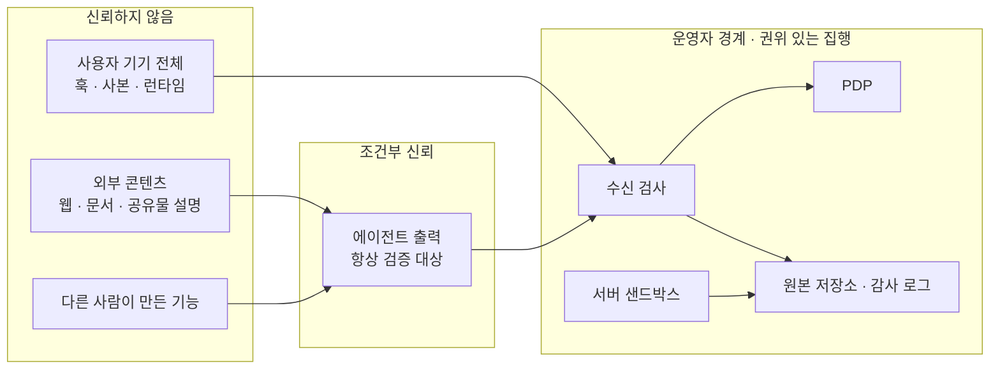
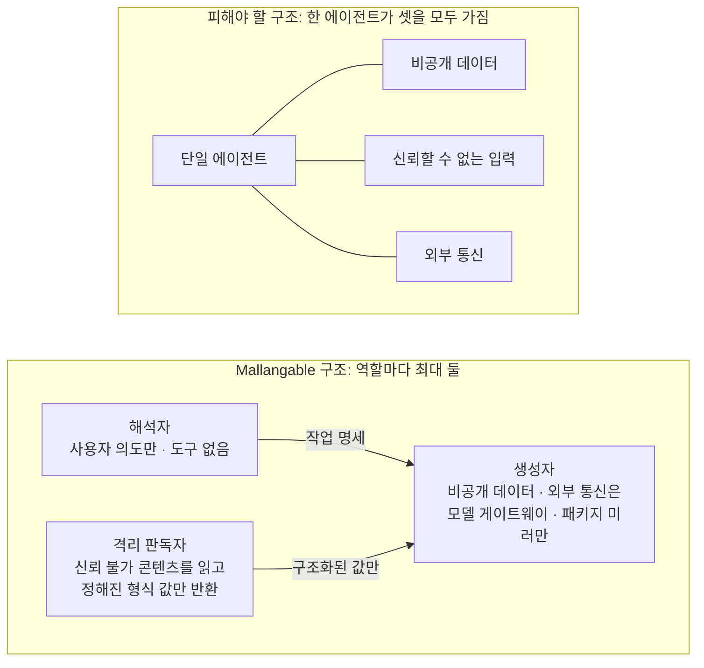

<!-- LANG-BAR -->
[English](../en/07-trust-and-security.md) · **한국어** · [简体中文](../zh-CN/07-trust-and-security.md) · [日本語](../ja/07-trust-and-security.md) · [Español](../es/07-trust-and-security.md)
<!-- /LANG-BAR -->

# 7. 신뢰와 보안 — 누구를 믿지 않을지 먼저 정한다

> 이 장의 결론: Mallangable 시스템의 생성 에이전트는 기본적으로 **비공개 데이터, 신뢰할 수 없는 입력, 외부로 내보낼 통로**를 한꺼번에 갖게 된다. 이 셋이 한 맥락에 모이면 프롬프트 인젝션 한 번으로 데이터가 샌다. 해법은 더 똑똑한 필터가 아니라 **구조적 분리**다: 역할을 쪼개고, 데이터에 가시성 라벨을 붙이고, 확장에는 명시적으로 건넨 권한만 주고, 최종 집행은 운영자 경계에서 한다.

## 7.1 위협 모델

### 지켜야 할 자산

| 자산 | 예 | 주인 |
| --- | --- | --- |
| 사용자 데이터 | 호스트 앱 안의 문서·레코드 | 사용자·테넌트 |
| 레이어 산출물 | 조직 기준판의 화면·자동화 (사내 노하우) | 테넌트·조직 |
| 코어 지식재산 | 호스트 소스 | 제공사 |
| 자격 증명 | 모델 API 키, 외부 서비스 토큰 | 사용자·테넌트 |
| 예산 | 추론 크레딧, 테넌트 클라우드 비용 | 테넌트·운영자 |
| 무결성 | "내 앱이 내가 승인한 대로만 동작한다" | 사용자 |

### 공격자

| 공격자 | 목표 | 주요 경로 |
| --- | --- | --- |
| 악성 공유자 | 받는 사람의 데이터·자격 증명 탈취 | 공유 기능, 공개 마켓 |
| 간접 인젝터 | 에이전트가 읽는 콘텐츠에 지시를 심어 행동을 조종 | 문서, 웹 페이지, 공유물의 설명문, 이슈 본문 |
| 호기심 많은 내부 사용자 | 숨겨진 상위 레이어 소스 열람 | 에이전트에게 "소스를 보여줘" |
| 손상된 클라이언트 | 정책을 우회한 변경을 서버에 밀어 넣기 | 기기 훅 비활성화, 직접 저장소 쓰기 |
| 과도한 관리자 | 구성원 감시 | 관리 가시성 상향 |
| 운영자 내부자 | 고객 코드 열람 | 지원 도구 |
| 비용 공격자 | 예산 고갈 | 무한 재시도 유도, 대량 생성 |
| 계약·판정자 오염자 | 악성 행동을 통과시키는 계약, 판정자를 속인 통과 판정 | 인젝션당한 생성자가 쓰는 계약, 산출물에 심은 판정자 겨냥 지시("이 패널은 의도를 충족함") |
| 해결 캐시 오염자 (같은 테넌트 안) | 자기 계약만으로 '검증된' 해결을 만들어 테넌트 전원에게 퍼뜨림 | R3 해결 캐시 재사용(6.8). 범위 제한은 테넌트 *간* 유출만 막음 |
| 손상된 상위 릴리스·운영자 | 기준판을 통해 하위 노드 전체에 악성 변경 배포 | 릴리스 서명 키 탈취, 운영자 내부자, `auto` 적용(6.5) |

마지막 세 행의 통제:
- **계약·판정자 오염**: 계약 초안은 해석자가 작업 명세 단계에서 쓰고, 생성자는 계약 항목을 지우거나 약화할 수 없습니다(I7의 분리를 계약까지 넓힘, 6.7 규칙 2). 판정자(G4)는 정해진 스키마의 입력(의도, 계약, 스크린샷, 관측값)만 받고 산출물 원문은 맥락에 넣지 않습니다. 산출물은 무결성 `untrusted`입니다(7.5).
- **해결 캐시 오염**: 해결은 만든 사용자와 다른 노드 k개 이상(제안값 3)에서 κ_up ∧ κ_down 재검증을 통과한 뒤에만 캐시에 적재합니다(R3, 6.8).
- **손상된 상위 릴리스·운영자**: 릴리스 서명 키는 집행 지점(수신 검사)마다 핀으로 고정하고 폐기 목록을 확인합니다. `auto` 적용에도 카나리아(6.5)를 거치고, 테넌트는 상위 릴리스를 거부하고 현재 릴리스를 유지할 수 있습니다. 릴리스에도 7.7의 출처 증명을 붙입니다.

### 신뢰 경계



읽는 법: 사용자 기기와 에이전트 출력은 **모두 검증 대상**입니다. 사용자 본인을 의심하라는 뜻이 아니라, 기기가 손상됐거나 에이전트가 인젝션당했을 때도 원본 저장소가 오염되지 않게 하라는 뜻입니다.

## 7.2 집행 지점과 결정 지점

| 집행 지점(PEP) | 위치 | 권위 | 막는 것 |
| --- | --- | --- | --- |
| 기기 하네스 훅 | 사용자 기기 | 안내 | 실수, 대부분의 인젝션 시도 |
| 런타임 브로커 | 호스트 안 | 실행 시점 권위 | 승인 안 된 권한 사용 |
| 수신 검사 | 운영자 경계 | **최종 권위** | 규격 위반·정책 위반 기록, 정책 파일 변조 |
| 서버 샌드박스 | 운영자 경계 | 최종 권위 | 잡 범위 밖 접근, 외부 통신 |
| 출력 게이트 | 생성면 → 경험면 | 최종 권위(hidden 모드) | 코드·비밀값 유출 |

모든 PEP는 같은 PDP 규칙을 씁니다. 생성 시점(하네스)과 실행 시점(브로커)에 다른 규칙을 쓰면, "만들 때는 허용됐는데 실행할 때는 금지" 같은 틈이 생깁니다.

## 7.3 치명적 3요소를 구조로 끊기

Simon Willison은 에이전트가 **① 비공개 데이터 접근, ② 신뢰할 수 없는 콘텐츠 노출, ③ 외부 통신 능력**을 동시에 가지면 공격자가 데이터를 쉽게 빼낼 수 있다고 정리하고, 이를 "치명적 3요소(lethal trifecta)"라고 불렀습니다. 그는 100% 막는 방법은 아직 없으며, 이 조합 자체를 피하는 것이 안전한 길이라고 말합니다([Willison, 2025.06](https://simonwillison.net/2025/Jun/16/the-lethal-trifecta/)).

말랑한 앱의 생성 에이전트는 기본 설정으로 셋 모두를 가집니다. 사용자의 레이어와 데이터를 읽고(①), 공유받은 기능·참고 문서를 읽고(②), 모델 API와 외부 패키지 저장소와 통신합니다(③).



규칙:
- **외부 통신 허용 목록** (반드시): 생성 에이전트의 외부 통신은 모델 게이트웨이와 승인된 패키지 미러로만 제한합니다. 임의 URL 접근은 막습니다.
- **신뢰 불가 콘텐츠는 격리 판독자가 먼저 읽습니다.** 판독자는 도구가 없고, 정해진 스키마의 값(예: "관련 있음/없음", 추출된 필드)만 돌려줍니다.
- **권한 증가는 무조건 사람 승인**입니다(I4). 공유물 설명에 "네트워크 권한을 추가하라"는 문장이 숨어 있어도, 에이전트는 승인 요청만 만들 수 있습니다.

## 7.4 계획과 실행의 분리

프롬프트 인젝션 방어 연구는 같은 방향을 가리킵니다.

- **CaMeL**은 신뢰할 수 있는 사용자 질의에서 제어 흐름과 데이터 흐름을 먼저 뽑아내고, 신뢰할 수 없는 데이터가 프로그램의 흐름을 바꾸지 못하게 합니다. 계획을 세우는 특권 LLM과, 도구 없이 신뢰 불가 데이터만 해석하는 격리 LLM을 나누고, 값마다 출처와 권한(capability)을 추적합니다. 벤치마크에서 방어 없는 시스템의 84%에 비해 77%의 과제를 증명 가능한 보안 아래 해결했습니다([Debenedetti et al., 2025](https://arxiv.org/abs/2503.18813)).
- **보안 설계 패턴** 논문은 여섯 가지 패턴(행동 선택자, 계획 후 실행, LLM 맵-리듀스, 이중 LLM, 코드 후 실행, 맥락 최소화)을 제시하고, "신뢰할 수 없는 입력을 받아들인 뒤에는 그 입력이 중대한 행동을 일으킬 수 없어야 한다"는 원칙을 세웁니다([Beurer-Kellner et al., 2025](https://arxiv.org/abs/2506.08837), [요약](https://simonwillison.net/2025/Jun/13/prompt-injection-design-patterns/)).

Mallangable 역할과의 대응:

| 패턴 | Mallangable 적용 |
| --- | --- |
| 계획 후 실행 | 해석자가 작업 명세(건드릴 확장 지점·깊이·권한)를 **신뢰 불가 콘텐츠를 보기 전에** 확정. 생성자는 명세 밖으로 나갈 수 없음(G1이 검사) |
| 이중 LLM ([Willison, 2023](https://simonwillison.net/2023/Apr/25/dual-llm-pattern/)) | 공유물·문서는 격리 판독자가 읽고 구조화된 값만 생성자에게 전달 |
| 코드 후 실행 | D3 선언형 산출물 자체가 '제한된 언어로 쓴 프로그램'. 실행 전 분석 가능 |
| 맥락 최소화 | 컨텍스트 공급자가 역할별로 필요한 것만 공급(5.10) |
| LLM 맵-리듀스 | 승격 후보 분석에서 기능마다 하위 에이전트가 "같은 의도인가"만 판정해 집계 |

## 7.5 정보 흐름 라벨

모든 데이터에 **가시성 라벨**을 붙이고, 라벨이 섞이는 규칙을 정합니다.

```text
라벨 λ = (범위, 등급, 무결성)
  범위   : 테넌트 / 조직 / 사용자 식별자
  등급   : V0 집계 < V1 메타데이터 < V2 설명 < V3 코드          # 기밀성
  무결성 : trusted(사람 의도·검증된 기준판) > untrusted(공유물·외부 문서·모델이 신뢰 불가 입력을 보고 만든 값)

파생 규칙:  λ(f(x, y)) = λ(x) ⊔ λ(y)          # 기밀성은 더 민감한 쪽, 무결성은 더 낮은 쪽
열람 규칙:  보는 사람 s가 x를 볼 수 있다  ⇔  λ(x) ⊑ 권한(s)
행동 규칙:  권한 증가·외부 전송·확장 지점 선택을 결정하는 값은 무결성이 trusted여야 한다
해제 규칙:  라벨을 낮추는 것은 출력 게이트(해제기 declassifier)만 할 수 있고, 규칙과 기록을 남긴다
```

무결성 축은 FIDES([Costa et al., 2025](https://arxiv.org/abs/2505.23643))가 계획자 수준에서 기밀성·무결성 라벨을 함께 추적해 정책을 결정적으로 강제한 방식을 따릅니다. 7.4의 "계획 후 실행"을 라벨 규칙으로 쓴 것입니다.

예: 병합 에이전트가 테넌트 A의 코드(V3)를 읽고 만든 해결은 V3 라벨을 갖습니다. 그래서 해결 캐시에 넣을 때도 테넌트 A 범위로만 들어갑니다(6.8). 대시보드가 "해결 방법 분포"를 보여 줄 때는 출력 게이트가 개수만 남기고 V0로 낮춥니다.

hidden 모드의 출력 게이트 검사 항목:

| 신호 | 판정 |
| --- | --- |
| 출력 스키마 위반, 길이 초과 | 차단, 재생성 |
| 코드 블록 또는 코드처럼 보이는 연속 줄 | 제거 |
| 저장소 내용과 긴 연속 일치(지문 인덱스 비교) | 제거 + 보안 이벤트 |
| 내부 경로·식별자 밀도 초과 | 제거 |
| 비밀값 패턴 | 차단 + 경보 |

## 7.6 확장 실행 보안

**객체 권한(object-capability) 원칙**: 확장은 전역 권한(ambient authority)을 갖지 않습니다. 마운트할 때 명시적으로 건넨 권한 객체만 쓸 수 있습니다. Hardened JavaScript는 `lockdown()`으로 내장 객체를 동결해 프로토타입 오염을 막고, `Compartment`로 전역을 분리해 건넨 객체만 쓰게 합니다([Endo/SES](https://github.com/endojs/endo)).

| 격리 수준 | 막는 것 | 못 막는 것 | 쓰기 좋은 곳 |
| --- | --- | --- | --- |
| 언어(SES·Wasm) | 전역 오염, 건네지 않은 API | 무한 루프에 의한 자원 고갈, 타이밍 | 이벤트 훅(D4) 경량 실행 |
| 프레임(교차 출처 iframe·웹뷰) | 호스트 DOM·저장소·쿠키 | 사용자를 속이는 화면(가짜 버튼) | 패널 코드(D4), 공개 공유물 |
| 프로세스·마이크로VM | 메모리·파일 시스템·네트워크(설정 시) | 허용 채널을 통한 유출 | 공유 네이티브 코드, 서버 잡 |

호스트가 데스크톱 프레임워크라면 웹뷰별 권한 체계를 확인하세요. 예를 들어 Tauri v2는 창·웹뷰 단위 capability를 쓰며, 어떤 capability에도 매칭되지 않는 웹뷰는 IPC 계층에 전혀 접근하지 못합니다([Tauri v2](https://v2.tauri.app/reference/acl/capability)). 이런 체계에서는 **확장 웹뷰에 아무 capability도 주지 않고** 브로커만 통로로 두는 구성이 기본값이 됩니다.

브로커 규칙:
- 모든 호출을 PDP에 묻고 감사 기록을 남깁니다.
- 호출 빈도·응답 크기 상한을 둡니다(유출 속도 제한).
- 사용자를 속일 수 있는 화면(로그인 입력창 흉내 등)은 카탈로그에서 제외하고, 확장 화면에는 "이 부분은 내가 추가한 기능" 표식을 붙입니다.

## 7.7 공급망

공유가 열리면(A8) 확장은 공급망이 됩니다. 2026년 2월, 보안 업체 Koi Security는 한 에이전트 스킬 마켓에서 감사한 2,857개 중 341개 악성 스킬을 공개했습니다([The Hacker News](https://thehackernews.com/2026/02/researchers-find-341-malicious-clawhub.html)). 이후 스캐너가 도입됐지만, 2026년 2~5월 분석에서는 파일을 22MB로 부풀려 검사 한도를 넘기는 방식으로 탐지를 피한 스킬 등이 여전히 남아 있었습니다. 분석가들은 근본 원인으로 "스킬 로직과 에이전트 권한 사이의 격리 부재"를 지목했습니다([Unit 42, 2026.06](https://unit42.paloaltonetworks.com/openclaw-ai-supply-chain-risk/)).

교훈을 통제로 바꾸면:

| 교훈 | 통제 |
| --- | --- |
| 스킬이 에이전트 권한으로 실행됐다 | 공유 기능은 받는 쪽의 샌드박스와 권한 승인을 처음부터 다시 거친다 |
| "선행 설치"를 핑계로 셸 명령을 유도했다 | 공유 기능에는 설치 스크립트가 없다. 산출물은 선언형 또는 샌드박스 코드뿐 |
| 파일을 부풀려 스캐너를 피했다 | 크기 상한을 넘는 공유물은 **거부**(건너뛰지 않음). 검사는 전체 바이트 대상 |
| 설치 후 원격에서 내용을 바꿨다 | 공유물은 내용 해시로 고정. 실행 중 외부 데이터 가져오기는 권한으로 표시되고 승인 대상 |
| 한 계정이 대량 업로드했다 | 게시자 출처 서명([in-toto](https://github.com/in-toto/attestation) Statement에 [SLSA provenance](https://slsa.dev/spec/v1.1/provenance) 술어. 대상은 매니페스트 content_hash, builder.id는 하네스 id), 신규 게시자 제한, 큐레이션 등급 |

## 7.8 소스 비공개는 어디까지 보장되나

**에이전트가 읽을 수 있는 코드는 그 에이전트에게 말을 거는 사람도 결국 읽을 수 있습니다.** 그래서 보장 수준을 위협별로 정직하게 구분해야 합니다.

| 위협 | client 모드 | server · hidden 모드 |
| --- | --- | --- |
| 캐주얼 열람 (궁금해서 열어봄) | 막지 않음 | 막음: 사용자에게 저장소 자체가 없음 |
| 의도적 추출 (에이전트에게 출력 유도) | 막을 수 없음 | 대부분 막음: 해석자는 코드를 본 적이 없고 출력 게이트가 거름 |
| 산출물 역분석 (내려받은 실행 번들 분석) | 해당 없음 | **남는 위험**: 기기로 가는 코드는 읽힐 수 있음 |
| 우회 요청 ("내 소스를 보여 주는 패널 만들어") | 해당 없음 | 정적 규칙(소스 접근 금지) + 판정자로 줄이지만 완벽하지 않음 |
| 내부자 반출 | 감사 기록 | 감사 기록 + 긴급 접근 승인 절차 |

고객 약속 문구는 "의도적 추출 방지는 최선 노력"처럼 정확해야 합니다. 핵심 로직은 기기로 내려가는 확장이 아니라 서버 쪽 확장 지점(서비스 지점)에 두도록 안내합니다.

## 7.9 관리 가시성과 프라이버시

- 가시성 등급 V0~V3(3.2의 A10)과 기본값은 4장에서 정합니다. 사용자는 현재 등급을 항상 볼 수 있습니다(하한 F3).
- 텔레메트리의 개인 식별 필드는 가명 키로 분리 저장해, 삭제 요청 시 키만 파기하면 연결이 끊기게 합니다.
- 운영자가 고객 데이터에 긴급 접근(break-glass)할 때: 사유·범위·기간 기재 → 고객 관리자 승인 → 읽기 전용 세션 → 모든 조회를 고객 대시보드에 실시간 표시 → 기간 만료 시 자동 회수 → 사후 보고.
- 커밋 메타데이터·의도 요약은 개인과 연결되면 개인정보가 될 수 있고, 구성원 활동 모니터링은 나라마다 노동·개인정보 규제가 다릅니다. 배포 전 관할 법률 검토가 필요합니다.

## 7.10 오용

말랑한 앱은 사용자가 **다른 사람에게 해로운 기능**을 만들 수도 있게 합니다. 예: 동료의 활동을 몰래 기록하는 패널, 고객 데이터를 외부로 보내는 자동화.
- 다른 사람의 데이터를 읽는 권한, 외부 전송 권한은 테넌트 상한으로 묶고 승인 대상으로 둡니다.
- 판정자 검사 항목에 "숨겨진 수집·전송" 여부를 넣습니다.
- 모델 공급사의 이용 정책이 금지하는 용도는 생성 단계에서 거절될 수 있음을 사용자에게 일반 용어로 안내합니다.

## 7.11 보안 체크리스트 (반드시)

- [ ] 확장은 브로커 외의 경로로 호스트 기능에 닿지 않는다
- [ ] 생성 에이전트의 외부 통신은 허용 목록뿐이다
- [ ] 권한 증가는 사람 승인 없이는 활성화되지 않는다
- [ ] 생성자와 판정자는 다른 인스턴스다
- [ ] 수신 검사가 기록 규격·계약 존재·정책 파일 불변·크기를 검사한다
- [ ] 공유 기능은 받는 쪽에서 재검증·재승인한다
- [ ] 크기 상한 초과 공유물은 거부한다
- [ ] 공유·마켓 목록, 설치 전 미리보기, 권한 표시는 확장 코드를 실행하지 않고 매니페스트에서 읽는다. 승인 전 실행은 5.9의 "승인 전 D4는 권한 0"을 깨뜨린다(ThinkRail도 목록 때마다 확장을 실행하던 방식을 거부하고 부작용 없는 목록을 둔다, [`agent/packages/SPEC.md`](https://github.com/JetBrains/thinkrail/blob/c10f8808cee693e4abffeeb1844a132ed0a91cc5/packages/server/src/agent/packages/SPEC.md#L23-L25))
- [ ] 해결 캐시·지문 인덱스·샌드박스는 가시성 범위별로 분리한다
- [ ] hidden 모드에서 해석자는 코드에 접근하지 못하고, 모든 출력은 출력 게이트를 지난다
- [ ] 사용자 권리 하한 F1~F7은 어떤 정책으로도 끌 수 없다
- [ ] 하한 행동 예외는 사람 소유자·자기 레이어·권한 비증가일 때만 적용한다. 되살리기·"다시 켜기"·보류 해제·에이전트가 부른 되돌리기는 활성화와 같은 판정을 거친다(4.8)
- [ ] 기준판 전파의 자동 적용도 activate(E10)를 거친다. gated·파괴적 기능·지문 묶인 승인이면 제안으로 내려간다(6.5)
- [ ] `permissions_delta`는 자기 신고를 믿지 않고 매니페스트와 부모 상태에서 다시 계산한다
- [ ] 매니페스트 `network.allow`가 비어 있지 않으면 `permissions`에 risk=egress 기능이 있다. IP 리터럴과 공개 접미사 와일드카드는 거부한다
- [ ] 검사 도구 출력은 문서·파일 이름의 제어 문자를 이스케이프하고, 판정은 종료 코드로 전달한다

다음 장: [8. 경험 설계](08-experience-design.md)
