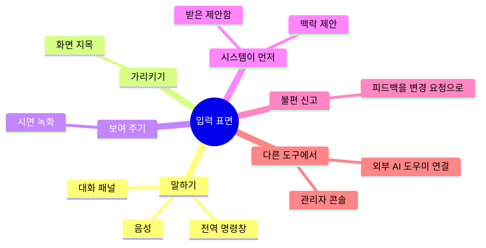
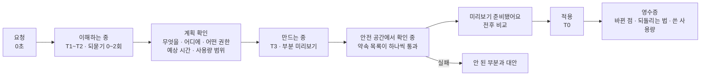
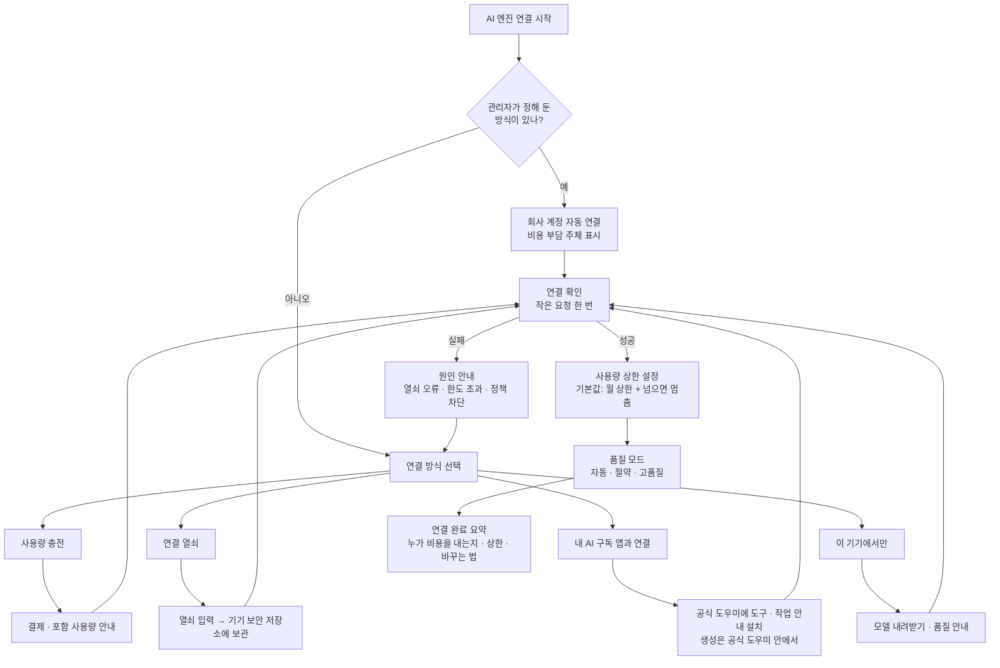

<!-- LANG-BAR -->
[English](../en/08-experience-design.md) · **한국어** · [简体中文](../zh-CN/08-experience-design.md) · [日本語](../ja/08-experience-design.md) · [Español](../es/08-experience-design.md)
<!-- /LANG-BAR -->

# 8. 경험 설계 — 어디서 듣고, 기다림을 어떻게 보여 주고, 어떤 말로 말하나

> 이 장의 결론: 사용자는 "AI가 코드를 고친다"를 원하지 않는다. **"내가 말한 대로 바뀌고, 마음에 안 들면 바로 돌아간다"** 를 원한다. 그래서 경험면은 ① 지목해서 말할 수 있는 입력, ② 시간 등급별로 정직한 진행 표현, ③ 진행 표시를 '약속 목록이 하나씩 통과하는 모습'으로 보여 주기, ④ 개발 용어를 숨기는 용어팩, ⑤ 약관을 지키는 AI 엔진 연결 흐름을 갖춰야 한다.

## 8.1 경험 원칙

| # | 원칙 | 뜻 |
| --- | --- | --- |
| X1 | 의도의 언어로 | 사용자는 "무엇을 원하는지"만 말한다. 깊이·확장 지점·권한은 시스템이 판정해 일반 용어로 보여 준다 |
| X2 | 가리킬 수 있게 | "이거"라고 말할 수 있어야 한다. 화면 지목이 가장 정확한 맥락이다 |
| X3 | 되돌림이 먼저 | 적용 버튼보다 되돌리는 방법이 먼저 보인다. 되돌리기는 즉시, 무료 |
| X4 | 기다림을 정직하게 | 걸리는 시간과 사용량을 미리 범위로 말하고, 진행은 실제 진척으로 보여 준다 |
| X5 | 개발 용어 없이 | 기본 수준 화면에는 커밋·브랜치·병합 같은 말이 나오지 않는다 |
| X6 | 비용이 보이게 | 사용자 부담 비용이 있으면 생성 전에 범위를, 후에 실제값을 보여 준다 |

## 8.2 입력 표면



| 표면 | 사용 방식 | 강점 | 주의 | 주로 다루는 깊이 |
| --- | --- | --- | --- | --- |
| 전역 명령창 | 단축키로 열고 한 문장 입력 | 어디서나 빠름 | 맥락 부족 → 현재 화면을 자동 첨부 | D1~D4 |
| 화면 지목 | '고치기 모드'에서 요소를 누르고 말하기 | **확장 지점 id가 자동으로 정해져** 해석 오류가 크게 줄어듦 | 코어 영역은 "여기는 바꿀 수 없어요"로 표시 | D1~D3 |
| 대화 패널 | 옆 패널에서 여러 차례 대화 | 복잡한 요구, 되묻기 | 대화가 길어지면 작업 명세로 요약해 확인 | 전체 |
| 음성 | 말로 요청 | 손이 바쁜 상황 | 확인 단계를 화면으로 | D1~D2 |
| 시연 녹화 | "내가 하는 걸 보고 그대로 만들어" | 말로 설명하기 어려운 반복 절차 | 녹화 중 개인정보 표시, 범위 지정 | D2 |
| 맥락 제안 | 같은 조작을 반복하면 "자동으로 해 드릴까요?" | 사용자가 몰랐던 기회 | 제안 빈도 상한(제안: 하루 1회), 끄기 | D2 |
| 받은 제안함 | 공유받은 기능, 새 기본판 도착 | 수동적 사용자도 혜택 | 권한 변화 강조 | 전체 |
| 피드백 전환 | "이거 불편해요" 신고가 곧 변경 요청 | 진입 장벽 최저 | 제공사로 갈 신고와 내 수정 요청을 구분 | 전체 |
| 외부 AI 도우미 연결 | 사용자가 쓰는 AI 도우미가 도구로 앱을 수정 | 개발자, 자동화 | 하네스 강제 필수 | 전체 |
| 관리자 콘솔 | 조직 기본판 편집, 승격 검토 | 조직 단위 개선 | 영향 범위(사용자 수) 표시 | D1~D4 |

시연 녹화는 '시연에 의한 프로그래밍(programming by demonstration)' 계열이고, 맥락 제안은 그 반대 방향입니다. 시스템이 반복을 감지해 먼저 제안합니다. 둘 다 결과는 D2(기존 기능의 조합)로 떨어지는 경우가 많아 안전하고 빠릅니다.

## 8.3 의도 수집

1. **되묻기는 최대 1~2회** (해야 함). 그 이상 필요하면 가장 그럴듯한 해석으로 미리보기를 만들고, 미리보기 위에서 고치게 합니다. 사람은 질문보다 결과물을 보고 수정하는 것을 더 쉽게 느낍니다.
2. **더 단순한 방법 먼저** (반드시, 최소 깊이 원칙의 경험 버전): 요청이 설정이나 기존 기능 조합으로 풀리면 그걸 먼저 보여 줍니다. "새 패널을 만들 수도 있지만, 지금 목록에 '마감 지난 것만' 필터를 켜면 바로 돼요."
3. **범위를 말로 확인**: 실행 전에 한 줄로 되돌려 줍니다. "사이드바 아래에 '이번 주 완료한 일' 목록을 추가할게요. 할 일 읽기 권한만 써요."
4. **무엇을 못 하는지도 말하기**: 정책 상한에 걸리면 어느 층의 규칙인지와 다음 행동(관리자에게 요청)을 줍니다.

## 8.4 시간 등급 T0~T4

사람이 느끼는 응답 시간에는 세 가지 경계가 있습니다. 0.1초 이내는 즉각 반응으로, 1초 이내는 생각의 흐름이 끊기지 않는 것으로, 10초는 주의를 유지하는 한계로 느낍니다. 10초를 넘으면 완료 예상을 보여 주는 진행 표시가 필요하고, 작업량을 모를 때는 처리 중인 항목을 하나씩 이름으로 보여 주는 편이 낫습니다([NN/g](https://www.nngroup.com/articles/response-times-3-important-limits/)).

| 등급 | 시간 | 해당 작업 | 경험 패턴 | 문구 예 |
| --- | --- | --- | --- | --- |
| T0 | 0.1초 미만 | 되돌리기, D1 토큰 적용, 미리보기 전환 | 낙관적 즉시 반영, 진행 표시 없음 | (표시 없음) |
| T1 | 0.1~1초 | D2 단축키·규칙 적용 | 즉시 반영 + 작은 확인 토스트 | "적용했어요 · 되돌리기" |
| T2 | 1~10초 | 짧은 생성(D1~D2 문장 해석, 간단한 규칙) | 작은 진행 표시 + 단계 문구 | "이해하는 중…" |
| T3 | 10초~수 분 | D3·D4 생성과 검증 | **단계형 진행 + 약속 목록 통과 표시 + 부분 미리보기**, 다른 일 해도 된다고 안내 | "만드는 중 · 약 30초~1분 · 끝나면 알려 드릴게요" |
| T4 | 수 분~수 일 | 새 기본판 전파, 조직 승인, 공유 수락 | 백그라운드 + 알림 + 적용 시점 예약 | "새 기본판 준비가 끝났어요 · 금요일 오후에 적용" |

배포 속도 기대치: 개인 변경은 T0~T3 안에 끝나야 하고, 기본판 전파(T4)는 순차 적용(카나리아) 때문에 의도적으로 느립니다. 사용자에게는 "모두에게 한 번에 적용하지 않고 문제가 없는지 보면서 차례로 적용해요"라고 설명합니다.

## 8.5 생성 과정을 보여 주는 법



### 상태어 네 개로 고정

`이해하는 중` → `만드는 중` → `확인하는 중` → `준비됐어요`. 모든 표면에서 같은 말을 씁니다. 상태어가 화면마다 다르면 사용자는 같은 일이 진행 중인지 판단할 수 없습니다.

### 진행 표시 = 약속 목록

T3 작업의 진행률은 막연한 퍼센트가 아니라 **계약(약속 목록)의 통과 상황**으로 보여 줍니다. 작업량을 모를 때 처리 항목을 이름으로 보여 주라는 원칙과 같고, 동시에 "무엇을 보장하는지"를 자연스럽게 알려 줍니다.

```text
확인하는 중 (2/3)
  ✓ 이번 주에 완료한 일만 보여요
  ✓ 완료한 일이 없으면 "이번 주에 완료한 일이 없어요"라고 보여요
  … 화면이 느려지지 않는지 확인하고 있어요
```

### 부분 미리보기

선언형 화면(D3)은 생성 중간에도 구조가 생기는 대로 그려 보일 수 있습니다. 생성형 UI 표준인 A2UI도 메시지를 점진적으로 받아 그리는 방식을 지원합니다([Lynx 문서의 A2UI 설명](https://lynxjs.org/react/genui/a2ui)). 단, 부분 미리보기에는 "아직 확인 전" 표시를 붙여 완성품과 구분합니다.

### 실패 표현

실패는 세 가지를 반드시 담습니다. **무엇이 안 됐는지**(일반 용어), **왜인지**(정책·기술 한 줄), **지금 할 수 있는 것**(더 단순한 대안, 관리자 요청, 다시 시도).

```text
'완료하면 팀 채팅에 알림' 기능은 아직 켜지 않았어요.
외부로 내용을 보내는 기능이라 회사 정책상 관리자 승인이 필요해요.
[관리자에게 승인 요청]  [알림 대신 내 화면에만 표시]  [취소]
```

## 8.6 변경 영수증

모든 적용 뒤에 남는 기록 카드입니다(사용자 권리 하한 F7).

```text
변경 영수증 · 10월 28일 오전 9:41
무엇을: 사이드바에 '이번 주 완료한 일' 목록을 추가했어요
어디에: 사이드바 아래쪽
허용 범위: 할 일 읽기 (새로 추가된 허용 없음)
약속 목록: 3개 모두 확인됨
사용량: 약 0.3 크레딧 (이번 달 4.1 / 30)
누가 볼 수 있나: 나, 팀 관리자(변경 설명까지)
되돌리기: [지금 되돌리기] 또는 "아까 거 되돌려"라고 말하기
```

## 8.7 되돌리기 경험

- 말로: "아까 거 되돌려", "어제 상태로". 해석이 모호하면 최근 변경 3개를 보여 줍니다.
- 시간 슬라이더: 최근 상태들을 썸네일로 넘겨 보고 고릅니다.
- 세이프 모드: 앱이 이상하면 시작할 때 '기본 모드로 시작'을 고릅니다. 내 변경은 지워지지 않고 꺼져 있을 뿐입니다.
- 자동 복구 알림: "최근 추가한 '자동 정렬'이 오류를 일으켜 잠시 꺼 뒀어요. [다시 켜기] [자세히]".

## 8.8 새 기본판·공유 제안

```text
팀 기본판이 새로 나왔어요 (2026.11)
- 내가 만든 기능 7개 중 6개는 그대로 옮겨졌어요
- 1개는 선택이 필요해요: '사이드바 이번 주 목록'
  새 기본판에서 사이드바가 탭으로 바뀌었어요
  [탭으로 옮기기 (추천)]  [예전 방식 유지]  [둘 다 되게 다시 만들기]
- 바뀌는 화면 3곳 미리보기 ▸
[지금 적용]  [금요일 오후에 적용]  [나중에]
```

선택지 세 개는 6.7의 의도 충돌 선택지와 같습니다. 공유 제안도 같은 형식에 "누가 보냈는지"와 "새로 필요한 허용 범위"를 추가합니다.

## 8.9 용어팩 (Lexicon Pack)

### 왜 필요한가

이 시스템의 내부는 버전 관리·권한·샌드박스 같은 개발 개념으로 가득합니다. 일반 사용자에게 "충돌을 해결하고 병합할까요?"는 경고문처럼 들립니다. 용어팩은 **개념 id 하나에 수준별·분야별·언어별 표현을 연결**한 사전이고, 경험면의 모든 문자열과 에이전트의 사용자용 답변이 이 사전을 거칩니다.

### 구조

```text
개념 id (안정적)
 └ 수준별 표현: basic(일반) · practitioner(실무자) · developer(개발자)
    └ 분야 덮어쓰기: education · healthcare · enterprise …
       └ 언어: ko · en …
```

- 사용자는 기본적으로 `basic`. 화면의 "자세히 보기"를 켜면 `practitioner`, 개발자 설정에서 `developer`.
- 분야 팩은 제공사나 테넌트가 추가합니다(9장 B13).

### 매칭표 (기본 한국어)

| 개념 id | 개발 용어 | 일반 사용자 표현 (basic) | 한 줄 설명 |
| --- | --- | --- | --- |
| change | 변경 | 바꾼 것 | 한 번에 바꾼 내용 |
| feature | 기능 | 내가 만든 기능 | 같은 목적으로 바꾼 것들의 묶음 |
| record | 커밋 | 저장 지점 | 언제든 돌아올 수 있는 지점 |
| branch | 브랜치 | 실험판 | 원래 것을 건드리지 않고 시험해 보는 사본 |
| merge | 병합 | 합치기 | 두 버전을 하나로 합침 |
| conflict | 충돌 | 겹치는 부분 | 양쪽이 같은 곳을 다르게 바꿈 |
| intent_conflict | 의도 충돌 | 선택이 필요한 부분 | 두 가지를 동시에 만족할 수 없음 |
| revert | 롤백 | 되돌리기 | 이전 상태로 돌아감 |
| baseline | 기준판 · LTS | 기본판 (공식 기본판 · 회사 기본판 · 팀 기본판) | 모두가 출발점으로 쓰는 버전 |
| release | 릴리스 | 새 기본판 | 기본판이 새로 나옴 |
| fork | 포크 | 내 사본 | 기본판에서 갈라져 나온 내 버전 |
| extension_point | 확장 지점 | 바꿀 수 있는 자리 | 앱이 수정을 허용한 위치 |
| capability | 권한 | 허용 범위 | 기능이 쓸 수 있는 데이터와 행동 |
| sandbox | 샌드박스 | 안전 공간 | 다른 데 영향 없이 먼저 돌려 보는 곳 |
| validation | 검증 | 확인 | 약속대로 동작하는지 검사 |
| contract | 계약 · 수용 조건 | 약속 목록 | 이 기능이 반드시 지켜야 할 것 |
| diff | 차이 | 바뀐 점 | 전과 후의 차이 |
| activate | 배포 · 활성화 | 적용 | 실제로 켜기 |
| safe_mode | 세이프 모드 | 기본 모드로 시작 | 내 변경을 모두 끄고 시작 |
| quarantine | 격리 | 잠시 꺼 둠 | 문제를 일으킨 기능을 멈춤 |
| depth | 깊이 D1~D4 | 바꾸는 정도 (모양 · 조합 · 화면 · 동작) | 얼마나 깊이 바꾸는지 |
| policy_ceiling | 정책 상한 | 회사에서 허용한 범위 | 관리자가 정한 한도 |
| canary | 카나리아 배포 | 차례로 적용 | 일부부터 적용하며 문제를 확인 |
| drift | 드리프트 | 기본판보다 뒤처짐 | 최신 기본판을 반영하지 않은 정도 |
| subscribe_share | 구독형 공유 | 계속 받아보기 | 보낸 사람이 고치면 나도 업데이트 제안을 받음 |
| promotion | 승격 | 공식 기능으로 채택 | 여러 사람이 만든 기능이 기본판에 들어감 |
| audit_log | 감사 로그 | 활동 기록 | 누가 언제 무엇을 했는지 |
| visibility | 관리 가시성 V0~V3 | 관리자에게 보이는 범위 | 관리자가 볼 수 있는 정보의 정도 |
| agent | 에이전트 | AI 도우미 | 변경을 만들어 주는 AI |
| model | 모델 | AI 엔진 | AI 도우미가 쓰는 두뇌 |
| api_key | API 키 | 연결 열쇠 | AI 엔진을 쓰기 위한 비밀 코드 |
| tokens | 토큰 | 사용량 | AI 엔진을 쓴 양 |
| route_quality | 모델 라우팅 | 품질 모드 (절약 · 표준 · 고품질) | 속도·비용·품질의 균형 |

### 적용 지점

| 지점 | 방식 |
| --- | --- |
| UI 문자열 | 개념 id로만 작성, 렌더 시 `LexiconPort.render` |
| 에이전트의 사용자용 답변 | 출력 단계(E13)에서 설명자 역할이 basic 수준으로 다시 씀 |
| 오류·거부 메시지 | PDP의 거부 이유 코드 → 개념 id → 문장 |
| 영수증·업그레이드 요약 | 설명자 역할이 생성, 린트 통과 필수 |
| 개발 과정 | UI 문자열 저장소에 린트를 걸어 basic 화면의 금지어(커밋, 브랜치, 병합, 머지, 토큰, API 등)를 빌드 단계에서 차단 |

### 저장과 출처

- **저장은 개념 id로** (반드시): 영수증·알림·기록처럼 저장되거나 기기 사이를 오가는 데이터에는 완성된 문장을 넣지 않고 `개념 id + 인자`를 넣습니다. 문장은 보여 줄 때 만듭니다. 그래야 사용자가 수준(basic ↔ developer)이나 언어를 바꾸면 지난 영수증도 함께 바뀝니다. 사용자나 에이전트가 직접 지은 이름(기능 이름 등)은 그대로 보여 줍니다.
- **용어팩은 데이터이고 출처가 정해져 있다** (반드시): 용어팩은 문자열만 담고 코드를 담지 않습니다. 용어팩을 넣을 수 있는 쪽은 제공사·테넌트(분야 팩, 9장 B13)와 사용자 자신의 설정뿐이고, **공유 기능이나 상위가 아닌 레이어는 용어팩을 바꿀 수 없습니다.** 그렇지 않으면 받은 기능이 권한 경고 문구("환자 정보 접근")를 순한 말로 바꿔 승인을 받아 낼 수 있습니다(F5).
- **대체 순서**: 분야 팩의 정확한 언어 → 기본 팩의 정확한 언어 → 기본 팩의 기본 언어 → 개념 id 자체. 빠진 항목 하나 때문에 화면 전체가 다른 언어로 바뀌지 않게 문자열 단위로 대체합니다.
- ThinkRail도 저장·통신 데이터에 번역문을 넣지 않고, 사용자 언어 파일은 전역 데이터 폴더에서만 읽어 "복제한 저장소가 UI를 다시 쓸 수 없게" 합니다([JetBrains/thinkrail `architecture.md` 결정 23](https://github.com/JetBrains/thinkrail/blob/c10f8808cee693e4abffeeb1844a132ed0a91cc5/architecture.md#L430-L454)). 다만 ThinkRail은 에이전트 출력을 번역하지 않는데, Mallangable은 basic 사용자를 위해 설명자가 다시 씁니다(위 표).

### 분야 덮어쓰기 예

| 개념 | 기본 | 교육 | 병원 업무 | 사내 업무 |
| --- | --- | --- | --- | --- |
| feature | 내가 만든 기능 | 내 수업 도구 | 내 업무 도구 | 내 업무 도구 |
| baseline | 기본판 | 학교 기본판 | 병원 표준 화면 | 우리 팀 표준 |
| capability: 개인 데이터 읽기 | 정보 읽기 | 학생 정보 보기 | **환자 정보 접근** (경고 강화) | 고객 정보 보기 |
| share | 공유 | 동료 선생님과 나누기 | 같은 과와 나누기 | 팀에 공유 |

전체 예시: [`examples/lexicon.ko.yaml`](../../examples/lexicon.ko.yaml), 스키마: [`schemas/lexicon-pack.schema.json`](../../schemas/lexicon-pack.schema.json).

## 8.10 AI 엔진(모델) 연결

### 연결 방식 (사용자에게 보이는 이름)

| 사용자에게 보이는 이름 | 내부 경로(A9) | 언제 | 사용자 경험 |
| --- | --- | --- | --- |
| 회사 계정으로 쓰기 | `tenant_cloud` | 관리자가 설정함 | 선택 화면 없이 바로 사용. 누가 비용을 내는지 표시 |
| 사용량 충전해서 쓰기 | `credits` | 가장 쉬운 시작 | 포함 사용량 + 충전, 월 상한 |
| 연결 열쇠 붙여 넣기 | `byok` | 이미 AI 서비스 계정이 있는 사용자·팀 | 열쇠 붙여 넣기 → 연결 확인 → 상한 설정 |
| 내 AI 구독 앱과 연결 | `sub` | 공급사의 공식 AI 도우미를 이미 쓰는 사용자 | 공식 도우미에 이 앱의 '도구'와 '작업 안내'를 추가. 생성은 그 도우미 안에서 일어남 |
| 이 기기에서만 쓰기 | `on_device` | 오프라인·프라이버시 | 모델 내려받기, 품질 안내("간단한 변경에 적합") |

### 흐름



### 구독 연결에 관한 약관 원칙

- 공급사마다 정책이 다르고 자주 바뀝니다. 2026년 2월 Anthropic은 Free·Pro·Max 구독에서 얻은 인증 토큰을 다른 제품·도구·서비스(Agent SDK 포함)에서 쓰는 것을 소비자 약관 위반으로 명시했고, 예외는 API 키 접근이나 명시적으로 허용한 경우로 두었습니다([The Register](https://www.theregister.com/2026/02/20/anthropic_clarifies_ban_third_party_claude_access)). 반면 같은 시기 일부 공급사가 특정 서드파티 도구와 제휴해 구독 사용을 열어 준 사례도 보도됐습니다([정리 글](https://falcao.org/posts/anthropic-claude-access-crackdown-ecosystem-fallout/)).
- 그래서 설계 원칙은 하나입니다. **'구독 연결' 어댑터는 공급사가 문서로 허용한 경로만 구현하고, 공급사별 플래그로 켜고 끈다.** 허용 경로가 없는 공급사의 구독은 "공식 도우미에 우리 도구를 붙이는" 방식(위 표의 `sub`)으로만 지원합니다. 이 경우 생성은 사용자가 띄운 공식 클라이언트 안에서 일어나고, 우리 앱은 토큰을 다루지 않습니다.
- 서버 쪽 작업(병합·승격 등)에는 사용자 개인 구독을 쓰지 않습니다(L2).

### 보안과 비용 표시

- 연결 열쇠는 기기의 보안 저장소(OS 키체인 등)나 테넌트 비밀 관리 시스템에만 둡니다. 변경 저장소·로그·에이전트 맥락에 절대 넣지 않습니다(반드시).
- `sub` 경로처럼 공식 도우미 안에서 MCP 도구로 동작할 때, 연결 열쇠나 외부 서비스 토큰을 대화나 form 모드 입력으로 받지 않습니다. MCP 명세는 비밀값·자격 증명에 URL 모드 elicitation을 쓰도록 요구합니다([2026-07-28판](https://modelcontextprotocol.io/specification/2026-07-28/client/elicitation)). 열쇠가 에이전트 맥락에 한 번도 들어가지 않아야 I6이 지켜집니다.
- 같은 판에서 MCP Sampling은 폐기 예정입니다([변경 사항](https://modelcontextprotocol.io/specification/2026-07-28/changelog)). 모델 호출을 MCP 클라이언트에 떠넘기는 방식으로 `ModelPort` 어댑터를 만들지 않습니다.
- 생성 전에 `ModelPort.estimate()`로 **범위**를 보여 줍니다("약 0.2~0.5 크레딧"). 단일 숫자는 틀리기 쉽고, 틀리면 신뢰를 잃습니다.
- 기본값은 **월 상한 + 넘으면 멈춤**입니다(하한 F6). 넘으면 "이번 달 사용량을 다 썼어요. 상한 올리기 · 절약 모드로 계속 · 다음 달까지 대기" 중 고르게 합니다.
- 한도 초과·공급사 장애 때의 대체 경로(예: 표준 → 절약 모드)는 정책에 미리 적고, 바뀌었다는 사실을 사용자에게 알립니다.

## 8.11 연결 과정에 붙는 사업 접점

자세한 모델은 9장에 있고, 경험면에서 생기는 접점만 정리합니다.

| 접점 | 형태 | 관련 BM |
| --- | --- | --- |
| 첫 연결 | 요금제에 포함 사용량 제공 → 충전 | B3 크레딧 마진 |
| 품질 모드 선택 | 고품질 모드는 상위 요금제 | B15 품질 등급 |
| 연결 열쇠 사용 | 플랫폼 이용료(검증·저장·전파 비용) | B4 BYOK 플랫폼 요금 |
| 회사 계정 연결 | 기업 커넥터·감사 기능 | B6 거버넌스, B7 기밀 실행 |
| 결과 기준 표시 | "검증을 통과한 변경에만 과금" 옵션 | B16 성과 단위 과금 |
| 공급사 가입 안내 | 공급사 제휴 프로그램이 있을 때만 | B14 공급사 제휴 |

## 8.12 접근성과 언어

- 미리보기 전후 비교는 화면 낭독기에서도 "바뀐 점 목록"으로 읽히게 합니다.
- 화면 지목 모드는 키보드로도 요소를 순회해 고를 수 있어야 합니다.
- 생성된 확장도 접근성 기본 규칙(대비, 라벨, 키보드 조작)을 G3에서 검사합니다. 사용자 수정이 접근성을 망가뜨리면 안 됩니다.
- 기본 문구는 한국어로 쓰고, 영문은 병기하거나 용어팩 언어 전환으로 제공합니다.

## 8.13 경험 지표

| 지표 | 정의 | 왜 보나 |
| --- | --- | --- |
| 첫 변경까지 시간 | 설치(또는 기능 발견)부터 첫 적용까지 | 진입 장벽 |
| 되묻기 횟수 | 요청당 평균 | 해석 품질 |
| 단계별 이탈 | 이해·계획·만들기·확인·미리보기 각 단계에서 포기한 비율 | 어디서 기다림이 무너지는지 |
| 미리보기 적용률 | 미리보기 중 적용한 비율 | 결과 품질 |
| 24시간 내 되돌림 | 적용 후 24시간 안에 되돌린 비율 | 숨은 품질 문제 |
| 영수증 열람률 | 영수증을 펼쳐 본 비율 | 신뢰·투명성 수요 |
| 예상 대비 실제 비용 | 실제 비용이 예상 범위 안에 든 비율 | 비용 신뢰 |
| 기본 수준 린트 위반 | 출시된 문자열·답변 중 개발 용어 노출 건수 | 용어팩 품질 |

다음 장: [9. 비즈니스 결합](09-business-coupling.md)
