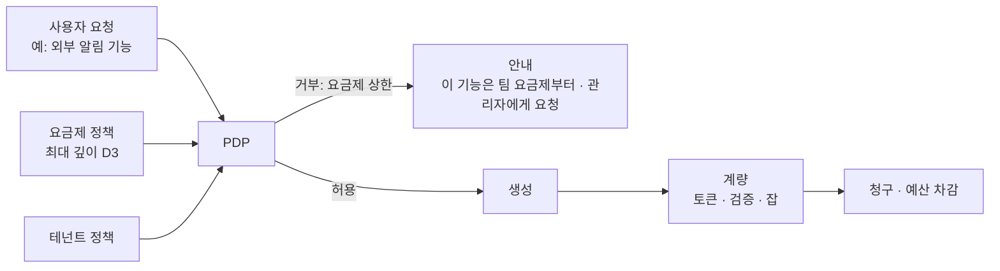

<!-- LANG-BAR -->
[English](../en/09-business-coupling.md) · **한국어** · [简体中文](../zh-CN/09-business-coupling.md) · [日本語](../ja/09-business-coupling.md) · [Español](../es/09-business-coupling.md)
<!-- /LANG-BAR -->

# 9. 비즈니스 결합 — 사업 모델은 아키텍처 선택에 묶여 있다

> 이 장의 결론: 사업 모델(BM)은 아키텍처 위에 나중에 얹는 것이 아니다. **에이전트 위치(A3), 토폴로지(A6), 공유 범위(A8), 관리 가시성(A10), 모델 조달(A9)** 이 무엇을 팔 수 있는지를 결정한다. 이 장은 20개 BM을 축 조건으로 정의하고, 레퍼런스 프로파일별로 가능 여부를 계산한다. 그리고 두 가지 통합 원칙을 제시한다: **요금제는 정책 상한이다**, **최소 깊이 원칙은 보안 원칙이자 원가 원칙이다**.

## 9.1 왜 함께 설계해야 하나

- 3장에서 봤듯이 구조 축은 바꾸기 비싸고, 사업 축은 싸게 바뀝니다. 그런데 **어떤 사업 축 값은 특정 구조에서만 존재합니다.** 예: 소스 비공개 실행을 팔려면(B7) 서버 에이전트와 hidden 가시성이 처음부터 있어야 합니다.
- 반대로 처음 고른 사업 모델이 구조를 강제하기도 합니다. 추론을 묶어 팔면(B3) 계량·예산·어뷰징 방지가 필수가 되고, 이는 관리 가시성 V0 이상(N3)을 요구합니다.

## 9.2 가치 단위와 원가 동인

| 가치 단위 (무엇에 돈을 내나) | 원가 동인 (무엇에 돈이 드나) |
| --- | --- |
| 활성 사용자·좌석 | 추론 토큰 (생성·판정·병합) |
| 완성된 변경 (검증 통과) | 검증 실행 (샌드박스·계약·스크린샷) |
| 기본판 생존 (업데이트 후에도 동작) | 전파 잡 (사용자 수 × 릴리스 수, 6.8) |
| 공유·설치 | 큐레이션·심사 인력 |
| 관리·감사 기능 | 저장·텔레메트리 |
| 기밀 실행 환경 | 서버 샌드박스·온프레미스 운영 |

변경 하나의 공헌이익:

```text
margin(δ) = price(δ) − [ tokens(δ) × unit_price(route) + c_validate(depth) + c_store + c_support / 변경 수 ]
```

`tokens`와 `c_validate`는 깊이에 따라 커집니다. D2로 되는 일을 D4로 만들면 비싸고(모델 호출·판정 게이트 추가) 위험합니다. 그래서 **최소 깊이 원칙(2.6)은 보안 원칙이면서 원가 원칙**입니다. 해석자가 더 단순한 방법을 먼저 제안하는 경험(8.3)은 사용자 만족과 마진을 동시에 올립니다.

## 9.3 BM 카탈로그

| id | BM | 과금 단위 | 필요한 아키텍처 조건 | 계량·집행 지점 |
| --- | --- | --- | --- | --- |
| B1 | 라이선스 판매 | 기기·사용자당 1회 | 없음 | 라이선스 서버 |
| B2 | 좌석 구독 | 월 좌석 | 없음 (서버 기능이 있을수록 가치 상승) | 신원·계량 |
| B3 | 추론 크레딧 마진 | 사용량 | `A9=credits` (+ N3: `A10≥V0`) | 모델 게이트웨이 |
| B4 | BYOK 플랫폼 요금 | 월 고정 또는 잡당 | `A9∈{byok, tenant_cloud}`, 서버 기능이 있으면 완전 | 잡 실행기·계량 |
| B5 | 공유 마켓 수수료 | 유료 기능 판매액의 일정 비율 | `A8=public` (테넌트 내부는 내부 정산) | 공유 서비스 |
| B6 | 거버넌스 애드온 | 테넌트 월정액 | `A10≥V1` | 대시보드·감사 |
| B7 | 기밀 실행 프리미엄 | 테넌트 월정액 | `A3=server` ∧ `A5=hidden` | 서버 샌드박스·출력 게이트 |
| B8 | 기준판 지원 계약 | 연간 계약 | `A6=lineage` ∧ `A7∈{proposed, auto}` | 계보 레지스트리·잡 실행기 |
| B9 | 업그레이드 생존 보증 | 활성 기능당 월 | `A6∈{fork, lineage}` ∧ `A7∈{proposed, auto}` | 전파 파이프라인·계약 실행 |
| B10 | 승격 분배 | 승격 건당 보상 | `A6=lineage` (+ 공유·V1 이상이면 완전) | 승격 파이프라인 |
| B11 | 동네 개발자 연결 | 연결 건당 수수료 | 가시성 open/own이면 완전, hidden이면 테넌트 내부 전문가만 | 에스컬레이션 큐 |
| B12 | 수요 신호 리포트 | 리포트 구독 | `A10≠none` | 텔레메트리 집계 |
| B13 | 용어·도메인 팩 | 팩 라이선스 | 없음 | 용어 변환기 |
| B14 | 모델 공급사 제휴 | 공급사 제휴 조건에 따름 | `A9≠on_device`, 공급사 공식 프로그램이 있을 때만 | 모델 게이트웨이 |
| B15 | 품질 등급 차등 | 요금제 차등 | `A9=credits` (BYOK·테넌트 클라우드는 서버 라우팅 시 조건부) | 모델 게이트웨이 라우팅 |
| B16 | 성과 단위 과금 | 검증 통과한 변경당 | `A10≠none` ∧ `A9∈{credits, byok, tenant_cloud}` | 검증 게이트 + 계량 |
| B17 | 런타임 OEM 라이선스 | 연간 라이선스 | 없음 (명세 공개 + 구현 상용) | — |
| B18 | 해결 레시피 구독 | 구독 | `A6∈{fork, lineage}` ∧ `A7∈{proposed, auto}` | 해결 캐시·릴리스 |
| B19 | 기능의 제품화 분배 | 판매액 분배 | `A8=public` | 공유 서비스·승격 |
| B20 | 후원 기본값 슬롯 (주의) | 노출·전환 | `A8=public`, 표시 의무 충족 시에만 | 기능 지도·추천 |

## 9.4 레퍼런스 프로파일 × BM 결합 행렬

`python3 tools/design_space.py --bm` 계산 결과입니다. ● 그대로 가능, ◐ 조건부(운영 방식·외부 계약 필요), ○ 구조상 불가.

| BM | 이름 | P1 개인 공방 | P2 팀 큐레이션 | P3 기업 기밀 | P4 대중 소비자 | P5 로컬 퍼스트 | P6 마켓 플랫폼 | P7 폐쇄망 공공 |
| --- | --- | :-: | :-: | :-: | :-: | :-: | :-: | :-: |
| B1 | 라이선스 판매 | ● | ● | ● | ● | ● | ● | ● |
| B2 | 좌석 구독 | ● | ● | ● | ● | ● | ● | ● |
| B3 | 추론 크레딧 마진 | ○ | ○ | ○ | ● | ○ | ● | ○ |
| B4 | BYOK 플랫폼 요금 | ○ | ● | ● | ○ | ◐ | ○ | ● |
| B5 | 공유 마켓 수수료 | ○ | ◐ | ◐ | ● | ◐ | ● | ◐ |
| B6 | 거버넌스 애드온 | ○ | ● | ● | ● | ○ | ● | ● |
| B7 | 기밀 실행 프리미엄 | ○ | ○ | ● | ◐ | ○ | ○ | ● |
| B8 | 기준판 지원 계약 | ◐ | ● | ● | ○ | ○ | ● | ● |
| B9 | 업그레이드 생존 보증 | ● | ● | ● | ○ | ○ | ● | ● |
| B10 | 승격 분배 | ○ | ● | ● | ○ | ○ | ● | ● |
| B11 | 동네 개발자 연결 | ◐ | ● | ◐ | ● | ● | ● | ◐ |
| B12 | 수요 신호 리포트 | ○ | ● | ● | ● | ○ | ● | ● |
| B13 | 용어·도메인 팩 | ● | ● | ● | ● | ● | ● | ● |
| B14 | 모델 공급사 제휴 | ◐ | ◐ | ◐ | ◐ | ◐ | ◐ | ◐ |
| B15 | 품질 등급 차등 | ○ | ◐ | ◐ | ● | ○ | ● | ◐ |
| B16 | 성과 단위 과금 | ○ | ◐ | ◐ | ● | ○ | ● | ◐ |
| B17 | 런타임 OEM 라이선스 | ● | ● | ● | ● | ● | ● | ● |
| B18 | 해결 레시피 구독 | ● | ● | ● | ○ | ○ | ● | ● |
| B19 | 기능의 제품화 분배 | ○ | ◐ | ◐ | ● | ◐ | ● | ◐ |
| B20 | 후원 기본값 슬롯 | ○ | ○ | ○ | ◐ | ○ | ◐ | ○ |

권장 조합 36,772개 전체에서 각 BM이 가능한 비율(`--bm-stats`):

| BM | 이름 | ● 가능 | ◐ 조건부 | ○ 불가 |
| --- | --- | ---: | ---: | ---: |
| B1·B2·B13·B17 | 라이선스·좌석·용어팩·OEM | 100.0% | 0.0% | 0.0% |
| B12 | 수요 신호 리포트 | 88.8% | 0.0% | 11.2% |
| B6 | 거버넌스 애드온 | 66.6% | 22.2% | 11.2% |
| B11 | 동네 개발자 연결 | 56.7% | 43.3% | 0.0% |
| B9·B18 | 업그레이드 생존 보증·해결 레시피 | 53.7% | 0.0% | 46.3% |
| B4 | BYOK 플랫폼 요금 | 40.4% | 16.3% | 43.3% |
| B5·B19 | 공유 마켓·제품화 분배 | 27.4% | 36.3% | 36.3% |
| B8 | 기준판 지원 계약 | 26.9% | 26.9% | 46.3% |
| B3 | 추론 크레딧 마진 | 24.2% | 0.0% | 75.8% |
| B15 | 품질 등급 차등 | 24.2% | 40.4% | 35.5% |
| B16 | 성과 단위 과금 | 24.2% | 48.3% | 27.5% |
| B10 | 승격 분배 | 11.7% | 15.2% | 73.1% |
| B7 | 기밀 실행 프리미엄 | 11.0% | 23.3% | 65.7% |
| B14 | 모델 공급사 제휴 | 0.0% | 89.0% | 11.0% |
| B20 | 후원 기본값 슬롯 | 0.0% | 27.4% | 72.6% |

### 해석

- **어디서나 되는 BM(B1·B2·B13·B17)은 차별화가 약합니다.** 말랑한 아키텍처 고유의 가치를 파는 BM은 B9(생존 보증), B18(해결 레시피), B8(기준판 계약), B10(승격 분배)처럼 **계보와 전파가 있어야 성립**하는 것들입니다. 이들은 권장 조합의 절반 정도에서만 가능합니다.
- **가장 비싼 차별화는 B7(기밀 실행)** 입니다. 가능한 조합이 11.0%뿐이고, 서버 에이전트·hidden·출력 게이트를 모두 갖춰야 합니다. 그만큼 경쟁자가 따라오기도 어렵습니다.
- **크레딧 마진(B3)은 생각보다 좁습니다.** 권장 조합의 76%에서 불가능합니다. 사용자 구독·BYOK·테넌트 클라우드를 지원하는 순간 추론 마진은 포기하고, 플랫폼 가치(B4·B6·B9)로 돈을 벌어야 합니다.
- **P1 개인 공방형은 추론 마진을 원천적으로 못 냅니다.** 사용자 구독(sub)으로 돌기 때문입니다. 대신 라이선스·생존 보증·레시피가 맞습니다.

## 9.5 비전형 BM — 구조를 이용한 우회로

통상적인 "좌석 × 월정액" 틀 밖에서, 이 아키텍처이기 때문에 가능한 방식들입니다. 모두 합법적으로 설계할 수 있지만, 각각 지켜야 할 조건이 있습니다.

| BM | 아이디어 | 왜 이 구조에서만 가능한가 | 지켜야 할 조건 |
| --- | --- | --- | --- |
| B9 업그레이드 생존 보증 | "다음 기본판에서도 당신의 기능이 동작한다"를 판다. 깨지면 무상 재구성 또는 크레딧 환급 | 계약(κ)이 있어서 '동작한다'를 기계로 판정할 수 있음 | 결정적 계약이 있는 기능, stable 확장 지점 위의 기능만 대상. 약관에 판정 기준 명시 |
| B18 해결 레시피 구독 | 기본판을 낼 때 대표 충돌의 해결 방법을 함께 배포 → 사용자 추론 비용 절감 | 해결 캐시와 동치류 구조(6.8) | 고객 산출물이 아니라 공개 패턴으로만 레시피 생성 |
| B10 승격 분배 | 내가 만든 기능이 조직·공식 기본판에 채택되면 보상 | 승격 파이프라인과 출처 기록(6.10) | 기업 내부는 고용 계약상 권리 귀속을 따름. 공개 생태계는 기여 약관 필요. **공식** 기본판 채택은 원작자의 명시적 옵트인과 라이선스 동의가 있을 때만(6.10 경계) |
| B11 동네 개발자 연결 | 의도 충돌·코어 요청을 검증된 사람 전문가에게 연결 | 에스컬레이션 지점이 구조적으로 정의돼 있음(R5, D5 수집) | 접근은 동의 기반 한시 권한, 모든 접근 감사 기록 |
| B12 수요 신호 리포트 | 사용자들이 무엇을 만들려 하는지(확장 지점별 수요, 코어 요청 상위)를 집계해 제공사 로드맵 자료로 제공 | 모든 변경이 의도·깊이·확장 지점으로 기록됨 | V0·V1 집계만, 최소 집계 크기(예: k개 테넌트 이상) 기준, 계약상 옵트인 |
| B19 기능의 제품화 분배 | 널리 공유된 기능을 공식 유료 확장으로 승격하고 원작자와 수익 분배 | 공유 출처·설치 수·유지율이 기록됨 | 원작자의 명시적 옵트인과 라이선스 동의(6.10 경계), 분배율 공개. 공개(A8=public) 공유물만 대상 |
| B20 후원 기본값 슬롯 | 외부 서비스가 특정 확장 지점의 기본 연동처가 되도록 후원 | 기능 지도가 연동처를 명시적으로 표현 | **'후원' 표시, 사용자가 언제든 변경 가능, 에이전트 추천에 후원 사실 고지**. 광고 표시 규제 검토 필수 |

## 9.6 모델 조달과 BM

| 조달 경로 | 추론 마진 | 우리가 버는 방식 | 정책 위험 |
| --- | --- | --- | --- |
| `sub` 사용자 구독 | 없음 | 라이선스·좌석·생존 보증 | 공급사가 제3자 사용을 금지하거나 조건을 바꿀 수 있음. 공식 클라이언트 위임 방식으로만 |
| `byok` | 없음 | 플랫폼 요금(검증·저장·전파) | 낮음 |
| `credits` | 있음 | 마진 + 품질 등급 | 원가 변동, 어뷰징, 공급사 재판매 조건 |
| `tenant_cloud` | 없음 | 기업 계약·거버넌스·기밀 실행 | 낮음 (고객 계약이 기존 클라우드 계약을 재사용) |
| `on_device` | 없음 | 라이선스·도메인 팩 | 품질 한계 |

2026년의 사실관계: Anthropic은 2월에 Free·Pro·Max 구독에서 얻은 인증 토큰을 다른 제품·도구·서비스(Agent SDK 포함)에서 쓰는 것이 소비자 약관 위반이라고 명시했고, 약관상 예외는 API 키로 접근하거나 명시적으로 허용한 경우입니다([The Register](https://www.theregister.com/2026/02/20/anthropic_clarifies_ban_third_party_claude_access)). 이후 4월부터 제3자 하네스의 구독 사용을 막았다가, 6월 15일부터 Claude Code 밖의 프로그래매틱 사용에 구독과 분리된 월 크레딧(정가 차감, 이월 없음)을 주는 방식으로 일부 되돌렸습니다([정리 글](https://falcao.org/posts/anthropic-claude-access-crackdown-ecosystem-fallout/)). 같은 글에 따르면 다른 공급사는 서드파티 도구와 제휴해 구독 사용을 열어 주는 방향을 택했습니다. **공급사 정책은 한 해 안에도 여러 번 바뀝니다.** 그래서:

- 모델 조달은 반드시 포트로 추상화하고(5.3), 공급사별 허용 경로를 설정으로 관리합니다.
- 사업 계획이 한 공급사의 구독 정책에 의존하면 안 됩니다. 최소 두 경로(예: BYOK + 크레딧)를 항상 열어 둡니다.

## 9.7 요금제 = 정책 상한

요금제는 4장의 손잡이 구간을 다르게 자른 운영자 정책입니다. 별도의 '기능 플래그 시스템'을 만들 필요가 없고, 거부 이유가 "요금제 상한"일 때가 가장 정확한 업그레이드 권유 시점이 됩니다.

| 손잡이 | 무료 | 개인 | 팀 | 기업 | 공공·폐쇄망 |
| --- | --- | --- | --- | --- | --- |
| 최대 깊이 | D2 | D4 | D3 | D4 | D3~D4 |
| 공유 | 받기만 | 없음 | 테넌트 | 테넌트(+심사된 공개) | 테넌트 |
| 기본판 계층 | 공식만 | 공식만 | 공식 → 팀 | 공식 → 기업 → 조직 | 공식 → 기관 → 부서 |
| 모델 조달 | 포함 크레딧 소량 | 구독 연결·BYOK·크레딧 | BYOK·크레딧 | 테넌트 클라우드·BYOK | 사내 모델 |
| 품질 모드 | 절약 | 표준 | 표준·고품질 | 전체 | 고객 지정 |
| 관리 가시성 | — | — | V1 | V2 (V3 옵션) | V3 |
| 생존 보증(B9) | — | 옵션 | 포함 | 포함 + 지원 계약(B8) | 지원 계약 |
| 기밀 실행(B7) | — | — | — | 옵션 | 기본 |



## 9.8 서비스 로직과의 연결

| BM | 계량 이벤트 | 집행 지점 | 실패 시 동작 |
| --- | --- | --- | --- |
| B3 크레딧 | `model.call` (토큰·경로) | 모델 게이트웨이 | 예산 초과 → 멈춤 또는 절약 모드 제안 |
| B4 BYOK 요금 | `job.completed` (전파·공유·승격) | 잡 실행기 | 미납 → 서버 잡 중지, 기기 기능은 유지 |
| B6 거버넌스 | 활성 관리자·대시보드 접근 | 제어면 | 등급 하향 시 V2 → V1 |
| B9 생존 보증 | `upgrade.applied`, `change.held` (계약 불충족 보류) | 전파 파이프라인 | 보류 발생 시 무상 재구성 잡 자동 생성 |
| B16 성과 과금 | `change.activated` + 게이트 통과 기록 | 검증면 | 실패한 생성은 과금 안 함 |
| B10 승격 분배 | `promotion.released` + 출처 | 승격 파이프라인 | 출처 불명이면 분배 보류 |
| B12 수요 리포트 | `core_request.recorded`, 확장 지점별 집계 | 텔레메트리 | 최소 집계 크기 미달 항목 제외 |

원칙: **과금 이벤트는 제어면의 감사 기록과 같은 이벤트 스트림에서 나온다.** 청구 근거와 감사 근거가 따로 놀면 분쟁 때 설명할 수 없습니다.

## 9.9 사업 지표

| 지표 | 정의 |
| --- | --- |
| 활성 수정자 비율 | 주간 활성 사용자 중 변경을 1건 이상 적용한 비율 |
| 사용자당 활성 기능 | 평균 활성 기능 수 (전환 비용의 대리 지표) |
| 기본판 생존율 | 릴리스 후 자동·제안으로 살아남은 기능 비율 (B9의 원가 결정) |
| 변경당 원가 | 깊이별 평균 추론·검증 비용 |
| 테넌트별 공헌이익 | 매출 − (추론 + 검증 + 전파 + 지원) |
| 승격률 | 승격 후보 중 실제 릴리스에 들어간 비율 |
| 공유 설치율 | 공유받은 기능 중 적용된 비율 |
| 코어 요청 상위 | D5로 수집된 요청 상위 목록 (제공사 로드맵 신호) |

## 9.10 고민할 질문

- 생존 보증(B9)의 판정 기준을 계약 통과로 둘 때, 사용자가 일부러 약한 계약을 쓰는 도덕적 해이를 어떻게 막는가? 권장: 보증 대상은 판정자가 계약 충분성을 승인한 기능만.
- 승격 분배(B10)는 기업 내부에서 보상 제도와 연결할 것인가, 인정(배지·실적)으로만 둘 것인가? 노동 계약·성과 평가 정책과 충돌하지 않는지 검토가 필요합니다.
- 수요 신호 리포트(B12)는 운영자와 제공사가 같은 회사일 때는 내부 자산이고, 다를 때는 판매 상품입니다. 어느 쪽이든 고객 계약에 명시해야 합니다.
- 후원 슬롯(B20)은 에이전트 추천의 중립성을 해칠 수 있습니다. 넣는다면 후원 사실을 사용자와 에이전트 맥락 양쪽에 명시하고, 추천 순서에 영향을 주지 않는 방식부터 시작하세요.

다음 장: [10. 열린 문제와 평가](10-open-problems.md)
