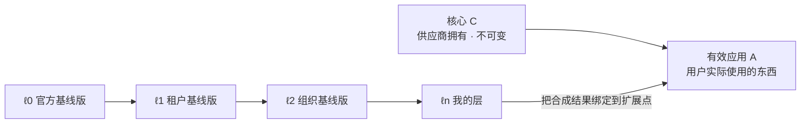
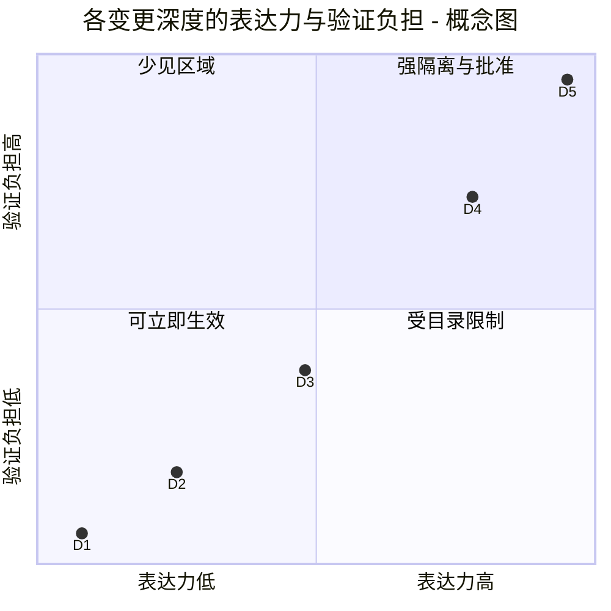
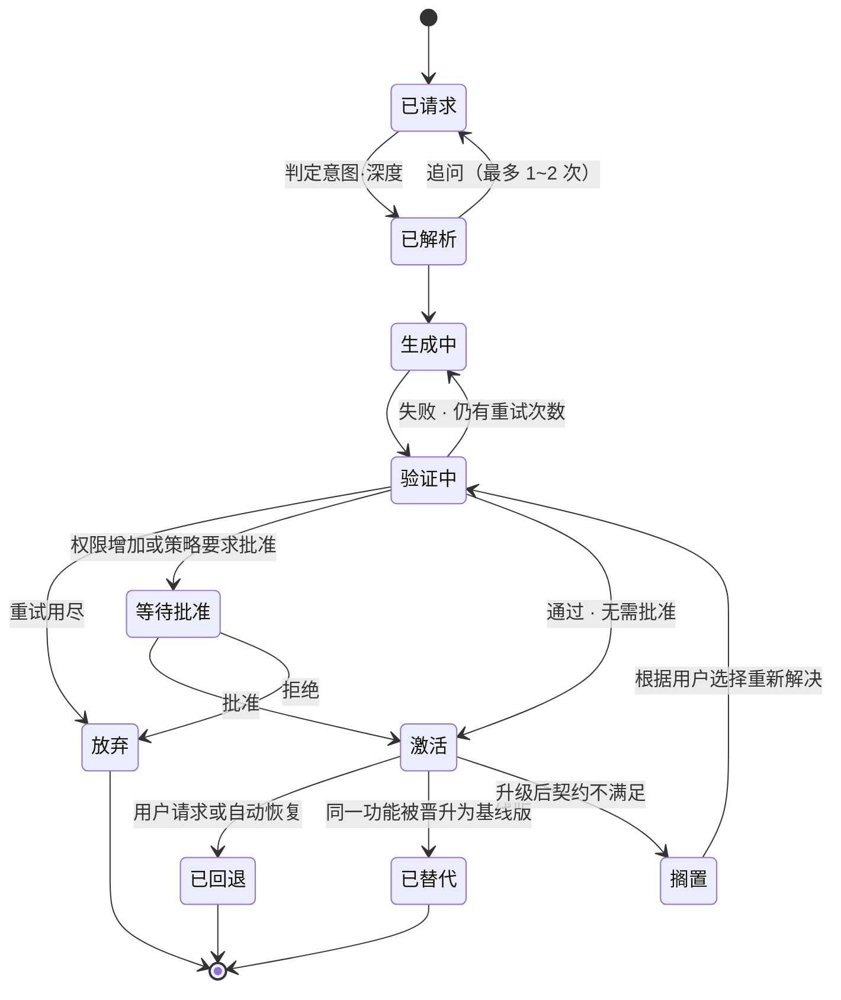

<!-- LANG-BAR -->
[English](../en/02-core-model.md) · [한국어](../ko/02-core-model.md) · **简体中文** · [日本語](../ja/02-core-model.md) · [Español](../es/02-core-model.md)
<!-- /LANG-BAR -->

# 2. 核心模型 — 宿主、层、变更、契约、策略

> 本章结论：Mallangable 系统是**叠加在不可变核心之上的层栈**，用户的所有修改都表示为**带有意图·产出物·契约·权限的变更（δ）**。无论架构做什么，都不得破坏不变式 I1~I10。

本章是与实现无关的概念模型。之后各章的所有组件·流程·策略都建立在这里定义的对象之上。

## 2.1 行为者 (Principals)

| 行为者 | 符号 | 角色 | 例 |
| --- | --- | --- | --- |
| 宿主供应商 (Host Vendor) | `V` | 制作并拥有核心。定义扩展点 | 开发该应用的公司 |
| 平台运营方 (Platform Operator) | `O` | 运营可塑基础设施（控制面） | 通常与 `V` 相同，但也可能是 Mallangable 托管服务商 |
| 租户管理员 (Tenant Admin) | `T` | 管理一个客户组织的策略·基线版·预算 | 客户公司的 IT 管理员 |
| 组织管理员 (Org Steward) | `G` | 管理租户内下级组织的基线版 | 团队负责人 |
| 用户 (End User) | `U` | 修改自己的层 | 普通员工、个人用户 |
| 智能体 (Agent) | `α` | 代替用户·管理员生成或合并变更。**非人类行为者** | 代码生成智能体、合并智能体 |

权限委托方向为 `V → O → T → G → U`。智能体 `α` 不在这条链上，**始终只作为接受某个人类行为者委托的短期主体**存在（I4、I9）。

## 2.2 宿主 (Host)

宿主（host）`H` 是四个要素的组合。

```text
H = ⟨ C, X, K, Σ ⟩
  C : 核心（Core）。供应商发布的不可变部分。用户层不改变 C。
  X : 扩展点（Extension Point）的集合。
  K : 能力（Capability）的集合。扩展可以使用的能力的名牌。
  Σ : 状态 schema。扩展可以读写的数据的形态。
```

单个扩展点定义如下。

```text
x = ⟨ id, kind, d_min, in, out, stability ⟩
  id        : 像 "sidebar.panel"、"editor.on_save" 这样稳定的标识符
  kind      : token | command | view | hook | service
  d_min     : 使用该扩展点所需的最小深度 (2.6)
  in / out  : 扩展点提供的输入和期望的输出的 schema
  stability : stable | experimental | deprecated
```

宿主必须(MUST)把扩展点和权限的清单作为**机器可读的能力图（capability map）**暴露出来。如果让智能体去猜 API，就会滑向核心补丁（D5）。[n.codes](https://github.com/yungookim/n.codes) 展示了分析代码库自动生成能力图的做法。

## 2.3 层与有效应用

用户实际使用的应用（有效应用，effective app）是在核心之上按顺序合成各层（layer）的结果。

```text
Λ = [ ℓ0, ℓ1, …, ℓn ]          ℓ0 = 供应商基线版，ℓn = 用户自己的层
A = C ⊗ ( ℓ0 ⊕ ℓ1 ⊕ … ⊕ ℓn )
```

- `⊕`（层合成）：触碰同一个键时，后面的层**覆盖（override）**前面的层。声明式数据的默认语义是 JSON Merge Patch（RFC 7396）。对象按键覆盖，`null` 删除该键，数组整体替换。若要按项合并数组，扩展点 schema 必须声明合并键（6.6 R2）。代码扩展按扩展点的槽位进行合成。
- `⊗`（应用到核心）：把合成后的层绑定到核心的扩展点上。核心不变。
- `⊕` 应当(SHOULD)满足结合律。这样才能预先把"企业基线版 + 组织基线版"合并并缓存。为此，层与层预先合并时必须(MUST)保留 `null`（删除标记）而不将其清除。这样之后再应用合并好的层，结果才与逐个应用相同。
- `⊕` 与第 6 章合并的关系：`⊕` 是在一条谱系内合成层**之间**的运算，而 3-way 合并（6.4~6.6）只用于**把某一层移到新的上级基线版之上时**该层内部的修改。



读法：越往右优先级越高。两个层触碰同一个扩展点时，离用户更近的层获胜，而这种"覆盖"在升级时会成为冲突候选（第 6 章）。

## 2.4 变更 (Change)

用户修改的原子单位。

```text
δ = ⟨ ι, a, κ, π, d, X_δ, prov ⟩
  ι    : 意图（Intent）。对人所说目的的概括。"想把今天截止的事项放到最上面"
  a    : 产出物（Artifact）。声明式数据或代码
  κ    : 契约（Contract）。验收条件的集合 (2.5)
  π    : 所需权限。π ⊆ K
  d    : 深度。D1~D5 (2.6)
  X_δ  : 触碰的扩展点。X_δ ⊆ X
  prov : 来源。请求者、批准者、智能体、模型、父变更、时间
```

源自同一意图的多次修改归为同一个**功能（Feature）**。功能是一系列变更，意图和契约以功能为单位维护。

## 2.5 契约 (Contract)

契约（contract）是关于有效应用 `A` 的**可观察行为**的谓词集合。

```text
κ = { k1, k2, … },   k_i : A → { 真, 假 }
κ(A) = k1(A) ∧ k2(A) ∧ …
```

| 种类 | 例 | 确定性 | 成本 | 强度 |
| --- | --- | --- | --- | --- |
| 结构查询 (dom/tree query) | "面板中显示 2 个项目" | 确定性 | 低 | 强 |
| 单元检查 (unit) | 纯函数的输入输出 | 确定性 | 低 | 强 |
| 快照 (snapshot) | 比较渲染结果 | 确定性（环境固定时） | 中 | 中 |
| 评判者 (judge) | 看截图判定是否满足意图 | **概率性** | 高 | 弱 |

评判者契约是概率性的，因此不应当(SHOULD)单独使用。至少要有一个确定性契约，才能在合并（第 6 章）中作为依据。

契约之所以是这个模型的中心：在升级·共享·晋升时，代码 diff 并不能告诉你含义。**只有记录下"这个变更必须保证什么"**，机器才能判定合并结果。

## 2.6 变更深度层次 D1~D5

深度（depth）既是产出物的**表达力**，也是**风险等级**。W3C 的最小权力原则建议"选择能够表达需求的最弱的语言"。因为语言越弱，就越能不执行而加以分析，越容易复用，也越容易保障安全（[W3C TAG](https://www.w3.org/2001/tag/doc/leastPower.html)）。Mallangable 把这一原则应用于用户变更。

| 深度 | 名称 | 产出物 | 表达力（计算模型） | 执行前分析 | 例 |
| --- | --- | --- | --- | --- | --- |
| D1 | 外观 | 设计令牌、样式值 | 有限的键-值映射 | 完全 | "按钮放大，颜色改成橙色" |
| D2 | 组合 | 现有命令的组合、快捷键、规则 | 有限命令集上无循环（或次数受限）的宏 | 完全 | "用这一个按钮完成导出+发送邮件" |
| D3 | 界面 | 已批准组件目录之上的声明式 UI 树 + 数据绑定 | 树结构 + 受权限限制的查询 | 大部分 | "今日截止列表面板" |
| D4 | 行为 | 沙箱内的任意代码 | 图灵完备，仅通过能力访问外部 | 部分（要执行才知道） | "保存时自动给表格排序" |
| D5 | 核心 | 修改核心源码 | 无限制 | 实际上不可能 | "更换渲染引擎" |



读法：深度每上升一级，能做的事和需要验证的事就一起增加。坐标是展示顺序的概念图，并非测量值。

规则：
- **最小深度原则（least-depth rule）**（必须(MUST)）：智能体必须以满足契约 `κ` 的最低深度来生成变更。D2 能做到的事用 D4 来做，会被拒绝。
- **D5 分离**（必须(MUST)）：D5 不作为用户层存在，只作为供应商批准的**核心分叉**存在。在一般用户流程中，D5 请求应当(SHOULD)默认作为"核心功能请求"收集。这种收集本身就会成为供应商路线图最准确的需求信号。
- 这个层次实现了 Ink & Switch 所引用的"平缓坡度（gentle slope）"。每一级用户需要新理解的东西只增加一点点。

## 2.7 策略 (Policy) 与策略格

策略（policy）`p` 为每个管控旋钮（knob）规定允许范围（详见第 4 章）。策略之间存在"更严格"的偏序关系。

```text
p ⊑ q   ⇔   p 允许的一切 q 也允许   （p 比 q 更严格或相同）
p ⊓ q   :  只允许两者都允许的内容的策略（交集，meet）
```

沿着行为者链，有效策略以交集来计算。

```text
p_eff(U) = p_V ⊓ p_O ⊓ p_T ⊓ p_G ⊓ p_U
```

- **单调收窄**（必须(MUST)）：下级行为者只能在上级给出的范围内收窄。`p_child ⊑ p_parent`。
- 一个例外：**用户权利底线（floor）**是任何上级策略都无法删除的（4.6）。例如"回退我的变更的权利"就是底线。

## 2.8 变更的生命周期



读法：**通往激活的每条路径都经过验证。**"搁置"是指基线版升级后契约被破坏的变更不会悄悄消失，而是等待用户选择的状态。用户选定的解决方案也必须再次通过验证（G 门）才能激活。

## 2.9 不变式 I1~I10

| # | 不变式 | 为什么需要 | 被破坏时会发生什么 | 执行位置 |
| --- | --- | --- | --- | --- |
| I1 | **核心不变**：用户层的任何变更都不改变 `C` | 维持更新·支持·安全的基准点 | 每个用户的核心都不同 → 无法更新 | 路径访问控制、服务器接收检查 |
| I2 | **契约随附**：契约为空的变更不会被激活（`κ ≠ ∅`） | 合并·晋升的判定依据 | 升级时功能悄悄失效 | 记录阶段检查 |
| I3 | **可回退性**：所有激活状态都有记录下来的上一个状态，回退无需生成、在常数时间内完成 | 让人不怕实验 | 用户不再去改 | 状态面、运行时 |
| I4 | **权限单调性**：权限 `π` 只能通过拥有权限的人明确批准来增加。智能体不能自行扩大权限 | 防御提示词注入·恶意共享物 | 共享的变更窃取数据 | 决策点（PDP）、运行时智能体 |
| I5 | **策略单调收窄**：`p_child ⊑ p_parent`（底线除外） | 委托体系的一致性 | 下级管理员绕过上级策略 | 策略存储检查 |
| I6 | **可见性 = 隔离边界**：某个行为者不该看到的数据，不会进入该行为者可以查询的任何上下文（包括对话智能体的上下文） | 阻止"问智能体就什么都能问出来" | 违反源码不公开的承诺 | 角色分离、输出门 |
| I7 | **生成·评判分离**：生成产出物的智能体实例与评判它的实例不同 | 防止自评偏差 | 验证流于形式 | 执行框架 |
| I8 | **信任边界执行**：最终执行只在运营方控制的边界上进行。用户设备上的检查仅供提示。仅适用于存在运营方边界的部署，没有服务器的部署（P1·P5）无法保证这一点 | 客户端可以被绕过 | 策略沦为摆设 | 服务器接收检查、沙箱重新验证 |
| I9 | **意图来源**：所有变更都可追溯到人的意图或上级变更 | 审计·责任·合并判断 | 来源不明的变更不断累积 | 记录规范 |
| I10 | **契约保持合并**：合并结果必须同时满足双方契约，做不到就交给人（`κ_up ∧ κ_down`） | 更新后存活的定义 | 合并偷偷删除了一方的功能 | 合并流水线 |

合规判定：只要实现**在设计上**（结构性地，而非运营失误）不保证 I1~I7、I9、I10 中的任意一条，就不称其为符合 Mallangable 的实现。I8 是 Governed 等级及以上的要求（10.3）。

## 2.10 示例：在待办应用中加入三个变更

假设一个虚构的宿主"待办应用"暴露了下列扩展点。

```yaml
extension_points:
  - id: theme.tokens        # D1
  - id: task.row.style      # D1~D2，条件样式规则
  - id: toolbar.command     # D2
  - id: sidebar.panel       # D3
  - id: task.on_complete    # D4，事件钩子
capabilities: [tasks.read, tasks.write, net.slack.post, notify.local]
```

三个用户请求落在不同的深度上。

```yaml
# 请求 1："把过了截止日期的事项显示成红色"  → D2（条件样式规则，没有代码）
- intent: 想一眼区分出已过截止日期的事项
  depth: D2
  points: [task.row.style]
  artifact: { rule: { when: "task.due < today && !task.done", style: { color: "danger" } } }
  permissions: [tasks.read]
  contract:
    - { id: overdue-red, check: tree-query, given: "昨天截止·未完成 1 项", expect: "该行颜色 = danger" }

# 请求 2："汇总本周已完成事项的面板"  → D3（声明式 UI）
- intent: 每周回顾时想看到本周完成的事项
  depth: D3
  points: [sidebar.panel]
  artifact: { ui: { type: list, source: "tasks where done_at in this_week", item: "{title}" } }
  permissions: [tasks.read]
  contract:
    - { id: only-this-week, check: tree-query, given: "本周 2 项·上周 1 项", expect: "列表 2 项" }

# 请求 3："完成事项时通知团队 Slack"  → D4（代码 + 对外发送权限）
- intent: 想把完成情况自动分享给团队
  depth: D4
  points: [task.on_complete]
  artifact: { module: "on_complete.js" }       # 在沙箱中执行
  permissions: [tasks.read, net.slack.post]    # 权限增加 → 需要人工批准 (I4)
  contract:
    - { id: posts-once, check: unit, given: "完成事件 1 次", expect: "slack.post 调用 1 次" }
```

如果智能体想把请求 1 做成 D4 代码，会因违反最小深度原则而被拒绝。请求 3 新增了向外部发送数据的权限，因此即使通过验证，在人批准之前也不会被激活。

下一章：[3. 设计空间](03-design-space.md)
