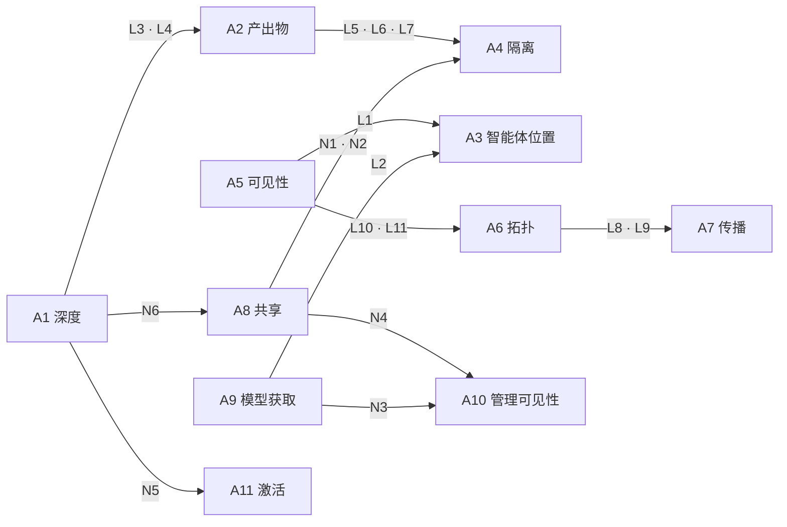
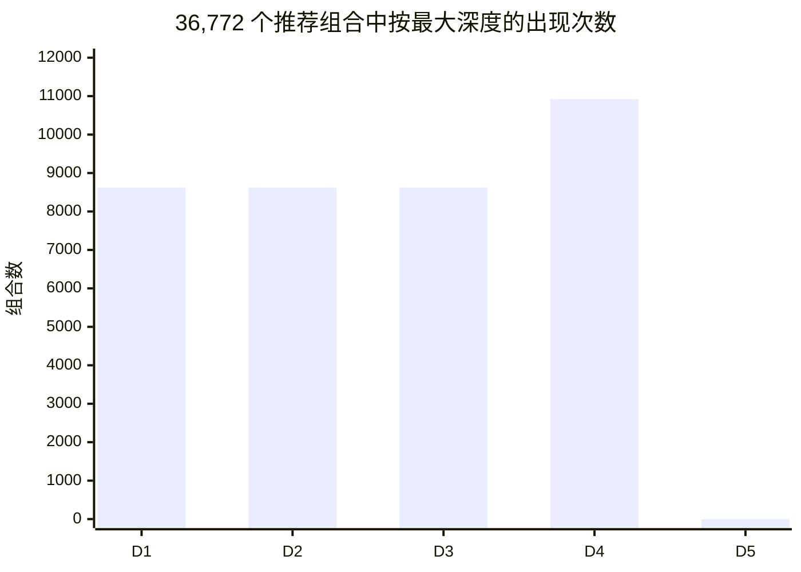
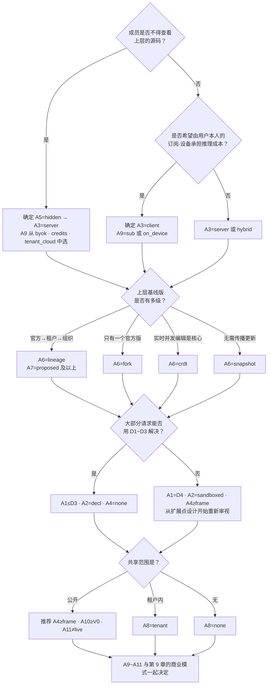
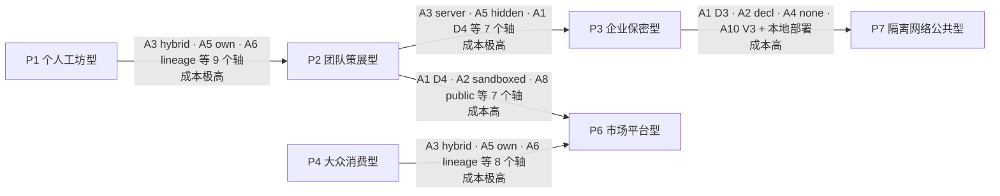

<!-- LANG-BAR -->
[English](../en/03-design-space.md) · [한국어](../ko/03-design-space.md) · **简体中文** · [日本語](../ja/03-design-space.md) · [Español](../es/03-design-space.md)
<!-- /LANG-BAR -->

# 3. 设计空间——选项、约束与组合数

> 本章结论：Mallangable 架构不是一个，而是**11 个轴的组合**。在 **1,944,000 个**原始组合中，逻辑上成立的占 **5.31%**，同时遵守安全规范的占 **3.14%**，可以无警告推荐的有 **36,772 个（1.89%）**。这些推荐组合在结构上归为 **863 个族**，而在结构确定之后，商业与策略轴平均仍有 **57%** 保持开放。也就是说，**结构决策要先做、谨慎地做；商业决策可以后做、轻松地做**。

## 3.1 为什么定义为"设计空间"

同样是"用 AI 修改应用"，个人桌面应用、消费级移动应用、需要源码保密的企业业务工具所要求的架构完全不同。与其给出唯一的正确答案，不如把选项分解为轴，并明确轴之间的约束，这样可以做到三件事。

1. **机械地筛掉不成立的组合。** 例如，"对用户隐藏代码"与"智能体在用户设备上运行"不可能同时成立（L1）。
2. **确定决策的顺序。** 有些轴改变时需要数据迁移，有些轴改一项设置就行（3.7）。
3. **与商业选项相连。** 可以计算每种 BM 要求哪些轴值（第 9 章）。

这种方法与软件产品线工程中的**特征模型（feature model）**相同。有效的产品配置是满足交叉约束的特征组合，而在运行中改变配置的动态产品线（DSPL）会在运行时检查这些约束（[Capilla et al., 2014](https://research.chalmers.se/publication/198081)）。Mallangable 的不同之处在于，配置的主体不仅是供应商（vendor），还有用户和 AI。

轴分为两组。

- **结构轴 A1~A8**：决定数据模型、部署和安全边界。改变时迁移成本高。
- **经济·策略轴 A9~A11**：决定成本结构、管理范围和用户体验。大多可以通过设置改变。

## 3.2 轴的定义

### A1. 最大变更深度——"用户能改到什么程度"

| 选项 | 含义 | 适用场景 | 代价 |
| --- | --- | --- | --- |
| `D1` | 仅外观 | 品牌一致性优先的消费级应用 | 几乎没有可塑性 |
| `D2` | 到现有功能的组合 | 业务自动化、快捷键·规则 | 无法创建新界面 |
| `D3` | 到声明式界面 | 大多数业务工具。推荐组合中一半以上落在这里 | 需要设计组件目录 |
| `D4` | 到沙箱代码 | 开发者·高级用户工具 | 沙箱、验证、批准的成本 |
| `D5` | 到核心（core） | 企业内部专用分支、研究用途 | 实际上放弃了更新后的存续 |

值得思考的问题
- 用户请求中有百分之多少能用 D1~D3 解决？如果事先调研中这个比例偏低，说明扩展点（extension point）设计不足。
- 开放 D4 时，谁来阅读并负责这些代码？
- 最大深度（depth）是**上限（ceiling）**。实际变更按最小深度原则（least-depth rule，2.6）以更低的深度生成。

### A2. 产出物表示——"变更用什么来表示"

| 选项 | 含义 | 适用场景 | 代价 |
| --- | --- | --- | --- |
| `decl` | 仅声明式数据（JSON/YAML，A2UI 式 UI 描述） | 安全与可分析性优先 | 表达力有限 |
| `sandboxed` | 沙箱专用代码（宿主 API 只能经由中介（broker）） | D4（2.6） | 需要沙箱运行时 |
| `native` | 与宿主同等权限的代码（插件或源码补丁） | D5，信任组内部 | 难以隔离，供应链风险 |

值得思考的问题
- 能否扩展声明式模式，使其覆盖大部分用户请求？声明式范围越广，验证、合并、共享都越便宜。
- 一旦允许代码产出物，该代码的语言和运行时版本也成为契约（contract）的一部分。

### A3. 智能体位置——"生成变更的 AI 在哪里运行"

| 选项 | 含义 | 适用场景 | 代价 |
| --- | --- | --- | --- |
| `client` | 用户设备（包括用户自行启动的智能体） | 个人用户、离线、利用用户订阅 | 控制仅为提示级别（I8），无法保密代码 |
| `server` | 运营方服务器沙箱 | 企业·公共部门、代码保密 | 推理成本由运营方·租户承担 |
| `hybrid` | 对话式生成在设备上，合并·传播·晋升在服务器上 | 团队·组织 | 需维护两套执行环境 |

值得思考的问题
- 谁来支付推理成本？这个问题同时决定 A3 和 A9。
- 服务器能否对用户设备上智能体产出的结果**重新验证**（I8）？

### A4. 执行隔离——"生成的代码被关在什么里面"

| 选项 | 含义 | 能阻止的 | 不能阻止的 |
| --- | --- | --- | --- |
| `none` | 无隔离（声明式则不适用） | — | 一切 |
| `lang` | 语言级隔离（例如 [Hardened JS/SES](https://github.com/endojs/endo) 的 Compartment、Wasm） | 全局污染、直接 API 访问 | 同一进程内的资源耗尽、侧信道 |
| `frame` | 源分离的 iframe·WebView（[MCP Apps](https://modelcontextprotocol.io/seps/1865-mcp-apps-interactive-user-interfaces-for-mcp) 强制要求沙箱 iframe） | 访问宿主 DOM·存储 | 欺骗用户的 UI |
| `proc` | 独立进程·微型虚拟机 | 访问内存·文件·网络 | 经由允许通道的泄露 |

值得思考的问题
- 跨越隔离边界的唯一通道（中介）的消息格式是什么？它必须是可审计的格式。
- 一旦开放共享（A8），隔离要求就会提高（N1、N2）。

### A5. 代码可见性——"用户能看到哪些源码"

| 选项 | 含义 | 适用场景 | 代价 |
| --- | --- | --- | --- |
| `open` | 可以看到所有层（layer）的源码 | 个人、开放社区 | 无法保护上层的知识产权 |
| `own` | 只看自己的层 | 组织基线版中包含企业内部诀窍时 | 需要层分离的拓扑（L10） |
| `hidden` | 看不到任何源码，只接收结果 | 源码保密为必需的企业·公共部门 | 必须使用服务器智能体（L1），需要输出门 |

值得思考的问题
- 核心原理：**智能体能读到的代码，与该智能体对话的人最终也能读到。** 所以 `hidden` 不是策略标志，而是部署决策（7.8）。
- 下发到客户端的执行包即使经过混淆也可能被分析。需要保护的核心逻辑最好放在服务器端扩展点。

### A6. 版本拓扑——"变更历史以什么形态累积"

| 选项 | 含义 | 适用场景 | 代价 |
| --- | --- | --- | --- |
| `snapshot` | 只有每个用户的快照历史，不追踪与上层的关系 | 最简单的消费级应用 | 无法传播基线版更新（L8） |
| `fork` | 用户仓库 = 单一基线版的分支 | 个人·小规模 | 无法表示组织层级 |
| `lineage` | 多级基线版层级（官方→租户→组织→用户）的分支网络 | 企业 | 需要传播流水线（S3） |
| `crdt` | 实时同步文档（[Automerge](https://automerge.org/docs/reference/documents/conflicts/) 一类） | 并发协作 | 语义冲突仍然存在，并发编辑代码有风险（S7） |

值得思考的问题
- 用户数 N 乘以基线版发布频率 r，就是每年的合并工作量。这个数字决定了架构成本的大部分（6.8）。
- 也可以采用数据（声明式）用 CRDT、代码用 Git 式谱系的混合方式，但本文档默认一个系统使用一种拓扑。

### A7. 基线版传播——"上层变化时下层如何跟进"

| 选项 | 含义 | 适用场景 | 代价 |
| --- | --- | --- | --- |
| `none` | 不传播 | 快照拓扑、一次性定制 | 用户层逐渐过时 |
| `manual` | 由人直接合并 | 开发者用户 | 大多数用户做不到 |
| `proposed` | 智能体合并·验证后提出建议，由人批准 | 默认推荐值 | 批准疲劳 |
| `auto` | 验证通过且权限不变时自动应用 | 大规模用户 | 错误自动合并的连锁影响 |

值得思考的问题
- 是否已把自动应用的条件定义成机器可判定的形式，例如"契约全部通过 + 权限无变化 + 金丝雀通过"？
- 停留在支持期已结束的基线版上的用户怎么办？强制合并会破坏信任（6.5）。

### A8. 共享范围——"我做的变更可以给谁"

| 选项 | 含义 | 适用场景 | 代价 |
| --- | --- | --- | --- |
| `none` | 不共享 | 个人用途、保密环境 | 每个人各自重复做同样的东西 |
| `tenant` | 仅在同一租户内 | 企业 | 租户内的审核体系 |
| `public` | 跨租户公开 | 社区·市场 | 供应链攻击面（7.7） |

值得思考的问题
- 共享单位应当是**功能（意图+契约+产出物）**，而不是仓库。这样接收方才能重新运行同样的验证。
- 像 ClawHub 的案例那样，没有策展、隔离和权限展示，就不应开放公开共享（N1、N4）。

### A9. 模型获取——"推理用谁的账户、谁的费用"

| 选项 | 含义 | 适用场景 | 代价 |
| --- | --- | --- | --- |
| `sub` | 用户个人订阅。**仅限在供应商的官方客户端内** | 个人、开发者 | 不能用于服务器作业（L2）。暴露于供应商条款的变化 |
| `byok` | 用户·租户的 API 密钥 | 团队、高级用户 | 密钥管理的 UX |
| `credits` | 运营方打包销售推理 | 消费者、中小团队 | 成本与滥用风险由运营方承担 |
| `tenant_cloud` | 租户的云合同（例如 Bedrock、Vertex）或企业内部模型 | 企业·公共部门 | 提供方适配器多样化 |
| `on_device` | 用户设备上的本地模型 | 离线、隐私 | 质量有限（S6） |

值得思考的问题
- 截至 2026 年，部分供应商在条款中禁止在第三方产品中使用消费者订阅的认证令牌（Anthropic 案例：[The Register, 2026.02](https://www.theregister.com/2026/02/20/anthropic_clarifies_ban_third_party_claude_access)）。`sub` 只有设计成"用户直接启动供应商官方智能体，再把我们的技能·工具接入其中"的形式才安全（8.10、9.6）。
- 供应商政策经常变化。模型获取（model sourcing）必须通过端口（5.3）进行抽象。

### A10. 管理可见性——"管理员能看到什么程度"

| 选项 | 含义 |
| --- | --- |
| `none` | 无集中收集 |
| `V0` | 仅聚合（租户·组织单位的合计） |
| `V1` | 元数据（变更数·大小·深度·扩展点·验证结果，用户为化名） |
| `V2` | V1 + 变更消息·意图摘要，实名 |
| `V3` | V2 + 代码 diff 与内容 |

值得思考的问题
- 可见性是管理员便利与成员信任之间的交换。当前的可见性级别必须在用户界面上**始终**显示（4.6 下限）。
- 提交元数据一旦与个人关联，也可能成为个人信息。需要审查所在司法辖区的法律。

### A11. 激活方式——"经过验证的变更何时启用"

| 选项 | 含义 | 适用场景 |
| --- | --- | --- |
| `live` | 验证通过后立即生效 | D1~D2、个人 |
| `preview` | 预览后由用户应用 | 默认推荐值 |
| `gated` | 经指定批准者批准后应用 | 企业、公开共享物 |

## 3.3 约束

### 轴之间的依赖关系



读法：箭头表示"前一个轴的取值会缩小后一个轴的选项"。最重要的一点是 **A5（可见性）和 A9（模型获取）共同约束 A3（智能体位置）**。源码保密和利用用户订阅会把 A3 拉向相反的方向，因此不能同时要求。

### 逻辑约束 L——不可能成立或含义重复

| 规则 | 条件 | 理由 |
| --- | --- | --- |
| L1 | `A5=hidden ⇒ A3=server` | 如果操作代码的智能体在用户一侧，代码就无法隐藏 |
| L2 | `A9∈{sub, on_device} ⇒ A3≠server` | 个人订阅（条款）和设备模型（物理位置）不能用于服务器作业 |
| L3 | `A1∈{D1,D2,D3} ⇒ A2=decl` | 2.6：D1~D3 是声明式。一旦允许代码产出物，那就是 D4 |
| L4 | `A1=D4 ⇒ A2=sandboxed`, `A1=D5 ⇒ A2=native` | 2.6：行为变更用沙箱代码，核心变更用原生代码 |
| L5 | `A2=decl ⇒ A4=none` | 规范化：没有执行代码，执行隔离轴就没有意义 |
| L6 | `A2=sandboxed ⇒ A4≠none` | 沙箱产出物必须有沙箱 |
| L7 | `A2=native ⇒ A4∈{none, proc}` | 把宿主权限的代码放进语言·frame 隔离，它就不再拥有宿主权限 |
| L8 | `A6=snapshot ⇒ A7=none` | 不追踪上层关系，就没有可传播的对象 |
| L9 | `A6=crdt ⇒ A7≠manual` | CRDT 是自动合并，不存在手动合并步骤 |
| L10 | `A5=own ⇒ A6∈{fork, lineage}` | "只看自己的"只在层分离的拓扑中成立 |
| L11 | `A5=hidden ⇒ A6≠crdt` | CRDT 副本位于客户端，因此无法隐藏代码 |

### 规范约束 N——可以成立，但 Mallangable 安全原则禁止

| 规则 | 条件 | 依据 |
| --- | --- | --- |
| N1 | 代码产出物 ∧ `A8=public` ⇒ `A4∈{frame, proc}` | 公开共享物是供应链攻击的通道（7.7） |
| N2 | `A2=native` ∧ `A8≠none` ⇒ `A4=proc` | 被共享的宿主权限代码至少要进程分离 |
| N3 | `A9=credits` ⇒ `A10≠none` | 转售计费需要计量 |
| N4 | `A8=public` ⇒ `A10≠none` | 公开市场需要审计追踪 |
| N5 | `A1∈{D4,D5}` ⇒ `A11≠live` | 行为·核心变更不在没有预览·批准的情况下立即启用 |
| N6 | `A1=D5` ⇒ `A8=none ∧ A6≠snapshot` | D5 不是用户层，而是供应商批准的核心分支（I1，2.6）。不共享，并追踪基线版 |

### 警告 S——允许但不推荐

| 规则 | 条件 | 风险 |
| --- | --- | --- |
| S1 | 代码产出物 ∧ `A8=public` ∧ `A11=live` | 公开共享代码的即时安装 |
| S2 | `A2=native` ∧ `A4=none` | 无隔离的宿主权限代码（应限于个人用途） |
| S3 | `A6=lineage` ∧ `A7∈{none, manual}` | 建了层级却不辅助传播 → 漂移累积 |
| S4 | `A1=D5` ∧ `A6∈{fork, lineage}` | 每个用户一个核心分支 → 合并成本激增 |
| S5 | `A3=hybrid` ∧ `A9=sub` | 服务器阶段无法使用模型 → 语义冲突必须退回设备处理 |
| S6 | `A9=on_device` ∧ `A1≥D4` | 用设备模型生成行为代码 → 失败率上升 |
| S7 | `A6=crdt` ∧ `A1≥D4` | 写到一半的代码可能在其他用户处执行 |

## 3.4 组合数

以下是 `tools/design_space.py` 枚举 11 个轴的所有组合并应用上述约束的结果。

| 阶段 | 组合数 | 占总数比例 |
| --- | ---: | ---: |
| 原始组合 Ω = 5×3×3×4×3×4×4×3×5×5×3 | 1,944,000 | 100% |
| 逻辑一致（通过 L） | 103,320 | 5.31% |
| 规范一致（通过 L+N） | 61,064 | 3.14% |
| 推荐（无警告） | 36,772 | 1.89% |

- 推荐组合的结构族（structural family，A1~A8 组合）数：**863**
- 每个族的经济·策略补全（A9~A11 组合）平均：**42.61 / 75**（57%）
- 补全数分布：72 个补全的有 96 个族，57 个的 96 个，42 个的 138 个，28 个的 198 个，24 个的 66 个，等等。没有任何一个族的 75 个补全全部开放（由于 N3，至少总有 3 个被排除）。

按规则筛掉的组合数。**首次违反**只把每个组合计入它最先违反的规则，因此规则顺序一变，数字也会变。**独立违反**是与顺序无关、违反该规则的组合数；**唯一违反**是只违反这一条规则的组合数（去掉这条规则就能存活的组合）。

| 逻辑规则 | 首次违反 | 独立违反 | 唯一违反 |
| --- | ---: | ---: | ---: |
| L3 | 501,120 | 777,600 | 193,725 |
| L4 | 334,080 | 518,400 | 90,405 |
| L5 | 187,920 | 486,000 | 116,235 |
| L1 | 432,000 | 432,000 | 32,400 |
| L8 | 31,320 | 364,500 | 17,280 |
| L10 | 18,720 | 324,000 | 18,720 |
| L7 | 41,760 | 324,000 | 25,830 |
| L2 | 259,200 | 259,200 | 20,880 |
| L11 | 3,240 | 162,000 | 3,240 |
| L6 | 20,880 | 162,000 | 12,915 |
| L9 | 10,440 | 121,500 | 4,680 |

| 规范规则 | 筛掉的组合 | 警告规则 | 涉及组合 |
| --- | ---: | --- | ---: |
| N5 | 15,738 | S3 | 12,400 |
| N1 | 8,610 | S5 | 4,420 |
| N6 | 5,332 | S4 | 4,416 |
| N3 | 4,347 | S6 | 3,800 |
| N2 | 4,305 | S7 | 3,600 |
| N4 | 3,924 | S2 | 2,580 |

推荐组合中各深度出现的次数：



### 解读

1. **大多数组合不成立或重复。** 95% 的原始组合在逻辑约束阶段被排除。按独立违反数计，筛掉最多的规则是让深度与表示一致的 L3·L4（2.6 的定义）和规范化规则 L5。去掉规范化，L1（源码保密必须使用服务器智能体）是最大的纯矛盾。组合数与设计者提出该要求的频率无关，因此这张表只能读作"哪条规则把空间缩小了多少"。
2. **每个深度只有一条路。** 把 D1~D3 为声明式、D4 为沙箱代码这一定义（2.6）设为规则后，各深度的推荐组合分布均匀：D1~D3 各 8,616 个，D4 为 10,924 个。产出物表示成为确定深度后随之而定的值。
3. **推荐组合中没有 D5。** D5 不是用户层而是核心分支（2.6，I1），因此 N6 禁止共享和 snapshot，剩下的组合全都触发 S4（每个用户一个核心分支）警告。修改核心属于设计空间之外的供应商流程。
4. **结构与商业大体上相互分离。** 确定结构族之后，商业·策略组合仍剩 57%。不过一旦选择 `A3=server`，5 种模型获取方式中就有 2 种（`sub`、`on_device`）被排除，所以智能体位置是直接约束模型获取的结构决策。
5. **最常见的警告是 S3（有层级但没有传播辅助）。** 这表明引入基线版层级的团队必须同时建立传播流水线。
6. **对取值分辨率敏感。** 像 A10 的 V0~V3 这样没有任何规则加以区分的取值，会把组合数原样相乘。请用规则 id 和比例来比较，而不是绝对数值。

## 3.5 参考配置

这是设计空间中的 7 个代表点。它们在计算器中都被判定为"推荐（clean）"（`python3 tools/design_space.py --check all`）。没有服务器的 P1·P5 无法保证 I8，因此合规等级（conformance level）最高为 Core（10.3）。需要代码的配置（P1·P3·P6）设为 D4，声明式就足够的配置设为 D3 及以下（2.6，L3·L4）。

| 轴 | P1 个人工坊型 | P2 团队策展型 | P3 企业保密型 | P4 大众消费型 | P5 本地优先协作型 | P6 市场平台型 | P7 隔离网络公共型 |
| --- | --- | --- | --- | --- | --- | --- | --- |
| A1 深度 | D4 | D3 | D4 | D2 | D3 | D4 | D3 |
| A2 产出物 | sandboxed | decl | sandboxed | decl | decl | sandboxed | decl |
| A3 智能体 | client | hybrid | server | server | client | hybrid | server |
| A4 隔离 | frame | none | proc | none | none | frame | none |
| A5 可见性 | open | own | hidden | open | open | own | hidden |
| A6 拓扑 | fork | lineage | lineage | snapshot | crdt | lineage | lineage |
| A7 传播 | proposed | proposed | proposed | none | auto | proposed | proposed |
| A8 共享 | none | tenant | tenant | public | tenant | public | tenant |
| A9 模型 | sub | byok | tenant_cloud | credits | byok | credits | tenant_cloud |
| A10 可见性 | none | V2 | V2 | V1 | none | V1 | V3 |
| A11 激活 | preview | preview | gated | live | preview | gated | gated |

| 配置 | 典型场景 | 核心权衡 |
| --- | --- | --- |
| P1 个人工坊型 | 面向开发者的桌面工具。用户用自己的 AI 订阅修改 | 运营成本最低，控制仅为提示级别 |
| P2 团队策展型 | 企业内部业务工具。在组织基线版中积累诀窍 | 服务器合并成本，批准疲劳 |
| P3 企业保密型 | 以源码保密为合同条件的企业客户 | 所有推理都在服务器，必须有输出门 |
| P4 大众消费型 | 数百万用户的消费级应用。共享主题·自动化规则 | 将深度限制在 D2 以确保安全 |
| P5 本地优先协作型 | 实时协作文档工具 | 语义冲突检测是待解问题，最多到声明式 D3（S7） |
| P6 市场平台型 | 用户制作扩展的公开市场 | 策展·隔离·审计成本 |
| P7 隔离网络公共型 | 网络隔离环境，企业内部模型 | 本地部署运营，最高级别审计 |

## 3.6 选择流程

不要一次选定全部 11 个轴，而应先回答最能缩小结构的问题。



读法：前两个问题决定 A3，而 A3 决定了商业模式的一半。因此"源码保密"和"推理成本由谁承担"必须在产品规划的最前面确定。

## 3.7 演进路径与轴变更成本

产品从一个配置起步，再迁移到另一个配置。每个轴的变更成本不同。

| 成本等级 | 轴 | 理由 |
| --- | --- | --- |
| 低（改设置） | A9 模型获取、A10 管理可见性、A11 激活 | 策略·路由设置。无需迁移现有数据 |
| 中（加功能） | A1 最大深度、A8 共享范围 | 需要新的扩展点·目录·策展体系。现有变更保持不变 |
| 高（替换运行时） | A2 产出物、A4 隔离 | 必须把现有代码产出物迁移到新运行时 |
| 极高（数据迁移） | A3 智能体位置、A5 可见性、A6 拓扑 | 存储位置、历史结构、信任边界都会改变 |



实务建议：不必一开始就做 P3 或 P7，但**如果以后有可能走到那一步，A6 从一开始就以 `lineage` 存储。** 单一基线版（fork）可以表示为深度为 1 的谱系，所以只要数据模型采用谱系形式，迁移成本就会大大降低。

## 3.8 计算器用法

```bash
python3 tools/design_space.py --markdown        # 重新生成 3.4 的表格
python3 tools/design_space.py --check all       # 检查参考配置
python3 tools/design_space.py --bm              # 配置 × 商业模式结合矩阵（第 9 章）
python3 tools/design_space.py --bm-stats        # 在全部推荐组合中各 BM 的可行比例
python3 tools/design_space.py --profile '{"A1":"D4","A2":"sandboxed","A3":"client","A4":"frame","A5":"open","A6":"fork","A7":"proposed","A8":"none","A9":"sub","A10":"none","A11":"preview"}'
```

如果有自己产品中没有列出的选项，就把它加到 `AXES`；把自己组织的安全原则写成 `normative()` 中的规则，再重新计算。这个工具的目的，是**让设计评审能够用规则 id 说明"为什么是这个组合"**。

下一章：[4. 控制光谱](04-control-spectrum.md)
