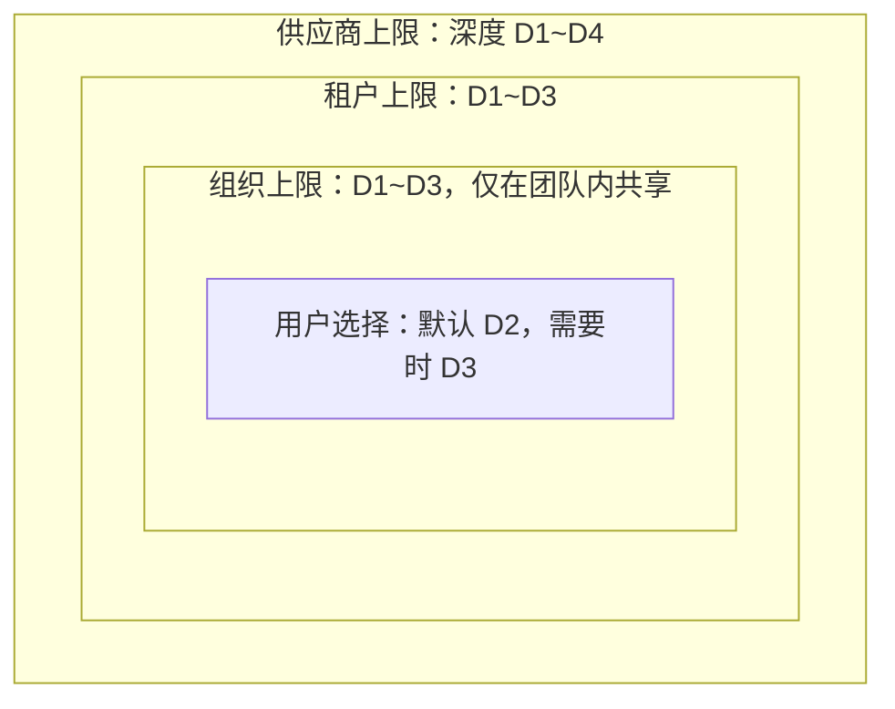
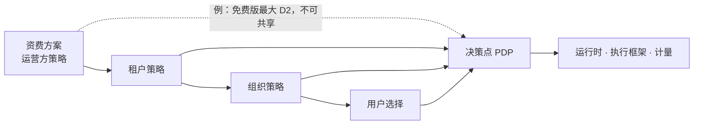

<!-- LANG-BAR -->
[English](../en/04-control-spectrum.md) · [한국어](../ko/04-control-spectrum.md) · **简体中文** · [日本語](../ja/04-control-spectrum.md) · [Español](../es/04-control-spectrum.md)
<!-- /LANG-BAR -->

# 4. 控制光谱——允许用户做什么，运营方控制什么

> 本章结论：控制不是开关，而是**每个旋钮（knob）上的区间**。上层行为者收窄区间的**上限（ceiling）**，用户在其中选择。但有 7 项**用户权利底线（floor）**是任何策略都无法删除的。资费方案、预设和租户策略，都只是对这个区间的不同切法。

## 4.1 问题：开放则危险，封闭则不可塑

- 过度开放：安全事故、支持成本激增、无法更新、品牌一致性崩溃。
- 过度封闭：与设置界面无异，用户最终会去找绕行办法（复制来的脚本、外部自动化）。

需要的是**可委托的连续控制**。这一结构是：供应商（vendor）设定整个平台的风险上限，租户（tenant）设定自己公司的上限，组织（org）设定团队的上限，用户在剩余范围内自由选择。

## 4.2 区间委托模型

每个旋钮 `k` 都有一个按风险排序的取值域 `D_k`（例如深度 `D1 < D2 < … < D5`）。集合型旋钮（例如允许的能力列表）按包含关系排序。

```text
行为者 i 对旋钮 k 设定的内容:  区间 [f_i, c_i] ⊆ D_k
  c_i : 上限(ceiling)。禁止比它更危险的值
  f_i : 下限(floor)。禁止给得比它更少（用于保障用户权利）

委托规则 (必须):        [f_child, c_child] ⊆ [f_parent, c_parent]
有效区间:               [f_eff, c_eff] = ⋂ 链上所有区间
用户的选择:             v_k ∈ [f_eff, c_eff],  默认值 d_k
```



读法：内侧的框不能比外侧的框更宽。如果用户想要 D4 功能，系统应当能够告诉用户，拦住它的不是组织，而是**租户上限**（"按公司策略，此功能不被允许。要把请求转给管理员吗？"）。

该模型的优点：
- **可解释性**：可以准确说出拒绝的原因是"哪一层的哪个上限"。
- **可组合性**：由于是交集，计算与顺序无关，并且可以缓存。
- **与资费方案统一**：资费方案就是运营方（operator）施加的又一个上限（4.9）。

## 4.3 旋钮目录

| 组 | 旋钮 | 取值域（风险低 → 高） | 推荐默认值 | 主要设定者 | 相关轴 |
| --- | --- | --- | --- | --- | --- |
| 什么 | 最大深度 | D1 → D5 | D3 | 供应商·租户 | A1 |
| 什么 | 扩展点允许列表 | 部分 → 全部 | 全部 stable 扩展点 | 供应商 | A1 |
| 什么 | 能力上限 | 读取 → 写入 → 外部发送 | 内部读取·写入 | 租户 | A1, A4 |
| 什么 | 外部网络 | 阻断 → 允许列表 → 全部 | 阻断 | 租户 | A4 |
| 怎样 | 激活方式 | gated → preview → live | preview | 租户·组织 | A11 |
| 怎样 | 批准者 | 管理员 → 组织管理员 → 本人 | 权限增加时由管理员 | 租户 | A11 |
| 怎样 | 验证强度 | 全部门 → 按深度省略 | 按深度的标准（5.8） | 供应商 | — |
| 怎样 | 基线版自动应用 | defer → approve → auto | approve | 租户·用户 | A7 |
| 与谁 | 共享范围 | 无 → 租户 → 公开 | 租户 | 租户 | A8 |
| 与谁 | 再共享 | 禁止 → 原作者允许时 → 自由 | 原作者允许时 | 组织 | A8 |
| 与谁 | 代码可见性 | hidden → own → open | 取决于部署形态 | 租户 | A5 |
| 多少 | 模型获取路径 | 租户指定 → 可选择 | 租户指定 | 租户 | A9 |
| 多少 | 质量等级 | 节约 → 标准 → 高质量 | 标准 | 用户 | A9 |
| 多少 | 预算上限 | 低 → 高 | 月上限 + 超出即停止 | 租户·用户 | A9 |
| 看到什么 | 管理可见性 | none → V0 → V3 | V1（企业 V2） | 租户 | A10 |
| 看到什么 | 平台导出 | 无 → 聚合 → 元数据 | 聚合 | 租户（合同） | A10 |
| 看到什么 | 保留期限 | 短 → 长 | 事件 13 个月 | 租户 | A10 |

## 4.4 光谱预设

不必逐个选择旋钮，可以从五种预设开始。


| 旋钮 | 锁定 | 策展 | 护栏 | 开放 | 实验室 |
| --- | --- | --- | --- | --- | --- |
| 最大深度 | D1 | D2（安装可到 D3） | D3 | D3 | D4 |
| 自行生成 | 不可 | 不可，只能安装 | 可以 | 可以 | 可以 |
| 能力 | 无 | 批准列表 | 内部读取·写入 | 内部 + 允许列表内的外部 | 请求时批准 |
| 激活 | — | gated | preview | live（D1~D2） | preview |
| 共享 | 无 | 只接收 | 租户 | 租户 | 租户 |
| 基线版应用 | 自动 | 自动 | approve | auto | approve |
| 管理可见性 | V0 | V1 | V2 | V1 | V2 |
| 适合的配置 | P4 的一部分 | P6 用户 | P2, P3 | P1, P5 | P1 开发者 |

预设是起点。租户选定预设后，可以把单个旋钮再收窄，但不能比预设更宽（只能在供应商上限之内）。

## 4.5 决策主体矩阵

`决定` = 设定取值，`上限` = 设定下层可选的范围，`提议` = 只能提出请求，`—` = 不参与。

| 决策 | 供应商 V | 运营方 O | 租户 T | 组织 G | 用户 U | 智能体 α |
| --- | --- | --- | --- | --- | --- | --- |
| 定义扩展点·能力图 | 决定 | — | — | — | 提议 | — |
| 平台最大深度 | 决定 | 上限 | 上限 | 上限 | 选择 | — |
| 授予能力 | 上限 | — | 上限·批准 | 批准（委托时） | 请求·批准（自己的范围） | **不可** |
| 基线版发布 | 决定官方版 | — | 决定租户版 | 决定组织版 | — | 提议（晋升） |
| 基线版应用时机 | — | — | 上限 | 上限 | 决定 | 仅准备 |
| 共享 | — | 上限（公开市场审核） | 上限 | 上限 | 决定 | — |
| 模型路径·预算 | — | 上限（资费方案） | 决定 | 上限 | 选择质量 | — |
| 管理可见性 | — | 导出上限 | 决定 | — | 确认（下限） | — |
| 生成变更 | — | — | — | — | 提供意图 | 生成 |
| 评判变更 | 验证规则 | — | 附加规则 | 附加规则 | 确认预览 | 评判（与生成者不同的实例） |

智能体一列是关键。智能体进行**生成、评判、提议**，但绝不做**授予权限、变更策略、决定发布**（I4、I9）。

## 4.6 用户权利底线（Floor Rights）

任何租户策略、资费方案或预设都不能删除以下权利（必须(MUST)）。有了这一底线，用户才会放心地去修改。

| # | 权利 | 内容 | 在企业环境中的解释 |
| --- | --- | --- | --- |
| F1 | 回退 | 可以立即回退自己层中的任何变更 | 上层基线版本身不能回退，但其上我的变更始终可以 |
| F2 | 安全模式 | 可以在关闭所有用户层的状态下启动 | 不中断业务即可隔离原因 |
| F3 | 可见性告知 | 始终可以查看谁能看到我的变更的哪些内容 | 显示"组织管理员可以看到变更说明" |
| F4 | 导出我的作品 | 可以用标准格式导出我所做变更的意图·契约 | 产出物（代码）的导出可以用策略加以限制 |
| F5 | 权限查看 | 可以查看活动变更所拥有的权限，权限增加不会在未告知的情况下发生 | 别人共享来的功能也一样 |
| F6 | 费用上限 | 如果我会产生费用，可以设定上限，超出即停止 | 若由租户承担，告知适用的是租户上限 |
| F7 | 要求解释 | 对任何变更都可以得到以通俗用语说明的"改了什么" | 变更回执（8.6） |

## 4.7 策略文档

策略（policy）是可继承的声明式文档。完整示例见 [`examples/policy.example.yaml`](../../examples/policy.example.yaml)，模式见 [`schemas/policy.schema.json`](../../schemas/policy.schema.json)。

```yaml
policy:
  id: tenant/acme
  level: tenant
  inherits: operator/plan-business      # 资费方案也是策略
  knobs:
    depth:            { ceiling: D3, default: D2 }
    capabilities:     { ceiling: [tasks.read, tasks.write, notify.local, net.slack.post] }
    network:          { ceiling: allowlist, allowlist: ["hooks.slack.com"] }
    activation:       { ceiling: preview, approver_on_capability_increase: tenant_admin }
    baseline_apply:   { ceiling: auto, default: approve }
    sharing:          { ceiling: tenant, reshare: author_opt_in }
    code_visibility:  { value: own }
    model_route:      { value: tenant_cloud }
    quality_tier:     { ceiling: standard, default: standard }
    budget:           { monthly: 3000, per_user_monthly: 30, on_exceed: stop }
    admin_visibility: { value: V2 }
    platform_export:  { ceiling: V0 }
  floors: [rollback, safe_mode, visibility_notice, export_intents, permission_view, spend_cap, receipt]
```

## 4.8 策略决策流程

所有请求都表示为 `(主体, 行为, 对象, 上下文)`，决策点（PDP）返回 `允许 / 拒绝 / 需要批准` 之一以及**义务（obligation）**。义务是"允许，但必须做的事"（记录、预览、通知等）。

```text
decide(req):
  p ← effective_policy(req.subject)            # 链上策略的交集（可缓存）
  if req.action ∈ FLOOR_ACTIONS and floor_scoped(req):   # 回退·安全模式·导出等
      return 允许, 义务=[记录]
  if req.action == revert:                      # 底线范围外的回退 = 与激活相同的判定
      req ← as_activate(req.target)             # 包括重做·重新启用·解除暂缓
  for k in knobs_touched(req):
      if value(req, k) ∉ [p.f_k, p.c_k]:
          return 拒绝, 原因=(k, 设定上限的层)   # "租户策略：最大深度 D3"
  if raises_capabilities(req):
      return 需要批准, 批准者=p.approver_for(req.capabilities_delta)
  if uses_destructive(req):                     # 破坏性能力与激活策略无关，一律 G5（5.8）
      return 需要批准, 批准者=p.gate_approver
  if p.activation(req.depth) == gated:
      return 需要批准, 批准者=p.gate_approver
  return 允许, 义务=obligations(p, req)         # 例如：preview、审计记录、费用计量
```

`floor_scoped(req)` 仅在同时满足以下所有条件时为真（必须(MUST)）。只要违反一条，就不作为底线行为，而按一般请求判定。
- 主体是拥有对象层的**人**（不是智能体、监视器或其他层的用户）。监视器的自动恢复只在减少权限的方向上才允许，并予以记录。
- 如果是回退，对象是同一层的**先前状态**，并且结果的有效深度·权限在当前活动状态和当前有效策略**之内**（⊆）。重做、"重新启用"（5.4）、解除暂缓等再次增加权限或深度的操作，按激活（E10）判定。
- 安全模式只做关闭，导出限于意图·契约范围（F2、F4）。

部署原则：
- **权威 PDP 位于运营方边界（服务器）（I8）。** 用户设备上放置策略副本以便快速提示，但最终判定由服务器重新做出。
- 离线个人模式（P1）没有服务器，因此设备上的 PDP 是唯一的。此时策略是"保护用户自己的安全装置"，而不是强制手段。文档和 UI 中不隐瞒这一区别。出于同样的原因，没有服务器的部署（P1·P5）无法保证 I8，因此合规等级（conformance level）最高为 Core，不能成为 Governed（10.3）。
- **策略引擎适配器**（可以(MAY)）：可以把旋钮区间转换为策略语言来实现 PDP。Cedar 中 forbid 优先于 permit，没有匹配的 permit 则拒绝，并一并返回做出决策的策略 id。这个 id 用作 `拒绝(原因·层)` 和回执（8.6）的依据。
- **I5 机器验证**（应当(SHOULD)）：保存策略时检查 `p_child ⊑ p_parent`。若已转换为 Cedar，可以用 SymCC 的包含检查（`check_implies`）连同反例一起证明。同一工具的 `check_never_errors` 也要一起运行。因为 Cedar 会跳过出现求值错误的策略，所以出错的 forbid 会悄无声息地保持敞开。
- **批准的范围与寿命**（必须(MUST)）：人对 `需要批准` 的回答带有范围：**仅此一次**（这一个请求）、**在此任务期间**（直到本次生成会话结束）、**始终**（在该用户·该层中持续）。"始终"绑定于所批准**对象的指纹**（功能的 content_hash 与权限列表）。功能内容或权限一旦改变，批准即失效并重新询问。批准界面要用文字写明"始终"的范围，且不把"始终"放在"拒绝"旁边。所有不是肯定回答的情况（关闭窗口、答非所问、中止、超时）都视为拒绝。不增加权限的只读行为不询问（批准疲劳，4.10）。ThinkRail 的 MCP 工具调用确认采用相同结构（拒绝 · 仅此一次 · 在此对话中 · 始终。"始终"绑定于服务器 `command`+`args` 或 `url` 的 SHA-256，[JetBrains/thinkrail `agent/mcp/SPEC.md`](https://github.com/JetBrains/thinkrail/blob/c10f8808cee693e4abffeeb1844a132ed0a91cc5/packages/server/src/agent/mcp/SPEC.md#L129-L150)）。
- **底线先于引擎**：由于 forbid 优先规则，如果把权利底线（F1~F7）作为普通 permit 放入，上层的 forbid 就能把它删除。应像上面的伪代码那样，把 `FLOOR_ACTIONS` 判定放在调用引擎之前。

## 4.9 资费方案 = 策略上限

不要把资费方案做成单独的系统，而是用运营方施加的策略来表示。



这样一来，升级引导也很自然。如果拒绝原因是"资费方案上限"，那一刻就是最精准的追加销售时机（9.7）。

## 4.10 值得思考的问题

- 租户开放 D4 后，该代码的缺陷造成的损害由谁负责？条款和策略文档必须说的是同一件事。
- 当底线 F4（导出）与企业的知识产权保护冲突时，只导出意图·契约的折中是否足够？
- 在预设之间切换时，如果已经活动的变更超出了新上限怎么办？推荐：不要立即关闭，而是置为"暂缓"状态并通知用户。
- 批准疲劳：每周批准请求超过多少件时，批准者就不再阅读内容？应当测量这一数值，并据此调整自动批准的范围。

下一章：[5. 参考架构](05-reference-architecture.md)
