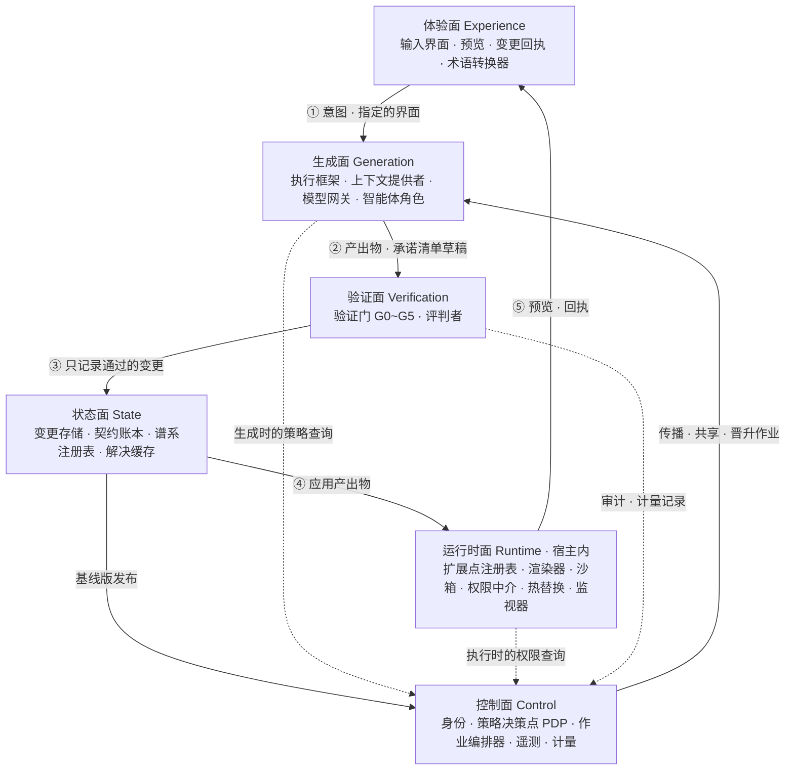
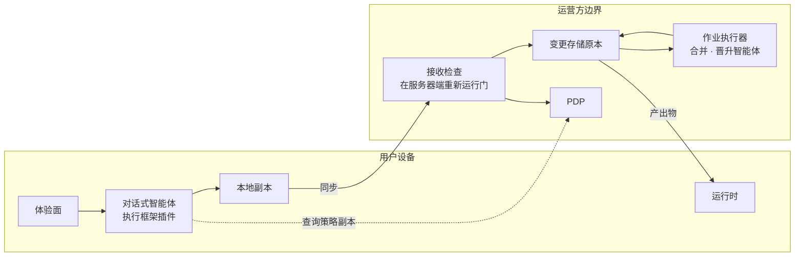
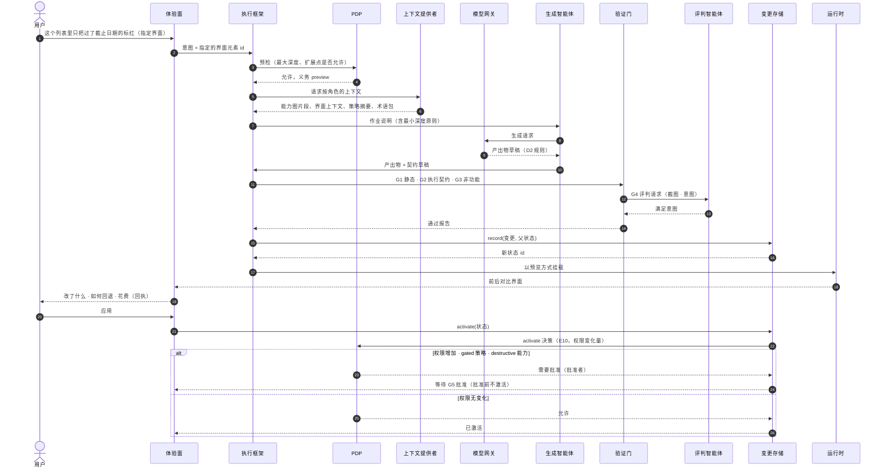
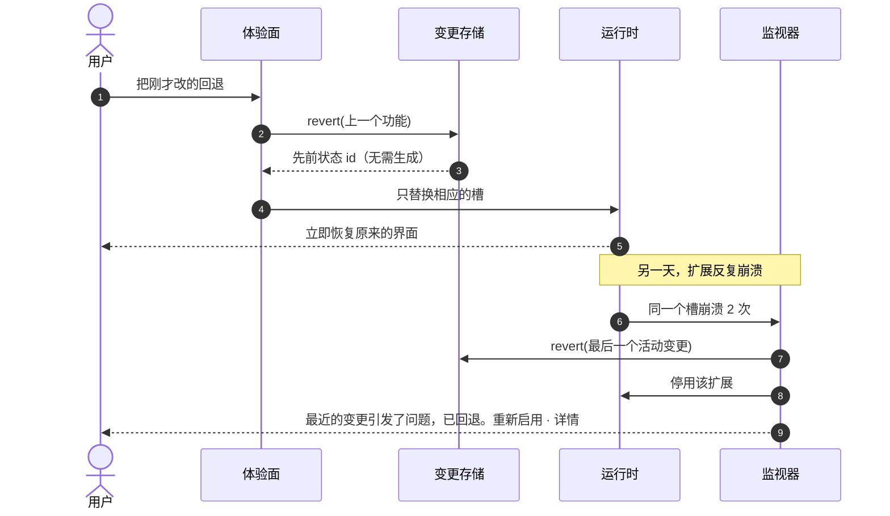
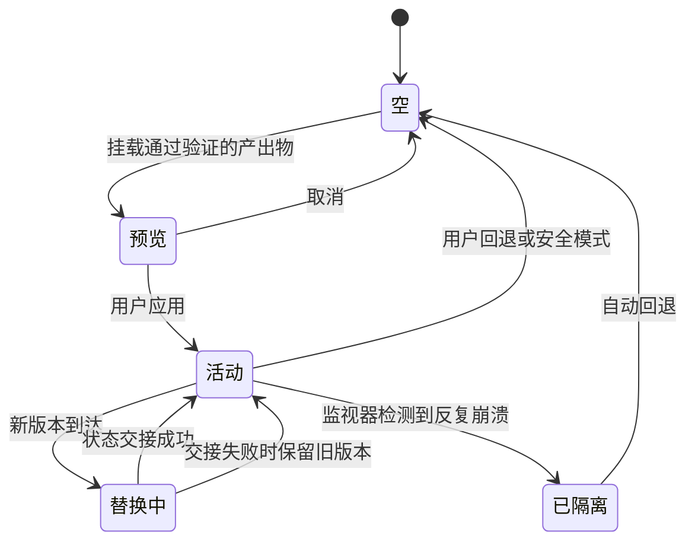

<!-- LANG-BAR -->
[English](../en/05-reference-architecture.md) · [한국어](../ko/05-reference-architecture.md) · **简体中文** · [日本語](../ja/05-reference-architecture.md) · [Español](../es/05-reference-architecture.md)
<!-- /LANG-BAR -->

# 5. 参考架构——平面、组件、端口、流程、执行框架

> 本章结论：Mallangable 系统分为 **6 个平面（plane）**：与用户接触的**体验面**、在宿主（host）内执行变更的**运行时面**、由 AI 生成变更的**生成面**、评判变更的**验证面**、守护历史的**状态面**，以及负责策略·计费·审计的**控制面**。平面之间只通过**端口（接口）**连接，实现（适配器）按第 3 章的轴选择替换。

## 5.1 整体结构



读法：实线 ①~⑤ 是一个变更的闭环。意图进入生成面，只有通过验证的才被记录，只有被记录的才应用到运行时，结果再以预览·回执的形式回到用户。新的基线版（baseline）发布时，控制面创建传播作业，再走一遍同样的闭环。虚线是策略查询。关键在于**生成时（执行框架）和执行时（运行时中介）询问的是同一个 PDP**。如果两个时点的权限判断出现分歧，就会出现"生成时允许、执行时禁止"之类的缝隙。各平面内的组件见下表和 5.3 的端口定义。

### 各平面的职责

| 平面 | 职责 | 必须遵守的 |
| --- | --- | --- |
| 体验面 | 收集意图、表达进度、预览、回执、通俗用语 | 用户可见的所有字符串都经过术语转换器 |
| 生成面 | 解释意图、生成产出物、合并、晋升 | 所有写入只能通过工具调用。禁止原始仓库命令 |
| 验证面 | 策略预检、静态检查、执行契约、非功能检查、评判 | 生成者与评判者分离（I7） |
| 运行时面 | 扩展的加载·隔离·执行、权限中介、热替换、恢复 | 扩展不经由中介以外的路径触及宿主 |
| 状态面 | 层历史、契约、谱系、解决缓存 | 所有活动状态都可以回退（I3） |
| 控制面 | 身份、策略、作业、审计、计量 | 权威执行只在这里（I8） |

## 5.2 部署视图——按智能体位置（A3）

| 组件 | `client` | `hybrid` | `server` |
| --- | --- | --- | --- |
| 输入界面、预览 | 设备 | 设备 | 设备 |
| 智能体执行框架 | 设备（用户启动的智能体 + 执行框架插件） | 对话式生成：设备 / 合并·晋升：服务器。若为 `own`，不把上层产出物交给设备上的生成者（5.10，I6） | 服务器沙箱 |
| 模型网关 | 设备（用户订阅·密钥） | 设备 + 服务器 | 服务器 |
| 验证门 | 设备（有服务器则重新验证） | 设备初检 + 服务器重新验证 | 服务器 |
| 运行时 | 设备 | 设备 | 设备（只下载产出物） |
| 变更存储 | 设备（可选同步） | 服务器为原本，设备为副本 | 仅服务器 |
| PDP | 设备（提示用） | 服务器（设备为缓存） | 服务器 |



读法（以 hybrid 为准）：用户在设备上通过对话进行修改，其结果必须再次通过服务器的接收检查（receive-check）才能成为原本。像基线版合并这样要对成千上万用户重复执行的工作，由服务器承担。

## 5.3 端口与适配器

把平面之间的边界定义为接口。以下是语言中立的表示法（借用 TypeScript 语法）。实现时插入符合轴选择的适配器。

```ts
// ── 运行时面 ─────────────────────────────────────────
interface ExtensionPointRegistry {
  list(filter?: { depth?: Depth; kind?: PointKind }): ExtensionPoint[];
  capabilityMap(): CapabilityMap;               // 机器可读。作为智能体上下文提供
}
interface SandboxHost {                         // 适配器: SES Compartment | iframe | Worker | 进程 | 微型虚拟机
  mount(artifact: Artifact, grants: CapabilityGrant[], prevState?: unknown): SlotHandle;
  unmount(slot: SlotHandle): Promise<unknown>;  // 返回用于状态交接的快照
  limits(slot: SlotHandle): ResourceBudget;
}
interface CapabilityBroker {
  call(slot: SlotHandle, cap: CapabilityId, args: unknown): Promise<unknown>;  // 每次调用都查询 PDP + 审计记录
}

// ── 生成面 ───────────────────────────────────────────
interface AgentHarness {                        // 适配器: 商用智能体 + 插件 | 自有智能体循环
  run(task: Task, role: AgentRole, budget: Budget): AsyncIterable<HarnessEvent>;
}
interface ContextProvider {
  build(task: Task, role: AgentRole): Context;  // 每个角色只给它能看的 (I6)
}
interface ModelPort {                           // 适配器: 用户订阅(经由官方客户端) | API 密钥 | 额度 | 租户云 | 设备模型
  complete(req: ModelRequest, route: Route): Promise<ModelResponse>;
  estimate(req: ModelRequest, route: Route): CostRange;
}

// ── 验证面 ───────────────────────────────────────────
interface ValidationPort {
  run(change: ChangeDraft, gates: GateId[]): Promise<GateReport>;
}
interface ContractRunner {
  check(contract: Contract, app: EffectiveAppHandle): Promise<ContractResult>;
}

// ── 状态面 ───────────────────────────────────────────
interface ChangeStore {                         // 适配器: Git 式仓库 | CRDT 文档 | 快照 DB
  record(change: Change, parent: StateId): StateId;   // 只暴露这个，替代原始提交命令
  activate(state: StateId): void;
  revert(target: StateId | FeatureId): StateId;        // 无需生成，常数时间 (I3)
  history(scope: Scope): ChangeRecord[];
}
interface LineageRegistry {
  parent(node: LayerNodeId): LayerNodeId | null;
  release(node: LayerNodeId, tag: BaselineTag): void;
  descendants(node: LayerNodeId): LayerNodeId[];        // 拓扑顺序
}
interface ResolutionCache {
  lookup(key: ConflictClassKey, scope: VisibilityScope): Resolution | null;
  store(key: ConflictClassKey, scope: VisibilityScope, r: VerifiedResolution): void;
}

// ── 控制面 ───────────────────────────────────────────
interface PolicyDecisionPoint {
  decide(req: AccessRequest): Decision;          // 允许 | 拒绝(原因·层) | 需要批准(批准者) + 义务
}
interface JobOrchestrator {
  submit(job: PropagationJob | ShareJob | PromotionJob): JobId;
}
interface TelemetrySink { emit(e: Event & { visibility: VisibilityLabel }): void; }
interface MeteringPort  { record(u: UsageRecord): void; entitlement(subject: Subject): PlanLimits; }

// ── 体验面 ───────────────────────────────────────────
interface LexiconPort {
  render(conceptId: string, level: "basic" | "practitioner" | "developer", locale: string, domain?: string): string;
  lint(text: string, level: string): LexiconViolation[];   // 检测普通用户界面中的开发术语
}
```

设计原则：
- `ChangeStore` **不暴露原始仓库命令（commit、push、merge、reset）。** 智能体可用的写入只有 `record`·`activate`·`revert`，正是这一边界使记录规范（6.11）得以统一。
- `ModelPort` 的"用户订阅"适配器只实现供应商允许的路径（8.10）。

## 5.4 流程 1——一个变更是如何产生的



要点：
- 通过第 3 步的预检，在**生成之前**就筛掉不可能的请求，节省成本。
- 第 7 步的作业说明中包含最小深度原则（least-depth rule）。如果生成智能体做成了 D4，会在第 11 步的 G1 被拒绝。
- 评判（第 12~13 步）由与生成智能体不同的实例完成（I7）。
- 记录（第 15 步）先于激活请求（第 21 步）。因此所有已应用的状态都可以回退（I3）。
- 激活也要经过 PDP（第 22 步，E10）。即使体验面调用了存储，只要权限增加或是 gated 策略，在 G5 批准之前就不会进入活动状态。

## 5.5 流程 2——回退与自动恢复



回退（revert）**不调用模型。** 它只是移动指针，成本为 0，属于时间等级（time tier）T0（8.4）。"回退是免费的"这一事实，是让用户开始尝试的最强动力。

### 依据所见内容回退

在用户看着界面的过程中，活动状态也可能改变：基线版传播（6.5）、其他设备上的应用、监视器的自动恢复都会如此。因此回退请求要一并发送**用户所见状态的 id**：`revert(feature, expect=所见状态 id)`。

- 如果当前状态与 `expect` 不同，就什么也不改（必须(MUST)）。而是展示当前状态，让用户重新选择。如果回退了错误的状态，权利底线 F1 反而会变成事故。
- 回退结果返回新的状态 id，用这个 id **再做一次同样的操作**就是重做（redo）。不为重做另设装置（应当(SHOULD)）。但重做以及监视器自动恢复之后的"重新启用"会再次增加权限·深度，因此不按权利底线（F1）处理，而要经过与激活相同的 PDP 判定（E10）（必须(MUST)，4.8 `floor_scoped`）。如果其间上限已降低或批准已失效，结果就是需要批准或拒绝。
- 如果记录已丢失而无法回退或重做，不能悄悄跳过，而要告知"已无法再回退"（必须(MUST)）。

ThinkRail 的 diff 回退也使用同样的规则。客户端不发送内容，只发送所见内容的哈希，若不同则以 `STALE_VIEW` 拒绝（[JetBrains/thinkrail `changes/SPEC.md`](https://github.com/JetBrains/thinkrail/blob/c10f8808cee693e4abffeeb1844a132ed0a91cc5/packages/server/src/changes/SPEC.md#L39-L43)，调研笔记 [T1·T2](research/thinkrail-analysis.md)）。

## 5.6 执行框架

### 定义

执行框架（harness）是**包裹非确定性智能体的确定性外壳**。无论智能体怎么想，执行框架都强制以下五件事。

| 职责 | 内容 | 实现手段 |
| --- | --- | --- |
| 流程 | 深度判定 → 编写契约 → 产出物 → 验证 → 记录 → 激活请求 的顺序 | 技能·作业说明，结束前检查钩子 |
| 工具边界 | 只允许的工具、只允许的路径 | 限制工具列表，路径访问钩子 |
| 策略钩子 | 每个生命周期事件都查询 PDP | 事件模型（见下） |
| 预算 | 令牌·时间·重试上限 | 模型网关计量，作业预算 |
| 输出契约 | 发给用户·其他智能体的格式 | 模式检查，输出门 |

智能体技能标准（SKILL.md）是以可移植方式分发流程的好手段，但权限强制交给了各个智能体实现。标准中的 `allowed-tools` 字段也是实验性的，各智能体的支持程度不同（[Agent Skills 规范](https://agentskills.io/specification)）。因此分工为：**技能负责流程，执行框架负责强制**。

### 供应商中立的事件模型

| id | 事件 | 时机 | 能否阻止 | 典型策略 |
| --- | --- | --- | --- | --- |
| E1 | `session.start` | 会话开始·恢复 | 否 | 把策略摘要·能力图·待处理的升级注入上下文 |
| E2 | `intent.submit` | 用户请求之后、模型处理之前 | 是 | 深度分类，D5 作为核心请求收集，阻止诱导查看源码（hidden） |
| E3 | `plan.ready` | 智能体确定计划 | 是 | 拒绝违反最小深度的计划 |
| E4 | `tool.before` | 工具执行前 | 是 | 路径访问控制，阻止原始仓库命令，阻止外部发送 |
| E5 | `tool.after` | 工具执行后 | 仅反馈 | 把增量验证结果返回给智能体，净化输出 |
| E6 | `permission.request` | 需要权限决策 | 通过决策 | 路由到人工批准卡片 |
| E7 | `batch.after` | 一批并行工具调用结束 | 是 | 累计变更量超过大小规则的 80% 时，指示按功能单位记录 |
| E8 | `artifact.ready` | 产出物草稿完成 | 是 | 运行验证门 |
| E9 | `record.before` | 记录变更之前 | 是 | 检查契约是否存在·记录规范·大小 |
| E10 | `activate.before` | 激活之前 | 是 | 权限增加则需要批准 |
| E11 | `stop.before` | 智能体结束之前 | 是 | 若有未验证·未记录的变更则拒绝结束 |
| E12 | `subagent.stop` | 子智能体结束 | 是 | 检查评判结果的模式 |
| E13 | `output.before` | 发往人·其他智能体之前 | 可替换 | 输出门（检测代码泄露，术语转换） |
| E14 | `merge.conflict` | 发现合并冲突 | — | 进入解决阶梯（6.6） |
| E15 | `compact.before` | 上下文压缩之前 | 否 | 把进度状态记入账本 |
| E16 | `session.end` | 会话结束 | 否 | 发送遥测 |

### 映射示例：Claude Code 钩子

Claude Code 钩子提供 30 多个事件、五种处理器（命令·HTTP·MCP 工具·提示·智能体）、通过管理员设置屏蔽用户钩子的选项，以及在钩子失败时阻止操作的 `onFailure: "block"`（[Claude Code 钩子文档](https://code.claude.com/docs/en/hooks.md)）。上述事件大致对应如下。

| Mallangable 事件 | Claude Code 钩子事件 |
| --- | --- |
| E1 `session.start` | `SessionStart` |
| E2 `intent.submit` | `UserPromptSubmit` |
| E4 `tool.before` | `PreToolUse` |
| E5 `tool.after` | `PostToolUse`（可用 `updatedToolOutput` 替换结果） |
| E6 `permission.request` | `PermissionRequest` |
| E7 `batch.after` | `PostToolBatch` |
| E11 `stop.before` | `Stop` ¹ |
| E12 `subagent.stop` | `SubagentStop` ¹ |
| E15 `compact.before` | `PreCompact` |
| E16 `session.end` | `SessionEnd` |
| E3, E8, E9, E10, E13, E14 | 没有对应事件 → 在 Mallangable 工具（MCP 服务器）内部直接触发 |

¹ `onFailure: "block"` 只在 v2.1.295 及以上的 command·http 钩子中生效，对 `Stop`·`SubagentStop` 无效。钩子失败时，E11·E12 会以敞开状态放行。因此不把 E11·E12 当作可靠的拦截关口。未验证·未记录变更的检查也在 MCP 工具一侧（`ChangeStore.record()`·`activate()`）强制执行。

其他智能体运行时也可以用同样的方式制作对应表。没有对应事件的，**在工具一侧强制**。例如 E9 `record.before` 在 `ChangeStore.record()` 内部检查。

运行时版本一变，对应表就会过时（上面的脚注 ¹ 就是一例）。因此对应表的每一项都要写明三件事（应当(SHOULD)）：**确认了什么**（所确认的行为及其出处）、**何时复查**（运行时版本更新时）、**何时删除**（运行时直接提供相同功能时，删除执行框架一侧的补充）。版本号只放在依赖锁定文件这一处，不在规范中重复书写。ThinkRail 为每项弥补引擎缺陷的适配都设有这样的兼容性台账，写明"需要复查的内容"和"可以删除的条件"（[JetBrains/thinkrail `pi-compatibility.md`](https://github.com/JetBrains/thinkrail/blob/c10f8808cee693e4abffeeb1844a132ed0a91cc5/pi-compatibility.md#L11-L16)）。

Codex CLI 也以同样方式对应（**需核对官方文档**）：E1 `SessionStart`、E2 `UserPromptSubmit`、E4 `PreToolUse`、E5 `PostToolUse`、E6 `PermissionRequest`、E11 `Stop`、E12 `SubagentStop`、E15 `PreCompact`。这份列表并非来自 Codex 官方文档，而是取自 Harness² 检查钩子设置时使用的事件集合（[google-research/harness2 `substrate/codex.py`](https://github.com/google-research/harness2/blob/1cfe254e8d25b15f37048c3730134686abe60335/harness2/substrate/codex.py#L58-L72)）。采用前必须与 Codex 官方文档对照。

体验面不直接接收执行框架事件，而是以面向用户的进度信号接收。若以 [AG-UI](https://docs.ag-ui.com/concepts/events) 作为传输规范，对应如下。

| Mallangable | AG-UI | 备注 |
| --- | --- | --- |
| E2 受理 ~ E11 结束 | `RUN_STARTED` · `RUN_FINISHED` · `RUN_ERROR` | |
| 4 个状态词（8.5） | `STEP_STARTED` · `STEP_FINISHED` | 把 step 名固定为状态词 id |
| 部分预览（8.5） | `STATE_SNAPSHOT` · `STATE_DELTA`（RFC 6902） | 保持"尚未确认"的标识 |
| E6 `permission.request`，2.8 `等待批准` | `RUN_FINISHED` 的 `outcome.type = "interrupt"` → 下一次运行的 `resume[]` | 批准以新的运行延续（[AG-UI interrupt](https://docs.ag-ui.com/concepts/interrupts)） |

完成信号只有一个（必须(MUST)）。在许多运行时中，"一次尝试结束"与"工作结束"是两回事。尝试结束之后，工作仍可能因重试、上下文压缩、待处理的后续请求而继续。体验面只在执行框架放行 E11 之后才显示 `已就绪`，在尝试边界处不改变状态词。像 `等待批准` 这样等待人工输入的状态是**电平信号**：不会因为用户看过界面就熄灭，只有输入到来才熄灭。ThinkRail 把 `agent_end` 视为尝试边界，只把 `agent_settled` 视为完成（[JetBrains/thinkrail `architecture.md` 决定 8](https://github.com/JetBrains/thinkrail/blob/c10f8808cee693e4abffeeb1844a132ed0a91cc5/architecture.md#L141-L156)）。

把服务器作业交给外部智能体时，由 [A2A](https://a2a-protocol.org/latest/specification/) 的任务状态（`TASK_STATE_INPUT_REQUIRED`·`TASK_STATE_AUTH_REQUIRED`）承担同样的角色；在 MCP 工具内部，则由多轮往返请求（`resultType: "input_required"`，[MCP 2026-07-28](https://modelcontextprotocol.io/specification/2026-07-28/changelog)）承担。

注意：用户设备上的钩子可以被用户关闭。设备执行框架的钩子只是提示，最终强制是服务器的接收检查（I8）。

格式错误的钩子设置在许多运行时中会在没有报错的情况下**根本不执行。** 也就是说，失败时保持敞开。执行框架插件必须(MUST)在写入钩子设置时，按运行时接受的事件名·处理器格式进行检查，并且必须(MUST)在会话开始（E1）时确认钩子确实已注册。智能体不能修改策略钩子·护栏文件（工具边界，E4）。Harness² 出于同样的理由，在写入 Codex 钩子文件时进行检查（[google-research/harness2 `core/tree.py`](https://github.com/google-research/harness2/blob/1cfe254e8d25b15f37048c3730134686abe60335/harness2/core/tree.py#L216-L251)）。

## 5.7 智能体角色

| 角色 | 工作内容 | 读取 | 写入 | 外部通信 | 备注 |
| --- | --- | --- | --- | --- | --- |
| 解释者 Interpreter | 解释意图、反问、编写作业说明 | 用户对话、能力图 | 作业说明 | 仅模型 | hidden 模式下绝不查看代码 |
| 生成者 Builder | 生成产出物·契约 | 自己的层、能力图 | 允许路径中的草稿 | 模型·软件包镜像 | 不能使用原始仓库命令 |
| 记录者 Curator | 记录规范化、拆分·合并 | 变更部分 | 记录元数据 | 无 | 规则 + 小型模型 |
| 评判者 Reviewer | 评判意图是否满足·质量 | 只读 | 评判结果 | 无 | 与生成者不同的实例（I7） |
| 合并者 Merger | 解决基线版·共享合并冲突 | 对象层 + 上层发布 | 冲突区域及相关功能 | 仅模型 | 禁止削弱契约 |
| 晋升者 Promoter | 把收敛的功能规范化后向上层提议 | 候选功能（在可见性范围内） | 上层的提议区域 | 仅模型 | 批准由人做出 |
| 说明者 Explainer | 用通俗用语写回执·升级摘要 | 变更元数据 | 面向用户的文字 | 无 | 经由术语转换器 |

划分角色有两个理由。① 一个智能体如果同时拥有私有数据、不可信输入和外部通信，攻击就会变得容易（7.3）。② 由制作的一方打分，验证就只剩形式。

## 5.8 验证门

| 门 | 内容 | 失败时 |
| --- | --- | --- |
| G0 策略预检 | 深度·扩展点·权限是否在策略区间内 | 生成前拒绝（成本 0） |
| G1 静态检查 | 模式、类型、禁用 API（动态求值·任意网络·访问源码原文）、权限变化量、大小 | 以可据以修正的文字把原因返回给智能体。超过重试上限（设计建议值：1 次）则不做变更、保持当前状态并结束 |
| G2 执行契约 | 在隔离的预览环境中执行全部契约 | 返回失败的契约 id 与观测值 |
| G3 非功能 | 性能预算（CPU·内存·启动时间）、无崩溃、无障碍基本规则 | 返回超出预算的项目 |
| G4 评判 | 评判者根据截图·意图判定语义是否满足。评判者不知道产出物来自哪个生成者·执行框架·模型路径（来源盲评，source-blind judging）。候选有多个时，以用可复现种子打乱的匿名 id 呈现 | 返回评判依据 |
| G5 人工 | 仅在权限增加·gated 策略·使用不可回退写入（`destructive`）能力时。`destructive` 能力不论激活策略如何都需人工批准 | 等待批准 |

各深度是否必需（●必需，○可选，—不适用）：

| | G0 | G1 | G2 | G3 | G4 | G5 |
| --- | :-: | :-: | :-: | :-: | :-: | :-: |
| D1 | ● | ● | ○ | — | — | — |
| D2 | ● | ● | ● | ○ | — | 含外部命令时 |
| D3 | ● | ● | ● | ● | ○ | 新增数据权限时 |
| D4 | ● | ● | ● | ● | ● | 权限增加时 |
| D5 | ● | ● | ● | ● | ● | ● |

成本原则：把便宜的门放在前面。在 G0·G1 筛掉大部分，昂贵的 G4（模型调用）只在 D3 及以上运行。

### 评判输出的处理

评判者（G4）的输出也是模型输出，因此不予信任。

- **格式错误即为失败**（必须(MUST)）。如果评判词不是规定的值（`pass`·`fail`），或者指摘的位置（扩展点·元素 id）不匹配，该评判就是失败而非通过，变更不会进入活动状态。不悄悄放行。
- **记录由执行框架重新生成**（必须(MUST)）。不原样保存评判结果，只挑选规定字段（评判·摘要·指摘）生成新记录。丢弃模型编造的字段（例如 `approved_by`、门结果）。只有执行框架知道的值由执行框架填写。
- **没有指摘的失败予以拒绝**（必须(MUST)）。如果是 `fail` 却没有任何指摘，生成者就无从修正，因此该评判本身按失败的评判处理。
- **通过评判不是定论**（必须(MUST)）。如果之前评判的指摘尚未解决，即使新评判为 `pass`，也不把 G4 记为通过。
- **所有入口共用重试上限**（必须(MUST)）。生成者自行再次请求评判的路径和人再次点击确认的路径使用同一个上限（与 G1 重试上限相同的计算）。如果分开计数，修正 → 评判 → 修正就会没完没了，成本攻击者（7.1）会绕到没有上限的那一侧。

ThinkRail 的计划阶段评审也使用同样的规则（[JetBrains/thinkrail `host/planReview.SPEC.md`](https://github.com/JetBrains/thinkrail/blob/c10f8808cee693e4abffeeb1844a132ed0a91cc5/packages/server/src/host/planReview.SPEC.md#L62-L119)，调研笔记 [T4~T6](research/thinkrail-analysis.md)）。

## 5.9 运行时细节

### 扩展槽的状态



### 热替换协议

1. 新产出物通过 G2 后，运行时预先把它挂载到**隐藏槽**中。但需要 G5 批准的变更，只有在批准后才获得权限并挂载。批准前的 D4 代码只能以 0 个权限挂载。
2. 用 `getState()` 从现有槽获取状态快照。
3. 如果新版本的状态模式不同，必须有 `migrate(prev)`。没有则拒绝替换。
4. `mount(prevState)` 成功后切换界面槽并卸下旧实例。失败则保留旧实例不动。
5. 核心不重启。开发工具的热模块替换（HMR）是开发构建的功能，因此在部署环境中由这种以槽为单位的替换承担其角色。

### 监视器与安全模式

- 同一个槽在规定时间内崩溃 N 次（建议值：2 次）时，监视器回退最后一个活动变更并通知用户。
- 隔离·关闭的单位不是槽，而是**整个功能**（必须(MUST)）。一个功能如果横跨多个槽·命令·事件钩子，就全部一起关闭。只关一个的话，剩下的钩子还会继续运行。已关闭功能的回执和记录仍然可见。ThinkRail 的扩展关闭开关也会一并关闭扩展贡献的工具·技能，但保留绘制以往对话的渲染器（[JetBrains/thinkrail `architecture.md` 决定 21](https://github.com/JetBrains/thinkrail/blob/c10f8808cee693e4abffeeb1844a132ed0a91cc5/architecture.md#L376-L382)）。
- 启动时通过特定操作（建议：按住修饰键启动）以**关闭所有用户层的状态**启动（权利底线 F2）。
- 向用户展示每个扩展的资源使用量。用户应当能够自己找到变慢的原因。

## 5.10 上下文提供

智能体的质量大半取决于给它看什么。按角色明确规定提供什么、不提供什么。

| 提供项 | 解释者 | 生成者 | 合并者 | 评判者 |
| --- | :-: | :-: | :-: | :-: |
| 能力图（相应扩展点周边） | ● | ● | ● | ○ |
| 界面上下文（指定区域截图、元素 id） | ● | ● | — | ● |
| 当前层栈摘要 | ● | ● | ● | — |
| 策略摘要（区间·义务） | ● | ● | ● | — |
| 术语包 | ● | — | — | — |
| 相关功能的契约 | ○ | ● | ● | ● |
| 自己层的产出物 | hidden 时 — | ● | ● | ● |
| 上层的产出物 | hidden 时 — | 仅在 open 时。own 时 —（上层只给类型·能力图） | ●（服务器） | ○ |
| 核心源码 | — | 仅在 D5 分支中 | — | — |

在 `own` 下生成者与用户对话，因此进入生成者上下文的上层产出物，用户最终也能读到（I6）。所以 `own` 的生成者只接收上层的类型定义和能力图，不接收产出物。这条规则与生成位置（5.2）无关。

用**类型定义和能力图**代替核心源码。这是给头文件不给实现的方式，这样才能从结构上减少智能体想要修补核心的倾向（滑向 D5）。

## 5.11 遥测事件

所有事件在存储时就带有**可见性标签（visibility label）**。仪表板查询会同时依据查看者的权限和该标签进行过滤（7.5）。

```json
{
  "event": "change.activated",
  "ts": "2026-10-28T09:41:12+09:00",
  "tenant": "t_acme", "org": "o_design", "subject": "u_8c1f",
  "feature": "f_01JBX7K2M9Q2", "depth": "D3", "points": ["sidebar.panel"],
  "gates": {"G1": "pass", "G2": "pass", "G3": "pass", "G4": "pass"},
  "gen_ai": {"operation.name": "invoke_agent", "agent.id": "builder@harness-x", "usage.input_tokens": 18200, "usage.output_tokens": 2100},
  "model_cost": {"unit_cost_ref": "route:standard"},
  "policy": {"decision_id": "dec_7Q2…", "revision": "tenant/acme@42"},
  "trace": {"traceparent": "00-…-…-01"},
  "latency_ms": {"total": 41200, "first_preview": 9800},
  "visibility": "V1"
}
```

模型用量属性沿用 [OpenTelemetry GenAI 语义约定](https://opentelemetry.io/docs/specs/semconv/gen-ai/)的名称（`gen_ai.usage.input_tokens`·`gen_ai.usage.output_tokens` 等）。该约定仍处于 Development 状态，因此实现时要一并记录所遵循的约定版本。策略决策像 OPA 决策日志那样，留下决策 id（`policy.decision_id`）和策略版本（`policy.revision`）。经过 MCP 服务器的调用，用 MCP `_meta` 中的 `traceparent` 约定绑定到同一条追踪上。

推荐的事件分组：会话、意图（分类·拦截·核心请求）、工具·策略（拒绝·权限请求·批准）、变更（验证·记录·激活·回退）、运行时（崩溃·安全模式）、传播（生成·冲突·解决方法·提议·应用·暂缓）、共享、晋升、成本（警告·超出）、安全（输出净化·密钥检测·紧急访问）。

下一章：[6. 版本与谱系](06-versioning-and-lineage.md)
