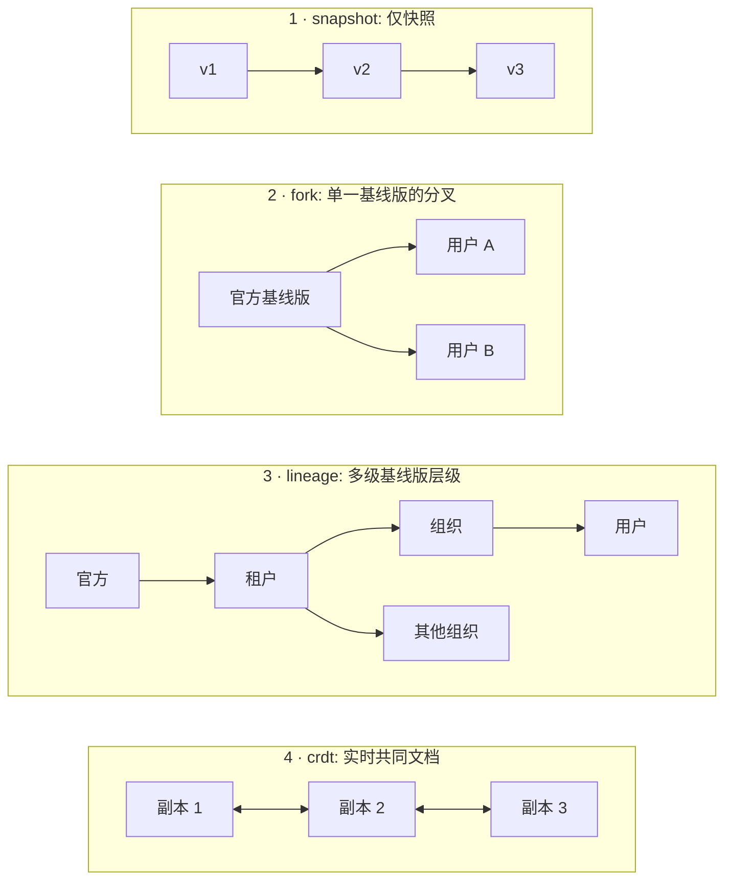
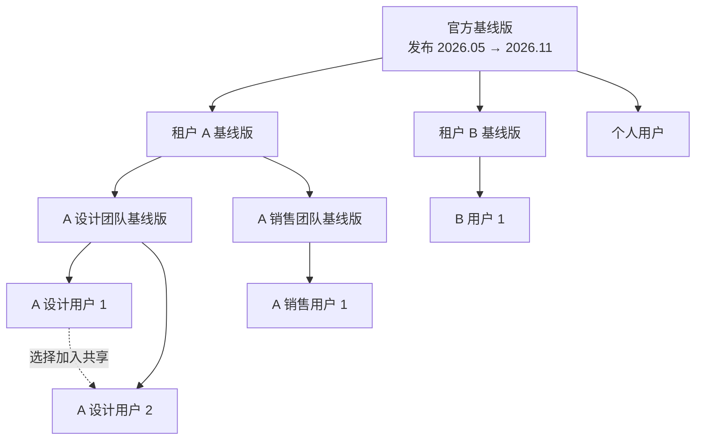
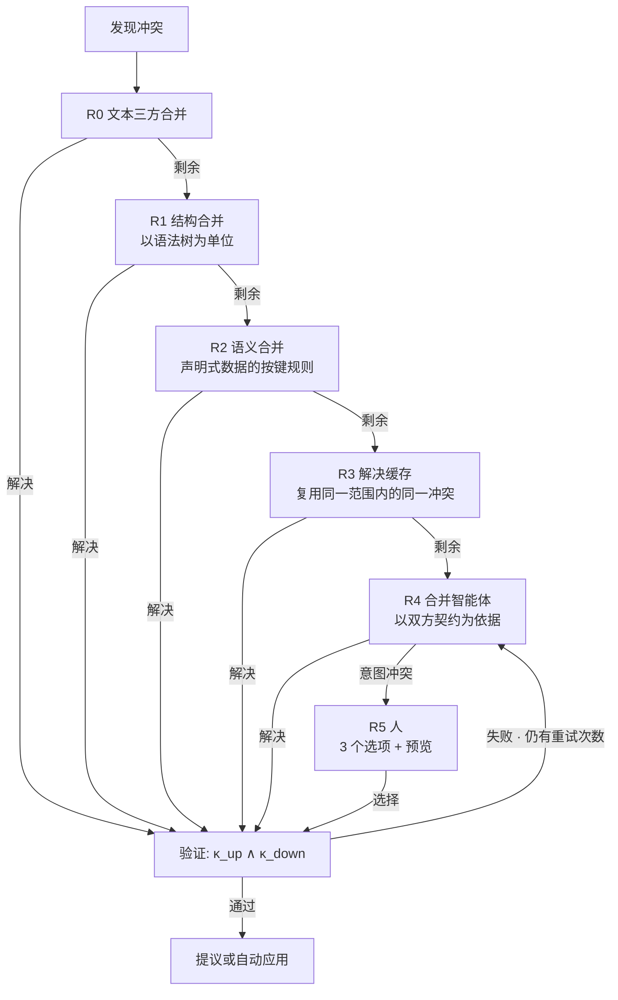
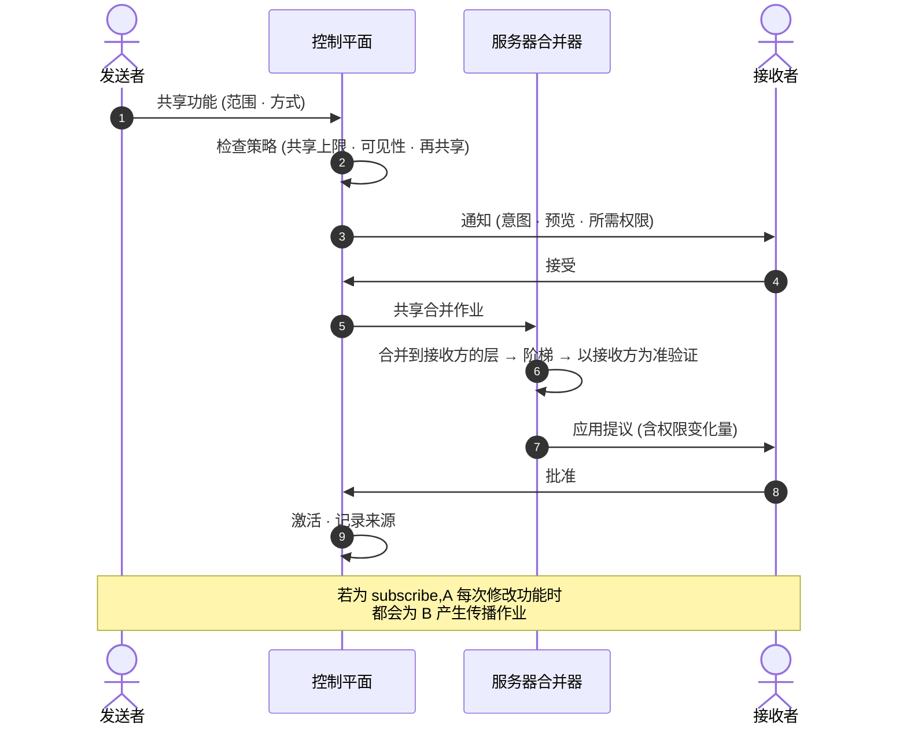
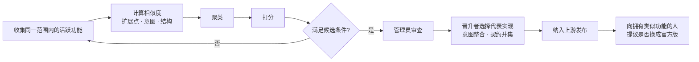

<!-- LANG-BAR -->
[English](../en/06-versioning-and-lineage.md) · [한국어](../ko/06-versioning-and-lineage.md) · **简体中文** · [日本語](../ja/06-versioning-and-lineage.md) · [Español](../es/06-versioning-and-lineage.md)
<!-- /LANG-BAR -->

# 6. 版本与谱系 — 让用户修改经得起更新

> 本章结论:可塑软件(malleable software)的真正成本不在制作的那一刻,而在于**供应商(vendor)每次发布新版本时**。要承担这一成本,必须:① 把隔离单位划分为仓库(层,layer),把工作单位划分为分支;② 用**谱系(lineage)** 管理基线版(baseline)的层级;③ 把合并定义为**契约保持(contract-preserving)**;④ 为了不反复解决同一冲突,在可见性范围内共享**解决缓存(resolution cache)**。

## 6.1 为什么版本管理是核心问题

如果 `N` 名用户各自拥有修改,而基线版一年变化 `r` 次,那么一年需要 `N × r` 次合并。Linux 发行版或手机厂商在上游源码之上叠加自己的补丁并维护时遇到的"补丁栈重新应用"问题,现在会发生在**每一位用户**身上。这不是人能手工解决的规模,因此必须让合并本身自动化,同时把**什么是正确的合并**定义成机器可以判定的形式。

## 6.2 四种拓扑



| | snapshot | fork | lineage | crdt |
| --- | --- | --- | --- | --- |
| 隔离 | 按用户 | 按用户的仓库 | 按节点的仓库 | 以文档为单位,所有访问者共享 |
| 上游更新传播 | 不可 | 单级 | 按拓扑顺序多级 | 自动收敛 |
| 冲突处理 | 不适用 | 合并阶梯 | 合并阶梯 + 层级策略 | 无语法冲突,**语义冲突仍存在** |
| 存储成本 | 低 | 分叉数 × 独有变更(可共享公共对象) | 同上 | 操作日志大小 |
| 适用 | 仅保存主题·规则的消费者应用 | 个人·小规模 | 企业·公共部门 | 实时协作 |

建议:只要将来有一点可能需要组织功能,存储模型就从一开始做成 `lineage`。`fork` 可表示为深度为 1 的谱系(3.7)。

## 6.3 谱系模型

```text
谱系 T = (节点, 边)
  节点 n      : 一个层仓库(官方基线版、租户基线版、组织基线版、用户层)
  边 n→m      : m 以 n 为上游(m 是 n 的分叉)
  发布 r(n)   : 在节点 n 上签名的基线版标签。例:2026.11
  漂移 δ(m) = m 已反映的上游发布与最新上游发布之间的级数
```



读法:实线是**更新流动的方向**,虚线是**横向跨越的共享**。官方基线版 2026.11 发布后,租户 A 先接收,然后是设计团队·销售团队,最后按各个用户的顺序向下传递。层级深度可以因客户而异,为 1~3 级。

## 6.4 隔离单位与工作单位

**隔离单位是仓库,分支是工作单位。** 常见的 Git 托管大多提供分支级写保护,但不提供分支级读限制;只要能下载仓库,所有分支都可见。如果试图用按用户的分支来隔离,这一前提就会被打破。

| 引用(ref) | 用途 | 写入主体 |
| --- | --- | --- |
| `main` | 当前激活状态。运行时加载它 | 执行框架(harness)(记录·已批准的合并) |
| `exp/<名称>` | 实验版、方案比较 | 执行框架 |
| `upgrade/<发布>` | 传播作业的合并结果,等待批准 | 服务器合并器 |
| `share-in/<共享 id>` | 合并收到的共享后的结果 | 服务器合并器 |
| 发布标签 | 基线版发布。仅限基线版节点,必须签名 | 管理员批准后由执行框架 |

合并方式:向下传播使用保留历史的合并(建议禁止变基(rebase))。只有保留用户历史,审计·回退·晋升分析才可能进行。

并发生成:一名用户的两个生成作业同时修改同一层时,哪项变更属于哪个功能会变得模糊(I9)。每个生成作业应当(SHOULD)单独设置一个 `exp/<名称>` 工作副本。记录者以作业开始时的状态为基准线,只记录该作业**改动过的路径**,不记录"当前改动的全部"。如果两个作业在同一副本中重叠,不要猜测归属,而是标记为重叠,由人来拆分。ThinkRail 在每个计划步骤打开一个工作窗口,只提交该步骤改动的路径,并把与其他对话重叠的窗口标记为 `shared`([JetBrains/thinkrail `todos/SPEC.md`](https://github.com/JetBrains/thinkrail/blob/c10f8808cee693e4abffeeb1844a132ed0a91cc5/packages/server/src/todos/SPEC.md#L64-L80))。

即使有数千个分叉,大部分对象也来自同一基线版,因此若在仓库之间共享公共对象(例:Git alternates),存储量与**独有变更数**成正比,而不是与用户数成正比。

## 6.5 传播算法

```text
这是事件驱动的。节点 p 把上游发布 r 应用到 `main` 时产生 `baseline.applied(p, r)`,该事件为 p 的子节点创建作业。

```text
on baseline.applied(p, r):                     # p = 发布节点本身,或应用了 r 的中间节点
  kids  = children(p)
  waves = canary(kids, ratios=[0.05, 0.25, 1.0], seed=hash(p, r))   # 固定种子的随机样本
  for wave in waves:
    results = parallel_map(m -> propagate(m, p, r), wave)           # 收集结果。主体内没有 return
    if failure_rate(results, key=(gate_id, contract_id, point)) > threshold:
      halt_propagation(p, r); alert(p.steward); stop

propagate(m, p, r) -> 结果:
  theirs    = p.main@applied(r)                # 不是原始 r,而是父节点应用后的结果(包含中间层的变更)
  contracts = ⋃_{a ∈ path(root(r), m)} κ(a)    # 从发布 r 的节点到 m 的路径上的所有契约 (I10)
  merged    = merge(base=last_applied(m), ours=m.main, theirs=theirs)   # 6.6 阶梯
  if merged.intent_conflict:   return NEEDS_HUMAN(options=3, previews)
  report = gates(merged, contracts)
  while report.fail and retries_left: report = retry_with_feedback(...)
  if report.fail:              return FAILED       # 保持上一发布,通知管理员
  if delta_permissions(merged) == ∅ and policy(m).apply == auto:
    d = activate(merged)                       # ChangeStore.activate → PDP(E10)。gated·破坏性·绑定指纹的批准会在这里被拦下
    if d == allow: emit baseline.applied(m, r); return APPLIED
    # 若为 approval required·deny,则落到下面的 propose
  propose(merged, summary=explain(diff_of_intents)); return PROPOSED
  # 获批后才 apply → emit baseline.applied(m, r)。若被拒绝·过期,m 保持上一发布

`apply`·`activate` 必须(MUST)不是绕过激活判定(5.4, E10)的独立路径。即使权限没有增加,只要激活策略为 gated、使用了破坏性功能,或"始终"批准绑定在已改变的 content_hash 上,PDP 就会返回 `approval required`,传播即成为 PROPOSED。`delta_permissions` 不依据变更记录的自我申报,而是从合并结果的清单中重新计算。

停留在支持期已结束的发布上的节点:不强制合并,置于"警告模式"。
```

每个节点的作业状态:

```text
等待 → 合并中 → 验证中 → { 已应用 | 等待批准 | 需要人工 | 失败 }
等待批准 → 已应用(批准) | 搁置(拒绝·过期)
需要人工 → 验证中(R5 选择后)
```

规则:
- **拓扑顺序**(必须(MUST)):在父节点应用发布之前,不创建子节点的作业。子节点作业只由父节点的 `baseline.applied` 事件产生。
- **等待批准中的父节点**:若父节点处于 `等待批准`·`需要人工`,子节点不是处于暂停的作业,而是处于**没有作业的状态**。子节点侧的功能继续在上一发布上运行,并显示漂移 δ 增加了 1。父节点批准后,其 `baseline.applied` 会创建子节点作业。若父节点拒绝,r 不会传播给子节点。
- **每个节点只有 1 个进行中的作业**:新发布到来时,取消现有作业并按最新发布重新创建。但 `等待批准` 作业不取消,而是与新发布的作业合并,一次性获得批准。这样即使发布周期短于批准延迟,也不会出现永远无法应用的情况。
- **读取失败不等于不存在**(必须(MUST)):读取合并输入(`base`·`ours`·`theirs`)或上游层时失败,则该作业为 `失败`,不处理为"该键不存在"。在层合成中,不存在即 `null`,也就是删除(2.3),因此若把读取失败当成不存在,传播就会悄无声息地删除用户的功能。存储必须把"确实不存在"和"未能读取"作为不同的结果返回。ThinkRail 出于同样的理由,只把 git 明确表示"路径不存在"的情况视为不存在,其余失败全部作为错误抛出([JetBrains/thinkrail `changes/SPEC.md`](https://github.com/JetBrains/thinkrail/blob/c10f8808cee693e4abffeeb1844a132ed0a91cc5/packages/server/src/changes/SPEC.md#L119-L122))。
- **金丝雀样本**(必须(MUST)):每一波都是兄弟节点中以 `(p, r)` 固定种子的随机样本,而不是拓扑顺序中靠前的若干 %。由于种子固定,重新运行时同一节点也会进入同一波。
- **金丝雀中止条件**:以同一原因键 `(门 id, 契约 id, 扩展点)` 失败的比例超过阈值(建议值 10%)时,停止传播。这很可能是上游发布的缺陷。

## 6.6 冲突解决阶梯

从便宜的方法到昂贵的方法依次尝试。智能体是倒数第二步,人是最后一步。



| 阶段 | 方法 | 成本 | 例 |
| --- | --- | --- | --- |
| R0 | 普通三方合并 | 几乎为 0 | 修改不同的文件 |
| R1 | 语法感知合并驱动(例:基于 tree-sitter 的 [Mergiraf](https://mergiraf.org/)) | 低 | 修改同一文件中的不同函数、import 顺序 |
| R2 | 声明式 schema 的按键合并规则(由 schema 声明规则) | 低 | 双方都向快捷键列表添加条目(schema 字段:capability-map 的 `extension_points[].merge`。取值名称沿用 [Kubernetes Server-Side Apply](https://kubernetes.io/docs/reference/using-api/server-side-apply/) 的 `x-kubernetes-list-type`。未声明的数组按 [RFC 7396](https://www.rfc-editor.org/rfc/rfc7396) 整体替换) |
| R3 | 复用已验证的解决(把 Git 的 rerere 推广为范围共享) | 低 | 从同一基线版分出的数千用户的相同冲突 |
| R4 | 合并智能体 | 高 | 上游重新排列了同一面板,用户添加了条目 |
| R5 | 人 | 最高 | 上游删除了侧边栏,而用户做了一个侧边栏面板 |

许可证注意:部分语法合并工具使用强著佐权(copyleft)许可证(例:Mergiraf 为 GPL-3.0-only)。在服务器上作为独立进程调用与包含在分发物中,义务不同,请按分发形态分别审查。

## 6.7 契约保持合并的定义

```text
合并结果 m 是正确的  ⇔  κ_up(m) ∧ κ_down(m)
意图冲突             ⇔  ∄ m : κ_up(m) ∧ κ_down(m)
```

第二个条件一般无法判定,因此在实践中做近似。如果合并智能体在规定次数(建议值 3 次)内无法同时满足双方契约,或者附带依据报告"满足一方契约则另一方必然被破坏"的结构,则判定为意图冲突(intent conflict)。

合并智能体规则:
1. 修改范围限定于冲突区域及该冲突所属功能的文件。
2. **契约只能变强。** 合并智能体删除或放宽契约条目时予以拒绝(单调性)。例外有两个,二者都由人而不是智能体决定。
   - **用户在 R5 中选择"迁移到上游方式"时**:在选择界面上用通俗术语展示将被破坏的用户契约条目,只有在用户明确同意后才放宽。
   - **扩展点废弃(6.12)**:挂在已废弃扩展点上的契约在原理上无法满足。按发布给出的迁移对应表(旧扩展点 → 新扩展点)迁移契约,无法迁移的条目像上面一样在征得用户同意后放宽。
   - 放宽以 `Contract-Migrated: <条目 id> <之前 → 之后 或 removed> (consent: <用户·时刻>)` 尾注(trailer)留在记录中(6.11)。未经同意的放宽在接收检查(receive-check)中被拒绝。
3. 在记录中留下解决依据(保留了哪个意图、如何保留)。
4. 只有通过验证的解决才放入解决缓存。在产生该解决的节点之外的 k 个以上(建议值 3)其他节点上再次验证后才载入(7.1 解决缓存污染)。

意图冲突时给人的三个选项(推荐格式):**迁移到上游方式** / **保留我的方式(暂缓部分上游变更)** / **请求兼顾两者的新设计**。各附预览。"迁移到上游方式"是放下部分用户契约的选择,因此要一并展示哪些承诺会消失,并以规则 2 的同意记录下来。

## 6.8 解决缓存与成本模型

一个发布的传播成本期望值如下。

```text
E[成本] = N · (c_job + c_val)  +  N · p · m · Σ_r q_r · c_r

  N     : 受影响的下游节点数
  p     : 出现一个以上冲突的节点比例
  m     : 每个冲突节点的平均冲突数
  q_r   : 在阶段 r(R0~R5)被解决的比例
  c_r   : 阶段 r 解决 1 个冲突的成本(c_R4 为模型调用,c_R5 为人的时间)
  c_val : 每个节点的验证成本(以确定性契约为主则便宜)
```

成本大部分来自 `c_R4`(智能体)和 `c_R5`(人)。解决缓存把相同冲突归入**等价类(equivalence class)**,以减少智能体调用次数。

```text
到达 R4 的冲突数 K = N · p · m · q_R4
其中不同等价类的数量 k  (同一上游变更 × 同一下游变更模式)
应用缓存后的智能体调用 ≈ k · (1 + 重试)       缓存命中率 h = 1 − k / K
```

示例(所有值均为假设):用户节点 N=10,000、p=0.3、m=2 时,冲突为 6,000 个。若 R0~R2 解决 70%,剩下 1,800 个。若这 1,800 个在同一范围内属于 150 个等价类,则智能体调用不是 1,800 次而是约 150 次(h≈0.92)。验证仍要运行 10,000 次,但因为是确定性契约,所以很便宜。

**范围限制**(必须(MUST)):解决缓存不跨可见性范围(租户或组织)共享,因为一个客户的解决中包含该客户的代码片段。因这一限制而降低的缓存效率,用**官方解决配方**来弥补:供应商发布官方版本时,把针对公开的官方扩展·常见模式的解决方法随发布一起分发(9.5 的 B18)。

## 6.9 共享

共享的单位不是仓库,而是**功能(意图+契约+产物)**。

```yaml
share:
  id: shr_01JBY2
  feature: f_01JBX7K2M9Q2
  source: { node: "t_acme/o_design/u_alice", state: "3f9c2e1" }
  scope: user:u_bob | org:o_design | tenant:t_acme | public
  mode: copy | subscribe          # 若为 subscribe,则原件每次变化时都会在接收方产生传播作业
  code_visibility: visible | hidden
  reshare: forbidden | author_opt_in | free
  expires_at: null
```



规则:
- 接收方**从头重新验证并重新批准权限**。不以"是可信的同事做的"为由省略(7.7)。
- 撤回只切断之后的更新。已经合并的内容归接收者所有。
- 所有共享合并都留有来源(6.11 的 `Shared-From`)。
- **接受只针对当时的内容**(必须(MUST)):接收者的接受与权限批准绑定在接受时刻的内容哈希上。在 `subscribe` 共享中,发送者修改后的版本是新内容,因此即使权限不变,也要重新经过接收方验证;权限增加的话要重新获得批准。如果首次接受覆盖到之后的版本,就会出现与"安装后远程更改内容"(7.7)同样的漏洞。
- **收到的功能不能抢占我的名称**(必须(MUST)):收到的共享功能与我已在使用的命令名称·快捷键·扩展点 id 重叠时,我的胜出,收到的一方以改名或关闭的状态进入。层合成中的"离用户更近的一方胜出"(2.3)保持不变,本规则只适用于收到的共享物抢占标识符的情况。
- ThinkRail 在给克隆的仓库授予信任时,只把**当时存在的技能**视为已确认,之后通过 pull·分支产生的技能会以 `pending-ack` 再次询问。同名时按内置 → 个人 → 项目的顺序胜出,仓库无法遮蔽我的技能([JetBrains/thinkrail `agent/SPEC.md`](https://github.com/JetBrains/thinkrail/blob/c10f8808cee693e4abffeeb1844a132ed0a91cc5/packages/server/src/agent/SPEC.md#L991-L1000))。

## 6.10 晋升 — 多人做了同样的东西就升为基线版

目标:找出"不同的人独立做出了类似的功能,并且一直在用"的情况,把它升到上游基线版。这是一条自下而上的创新路径。



相似度与分数(权重为建议值):

```text
sim(f_i, f_j) = 0.4 · Jaccard(X_i, X_j)                 # 触及的扩展点集合
              + 0.4 · cos(embed(ι_i), embed(ι_j))        # 意图摘要嵌入
              + 0.2 · struct(a_i, a_j)                   # 产物结构相似度(仅在 V3 允许范围内)

score(簇) = 2.0 · log2(1 + 独立用户数)
          + 1.5 · 14 天留存率
          + 1.0 · 簇内聚度
          − 1.0 · 权限风险度
          − 0.5 · 验证失败率

候选条件(建议):独立用户 3 名以上或范围内活跃用户的 5% 以上,14 天留存率 80% 以上
```

晋升(promotion)后用户换成官方版时,用户功能变为 `已替代` 状态(2.8)。不让做同一件事的功能留下两份,以降低之后的合并成本。

边界:跨租户的信号只使用汇总(V0)·元数据(V1)。**客户制作的产物,没有明确的选择加入和许可证,不放入官方基线版。** 默认是供应商自己制作官方功能。公开(A8=public)共享物只有在原作者明确同意晋升与许可证条件时才晋升(9.5 B10·B19);租户内部产物按租户合同,没有选择加入就不升到租户之外。以文档承诺这一原则,是取得企业客户信任的前提。

## 6.11 记录规格

由于智能体不能使用原始仓库命令,只能通过 `ChangeStore.record()` 记录,所有记录都有相同的格式。以下是面向基于 Git 的实现的消息规格示例(以约定式提交格式为基础,把范围固定为扩展点 id)。

```text
<type>(<扩展点 id>): <结果式摘要,50 字以内>

<正文:做了什么、为什么。5 行以内>

Feature-Id: f_01JBX7K2M9Q2
Intent: 想在每周回顾时看到本周完成的条目
Depth: D3
Points: sidebar.panel
Contract: features/f_01JBX7K2M9Q2/contract.yaml
Validation: pass val_8f21
Agent: builder@harness-x
Permissions-Delta: +tasks.read                 (权限变化时)
Overrides: layers/org/sidebar/layout.json      (覆盖上游所有的条目时)
Upstream: official@2026.11                     (传播合并时)
Shared-From: t_acme/o_design/u_alice@3f9c2e1   (共享合并时)
Resolved: r0=3 r1=1 r2=0 r3=2 r4=1 r5=0        (合并时各解决阶段的分布)
Contract-Migrated: k3 removed (consent: u_alice@2026-11-02T09:12Z)   (契约放宽时,6.7 规则 2)
Prompt-Hash: sha256:…                          (原文按可见性策略仅存于账本)
```

| type | 用途 |
| --- | --- |
| `feat` / `fix` / `style` / `refactor` / `perf` | 用户变更 |
| `revert` | 回退 |
| `upgrade` | 基线版传播合并 |
| `share` | 共享合并 |
| `promote` | 反映晋升 |
| `chore` | 元数据整理 |

大小规则(建议值):1 条记录 = 1 个功能,文件 20 个以下,变更 400 行以下(生成的文件除外)。超出时由记录者按扩展点单位拆分。同一功能·同一会话·10 分钟以内的零碎修改予以合并。只有遵守这一规则,仪表板才能按"功能单位"汇总,晋升候选分析才可能进行。机器可读 schema 为 [`schemas/change-record.schema.json`](../../schemas/change-record.schema.json)。

## 6.12 扩展点 API 的演进

供应商的扩展点(extension point)一旦改变,其上的所有用户变更都会受影响。

- 给扩展点加上语义化版本(semver)。`stable` 扩展点的破坏兼容性的变更应当(SHOULD)**至少在两次基线版发布期间与旧版本并行**。
- 每次发布都以机器可读形式发布能力图(capability map)的差异(新增·废弃·变更)。合并智能体把这个差异作为上下文接收。废弃要附上旧扩展点 → 新扩展点的对应表。契约迁移(contract migration)按此表进行(6.7 规则 2)。
- **影响半径** = 依赖该扩展点的活跃功能数。在决定废弃之前测量。影响半径大的扩展点废弃时,必须同时发布官方解决配方。

## 6.13 CRDT 拓扑的注意事项

CRDT 消除语法冲突,但语义冲突原样保留。两个人同时以不同方式修改同一规则的条件时,可能产生两者都被反映的怪异条件。另外,如果实时同步可执行代码,**写到一半的代码可能在其他用户的画面上运行**(S7)。建议:
- 在 CRDT 拓扑中,最大深度设为 D3 以下。
- 以变更为单位的契约检查不在同步时,而在**激活时**运行。
- 实验在 CRDT 文档的分支(分叉副本)中进行,激活时合入主文档。

下一章:[7. 信任与安全](07-trust-and-security.md)
