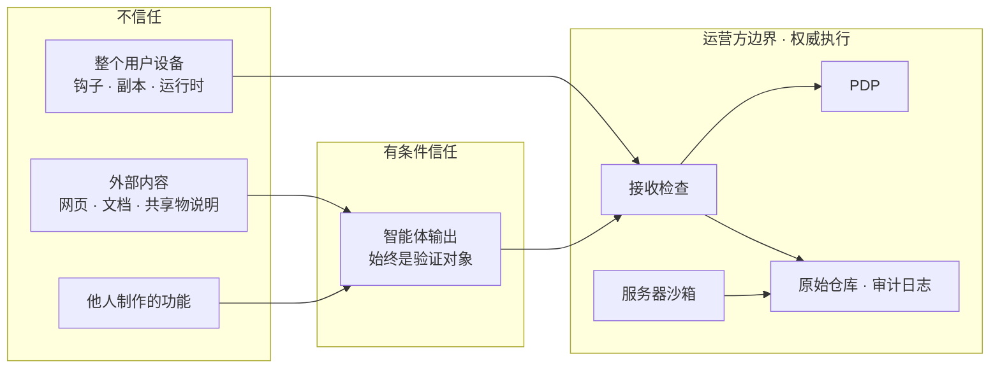
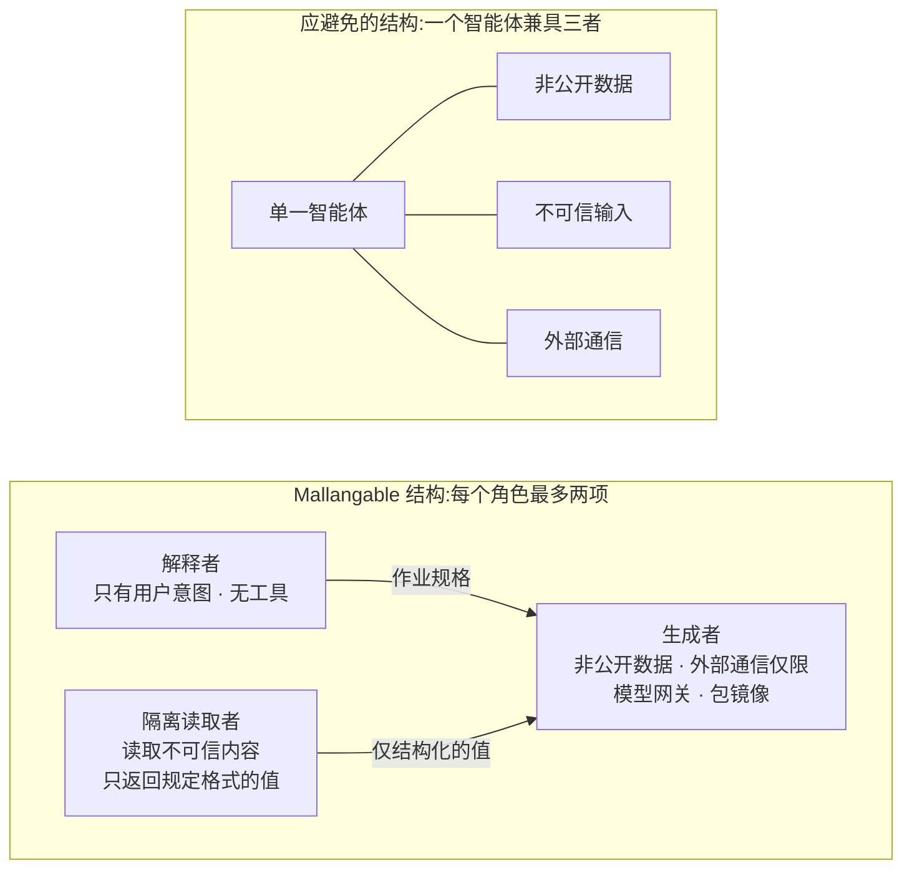

<!-- LANG-BAR -->
[English](../en/07-trust-and-security.md) · [한국어](../ko/07-trust-and-security.md) · **简体中文** · [日本語](../ja/07-trust-and-security.md) · [Español](../es/07-trust-and-security.md)
<!-- /LANG-BAR -->

# 7. 信任与安全 — 先决定不信任谁

> 本章结论:Mallangable 系统的生成智能体默认会同时拥有**非公开数据、不可信输入、对外发送的通道**。这三者汇聚在同一上下文中时,一次提示注入就会泄露数据。解法不是更聪明的过滤器,而是**结构性分离**:拆分角色,给数据加上可见性标签(visibility label),只给扩展明确交付的权限,最终执行在运营方(operator)边界进行。

## 7.1 威胁模型

### 需要保护的资产

| 资产 | 例 | 所有者 |
| --- | --- | --- |
| 用户数据 | 宿主(host)应用内的文档·记录 | 用户·租户 |
| 层产物 | 组织基线版的界面·自动化(公司内部诀窍) | 租户·组织 |
| 核心知识产权 | 宿主源码 | 供应商 |
| 凭据 | 模型 API 密钥、外部服务令牌 | 用户·租户 |
| 预算 | 推理额度、租户云成本 | 租户·运营方 |
| 完整性 | "我的应用只按我批准的方式运行" | 用户 |

### 攻击者

| 攻击者 | 目标 | 主要途径 |
| --- | --- | --- |
| 恶意共享者 | 窃取接收者的数据·凭据 | 共享功能、公开市场 |
| 间接注入者 | 在智能体读取的内容中植入指令以操纵其行为 | 文档、网页、共享物的说明文字、issue 正文 |
| 好奇的内部用户 | 查看隐藏的上游层源码 | 对智能体说"把源码给我看" |
| 受损的客户端 | 把绕过策略的变更推入服务器 | 禁用设备钩子、直接写仓库 |
| 越权的管理员 | 监视成员 | 提高管理可见性 |
| 运营方内部人员 | 查看客户代码 | 支持工具 |
| 成本攻击者 | 耗尽预算 | 诱导无限重试、大量生成 |
| 契约·评判者污染者 | 让恶意行为通过的契约、骗过评判者的通过判定 | 被注入的生成者所写的契约、植入产物中针对评判者的指令("此面板满足意图") |
| 解决缓存污染者(同一租户内) | 只凭自己的契约做出"已验证"的解决,扩散给租户全员 | R3 解决缓存复用(6.8)。范围限制只能防止租户*之间*的泄露 |
| 受损的上游发布·运营方 | 通过基线版向所有下游节点分发恶意变更 | 窃取发布签名密钥、运营方内部人员、`auto` 应用(6.5) |

最后三行的控制措施:
- **契约·评判者污染**:契约草稿由解释者在作业规格阶段编写,生成者不能删除或放宽契约条目(把 I7 的分离扩展到契约,6.7 规则 2)。评判者(G4)只接收规定 schema 的输入(意图、契约、截图、观测值),不把产物原文放入上下文。产物的完整性为 `untrusted`(7.5)。
- **解决缓存污染**:解决只有在与制作者不同的 k 个以上节点(建议值 3)上通过 κ_up ∧ κ_down 重新验证后才载入缓存(R3, 6.8)。
- **受损的上游发布·运营方**:发布签名密钥在每个执行点(接收检查)固定为钉(pin),并检查吊销列表。`auto` 应用也要经过金丝雀(6.5),租户可以拒绝上游发布并保持当前发布。发布也附带 7.7 的来源证明。

### 信任边界



读法:用户设备和智能体输出**都是验证对象**。这不是要怀疑用户本人,而是要保证在设备受损或智能体被注入时,原始仓库也不会被污染。

## 7.2 执行点与决策点

| 执行点(PEP) | 位置 | 权威 | 阻止的内容 |
| --- | --- | --- | --- |
| 设备执行框架钩子 | 用户设备 | 引导 | 失误、大部分注入尝试 |
| 运行时代理人(broker) | 宿主内 | 运行时权威 | 使用未批准的权限 |
| 接收检查 | 运营方边界 | **最终权威** | 违反规格·违反策略的记录、篡改策略文件 |
| 服务器沙箱 | 运营方边界 | 最终权威 | 作业范围外的访问、外部通信 |
| 输出门 | 生成面 → 体验面 | 最终权威(hidden 模式) | 代码·机密值泄露 |

所有 PEP 使用同一套 PDP 规则。如果生成时(执行框架)和运行时(代理人)使用不同的规则,就会出现"制作时允许,运行时禁止"这样的缝隙。

## 7.3 从结构上切断致命三要素

Simon Willison 归纳指出,智能体如果同时拥有**① 访问非公开数据、② 暴露于不可信内容、③ 对外通信能力**,攻击者就能轻易窃取数据,并称之为"致命三要素(lethal trifecta)"。他说目前还没有 100% 阻止的方法,避开这一组合本身才是安全之道([Willison, 2025.06](https://simonwillison.net/2025/Jun/16/the-lethal-trifecta/))。

可塑应用的生成智能体在默认设置下三者兼具:读取用户的层与数据(①),读取收到的共享功能·参考文档(②),与模型 API 和外部包仓库通信(③)。



规则:
- **外部通信允许列表**(必须(MUST)):生成智能体的外部通信只限于模型网关和已批准的包镜像。阻止访问任意 URL。
- **不可信内容先由隔离读取者读取。** 读取者没有工具,只返回规定 schema 的值(例:"相关/不相关"、抽取出的字段)。
- **权限增加一律需要人工批准**(I4)。即使共享物说明中藏着"添加网络权限"的句子,智能体也只能生成批准请求。

## 7.4 计划与执行的分离

关于提示注入防御的研究指向同一方向。

- **CaMeL** 先从可信的用户查询中提取控制流和数据流,使不可信的数据无法改变程序的流程。它把制定计划的特权 LLM 与没有工具、只解释不可信数据的隔离 LLM 分开,并对每个值追踪来源和权限(capability)。在基准测试中,相对于无防御系统的 84%,它在可证明的安全性下解决了 77% 的任务([Debenedetti et al., 2025](https://arxiv.org/abs/2503.18813))。
- **安全设计模式**论文提出六种模式(行动选择器、先计划后执行、LLM map-reduce、双 LLM、先代码后执行、上下文最小化),并确立了"接受不可信输入之后,该输入不得引发重大行为"的原则([Beurer-Kellner et al., 2025](https://arxiv.org/abs/2506.08837),[摘要](https://simonwillison.net/2025/Jun/13/prompt-injection-design-patterns/))。

与 Mallangable 角色的对应:

| 模式 | Mallangable 中的应用 |
| --- | --- |
| 先计划后执行 | 解释者在**看到不可信内容之前**确定作业规格(要触及的扩展点·深度·权限)。生成者不能越出规格(由 G1 检查) |
| 双 LLM([Willison, 2023](https://simonwillison.net/2023/Apr/25/dual-llm-pattern/)) | 共享物·文档由隔离读取者读取,只把结构化的值传给生成者 |
| 先代码后执行 | D3 声明式产物本身就是"用受限语言写的程序",可在执行前分析 |
| 上下文最小化 | 上下文供给者按角色只供给所需内容(5.10) |
| LLM map-reduce | 在晋升候选分析中,每个功能由子智能体只判定"是否同一意图",然后汇总 |

## 7.5 信息流标签

给所有数据加上**可见性标签**,并规定标签混合的规则。

```text
标签 λ = (范围, 等级, 完整性)
  范围   : 租户 / 组织 / 用户标识符
  等级   : V0 汇总 < V1 元数据 < V2 说明 < V3 代码          # 机密性
  完整性 : trusted(人的意图·已验证的基线版) > untrusted(共享物·外部文档·模型看了不可信输入后生成的值)

派生规则:  λ(f(x, y)) = λ(x) ⊔ λ(y)          # 机密性取更敏感的一方,完整性取更低的一方
查看规则:  查看者 s 可以查看 x  ⇔  λ(x) ⊑ 权限(s)
行为规则:  决定权限增加·外部发送·扩展点选择的值,其完整性必须为 trusted
解除规则:  降低标签只能由输出门(解除器 declassifier)进行,并留下规则与记录
```

完整性轴沿用 FIDES([Costa et al., 2025](https://arxiv.org/abs/2505.23643))在规划者层面同时追踪机密性·完整性标签并确定性地强制执行策略的方式。这是把 7.4 的"先计划后执行"写成了标签规则。

例:合并智能体读取租户 A 的代码(V3)后生成的解决带有 V3 标签,因此放入解决缓存时也只进入租户 A 的范围(6.8)。仪表板展示"解决方法分布"时,由输出门只保留数量并降为 V0。

hidden 模式下输出门(output gate)的检查项:

| 信号 | 判定 |
| --- | --- |
| 违反输出 schema、超出长度 | 阻断,重新生成 |
| 代码块或看起来像代码的连续行 | 删除 |
| 与仓库内容长段连续一致(指纹索引比对) | 删除 + 安全事件 |
| 内部路径·标识符密度超标 | 删除 |
| 机密值模式 | 阻断 + 警报 |

## 7.6 扩展执行安全

**对象能力(object-capability)原则**:扩展不拥有环境权限(ambient authority),只能使用挂载时明确交付的权限对象。Hardened JavaScript 用 `lockdown()` 冻结内置对象以防止原型污染,用 `Compartment` 分离全局,使扩展只能使用交付给它的对象([Endo/SES](https://github.com/endojs/endo))。

| 隔离级别 | 能阻止的 | 不能阻止的 | 适合的场合 |
| --- | --- | --- | --- |
| 语言(SES·Wasm) | 全局污染、未交付的 API | 无限循环导致的资源耗尽、计时 | 事件钩子(D4)的轻量执行 |
| 框架(跨源 iframe·webview) | 宿主 DOM·存储·cookie | 欺骗用户的界面(假按钮) | 面板代码(D4)、公开共享物 |
| 进程·microVM | 内存·文件系统·网络(经配置时) | 通过允许通道的泄露 | 共享的原生代码、服务器作业 |

如果宿主是桌面框架,请确认每个 webview 的权限体系。例如 Tauri v2 使用以窗口·webview 为单位的 capability,不匹配任何 capability 的 webview 完全无法访问 IPC 层([Tauri v2](https://v2.tauri.app/reference/acl/capability))。在这类体系中,**不给扩展 webview 任何 capability**、只把代理人作为通道的配置是默认值。

代理人规则:
- 每次调用都询问 PDP 并留下审计记录。
- 设置调用频率·响应大小上限(限制泄露速度)。
- 能欺骗用户的界面(模仿登录输入框等)从目录中排除,扩展界面上加上"这部分是我添加的功能"的标识。

## 7.7 供应链

一旦开放共享(A8),扩展就成为供应链。2026 年 2 月,安全公司 Koi Security 公布,在某智能体技能市场审计的 2,857 个技能中有 341 个恶意技能([The Hacker News](https://thehackernews.com/2026/02/researchers-find-341-malicious-clawhub.html))。之后虽然引入了扫描器,但在 2026 年 2~5 月的分析中,仍有把文件膨胀到 22MB 以超出检查上限来逃避检测的技能等残留。分析人员把根本原因指向"技能逻辑与智能体权限之间缺乏隔离"([Unit 42, 2026.06](https://unit42.paloaltonetworks.com/openclaw-ai-supply-chain-risk/))。

把教训转化为控制措施:

| 教训 | 控制措施 |
| --- | --- |
| 技能以智能体的权限运行 | 共享功能从头重新经过接收方的沙箱与权限批准 |
| 以"预先安装"为借口诱导执行 shell 命令 | 共享功能没有安装脚本。产物只有声明式或沙箱代码 |
| 膨胀文件以躲避扫描器 | 超过大小上限的共享物**予以拒绝**(而非跳过)。检查覆盖全部字节 |
| 安装后在远程更改内容 | 共享物以内容哈希固定。运行时从外部获取数据会显示为权限,并成为批准对象 |
| 一个账户大量上传 | 发布者来源签名([in-toto](https://github.com/in-toto/attestation) Statement 中的 [SLSA provenance](https://slsa.dev/spec/v1.1/provenance) 谓词。对象为清单 content_hash,builder.id 为执行框架 id)、新发布者限制、策展等级 |

## 7.8 源码不公开能保证到什么程度

**智能体能读到的代码,和这个智能体对话的人最终也能读到。** 因此必须按威胁诚实地区分保证级别。

| 威胁 | client 模式 | server · hidden 模式 |
| --- | --- | --- |
| 随意查看(出于好奇打开看看) | 不阻止 | 阻止:用户手里根本没有仓库 |
| 有意提取(诱导智能体输出) | 无法阻止 | 大部分阻止:解释者从未见过代码,输出门会过滤 |
| 产物逆向分析(分析下载的执行包) | 不适用 | **残余风险**:发往设备的代码可能被读取 |
| 绕过请求("做一个显示我的源码的面板") | 不适用 | 用静态规则(禁止访问源码)+ 评判者来减少,但并不完美 |
| 内部人员带出 | 审计记录 | 审计记录 + 紧急访问批准流程 |

面向客户的承诺措辞必须准确,如"防止有意提取为尽力而为"。引导把核心逻辑放在服务器侧的扩展点(服务点),而不是下发到设备的扩展中。

## 7.9 管理可见性与隐私

- 可见性等级 V0~V3(3.2 的 A10)及其默认值在第 4 章规定。用户始终可以看到当前等级(底线 F3)。
- 遥测中的个人识别字段以假名密钥分离存储,收到删除请求时只需销毁密钥即可切断关联。
- 运营方对客户数据进行紧急访问(break-glass)时:填写事由·范围·期限 → 客户管理员批准 → 只读会话 → 在客户仪表板上实时显示所有查询 → 期限届满自动收回 → 事后报告。
- 提交元数据·意图摘要一旦与个人关联就可能成为个人信息,而成员活动监控在各国受不同的劳动·个人信息法规约束。部署前需要进行管辖法律审查。

## 7.10 滥用

可塑应用也可能让用户制作**对他人有害的功能**。例:偷偷记录同事活动的面板、把客户数据发送到外部的自动化。
- 读取他人数据的权限、外部发送权限,以租户上限约束并作为批准对象。
- 在评判者检查项中加入是否存在"隐藏的收集·发送"。
- 用通俗术语告知用户:模型供应商使用政策所禁止的用途,可能在生成阶段被拒绝。

## 7.11 安全检查清单(必须(MUST))

- [ ] 扩展不通过代理人以外的途径触及宿主功能
- [ ] 生成智能体的外部通信只有允许列表
- [ ] 权限增加未经人工批准不会被激活
- [ ] 生成者与评判者是不同的实例
- [ ] 接收检查检查记录规格·契约存在·策略文件不变·大小
- [ ] 共享功能在接收方重新验证·重新批准
- [ ] 拒绝超过大小上限的共享物
- [ ] 共享·市场列表、安装前预览、权限显示不执行扩展代码,而从清单读取。批准前执行会破坏 5.9 的"批准前 D4 权限为 0"(ThinkRail 也拒绝了每次列出时都执行扩展的方式,改为无副作用的列表,[`agent/packages/SPEC.md`](https://github.com/JetBrains/thinkrail/blob/c10f8808cee693e4abffeeb1844a132ed0a91cc5/packages/server/src/agent/packages/SPEC.md#L23-L25))
- [ ] 解决缓存·指纹索引·沙箱按可见性范围分离
- [ ] hidden 模式下解释者不能访问代码,所有输出都经过输出门
- [ ] 用户权利底线 F1~F7 不能被任何策略关闭
- [ ] 底线行为例外只在人类所有者·自己的层·权限不增加时适用。重做·"重新开启"·解除搁置·智能体发起的回退要经过与激活相同的判定(4.8)
- [ ] 基线版传播的自动应用也经过 activate(E10)。若为 gated·破坏性功能·绑定指纹的批准,则降为提议(6.5)
- [ ] `permissions_delta` 不信任自我申报,而从清单与父状态重新计算
- [ ] 清单 `network.allow` 不为空时,`permissions` 中有 risk=egress 的能力。拒绝 IP 字面量和公共后缀通配符
- [ ] 检查工具的输出对文档·文件名中的控制字符进行转义,判定结果通过退出码传递

下一章:[8. 体验设计](08-experience-design.md)
