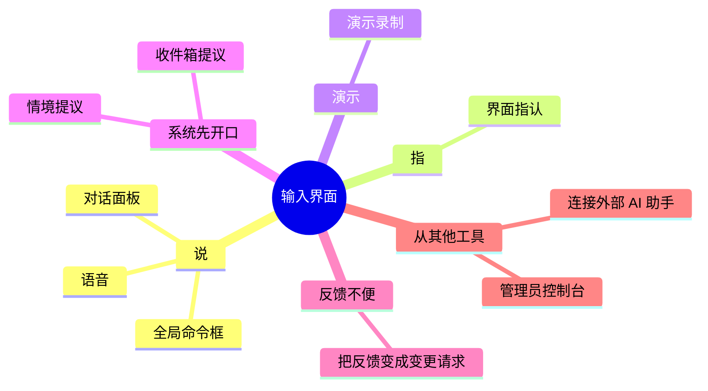
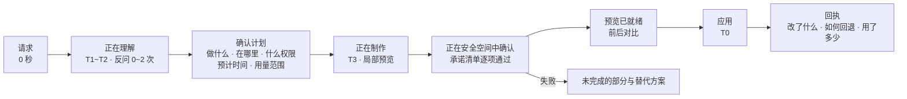
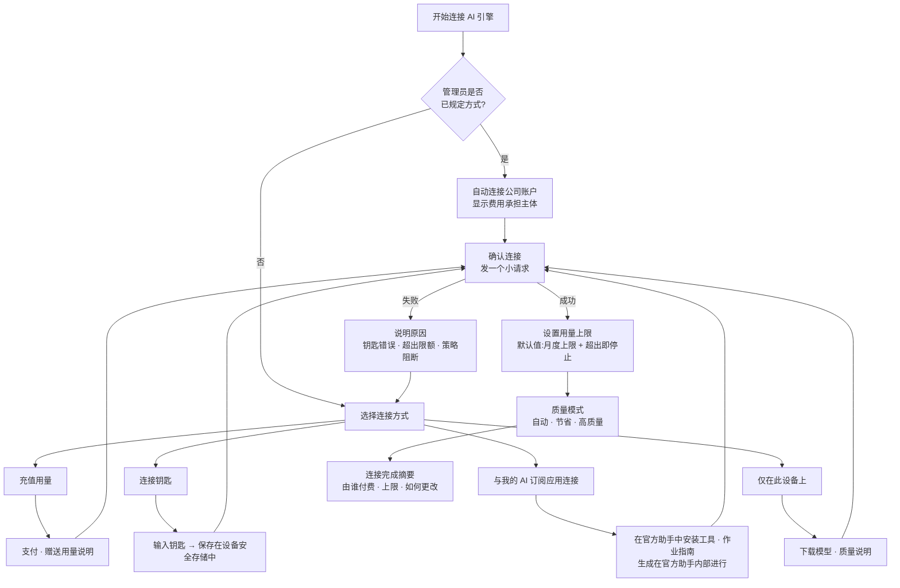

<!-- LANG-BAR -->
[English](../en/08-experience-design.md) · [한국어](../ko/08-experience-design.md) · **简体中文** · [日本語](../ja/08-experience-design.md) · [Español](../es/08-experience-design.md)
<!-- /LANG-BAR -->

# 8. 体验设计 — 在哪里倾听、如何呈现等待、用什么话来说

> 本章结论:用户想要的不是"AI 修改代码",而是**"照我说的改,不满意就立刻回去"**。因此体验面必须具备:① 可以指着说的输入;② 按时间等级(time tier)诚实的进度表达;③ 把进度显示呈现为"承诺清单逐项通过的样子";④ 隐藏开发术语的术语包(lexicon pack);⑤ 遵守条款的 AI 引擎连接流程。

## 8.1 体验原则

| # | 原则 | 含义 |
| --- | --- | --- |
| X1 | 用意图的语言 | 用户只说"想要什么"。深度·扩展点·权限由系统判定,并用通俗术语展示 |
| X2 | 可以指认 | 必须能说"这个"。在界面上指认是最准确的上下文 |
| X3 | 回退优先 | 回退方法比应用按钮先被看到。回退即时、免费 |
| X4 | 诚实地等待 | 事先以范围说明所需时间和用量,进度以实际进展呈现 |
| X5 | 不用开发术语 | 基本级别的界面不出现提交·分支·合并之类的词 |
| X6 | 让成本可见 | 若有用户承担的成本,生成前显示范围,生成后显示实际值 |

## 8.2 输入界面



| 界面 | 使用方式 | 优势 | 注意 | 主要处理的深度 |
| --- | --- | --- | --- | --- |
| 全局命令框 | 用快捷键打开,输入一句话 | 随处可用、快 | 缺少上下文 → 自动附上当前画面 | D1~D4 |
| 界面指认 | 在"修改模式"中点选元素并说话 | **扩展点 id 自动确定**,解释错误大幅减少 | 核心区域显示"这里不能修改" | D1~D3 |
| 对话面板 | 在侧边面板中多轮对话 | 复杂需求、反问 | 对话变长时总结为作业规格加以确认 | 全部 |
| 语音 | 用说话提出请求 | 双手忙碌的场合 | 确认步骤用画面完成 | D1~D2 |
| 演示录制 | "看我怎么做,照着做出来" | 难以用语言说明的重复流程 | 录制中显示个人信息,指定范围 | D2 |
| 情境提议 | 重复同样操作时提示"要我自动帮你做吗?" | 用户原本不知道的机会 | 提议频率上限(建议:每天 1 次)、可关闭 | D2 |
| 收件箱提议 | 收到的共享功能、新基本版到达 | 被动用户也能受益 | 突出权限变化 | 全部 |
| 反馈转换 | "这个不方便"的反馈就是变更请求 | 门槛最低 | 区分发往供应商的反馈与对我自己的修改请求 | 全部 |
| 连接外部 AI 助手 | 用户使用的 AI 助手以工具形式修改应用 | 开发者、自动化 | 必须强制经过执行框架 | 全部 |
| 管理员控制台 | 编辑组织基本版、审查晋升 | 以组织为单位改进 | 显示影响范围(用户数) | D1~D4 |

演示录制属于"示范编程(programming by demonstration)"一类,情境提议则方向相反:由系统检测重复并主动提议。两者的结果大多落在 D2(现有功能的组合),因此安全且快速。

## 8.3 意图收集

1. **反问最多 1~2 次**(应当(SHOULD))。如果需要更多,就以最可能的解释生成预览,让用户在预览上修改。比起回答问题,人们觉得看着结果修改更容易。
2. **先用更简单的方法**(必须(MUST),最小深度原则(least-depth rule)的体验版):如果请求可以用设置或现有功能组合解决,先展示这个。"也可以做个新面板,不过现在在列表上打开'只看已过期的'筛选就能马上实现。"
3. **用话语确认范围**:执行前用一句话复述。"我会在侧边栏下方添加一个'本周已完成的事'列表。只使用待办读取权限。"
4. **也要说明不能做什么**:触及策略上限时,告知是哪一层的规则以及下一步行动(向管理员申请)。

## 8.4 时间等级 T0~T4

人感知的响应时间有三个边界。0.1 秒以内感觉是即时反应,1 秒以内感觉思路不被打断,10 秒是保持注意力的极限。超过 10 秒就需要显示预计完成的进度指示;在不知道工作量时,逐项按名称显示正在处理的条目更好([NN/g](https://www.nngroup.com/articles/response-times-3-important-limits/))。

| 等级 | 时间 | 对应作业 | 体验模式 | 文案示例 |
| --- | --- | --- | --- | --- |
| T0 | 不到 0.1 秒 | 回退、D1 令牌应用、预览切换 | 乐观即时反映,无进度显示 | (不显示) |
| T1 | 0.1~1 秒 | D2 快捷键·规则应用 | 即时反映 + 小型确认提示 | "已应用 · 回退" |
| T2 | 1~10 秒 | 短生成(D1~D2 句子解释、简单规则) | 小型进度显示 + 阶段文案 | "正在理解…" |
| T3 | 10 秒~数分钟 | D3·D4 生成与验证 | **分阶段进度 + 承诺清单通过显示 + 局部预览**,提示可以去做别的事 | "正在制作 · 约 30 秒~1 分钟 · 完成后通知你" |
| T4 | 数分钟~数天 | 新基本版传播、组织批准、接受共享 | 后台 + 通知 + 预约应用时间 | "新基本版已准备好 · 周五下午应用" |

部署速度预期:个人变更必须在 T0~T3 内完成,基本版传播(T4)因为逐步应用(金丝雀)而有意放慢。对用户解释为"不会一次性应用给所有人,而是边观察有无问题边依次应用"。

## 8.5 如何呈现生成过程



### 固定为四个状态词

`正在理解` → `正在制作` → `正在确认` → `已就绪`。所有界面使用相同的词。如果状态词因界面而异,用户就无法判断是否是同一件事在进行。

### 进度显示 = 承诺清单

T3 作业的进度不以笼统的百分比,而以**契约(承诺清单)的通过情况**呈现。这与"不知道工作量时按名称显示处理条目"的原则相同,同时也自然地告诉用户"保证了什么"。

```text
正在确认 (2/3)
  ✓ 只显示本周完成的事
  ✓ 如果没有完成的事,就显示"本周没有完成的事"
  … 正在确认界面不会变慢
```

### 局部预览

声明式界面(D3)在生成过程中也能随结构的形成边画边显示。生成式 UI 标准 A2UI 也支持渐进接收消息并绘制的方式([Lynx 文档中的 A2UI 说明](https://lynxjs.org/react/genui/a2ui))。但局部预览要加上"尚未确认"标识,与成品区分。

### 失败的表达

失败必须(MUST)包含三点:**什么没做成**(通俗术语)、**为什么**(策略·技术一句话)、**现在能做什么**(更简单的替代方案、向管理员申请、重试)。

```text
"完成后通知团队聊天"功能还没有开启。
这是向外部发送内容的功能,按公司策略需要管理员批准。
[向管理员申请批准]  [不发通知,只在我的界面上显示]  [取消]
```

## 8.6 变更回执

每次应用后留下的记录卡片(用户权利底线 F7)。

```text
变更回执 · 10 月 28 日 上午 9:41
做了什么:在侧边栏添加了"本周已完成的事"列表
在哪里:侧边栏下方
允许范围:待办读取(没有新增的允许)
承诺清单:3 项全部已确认
用量:约 0.3 额度(本月 4.1 / 30)
谁能看到:我、团队管理员(可看到变更说明)
回退:[立即回退] 或者说"把刚才的撤回"
```

## 8.7 回退体验

- 用话语:"把刚才的撤回""回到昨天的状态"。解释含糊时显示最近 3 个变更。
- 时间滑块:以缩略图翻看最近的各个状态并选择。
- 安全模式(safe mode):应用异常时,在启动时选择"以基本模式启动"。我的变更不会被删除,只是被关闭。
- 自动恢复通知:"最近添加的'自动排序'引发了错误,已暂时关闭。[重新开启] [详情]"。

## 8.8 新基本版·共享提议

```text
团队基本版有新版本了 (2026.11)
- 我做的 7 个功能中有 6 个已原样迁移
- 1 个需要选择:"侧边栏本周列表"
  新基本版中侧边栏变成了标签页
  [迁移到标签页 (推荐)]  [保持原来的方式]  [重新做成两者都可行]
- 预览将会改变的 3 处界面 ▸
[立即应用]  [周五下午应用]  [以后再说]
```

三个选项与 6.7 中意图冲突的选项相同。共享提议也采用同样的格式,并加上"是谁发送的"和"新需要的允许范围"。

## 8.9 术语包 (Lexicon Pack)

### 为什么需要

这个系统的内部充满了版本管理·权限·沙箱之类的开发概念。对普通用户来说,"要解决冲突并合并吗?"听起来像警告。术语包是**把一个概念 id 与按级别·按领域·按语言的表达连接起来**的词典,体验面的所有字符串和智能体面向用户的回答都要经过这本词典。

### 结构

```text
概念 id(稳定)
 └ 按级别的表达:basic(普通) · practitioner(从业者) · developer(开发者)
    └ 领域覆盖:education · healthcare · enterprise …
       └ 语言:ko · en …
```

- 用户默认为 `basic`。打开界面上的"查看详情"为 `practitioner`,在开发者设置中为 `developer`。
- 领域包由供应商或租户添加(第 9 章 B13)。

### 对照表(默认中文)

| 概念 id | 开发术语 | 普通用户表达 (basic) | 一句话说明 |
| --- | --- | --- | --- |
| change | 变更 | 改动 | 一次改动的内容 |
| feature | 功能 | 我做的功能 | 为同一目的所做改动的集合 |
| record | 提交 | 保存点 | 随时可以回到的点 |
| branch | 分支 | 实验版 | 不碰原版、用来试验的副本 |
| merge | 合并 | 合在一起 | 把两个版本合为一个 |
| conflict | 冲突 | 重叠的部分 | 双方对同一处做了不同的修改 |
| intent_conflict | 意图冲突 | 需要选择的部分 | 无法同时满足两者 |
| revert | 回滚 | 撤回 | 回到之前的状态 |
| baseline | 基线版 · LTS | 基本版(官方基本版 · 公司基本版 · 团队基本版) | 大家都作为起点使用的版本 |
| release | 发布 | 新基本版 | 基本版出了新版本 |
| fork | 分叉 | 我的副本 | 从基本版分出来的我的版本 |
| extension_point | 扩展点 | 可以修改的位置 | 应用允许修改的位置 |
| capability | 权限 | 允许范围 | 功能可以使用的数据与操作 |
| sandbox | 沙箱 | 安全空间 | 不影响别处、先运行试试的地方 |
| validation | 验证 | 确认 | 检查是否按承诺运行 |
| contract | 契约 · 验收条件 | 承诺清单 | 这个功能必须遵守的事项 |
| diff | 差异 | 改了什么 | 前后的差别 |
| activate | 部署 · 激活 | 应用 | 真正开启 |
| safe_mode | 安全模式 | 以基本模式启动 | 关闭我的所有变更后启动 |
| quarantine | 隔离 | 暂时关闭 | 停用引发问题的功能 |
| depth | 深度 D1~D4 | 修改程度(外观 · 组合 · 界面 · 行为) | 改得有多深 |
| policy_ceiling | 策略上限 | 公司允许的范围 | 管理员规定的限度 |
| canary | 金丝雀部署 | 依次应用 | 先对一部分应用以确认问题 |
| drift | 漂移 | 落后于基本版 | 未反映最新基本版的程度 |
| subscribe_share | 订阅式共享 | 持续接收 | 发送者修改后,我也会收到更新提议 |
| promotion | 晋升 | 采纳为官方功能 | 多人做的功能被纳入基本版 |
| audit_log | 审计日志 | 活动记录 | 谁在何时做了什么 |
| visibility | 管理可见性 V0~V3 | 管理员可见的范围 | 管理员能看到的信息的程度 |
| agent | 智能体 | AI 助手 | 帮你做出变更的 AI |
| model | 模型 | AI 引擎 | AI 助手使用的大脑 |
| api_key | API 密钥 | 连接钥匙 | 使用 AI 引擎所需的秘密代码 |
| tokens | 令牌 | 用量 | 使用 AI 引擎的量 |
| route_quality | 模型路由 | 质量模式(节省 · 标准 · 高质量) | 速度·成本·质量的平衡 |

### 应用点

| 位置 | 方式 |
| --- | --- |
| UI 字符串 | 只用概念 id 编写,渲染时 `LexiconPort.render` |
| 智能体面向用户的回答 | 在输出阶段(E13)由说明者角色改写为 basic 级别 |
| 错误·拒绝消息 | PDP 的拒绝理由代码 → 概念 id → 句子 |
| 回执·升级摘要 | 由说明者角色生成,必须通过 lint |
| 开发过程 | 对 UI 字符串仓库施加 lint,在构建阶段拦截 basic 界面的禁用词(提交、分支、合并、merge、令牌、API 等) |

### 存储与来源

- **以概念 id 存储**(必须(MUST)):回执·通知·记录这类被存储或在设备之间往来的数据中,不放完整的句子,而放 `概念 id + 参数`。句子在显示时生成。这样用户切换级别(basic ↔ developer)或语言时,过去的回执也会一起改变。用户或智能体亲自起的名称(功能名等)原样显示。
- **术语包是数据,来源是确定的**(必须(MUST)):术语包只包含字符串,不包含代码。能放入术语包的只有供应商·租户(领域包,第 9 章 B13)和用户自己的设置,**共享功能或非上游的层不能更改术语包。** 否则收到的功能可能把权限警告文案("访问患者信息")换成温和的说法以骗取批准(F5)。
- **回退顺序**:领域包的精确语言 → 基本包的精确语言 → 基本包的默认语言 → 概念 id 本身。以字符串为单位回退,避免因缺了一个条目而让整个界面换成另一种语言。
- ThinkRail 也不在存储·通信数据中放入译文,用户语言文件只从全局数据文件夹读取,使"克隆的仓库无法改写 UI"([JetBrains/thinkrail `architecture.md` 决定 23](https://github.com/JetBrains/thinkrail/blob/c10f8808cee693e4abffeeb1844a132ed0a91cc5/architecture.md#L430-L454))。不过 ThinkRail 不翻译智能体输出,而 Mallangable 为 basic 用户由说明者改写(上表)。

### 领域覆盖示例

| 概念 | 默认 | 教育 | 医院业务 | 公司内部业务 |
| --- | --- | --- | --- | --- |
| feature | 我做的功能 | 我的教学工具 | 我的业务工具 | 我的业务工具 |
| baseline | 基本版 | 学校基本版 | 医院标准界面 | 我们团队的标准 |
| capability: 读取个人数据 | 读取信息 | 查看学生信息 | **访问患者信息**(加强警告) | 查看客户信息 |
| share | 共享 | 与同事老师分享 | 与同科室分享 | 共享给团队 |

完整示例:[`examples/lexicon.zh-CN.yaml`](../../examples/lexicon.zh-CN.yaml),schema:[`schemas/lexicon-pack.schema.json`](../../schemas/lexicon-pack.schema.json)。

## 8.10 AI 引擎(模型)连接

### 连接方式(用户可见的名称)

| 用户可见的名称 | 内部路径(A9) | 何时 | 用户体验 |
| --- | --- | --- | --- |
| 用公司账户 | `tenant_cloud` | 管理员已设置 | 无需选择界面即可直接使用。显示由谁支付费用 |
| 充值用量使用 | `credits` | 最简单的起步 | 含赠送用量 + 充值,月度上限 |
| 粘贴连接钥匙 | `byok` | 已有 AI 服务账户的用户·团队 | 粘贴钥匙 → 确认连接 → 设置上限 |
| 与我的 AI 订阅应用连接 | `sub` | 已在使用供应商官方 AI 助手的用户 | 在官方助手中添加本应用的"工具"和"作业指南"。生成在该助手内部进行 |
| 仅在此设备上使用 | `on_device` | 离线·隐私 | 下载模型,质量说明("适合简单的变更") |

### 流程



### 关于订阅连接的条款原则

- 各供应商的政策不同,而且经常变化。2026 年 2 月,Anthropic 明确规定,把从 Free·Pro·Max 订阅获得的认证令牌用于其他产品·工具·服务(包括 Agent SDK)属于违反消费者条款,例外是 API 密钥访问或明确允许的情况([The Register](https://www.theregister.com/2026/02/20/anthropic_clarifies_ban_third_party_claude_access))。另一方面,同一时期也有报道称部分供应商与特定第三方工具合作,开放了订阅使用([整理文章](https://falcao.org/posts/anthropic-claude-access-crackdown-ecosystem-fallout/))。
- 因此设计原则只有一条:**"订阅连接"适配器只实现供应商在文档中允许的路径,并以按供应商的标志开关。** 对没有允许路径的供应商,其订阅只以"把我们的工具挂到官方助手上"的方式(上表的 `sub`)支持。这种情况下,生成在用户启动的官方客户端内部进行,我们的应用不处理令牌。
- 服务器侧作业(合并·晋升等)不使用用户的个人订阅(L2)。

### 安全与成本显示

- 连接钥匙只放在设备的安全存储(操作系统钥匙串等)或租户的机密管理系统中。必须(MUST)绝不放入变更仓库·日志·智能体上下文。
- 像 `sub` 路径那样在官方助手内作为 MCP 工具运行时,不通过对话或 form 模式输入接收连接钥匙或外部服务令牌。MCP 规范要求对机密值·凭据使用 URL 模式 elicitation([2026-07-28 版](https://modelcontextprotocol.io/specification/2026-07-28/client/elicitation))。只有钥匙从未进入智能体上下文,I6 才能得到遵守。
- 在同一版本中,MCP Sampling 预定废弃([变更内容](https://modelcontextprotocol.io/specification/2026-07-28/changelog))。不以把模型调用转嫁给 MCP 客户端的方式制作 `ModelPort` 适配器。
- 生成前用 `ModelPort.estimate()` 显示**范围**("约 0.2~0.5 额度")。单一数字容易出错,一旦出错就会失去信任。
- 默认值为**月度上限 + 超出即停止**(底线 F6)。超出时让用户在"本月用量已用完。提高上限 · 以节省模式继续 · 等到下个月"中选择。
- 超出限额·供应商故障时的替代路径(例:标准 → 节省模式)事先写入策略,并把已发生切换的事实告知用户。

## 8.11 连接过程中的商业接触点

详细模式见第 9 章,这里只整理体验面上产生的接触点。

| 接触点 | 形式 | 相关 BM |
| --- | --- | --- |
| 首次连接 | 套餐提供赠送用量 → 充值 | B3 额度差价 |
| 选择质量模式 | 高质量模式属于高级套餐 | B15 质量等级 |
| 使用连接钥匙 | 平台使用费(验证·存储·传播成本) | B4 BYOK 平台费 |
| 连接公司账户 | 企业连接器·审计功能 | B6 治理、B7 机密执行 |
| 按结果显示 | "只对通过验证的变更收费"选项 | B16 按成果计费 |
| 供应商注册引导 | 仅在有供应商合作计划时 | B14 供应商合作 |

## 8.12 无障碍与语言

- 预览的前后对比在屏幕阅读器中也要能作为"改动清单"被朗读。
- 界面指认模式也必须能用键盘遍历并选择元素。
- 生成的扩展也在 G3 检查无障碍基本规则(对比度、标签、键盘操作)。用户修改不得破坏无障碍。
- 默认文案用韩语书写,英文以并列标注或通过术语包语言切换提供。

## 8.13 体验指标

| 指标 | 定义 | 为什么看 |
| --- | --- | --- |
| 到首次变更的时间 | 从安装(或发现功能)到首次应用 | 进入门槛 |
| 反问次数 | 每个请求的平均值 | 解释质量 |
| 各阶段流失 | 在理解·计划·制作·确认·预览各阶段放弃的比例 | 等待在哪里崩溃 |
| 预览应用率 | 预览中被应用的比例 | 结果质量 |
| 24 小时内回退 | 应用后 24 小时内回退的比例 | 隐藏的质量问题 |
| 回执查看率 | 展开查看回执的比例 | 对信任·透明度的需求 |
| 预计与实际成本 | 实际成本落在预计范围内的比例 | 成本信任 |
| 基本级别 lint 违规 | 已发布的字符串·回答中暴露开发术语的次数 | 术语包质量 |

下一章:[9. 商业耦合](09-business-coupling.md)
