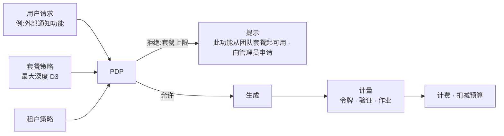

<!-- LANG-BAR -->
[English](../en/09-business-coupling.md) · [한국어](../ko/09-business-coupling.md) · **简体中文** · [日本語](../ja/09-business-coupling.md) · [Español](../es/09-business-coupling.md)
<!-- /LANG-BAR -->

# 9. 商业耦合 — 商业模式与架构选择绑定在一起

> 本章结论:商业模式(business model, BM)不是事后叠加在架构之上的东西。**智能体位置(A3)、拓扑(A6)、共享范围(A8)、管理可见性(A10)、模型获取(A9)** 决定了能卖什么。本章以轴条件定义 20 个 BM,并按参考配置(reference profile)计算可行与否。然后提出两条整合原则:**套餐就是策略上限**,**最小深度原则既是安全原则也是成本原则**。

## 9.1 为什么必须一起设计

- 如第 3 章所见,结构轴改起来昂贵,商业轴改起来便宜。但**某些商业轴取值只存在于特定结构中。** 例:要销售源码不公开的执行(B7),就必须从一开始就有服务器智能体和 hidden 可见性。
- 反过来,最初选定的商业模式也会强制结构。如果捆绑销售推理(B3),计量·预算·防滥用就成为必需,这又要求管理可见性 V0 以上(N3)。

## 9.2 价值单位与成本驱动因素

| 价值单位(为什么付钱) | 成本驱动因素(钱花在什么上) |
| --- | --- |
| 活跃用户·席位 | 推理令牌(生成·评判·合并) |
| 完成的变更(通过验证) | 验证执行(沙箱·契约·截图) |
| 基本版存活(更新后依然可用) | 传播作业(用户数 × 发布数,6.8) |
| 共享·安装 | 策展·审核人力 |
| 管理·审计功能 | 存储·遥测 |
| 机密执行环境 | 服务器沙箱·本地部署运维 |

一个变更的边际贡献:

```text
margin(δ) = price(δ) − [ tokens(δ) × unit_price(route) + c_validate(depth) + c_store + c_support / 变更数 ]
```

`tokens` 和 `c_validate` 随深度增长。用 D4 来做 D2 就能做的事,既昂贵(增加模型调用·评判门)又危险。因此**最小深度原则(2.6)既是安全原则,也是成本原则**。解释者先提议更简单方法的体验(8.3)同时提升用户满意度和利润率。

## 9.3 BM 目录

| id | BM | 计费单位 | 所需的架构条件 | 计量·执行点 |
| --- | --- | --- | --- | --- |
| B1 | 许可证销售 | 每台设备·每用户一次 | 无 | 许可证服务器 |
| B2 | 席位订阅 | 每月每席位 | 无(服务器功能越多价值越高) | 身份·计量 |
| B3 | 推理额度差价 | 用量 | `A9=credits` (+ N3: `A10≥V0`) | 模型网关 |
| B4 | BYOK 平台费 | 月度固定或按作业 | `A9∈{byok, tenant_cloud}`,有服务器功能则完整 | 作业执行器·计量 |
| B5 | 共享市场佣金 | 付费功能销售额的一定比例 | `A8=public`(租户内部为内部结算) | 共享服务 |
| B6 | 治理附加组件 | 租户月费 | `A10≥V1` | 仪表板·审计 |
| B7 | 机密执行溢价 | 租户月费 | `A3=server` ∧ `A5=hidden` | 服务器沙箱·输出门 |
| B8 | 基线版支持合同 | 年度合同 | `A6=lineage` ∧ `A7∈{proposed, auto}` | 谱系注册表·作业执行器 |
| B9 | 升级存活保证 | 每个活跃功能每月 | `A6∈{fork, lineage}` ∧ `A7∈{proposed, auto}` | 传播流水线·契约执行 |
| B10 | 晋升分成 | 每次晋升的奖励 | `A6=lineage`(+ 共享·V1 以上则完整) | 晋升流水线 |
| B11 | 本地开发者对接 | 每次对接的佣金 | 可见性为 open/own 则完整,hidden 则仅限租户内部专家 | 升级处理队列 |
| B12 | 需求信号报告 | 报告订阅 | `A10≠none` | 遥测汇总 |
| B13 | 术语·领域包 | 包许可证 | 无 | 术语转换器 |
| B14 | 模型供应商合作 | 依供应商合作条件 | `A9≠on_device`,仅在供应商有官方计划时 | 模型网关 |
| B15 | 质量等级差异化 | 套餐差异 | `A9=credits`(BYOK·租户云在服务器路由时有条件) | 模型网关路由 |
| B16 | 按成果计费 | 每个通过验证的变更 | `A10≠none` ∧ `A9∈{credits, byok, tenant_cloud}` | 验证门 + 计量 |
| B17 | 运行时 OEM 许可证 | 年度许可证 | 无(规格公开 + 实现商用) | — |
| B18 | 解决配方订阅 | 订阅 | `A6∈{fork, lineage}` ∧ `A7∈{proposed, auto}` | 解决缓存·发布 |
| B19 | 功能产品化分成 | 销售额分成 | `A8=public` | 共享服务·晋升 |
| B20 | 赞助默认值槽位(注意) | 曝光·转化 | `A8=public`,仅在满足标示义务时 | 能力图·推荐 |

## 9.4 参考配置 × BM 耦合矩阵

这是 `python3 tools/design_space.py --bm` 的计算结果。● 直接可行,◐ 有条件(需要运营方式·外部合同),○ 结构上不可行。

| BM | 名称 | P1 个人工坊 | P2 团队策展 | P3 企业保密 | P4 大众消费 | P5 本地优先 | P6 市场平台 | P7 隔离网络公共 |
| --- | --- | :-: | :-: | :-: | :-: | :-: | :-: | :-: |
| B1 | 许可证销售 | ● | ● | ● | ● | ● | ● | ● |
| B2 | 席位订阅 | ● | ● | ● | ● | ● | ● | ● |
| B3 | 推理额度差价 | ○ | ○ | ○ | ● | ○ | ● | ○ |
| B4 | BYOK 平台费 | ○ | ● | ● | ○ | ◐ | ○ | ● |
| B5 | 共享市场佣金 | ○ | ◐ | ◐ | ● | ◐ | ● | ◐ |
| B6 | 治理附加组件 | ○ | ● | ● | ● | ○ | ● | ● |
| B7 | 机密执行溢价 | ○ | ○ | ● | ◐ | ○ | ○ | ● |
| B8 | 基线版支持合同 | ◐ | ● | ● | ○ | ○ | ● | ● |
| B9 | 升级存活保证 | ● | ● | ● | ○ | ○ | ● | ● |
| B10 | 晋升分成 | ○ | ● | ● | ○ | ○ | ● | ● |
| B11 | 本地开发者对接 | ◐ | ● | ◐ | ● | ● | ● | ◐ |
| B12 | 需求信号报告 | ○ | ● | ● | ● | ○ | ● | ● |
| B13 | 术语·领域包 | ● | ● | ● | ● | ● | ● | ● |
| B14 | 模型供应商合作 | ◐ | ◐ | ◐ | ◐ | ◐ | ◐ | ◐ |
| B15 | 质量等级差异化 | ○ | ◐ | ◐ | ● | ○ | ● | ◐ |
| B16 | 按成果计费 | ○ | ◐ | ◐ | ● | ○ | ● | ◐ |
| B17 | 运行时 OEM 许可证 | ● | ● | ● | ● | ● | ● | ● |
| B18 | 解决配方订阅 | ● | ● | ● | ○ | ○ | ● | ● |
| B19 | 功能产品化分成 | ○ | ◐ | ◐ | ● | ◐ | ● | ◐ |
| B20 | 赞助默认值槽位 | ○ | ○ | ○ | ◐ | ○ | ◐ | ○ |

在全部 36,772 个推荐组合中各 BM 可行的比例(`--bm-stats`):

| BM | 名称 | ● 可行 | ◐ 有条件 | ○ 不可行 |
| --- | --- | ---: | ---: | ---: |
| B1·B2·B13·B17 | 许可证·席位·术语包·OEM | 100.0% | 0.0% | 0.0% |
| B12 | 需求信号报告 | 88.8% | 0.0% | 11.2% |
| B6 | 治理附加组件 | 66.6% | 22.2% | 11.2% |
| B11 | 本地开发者对接 | 56.7% | 43.3% | 0.0% |
| B9·B18 | 升级存活保证·解决配方 | 53.7% | 0.0% | 46.3% |
| B4 | BYOK 平台费 | 40.4% | 16.3% | 43.3% |
| B5·B19 | 共享市场·产品化分成 | 27.4% | 36.3% | 36.3% |
| B8 | 基线版支持合同 | 26.9% | 26.9% | 46.3% |
| B3 | 推理额度差价 | 24.2% | 0.0% | 75.8% |
| B15 | 质量等级差异化 | 24.2% | 40.4% | 35.5% |
| B16 | 按成果计费 | 24.2% | 48.3% | 27.5% |
| B10 | 晋升分成 | 11.7% | 15.2% | 73.1% |
| B7 | 机密执行溢价 | 11.0% | 23.3% | 65.7% |
| B14 | 模型供应商合作 | 0.0% | 89.0% | 11.0% |
| B20 | 赞助默认值槽位 | 0.0% | 27.4% | 72.6% |

### 解读

- **在哪里都能做的 BM(B1·B2·B13·B17)差异化弱。** 销售可塑架构独有价值的 BM,是像 B9(存活保证)、B18(解决配方)、B8(基线版合同)、B10(晋升分成)这样**必须有谱系和传播才能成立**的 BM。它们只在大约一半的推荐组合中可行。
- **最昂贵的差异化是 B7(机密执行)**。可行组合只有 11.0%,必须同时具备服务器智能体·hidden·输出门。正因如此,竞争者也难以跟进。
- **额度差价(B3)比想象的窄。** 在 76% 的推荐组合中不可行。一旦支持用户订阅·BYOK·租户云,就要放弃推理差价,靠平台价值(B4·B6·B9)赚钱。
- **P1 个人工坊型从根本上无法获得推理差价。** 因为它依靠用户订阅(sub)运行。相应地,许可证·存活保证·配方更合适。

## 9.5 非典型 BM — 利用结构的迂回路径

这些是在常规"席位 × 月费"框架之外、正因为这种架构才可行的方式。它们都可以合法地设计,但各自有必须遵守的条件。

| BM | 想法 | 为什么只有这种结构才可行 | 必须遵守的条件 |
| --- | --- | --- | --- |
| B9 升级存活保证 | 销售"你的功能在下一个基本版中依然可用"。若损坏则免费重建或退还额度 | 有契约(κ),因此可以用机器判定"可用" | 仅针对有确定性契约的功能、位于 stable 扩展点上的功能。在条款中写明判定标准 |
| B18 解决配方订阅 | 发布基本版时一并分发典型冲突的解决方法 → 降低用户推理成本 | 解决缓存与等价类结构(6.8) | 只用公开模式而非客户产物生成配方 |
| B10 晋升分成 | 我做的功能被组织·官方基本版采纳时获得奖励 | 晋升流水线与来源记录(6.10) | 企业内部依雇佣合同的权利归属。公开生态需要贡献条款。被**官方**基本版采纳仅在原作者明确选择加入并同意许可证时(6.10 边界) |
| B11 本地开发者对接 | 把意图冲突·核心请求对接给经过验证的人类专家 | 升级处理点在结构上已有定义(R5、D5 收集) | 访问为基于同意的限时权限,所有访问均有审计记录 |
| B12 需求信号报告 | 汇总用户想做什么(按扩展点的需求、核心请求排行),作为供应商路线图资料提供 | 所有变更都以意图·深度·扩展点被记录 | 仅 V0·V1 汇总,以最小汇总规模(例:k 个租户以上)为标准,合同上选择加入 |
| B19 功能产品化分成 | 把广泛共享的功能晋升为官方付费扩展,与原作者分享收益 | 共享来源·安装数·留存率均有记录 | 原作者明确选择加入并同意许可证(6.10 边界),公开分成比例。仅针对公开(A8=public)共享物 |
| B20 赞助默认值槽位 | 外部服务赞助,成为特定扩展点的默认对接方 | 能力图明确表达对接方 | **标示"赞助"、用户随时可以更改、在智能体推荐中告知赞助事实**。必须审查广告标示法规 |

## 9.6 模型获取与 BM

| 获取路径 | 推理差价 | 我们的盈利方式 | 政策风险 |
| --- | --- | --- | --- |
| `sub` 用户订阅 | 无 | 许可证·席位·存活保证 | 供应商可能禁止第三方使用或改变条件。只能采用委托官方客户端的方式 |
| `byok` | 无 | 平台费(验证·存储·传播) | 低 |
| `credits` | 有 | 差价 + 质量等级 | 成本波动、滥用、供应商转售条件 |
| `tenant_cloud` | 无 | 企业合同·治理·机密执行 | 低(客户合同复用既有云合同) |
| `on_device` | 无 | 许可证·领域包 | 质量局限 |

2026 年的事实情况:Anthropic 在 2 月明确规定,把从 Free·Pro·Max 订阅获得的认证令牌用于其他产品·工具·服务(包括 Agent SDK)属于违反消费者条款,条款上的例外是以 API 密钥访问或明确允许的情况([The Register](https://www.theregister.com/2026/02/20/anthropic_clarifies_ban_third_party_claude_access))。此后从 4 月起禁止第三方执行框架使用订阅,又从 6 月 15 日起以为 Claude Code 之外的程序化使用提供与订阅分离的月度额度(按定价扣减,不结转)的方式部分恢复([整理文章](https://falcao.org/posts/anthropic-claude-access-crackdown-ecosystem-fallout/))。据同一文章,其他供应商选择了与第三方工具合作、开放订阅使用的方向。**供应商政策在一年之内也会多次变化。** 因此:

- 模型获取必须(MUST)以端口抽象(5.3),并以配置管理按供应商的允许路径。
- 商业计划不能依赖某一家供应商的订阅政策。始终开放至少两条路径(例:BYOK + 额度)。

## 9.7 套餐 = 策略上限

套餐是对第 4 章旋钮(knob)区间做不同切分的运营方策略。不需要另做一套"功能开关系统",拒绝理由为"套餐上限"之时,就是最准确的升级推荐时机。

| 旋钮 | 免费 | 个人 | 团队 | 企业 | 公共·隔离网络 |
| --- | --- | --- | --- | --- | --- |
| 最大深度 | D2 | D4 | D3 | D4 | D3~D4 |
| 共享 | 仅接收 | 无 | 租户 | 租户(+经审核的公开) | 租户 |
| 基本版层级 | 仅官方 | 仅官方 | 官方 → 团队 | 官方 → 企业 → 组织 | 官方 → 机构 → 部门 |
| 模型获取 | 少量赠送额度 | 订阅连接·BYOK·额度 | BYOK·额度 | 租户云·BYOK | 内部模型 |
| 质量模式 | 节省 | 标准 | 标准·高质量 | 全部 | 客户指定 |
| 管理可见性 | — | — | V1 | V2(V3 可选) | V3 |
| 存活保证(B9) | — | 可选 | 包含 | 包含 + 支持合同(B8) | 支持合同 |
| 机密执行(B7) | — | — | — | 可选 | 默认 |



## 9.8 与服务逻辑的连接

| BM | 计量事件 | 执行点 | 失败时的行为 |
| --- | --- | --- | --- |
| B3 额度 | `model.call`(令牌·路径) | 模型网关 | 超出预算 → 停止或提议节省模式 |
| B4 BYOK 费用 | `job.completed`(传播·共享·晋升) | 作业执行器 | 欠费 → 停止服务器作业,保留设备功能 |
| B6 治理 | 活跃管理员·仪表板访问 | 控制平面 | 等级下调时 V2 → V1 |
| B9 存活保证 | `upgrade.applied`、`change.held`(契约未满足而搁置) | 传播流水线 | 发生搁置时自动创建免费重建作业 |
| B16 按成果计费 | `change.activated` + 门通过记录 | 验证面 | 失败的生成不计费 |
| B10 晋升分成 | `promotion.released` + 来源 | 晋升流水线 | 来源不明则暂缓分成 |
| B12 需求报告 | `core_request.recorded`、按扩展点汇总 | 遥测 | 排除未达最小汇总规模的条目 |

原则:**计费事件来自与控制平面审计记录相同的事件流。** 计费依据与审计依据各自为政的话,发生争议时就无法解释。

## 9.9 商业指标

| 指标 | 定义 |
| --- | --- |
| 活跃修改者比例 | 周活跃用户中应用了 1 个以上变更的比例 |
| 每用户活跃功能 | 平均活跃功能数(转换成本的智能体指标) |
| 基本版存活率 | 发布后经自动·提议存活下来的功能比例(决定 B9 的成本) |
| 每个变更的成本 | 按深度的平均推理·验证成本 |
| 每租户边际贡献 | 收入 − (推理 + 验证 + 传播 + 支持) |
| 晋升率 | 晋升候选中实际进入发布的比例 |
| 共享安装率 | 收到的共享功能中被应用的比例 |
| 核心请求排行 | 以 D5 收集的请求排行列表(供应商路线图信号) |

## 9.10 需要思考的问题

- 把存活保证(B9)的判定标准定为契约通过时,如何防止用户故意写弱契约的道德风险?建议:保证对象只限于评判者已认可契约充分性的功能。
- 晋升分成(B10)在企业内部是与奖励制度挂钩,还是只作为认可(徽章·业绩)?需要审查是否与劳动合同·绩效评估政策冲突。
- 需求信号报告(B12)在运营方与供应商为同一公司时是内部资产,不同时是销售商品。无论哪种,都必须在客户合同中写明。
- 赞助槽位(B20)可能损害智能体推荐的中立性。如果要加入,就在用户和智能体上下文两侧都明示赞助事实,并从不影响推荐顺序的方式开始。

下一章:[10. 开放问题与评估](10-open-problems.md)
